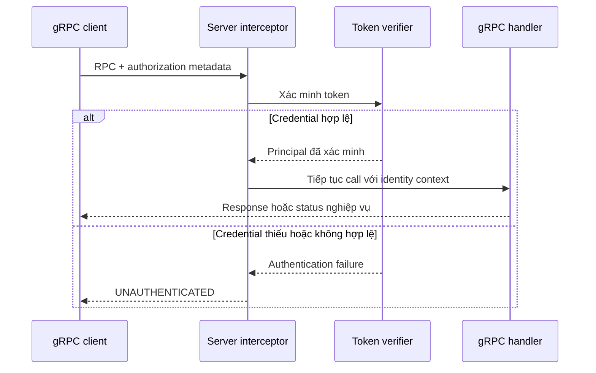

# UNAUTHENTICATED

Trong gRPC, **`UNAUTHENTICATED` là status code số `16`**, cho biết server không xác minh được danh tính của caller cho RPC hiện tại. Nguyên nhân thường gặp là credential bị thiếu, sai định dạng, hết hạn, sai chữ ký, không được tin cậy hoặc không dành cho service đang được gọi. Khi không thể xác lập danh tính, server không nên tiếp tục xử lý nghiệp vụ cần xác thực.

Trong **SPRING_GRPC**, authentication cần được thiết kế xuyên suốt từ client gửi credential, metadata hoặc TLS, đến server xác minh và tạo principal. Sau bước này mới thực hiện authorization. Vì vậy, `UNAUTHENTICATED` khác `PERMISSION_DENIED`: status đầu tiên nghĩa là chưa xác minh được caller là ai; status thứ hai nghĩa là đã biết caller nhưng caller không có quyền thực hiện hành động.

## 1. Ý nghĩa của UNAUTHENTICATED

`UNAUTHENTICATED` có giá trị số **16**. Status này phù hợp khi RPC không thể được xử lý vì danh tính caller chưa được xác minh hoặc credential không hợp lệ theo cơ chế authentication của service.

| Góc nhìn | Ý nghĩa |
| --- | --- |
| Client | Credential không được chấp nhận hoặc chưa được cung cấp |
| Server | Không thể thiết lập một principal đã xác minh cho call |
| gRPC runtime | Kết thúc RPC với status `UNAUTHENTICATED` |
| Nghiệp vụ | Không được thực hiện thao tác yêu cầu identity hợp lệ |

Các trường hợp thường gặp:

- Không có bearer token trong metadata của method yêu cầu đăng nhập.
- Token hết hạn, sai chữ ký hoặc bị thu hồi.
- Token được phát hành bởi issuer không được service tin cậy.
- Token có audience không khớp với service đích.
- API key không tồn tại, sai hoặc không còn hiệu lực.
- Credential không thể được xác minh do cấu hình trust hoặc identity provider không phù hợp.

Không nên trả `UNAUTHENTICATED` cho mọi lỗi. Request sai dữ liệu thường là `INVALID_ARGUMENT`; caller đã xác thực nhưng thiếu quyền thường là `PERMISSION_DENIED`; dependency xác thực tạm thời không sẵn sàng có thể cần status hạ tầng phù hợp thay vì giả vờ credential của người dùng không hợp lệ.

## 2. Authentication khác authorization

Authentication trả lời **caller là ai?** Authorization trả lời **caller được phép làm gì?**

| Tình huống | Status thường phù hợp | Giải thích |
| --- | --- | --- |
| Không gửi credential trong API bắt buộc xác thực | `UNAUTHENTICATED` | Chưa có identity để kiểm tra |
| Token hết hạn hoặc sai chữ ký | `UNAUTHENTICATED` | Credential không xác minh được |
| Token hợp lệ nhưng thiếu scope | `PERMISSION_DENIED` | Identity đã được xác minh, quyền không đủ |
| User hợp lệ nhưng không sở hữu tài nguyên | `PERMISSION_DENIED` hoặc `NOT_FOUND` theo chính sách | Đây là quyết định authorization |
| Service account hợp lệ nhưng không được gọi method quản trị | `PERMISSION_DENIED` | Identity có thật nhưng không được phép |
| Request có field sai định dạng | `INVALID_ARGUMENT` | Lỗi đầu vào, không phải lỗi identity |

### 2.1. Vì sao không dùng UNAUTHENTICATED cho thiếu quyền?

Nếu token hợp lệ nhưng không có scope `orders:write`, yêu cầu đăng nhập lại không giải quyết được vấn đề. Client cần dừng thao tác hoặc chuyển người dùng sang quy trình xin quyền phù hợp. Trả nhầm `UNAUTHENTICATED` có thể khiến client refresh token lặp lại, tạo tải không cần thiết và che khuất lỗi policy.

Ngược lại, token hết hạn là vấn đề authentication. Client có thể thử refresh credential theo cơ chế đã thiết kế, sau đó gọi lại một lần nếu thao tác vẫn còn hợp lệ và an toàn.

### 2.2. Vì sao không dùng UNAUTHENTICATED cho mọi lỗi xác minh?

Nếu token verifier gọi identity provider và identity provider tạm thời không truy cập được, server chưa thể kết luận token của caller sai. Cần phân biệt credential invalid với dependency unavailable. Trường hợp sau nên được ghi nhận và ánh xạ theo chính sách lỗi hạ tầng, không biến thành lỗi đăng nhập của người dùng.

## 3. Credential được truyền đến gRPC server như thế nào?

Một cách phổ biến là gửi bearer token trong gRPC metadata với key `authorization`. Metadata là phần thông tin kèm theo RPC; nó chỉ vận chuyển credential, không tự xác minh credential.

Luồng xử lý tổng quát:



Server thường cần kiểm tra:

- Credential có tồn tại và đúng scheme, ví dụ `Bearer`.
- Chữ ký hoặc cơ chế xác minh credential có hợp lệ.
- Issuer có nằm trong danh sách tin cậy.
- Audience có dành cho service đang nhận RPC.
- Thời điểm hết hạn và thời điểm bắt đầu hiệu lực.
- Token có bị thu hồi hoặc bị policy chặn hay không, nếu hệ thống hỗ trợ.
- Các claim cần thiết có đúng kiểu và cấu trúc.

Không được coi việc decode payload JWT là xác minh. Payload có thể đọc được mà không cần biết chữ ký có hợp lệ hay không. Hãy dùng thư viện đã được kiểm chứng để xác minh chữ ký, issuer, audience và thời hạn theo cấu hình của hệ thống.

## 4. Client gửi credential bằng metadata

Với gRPC Java, credential có thể được gắn vào call qua `CallCredentials` hoặc cơ chế client authentication mà thư viện/starter cung cấp. Cách này giúp tách logic lấy credential khỏi business method.

Một minh họa đơn giản cho metadata:

```java
Metadata headers = new Metadata();
Metadata.Key<String> authorization =
    Metadata.Key.of(
        "authorization",
        Metadata.ASCII_STRING_MARSHALLER);

headers.put(authorization, "Bearer " + accessToken);

InventoryServiceGrpc.InventoryServiceBlockingStub authenticatedStub =
    MetadataUtils.attachHeaders(inventoryStub, headers);
```

Đây là ví dụ minh họa việc gắn metadata tĩnh vào stub. Trong ứng dụng thực tế, token có thể thay đổi hoặc hết hạn; tránh tạo một stub gắn token cũ rồi tái sử dụng vô thời hạn. Với credential động, ưu tiên `CallCredentials` hoặc provider được gọi theo từng call để lấy token hiện hành.

Một số nguyên tắc:

- Chỉ gửi credential đến endpoint đã được xác minh và bảo vệ bằng TLS.
- Không gắn token vào message Protobuf hoặc query parameter.
- Không ghi token vào log, exception, trace attribute hay metric.
- Không chia sẻ stub mang identity của user này sang request của user khác.
- Với workload identity, cân nhắc credential ngắn hạn và rotation tự động.

## 5. Server interceptor xác minh credential

Một server interceptor có thể đọc metadata, gọi token verifier và gắn principal đã xác minh vào gRPC `Context`. Ví dụ dưới đây minh họa ranh giới xử lý:

```java
public final class AuthenticationInterceptor implements ServerInterceptor {
    private static final Metadata.Key<String> AUTHORIZATION =
        Metadata.Key.of(
            "authorization",
            Metadata.ASCII_STRING_MARSHALLER);

    static final Context.Key<Principal> PRINCIPAL =
        Context.key("authenticated-principal");

    private final TokenVerifier tokenVerifier;

    public AuthenticationInterceptor(TokenVerifier tokenVerifier) {
        this.tokenVerifier = tokenVerifier;
    }

    @Override
    public <ReqT, RespT> ServerCall.Listener<ReqT> interceptCall(
            ServerCall<ReqT, RespT> call,
            Metadata headers,
            ServerCallHandler<ReqT, RespT> next) {

        String value = headers.get(AUTHORIZATION);
        if (value == null || !value.startsWith("Bearer ")) {
            call.close(Status.UNAUTHENTICATED
                .withDescription("Thiếu thông tin xác thực"), new Metadata());
            return new ServerCall.Listener<>() {};
        }

        try {
            Principal principal =
                tokenVerifier.verify(value.substring("Bearer ".length()));
            Context context =
                Context.current().withValue(PRINCIPAL, principal);
            return Contexts.interceptCall(context, call, headers, next);
        } catch (InvalidCredentialException ex) {
            call.close(Status.UNAUTHENTICATED
                .withDescription("Thông tin xác thực không hợp lệ"), new Metadata());
            return new ServerCall.Listener<>() {};
        }
    }
}
```

`TokenVerifier` và `InvalidCredentialException` là abstraction của ứng dụng. Code thực tế cần bổ sung phân loại lỗi từ identity provider: credential sai khác với identity provider tạm thời không truy cập được. Không nên biến lỗi kết nối đến identity provider thành `UNAUTHENTICATED` nếu server chưa thể kết luận credential của caller không hợp lệ.

Interceptor phải được đăng ký thực sự vào gRPC server. Trong Spring, có thể quản lý verifier và interceptor dưới dạng bean, sau đó đăng ký qua cơ chế của starter đang dùng. Chỉ khai báo bean không bảo đảm mọi gRPC service đều đi qua interceptor; integration test cần xác minh điều này.

## 6. Tích hợp identity với Spring Security

Spring Security cung cấp các khái niệm như `Authentication`, `GrantedAuthority`, principal và authorization policy. Tuy nhiên, không nên mặc định gRPC call tự động đi qua Servlet filter chain hoặc có sẵn `SecurityContextHolder` như một HTTP controller trong mọi cấu hình.

Một luồng tích hợp có thể gồm:

1. gRPC interceptor đọc credential từ metadata.
2. Token verifier xác minh credential với issuer/identity provider.
3. Server tạo principal hoặc đối tượng `Authentication` đã xác minh.
4. Identity được gắn vào gRPC `Context` hoặc truyền tường minh đến application service.
5. Authorization layer kiểm tra role, scope, tenant và resource.
6. Lỗi identity được ánh xạ thành `UNAUTHENTICATED`; lỗi quyền thành `PERMISSION_DENIED`.

Nếu ứng dụng muốn dùng `SecurityContextHolder`, cần bridge identity vào đúng execution context và dọn context sau call. Với async callback, executor hoặc streaming, ThreadLocal không tự động bảo đảm identity được truyền đúng. Có thể truyền principal qua command/service argument hoặc dùng cơ chế context propagation được kiểm thử.

### 6.1. Không tin identity do client tự khai

Các metadata như `x-user-id`, `x-role` hoặc `x-tenant-id` không phải bằng chứng authentication nếu client có thể tự đặt. Server chỉ nên tin identity do credential đã xác minh hoặc transport identity được tin cậy cung cấp.

Nếu gateway nội bộ thêm metadata identity, cần bảo đảm:

- Chỉ gateway đáng tin được phép kết nối tới backend hoặc được xác thực bằng mTLS.
- Backend không thể bị gọi trực tiếp từ mạng không tin cậy để giả mạo header.
- Gateway xóa hoặc ghi đè các header identity do client bên ngoài gửi.
- Backend vẫn kiểm tra audience, issuer hoặc trust context phù hợp với kiến trúc.

## 7. TLS, mTLS và authentication ở các lớp khác nhau

TLS bảo vệ kênh truyền và xác thực server theo certificate/trust configuration. mTLS bổ sung xác thực certificate của client ở tầng transport. Bearer token thường xác định user hoặc workload ở tầng ứng dụng.

| Cơ chế | Xác minh điều gì? | Không tự giải quyết điều gì? |
| --- | --- | --- |
| TLS server authentication | Client kết nối đúng server có certificate được tin cậy | User có quyền gọi method nào |
| mTLS | Client workload có certificate hợp lệ theo trust policy | Quyền nghiệp vụ trên từng resource |
| Bearer token | Principal/claims ở tầng ứng dụng | TLS encryption nếu transport không được bảo vệ |
| Authorization policy | Principal được phép thực hiện action nào | Không thay thế việc xác minh credential |

Nếu TLS/mTLS handshake thất bại, RPC có thể không đến được gRPC handler; client có thể thấy lỗi transport/handshake thay vì status `UNAUTHENTICATED` do server trả. Cần phân biệt lỗi thiết lập kênh với lỗi xác minh token ở tầng ứng dụng.

Không gửi bearer token qua plaintext trên mạng production. Cần quản lý certificate trust, rotation và thời hạn credential theo môi trường.

## 8. Token hết hạn, refresh và retry

Khi client nhận `UNAUTHENTICATED`, trước tiên cần biết nguyên nhân thuộc loại nào:

- Token hết hạn: có thể refresh theo quy trình được cấp phép.
- Token bị thu hồi hoặc sai audience: refresh có thể không giải quyết; cần kiểm tra cấu hình hoặc đăng nhập lại.
- Credential thiếu do lỗi client: sửa cấu hình gửi metadata.
- Identity provider không sẵn sàng: xử lý như lỗi phụ thuộc/hạ tầng theo policy, không kết luận token của user sai.

Quy trình refresh thường nên giới hạn:

1. Nhận status `UNAUTHENTICATED`.
2. Kiểm tra cơ chế authentication có hỗ trợ refresh và lỗi có thể khắc phục bằng refresh không.
3. Làm mới credential một lần bằng kênh bảo mật.
4. Tạo call mới với credential mới nếu deadline và nghiệp vụ còn phù hợp.
5. Nếu vẫn thất bại, dừng và trả lỗi cho tầng gọi.

Không retry vô hạn vì token sai chữ ký, issuer hoặc audience sẽ tiếp tục thất bại. Với thao tác ghi, nếu kết quả call trước không rõ do lỗi transport, phải xét idempotency trước khi gửi lại; authentication failure thường xảy ra trước handler nhưng không nên dựa vào giả định đó cho mọi lỗi.

## 9. Client phân biệt UNAUTHENTICATED và PERMISSION_DENIED

Với blocking stub, client có thể phân loại status:

```java
try {
    GetProfileReply reply = profileStub.getProfile(request);
    // Xử lý response.
} catch (StatusRuntimeException ex) {
    Status.Code code = ex.getStatus().getCode();

    if (code == Status.Code.UNAUTHENTICATED) {
        // Thử refresh credential theo policy, tối đa một lần.
    } else if (code == Status.Code.PERMISSION_DENIED) {
        // Dừng thao tác; identity hợp lệ nhưng thiếu quyền.
    } else {
        // Xử lý status khác.
    }
}
```

Client nên:

- Không tự suy luận nguyên nhân chỉ từ câu chữ của `grpc-message`.
- Không lặp refresh cho mọi lỗi status.
- Không tự sửa claim hoặc role để thử vượt policy.
- Không gửi credential cũ sau khi đã refresh thành công.
- Không hiển thị token hoặc thông tin xác thực trong UI/log.

Với ứng dụng nhiều người dùng, không dùng chung một stub hoặc metadata chứa token user-specific giữa các session. Credential cần gắn với đúng principal và vòng đời call.

## 10. Error message và bảo vệ thông tin xác thực

Description trả client nên ngắn và an toàn, ví dụ “Thiếu thông tin xác thực” hoặc “Thông tin xác thực không hợp lệ”. Không trả:

- Token nhận được hoặc một phần token đủ để nhận dạng.
- Chữ ký, secret, private key hoặc chi tiết trust store.
- Stack trace từ thư viện xác minh.
- Nội dung claim nhạy cảm hoặc toàn bộ principal.
- Chi tiết nội bộ về issuer, key rotation hoặc cấu hình bảo mật nếu không cần công khai.

Thông tin chi tiết phục vụ điều tra nên nằm trong log/audit được bảo vệ ở server. Có thể dùng correlation ID để nối log client/server mà không tiết lộ credential.

## 11. Kiểm thử UNAUTHENTICATED

Test nên bao phủ credential hợp lệ, không hợp lệ và ranh giới transport:

| Kịch bản | Điều cần xác minh |
| --- | --- |
| Không có authorization metadata | Server trả `UNAUTHENTICATED` cho method yêu cầu authentication |
| Bearer scheme sai định dạng | Request bị từ chối an toàn |
| Token hết hạn | Status authentication đúng; client refresh theo policy |
| Token sai chữ ký | Không tạo principal, không chạy business handler |
| Issuer hoặc audience sai | Credential bị từ chối |
| Token hợp lệ nhưng thiếu scope | Authentication thành công; authorization trả `PERMISSION_DENIED` |
| Identity provider tạm thời lỗi | Không map nhầm thành credential invalid |
| TLS certificate không tin cậy | Client phát hiện handshake/transport failure |
| Async/streaming callback | Principal/context được giữ đúng trong vòng đời call |
| Log và error details | Không có token, secret hoặc claim nhạy cảm |

Integration test cần gọi qua gRPC client/server để xác minh interceptor đã đăng ký và metadata thực sự được đọc. Với TLS/mTLS, cần test channel/server dùng certificate và trust configuration phù hợp; in-process test không thay thế được kiểm tra handshake thực tế.

## 12. Audit và observability

`UNAUTHENTICATED` tăng có thể báo hiệu client không gửi token, token hết hạn hàng loạt, clock skew, issuer/key rotation sai hoặc thay đổi cấu hình authentication.

Nên theo dõi:

- Tỷ lệ `UNAUTHENTICATED` theo service/method.
- Nhóm nguyên nhân đã chuẩn hóa: missing, expired, invalid signature, wrong issuer/audience.
- Client/SDK version và môi trường.
- Tỷ lệ refresh thành công/thất bại.
- Lỗi kết nối đến identity provider, tách biệt với credential invalid.
- Trace/correlation ID để nối RPC với authentication event.

Không đưa token, email, subject ID hoặc raw claim vào metric label. Audit log chỉ lưu principal identifier ở dạng được phép, kết quả xác minh, method và thời điểm; bảo vệ quyền truy cập và thời gian lưu theo chính sách. Không ghi credential thô ngay cả khi authentication thất bại.

## 13. Những lỗi thiết kế thường gặp

| Sai lầm | Hậu quả | Cách làm tốt hơn |
| --- | --- | --- |
| Dùng `PERMISSION_DENIED` cho token hết hạn | Client có thể không refresh credential | Trả `UNAUTHENTICATED` khi không xác minh được identity |
| Dùng `UNAUTHENTICATED` cho thiếu scope | Client refresh lặp lại dù token hợp lệ | Trả `PERMISSION_DENIED` cho lỗi authorization |
| Chỉ decode JWT mà không xác minh chữ ký | Chấp nhận credential giả mạo | Xác minh signature, issuer, audience và expiry |
| Tin `x-user-id` hoặc `x-role` từ client | Caller có thể giả mạo principal | Xác minh credential và tạo principal phía server |
| Gắn token tĩnh vào stub dùng lâu dài | Token hết hạn hoặc lẫn identity giữa user | Dùng CallCredentials/provider và scope vòng đời call |
| Cho rằng Spring Security tự động bảo vệ gRPC | RPC có thể bỏ qua filter chain dự kiến | Đăng ký interceptor/bridge và test thực tế |
| Map lỗi identity provider thành UNAUTHENTICATED | Che giấu sự cố hạ tầng | Phân loại dependency failure riêng |
| Ghi token vào log | Rò rỉ credential | Log status, nguyên nhân chuẩn hóa và correlation ID |
| Retry authentication vô hạn | Tăng tải và có thể gây lockout | Refresh có giới hạn, sau đó dừng |

## 14. Checklist thiết kế UNAUTHENTICATED

Trước khi công bố gRPC method, hãy xác định:

1. **Method có yêu cầu authentication không?** Phân biệt endpoint công khai và endpoint bảo vệ.
2. **Credential được truyền bằng cách nào?** Metadata, CallCredentials, mTLS hoặc cơ chế workload identity.
3. **Server xác minh những gì?** Signature, issuer, audience, expiry, revocation và trust policy.
4. **Principal được tạo và truyền thế nào?** gRPC Context hoặc application argument; kiểm thử async/streaming.
5. **Thiếu identity khác thiếu quyền thế nào?** Mapping `UNAUTHENTICATED` và `PERMISSION_DENIED` rõ ràng.
6. **TLS/mTLS được cấu hình ra sao?** Phân biệt handshake failure với application authentication failure.
7. **Client refresh thế nào?** Có giới hạn, không retry vô hạn và tôn trọng deadline.
8. **Có bảo vệ credential không?** Không log token, không dùng plaintext và không chia sẻ token giữa user.
9. **Dependency authentication lỗi thì sao?** Không nhầm identity provider unavailable với token invalid.
10. **Test có đủ trường hợp không?** Missing, expired, invalid signature, wrong audience, valid-but-forbidden và transport TLS.

## 15. Ghi nhớ

`UNAUTHENTICATED` là gRPC status code `16`, cho biết server không xác minh được danh tính caller cho RPC. Nó thường xuất hiện khi credential thiếu, hết hạn, sai chữ ký hoặc không được tin cậy. `PERMISSION_DENIED` lại biểu thị caller đã được xác thực nhưng không có quyền thực hiện thao tác.

Trong Spring gRPC, client gửi credential qua metadata hoặc cơ chế credential của gRPC; server interceptor xác minh và tạo principal; Spring application/security layer kiểm tra quyền. TLS/mTLS bảo vệ và có thể xác minh identity ở tầng transport, nhưng không thay thế authorization nghiệp vụ. Client chỉ refresh credential khi phù hợp và có giới hạn. Hãy giữ token ngoài log, phân biệt lỗi identity provider với credential invalid và kiểm thử cả authentication lẫn authorization. Làm rõ các ranh giới này giúp dịch vụ bảo vệ RPC nhất quán mà vẫn dễ chẩn đoán.

### Tài liệu tham khảo

- [gRPC – Status codes](https://grpc.io/docs/guides/status-codes/)
- [gRPC – Authentication](https://grpc.io/docs/guides/auth/)
- [gRPC – Metadata](https://grpc.io/docs/guides/metadata/)
- [gRPC – Interceptors](https://grpc.io/docs/guides/interceptors/)
- [gRPC Java – CallCredentials](https://grpc.github.io/grpc-java/javadoc/io/grpc/CallCredentials.html)
- [Spring Security – Authentication](https://docs.spring.io/spring-security/reference/servlet/authentication/index.html)
