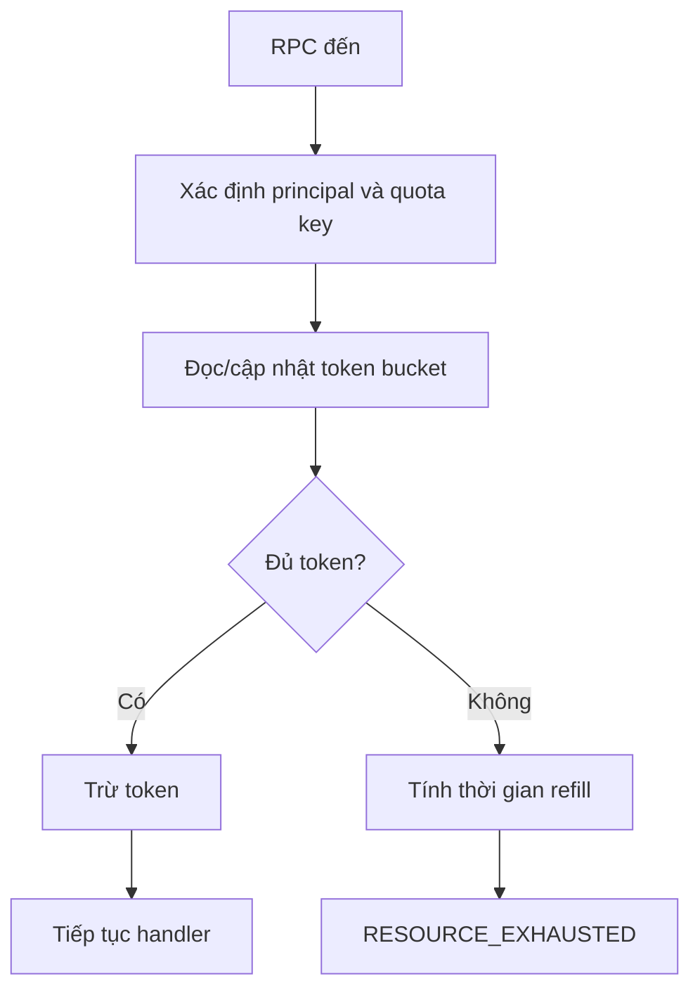

# RESOURCE_EXHAUSTED

Trong gRPC, **`RESOURCE_EXHAUSTED` là status code số `8`**, cho biết một tài nguyên cần thiết để xử lý RPC đã cạn hoặc giới hạn sử dụng đã bị vượt. Tài nguyên đó có thể là quota của tenant, số request trong một khoảng thời gian, dung lượng lưu trữ, hàng đợi xử lý, bộ nhớ đệm hoặc giới hạn kích thước message. Server dùng status này để từ chối công việc không thể tiếp nhận trong điều kiện hiện tại.

Trong **SPRING_GRPC**, cần xác định rõ tài nguyên nào đang bị giới hạn, giới hạn thuộc phạm vi user/tenant/service hay toàn hệ thống, và client có thể thử lại sau bao lâu. `RESOURCE_EXHAUSTED` không mặc định là lỗi tạm thời: quota tháng đã dùng hết có thể không được phục hồi trong vài giây, trong khi hàng đợi đầy có thể sớm có chỗ trống. Client cần dựa vào contract và thông tin retry, không retry liên tục theo cảm tính.

## 1. Ý nghĩa của RESOURCE_EXHAUSTED

`RESOURCE_EXHAUSTED` có giá trị số **8**. Status này phù hợp khi một tài nguyên đã cạn hoặc một giới hạn có thể đo được đã bị vượt.

| Góc nhìn | Ý nghĩa |
| --- | --- |
| Client | Request bị từ chối vì quota, capacity hoặc resource limit đã chạm ngưỡng |
| Server | Không thể tiếp tục xử lý mà không vi phạm giới hạn tài nguyên/chính sách |
| gRPC runtime | Kết thúc RPC với status `RESOURCE_EXHAUSTED` |
| Nghiệp vụ | Có thể cần chờ quota được cấp lại, giảm kích thước request hoặc giảm tải |

Các tình huống thường gặp:

- Tenant đã dùng hết quota API trong ngày hoặc tháng.
- Client vượt rate limit, ví dụ gửi quá nhiều request trong một phút.
- Server đạt giới hạn số RPC đồng thời hoặc hàng đợi admission đã đầy.
- Message vượt giới hạn kích thước được cấu hình.
- Bộ nhớ, dung lượng lưu trữ hoặc một tài nguyên hữu hạn không còn đủ.
- Workflow vượt quota số lượng tác vụ hoặc dung lượng dữ liệu được phép tạo.

Status này mô tả việc cạn tài nguyên/vi phạm giới hạn, không tự cho biết giới hạn nào bị chạm. Server nên cung cấp thông tin có cấu trúc khi client cần biết cách phục hồi.

## 2. Phân biệt quota, rate limit và capacity

Ba khái niệm có liên quan nhưng không giống nhau:

| Khái niệm | Ý nghĩa | Ví dụ |
| --- | --- | --- |
| Quota | Ngân sách sử dụng trong một phạm vi/thời kỳ | Tenant được gọi 100.000 RPC mỗi tháng |
| Rate limit | Giới hạn tốc độ trong một cửa sổ thời gian | Tối đa 50 request/giây cho một API key |
| Capacity limit | Giới hạn khả năng tiếp nhận hoặc xử lý tại một thời điểm | Tối đa 500 call đồng thời, queue chứa tối đa 1.000 task |

Quota thường được tính theo tổng mức tiêu thụ và được reset theo chu kỳ hoặc tăng bởi quản trị viên. Rate limit kiểm soát tốc độ để bảo vệ service và phân phối công bằng. Capacity limit bảo vệ tài nguyên đang có, chẳng hạn worker, connection pool hoặc bộ nhớ.

Không nên dùng chung một thông báo “quá tải” cho cả ba nếu client cần hành động khác nhau:

- Hết quota dài hạn: client cần chờ kỳ reset hoặc yêu cầu tăng quota.
- Rate limit: client có thể giảm tốc độ và thử lại sau khoảng chờ.
- Capacity tạm thời: client có thể backoff và thử lại khi service có chỗ trống.

## 3. Phân biệt RESOURCE_EXHAUSTED với status gần nghĩa

| Status | Ý nghĩa | Ví dụ |
| --- | --- | --- |
| `RESOURCE_EXHAUSTED` | Một resource hoặc quota cụ thể đã cạn/vượt giới hạn | Hết quota tenant hoặc queue admission đầy |
| `UNAVAILABLE` | Service tạm thời không thể phục vụ hoặc kết nối không dùng được | Server mất kết nối, đang restart hoặc dependency unavailable |
| `ABORTED` | Thao tác bị hủy do xung đột cần xử lý ở mức transaction | Optimistic locking conflict |
| `FAILED_PRECONDITION` | Trạng thái hiện tại ngăn thao tác | Tài khoản chưa được kích hoạt |
| `INVALID_ARGUMENT` | Request chứa tham số không hợp lệ | Field sai định dạng |
| `DEADLINE_EXCEEDED` | RPC không hoàn tất trước deadline | Server phản hồi chậm hơn thời gian caller cho phép |

### 3.1. RESOURCE_EXHAUSTED và UNAVAILABLE

Hãy dùng `RESOURCE_EXHAUSTED` khi biết một giới hạn tài nguyên hoặc quota đã bị chạm. `UNAVAILABLE` phù hợp hơn khi service hoặc dependency tạm thời không thể phục vụ theo nghĩa rộng, chẳng hạn kết nối bị đứt hoặc server đang không sẵn sàng.

Ví dụ, tenant đã dùng hết quota 10.000 export trong tháng thì `RESOURCE_EXHAUSTED` phản ánh đúng policy. Một node vừa mất kết nối database và không thể phục vụ request có thể trả `UNAVAILABLE`. Nếu admission controller từ chối call vì số slot đồng thời đã đầy, có thể dùng `RESOURCE_EXHAUSTED` khi contract xác định đây là capacity limit có thể thử lại.

Không chọn status chỉ dựa trên việc server đang bận. Hãy xác định client cần hiểu đây là quota đã cạn, capacity bị giới hạn hay service không sẵn sàng.

### 3.2. RESOURCE_EXHAUSTED và FAILED_PRECONDITION

`RESOURCE_EXHAUSTED` nói về ngân sách/tài nguyên không còn đủ. `FAILED_PRECONDITION` nói về trạng thái nghiệp vụ chưa đáp ứng điều kiện. Ví dụ tenant hết dung lượng lưu trữ là `RESOURCE_EXHAUSTED`; tài khoản chưa hoàn tất KYC nên không được kích hoạt tính năng là `FAILED_PRECONDITION`.

## 4. Thiết kế quota và rate limit cho gRPC method

Trước khi triển khai limiter, cần xác định:

- **Đối tượng áp dụng:** user, API key, tenant, service account, IP hoặc toàn service.
- **Phạm vi method:** toàn service hay từng RPC như `ExportReport`.
- **Đơn vị tiêu thụ:** số request, số record, byte, CPU time hoặc chi phí nghiệp vụ.
- **Cửa sổ tính:** cố định theo phút/giờ/ngày, rolling window hay token bucket.
- **Chính sách khi vượt:** từ chối ngay, xếp hàng có giới hạn hoặc trả kết quả bất đồng bộ.
- **Thời điểm phục hồi:** reset theo chu kỳ, refill liên tục hay chỉ khi quản trị viên cấp thêm.

Ví dụ quota:

| Principal | Method | Limit | Cửa sổ |
| --- | --- | ---: | --- |
| Tenant cơ bản | `ExportReport` | 20 | mỗi giờ |
| Tenant doanh nghiệp | `ExportReport` | 500 | mỗi giờ |
| Service account nội bộ | `GetProduct` | 100 | mỗi giây |

Các con số chỉ minh họa. Giá trị thực tế cần dựa trên chi phí xử lý, SLA, khả năng hệ thống và thỏa thuận với khách hàng.

### 4.1. Token bucket

Token bucket là thuật toán phổ biến để giới hạn tốc độ. Bucket có dung lượng tối đa; token được bổ sung theo tốc độ xác định. Mỗi request tiêu thụ một hoặc nhiều token. Nếu không đủ token, request bị từ chối hoặc chờ theo policy.



Token bucket cho phép burst ngắn trong giới hạn bucket nhưng vẫn kiểm soát tốc độ trung bình. Với nhiều instance Spring chạy song song, trạng thái bucket cần được chia sẻ hoặc phân vùng nhất quán; limiter chỉ lưu trong memory từng instance có thể khiến tổng quota vượt mức dự kiến.

### 4.2. Quota phân tán

Trong deployment nhiều replica, quota theo tenant cần có một nguồn trạng thái chung hoặc thuật toán phân bổ ngân sách giữa các node. Có thể dùng Redis, database hoặc quota service chuyên dụng tùy yêu cầu độ chính xác và độ trễ.

Hãy quyết định rõ:

- Cập nhật counter có atomic không?
- Khi quota store không sẵn sàng, service fail-open hay fail-closed?
- Có cho phép sai số nhỏ để giảm độ trễ không?
- Key có TTL và chính sách reset rõ ràng không?
- Tenant key được lấy từ identity đã xác thực, không lấy trực tiếp từ metadata tùy ý của client.

Fail-open giữ service tiếp tục hoạt động khi quota store lỗi nhưng có thể vượt quota. Fail-closed bảo vệ quota chặt hơn nhưng có thể từ chối cả caller hợp lệ khi hệ thống quota gặp sự cố. Đây là quyết định vận hành và nghiệp vụ, không có lựa chọn chung cho mọi API.

## 5. Giới hạn capacity và admission control

Quota/rate limit kiểm soát mức tiêu thụ theo principal hoặc thời gian. Admission control kiểm tra service còn khả năng tiếp nhận công việc ngay lúc đó hay không.

Trong Spring gRPC, các điểm cần giới hạn có thể gồm:

- Số request đang xử lý đồng thời.
- Kích thước executor queue.
- Số export/report job đang chạy.
- Số connection đến database hoặc downstream.
- Kích thước buffer của streaming.
- Kích thước request/response message.

Một queue không giới hạn có thể biến đỉnh tải ngắn thành độ trễ kéo dài và làm cạn heap. Nên dùng queue có giới hạn, semaphore hoặc bulkhead theo loại công việc. Khi không còn slot, server có thể từ chối sớm bằng status phù hợp thay vì nhận thêm công việc không thể xử lý trong deadline.

Ví dụ semaphore đơn giản:

```java
public final class ExportAdmission {
    private final Semaphore permits = new Semaphore(20);

    public void acquire() {
        if (!permits.tryAcquire()) {
            throw Status.RESOURCE_EXHAUSTED
                .withDescription("Đã đạt giới hạn export đồng thời")
                .asRuntimeException();
        }
    }

    public void release() {
        permits.release();
    }
}
```

Đây chỉ là minh họa cho giới hạn trong một instance. Code thực tế phải bảo đảm `release()` luôn chạy trong `finally` hoặc cơ chế cleanup tương ứng, không giữ permit sau exception/cancellation. Nếu có nhiều replica, semaphore local giới hạn từng instance chứ không tạo quota toàn cluster.

## 6. Mapping resource exhaustion thành gRPC status trong Spring

Application service có thể phát sinh exception domain khi quota hoặc capacity đã cạn:

```java
public ExportJob createExport(ExportCommand command) {
    quotaService.consume(command.tenantId(), "export", 1);
    return exportRepository.create(command);
}
```

Ở gRPC boundary, map exception đã biết:

```java
try {
    ExportJob job = exportService.createExport(command);
    observer.onNext(toReply(job));
    observer.onCompleted();
} catch (QuotaExceededException ex) {
    observer.onError(Status.RESOURCE_EXHAUSTED
        .withDescription("Quota export đã được sử dụng hết")
        .asRuntimeException());
}
```

Ví dụ giả định quota service và exception domain đã được định nghĩa. Với ứng dụng lớn, nên dùng exception mapper/interceptor để chuẩn hóa status, metadata và error details. Không map mọi `RuntimeException` hoặc mọi lỗi database thành `RESOURCE_EXHAUSTED`; chỉ dùng khi đã xác định đúng resource limit.

### 6.1. Cập nhật quota phải nhất quán với side effect

Nếu quota được trừ trước nhưng thao tác tạo job thất bại, hệ thống có thể mất quota dù công việc chưa được tạo. Ngược lại, nếu tạo job trước rồi mới trừ quota, nhiều request đồng thời có thể vượt hạn mức.

Tùy kiến trúc, cần dùng transaction chung, reservation/commit quota, idempotency key hoặc workflow bù trừ. Với quota ở hệ thống phân tán, không giả định một lần kiểm tra counter rồi một lần ghi business data là nguyên tử nếu chúng nằm ở hai hệ thống khác nhau.

## 7. Cung cấp thông tin retry cho client

Không phải mọi `RESOURCE_EXHAUSTED` đều có thể retry sau vài giây. Client cần biết:

- Giới hạn nào bị chạm: rate, concurrent capacity, storage hay quota theo kỳ.
- Có thời điểm thử lại dự kiến hay không.
- Client có thể giảm kích thước request hoặc tốc độ không.
- Quota được reset tự động hay cần quản trị viên cấp thêm.

Với rich error model của Google RPC, có thể dùng:

- `google.rpc.RetryInfo`: khoảng thời gian server đề xuất chờ trước khi retry.
- `google.rpc.QuotaFailure`: mô tả vi phạm quota theo rule/subject phù hợp.
- `google.rpc.ResourceInfo`: loại và tên resource liên quan nếu caller được phép biết.

Ví dụ thông tin logic:

```text
grpc-status: RESOURCE_EXHAUSTED
grpc-message: Đã vượt giới hạn tốc độ

RetryInfo:
  retry_delay: 2 seconds

QuotaFailure:
  violations:
    - subject: "tenant:current"
      description: "Export limit exceeded"
```

Đây là ví dụ về nội dung error details, không phải header gRPC chuẩn. Trong gRPC Java, richer details có thể được đóng gói trong `com.google.rpc.Status` và chuyển thành exception bằng `io.grpc.protobuf.StatusProto`. Chỉ gửi subject/limit detail mà caller được phép biết; không tiết lộ quota của tenant khác hoặc cấu hình nội bộ.

Nếu không dùng richer error details, service có thể cung cấp metadata riêng theo contract, nhưng client và server phải thống nhất tên key, đơn vị thời gian và semantics. Không mặc định header HTTP `Retry-After` sẽ tự động xuất hiện hoặc được mọi gRPC client hiểu.

## 8. Client retry có kiểm soát

Client không nên retry ngay lập tức khi nhận `RESOURCE_EXHAUSTED`. Retry tức thì có thể làm tăng tải đúng lúc server đang thiếu tài nguyên.

Một policy hợp lý cần:

1. Xác định loại giới hạn từ status/error details.
2. Nếu có `RetryInfo`, chờ ít nhất khoảng thời gian được server đề xuất.
3. Nếu không có hướng dẫn, dùng exponential backoff có jitter và giới hạn số lần thử.
4. Tôn trọng deadline tổng của operation.
5. Giảm tốc độ hoặc kích thước batch nếu đó là nguyên nhân.
6. Không retry quota đã cạn cho đến kỳ reset nếu server xác định không có khả năng phục hồi sớm.

| Trường hợp | Hành động phía client |
| --- | --- |
| Rate limit ngắn hạn | Chờ theo RetryInfo/backoff, giảm request rate |
| Concurrent capacity đầy | Chờ một khoảng ngắn rồi thử lại có giới hạn |
| Quota ngày/tháng hết | Dừng retry; chờ reset hoặc yêu cầu tăng quota |
| Request quá lớn | Chia nhỏ batch hoặc giảm payload |
| Storage hết dung lượng | Không retry liên tục; giải phóng dung lượng hoặc yêu cầu can thiệp |
| Không rõ resource nào cạn | Ghi nhận status và correlation ID; không retry mù quáng |

### 8.1. Idempotency khi retry

Với thao tác ghi, server có thể đã nhận và thực hiện một phần công việc trước khi trả `RESOURCE_EXHAUSTED`, đặc biệt nếu quota được kiểm tra ở nhiều giai đoạn. Client cần biết operation có thể được gửi lại an toàn hay không.

Dùng idempotency key cho operation có side effect; server lưu kết quả hoặc trạng thái theo key và xử lý duplicate một cách nhất quán. Đừng coi status code là bằng chứng tuyệt đối rằng không có side effect nào đã xảy ra.

## 9. RESOURCE_EXHAUSTED và streaming flow control

Streaming gRPC có flow control để sender không gửi vô hạn nhanh hơn receiver có thể tiếp nhận. Flow control điều tiết việc truyền message; `RESOURCE_EXHAUSTED` biểu thị một resource hoặc giới hạn ứng dụng đã cạn.

| Tình huống | Cơ chế phù hợp |
| --- | --- |
| Client đọc chậm, server cần chờ khả năng nhận tiếp | Flow control/readiness |
| Server buffer đạt giới hạn an toàn | Backpressure, tạm dừng producer hoặc từ chối theo policy |
| Tenant vượt quota tổng byte/message | `RESOURCE_EXHAUSTED` |
| Một message vượt max inbound message size | Runtime có thể từ chối bằng `RESOURCE_EXHAUSTED` |
| Client chủ động dừng stream | Cancellation, thường phía client thấy `CANCELLED` |

Với server streaming, cần giới hạn buffer và tốc độ producer. Nếu client đọc chậm, không nên tiếp tục tích lũy message vô hạn. Với client/bidirectional streaming, cần định nghĩa quota theo message, byte hoặc thời lượng nếu stream có thể tồn tại lâu.

## 10. Kích thước message và resource bounds

gRPC runtime và server có thể đặt giới hạn kích thước message để bảo vệ bộ nhớ và chi phí giải mã. Một request vượt giới hạn có thể bị từ chối trước khi handler được gọi.

Client nên:

- Tránh gửi payload rất lớn trong một RPC nếu có thể chia thành chunk hoặc dùng streaming.
- Kiểm tra giới hạn message được công bố cho API.
- Dùng compression khi phù hợp, nhưng không coi compression là cách thay thế giới hạn payload.
- Thiết kế upload/download theo chunk có giới hạn và xác nhận tiến độ.

Server không nên tăng max inbound size tùy tiện để sửa lỗi `RESOURCE_EXHAUSTED`. Payload lớn có thể làm tăng memory pressure và ảnh hưởng toàn bộ process. Hãy chọn giới hạn dựa trên heap, concurrency và kích thước nghiệp vụ.

## 11. Kiểm thử RESOURCE_EXHAUSTED

Test nên xác minh cả policy và khả năng phục hồi:

| Kịch bản | Điều cần xác minh |
| --- | --- |
| Tenant dùng hết quota | RPC trả `RESOURCE_EXHAUSTED`, không tạo side effect ngoài policy |
| Rate limit bị vượt | Request vượt ngưỡng bị từ chối; request hợp lệ sau refill được chấp nhận |
| Hai request đồng thời tranh quota cuối | Counter/decision không vượt giới hạn theo semantics đã chọn |
| Queue hoặc semaphore đầy | Server từ chối sớm, permit được giải phóng đúng khi call kết thúc |
| Quota store không sẵn sàng | Hành vi fail-open/fail-closed đúng policy |
| Message vượt giới hạn | Runtime từ chối; handler không được giả định đã nhận request |
| Client nhận RetryInfo | Chờ đúng đơn vị/thời gian và không retry sớm hơn policy |
| Quota dài hạn đã cạn | Client không retry liên tục |
| Streaming client đọc chậm | Buffer được giới hạn và flow control hoạt động |
| Client hủy khi đang giữ permit | Tài nguyên được cleanup, không rò rỉ slot |

Với quota phân tán, test cần chạy nhiều request đồng thời và nếu có thể nhiều server instance. Unit test cho limiter không thay thế integration test với storage/counter thực tế.

## 12. Quan sát resource exhaustion trong production

`RESOURCE_EXHAUSTED` là tín hiệu quan trọng về tải, chính sách quota và giới hạn vận hành. Nên theo dõi:

- Số lượng và tỷ lệ status theo service/method.
- Nhóm nguyên nhân: quota, rate limit, concurrency, queue, message size hoặc storage.
- Mức tiêu thụ quota so với giới hạn và thời điểm reset.
- Queue depth, active calls, worker utilization và rejection count.
- Tỷ lệ retry, số lần retry trung bình và kết quả sau retry.
- Bộ nhớ, GC, connection pool và các resource liên quan.
- Tenant/client class bị ảnh hưởng theo cách không lộ dữ liệu riêng tư.

Không đưa tenant ID, API key, user ID hoặc request ID có cardinality cao vào metric labels. Có thể dùng quota tier, method và reason code đã chuẩn hóa. Log/traces có thể giữ correlation ID và decision metadata được kiểm soát để điều tra.

Nếu `RESOURCE_EXHAUSTED` tăng trên một tenant, kiểm tra mức sử dụng và policy của tenant đó. Nếu nhiều tenant cùng bị từ chối, xem capacity toàn hệ thống, queue, database pool hoặc quota service. Đừng chỉ tăng limit; trước tiên xác định tài nguyên thực sự bị cạn và tác động đến các caller khác.

## 13. Những lỗi thiết kế thường gặp

| Sai lầm | Hậu quả | Cách làm tốt hơn |
| --- | --- | --- |
| Dùng `RESOURCE_EXHAUSTED` cho mọi lỗi server bận | Client không biết đó là quota hay service outage | Phân loại resource limit và service availability |
| Retry ngay lập tức | Retry storm làm tải nặng hơn | RetryInfo, backoff, jitter và giới hạn |
| Dùng limiter local cho quota toàn cluster | Tổng quota bị vượt khi có nhiều replica | Counter phân tán hoặc phân bổ ngân sách rõ ràng |
| Queue không giới hạn | Heap tăng, latency kéo dài và cascade failure | Queue bounded và admission control |
| Trừ quota không nguyên tử với side effect | Mất quota hoặc vượt quota khi lỗi đồng thời | Transaction, reservation hoặc workflow bù trừ |
| Map mọi lỗi database thành RESOURCE_EXHAUSTED | Che giấu lỗi dữ liệu/hạ tầng khác | Chỉ map lỗi resource/quota đã xác định |
| Tăng message size limit tùy tiện | Tăng memory pressure và nguy cơ OOM | Chunking, streaming và giới hạn dựa trên capacity |
| Không cung cấp retry guidance | Client retry quá sớm hoặc bỏ cuộc không cần thiết | RetryInfo/contract rõ về reset và phục hồi |
| Không cleanup permit khi cancellation | Rò rỉ capacity, request sau bị từ chối mãi | Release trong finally và test cancellation |

## 14. Checklist thiết kế RESOURCE_EXHAUSTED

Trước khi công bố gRPC method, hãy xác định:

1. **Resource nào được giới hạn?** Quota, rate, concurrency, queue, bytes, storage hay message size.
2. **Giới hạn áp dụng cho ai?** User, tenant, API key, service account hay toàn service.
3. **Đơn vị và chu kỳ tính là gì?** Request, byte, job, giây, ngày hoặc tháng.
4. **Counter có an toàn khi concurrent và multi-instance không?**
5. **Khi vượt giới hạn, server từ chối hay xếp hàng?** Queue có bounded không?
6. **Client biết khi nào thử lại không?** RetryInfo, reset time hoặc hướng dẫn giảm tải.
7. **Retry có an toàn không?** Deadline, backoff, jitter và idempotency được xác định.
8. **Streaming có flow control và buffer bound không?**
9. **Lỗi quota store được xử lý thế nào?** Fail-open hay fail-closed theo policy.
10. **Telemetry có phân biệt nguyên nhân mà không lộ tenant/credential không?**

## 15. Ghi nhớ

`RESOURCE_EXHAUSTED` là gRPC status code `8`, dùng khi quota hoặc một tài nguyên hữu hạn đã cạn/vượt giới hạn. Nó có thể biểu thị rate limit, quota theo tenant, capacity đồng thời, queue, storage hoặc giới hạn kích thước message. Hãy phân biệt status này với `UNAVAILABLE` (service không sẵn sàng), `FAILED_PRECONDITION` (trạng thái nghiệp vụ chưa đáp ứng) và `ABORTED` (xung đột transaction).

Trong Spring gRPC, xác định resource và phạm vi quota, dùng limiter/admission control có giới hạn, bảo đảm counter đúng khi nhiều request/instance chạy đồng thời, và cleanup tài nguyên khi call kết thúc hoặc bị hủy. Cung cấp `RetryInfo` hoặc hướng dẫn phục hồi phù hợp; client cần backoff, jitter, tôn trọng deadline và idempotency. Đo quota, queue, active calls và rejection theo nguyên nhân để biết cần điều chỉnh policy hay capacity. Làm rõ semantics giúp bảo vệ hệ thống mà vẫn cho client cách phục hồi có kiểm soát.

### Tài liệu tham khảo

- [gRPC – Status codes](https://grpc.io/docs/guides/status-codes/)
- [gRPC – Error handling](https://grpc.io/docs/guides/error/)
- [gRPC – Flow control](https://grpc.io/docs/guides/flow-control/)
- [Google API – Error model](https://cloud.google.com/apis/design/errors)
- [Google API – Quotas](https://cloud.google.com/docs/quotas)
- [gRPC – Retry](https://grpc.io/docs/guides/retry/)
