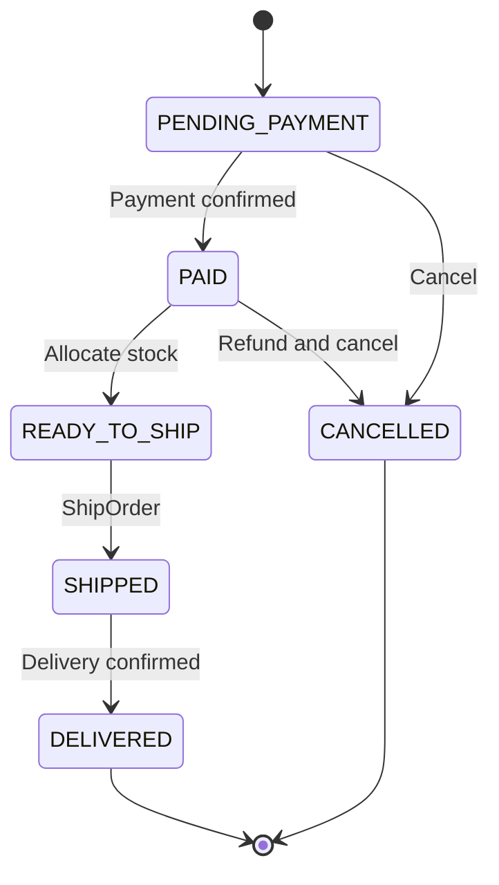
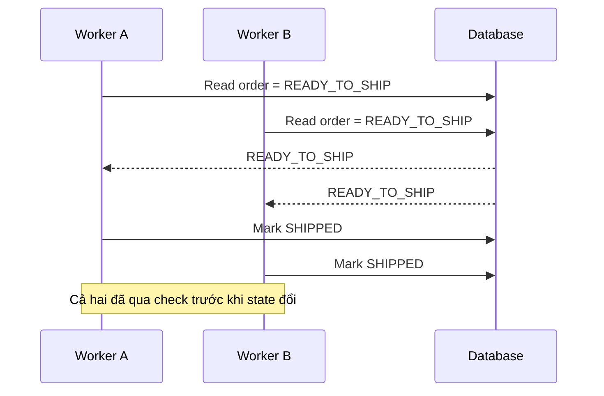

# FAILED_PRECONDITION

Trong gRPC, **`FAILED_PRECONDITION` là status code số `9`**, cho biết thao tác bị từ chối vì hệ thống hoặc tài nguyên chưa ở trạng thái cần thiết để thực hiện. Request có thể hợp lệ về cú pháp, caller có thể đã được xác thực và có quyền, nhưng điều kiện nghiệp vụ hiện tại chưa cho phép hành động. Ví dụ, đơn hàng đã tồn tại nhưng chưa thanh toán nên chưa thể chuyển sang trạng thái giao hàng.

Trong **SPRING_GRPC**, cần mô hình hóa rõ trạng thái và điều kiện chuyển trạng thái của tài nguyên, kiểm tra precondition ở application/domain service, rồi ánh xạ lỗi nghiệp vụ sang gRPC status. `FAILED_PRECONDITION` giúp client biết rằng muốn tiếp tục thì phải thay đổi trạng thái hoặc hoàn tất một bước trước đó. Client gửi lại nguyên request khi điều kiện chưa đổi thường chỉ nhận lại cùng lỗi.

## 1. Ý nghĩa của FAILED_PRECONDITION

`FAILED_PRECONDITION` có giá trị số **9**. Status này phù hợp khi thao tác chỉ có thể thực hiện nếu một điều kiện của hệ thống đã được thỏa mãn, nhưng điều kiện đó hiện chưa đúng.

| Góc nhìn | Ý nghĩa |
| --- | --- |
| Client | Thao tác chưa thể thực hiện; cần thay đổi trạng thái hoặc hoàn tất điều kiện trước |
| Server | Domain state hoặc precondition cần thiết không được đáp ứng |
| gRPC runtime | Kết thúc RPC với status `FAILED_PRECONDITION` |
| Nghiệp vụ | Request không sai về cấu trúc, nhưng thời điểm/trạng thái hiện tại không cho phép thực hiện |

Ví dụ:

- Chỉ đơn hàng đã thanh toán mới được chuyển sang `SHIPPED`.
- Chỉ tài khoản đã hoàn tất KYC mới được mở hạn mức giao dịch.
- Không thể xóa thư mục còn chứa tài liệu.
- Không thể đóng phiên làm việc khi vẫn còn tác vụ bắt buộc chưa hoàn tất.
- Không thể phát hành hóa đơn khi đơn hàng chưa được xác nhận.
- Không thể chuyển thiết bị sang `ACTIVE` khi chưa đăng ký certificate.

`FAILED_PRECONDITION` mô tả một điều kiện chưa được đáp ứng, không tự cho biết client cần làm gì tiếp theo. Nếu API cần hướng dẫn máy đọc được, hãy cung cấp error details có cấu trúc hoặc một method đọc trạng thái/precondition.

## 2. Precondition khác validation của request

Một precondition thường phụ thuộc vào trạng thái hiện tại của hệ thống hoặc tài nguyên. Validation của request kiểm tra chính dữ liệu client gửi.

Ví dụ với method `ShipOrder`:

- `order_id` rỗng hoặc sai định dạng: request không hợp lệ, thường là `INVALID_ARGUMENT`.
- `order_id` đúng nhưng đơn hàng chưa thanh toán: precondition chưa đạt, thường là `FAILED_PRECONDITION`.
- Đơn hàng không tồn tại: `NOT_FOUND`.
- Caller không có quyền giao đơn hàng: `PERMISSION_DENIED`.
- Đơn hàng vừa được một tiến trình khác cập nhật và transaction hiện tại bị xung đột: có thể là `ABORTED`, tùy semantics của API.

| Loại điều kiện | Câu hỏi | Ví dụ |
| --- | --- | --- |
| Request validation | Dữ liệu đầu vào có đúng contract không? | ID có đúng định dạng, quantity có dương không? |
| Authentication | Có xác minh được caller không? | Token có hợp lệ không? |
| Authorization | Caller có quyền thực hiện action không? | Có quyền giao đơn hàng của tenant này không? |
| Resource existence | Tài nguyên được tham chiếu có tồn tại không? | Có order mang ID đó không? |
| State precondition | Trạng thái hiện tại có cho phép action không? | Order đã thanh toán chưa? |
| Concurrency control | Dữ liệu có bị thay đổi cạnh tranh trong transaction không? | Version không còn khớp khi commit |

Đừng dùng `FAILED_PRECONDITION` để gom mọi loại lỗi. Phân loại đúng giúp client biết nên sửa request, đăng nhập, xin quyền, tìm tài nguyên hay hoàn tất bước nghiệp vụ.

## 3. Phân biệt FAILED_PRECONDITION với status gần nghĩa

| Status | Ý nghĩa | Ví dụ |
| --- | --- | --- |
| `FAILED_PRECONDITION` | Trạng thái hệ thống/tài nguyên chưa thỏa điều kiện để thao tác | Order chưa thanh toán nên chưa thể giao |
| `INVALID_ARGUMENT` | Tham số request không hợp lệ bất kể trạng thái hệ thống | ID sai cú pháp |
| `ABORTED` | Thao tác bị hủy do xung đột cần xử lý ở mức transaction | Optimistic locking conflict |
| `PERMISSION_DENIED` | Caller không có quyền thực hiện thao tác | User không được phép giao hàng |
| `UNAUTHENTICATED` | Không xác minh được danh tính caller | Token hết hạn |
| `NOT_FOUND` | Tài nguyên đích không tồn tại | Không có order mang ID đã gửi |
| `ALREADY_EXISTS` | Tài nguyên cần tạo đã tồn tại | Tạo reservation với key đã được sử dụng |
| `RESOURCE_EXHAUSTED` | Quota hoặc resource limit đã cạn | Tenant hết quota export |

### 3.1. FAILED_PRECONDITION và INVALID_ARGUMENT

`INVALID_ARGUMENT` phù hợp khi request sai bất kể hệ thống đang ở trạng thái nào. `FAILED_PRECONDITION` phù hợp khi cùng một request có thể hợp lệ ở trạng thái khác.

Ví dụ, `ActivateAccount(account_id)` có thể là request hợp lệ. Nếu tài khoản chưa hoàn tất bước xác minh danh tính, trạng thái hiện tại ngăn kích hoạt nên có thể trả `FAILED_PRECONDITION`. Nếu `account_id` không đúng định dạng, đó là `INVALID_ARGUMENT`.

### 3.2. FAILED_PRECONDITION và ABORTED

`FAILED_PRECONDITION` mô tả điều kiện nghiệp vụ không thỏa. `ABORTED` thường mô tả thao tác bị hủy vì xung đột concurrency/transaction và caller có thể cần chạy lại một chu trình đọc-sửa-ghi.

Ví dụ:

- Order đang ở `PENDING_PAYMENT`, gọi `ShipOrder`: `FAILED_PRECONDITION`.
- Hai worker cùng cập nhật order với optimistic locking; một transaction thua do version thay đổi: `ABORTED` có thể phù hợp nếu caller cần đọc lại và quyết định lại.

Ranh giới cụ thể phụ thuộc contract và cách hệ thống xử lý race. Không nên chỉ nhìn tên exception database rồi chọn status; hãy diễn đạt điều client cần biết.

### 3.3. FAILED_PRECONDITION và PERMISSION_DENIED

Caller có thể đủ quyền nhưng tài nguyên chưa sẵn sàng; đó là precondition. Ngược lại, tài nguyên có thể sẵn sàng nhưng caller không có quyền; đó là authorization. Không dùng trạng thái nghiệp vụ để che một lỗi quyền, hoặc dùng `PERMISSION_DENIED` cho mọi hành động chưa đủ điều kiện.

## 4. Mô hình hóa state transition trước khi viết handler

Một API điều khiển vòng đời tài nguyên nên xác định:

- Các trạng thái hợp lệ.
- Những chuyển trạng thái được phép.
- Điều kiện cần trước mỗi chuyển trạng thái.
- Vai trò nào được thực hiện chuyển trạng thái.
- Những trạng thái cuối không thể quay lại.
- Hành vi khi request lặp hoặc hai actor cùng chuyển trạng thái.

Ví dụ vòng đời đơn hàng:



Nếu client gọi `ShipOrder` khi order còn `PENDING_PAYMENT`, server trả `FAILED_PRECONDITION` với mô tả rằng cần xác nhận thanh toán trước. Khi order đã `READY_TO_SHIP`, cùng method có thể thành công.

Không nên chỉ kiểm tra một enum trạng thái ở gRPC handler rồi để các lớp khác thay đổi trạng thái tùy ý. Quy tắc chuyển trạng thái nên được đặt trong domain/application service để mọi entry point dùng chung.

## 5. Contract Protobuf cho precondition

Ví dụ request chuyển đơn hàng sang giao:

```protobuf
syntax = "proto3";

package commerce.order.v1;

service OrderService {
  rpc ShipOrder(ShipOrderRequest) returns (ShipOrderReply);
}

message ShipOrderRequest {
  string order_id = 1;
}

message ShipOrderReply {
  string order_id = 1;
  string state = 2;
  string shipment_id = 3;
}
```

Contract có thể quy định:

- `order_id` phải có định dạng hợp lệ.
- Order phải tồn tại trong tenant của caller.
- Caller cần quyền thực hiện `ShipOrder`.
- Order phải ở `READY_TO_SHIP`.
- Stock reservation và shipping data phải được tạo theo transaction/workflow đã định nghĩa.

Các điều kiện trên thuộc các lớp khác nhau. Không gom tất cả thành một exception chung rồi trả `FAILED_PRECONDITION`. Ví dụ order không tồn tại vẫn là `NOT_FOUND`; caller không có quyền vẫn là `PERMISSION_DENIED`; trạng thái không đúng mới là `FAILED_PRECONDITION`.

## 6. Kiểm tra precondition trong Spring application service

Một domain service có thể giữ quy tắc chuyển trạng thái:

```java
public Order shipOrder(String orderId) {
    Order order = orderRepository.findById(orderId)
        .orElseThrow(OrderNotFoundException::new);

    if (order.getState() != OrderState.READY_TO_SHIP) {
        throw new OrderPreconditionException(
            orderId,
            order.getState(),
            OrderState.READY_TO_SHIP);
    }

    order.markShipped();
    return orderRepository.save(order).toDomain();
}
```

Ở gRPC boundary, map exception domain sang status:

```java
try {
    Order order = orderService.shipOrder(request.getOrderId());
    observer.onNext(toShipReply(order));
    observer.onCompleted();
} catch (OrderPreconditionException ex) {
    observer.onError(Status.FAILED_PRECONDITION
        .withDescription("Đơn hàng chưa ở trạng thái cho phép giao")
        .asRuntimeException());
}
```

Ví dụ giả định repository, enum và exception đã được định nghĩa. Với ứng dụng lớn, nên gom mapping vào exception mapper/interceptor theo gRPC stack đang dùng để tránh lặp try/catch. Description trả client nên ngắn và an toàn; trạng thái chi tiết có thể được đưa vào structured error detail nếu contract cần.

### 6.1. Đặt validation ở đúng ranh giới

Một trình tự xử lý thường là:

1. Xác thực credential và tạo principal.
2. Kiểm tra quyền gọi method/action.
3. Validate request shape và ID.
4. Tìm tài nguyên trong phạm vi caller được phép.
5. Kiểm tra precondition của domain state.
6. Thực hiện chuyển trạng thái và side effect theo transaction/workflow.
7. Trả response sau khi kết quả đã đạt semantics cam kết.

Thứ tự thực tế có thể điều chỉnh để tránh tiết lộ sự tồn tại của tài nguyên. Ví dụ API đa tenant có thể kiểm tra visibility/authorization trong query trước khi trả `NOT_FOUND` hay `PERMISSION_DENIED`.

## 7. Race condition: kiểm tra precondition phải đi cùng cập nhật

Một lỗi phổ biến là đọc trạng thái, kiểm tra rồi cập nhật trong hai thao tác không được bảo vệ:



Nếu hai request cùng vượt qua precondition rồi cùng tạo shipment, hệ thống có thể tạo side effect trùng. Kiểm tra trạng thái trong Java không tự bảo vệ trước concurrency.

Các cách bảo vệ thường dùng:

- Transaction với isolation phù hợp.
- Optimistic locking bằng version.
- Pessimistic lock khi cần tuần tự hóa thao tác.
- Conditional update chỉ thành công khi state vẫn đúng.
- Unique constraint/idempotency key cho side effect cần duy nhất.

Ví dụ conditional update:

```sql
UPDATE orders
SET state = 'SHIPPED', version = version + 1
WHERE id = :orderId
  AND state = 'READY_TO_SHIP';
```

Nếu số dòng được cập nhật là 0, trạng thái đã thay đổi hoặc order không còn thỏa điều kiện. Ứng dụng cần phân biệt không tồn tại với state conflict bằng cách tra cứu/locking phù hợp, rồi ánh xạ status theo contract. Không được giả định mọi update count bằng 0 đều là `FAILED_PRECONDITION`.

### 7.1. Transaction không tự bảo vệ side effect bên ngoài

Một transaction database không tự rollback được thao tác đã gửi sang hệ thống vận chuyển, email hoặc payment provider. Nếu workflow có nhiều hệ thống, cân nhắc transactional outbox, saga/compensation hoặc trạng thái operation trung gian. Chỉ trả thành công khi contract đã xác định rõ là “đã hoàn tất” hay “đã tiếp nhận để xử lý”.

## 8. Error details cho precondition

Description tự do có thể đủ cho ứng dụng đơn giản. Với client cần biết điều kiện nào thất bại, có thể dùng rich error model `google.rpc.PreconditionFailure`, gồm các violation có `type`, `subject` và `description`.

Ví dụ nội dung logic:

```text
grpc-status: FAILED_PRECONDITION
grpc-message: Đơn hàng chưa thể giao

PreconditionFailure:
  violations:
    - type: "ORDER_STATE"
      subject: "orders/{order_id}/state"
      description: "Order must be READY_TO_SHIP before ShipOrder"
```

Đây là ví dụ biểu diễn error detail, không phải metadata header chuẩn. Trong gRPC Java, richer details có thể được đóng gói trong `com.google.rpc.Status` và chuyển thành exception bằng `io.grpc.protobuf.StatusProto`.

Ví dụ xây dựng status:

```java
PreconditionFailure detail = PreconditionFailure.newBuilder()
    .addViolations(PreconditionFailure.Violation.newBuilder()
        .setType("ORDER_STATE")
        .setSubject("orders/" + orderId + "/state")
        .setDescription("Order must be READY_TO_SHIP before ShipOrder"))
    .build();

com.google.rpc.Status rpcStatus = com.google.rpc.Status.newBuilder()
    .setCode(Status.Code.FAILED_PRECONDITION.value())
    .setMessage("Đơn hàng chưa thể giao")
    .addDetails(Any.pack(detail))
    .build();

observer.onError(StatusProto.toStatusRuntimeException(rpcStatus));
```

Ví dụ cần các Protobuf types và dependency tương ứng của Google RPC error details. Không đưa thông tin nội bộ nhạy cảm vào `subject` hoặc `description`; chỉ cung cấp resource/state mà caller được phép biết. Nếu client không hỗ trợ richer details, status code vẫn phải đủ để xử lý ở mức tổng quát.

## 9. Client đọc và khôi phục sau FAILED_PRECONDITION

Khi nhận `FAILED_PRECONDITION`, client nên xác định điều kiện cần thay đổi. Không nên retry nguyên request liên tục khi trạng thái chưa đổi.

Một cách xử lý:

1. Đọc status và structured details nếu có.
2. Xác định resource và precondition bị vi phạm.
3. Gọi method đọc trạng thái hoặc tải lại resource.
4. Hướng người dùng hoàn tất bước trước, ví dụ thanh toán hoặc xác minh.
5. Chỉ gọi lại action khi precondition đã đạt.
6. Nếu state có thể bị thay đổi bởi actor khác, xử lý kết quả mới thay vì dùng dữ liệu cũ.

Ví dụ blocking stub:

```java
try {
    ShipOrderReply reply = orderStub.shipOrder(request);
    // Cập nhật giao diện theo kết quả.
} catch (StatusRuntimeException ex) {
    if (ex.getStatus().getCode() == Status.Code.FAILED_PRECONDITION) {
        // Tải lại order và hiển thị bước nghiệp vụ còn thiếu.
    } else {
        // Phân loại status khác.
    }
}
```

Nếu dùng richer details, client có thể đọc:

```java
com.google.rpc.Status rpcStatus = StatusProto.fromThrowable(ex);
if (rpcStatus != null) {
    for (Any detail : rpcStatus.getDetailsList()) {
        if (detail.is(PreconditionFailure.class)) {
            PreconditionFailure failure =
                detail.unpack(PreconditionFailure.class);
            // Ánh xạ violation type/subject sang hành động UI.
        }
    }
}
```

Client không nên parse câu văn `grpc-message` để quyết định logic. Hãy dùng status code và structured detail ổn định; message chỉ phục vụ hiển thị/chẩn đoán.

## 10. Retry có điều kiện, không retry mù quáng

`FAILED_PRECONDITION` thường không phải status để retry tự động theo backoff như `UNAVAILABLE`. Điều kiện nghiệp vụ cần thay đổi trước khi thử lại.

| Tình huống | Cách xử lý |
| --- | --- |
| Order chưa thanh toán | Chờ thanh toán hoàn tất, tải lại order rồi gọi `ShipOrder` |
| Tài khoản chưa KYC | Hoàn tất KYC; không retry liên tục |
| Tài nguyên đang ở trạng thái khóa | Chờ quy trình mở khóa hoặc yêu cầu người có quyền |
| Precondition thay đổi do actor khác | Đọc lại state và quyết định lại |
| Optimistic lock conflict | Có thể cần `ABORTED`, đọc lại và chạy lại transaction |
| Request ID không hợp lệ | Sửa request; đây là `INVALID_ARGUMENT` |

Với thao tác ghi, cần idempotency key nếu client có thể không biết lần gọi trước đã hoàn tất đến đâu. `FAILED_PRECONDITION` cho biết server từ chối theo điều kiện hiện tại, nhưng nếu workflow có side effect ngoài transaction hoặc response bị mất, client vẫn cần contract rõ về operation status.

## 11. FAILED_PRECONDITION trong streaming RPC

Với client-streaming hoặc bidirectional streaming, precondition có thể được đánh giá ở từng message hoặc tại thời điểm kết thúc stream. Cần xác định semantics:

- Một message vi phạm điều kiện có làm kết thúc toàn bộ RPC không?
- Những message trước đó đã được xử lý/commit chưa?
- Client có thể tiếp tục từ sequence/cursor nào?
- Nếu một phần dữ liệu đã được chấp nhận, server có trả kết quả từng phần hay status cuối cùng?

Nếu stream là một transaction logic duy nhất, status cuối có thể từ chối toàn bộ operation theo contract. Nếu mỗi message là một command độc lập, response message-level có thể phù hợp hơn để báo lỗi từng item mà không kết thúc cả stream. Không để client suy đoán rằng stream kết thúc với `FAILED_PRECONDITION` đồng nghĩa mọi message trước đó đã rollback.

## 12. Kiểm thử FAILED_PRECONDITION

Test cần xác minh cả status, state transition và concurrency:

| Kịch bản | Điều cần xác minh |
| --- | --- |
| Order ở `PENDING_PAYMENT` gọi `ShipOrder` | `FAILED_PRECONDITION`; state không đổi |
| Order ở `READY_TO_SHIP` gọi `ShipOrder` | Chuyển trạng thái thành công theo contract |
| Order ID sai định dạng | `INVALID_ARGUMENT`, không bị map nhầm |
| Order không tồn tại | `NOT_FOUND` |
| Caller không có quyền | `PERMISSION_DENIED` |
| Hai worker cùng chuyển trạng thái | Chỉ một transition/side effect được thực hiện |
| Version thay đổi giữa read và write | Xử lý conflict theo semantics, có thể `ABORTED` |
| Structured details | Client đọc đúng violation type/subject |
| State thay đổi sau lần bị từ chối | Client tải lại và có thể thực hiện action khi điều kiện đạt |
| Streaming vi phạm precondition | Hành vi kết thúc/partial result đúng contract |

Unit test domain service xác minh state machine và quy tắc chuyển trạng thái. Integration test qua gRPC client/server xác minh status và details được truyền chính xác. Test concurrency nên dùng database phù hợp để xác minh số transition và side effect thực tế, không chỉ mock repository.

## 13. Observability và audit

`FAILED_PRECONDITION` có thể là một kết quả nghiệp vụ bình thường. Tuy nhiên, tỷ lệ tăng bất thường có thể chỉ ra client gọi sai thứ tự workflow, state machine không đồng nhất hoặc contract chưa rõ.

Nên theo dõi:

- Số lượng/tỷ lệ status theo service và method.
- Nhóm precondition violation đã chuẩn hóa, ví dụ `ORDER_STATE`, `KYC_REQUIRED`.
- Loại action bị từ chối và trạng thái nguồn ở dạng không nhạy cảm.
- Client/SDK version gây ra lỗi.
- Tỷ lệ action thành công sau khi caller khắc phục precondition.
- Trace/correlation ID để nối lần bị từ chối với bước workflow trước đó.
- Tỷ lệ concurrency conflict tách biệt với precondition nghiệp vụ.

Không dùng resource ID, user ID hoặc nội dung tự do của exception làm metric label có cardinality cao. Audit log cần đủ thông tin để giải thích quyết định nhưng phải tránh ghi dữ liệu nhạy cảm hoặc policy nội bộ không cần thiết.

Nếu `FAILED_PRECONDITION` tăng sau khi phát hành client mới, kiểm tra thứ tự gọi method và state assumptions trong client. Nếu tăng ở một service sau deploy, kiểm tra state transition, migration và dữ liệu đã tồn tại.

## 14. Những lỗi thiết kế thường gặp

| Sai lầm | Hậu quả | Cách làm tốt hơn |
| --- | --- | --- |
| Dùng `FAILED_PRECONDITION` cho field sai định dạng | Client không biết cần sửa request | Dùng `INVALID_ARGUMENT` |
| Dùng status này cho thiếu quyền | Làm mờ ranh giới authorization | Dùng `PERMISSION_DENIED` |
| Dùng status này cho mọi transaction conflict | Client không biết cần đọc-sửa-ghi lại | Phân biệt `ABORTED` |
| Chỉ check state trong handler rồi cập nhật sau | Race condition và side effect trùng | Kiểm tra/cập nhật atomically hoặc dùng locking/version |
| Retry nguyên request khi state chưa đổi | Lặp lỗi và tăng tải | Đọc state, hoàn tất prerequisite rồi mới gọi lại |
| Trả message tự do làm contract máy đọc | Client phụ thuộc văn bản dễ thay đổi | Dùng `PreconditionFailure` details hoặc mã violation ổn định |
| Không định nghĩa partial result của stream | Client hiểu sai dữ liệu đã được xử lý | Quy định semantics commit/resume rõ ràng |
| Phát response thành công trước khi transaction/workflow đạt cam kết | Client thấy thành công dù side effect thất bại | Chỉ trả theo semantics đã công bố |

## 15. Checklist thiết kế FAILED_PRECONDITION

Trước khi công bố method, hãy xác định:

1. **Precondition cụ thể là gì?** Trạng thái hoặc điều kiện nào phải đúng?
2. **Điều kiện thuộc request hay system state?** Tách `INVALID_ARGUMENT` khỏi `FAILED_PRECONDITION`.
3. **Resource có tồn tại và caller có quyền không?** Phân loại `NOT_FOUND`/`PERMISSION_DENIED`.
4. **State transition hợp lệ là gì?** Mô hình hóa state machine và action.
5. **Check và update có nguyên tử không?** Xử lý race bằng transaction, version, lock hoặc conditional update.
6. **Side effect ở hệ thống ngoài được quản lý thế nào?** Outbox, saga, compensation hoặc operation state.
7. **Client biết cách khôi phục không?** Cung cấp detail/method đọc state và prerequisite.
8. **Retry có điều kiện không?** Không retry khi state chưa đổi; cân nhắc idempotency.
9. **Streaming partial result có semantics rõ không?**
10. **Telemetry có phân biệt business precondition với concurrency conflict không?**

## 16. Ghi nhớ

`FAILED_PRECONDITION` là gRPC status code `9`, dùng khi thao tác bị từ chối vì trạng thái hiện tại của hệ thống hoặc tài nguyên chưa đáp ứng điều kiện cần thiết. Nó khác `INVALID_ARGUMENT` (request sai), `ABORTED` (xung đột transaction) và `PERMISSION_DENIED` (caller không có quyền).

Trong Spring gRPC, hãy mô hình hóa state transition trong domain/application service, kiểm tra precondition cùng với cập nhật bằng transaction hoặc concurrency control, rồi map exception nghiệp vụ thành `Status.FAILED_PRECONDITION`. Nếu client cần biết điều kiện nào thất bại, dùng structured detail như `google.rpc.PreconditionFailure`; không buộc client parse message text. Client cần đọc lại state và hoàn tất prerequisite trước khi gọi lại. Thiết kế rõ precondition giúp workflow dễ hiểu, chống race và tránh retry vô ích.

### Tài liệu tham khảo

- [gRPC – Status codes](https://grpc.io/docs/guides/status-codes/)
- [gRPC – Error handling](https://grpc.io/docs/guides/error/)
- [Google API – Error model](https://cloud.google.com/apis/design/errors)
- [Google API – Resource-oriented design](https://cloud.google.com/apis/design/resources)
- [Spring Framework – Transaction management](https://docs.spring.io/spring-framework/reference/data-access/transaction.html)
