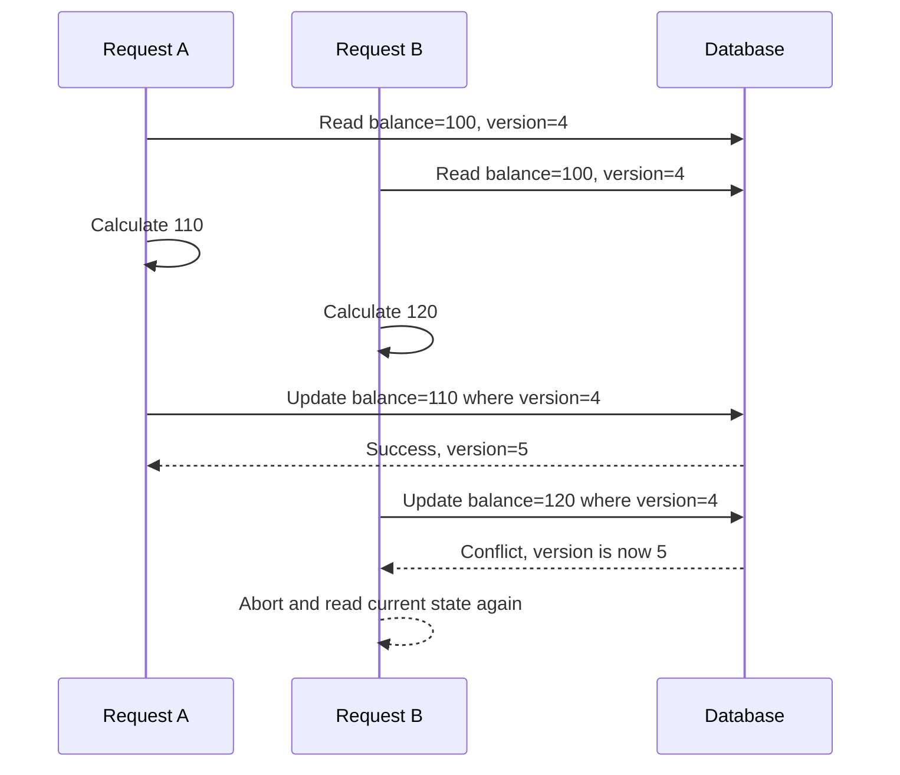

# ABORTED

Trong gRPC, **ABORTED là status code số 10**, thường biểu thị một thao tác bị hủy do xung đột cần được xử lý ở cấp transaction hoặc quy trình nghiệp vụ. Tình huống điển hình là hai request cùng đọc một phiên bản dữ liệu rồi cùng cập nhật; chỉ một request ghi thành công, request còn lại phát hiện dữ liệu đã thay đổi và phải đọc lại trước khi quyết định tiếp.

Trong **SPRING_GRPC**, ABORTED đặc biệt hữu ích khi ứng dụng dùng optimistic locking, transaction isolation hoặc cơ chế kiểm soát concurrency. Client thường cần thử lại **toàn bộ chu trình đọc – tính toán – ghi** với dữ liệu mới, thay vì gửi lại riêng câu lệnh ghi đã thất bại. Việc retry phải có giới hạn, tôn trọng deadline và bảo đảm side effect không bị lặp.

## 1. Ý nghĩa của ABORTED

ABORTED có giá trị số **10**. Status này phù hợp khi RPC thất bại do một xung đột khiến caller cần khởi động lại một quy trình ở mức cao hơn, thường là transaction hoặc read-modify-write.

| Góc nhìn | Ý nghĩa |
| --- | --- |
| Client | Thao tác bị hủy do conflict; có thể cần đọc lại dữ liệu và tính toán lại |
| Server | Transaction hoặc concurrency check phát hiện xung đột không thể tiếp tục an toàn |
| gRPC runtime | Kết thúc RPC với status ABORTED |
| Nghiệp vụ | Kết quả của lần cập nhật này không được chấp nhận; caller cần quyết định lại dựa trên state mới |

Ví dụ:

- Hai người cùng sửa một hồ sơ; một người lưu trước, phiên bản của người còn lại đã cũ.
- Hai worker cùng cập nhật số dư hoặc trạng thái của một tài khoản.
- Một transaction bị hủy vì serialization conflict ở mức database.
- Một thao tác đặt chỗ phát hiện tài nguyên đã bị một transaction cạnh tranh chiếm trước.
- Một quy trình đọc – kiểm tra – ghi không còn hợp lệ vì dữ liệu thay đổi giữa các bước.

ABORTED không đồng nghĩa server bị crash, service mất kết nối hay request sai cú pháp. Nó mô tả một thao tác đã bị hủy do conflict theo semantics của API.

## 2. Vì sao cần ABORTED trong hệ thống đồng thời?

Nhiều RPC có dạng đọc dữ liệu, tính toán rồi ghi lại:

1. Đọc trạng thái hiện tại.
2. Kiểm tra điều kiện nghiệp vụ.
3. Tính giá trị mới.
4. Ghi thay đổi.

Nếu nhiều request chạy cùng lúc, dữ liệu có thể đổi sau bước đọc nhưng trước bước ghi. Nếu server vẫn ghi giá trị được tính từ dữ liệu cũ, nó có thể ghi đè cập nhật mới hoặc tạo kết quả sai.

Ví dụ hai request cùng tăng số dư từ 100:



Nếu không phát hiện conflict, request B có thể ghi 120 dựa trên số dư cũ 100, làm mất phần tăng 10 của request A. Optimistic locking phát hiện version đã thay đổi và từ chối lần ghi không còn hợp lệ.

## 3. Phân biệt ABORTED với status gần nghĩa

| Status | Ý nghĩa | Ví dụ |
| --- | --- | --- |
| ABORTED | Conflict ở transaction/concurrency; cần chạy lại quy trình đọc-sửa-ghi | Optimistic locking version mismatch |
| FAILED_PRECONDITION | Trạng thái hiện tại không đáp ứng điều kiện nghiệp vụ | Đơn hàng chưa thanh toán nên chưa thể giao |
| UNAVAILABLE | Service hoặc dependency tạm thời không thể phục vụ | Kết nối tới server/database bị gián đoạn |
| ALREADY_EXISTS | Tài nguyên muốn tạo đã tồn tại | Tạo user với email đã được dùng |
| INVALID_ARGUMENT | Request chứa tham số không hợp lệ | ID sai định dạng |
| PERMISSION_DENIED | Caller không có quyền thực hiện thao tác | User không được sửa hồ sơ của người khác |
| DEADLINE_EXCEEDED | RPC không hoàn tất trước thời hạn | Server phản hồi sau deadline |

### 3.1. ABORTED và FAILED_PRECONDITION

FAILED_PRECONDITION mô tả một điều kiện nghiệp vụ hiện chưa thỏa. Cùng request có thể thành công sau khi trạng thái được thay đổi theo workflow. ABORTED mô tả một conflict trong quá trình thực hiện, thường cần đọc lại và chạy lại chu trình xử lý.

Ví dụ:

- Đơn hàng chưa thanh toán nên ShipOrder bị từ chối: FAILED_PRECONDITION.
- Hai transaction cùng cập nhật đơn hàng; một transaction mất optimistic lock: ABORTED.

### 3.2. ABORTED và UNAVAILABLE

UNAVAILABLE thường gợi ý service tạm thời không thể phục vụ; client có thể retry call theo policy nếu thao tác an toàn. ABORTED thường yêu cầu caller chạy lại logic cấp cao hơn, bởi dữ liệu đầu vào cho phép tính toán đã thay đổi.

Ví dụ, gửi lại cùng câu lệnh UPDATE dựa trên version cũ sẽ tiếp tục thất bại. Caller cần đọc version mới, đánh giá lại thay đổi và tạo một cập nhật mới.

### 3.3. ABORTED và ALREADY_EXISTS

Nếu CreateReservation thất bại vì mã reservation đã tồn tại, ALREADY_EXISTS thường diễn đạt đúng nguyên nhân. Nếu hai transaction cạnh tranh và một transaction bị database hủy do serialization conflict, ABORTED có thể phù hợp. Chọn status theo kết quả mà client cần xử lý, không chỉ theo loại exception thấp nhất.

## 4. Optimistic locking trong Spring Data JPA

Optimistic locking phù hợp khi xung đột không xảy ra quá thường xuyên và ứng dụng muốn tránh giữ lock dài. JPA hỗ trợ version field bằng annotation @Version.

Ví dụ entity:

```java
@Entity
@Table(name = "accounts")
public class AccountEntity {
    @Id
    private String id;

    private long balance;

    @Version
    private long version;

    // getters and domain operations
}
```

Khi cập nhật entity, JPA dùng version để kiểm tra dữ liệu chưa bị transaction khác thay đổi. Nếu version không còn khớp, thao tác có thể phát sinh OptimisticLockException hoặc exception Spring như ObjectOptimisticLockingFailureException, tùy tầng và provider.

Một service cập nhật số dư có thể như sau:

```java
@Service
public class AccountCommandService {
    private final AccountRepository repository;

    public AccountCommandService(AccountRepository repository) {
        this.repository = repository;
    }

    @Transactional
    public Account adjustBalance(String accountId, long delta) {
        AccountEntity account = repository.findById(accountId)
            .orElseThrow(AccountNotFoundException::new);

        account.applyDelta(delta);
        return Account.from(repository.save(account));
    }
}
```

Ví dụ giả định entity có applyDelta để kiểm tra invariant nghiệp vụ. Việc flush/commit có thể xảy ra sau khi method body kết thúc; do đó optimistic locking exception đôi khi chỉ xuất hiện khi transaction commit, không nhất thiết ngay tại save.

## 5. Map conflict sang ABORTED ở gRPC boundary

Để bắt được lỗi phát sinh trong lúc commit, ranh giới transaction nên nằm trong Spring service được gọi qua proxy. gRPC endpoint gọi service; khi lời gọi transactional trả về, transaction đã hoàn tất hoặc exception commit được ném ra ngoài để endpoint ánh xạ.

```java
@GrpcService
public class AccountGrpcEndpoint
        extends AccountServiceGrpc.AccountServiceImplBase {

    private final AccountCommandService commandService;

    public AccountGrpcEndpoint(AccountCommandService commandService) {
        this.commandService = commandService;
    }

    @Override
    public void adjustBalance(
            AdjustBalanceRequest request,
            StreamObserver<AdjustBalanceReply> observer) {
        try {
            Account account = commandService.adjustBalance(
                request.getAccountId(),
                request.getDelta());

            observer.onNext(toReply(account));
            observer.onCompleted();
        } catch (ObjectOptimisticLockingFailureException ex) {
            observer.onError(Status.ABORTED
                .withDescription("Dữ liệu đã thay đổi bởi một thao tác khác")
                .asRuntimeException());
        }
    }
}
```

GrpcService là ví dụ theo một số Spring gRPC starter; annotation và base class thực tế phụ thuộc stack được module sử dụng. Ví dụ tập trung vào ranh giới xử lý: endpoint bắt lỗi sau khi transactional service kết thúc, rồi trả status phù hợp. Có thể bắt abstraction rộng hơn như OptimisticLockingFailureException nếu cần hỗ trợ nhiều loại repository, nhưng không nên map mọi DataAccessException thành ABORTED.

### 5.1. Không bắt conflict bên trong transaction rồi tiếp tục

Khi optimistic lock exception xảy ra, transaction có thể đã bị đánh dấu rollback-only. Bắt exception trong cùng transaction rồi tiếp tục ghi hoặc trả thành công có thể dẫn đến lỗi khi commit hoặc trạng thái không nhất quán.

Hãy để transaction thất bại và rollback; xử lý retry ở bên ngoài transaction boundary. Mỗi lần thử phải chạy trong một transaction mới và đọc lại dữ liệu hiện tại.

## 6. Retry đúng cấp độ: chạy lại toàn bộ read-modify-write

Đối với ABORTED, retry thường không phải là gửi lại cùng một write với dữ liệu cũ. Caller cần:

1. Bắt đầu transaction mới.
2. Đọc lại dữ liệu mới nhất.
3. Kiểm tra lại invariant và điều kiện nghiệp vụ.
4. Tính toán lại thay đổi từ state mới.
5. Thử ghi và commit.
6. Nếu vẫn conflict, dừng khi đạt giới hạn retry.

Ví dụ logic:

```text
repeat up to maxAttempts:
    begin new transaction
    current = read account
    validate current state
    updated = apply requested delta to current
    write updated
    commit
    if optimistic conflict:
        rollback
        backoff with jitter
return ABORTED if attempts exhausted
```

Với request “tăng số dư thêm 10”, việc đọc lại rồi áp dụng delta có thể hợp lý. Với request “đặt số dư thành 110”, tự động áp dụng lại giá trị tuyệt đối có thể ghi đè thay đổi của người khác. Client/server phải xác định intent của command và quy tắc merge trước khi retry.

### 6.1. Giới hạn số lần thử và deadline

Không retry vô hạn. Cần đặt:

- Số lần thử tối đa.
- Backoff tăng dần và jitter để giảm khả năng các request cạnh tranh lại cùng lúc.
- Deadline tổng cho toàn operation.
- Điều kiện dừng khi state mới làm thay đổi ý nghĩa nghiệp vụ.
- Metric cho số lần conflict và tỷ lệ retry thành công.

Nếu deadline inbound đã gần hết, việc bắt đầu thêm transaction có thể không còn hữu ích. Hãy tính ngân sách còn lại trước mỗi lần thử và trả ABORTED khi không còn đủ thời gian.

### 6.2. Ví dụ retry bên ngoài transactional service

Endpoint hoặc application facade không mang @Transactional có thể gọi lại transactional bean. Mỗi lời gọi qua Spring proxy tạo một transaction mới:

```java
public Account adjustWithRetry(String accountId, long delta) {
    int maxAttempts = 3;

    for (int attempt = 1; attempt <= maxAttempts; attempt++) {
        try {
            return commandService.adjustBalance(accountId, delta);
        } catch (ObjectOptimisticLockingFailureException ex) {
            if (attempt == maxAttempts) {
                throw ex;
            }
            backoff(attempt);
        }
    }
    throw new IllegalStateException("Unreachable");
}
```

Đây là ví dụ khung; backoff nên có giới hạn và jitter. Không đặt @Transactional bao quanh cả vòng lặp nếu mục tiêu là mỗi attempt có transaction độc lập. Cũng cần bảo đảm lần gọi service đi qua Spring proxy; self-invocation trong cùng bean có thể bỏ qua transaction advice.

## 7. Không phải conflict nào cũng nên retry

Retry chỉ hợp lý khi ứng dụng có thể đọc state mới và tính lại một hành động vẫn còn đúng ý nghĩa.

| Tình huống | Hướng xử lý |
| --- | --- |
| Version thay đổi khi cập nhật hồ sơ | Đọc lại, merge field theo policy rồi thử lại có giới hạn |
| Hai request cùng trừ tồn kho | Đọc lại stock, kiểm tra lại availability trước khi trừ |
| Serialization failure của database | Có thể retry toàn transaction trong transaction mới |
| Người dùng sửa cùng field với nội dung khác | Có thể yêu cầu người dùng giải quyết conflict thay vì tự ghi đè |
| Điều kiện nghiệp vụ đã đổi và action không còn hợp lệ | Trả status domain phù hợp, có thể FAILED_PRECONDITION |
| Tài nguyên tạo trùng theo unique key | Thường là ALREADY_EXISTS, không retry cùng create |

Không nên tự động retry nếu việc tính lại có thể làm thay đổi ý định người dùng. Ví dụ hai người cùng chỉnh địa chỉ giao hàng; hệ thống không thể tùy tiện chọn một giá trị và ghi đè giá trị còn lại nếu không có quy tắc merge.

## 8. Idempotency và side effect ngoài transaction

Retry transaction có thể thực thi lại code ứng dụng. Nếu code gửi email, phát event trực tiếp, gọi payment provider hoặc tạo shipment trước khi transaction commit, lần thử thất bại có thể đã tạo side effect bên ngoài. Khi retry, side effect có thể lặp.

Các nguyên tắc:

- Giữ transaction retryable chỉ chứa thao tác có thể rollback.
- Dùng transactional outbox để ghi event cùng transaction rồi publish sau commit.
- Dùng idempotency key ở downstream cho thao tác không thể rollback.
- Không gửi email hoặc gọi dịch vụ ngoài trước khi transaction được xác nhận nếu không có cơ chế chống lặp.
- Định nghĩa operation ID để tra cứu trạng thái khi kết quả call không rõ.

Ví dụ, cập nhật trạng thái đơn hàng và ghi một outbox event trong cùng database transaction. Worker chỉ publish event sau commit. Nếu transaction bị ABORTED, cả thay đổi đơn hàng lẫn outbox record đều rollback; không có event thành công giả.

## 9. Conditional update và database isolation

Ngoài JPA @Version, có thể dùng conditional update:

```sql
UPDATE accounts
SET balance = :newBalance,
    version = version + 1
WHERE id = :accountId
  AND version = :expectedVersion;
```

Nếu số dòng cập nhật bằng 1, write đã áp dụng. Nếu bằng 0, version không còn khớp hoặc tài nguyên không tồn tại. Ứng dụng cần xác định nguyên nhân theo contract trước khi chọn ABORTED hay NOT_FOUND.

Ở isolation level như SERIALIZABLE, database có thể hủy transaction để bảo đảm kết quả tương đương thực thi tuần tự. Driver/provider có thể biểu diễn lỗi bằng exception khác nhau; cần phân loại theo database đang dùng và chỉ retry các serialization/deadlock conflict đã xác định.

Pessimistic locking có thể giảm một số conflict bằng cách khóa row, nhưng tăng contention và nguy cơ deadlock. Khi lock timeout/deadlock xảy ra, status cần phản ánh semantics của lỗi và policy retry; không map mọi lỗi lock thành cùng một status một cách máy móc.

## 10. Error details cho conflict

Status code ABORTED có thể đủ để client biết phải chạy lại quy trình cấp cao hơn. Nếu cần chẩn đoán, server có thể bổ sung detail có cấu trúc, ví dụ google.rpc.ErrorInfo với reason ổn định:

```text
grpc-status: ABORTED
grpc-message: Dữ liệu đã thay đổi trong lúc cập nhật

ErrorInfo:
  reason: "OPTIMISTIC_LOCK_CONFLICT"
  domain: "accounts.example"
  metadata:
    resource_type: "Account"
    operation: "AdjustBalance"
```

Đây là minh họa logic, không phải header gRPC chuẩn. Trong gRPC Java, richer details có thể được đóng gói trong com.google.rpc.Status và chuyển thành exception qua io.grpc.protobuf.StatusProto. Chỉ đưa metadata cần thiết, không tiết lộ dữ liệu nhạy cảm hoặc giá trị nội bộ không được phép xem.

Nếu client không hỗ trợ details, status vẫn phải có semantics đủ rõ để xử lý tổng quát. Không buộc client parse câu grpc-message để quyết định retry.

## 11. Client xử lý ABORTED

Với blocking stub, client có thể phân loại:

```java
try {
    UpdateProfileReply reply = profileStub.updateProfile(request);
    // Cập nhật giao diện với kết quả mới.
} catch (StatusRuntimeException ex) {
    if (ex.getStatus().getCode() == Status.Code.ABORTED) {
        // Đọc lại profile, merge thay đổi theo policy rồi thử lại
        // nếu operation còn hợp lệ và deadline còn đủ.
    } else {
        // Xử lý status khác.
    }
}
```

Client nên:

- Đọc lại resource hoặc operation state trước khi thử lại.
- Không gửi lại payload được tính từ version cũ.
- Chỉ merge tự động những field có quy tắc merge rõ.
- Giới hạn số lần retry và tôn trọng deadline.
- Nếu conflict cần người dùng quyết định, hiển thị phiên bản mới và yêu cầu giải quyết.
- Dùng idempotency key cho operation có side effect.

Nếu server đã thực hiện side effect nhưng response bị mất, client không thể chỉ dựa vào status/transport để kết luận. API nên cung cấp operation ID hoặc idempotency key để truy vấn kết quả.

## 12. ABORTED trong streaming RPC

Với client-streaming hoặc bidirectional streaming, một conflict có thể xảy ra sau khi server đã nhận và xử lý nhiều message. Khi RPC kết thúc với ABORTED, client không nên mặc định mọi message trước đó đã rollback.

Contract cần xác định:

- Mỗi message là một transaction độc lập hay toàn stream là một transaction logic?
- Message nào đã được commit trước khi conflict xảy ra?
- Client có thể resume từ sequence/cursor nào?
- Có thể gửi lại message đã commit mà không tạo side effect trùng không?
- Status cuối có kèm operation ID hoặc checkpoint không?

Với stream xử lý nhiều item độc lập, có thể trả kết quả theo từng item và dùng status cuối cho lỗi toàn stream. Với stream là một batch nguyên tử, cần bảo đảm transaction/operation semantics thực sự hỗ trợ rollback toàn bộ trước khi công bố rằng cả batch thất bại.

## 13. Kiểm thử ABORTED

Test cần tạo conflict thực, xác minh rollback, retry và side effect:

| Kịch bản | Điều cần xác minh |
| --- | --- |
| Hai transaction cập nhật cùng version | Một thành công; transaction còn lại nhận conflict và được map thành ABORTED |
| JPA optimistic lock chỉ ném lỗi lúc commit | gRPC endpoint vẫn bắt được exception và trả đúng status |
| Retry sau conflict | Attempt mới đọc state/version mới |
| Hết số lần retry | RPC trả ABORTED, không lặp vô hạn |
| Deadline gần hết | Không bắt đầu attempt mới vượt ngân sách |
| Request có side effect | Outbox/idempotency ngăn event hoặc thao tác lặp |
| Tài nguyên không tồn tại | NOT_FOUND, không bị map nhầm thành ABORTED |
| Precondition nghiệp vụ không đạt | FAILED_PRECONDITION |
| Client gửi version cũ | Server trả conflict theo contract |
| Streaming bị conflict giữa chừng | Partial commit/checkpoint đúng semantics đã công bố |

Unit test có thể kiểm tra exception mapping và retry policy. Integration test nên dùng database thật hoặc container tương ứng để tạo optimistic/serialization conflict. Test concurrency cần đồng bộ hai transaction tại thời điểm đọc rồi cho cùng ghi, thay vì chỉ mock exception.

## 14. Observability và vận hành

ABORTED có thể là một phần bình thường của concurrency control, nhưng tỷ lệ cao kéo dài thường cho thấy contention hoặc thiết kế update không phù hợp.

Nên theo dõi:

- Tỷ lệ ABORTED theo service/method.
- Số optimistic lock conflict, serialization failure và deadlock theo nhóm nguyên nhân.
- Số attempt trung bình trước khi thành công.
- Tỷ lệ retry thành công và tỷ lệ hết retry.
- Latency transaction, lock wait và connection pool.
- Tài nguyên/domain aggregate thường xuyên xung đột ở dạng nhãn có cardinality thấp.
- Trace/correlation ID để nối RPC với transaction và downstream event.

Không dùng resource ID, user ID hoặc request ID làm metric label có cardinality cao. Log có thể ghi loại conflict, entity type, version mismatch đã được phép và trace ID; tránh ghi payload nhạy cảm.

Nếu ABORTED tăng sau khi triển khai, kiểm tra transaction duration, số worker xử lý cùng aggregate, batch size, isolation level và cách phân chia dữ liệu. Có thể giảm contention bằng cách rút ngắn transaction, phân vùng công việc, gom cập nhật hoặc dùng queue theo key. Tăng retry count đơn thuần có thể làm tải và contention nặng hơn.

## 15. Những lỗi thiết kế thường gặp

| Sai lầm | Hậu quả | Cách làm tốt hơn |
| --- | --- | --- |
| Retry cùng write với version cũ | Conflict lặp lại | Đọc lại và chạy lại toàn bộ read-modify-write |
| Retry bên trong transaction đã rollback-only | Attempt sau vẫn nằm trong transaction lỗi | Retry ngoài transaction boundary |
| Map mọi DataAccessException thành ABORTED | Che giấu lỗi database khác | Chỉ map conflict đã nhận diện |
| Không xử lý exception lúc commit | Endpoint có thể không trả status đúng | Đặt transaction boundary trong service proxy và bắt ở caller |
| Retry không giới hạn | Tăng contention và latency | Giới hạn attempts, backoff, jitter và deadline |
| Gửi event trước commit | Side effect tồn tại dù transaction rollback | Transactional outbox hoặc downstream idempotency |
| Tự merge mọi thay đổi | Ghi đè ý định người dùng | Chỉ merge field có quy tắc rõ, còn lại yêu cầu giải quyết |
| Coi ABORTED giống UNAVAILABLE | Retry sai cấp độ | Phân biệt retry call với retry transaction workflow |

## 16. Checklist thiết kế ABORTED

Trước khi công bố method có cập nhật dữ liệu, hãy xác định:

1. **Conflict nào có thể xảy ra?** Version mismatch, serialization failure, deadlock hay tranh chấp tài nguyên.
2. **Cơ chế concurrency control là gì?** @Version, conditional update, pessimistic lock hay isolation level.
3. **Exception xuất hiện ở đâu?** Trong method body, flush hay transaction commit.
4. **Transaction rollback thế nào?** Có bắt lỗi sau khi transaction kết thúc không?
5. **Retry ở cấp độ nào?** Toàn bộ read-modify-write trong transaction mới hay yêu cầu client đọc lại?
6. **Intent có thể tính lại an toàn không?** Phân biệt delta command và ghi giá trị tuyệt đối.
7. **Số lần thử và deadline là bao nhiêu?** Có backoff/jitter và giới hạn rõ không?
8. **Side effect được bảo vệ thế nào?** Outbox, idempotency key hoặc operation status.
9. **Streaming partial result có semantics rõ không?** Sequence, cursor và checkpoint.
10. **Telemetry có chỉ ra contention mà không lộ dữ liệu không?**

## 17. Ghi nhớ

ABORTED là gRPC status code 10, thường dùng khi thao tác bị hủy do conflict ở cấp transaction hoặc concurrency control. Nó khác FAILED_PRECONDITION (trạng thái nghiệp vụ chưa đáp ứng), UNAVAILABLE (service tạm thời không thể phục vụ) và ALREADY_EXISTS (tài nguyên muốn tạo đã tồn tại).

Trong Spring gRPC, optimistic locking với @Version hoặc conditional update giúp phát hiện dữ liệu đã đổi. Hãy để transaction rollback, bắt conflict ở ngoài transaction boundary và retry toàn bộ chu trình đọc – kiểm tra – tính toán – ghi trong transaction mới nếu nghiệp vụ cho phép. Retry cần giới hạn, backoff, jitter, deadline và bảo vệ side effect bằng outbox/idempotency. Client phải đọc lại state thay vì gửi lại dữ liệu cũ. Thiết kế như vậy giúp bảo toàn cập nhật đồng thời và tránh biến conflict thành lỗi dữ liệu.

### Tài liệu tham khảo

- [gRPC – Status codes](https://grpc.io/docs/guides/status-codes/)
- [gRPC – Error handling](https://grpc.io/docs/guides/error/)
- [Spring Data JPA – Locking](https://docs.spring.io/spring-data/jpa/reference/jpa/locking.html)
- [Jakarta Persistence – Versioning and optimistic locking](https://jakarta.ee/specifications/persistence/)
- [Spring Framework – Transaction management](https://docs.spring.io/spring-framework/reference/data-access/transaction.html)
- [Google API – Error model](https://cloud.google.com/apis/design/errors)
