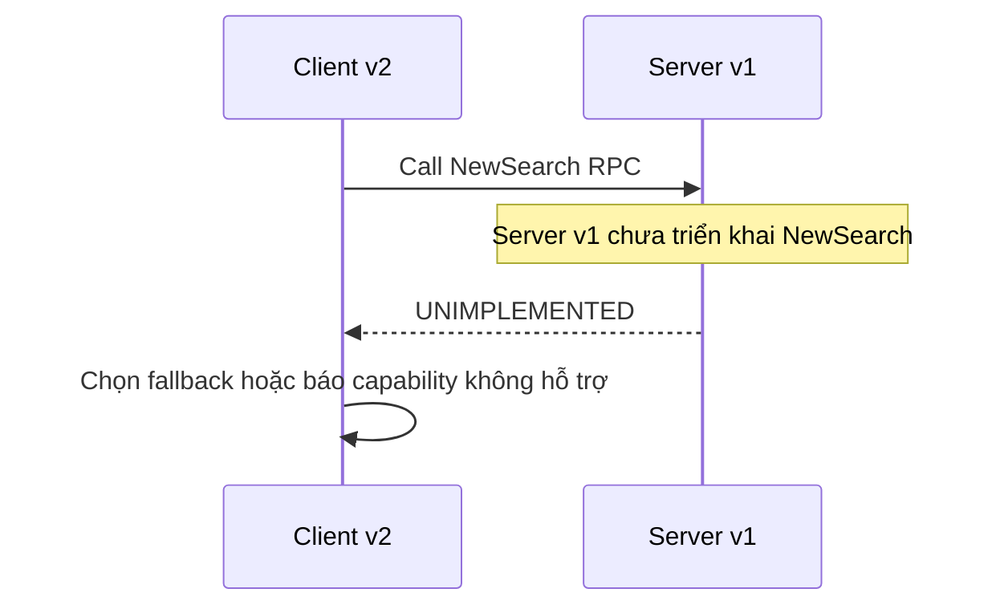

# UNIMPLEMENTED

Trong gRPC, **UNIMPLEMENTED là status code số 12**, cho biết operation được gọi chưa được triển khai hoặc không được service hiện tại hỗ trợ. Ví dụ client dùng stub mới để gọi RPC vừa được thêm vào Protobuf contract, nhưng server đang chạy phiên bản cũ chưa có method đó. Server có thể nhận được request ở tầng transport nhưng không có implementation tương ứng để thực thi.

Trong **SPRING_GRPC**, status này thường liên quan đến việc triển khai service, đăng ký bean/server, method path, khả năng của phiên bản server hoặc một tính năng không được hỗ trợ trong deployment hiện tại. Cần phân biệt một operation chưa được hỗ trợ với request sai, tài nguyên không tồn tại và lỗi hạ tầng tạm thời. Client thường không nên retry cùng một call một cách tự động; cần fallback hoặc nâng cấp server theo capability contract.

## 1. Ý nghĩa của UNIMPLEMENTED

UNIMPLEMENTED có giá trị số **12**. Status phù hợp khi server không cung cấp implementation cho RPC được gọi hoặc operation đó không được hỗ trợ trong service/deployment hiện tại.

| Góc nhìn | Ý nghĩa |
| --- | --- |
| Client | Method hoặc capability được yêu cầu không được server hỗ trợ |
| Server | Không có implementation được đăng ký cho operation hoặc deployment không cung cấp operation đó |
| gRPC runtime | Kết thúc RPC với status UNIMPLEMENTED |
| Nghiệp vụ | Client cần dùng operation khác, fallback theo contract hoặc gọi service/version hỗ trợ |

Các trường hợp thường gặp:

- Client gọi RPC mới nhưng server chưa được nâng cấp.
- Service implementation kế thừa generated base class nhưng không override method cần dùng.
- Method path hoặc tên service không khớp với contract mà server đăng ký.
- Một RPC được định nghĩa trong Protobuf nhưng deployment hiện tại cố ý chưa cung cấp.
- Client yêu cầu một capability tùy chọn mà server không hỗ trợ.
- Server nhận một method name không tồn tại trong service descriptor.

UNIMPLEMENTED không có nghĩa server process nhất thiết bị lỗi. Server có thể đang hoạt động bình thường nhưng không hỗ trợ operation đó.

## 2. Method path và dispatch trong gRPC

Một RPC gRPC được định danh bằng full method name, thường có dạng:

```text
/fully.qualified.ServiceName/MethodName
```

Ví dụ với service:

```protobuf
syntax = "proto3";

package commerce.catalog.v1;

service CatalogService {
  rpc GetProduct(GetProductRequest) returns (GetProductReply);
}
```

Method path tương ứng là:

```text
/commerce.catalog.v1.CatalogService/GetProduct
```

Server runtime dùng service name và method name để dispatch request đến implementation đã đăng ký. Những sai khác về package, service name hoặc method name có thể khiến server không tìm thấy method phù hợp. Vì vậy, tên đầy đủ của service là một phần contract giao tiếp giữa client và server.

Đổi package hoặc service name trong Protobuf có thể làm thay đổi method path dù request/response message không đổi. Đây là thay đổi có ảnh hưởng đến routing và tương thích, cần được quản lý như một thay đổi API.

## 3. UNIMPLEMENTED trong generated Java service

Protobuf compiler sinh Java message và gRPC stub/base class từ service definition. Trong gRPC Java, generated service base class cung cấp method mặc định cho từng RPC. Nếu ứng dụng không override method, implementation mặc định sẽ kết thúc call bằng UNIMPLEMENTED.

Ví dụ service được sinh từ contract:

```protobuf
service CatalogService {
  rpc GetProduct(GetProductRequest) returns (GetProductReply);
  rpc ListProducts(ListProductsRequest) returns (ListProductsReply);
}
```

Generated base class có thể được sử dụng như sau:

```java
public final class CatalogGrpcService
        extends CatalogServiceGrpc.CatalogServiceImplBase {

    @Override
    public void getProduct(
            GetProductRequest request,
            StreamObserver<GetProductReply> responseObserver) {

        GetProductReply reply = catalogService.getProduct(request);
        responseObserver.onNext(reply);
        responseObserver.onCompleted();
    }
}
```

Trong ví dụ này, GetProduct đã được override nên có implementation. Nếu ListProducts không được override, method mặc định trong generated base class sẽ trả UNIMPLEMENTED khi client gọi. Đây là hành vi hữu ích trong giai đoạn phát triển vì method chưa hoàn thành không bị giả lập thành response thành công.

Hãy kiểm tra tất cả RPC trong service definition:

- Unary RPC cần override method unary tương ứng.
- Server-streaming RPC cần triển khai logic phát nhiều message và kết thúc stream.
- Client-streaming RPC cần xử lý observer/listener và hoàn tất response theo contract.
- Bidirectional streaming RPC cần quản lý vòng đời hai chiều và cancellation.

Không nên override method rồi trả UNIMPLEMENTED vĩnh viễn chỉ để làm cho class compile nếu deployment được quảng bá là đã hỗ trợ capability đó.

## 4. Triển khai RPC trong Spring gRPC

Trong Spring gRPC, implementation thường được quản lý như một Spring bean và được starter đăng ký vào gRPC server. Ví dụ dưới đây minh họa cấu trúc service:

```java
@GrpcService
public final class CatalogGrpcService
        extends CatalogServiceGrpc.CatalogServiceImplBase {

    private final CatalogApplicationService catalogService;

    public CatalogGrpcService(CatalogApplicationService catalogService) {
        this.catalogService = catalogService;
    }

    @Override
    public void getProduct(
            GetProductRequest request,
            StreamObserver<GetProductReply> observer) {
        try {
            GetProductReply reply =
                catalogService.getProduct(request.getProductId());
            observer.onNext(reply);
            observer.onCompleted();
        } catch (ProductNotFoundException ex) {
            observer.onError(Status.NOT_FOUND
                .withDescription("Không tìm thấy sản phẩm")
                .asRuntimeException());
        }
    }
}
```

Annotation @GrpcService là ví dụ của một số Spring gRPC starter; cách đăng ký cụ thể phụ thuộc thư viện mà ứng dụng sử dụng. Điểm cần bảo đảm là implementation được phát hiện, đăng ký vào đúng server và dùng đúng generated service base class.

Các nguyên nhân cấu hình thường gặp:

- Bean implementation không được component scan hoặc không được đăng ký.
- Implementation kế thừa nhầm class được sinh từ package/service cũ.
- Server đăng ký một service khác tên với service client đang gọi.
- Protobuf generated sources chưa được cập nhật sau khi contract thay đổi.
- Có nhiều implementation cùng đăng ký một service và gây xung đột startup.
- Module chứa implementation không được đóng gói hoặc không có trong runtime classpath.

Không suy luận rằng bean tồn tại đồng nghĩa RPC đã được đăng ký. Integration test cần gọi qua gRPC channel thực tế của ứng dụng để xác minh dispatch.

## 5. Phân biệt UNIMPLEMENTED với status gần nghĩa

| Status | Ý nghĩa | Ví dụ |
| --- | --- | --- |
| UNIMPLEMENTED | Operation không được triển khai hoặc không được hỗ trợ | Server cũ chưa có RPC mới |
| UNAVAILABLE | Service hoặc dependency tạm thời không thể phục vụ | Server đang restart hoặc kết nối bị gián đoạn |
| NOT_FOUND | Method đã chạy nhưng tài nguyên được yêu cầu không tồn tại | GetProduct không tìm thấy product ID |
| INVALID_ARGUMENT | Request không hợp lệ theo contract | Product ID sai định dạng |
| FAILED_PRECONDITION | Trạng thái hiện tại ngăn operation | Order chưa thanh toán nên chưa thể giao |
| PERMISSION_DENIED | Caller không có quyền | User không được phép gọi thao tác quản trị |
| UNAUTHENTICATED | Không xác minh được danh tính caller | Token thiếu hoặc hết hạn |

### 5.1. UNIMPLEMENTED và UNAVAILABLE

UNIMPLEMENTED thường phản ánh thiếu capability hoặc method. UNAVAILABLE phản ánh service/dependency hiện không thể phục vụ. Nếu server cũ hoạt động bình thường nhưng chưa có RPC mới, UNIMPLEMENTED phù hợp. Nếu server hỗ trợ RPC đó nhưng đang restart hoặc không thể kết nối database, lỗi thường thuộc nhóm UNAVAILABLE hoặc status hạ tầng khác.

Retry một call UNIMPLEMENTED đến cùng server/version thường không giúp ích. Với UNAVAILABLE, retry có thể hợp lý nếu policy cho phép, có backoff và operation an toàn.

### 5.2. UNIMPLEMENTED và NOT_FOUND

Nếu method GetProduct đã được triển khai nhưng product ID không tồn tại, trả NOT_FOUND. Nếu server không có method GetProduct trong service được đăng ký, trả UNIMPLEMENTED. Hai lỗi nằm ở hai lớp khác nhau: capability của API và dữ liệu nghiệp vụ.

### 5.3. UNIMPLEMENTED và FAILED_PRECONDITION

Nếu operation không được hỗ trợ trong deployment hoặc server không có implementation, UNIMPLEMENTED có thể phù hợp. Nếu operation đã được triển khai nhưng trạng thái hiện tại của resource không cho phép thực hiện, dùng FAILED_PRECONDITION. Một tính năng bị khóa theo policy của tenant có thể cần PERMISSION_DENIED hoặc FAILED_PRECONDITION tùy contract; không tự động xem mọi feature flag tắt là UNIMPLEMENTED.

## 6. Version skew giữa client và server

Một tình huống phổ biến là client và server được triển khai ở các thời điểm khác nhau:

1. Server phiên bản A chỉ hỗ trợ RPC hiện có.
2. Contract được mở rộng với RPC mới.
3. Client phiên bản B được sinh stub từ contract mới và bắt đầu gọi RPC đó.
4. Server A chưa có method tương ứng nên trả UNIMPLEMENTED.



Để giảm lỗi trong rollout:

- Triển khai server có khả năng xử lý RPC mới trước khi client bắt đầu gọi.
- Chỉ bật client path sau khi các server instance cần thiết đã được cập nhật.
- Nếu rollout theo từng phần, dùng capability negotiation hoặc routing đến pool server phù hợp.
- Giữ fallback tương thích trong client trong giai đoạn chuyển tiếp nếu nghiệp vụ cho phép.
- Theo dõi tỷ lệ UNIMPLEMENTED theo method và server version.

Không phải mọi thay đổi Protobuf đều tương thích chỉ vì field mới có số field riêng. Thêm RPC mới thường tương thích về schema message, nhưng client gọi RPC mới vẫn cần server có implementation hoặc hành vi rõ ràng khi chưa hỗ trợ.

## 7. Capability negotiation và fallback

Nếu client có thể kết nối đến nhiều server version hoặc nhiều loại deployment, một API capability giúp client biết operation nào được hỗ trợ trước khi gọi.

Ví dụ:

```protobuf
service CapabilityService {
  rpc GetCapabilities(GetCapabilitiesRequest)
      returns (GetCapabilitiesReply);
}

message GetCapabilitiesRequest {}

message GetCapabilitiesReply {
  repeated string supported_features = 1;
  string api_version = 2;
}
```

Client có thể kiểm tra feature như NewSearchV2 hoặc BulkExport trước khi chọn luồng xử lý. Capability cần được định nghĩa ổn định:

- Tên feature có semantics rõ và không phụ thuộc class Java nội bộ.
- Server chỉ công bố feature khi implementation thực sự sẵn sàng.
- Capability phản ánh deployment/pool mà client đang kết nối.
- Cache capability cần TTL hoặc version để tránh giữ kết quả cũ quá lâu.
- Client vẫn phải xử lý UNIMPLEMENTED vì server có thể đổi version sau lần kiểm tra.

Fallback chỉ nên dùng khi hai operation có semantics tương đương theo contract. Không tự thay một RPC mới bằng RPC cũ nếu cách tính dữ liệu, bảo mật hoặc side effect khác nhau.

## 8. Xử lý capability tùy chọn và feature flag

Một service có thể triển khai method nhưng chỉ hỗ trợ tính năng trong một số cấu hình. Cần chọn status theo ý nghĩa:

| Tình huống | Cách biểu diễn có thể phù hợp |
| --- | --- |
| Method không có implementation trong server build | UNIMPLEMENTED |
| Deployment không cung cấp operation này | UNIMPLEMENTED |
| Method có implementation nhưng tenant không được cấp quyền | PERMISSION_DENIED |
| Method có implementation nhưng trạng thái resource chưa cho phép | FAILED_PRECONDITION |
| Method hỗ trợ nhưng dependency tạm thời không sẵn sàng | UNAVAILABLE |
| Tính năng tùy chọn được hỗ trợ nhưng hiện không có dữ liệu | OK với response rỗng hoặc NOT_FOUND theo contract |

Feature flag không tự quyết định status. Nếu flag chỉ bật/tắt quyền sử dụng của một tenant, đó có thể là authorization hoặc policy. Nếu deployment không chứa implementation của capability, UNIMPLEMENTED phản ánh chính xác hơn.

Không dùng UNIMPLEMENTED như một cách né xử lý lỗi nội bộ. Nếu method đã được quảng bá là được hỗ trợ nhưng code bên trong ném exception bất ngờ, cần phân loại thành lỗi phù hợp, thường là INTERNAL chứ không phải UNIMPLEMENTED.

## 9. Client xử lý UNIMPLEMENTED

Client nên xem UNIMPLEMENTED là tín hiệu capability không được hỗ trợ trong endpoint hiện tại:

1. Đọc status code, không parse grpc-message.
2. Kiểm tra capability/API version nếu contract cung cấp.
3. Chọn fallback đã được định nghĩa hoặc hiển thị tính năng không khả dụng.
4. Không retry cùng method liên tục đến cùng server version.
5. Nếu deployment vừa rollout, có thể thử lại sau khi xác nhận server pool đã cập nhật, với giới hạn rõ ràng.
6. Ghi nhận method và server version để hỗ trợ điều tra.

Ví dụ blocking stub:

```java
try {
    SearchReply reply = catalogStub.newSearch(request);
    render(reply);
} catch (StatusRuntimeException ex) {
    if (ex.getStatus().getCode() == Status.Code.UNIMPLEMENTED) {
        // Chỉ dùng fallback nếu contract xác định hai luồng tương đương.
        useLegacySearchIfSupported(request);
    } else {
        // Xử lý status khác.
    }
}
```

Không nên fallback âm thầm nếu luồng cũ bỏ qua filter, authorization, consistency hoặc dữ liệu mà luồng mới yêu cầu. Client cần giữ cùng ranh giới bảo mật và semantics nghiệp vụ khi chuyển sang phương án thay thế.

## 10. Error details và chẩn đoán capability

Status code thường đủ để client biết method không được hỗ trợ. Nếu cần chẩn đoán có cấu trúc, server có thể bổ sung detail như google.rpc.ErrorInfo với reason ổn định:

```text
grpc-status: UNIMPLEMENTED
grpc-message: Operation chưa được hỗ trợ

ErrorInfo:
  reason: "METHOD_NOT_SUPPORTED"
  domain: "commerce.catalog"
  metadata:
    service: "commerce.catalog.v1.CatalogService"
    method: "NewSearch"
    api_version: "v1"
```

Đây là minh họa logic, không phải metadata header chuẩn. Trong gRPC Java, richer details có thể được đóng gói trong com.google.rpc.Status và chuyển thành exception qua io.grpc.protobuf.StatusProto. Chỉ gửi thông tin deployment/version được phép công khai; không tiết lộ class name, stack trace, đường dẫn nội bộ hoặc topology hạ tầng.

Không buộc client parse description tự do. Nếu client cần capability chính thức, hãy cung cấp RPC capability riêng với schema có version và semantics ổn định.

## 11. Kiểm thử UNIMPLEMENTED

Test nên xác minh cả generated default behavior, service registration và version compatibility:

| Kịch bản | Điều cần xác minh |
| --- | --- |
| Method trong generated base class không được override | Call kết thúc bằng UNIMPLEMENTED |
| Method đã override và đăng ký đúng service | RPC thực thi thành công |
| Client gọi method không tồn tại trên server | Server trả UNIMPLEMENTED theo runtime |
| Service implementation không được đăng ký | Hành vi dispatch/status đúng với server stack |
| Client mới gọi server cũ | Client nhận UNIMPLEMENTED và dùng fallback theo policy |
| Capability endpoint công bố feature | Danh sách chỉ gồm capability thực sự sẵn sàng |
| Feature bị tắt do policy tenant | Status phản ánh authorization/precondition theo contract |
| Dependency của method bị lỗi | Không map nhầm thành UNIMPLEMENTED |
| Fallback được kích hoạt | Semantics, authorization và side effect tương đương |
| Server rollout từng phần | Client không retry vô hạn vào instance chưa hỗ trợ |

Integration test cần khởi động Spring application context và gọi qua channel thật để xác minh bean/service registration. Unit test trên application service không phát hiện được lỗi đăng ký gRPC service hoặc method path sai.

## 12. Observability và vận hành rollout

UNIMPLEMENTED tăng có thể chỉ ra version skew, client gọi nhầm endpoint, service chưa đăng ký hoặc capability được bật quá sớm.

Nên theo dõi:

- Số lượng/tỷ lệ UNIMPLEMENTED theo service và method.
- Client version và server version.
- Deployment/instance pool nhận request.
- Tỷ lệ fallback và kết quả của fallback.
- Capability được công bố so với capability thực tế.
- Thời điểm lỗi bắt đầu so với rollout client/server.
- Trace/correlation ID để nối call với deployment.

Không dùng user ID, token hoặc resource ID làm metric label có cardinality cao. Method name, service name, client/server version và deployment group thường đủ để phân tích. Log không nên chứa credential hoặc payload nhạy cảm.

Trong rollout, một tỷ lệ UNIMPLEMENTED ngắn hạn có thể xuất hiện nếu client mới đến server cũ. Nếu tỷ lệ kéo dài, kiểm tra thứ tự rollout, service registration, generated sources, method path và endpoint routing. Không chỉ tăng retry count vì retry không làm server cũ có thêm implementation.

## 13. Những lỗi thiết kế thường gặp

| Sai lầm | Hậu quả | Cách làm tốt hơn |
| --- | --- | --- |
| Không override một RPC nhưng vẫn quảng bá capability | Client nhận UNIMPLEMENTED khi dùng tính năng được công bố | Triển khai và test mọi RPC được hỗ trợ |
| Bean tồn tại nhưng service chưa đăng ký vào server | Method không được dispatch | Integration test qua gRPC channel thực |
| Đổi package/service name mà không quản lý rollout | Method path client/server không khớp | Xem full method name là contract |
| Retry UNIMPLEMENTED liên tục | Tạo tải mà không khắc phục thiếu implementation | Fallback hoặc nâng cấp server |
| Dùng UNIMPLEMENTED cho tài nguyên không tồn tại | Client hiểu nhầm API không hỗ trợ | Dùng NOT_FOUND trong method đã triển khai |
| Dùng UNIMPLEMENTED cho mọi lỗi runtime | Che giấu bug và dependency failure | Phân loại lỗi theo nguyên nhân |
| Fallback sang RPC cũ có semantics khác | Sai kết quả hoặc bỏ qua policy | Chỉ fallback khi contract bảo đảm tương đương |
| Bật client trước server trong rollout | Version skew gây lỗi hàng loạt | Server-first rollout hoặc capability negotiation |
| Cho rằng reflection không bật nghĩa là service không có | Chẩn đoán nhầm cơ chế discovery với dispatch | Kiểm tra RPC trực tiếp; reflection là capability riêng |

## 14. Checklist thiết kế UNIMPLEMENTED

Trước khi phát hành gRPC service/client, hãy xác định:

1. **RPC nào được hỗ trợ?** Mọi method được công bố có implementation hay không?
2. **Generated base class có method mặc định nào?** Có method nào chưa override ngoài ý muốn?
3. **Service được đăng ký thế nào trong Spring?** Bean, starter và server instance có nhận implementation không?
4. **Full method path có ổn định không?** Package, service name và method name có khớp client/server?
5. **Client/server version skew được xử lý ra sao?** Thứ tự rollout và compatibility window.
6. **Capability có được công bố không?** Server chỉ báo hỗ trợ khi implementation sẵn sàng.
7. **Fallback có tương đương semantics không?** Authorization, dữ liệu và side effect phải được giữ nguyên.
8. **Client retry thế nào?** Không retry mù quáng cùng method vào server không hỗ trợ.
9. **Error details có an toàn không?** Không tiết lộ class name, stack trace hay topology nội bộ.
10. **Test có qua gRPC runtime thật không?** Bao gồm default unimplemented, registration, path và version skew.

## 15. Ghi nhớ

UNIMPLEMENTED là gRPC status code 12, dùng khi operation chưa được triển khai hoặc không được service hiện tại hỗ trợ. Nó khác UNAVAILABLE (service tạm thời không thể phục vụ), NOT_FOUND (method đã chạy nhưng resource không tồn tại), INVALID_ARGUMENT (request sai) và FAILED_PRECONDITION (state hiện tại ngăn operation).

Trong Spring gRPC, hãy bảo đảm generated service method được override, implementation được đăng ký vào đúng server và package/service/method path khớp với client. Khi thêm RPC mới, triển khai server trước client hoặc dùng capability negotiation để quản lý version skew. Client nên kiểm tra status, fallback chỉ khi semantics tương đương và tránh retry liên tục. Integration test qua gRPC channel thật giúp phát hiện lỗi registration và dispatch mà unit test nghiệp vụ không thấy. Làm rõ capability giúp rollout an toàn và khiến client xử lý đúng khi server chưa hỗ trợ operation.

### Tài liệu tham khảo

- [gRPC – Status codes](https://grpc.io/docs/guides/status-codes/)
- [gRPC Java – Generated code reference](https://grpc.io/docs/languages/java/generated-code/)
- [gRPC – Service config and method names](https://grpc.io/docs/guides/service-config/)
- [Protocol Buffers – Best practices](https://protobuf.dev/best-practices/dos-donts/)
- [Google API – Compatibility](https://cloud.google.com/apis/design/compatibility)
