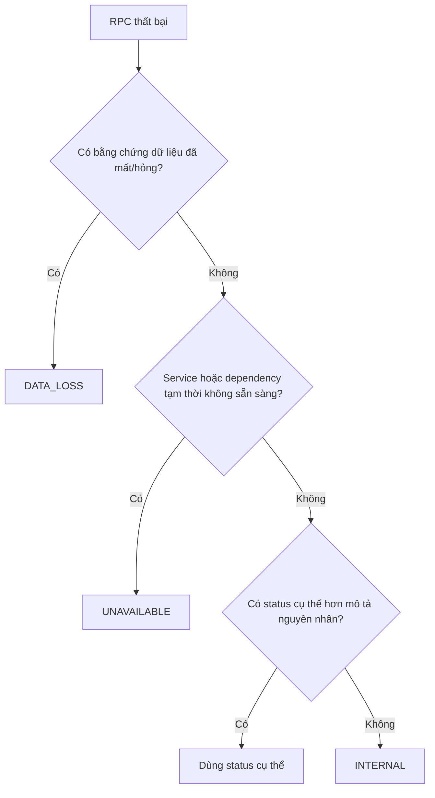

# INTERNAL, UNAVAILABLE và DATA_LOSS

Trong gRPC, **INTERNAL, UNAVAILABLE và DATA_LOSS** là ba status dùng để biểu diễn những nhóm lỗi quan trọng ở phía server và hạ tầng, nhưng chúng dẫn đến cách xử lý rất khác nhau:

- **INTERNAL (13):** lỗi nội bộ bất ngờ khiến server không thể hoàn tất operation theo đúng contract.
- **UNAVAILABLE (14):** service hoặc dependency hiện không thể phục vụ; tình trạng có thể tạm thời và có thể phục hồi.
- **DATA_LOSS (15):** dữ liệu đã bị mất hoặc hỏng ở mức không thể khôi phục bằng cách retry cùng operation.

Trong **SPRING_GRPC**, việc chọn đúng status giúp client biết nên dừng và báo lỗi, thử lại có kiểm soát hay kích hoạt quy trình phục hồi dữ liệu. Không nên ánh xạ mọi exception thành cùng một status chỉ vì chúng đều phát sinh ở server. Cần phân loại theo nguyên nhân thực tế, khả năng phục hồi và side effect đã xảy ra.

## 1. Ý nghĩa và phản ứng của từng status

| Status | Mã | Ý nghĩa | Phản ứng thường phù hợp |
| --- | ---: | --- | --- |
| INTERNAL | 13 | Lỗi nội bộ không mong đợi; invariant hoặc xử lý server thất bại | Dừng retry tự động, ghi log/trace và điều tra |
| UNAVAILABLE | 14 | Service hoặc dependency tạm thời không sẵn sàng | Có thể retry với backoff nếu operation an toàn |
| DATA_LOSS | 15 | Phát hiện mất hoặc hỏng dữ liệu nghiêm trọng | Dừng retry thông thường, bảo toàn bằng chứng và phục hồi từ nguồn tin cậy |

Các mã này là kết quả RPC mà client nhận được. Chúng không tự tiết lộ stack trace, database, node hoặc nguyên nhân nội bộ. Server cần giữ chi tiết chẩn đoán ở log/trace được bảo vệ, còn response công khai chỉ cung cấp thông tin an toàn và đủ để client quyết định.

## 2. INTERNAL: lỗi nội bộ không mong đợi

INTERNAL phù hợp khi server gặp lỗi nội bộ khiến operation không thể hoàn tất theo contract và không có status cụ thể hơn diễn đạt chính xác nguyên nhân. Ví dụ:

- Một invariant trong domain bị vi phạm do bug hoặc dữ liệu ở trạng thái không được dự kiến.
- Server nhận kết quả từ dependency nhưng không thể chuyển đổi theo contract nội bộ.
- Một nhánh xử lý bắt buộc không được triển khai đúng và phát sinh exception không mong đợi.
- Một lỗi lập trình hoặc cấu hình runtime khiến handler không thể tạo response hợp lệ.
- Server phát hiện trạng thái nội bộ không nhất quán nhưng chưa đủ căn cứ kết luận dữ liệu đã bị mất/hỏng không thể khôi phục.

Không nên dùng INTERNAL cho mọi lỗi xảy ra trong process. Nếu server biết rõ request sai, resource không tồn tại, caller thiếu quyền hoặc dependency tạm thời không sẵn sàng, hãy dùng status chuyên biệt tương ứng. Status cụ thể giúp client phản ứng đúng hơn và giúp telemetry phân loại nguyên nhân tốt hơn.

### 2.1. INTERNAL không phải thông báo để client sửa request

Client thường không thể khắc phục INTERNAL bằng cách đổi một field hoặc đăng nhập lại. Client nên hiển thị lỗi chung, ghi correlation ID và tránh retry tự động vô hạn. Nếu server xác định nguyên nhân thực tế là transient dependency failure, cần ánh xạ thành UNAVAILABLE thay vì buộc client suy luận từ message.

### 2.2. Không để lộ exception nội bộ

Không gửi stack trace, câu SQL, tên bảng, đường dẫn file, host nội bộ, access token hoặc nội dung exception thô qua grpc-message. Những chi tiết đó có thể tiết lộ cấu trúc hệ thống và dữ liệu nhạy cảm.

Response có thể dùng mô tả ngắn như “Lỗi nội bộ khi xử lý yêu cầu” cùng correlation ID. Server log exception gốc với trace ID, method, phiên bản service và context đã được lọc dữ liệu nhạy cảm.

## 3. UNAVAILABLE: service hoặc dependency tạm thời không sẵn sàng

UNAVAILABLE phù hợp khi service hiện không thể phục vụ RPC, thường do tình trạng tạm thời ở server, mạng hoặc dependency:

- Server đang restart, draining hoặc chưa sẵn sàng nhận traffic.
- Kết nối tới database, message broker hoặc downstream service bị gián đoạn.
- Connection pool tạm thời không cấp được connection vì dependency không sẵn sàng.
- Load balancer không tìm được backend healthy.
- Một node hoặc zone gặp sự cố khiến request không thể được phục vụ.
- Hệ thống đang trong giai đoạn failover hoặc chuyển leader.

UNAVAILABLE thường có thể retry, nhưng **không có nghĩa mọi operation đều an toàn để gửi lại**. Client phải xét idempotency, deadline, retry policy và khả năng operation trước đã tạo side effect hay chưa.

### 3.1. UNAVAILABLE và DEADLINE_EXCEEDED

UNAVAILABLE nói rằng service/dependency hiện không thể phục vụ. DEADLINE_EXCEEDED nói rằng RPC không hoàn tất trước thời hạn mà caller đặt. Một dependency chậm có thể dẫn đến deadline exceeded; một backend không thể kết nối có thể dẫn đến unavailable. Chọn status theo kết quả thực tế và contract, không map mọi timeout/connectivity exception một cách máy móc.

### 3.2. UNAVAILABLE và RESOURCE_EXHAUSTED

Nếu service không sẵn sàng do node down hoặc dependency mất kết nối, UNAVAILABLE có thể phù hợp. Nếu server từ chối vì quota, rate limit hoặc capacity limit cụ thể đã chạm ngưỡng, RESOURCE_EXHAUSTED diễn đạt rõ hơn. “Quá tải” cần được phân loại theo nguyên nhân và policy của API.

### 3.3. Retry không có giới hạn có thể làm sự cố nặng hơn

Khi dependency đang phục hồi, hàng nghìn client retry đồng thời có thể tạo retry storm. Client và server cần backoff tăng dần, jitter, giới hạn số lần thử, deadline tổng và retry throttling. Nếu có google.rpc.RetryInfo trong rich error details, client có thể dùng thời gian chờ được server đề xuất theo contract.

## 4. DATA_LOSS: mất hoặc hỏng dữ liệu

DATA_LOSS phù hợp khi server phát hiện dữ liệu đã bị mất hoặc hỏng nghiêm trọng. Đây là nhóm lỗi cần được xử lý thận trọng vì retry cùng request thường không sửa được nội dung đã mất/hỏng.

Ví dụ:

- Checksum hoặc hash của object không khớp và không còn bản sao hợp lệ để tự phục hồi.
- Một record hoặc segment bắt buộc bị mất khỏi storage.
- Dữ liệu đã commit bị phát hiện không thể đọc hoặc giải mã do corruption.
- Replication/restore phát hiện một phần dữ liệu không còn bản sao nhất quán.
- Một snapshot hoặc file được xác nhận là hỏng và không có bản phục hồi tự động.

Không nên dùng DATA_LOSS chỉ vì một truy vấn trả về rỗng hoặc một record không tồn tại. Nếu resource chưa từng tồn tại, NOT_FOUND phù hợp hơn. Nếu dependency tạm thời không đọc được nhưng dữ liệu chưa được xác định là mất/hỏng, UNAVAILABLE có thể phù hợp hơn. Chỉ dùng DATA_LOSS khi có căn cứ rằng integrity hoặc availability của dữ liệu đã bị tổn hại nghiêm trọng.

### 4.1. Phân biệt DATA_LOSS với INTERNAL

INTERNAL mô tả lỗi xử lý nội bộ bất ngờ. DATA_LOSS nhấn mạnh dữ liệu đã mất hoặc hỏng. Ví dụ:

- Bug khiến server tính sai một trường response nhưng dữ liệu gốc vẫn nguyên vẹn: thường là INTERNAL.
- Checksum xác nhận file lưu trữ đã bị hỏng và không có bản sao hợp lệ: DATA_LOSS.
- Parser gặp exception không mong đợi nhưng chưa xác định dữ liệu bị hỏng: có thể là INTERNAL; cần điều tra trước khi kết luận data loss.

Không nâng mọi lỗi parse thành DATA_LOSS. Parser có thể thất bại vì payload không hợp lệ do client gửi, schema mismatch hoặc bug tương thích. Cần xác minh nguồn dữ liệu, checksum, format/version và khả năng phục hồi.

## 5. Quy trình chọn status theo nguyên nhân

Một quy trình phân loại có thể đặt các câu hỏi theo thứ tự:



Đây là hướng dẫn tư duy, không phải thuật toán phân loại tự động. Trước khi chọn status, hãy xem exception gốc, trạng thái transaction, kết quả side effect và khả năng phục hồi. Một exception wrapper có thể che mất nguyên nhân thật; chỉ nhìn class ngoài cùng thường không đủ.

## 6. Mapping exception trong Spring gRPC

Spring và các thư viện persistence/network có nhiều loại exception. Nên ánh xạ theo nguyên nhân đã xác định, không ánh xạ chỉ theo superclass rộng:

| Tình huống/exception đã xác định | Status có thể phù hợp | Lưu ý |
| --- | --- | --- |
| Exception không mong đợi, bug hoặc invariant nội bộ | INTERNAL | Log stack trace ở server, response không lộ chi tiết |
| Connection tới database bị từ chối hoặc dependency tạm thời mất kết nối | UNAVAILABLE | Chỉ khi đã xác định lỗi thuộc availability |
| Connection pool hết connection do database unavailable | UNAVAILABLE hoặc status vận hành phù hợp | Phân biệt dependency outage với quota/capacity policy của chính API |
| Corruption được xác nhận bằng checksum/integrity check | DATA_LOSS | Kích hoạt quy trình phục hồi và cảnh báo |
| Resource không tồn tại | NOT_FOUND | Không xem là data loss nếu không có bằng chứng corruption |
| Unique constraint bị vi phạm | ALREADY_EXISTS | Nếu đúng là xung đột tạo tài nguyên |

Ví dụ application service có thể ném exception domain cụ thể:

```java
public Report loadReport(String reportId) {
    try {
        return reportRepository.load(reportId);
    } catch (DataCorruptionDetectedException ex) {
        throw new ReportDataLossException(reportId, ex);
    } catch (TransientDataAccessResourceException ex) {
        throw new ReportStoreUnavailableException(ex);
    }
}
```

Các exception như DataCorruptionDetectedException, ReportDataLossException và ReportStoreUnavailableException là abstraction do ứng dụng định nghĩa. Không phải mọi TransientDataAccessResourceException đều chắc chắn là UNAVAILABLE; cần xem nguyên nhân gốc, database state và policy của service.

Ở gRPC boundary, map rõ từng loại:

```java
try {
    Report report = reportService.loadReport(request.getReportId());
    observer.onNext(toReply(report));
    observer.onCompleted();
} catch (ReportStoreUnavailableException ex) {
    observer.onError(Status.UNAVAILABLE
        .withDescription("Kho dữ liệu hiện tạm thời không sẵn sàng")
        .asRuntimeException());
} catch (ReportDataLossException ex) {
    observer.onError(Status.DATA_LOSS
        .withDescription("Phát hiện dữ liệu báo cáo bị hỏng")
        .asRuntimeException());
} catch (RuntimeException ex) {
    logUnexpectedFailure(ex);
    observer.onError(Status.INTERNAL
        .withDescription("Lỗi nội bộ khi xử lý báo cáo")
        .asRuntimeException());
}
```

Ví dụ giả định logger và service đã được cấu hình. Trong production, nên dùng exception mapper/interceptor tập trung để bảo đảm mọi endpoint ánh xạ status nhất quán. Catch RuntimeException cuối cùng chỉ là lớp bảo vệ cho lỗi không dự kiến; không thay thế việc phân loại exception cụ thể và không được bỏ qua logging/trace.

## 7. Transaction boundary và kết quả chưa rõ

Một RPC có thể thất bại ở các thời điểm khác nhau:

- Trước khi bắt đầu transaction.
- Trong lúc đọc dữ liệu.
- Trong lúc ghi nhưng trước commit.
- Trong quá trình commit.
- Sau commit nhưng trước khi response tới client.

Nếu connection bị mất ngay sau khi server gửi commit, server có thể không biết chắc transaction đã được database chấp nhận hay chưa. Client cũng có thể chỉ thấy UNAVAILABLE hoặc lỗi transport. Không được mặc định rằng mọi lỗi availability đồng nghĩa operation chưa xảy ra.

Với thao tác ghi:

- Dùng idempotency key hoặc operation ID để client truy vấn kết quả.
- Ghi operation state trong cùng transaction với business data khi có thể.
- Dùng transactional outbox cho event cần publish sau commit.
- Thiết kế downstream command có idempotency key.
- Chỉ trả thành công sau khi đạt semantics commit đã công bố.

Đối với INTERNAL và DATA_LOSS, việc retry write cũng có thể gây side effect trùng hoặc làm tình trạng dữ liệu nặng hơn. Client nên dùng operation status/reconciliation API khi kết quả lần gọi trước chưa rõ.

## 8. Retry policy cho UNAVAILABLE

UNAVAILABLE là status trong ba loại thường có khả năng retry cao nhất, nhưng policy phải có kiểm soát:

1. Chỉ retry operation idempotent hoặc operation có idempotency key.
2. Đặt số lần retry tối đa và deadline tổng.
3. Dùng exponential backoff có jitter.
4. Tôn trọng retry delay server cung cấp nếu contract có google.rpc.RetryInfo.
5. Giới hạn tổng retry trong client/service để tránh retry lồng nhiều tầng.
6. Dừng retry khi deadline hết hoặc caller hủy.
7. Ghi nhận attempt count và kết quả cuối.

Ví dụ cấu hình retry gRPC service config có thể áp dụng cho method phù hợp:

```json
{
  "methodConfig": [{
    "name": [{
      "service": "commerce.catalog.v1.CatalogService",
      "method": "GetProduct"
    }],
    "retryPolicy": {
      "maxAttempts": 4,
      "initialBackoff": "0.1s",
      "maxBackoff": "2s",
      "backoffMultiplier": 2,
      "retryableStatusCodes": ["UNAVAILABLE"]
    }
  }]
}
```

Đây là ví dụ minh họa; khả năng hỗ trợ service config/retry phụ thuộc gRPC Java version, channel configuration và môi trường. Không bật retry cho mọi method theo một policy chung. RPC đọc thường dễ retry hơn RPC tạo thanh toán, gửi email hoặc cập nhật trạng thái.

### 8.1. Retry không phải circuit breaker

Retry thử lại một operation sau lỗi. Circuit breaker tạm ngăn gọi dependency đang lỗi để bảo vệ caller và downstream. Bulkhead giới hạn mức tài nguyên một nhóm request được phép chiếm. Ba cơ chế có thể phối hợp nhưng không thay thế nhau.

Trong Spring, có thể áp dụng resilience policy quanh application service/downstream client. Cần tránh retry ở cả gRPC client, gateway, service và database layer cùng lúc mà không có ngân sách chung; retry lồng nhau có thể nhân số request rất nhanh.

## 9. Không retry mù quáng INTERNAL và DATA_LOSS

| Status | Retry tự động? | Hành động ưu tiên |
| --- | --- | --- |
| INTERNAL | Thường không | Ghi trace, phân loại bug/invariant, điều tra và sửa lỗi |
| UNAVAILABLE | Có thể, nếu operation an toàn | Backoff, jitter, deadline và idempotency |
| DATA_LOSS | Không retry cùng nguồn một cách mù quáng | Cô lập dữ liệu hỏng, xác minh replica/backup và phục hồi |

Một lỗi INTERNAL có thể được sửa ở server rồi call mới thành công, nhưng retry ngay cùng code path thường không thay đổi kết quả. Nếu nguyên nhân thực tế là transient dependency failure, sửa mapping thành UNAVAILABLE để client có thể áp dụng policy phù hợp.

Với DATA_LOSS, retry cùng object hoặc replica có thể đọc lại dữ liệu hỏng, ghi đè bằng dữ liệu sai hoặc che mất bằng chứng. Trước khi phục hồi, cần bảo toàn bản lỗi, checksum, version, replication metadata và audit trail theo quy trình vận hành.

## 10. DATA_LOSS và integrity protection

Một hệ thống lưu trữ đáng tin cậy cần phát hiện corruption trước khi dữ liệu được sử dụng như thể hợp lệ. Các cơ chế có thể gồm:

- Checksum/hash khi ghi và đọc object.
- End-to-end integrity check giữa client, service và storage.
- Replication với kiểm tra consistency.
- Snapshot/backup có kiểm tra khả năng restore.
- Versioning hoặc append-only log cho dữ liệu quan trọng.
- Scrubbing định kỳ để phát hiện corruption không được truy cập thường xuyên.
- Audit record cho thao tác restore/repair.

Checksum mismatch không phải lúc nào cũng chứng minh dữ liệu đã mất không thể khôi phục. Nếu có replica hợp lệ và hệ thống tự sửa được, client có thể không cần nhận DATA_LOSS; service có thể phục hồi nội bộ và trả thành công. Chỉ trả DATA_LOSS khi operation không thể tiếp tục do mất/hỏng dữ liệu đã được xác nhận.

### 10.1. Quy trình phản ứng khi phát hiện DATA_LOSS

Một quy trình vận hành có thể gồm:

1. Dừng hoặc cô lập đường đọc/ghi có nguy cơ làm lan truyền dữ liệu hỏng.
2. Bảo toàn bản lỗi và metadata phục vụ điều tra.
3. Xác định phạm vi: object, record, partition, tenant hay replica.
4. Kiểm tra replica, snapshot và backup có tính toàn vẹn.
5. Chọn nguồn phục hồi có version/consistency phù hợp.
6. Restore hoặc repair theo quy trình có audit.
7. Xác minh checksum và tính nhất quán sau phục hồi.
8. Mở lại traffic và theo dõi lỗi lặp lại.

Client không nên tự chọn backup hoặc ghi đè dữ liệu bằng một bản cũ. Phục hồi dữ liệu là quyết định của service/operator có quyền và cần kiểm tra tính nhất quán nghiệp vụ.

## 11. Error details và thông tin chẩn đoán

Status code giữ semantics tổng quát; richer error details có thể cung cấp reason hoặc thông tin phục hồi có cấu trúc:

- google.rpc.ErrorInfo: reason/domain và metadata đã được phép công khai.
- google.rpc.RetryInfo: thời gian chờ đề xuất cho lỗi có thể retry.
- google.rpc.ResourceInfo: loại/tên resource liên quan nếu caller có quyền biết.
- google.rpc.DebugInfo: thông tin debug nhạy cảm; không nên gửi cho client không tin cậy.

Ví dụ logic cho lỗi dependency:

```text
grpc-status: UNAVAILABLE
grpc-message: Kho dữ liệu tạm thời không sẵn sàng

RetryInfo:
  retry_delay: 1 second

ErrorInfo:
  reason: "DEPENDENCY_UNAVAILABLE"
  domain: "reports.example"
```

Ví dụ logic cho corruption đã xác nhận:

```text
grpc-status: DATA_LOSS
grpc-message: Phát hiện dữ liệu không toàn vẹn

ErrorInfo:
  reason: "DATA_CORRUPTION_DETECTED"
  domain: "storage.example"
  metadata:
    resource_type: "Report"
```

Đây là nội dung minh họa, không phải header gRPC chuẩn. Trong gRPC Java, richer details có thể được đóng gói trong com.google.rpc.Status và chuyển thành exception bằng io.grpc.protobuf.StatusProto. Không gửi stack trace, đường dẫn nội bộ, database host, token hoặc checksum/raw data nhạy cảm cho client.

## 12. Streaming RPC và lỗi giữa stream

Với server streaming, client có thể đã nhận một số message trước khi server kết thúc stream bằng status lỗi. Những message đã gửi không tự động bị thu hồi.

| Status cuối | Cách hiểu cần thiết |
| --- | --- |
| INTERNAL | Server gặp lỗi nội bộ; client cần biết message đã nhận có thể sử dụng đến mức nào |
| UNAVAILABLE | Stream bị gián đoạn; client có thể resume nếu có cursor/checkpoint và operation an toàn |
| DATA_LOSS | Một phần dữ liệu stream đã được xác nhận mất/hỏng; cần quy trình integrity/recovery |

Với stream dài, contract nên xác định sequence number, cursor, checkpoint và semantics của partial result. Nếu client reconnect sau UNAVAILABLE, server cần hỗ trợ resume hoặc deduplication để tránh bỏ sót/trùng message. Nếu nhận DATA_LOSS, không được tự nối stream từ một vị trí tùy ý mà không xác minh integrity.

Với client-streaming hoặc bidirectional streaming, status cuối không nhất thiết cho biết mọi message trước đó đã rollback. Nếu từng message được commit độc lập, cần operation ID hoặc per-message acknowledgement. Nếu toàn stream là một batch nguyên tử, implementation phải thực sự bảo đảm transaction semantics đó trước khi công bố.

## 13. Kiểm thử ba status

Test nên xác minh cả mapping status, side effect và hành vi client:

| Kịch bản | Điều cần xác minh |
| --- | --- |
| Handler ném exception không dự kiến | Server trả INTERNAL, log có trace và response không lộ stack |
| Invariant nội bộ bị vi phạm | Không bị map nhầm thành INVALID_ARGUMENT hoặc DATA_LOSS |
| Database connection tạm thời mất | UNAVAILABLE nếu nguyên nhân availability đã được xác định |
| Dependency phục hồi | Retry có giới hạn có thể thành công |
| Retry vượt deadline | Client dừng và trả kết quả cuối đúng policy |
| Commit thành công nhưng response bị mất | Operation ID/idempotency cho phép tra cứu kết quả |
| Checksum không khớp và không có bản hợp lệ | DATA_LOSS, kích hoạt alert/recovery path |
| Corruption được repair từ replica hợp lệ | Service xác minh integrity rồi mới trả thành công |
| Resource không tồn tại | NOT_FOUND, không bị map nhầm thành DATA_LOSS |
| Stream lỗi sau nhiều message | Partial result/checkpoint đúng contract |
| Error details | Client đọc được reason/retry delay, không có secret |
| Exception mapper | Các exception đã phân loại được ánh xạ ổn định |

Unit test kiểm tra mapper và policy. Integration test nên mô phỏng database/downstream unavailable, transaction failure và integrity check. Test DATA_LOSS cần xác minh alert, isolation và recovery workflow; không chỉ assert status code.

## 14. Observability và vận hành

Theo dõi ba status riêng biệt vì chúng dẫn đến hành động vận hành khác nhau:

- **INTERNAL:** tỷ lệ theo service/method, exception class đã chuẩn hóa, release version, trace ID và nhóm invariant.
- **UNAVAILABLE:** dependency health, connection errors, retry attempts, circuit breaker state, queue depth, failover và thời gian phục hồi.
- **DATA_LOSS:** integrity check failure, resource type, phạm vi ảnh hưởng, replica/backup health, recovery state và audit event.

Không dùng user ID, token, file ID hoặc request ID có cardinality cao làm metric label. Log/trace có thể chứa correlation ID và resource identifier đã được bảo vệ theo policy. Với DATA_LOSS, cần alert có mức ưu tiên cao và quy trình incident rõ ràng; với UNAVAILABLE, theo dõi thời gian phục hồi và retry amplification; với INTERNAL, liên kết lỗi với code release và exception source.

Đừng chỉ đếm tổng số lỗi server. Một tỷ lệ nhỏ DATA_LOSS có thể nghiêm trọng hơn hàng nghìn lỗi UNAVAILABLE ngắn hạn. Dashboard và alert cần phản ánh severity và tác động đến dữ liệu/người dùng.

## 15. Những lỗi thiết kế thường gặp

| Sai lầm | Hậu quả | Cách làm tốt hơn |
| --- | --- | --- |
| Map mọi exception thành INTERNAL | Client mất khả năng phân biệt lỗi tạm thời và lỗi dữ liệu | Phân loại nguyên nhân cụ thể |
| Map mọi lỗi database thành UNAVAILABLE | Che giấu constraint, query bug hoặc corruption | Kiểm tra root cause và transaction state |
| Retry INTERNAL liên tục | Lặp bug và tăng tải | Dừng retry mặc định, điều tra server |
| Retry UNAVAILABLE không giới hạn | Retry storm và làm dependency khó phục hồi | Backoff, jitter, deadline, retry budget |
| Retry cùng operation sau commit không rõ | Side effect có thể bị thực hiện hai lần | Idempotency key/operation status |
| Dùng DATA_LOSS cho mọi lỗi đọc | Báo động sai và làm client xử lý quá mức | Chỉ dùng khi có bằng chứng mất/hỏng dữ liệu |
| Trả stack trace hoặc SQL qua grpc-message | Rò rỉ cấu trúc và dữ liệu nội bộ | Description an toàn, chi tiết ở log được bảo vệ |
| Coi stream lỗi là mọi message đã rollback | Client có thể xử lý sai partial result | Sequence, checkpoint và commit semantics rõ |
| Không có backup/restore verification | Không thể phục hồi đáng tin khi corruption xảy ra | Kiểm tra restore định kỳ và integrity |

## 16. Checklist chọn INTERNAL, UNAVAILABLE và DATA_LOSS

Trước khi ánh xạ exception ở gRPC boundary, hãy xác định:

1. **Nguyên nhân đã được xác minh chưa?** Hay chỉ có một exception wrapper chung?
2. **Đây là bug/invariant nội bộ?** Nếu có và không có status cụ thể hơn, cân nhắc INTERNAL.
3. **Service/dependency tạm thời không thể phục vụ?** Nếu có, cân nhắc UNAVAILABLE.
4. **Có bằng chứng dữ liệu bị mất/hỏng không thể tiếp tục sử dụng?** Nếu có, cân nhắc DATA_LOSS.
5. **Có status chuyên biệt hơn không?** Ví dụ NOT_FOUND, INVALID_ARGUMENT, RESOURCE_EXHAUSTED hoặc FAILED_PRECONDITION.
6. **Transaction đã commit chưa?** Có thể operation đã xảy ra dù response thất bại.
7. **Retry có an toàn không?** Xác định idempotency, deadline, backoff và retry budget.
8. **Side effect được kiểm soát thế nào?** Outbox, operation ID hoặc downstream idempotency.
9. **Streaming partial result có semantics rõ không?** Sequence, cursor, checkpoint và resume.
10. **Thông tin trả client có an toàn không?** Không gửi secret, stack trace hoặc topology nội bộ.
11. **Có telemetry/alert phù hợp severity không?** Đặc biệt với DATA_LOSS.
12. **Có quy trình phục hồi dữ liệu đã kiểm chứng không?** Replica, backup, restore và integrity verification.

## 17. Ghi nhớ

INTERNAL (13) biểu thị lỗi nội bộ bất ngờ; UNAVAILABLE (14) biểu thị service hoặc dependency tạm thời không thể phục vụ; DATA_LOSS (15) biểu thị mất hoặc hỏng dữ liệu nghiêm trọng. Ba status không thể thay thế cho nhau: INTERNAL thường cần điều tra, UNAVAILABLE có thể retry có kiểm soát, còn DATA_LOSS cần integrity/recovery workflow thay vì retry mù quáng.

Trong Spring gRPC, hãy tạo domain exception có nghĩa, ánh xạ ở một boundary thống nhất và giữ exception gốc trong log/trace an toàn. Phân biệt lỗi availability của database với lỗi dữ liệu, kiểm tra transaction commit trước khi quyết định retry, bảo vệ side effect bằng idempotency/outbox và định nghĩa semantics cho streaming partial result. Với DATA_LOSS, xác minh corruption, cô lập nguồn lỗi và phục hồi từ bản sao tin cậy. Client chỉ nhận status cùng error details đã được phép công khai; server giữ trách nhiệm chẩn đoán và khôi phục.

### Tài liệu tham khảo

- [gRPC – Status codes](https://grpc.io/docs/guides/status-codes/)
- [gRPC – Error handling](https://grpc.io/docs/guides/error/)
- [gRPC – Retry](https://grpc.io/docs/guides/retry/)
- [Google API – Error model](https://cloud.google.com/apis/design/errors)
- [Spring Framework – Data access](https://docs.spring.io/spring-framework/reference/data-access.html)
- [Spring Framework – Transaction management](https://docs.spring.io/spring-framework/reference/data-access/transaction.html)
