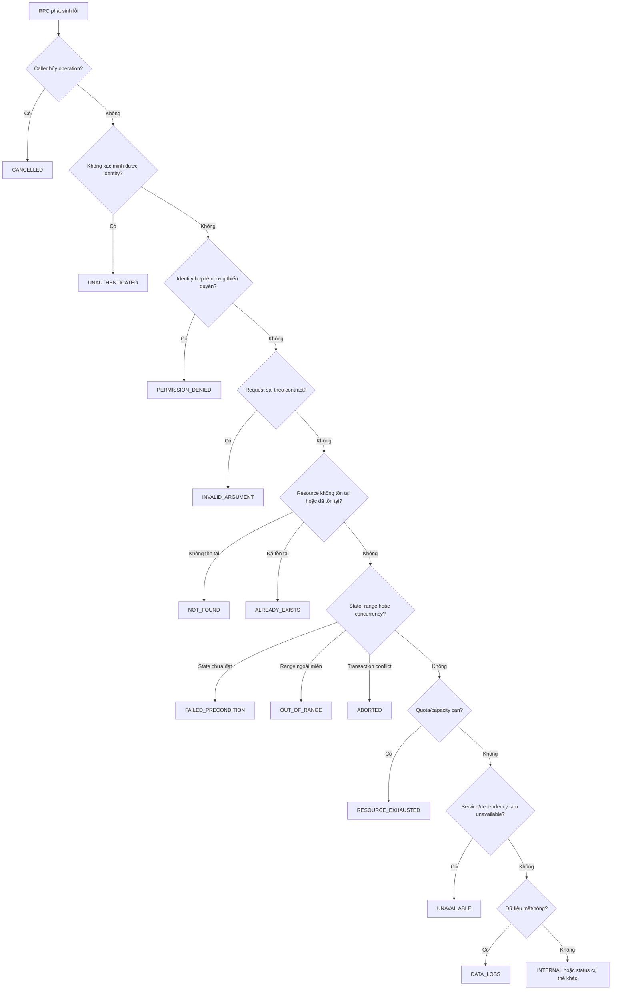

# Chọn status code phản ánh đúng nguyên nhân

Trong gRPC, status code là kết quả cuối cùng của một RPC và là một phần của contract giữa server với client. Một status được chọn đúng cho client biết request thành công, bị từ chối vì dữ liệu hay quyền, chưa thể thực hiện do trạng thái hiện tại, thất bại vì cạnh tranh tài nguyên, hay gặp sự cố hạ tầng. Status cũng giúp retry policy, telemetry, dashboard và quy trình vận hành phân loại lỗi nhất quán.

Trong **SPRING_GRPC**, status nên phản ánh nguyên nhân đã được xác định ở application/domain boundary. Không nên ánh xạ mọi exception thành INTERNAL, cũng không nên chọn status theo câu message hoặc tên exception wrapper một cách máy móc. Hãy xác định điều gì đã xảy ra, operation đã tạo side effect chưa, caller có thể khắc phục thế nào và có an toàn để retry không.

## 1. Nguyên tắc chọn status

Trước khi ánh xạ lỗi, hãy trả lời bốn câu hỏi:

1. **Request có hợp lệ theo contract không?** Nếu sai cấu trúc hoặc tham số, đây thường là lỗi đầu vào.
2. **Caller có được xác thực và có quyền không?** Authentication và authorization là hai quyết định riêng.
3. **Resource và trạng thái nghiệp vụ có đáp ứng điều kiện không?** Tài nguyên có thể không tồn tại, đã tồn tại, nằm ngoài range hoặc chưa sẵn sàng cho action.
4. **Lỗi có thể phục hồi bằng retry không?** Phân biệt conflict cần đọc lại, service tạm thời unavailable, quota đã cạn, lỗi nội bộ và data corruption.

Status code cần được chọn theo semantics mà client phải hành động dựa vào, không chỉ theo implementation detail ở server. Hai exception Java khác nhau có thể cần cùng status nếu chúng biểu thị cùng nguyên nhân; một exception wrapper giống nhau cũng có thể che nhiều nguyên nhân cần status khác nhau.

## 2. Bảng tra cứu các status code chuẩn

gRPC định nghĩa 17 status code chuẩn. Bảng sau tóm tắt ý nghĩa thường dùng trong API:

| Mã | Status | Khi nào dùng |
| ---: | --- | --- |
| 0 | **OK** | RPC hoàn tất thành công |
| 1 | **CANCELLED** | Operation bị caller hủy hoặc bị hủy theo ngữ cảnh |
| 2 | **UNKNOWN** | Lỗi không xác định được nguyên nhân cụ thể hoặc không ánh xạ được tốt hơn |
| 3 | **INVALID_ARGUMENT** | Request chứa tham số không hợp lệ, bất kể trạng thái hệ thống |
| 4 | **DEADLINE_EXCEEDED** | RPC không hoàn tất trước deadline |
| 5 | **NOT_FOUND** | Resource được tham chiếu không tồn tại hoặc được cố ý che giấu theo policy |
| 6 | **ALREADY_EXISTS** | Resource mà operation muốn tạo đã tồn tại |
| 7 | **PERMISSION_DENIED** | Caller đã được xác định nhưng không có quyền |
| 8 | **RESOURCE_EXHAUSTED** | Quota hoặc tài nguyên hữu hạn đã cạn/vượt giới hạn |
| 9 | **FAILED_PRECONDITION** | Trạng thái hiện tại chưa đáp ứng điều kiện để thực hiện operation |
| 10 | **ABORTED** | Operation bị hủy do conflict ở cấp transaction/concurrency |
| 11 | **OUT_OF_RANGE** | Vị trí, chỉ số hoặc range nằm ngoài miền hợp lệ |
| 12 | **UNIMPLEMENTED** | Operation chưa được triển khai hoặc không được hỗ trợ |
| 13 | **INTERNAL** | Lỗi nội bộ bất ngờ, không có status cụ thể hơn phù hợp |
| 14 | **UNAVAILABLE** | Service hoặc dependency tạm thời không thể phục vụ |
| 15 | **DATA_LOSS** | Phát hiện mất hoặc hỏng dữ liệu nghiêm trọng |
| 16 | **UNAUTHENTICATED** | Không xác minh được danh tính caller |

Bảng này là điểm bắt đầu. Contract của từng service cần quy định thêm những trường hợp biên, đặc biệt với NOT_FOUND, OUT_OF_RANGE, FAILED_PRECONDITION, ABORTED và các lỗi có thể retry.

## 3. Decision tree để chọn status

Có thể dùng quy trình sau khi một RPC thất bại:



Decision tree là cách đặt câu hỏi, không phải thứ tự bắt buộc cho mọi service. Một số API cần kiểm tra authorization trước khi tiết lộ resource có tồn tại hay không. Nếu lỗi xảy ra do deadline hoặc cancellation, gRPC runtime cũng có thể kết thúc call trước khi handler trả một status nghiệp vụ.

## 4. Phân biệt các nhóm lỗi dễ nhầm

### 4.1. INVALID_ARGUMENT, FAILED_PRECONDITION và OUT_OF_RANGE

Ba status này đều có thể xuất hiện khi client gửi giá trị không dùng được, nhưng nguyên nhân khác nhau:

| Status | Câu hỏi | Ví dụ |
| --- | --- | --- |
| **INVALID_ARGUMENT** | Giá trị có sai theo contract bất kể system state không? | ID sai định dạng, số lượng âm, timestamp start sau end |
| **FAILED_PRECONDITION** | Request hợp lệ nhưng trạng thái hiện tại ngăn operation? | Order chưa thanh toán nên chưa thể giao |
| **OUT_OF_RANGE** | Giá trị hợp lệ về kiểu nhưng nằm ngoài miền hiện có? | Offset vượt file size, sequence vượt bounds |

Ví dụ với RPC đọc file:

- Offset âm: INVALID_ARGUMENT.
- Offset dương nhưng lớn hơn file size hiện tại: OUT_OF_RANGE.
- File đang bị khóa bởi workflow nghiệp vụ nên không cho phép đọc: có thể là FAILED_PRECONDITION, theo contract.
- File không tồn tại: NOT_FOUND.

Một query hợp lệ không có kết quả thường trả OK với danh sách rỗng. Không dùng NOT_FOUND hoặc OUT_OF_RANGE chỉ vì collection rỗng nếu contract định nghĩa đó là kết quả hợp lệ.

### 4.2. UNAUTHENTICATED và PERMISSION_DENIED

- **UNAUTHENTICATED:** server không xác minh được caller là ai, ví dụ token thiếu, hết hạn hoặc sai chữ ký.
- **PERMISSION_DENIED:** server đã xác minh identity nhưng policy không cho phép caller thực hiện action.

Token hợp lệ nhưng thiếu scope không nên trả UNAUTHENTICATED, vì đăng nhập lại không cấp thêm quyền. Ngược lại, token hết hạn không nên trả PERMISSION_DENIED, vì client có thể cần refresh credential theo policy.

### 4.3. NOT_FOUND và ALREADY_EXISTS

- **NOT_FOUND:** operation tham chiếu một resource không tồn tại.
- **ALREADY_EXISTS:** operation muốn tạo resource nhưng key/identity đó đã được dùng.

Một số API cố ý trả NOT_FOUND cho cả resource không tồn tại và resource caller không được phép nhìn thấy để tránh enumeration. Nếu chọn cách này, phải áp dụng nhất quán và không để message, timing hoặc error details tiết lộ khác biệt.

### 4.4. FAILED_PRECONDITION, ABORTED và UNAVAILABLE

| Status | Nguyên nhân | Client thường cần làm gì |
| --- | --- | --- |
| FAILED_PRECONDITION | Điều kiện nghiệp vụ chưa đạt | Thay đổi state/hoàn tất prerequisite rồi gọi lại |
| ABORTED | Conflict khi transaction hoặc cập nhật đồng thời | Đọc lại dữ liệu và chạy lại toàn bộ read-modify-write |
| UNAVAILABLE | Service/dependency tạm không thể phục vụ | Retry call có kiểm soát nếu operation an toàn |

Đây là khác biệt quan trọng đối với retry. Gửi lại cùng câu lệnh với version cũ sau ABORTED thường tiếp tục thất bại. Retry UNAVAILABLE có thể phù hợp nếu request idempotent. Retry FAILED_PRECONDITION khi state chưa đổi thường chỉ lặp lại cùng kết quả.

### 4.5. RESOURCE_EXHAUSTED và UNAVAILABLE

RESOURCE_EXHAUSTED biểu thị quota hoặc giới hạn tài nguyên cụ thể đã bị chạm, ví dụ tenant hết quota export hoặc admission queue đầy. UNAVAILABLE biểu thị service/dependency hiện không thể phục vụ, ví dụ backend mất kết nối hoặc server đang failover.

Nếu queue/capacity limit là một policy từ chối có chủ đích, RESOURCE_EXHAUSTED thường giúp client hiểu đúng hơn. Nếu node hoặc dependency hỏng khiến service không thể hoạt động, UNAVAILABLE thường phù hợp hơn.

### 4.6. INTERNAL và DATA_LOSS

- **INTERNAL:** lỗi xử lý nội bộ bất ngờ, invariant hoặc bug; chưa có bằng chứng dữ liệu bị mất/hỏng.
- **DATA_LOSS:** có bằng chứng dữ liệu đã mất hoặc corruption nghiêm trọng.

Không nâng mọi lỗi parse, query hoặc đọc storage thành DATA_LOSS. Cần xác minh checksum, version, replica và khả năng phục hồi. Nếu lỗi chỉ là bug chuyển đổi dữ liệu nhưng dữ liệu gốc vẫn nguyên vẹn, INTERNAL có thể phù hợp hơn.

## 5. Phân loại theo khả năng phục hồi

Status code ảnh hưởng trực tiếp đến hành động của client. Một cách nhìn hữu ích là phân nhóm theo loại phục hồi:

| Nhóm | Status tiêu biểu | Hành động |
| --- | --- | --- |
| Caller sửa request | INVALID_ARGUMENT, OUT_OF_RANGE | Sửa tham số hoặc chọn range hợp lệ |
| Caller thay đổi identity/quyền | UNAUTHENTICATED, PERMISSION_DENIED | Refresh/login hoặc xin quyền; không lặp vô hạn |
| Workflow/resource state | NOT_FOUND, ALREADY_EXISTS, FAILED_PRECONDITION | Đọc lại resource hoặc hoàn tất bước nghiệp vụ |
| Concurrency | ABORTED | Đọc lại và chạy lại transaction/command theo policy |
| Capacity/availability | RESOURCE_EXHAUSTED, UNAVAILABLE | Giảm tải, chờ reset hoặc retry có backoff |
| Caller/runtime lifecycle | CANCELLED, DEADLINE_EXCEEDED | Dừng công việc hoặc quyết định lại deadline |
| Server/data integrity | UNKNOWN, INTERNAL, UNIMPLEMENTED, DATA_LOSS | Điều tra, fallback có contract hoặc phục hồi dữ liệu |

Không phải status nào trong một nhóm cũng có cùng retry semantics. RESOURCE_EXHAUSTED do rate limit ngắn hạn có thể retry sau delay; quota tháng đã cạn thì không. UNIMPLEMENTED thường không được khắc phục bằng retry; client cần capability fallback hoặc server mới.

## 6. Deadline, cancellation và status

DEADLINE_EXCEEDED và CANCELLED phản ánh vòng đời call:

- **DEADLINE_EXCEEDED:** deadline do caller đặt đã hết trước khi RPC hoàn tất.
- **CANCELLED:** caller hoặc một ngữ cảnh liên quan đã hủy operation.

Trong server, cần truyền cancellation/deadline xuống application work nếu có thể. Không tiếp tục xử lý tốn tài nguyên sau khi client đã hủy nếu operation chưa có lý do phải hoàn tất. Tuy nhiên, nếu transaction đã commit hoặc side effect đã xảy ra, cancellation không tự rollback được kết quả.

Với Spring gRPC, hãy xác định deadline còn lại trước khi gọi downstream, đặt timeout tương ứng và dừng công việc khi call bị hủy. Không map mọi timeout của dependency thành DEADLINE_EXCEEDED: nếu dependency không thể kết nối hoặc service unavailable, UNAVAILABLE có thể đúng hơn. Nếu deadline của chính RPC đã hết, client thường quan sát DEADLINE_EXCEEDED.

## 7. Mapping exception ở Spring gRPC

Một lớp application/domain nên phát sinh exception có ý nghĩa nghiệp vụ, còn gRPC boundary chuyển chúng thành status. Ví dụ:

```java
public final class GrpcStatusMapper {
    public static StatusRuntimeException toStatus(Throwable error) {
        if (error instanceof ProductNotFoundException) {
            return Status.NOT_FOUND
                .withDescription("Không tìm thấy sản phẩm")
                .asRuntimeException();
        }
        if (error instanceof AccessDeniedException) {
            return Status.PERMISSION_DENIED
                .withDescription("Không có quyền thực hiện thao tác")
                .asRuntimeException();
        }
        if (error instanceof InvalidProductRequestException) {
            return Status.INVALID_ARGUMENT
                .withDescription("Dữ liệu yêu cầu không hợp lệ")
                .asRuntimeException();
        }
        if (error instanceof QuotaExceededException) {
            return Status.RESOURCE_EXHAUSTED
                .withDescription("Quota đã được sử dụng hết")
                .asRuntimeException();
        }
        if (error instanceof TransientCatalogUnavailableException) {
            return Status.UNAVAILABLE
                .withDescription("Dịch vụ catalog tạm thời không sẵn sàng")
                .asRuntimeException();
        }

        return Status.INTERNAL
            .withDescription("Lỗi nội bộ khi xử lý yêu cầu")
            .asRuntimeException();
    }
}
```

Các exception trong ví dụ là kiểu domain/application do ứng dụng định nghĩa. Mapper cần được mở rộng theo contract thực tế và phân biệt rõ nguyên nhân. Không map RuntimeException tổng quát thành status nghiệp vụ chỉ dựa vào message.

Một endpoint unary có thể dùng mapper:

```java
try {
    Product product = catalogService.getProduct(request.getProductId());
    observer.onNext(toReply(product));
    observer.onCompleted();
} catch (Exception ex) {
    StatusRuntimeException statusError = GrpcStatusMapper.toStatus(ex);
    observer.onError(statusError);
}
```

Trong production, nên log exception gốc với trace/correlation ID trước khi trả status. Cần bảo đảm mapper không làm mất cause, stack trace hoặc thông tin phục vụ điều tra ở server. Có thể tích hợp mapper qua interceptor/advice của gRPC starter, nhưng phải kiểm thử rằng mọi service thực sự đi qua cơ chế đó.

### 7.1. Không ánh xạ theo tên exception một cách mù quáng

Một DataAccessException có thể là connection outage, constraint violation, query bug hoặc corruption. Một IllegalStateException có thể do state nghiệp vụ chưa đạt hoặc do bug lập trình. Hãy xem root cause và context:

- Dependency connection failure đã xác định: có thể là UNAVAILABLE.
- Unique constraint do resource đã tồn tại: có thể là ALREADY_EXISTS.
- Optimistic lock/serialization conflict: có thể là ABORTED.
- Invariant nội bộ bị phá vỡ ngoài dự kiến: có thể là INTERNAL.
- Checksum xác nhận corruption không thể phục hồi: có thể là DATA_LOSS.

Nếu chưa đủ căn cứ, không bịa một nguyên nhân cụ thể. Giữ status tổng quát phù hợp và ghi nhận lỗi để điều tra.

## 8. Rich error details: status code và thông tin máy đọc được

Status code mô tả loại lỗi ở mức tổng quát. Khi client cần biết chi tiết để khắc phục, có thể dùng richer error model của Google RPC:

| Detail | Mục đích |
| --- | --- |
| google.rpc.BadRequest | Chỉ ra field/request violation |
| google.rpc.PreconditionFailure | Mô tả precondition bị vi phạm |
| google.rpc.QuotaFailure | Mô tả quota violation |
| google.rpc.RetryInfo | Gợi ý thời gian chờ trước khi retry |
| google.rpc.ErrorInfo | Reason/domain và metadata ổn định |
| google.rpc.ResourceInfo | Mô tả resource liên quan nếu được phép |
| google.rpc.DebugInfo | Thông tin debug; cần hạn chế nghiêm ngặt với client không tin cậy |

Ví dụ logic cho validation:

```text
status: INVALID_ARGUMENT
detail:
  type: google.rpc.BadRequest
  field_violations:
    - field: "page_size"
      description: "Must be between 1 and 100"
```

Ví dụ logic cho rate limit:

```text
status: RESOURCE_EXHAUSTED
detail:
  type: google.rpc.RetryInfo
  retry_delay: 2 seconds
```

Đây là minh họa nội dung detail, không phải HTTP header chuẩn. Trong gRPC Java, có thể đóng gói com.google.rpc.Status và detail Protobuf bằng Any, rồi chuyển thành exception bằng io.grpc.protobuf.StatusProto. Chỉ đưa thông tin client được phép biết; không gửi stack trace, token, SQL, internal host hoặc dữ liệu của tenant khác.

Client nên dựa vào status code và detail type/reason ổn định, không parse câu grpc-message để quyết định logic. Message có thể thay đổi ngôn ngữ hoặc cách diễn đạt mà không nên phá contract.

## 9. Retry policy phải theo semantics của status và operation

Không có quy tắc “mọi lỗi server đều retry”. Trước khi retry, client cần biết:

- Status có biểu thị tình trạng tạm thời không?
- Operation là read-only, idempotent hay có side effect?
- Server có thể đã commit trước khi response bị mất không?
- Deadline tổng còn đủ không?
- Có RetryInfo hoặc policy retry theo method không?
- Retry có thể tạo retry storm hoặc làm dependency quá tải không?

| Status | Retry tự động thường nên thế nào |
| --- | --- |
| INVALID_ARGUMENT | Không; sửa request |
| UNAUTHENTICATED | Chỉ refresh credential theo policy, có giới hạn |
| PERMISSION_DENIED | Không; cần quyền/policy thay đổi |
| NOT_FOUND | Thường không; trừ khi resource được tạo bất đồng bộ và contract cho phép chờ |
| ALREADY_EXISTS | Không lặp create; đọc resource hoặc xử lý idempotency |
| FAILED_PRECONDITION | Không khi state chưa đổi; hoàn tất prerequisite |
| ABORTED | Retry toàn bộ transaction/read-modify-write nếu intent còn hợp lệ |
| OUT_OF_RANGE | Điều chỉnh range hoặc tải lại bounds |
| RESOURCE_EXHAUSTED | Chờ/reset hoặc giảm tải; chỉ retry theo loại quota/capacity |
| UNAVAILABLE | Có thể retry với backoff, jitter, deadline và idempotency |
| DEADLINE_EXCEEDED | Chỉ retry nếu operation an toàn và còn deadline cho lần thử mới |
| CANCELLED | Không tự retry nếu caller đã chủ động hủy |
| UNIMPLEMENTED | Không retry cùng endpoint/version; fallback hoặc nâng cấp |
| INTERNAL | Thường không retry tự động nếu chưa xác định lỗi transient |
| DATA_LOSS | Không retry mù quáng; bảo toàn bằng chứng và phục hồi |
| UNKNOWN | Cần điều tra nguyên nhân; không suy đoán retry semantics |

### 9.1. Idempotency và side effect

Với thao tác tạo đơn hàng, thanh toán, gửi thông báo hoặc cập nhật trạng thái, retry có thể thực hiện side effect hai lần nếu lần đầu đã commit nhưng response bị mất. Dùng idempotency key hoặc operation ID để server nhận diện request lặp và trả lại kết quả đã ghi nhận.

Trong Spring, transactional outbox có thể ghi business state và event trong cùng transaction; worker chỉ publish event sau commit. Với downstream không hỗ trợ transaction chung, cần idempotency ở downstream hoặc quy trình reconciliation. Status code một mình không chứng minh operation chưa xảy ra.

### 9.2. Backoff, jitter và retry budget

Với lỗi tạm thời như UNAVAILABLE, dùng exponential backoff có jitter, số lần thử tối đa và deadline tổng. Jitter tránh nhiều client retry cùng thời điểm. Retry budget giới hạn tổng traffic phát sinh từ retry. Tránh retry lồng nhau ở client, gateway, service và database mà không có ngân sách chung.

## 10. Streaming RPC và status cuối

Trong streaming, server có thể đã gửi một hoặc nhiều message trước khi stream kết thúc với status lỗi. Status cuối không tự thu hồi những message client đã nhận.

Contract cần xác định:

- Message nào đã được xác nhận/commit?
- Stream có sequence number, cursor hoặc checkpoint để resume không?
- Khi reconnect, client có thể gửi lại message đã xử lý không?
- Một message lỗi kết thúc toàn stream hay chỉ trả kết quả lỗi cho item đó?
- CANCELLED hoặc DEADLINE_EXCEEDED có dừng producer và giải phóng tài nguyên không?

Với stream đọc dữ liệu, UNAVAILABLE có thể cho phép resume từ cursor. Với stream ghi dữ liệu, cần acknowledgement và idempotency để tránh duplicate. Với DATA_LOSS, phải xác minh integrity trước khi tiếp tục từ checkpoint. Không giả định mọi message trước status lỗi đều rollback.

## 11. Kiểm thử status mapping

Integration test nên gọi qua gRPC client/server để xác minh status thực tế và details:

| Kịch bản | Kết quả cần kiểm tra |
| --- | --- |
| Request sai định dạng | INVALID_ARGUMENT, có field detail nếu contract hỗ trợ |
| Token thiếu/hết hạn | UNAUTHENTICATED |
| Token hợp lệ nhưng thiếu quyền | PERMISSION_DENIED |
| Resource không tồn tại | NOT_FOUND |
| Resource đã tồn tại khi create | ALREADY_EXISTS |
| State chưa đáp ứng action | FAILED_PRECONDITION |
| Hai transaction cạnh tranh | ABORTED theo semantics |
| Range vượt bounds | OUT_OF_RANGE |
| Quota hết | RESOURCE_EXHAUSTED và retry guidance phù hợp |
| Service/dependency tạm mất | UNAVAILABLE |
| Deadline hết hoặc caller hủy | DEADLINE_EXCEEDED/CANCELLED theo nguyên nhân |
| Method chưa được hỗ trợ | UNIMPLEMENTED |
| Exception không dự kiến | INTERNAL, không lộ stack trace |
| Checksum xác nhận corruption | DATA_LOSS và recovery/alert path |

Ngoài status, test cần xác minh side effect, transaction rollback/commit, retry count, deadline, cancellation, rich details và log privacy. Test mapper đơn vị không thay thế integration test qua gRPC runtime.

## 12. Observability và vận hành

Status code là một chiều quan trọng của telemetry. Nên ghi nhận:

- Số lượng/tỷ lệ status theo service và method.
- Nhóm reason đã chuẩn hóa, không dùng message tự do làm metric label.
- Client/server version và deployment khi cần phân tích rollout.
- Retry attempt, retry success, retry exhaustion và deadline.
- Correlation/trace ID để nối client, interceptor, application service và downstream.
- Side effect/operation ID khi cần điều tra kết quả chưa rõ.

Tránh dùng user ID, token, resource ID hoặc request ID có cardinality cao làm metric labels. Log có thể chứa context chi tiết hơn nhưng phải lọc credential, dữ liệu cá nhân và payload nhạy cảm. DATA_LOSS cần alert theo severity cao; UNAVAILABLE cần theo dõi dependency health và retry amplification; INTERNAL cần gắn với exception source và release version.

Không chỉ theo dõi tổng số lỗi. Tỷ lệ PERMISSION_DENIED tăng có thể là thay đổi policy hoặc client dùng sai scope; OUT_OF_RANGE tăng có thể là metadata cũ; ABORTED tăng có thể là contention; RESOURCE_EXHAUSTED tăng có thể là quota hoặc capacity. Phân nhóm theo status giúp điều tra đúng hướng.

## 13. Những lỗi thiết kế thường gặp

| Sai lầm | Hậu quả | Cách làm tốt hơn |
| --- | --- | --- |
| Map mọi exception thành INTERNAL | Client không biết cách phục hồi | Phân loại root cause và dùng status cụ thể |
| Map theo message text | Thay đổi câu chữ làm đổi semantics | Dùng domain exception và reason ổn định |
| Dùng UNAUTHENTICATED cho thiếu quyền | Client refresh token vô ích | Tách authentication và authorization |
| Dùng INVALID_ARGUMENT cho state conflict | Client sửa request sai hướng | Phân biệt request validation và precondition/concurrency |
| Retry mọi status server | Retry storm hoặc side effect trùng | Retry theo status, idempotency và deadline |
| Dùng UNAVAILABLE cho quota policy | Client retry khi cần chờ reset/giảm tải | Dùng RESOURCE_EXHAUSTED khi quota/capacity bị chạm |
| Trả stack trace qua grpc-message | Rò rỉ thông tin nội bộ | Message an toàn, log/trace được bảo vệ |
| Dùng DATA_LOSS khi chưa xác minh corruption | Báo động sai và kích hoạt recovery không cần thiết | Kiểm tra integrity và replica trước khi kết luận |
| Không kiểm thử status qua gRPC runtime | Mapper đúng nhưng interceptor/registration có thể sai | Integration test end-to-end ở ranh giới RPC |

## 14. Checklist trước khi phát hành gRPC method

1. **Contract:** request/response và semantics thành công đã rõ chưa?
2. **Validation:** giá trị sai được phân biệt với range/state error chưa?
3. **Identity:** UNAUTHENTICATED và PERMISSION_DENIED có tách biệt không?
4. **Resource:** NOT_FOUND và ALREADY_EXISTS có đúng với semantics không?
5. **State/concurrency:** FAILED_PRECONDITION và ABORTED có được phân biệt không?
6. **Capacity/availability:** quota/capacity có khác service outage không?
7. **Server/data:** INTERNAL chỉ dành cho lỗi không mong đợi; DATA_LOSS có bằng chứng integrity không?
8. **Lifecycle:** deadline và cancellation có được truyền tới downstream/worker không?
9. **Retry:** status nào retry được, có idempotency, backoff, jitter và retry budget không?
10. **Details:** error detail có schema ổn định và không lộ thông tin nhạy cảm không?
11. **Streaming:** partial result, checkpoint, resume và cancellation semantics đã rõ chưa?
12. **Telemetry:** metric, trace, audit và alert có phân loại theo status/reason không?
13. **Tests:** có integration test cho cả success, lỗi nghiệp vụ, lỗi hạ tầng và side effect không?

## 15. Ghi nhớ

Chọn status code là quyết định về contract: status phải nói đúng nguyên nhân mà client có thể hành động dựa vào. INVALID_ARGUMENT dành cho request sai; UNAUTHENTICATED và PERMISSION_DENIED tách identity khỏi quyền; NOT_FOUND/ALREADY_EXISTS mô tả resource; FAILED_PRECONDITION/ABORTED tách state khỏi concurrency; RESOURCE_EXHAUSTED/UNAVAILABLE tách quota khỏi availability; INTERNAL dành cho lỗi nội bộ bất ngờ; DATA_LOSS dành cho mất/hỏng dữ liệu đã xác nhận.

Trong Spring gRPC, hãy tạo domain exception rõ nghĩa, ánh xạ tại một boundary thống nhất, giữ nguyên nguyên nhân trong log/trace an toàn và cung cấp rich error details khi client cần hành động có cấu trúc. Retry phải dựa trên status, deadline, idempotency và side effect; streaming phải định nghĩa partial result/checkpoint. Kiểm thử qua gRPC runtime và theo dõi status theo method giúp contract ổn định, client phục hồi đúng cách và đội vận hành tìm ra nguyên nhân nhanh hơn.

### Tài liệu tham khảo

- [gRPC – Status codes](https://grpc.io/docs/guides/status-codes/)
- [gRPC – Error handling](https://grpc.io/docs/guides/error/)
- [gRPC – Retry](https://grpc.io/docs/guides/retry/)
- [gRPC – Deadlines](https://grpc.io/docs/guides/deadlines/)
- [Google API – Error model](https://cloud.google.com/apis/design/errors)
- [Spring Framework – Data access](https://docs.spring.io/spring-framework/reference/data-access.html)
