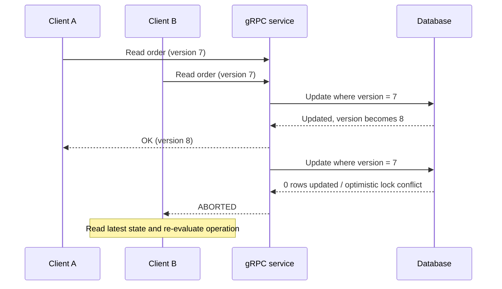

# Lỗi cạnh tranh và ABORTED

**Chương:** Error handling  
**Phạm vi:** Spring gRPC (SPRING_GRPC) dùng hợp đồng Protocol Buffers, mã Java được sinh và RPC unary hoặc streaming. Bài này tập trung vào xung đột khi nhiều request cùng thay đổi một tài nguyên và cách biểu diễn xung đột đó bằng gRPC status ABORTED.

## 1. Lỗi cạnh tranh xảy ra như thế nào?

Giả sử hai nhân viên cùng mở một đơn hàng có phiên bản 7. Người thứ nhất cập nhật địa chỉ; người thứ hai cập nhật trạng thái giao hàng. Cả hai đọc cùng dữ liệu ban đầu. Nếu server cho cả hai ghi mà không kiểm tra phiên bản, lần ghi sau có thể ghi đè thay đổi của lần ghi trước (*lost update*).

Optimistic locking phát hiện tình huống này bằng một version hoặc điều kiện compare-and-set. Chỉ một transaction được phép ghi trên phiên bản đã đọc. Transaction còn lại thất bại vì dữ liệu đã thay đổi.



Xung đột không nhất thiết là bug. Trong hệ thống có nhiều writer, đây là kết quả hợp lệ của cơ chế bảo vệ tính nhất quán. Điều quan trọng là server và client phải hiểu cách phục hồi.

## 2. Vì sao dùng gRPC status ABORTED?

`ABORTED` biểu thị thao tác bị hủy do một xung đột, thường là xung đột đồng thời hoặc transaction bị abort. Caller thường cần **thử lại ở cấp cao hơn**, nghĩa là đọc lại trạng thái hoặc chạy lại toàn bộ transaction/workflow, thay vì lặp nguyên một lời gọi thấp hơn.

Phân biệt với các status gần nghĩa:

| Status | Khi nào dùng | Client cần làm gì |
| --- | --- | --- |
| `ABORTED` | Xung đột đồng thời, optimistic lock hoặc transaction serialization conflict | Đọc lại dữ liệu, đánh giá lại thao tác và chạy lại workflow |
| `FAILED_PRECONDITION` | Trạng thái hiện tại không cho phép thao tác cho đến khi điều kiện được thay đổi | Sửa điều kiện nghiệp vụ trước khi thử lại |
| `ALREADY_EXISTS` | Tạo tài nguyên có định danh đã tồn tại | Tra cứu tài nguyên hoặc xử lý trùng |
| `UNAVAILABLE` | Service/dependency tạm thời không sẵn sàng | Retry call có backoff nếu thao tác an toàn |
| `RESOURCE_EXHAUSTED` | Vượt quota hoặc giới hạn tài nguyên | Giảm tải hoặc chờ quota |
| `DEADLINE_EXCEEDED` | Ngân sách thời gian của RPC đã hết | Xác minh kết quả nếu thao tác có tác dụng phụ |
| `INTERNAL` | Lỗi nội bộ không mong đợi | Điều tra phía server |

Ví dụ:

- Hai client cập nhật cùng phiên bản đơn hàng: `ABORTED`.
- Đơn hàng đã giao nên không thể hủy theo quy tắc nghiệp vụ: `FAILED_PRECONDITION`.
- Tạo đơn hàng với mã đơn đã tồn tại: `ALREADY_EXISTS`.
- Service đơn hàng không kết nối được tới kho dữ liệu do sự cố tạm thời: có thể là `UNAVAILABLE`, tùy nguyên nhân và hợp đồng.

Không dùng `ABORTED` cho mọi lỗi database. Chỉ ánh xạ khi đã xác định nguyên nhân là xung đột hoặc transaction bị abort có thể được giải quyết bằng cách chạy lại workflow.

## 3. Phát hiện cạnh tranh bằng optimistic locking

Với Spring Data JPA, trường `@Version` giúp phát hiện cập nhật đồng thời. ORM tạo câu lệnh cập nhật có điều kiện theo version; nếu một transaction khác đã cập nhật trước, lần flush/commit hiện tại sẽ thất bại.

```java
@Entity
public class Inventory {
    @Id
    private String sku;

    @Version
    private long version;

    private int available;

    public void reserve(int quantity) {
        if (quantity <= 0) {
            throw new IllegalArgumentException("quantity must be positive");
        }
        if (available < quantity) {
            throw new InsufficientStockException();
        }
        available -= quantity;
    }

    public long getVersion() {
        return version;
    }

    public int getAvailable() {
        return available;
    }
}
```

Nếu hai transaction cùng đọc version 12, cả hai có thể tính toán trên cùng snapshot. Khi ghi, database chỉ cho transaction đầu cập nhật hàng có version 12 và tăng version. Transaction thứ hai không còn thỏa điều kiện version nên ORM ném lỗi optimistic locking.

Có thể dùng compare-and-set trực tiếp ở repository:

```sql
UPDATE inventory
SET available = available - :quantity,
    version = version + 1
WHERE sku = :sku
  AND version = :expectedVersion
  AND available >= :quantity;
```

Nếu số hàng được cập nhật bằng 0, cần xác định nguyên nhân: SKU không tồn tại, version đã đổi hay số lượng tồn không đủ. Không được gộp tất cả thành `ABORTED`; mỗi nguyên nhân có status phù hợp theo hợp đồng API. Một truy vấn đọc bổ sung hoặc thao tác SQL có kết quả phân loại rõ hơn có thể cần thiết.

## 4. Ánh xạ optimistic locking sang ABORTED

Ở tầng ứng dụng, có thể chuẩn hóa xung đột thành exception riêng. Mapper gRPC chuyển exception đó thành status:

```java
public class ConcurrentUpdateException extends RuntimeException {
    public ConcurrentUpdateException(String message, Throwable cause) {
        super(message, cause);
    }
}

@Component
public class ConcurrencyStatusMapper {

    public StatusRuntimeException map(ConcurrentUpdateException error) {
        return Status.ABORTED
                .withDescription(
                        "Dữ liệu đã thay đổi; hãy tải lại và thử lại thao tác")
                .asRuntimeException();
    }
}
```

Trong Spring, optimistic locking có thể xuất hiện dưới dạng `OptimisticLockingFailureException` của Spring DAO hoặc exception JPA tương ứng. Chỉ bắt các loại exception đã xác định là optimistic conflict:

```java
@GrpcService
public class InventoryGrpcService
        extends InventoryServiceGrpc.InventoryServiceImplBase {

    private final InventoryApplicationService applicationService;
    private final ConcurrencyStatusMapper statusMapper;

    public InventoryGrpcService(
            InventoryApplicationService applicationService,
            ConcurrencyStatusMapper statusMapper) {
        this.applicationService = applicationService;
        this.statusMapper = statusMapper;
    }

    @Override
    public void reserve(
            ReserveRequest request,
            StreamObserver<ReserveResponse> responseObserver) {
        try {
            var result = applicationService.reserve(
                    request.getSku(),
                    request.getQuantity(),
                    request.getExpectedVersion());
            responseObserver.onNext(toProto(result));
            responseObserver.onCompleted();
        } catch (ConcurrentUpdateException conflict) {
            responseObserver.onError(statusMapper.map(conflict));
        } catch (OptimisticLockingFailureException conflict) {
            responseObserver.onError(
                    Status.ABORTED
                            .withDescription(
                                    "Dữ liệu đã thay đổi; hãy tải lại và thử lại thao tác")
                            .asRuntimeException());
        } catch (InsufficientStockException insufficient) {
            responseObserver.onError(
                    Status.FAILED_PRECONDITION
                            .withDescription("Không đủ hàng tồn kho")
                            .asRuntimeException());
        }
    }
}
```

Đây là ví dụ ở adapter. Cần có fallback an toàn cho lỗi không dự kiến và không để exception message nội bộ xuất hiện trong status description. Không chuyển mọi `DataAccessException` thành `ABORTED`: lỗi kết nối database, lỗi SQL hoặc constraint khác có semantics khác nhau.

## 5. Version trong API giúp client phát hiện stale write

Với thao tác cập nhật có điều kiện, hợp đồng protobuf có thể mang version mà client đã đọc:

```proto
message ReserveRequest {
  string sku = 1;
  int32 quantity = 2;
  int64 expected_version = 3;
}

message ReserveResponse {
  string sku = 1;
  int32 remaining = 2;
  int64 new_version = 3;
}
```

Server so sánh `expected_version` với version hiện tại trong transaction. Nếu không khớp, trả `ABORTED`. Version là một phần của hợp đồng đồng thời, giúp client biết request được xây dựng dựa trên snapshot nào.

Nếu client dùng proto3 scalar không có presence, giá trị mặc định 0 có thể không phân biệt “không gửi version” với “gửi version 0”. Dùng `optional int64` hoặc quy ước version hợp lệ rõ ràng nếu presence quan trọng. Server vẫn phải kiểm tra và không tin version do client cung cấp như một bằng chứng bảo mật; nó chỉ là điều kiện concurrency.

## 6. Thử lại đúng cấp độ: đọc lại và tính lại

Giả sử client đọc tồn kho version 12 và muốn đặt trước 3 sản phẩm:

1. Client gửi `expected_version = 12`.
2. Một client khác cập nhật tồn kho lên version 13 trước.
3. Server trả `ABORTED`.
4. Client đọc lại tồn kho version 13.
5. Client kiểm tra số lượng hiện có và tính lại quyết định đặt trước.
6. Nếu thao tác vẫn hợp lệ, client gửi request mới với `expected_version = 13`.

**Không nên tự động gửi lại nguyên request cũ với version 12.** Nó sẽ tiếp tục thất bại vì snapshot vẫn cũ. Quan trọng hơn, nghiệp vụ có thể đã thay đổi: số lượng còn lại, giá, trạng thái hoặc quyền có thể khác.

Retry ở cấp workflow:

```java
for (int attempt = 1; attempt <= MAX_ATTEMPTS; attempt++) {
    InventorySnapshot snapshot = blockingStub.getInventory(
            GetInventoryRequest.newBuilder().setSku(sku).build());

    if (snapshot.getAvailable() < quantity) {
        throw new InsufficientStockException();
    }

    ReserveRequest request = ReserveRequest.newBuilder()
            .setSku(sku)
            .setQuantity(quantity)
            .setExpectedVersion(snapshot.getVersion())
            .build();

    try {
        return blockingStub.reserve(request);
    } catch (StatusRuntimeException error) {
        Status.Code code = Status.fromThrowable(error).getCode();
        if (code != Status.Code.ABORTED || attempt == MAX_ATTEMPTS) {
            throw error;
        }
        sleepWithBackoff(attempt);
        // Vòng lặp đọc snapshot mới và tính lại, không gửi lại request cũ.
    }
}
throw new IllegalStateException("Retry loop ended unexpectedly");
```

Đoạn mã giả định `MAX_ATTEMPTS` và `sleepWithBackoff` được cấu hình ở client. Trong ứng dụng thực, dùng scheduler/non-blocking retry nếu không muốn giữ thread; đồng thời giới hạn tổng thời gian theo deadline và retry budget.

## 7. Retry nội bộ server và ranh giới transaction

Có hai loại retry khác nhau:

- **Retry từ client/workflow:** nhận `ABORTED`, đọc lại trạng thái và đánh giá lại ý định nghiệp vụ. Đây là cách phù hợp khi request chứa `expected_version` của client.
- **Retry nội bộ server:** chỉ phù hợp khi server có thể chạy lại toàn bộ thao tác một cách an toàn từ dữ liệu mới, không vi phạm ý định của client và không lặp tác dụng phụ bên ngoài transaction.

Nếu server tự retry optimistic locking, mỗi lần thử phải dùng **transaction mới**. Không bắt lỗi optimistic lock bên trong transaction đã bị đánh dấu rollback-only rồi tiếp tục dùng transaction đó. Với Spring, có thể đặt vòng retry bên ngoài `TransactionTemplate.execute(...)` để mỗi lần gọi mở và kết thúc một transaction riêng.

Không retry tự động nếu:

- Thao tác đã gửi email, gọi payment gateway hoặc phát message ngoài transaction.
- Request có điều kiện version mà client yêu cầu phải được tôn trọng.
- Việc đọc lại và áp dụng lại có thể thay đổi ý nghĩa nghiệp vụ.
- Đã hết deadline hoặc retry budget.

Nếu cần phối hợp database và message broker, cân nhắc transactional outbox hoặc một workflow có idempotency; không đặt side effect bên ngoài vào vòng retry transaction một cách tùy tiện.

## 8. Backoff, giới hạn retry và idempotency

Nhiều client cùng nhận xung đột có thể retry đồng loạt, tạo thêm tải và làm xung đột nặng hơn. Dùng exponential backoff kèm jitter:

```text
delay = random(0, min(maxDelay, baseDelay * 2^(attempt - 1)))
```

Giới hạn:

- Số lần retry tối đa.
- Tổng thời gian retry không vượt deadline caller.
- Số request đồng thời tới cùng tài nguyên.
- Tần suất retry theo client/tenant.

Đối với thao tác ghi, cần phân biệt **retry do conflict** với **retry do mất response**. Khi nhận `ABORTED`, client biết server từ chối transaction vì conflict theo hợp đồng. Khi nhận `UNAVAILABLE` hoặc `DEADLINE_EXCEEDED`, kết quả có thể không rõ: server có thể đã commit trước khi response mất. Dùng idempotency key để tránh tạo tác dụng phụ trùng.

Nếu client đọc lại và tạo một command mới với version mới, request đã thay đổi. Chính sách idempotency phải xác định rõ ID cho từng lần thử hay ID cho toàn workflow; không tái sử dụng một key gắn với payload cũ cho request mới khác payload nếu server coi đó là xung đột idempotency.

## 9. Kiểm thử xung đột đồng thời

Test quan trọng nhất không chỉ gọi mapper; nó phải tạo được hai transaction cạnh tranh trên cùng version.

| Ca kiểm thử | Kỳ vọng |
| --- | --- |
| Hai client đọc cùng version, cùng cập nhật | Một thành công, một nhận `ABORTED` |
| Client retry sau khi đọc version mới | Thao tác thành công nếu điều kiện nghiệp vụ còn đúng |
| Client gửi lại version cũ | Tiếp tục nhận `ABORTED`, không ghi đè dữ liệu mới |
| Số lượng tồn kho không đủ | `FAILED_PRECONDITION`, không nhầm thành conflict |
| Tài nguyên không tồn tại | `NOT_FOUND` |
| Database connection tạm mất | Status dependency phù hợp, không giả dạng `ABORTED` |
| Side effect ngoài transaction | Không bị thực hiện lặp khi retry |

Unit test mapper:

```java
class ConcurrencyStatusMapperTest {

    private final ConcurrencyStatusMapper mapper =
            new ConcurrencyStatusMapper();

    @Test
    void concurrentUpdateMapsToAborted() {
        var error = mapper.map(
                new ConcurrentUpdateException("version changed", null));

        assertEquals(Status.Code.ABORTED,
                error.getStatus().getCode());
    }
}
```

Integration test nên dùng database thật hoặc test container với hai transaction đồng thời. Dùng `CountDownLatch`/barrier để cả hai transaction cùng đọc version trước khi cho phép ghi. Sau test, xác nhận:

- Chỉ một transaction thành công.
- Transaction còn lại nhận conflict và được chuyển thành `ABORTED`.
- Version tăng đúng một lần.
- Giá trị cuối cùng không bị lost update.
- Không có side effect trùng.

Tránh dựa vào `Thread.sleep()` để tạo race condition; đồng bộ bằng barrier giúp test lặp lại ổn định hơn. Test in-process có thể xác minh gRPC status ở client, nhưng kiểm thử concurrency ở persistence layer cần transaction/database thực.

## 10. Quan sát lỗi cạnh tranh trong vận hành

Theo dõi các chỉ số:

- Số lượng `ABORTED` theo RPC method và loại tài nguyên.
- Tỷ lệ xung đột trên tổng số cập nhật.
- Số lần retry trung bình và tỷ lệ retry thành công.
- Số lần retry hết ngân sách hoặc hết deadline.
- Thời gian transaction và thời gian chờ lock.
- Số side effect bị ngăn lặp nhờ idempotency.

Nếu `ABORTED` tăng đột biến, xem xét contention trên một số bản ghi nóng, batch cập nhật quá lớn, transaction kéo dài hoặc client giữ snapshot quá lâu. Đừng chỉ tăng số lần retry; điều đó có thể làm tăng tải mà không giải quyết điểm nghẽn. Cân nhắc giảm transaction duration, phân vùng dữ liệu, serialize thao tác trên tài nguyên nóng hoặc thiết kế command ít xung đột hơn.

## 11. Tự luyện tập

1. Hai client cùng đọc version 5 và cập nhật một tài khoản. Vì sao một request nên nhận `ABORTED`?
2. Một đơn hàng đã giao nên không thể hủy. Vì sao đây là `FAILED_PRECONDITION` chứ không phải `ABORTED`?
3. Client nhận `ABORTED`; hãy mô tả các bước đọc lại, kiểm tra lại nghiệp vụ và gửi request mới.
4. Vì sao không nên retry optimistic lock trong cùng transaction đã rollback-only?
5. Thiết kế integration test dùng hai transaction và barrier để chứng minh chỉ một cập nhật trên cùng version thành công.

**Ghi nhớ:** Dùng `ABORTED` cho xung đột đồng thời hoặc transaction bị abort. Client cần đọc trạng thái mới, đánh giá lại ý định và thử lại ở cấp workflow; không gửi lặp request với version cũ. Retry phải có giới hạn, backoff, deadline và idempotency phù hợp để bảo vệ dữ liệu cũng như tránh lặp tác dụng phụ.
