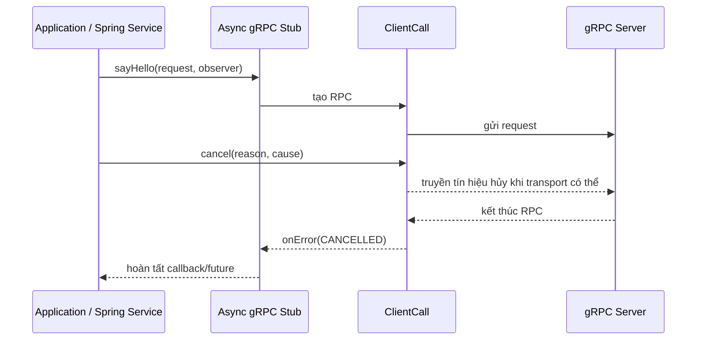

# Client hủy một RPC

Một client gRPC có thể không còn cần kết quả của một RPC: người dùng đóng màn hình, HTTP request phía trước bị hủy, một tác vụ nền bị dừng hoặc một luồng dữ liệu không còn consumer. Trong các trường hợp đó, client nên **hủy đúng lời gọi đang chạy** để giải phóng tài nguyên và thông báo cho server rằng kết quả không còn cần thiết.

Hủy một RPC là thao tác ở phạm vi `ClientCall`. Nó khác với đóng `ManagedChannel`: channel có thể đang phục vụ nhiều RPC khác và vẫn cần được tái sử dụng. Bài học thuộc chương **Cancellation** của mô-đun **SPRING_GRPC**, tập trung vào API hủy ở client, liên kết cancellation với async stub, xử lý race condition và kiểm chứng server nhận được tín hiệu hủy.

## 1. Cancellation có phạm vi một lời gọi

Một lời gọi client đi qua generated stub, tạo `ClientCall` trên channel và trao đổi với server. Khi caller hủy, client yêu cầu call kết thúc với trạng thái cancellation:



Cancellation không phải rollback. Nếu server đã ghi dữ liệu hoặc hoàn tất một tác dụng phụ trước khi nhận tín hiệu hủy, client không thể đảo ngược việc đó chỉ bằng `cancel()`. Với thao tác ghi, cần idempotency key, kiểm tra trạng thái hoặc API tra cứu kết quả khi client không biết server đã commit hay chưa.

| Thao tác | Phạm vi tác động | Dùng khi |
| --- | --- | --- |
| Hủy `ClientCall` | Một RPC cụ thể. | Caller không còn cần kết quả hoặc stream. |
| Deadline hết hạn | Một RPC cụ thể, tự kết thúc khi quá thời hạn. | Giới hạn thời gian tối đa cho lời gọi. |
| `ManagedChannel.shutdown()` | Toàn bộ channel: ngừng nhận call mới và bắt đầu shutdown trật tự. | Ứng dụng hoặc owner channel dừng. |
| `ManagedChannel.shutdownNow()` | Toàn bộ channel và các call còn hoạt động. | Buộc dừng channel sau thời gian chờ hoặc khi cần đóng khẩn cấp. |

Không đóng channel chỉ để hủy một request. Nếu nhiều stub dùng chung channel, đóng channel có thể làm gián đoạn những RPC không liên quan.

## 2. Hủy lời gọi async bằng `ClientCallStreamObserver`

Với async stub, API phù hợp để lấy quyền hủy call là `ClientResponseObserver`. Nó mở rộng `StreamObserver` và cung cấp callback `beforeStart(...)`, nơi gRPC truyền `ClientCallStreamObserver` của lời gọi vừa được tạo. Từ đối tượng đó, client gọi `cancel(message, cause)`.

Ví dụ một Spring component dùng `GreeterGrpc.GreeterStub`:

```java
package com.example.client;

import com.example.contract.grpc.GreeterGrpc;
import com.example.contract.grpc.HelloReply;
import com.example.contract.grpc.HelloRequest;
import io.grpc.stub.ClientCallStreamObserver;
import io.grpc.stub.ClientResponseObserver;
import java.util.concurrent.CompletableFuture;
import java.util.concurrent.TimeUnit;
import java.util.concurrent.atomic.AtomicBoolean;
import java.util.concurrent.atomic.AtomicReference;
import org.springframework.stereotype.Component;

@Component
public class CancellableGreetingClient {

    private final GreeterGrpc.GreeterStub stub;

    public CancellableGreetingClient(GreeterGrpc.GreeterStub stub) {
        this.stub = stub;
    }

    public CompletableFuture<HelloReply> sayHello(String name) {
        HelloRequest request = HelloRequest.newBuilder()
                .setName(name)
                .build();

        CompletableFuture<HelloReply> result = new CompletableFuture<>();
        AtomicReference<ClientCallStreamObserver<HelloRequest>> activeCall =
                new AtomicReference<>();
        AtomicReference<HelloReply> response = new AtomicReference<>();
        AtomicBoolean cancellationRequested = new AtomicBoolean();

        // Khi caller cancel future, chuyển yêu cầu đó xuống gRPC ClientCall.
        result.whenComplete((value, failure) -> {
            if (result.isCancelled()) {
                cancellationRequested.set(true);
                ClientCallStreamObserver<HelloRequest> call = activeCall.get();
                if (call != null) {
                    call.cancel("Application caller cancelled", null);
                }
            }
        });

        ClientResponseObserver<HelloRequest, HelloReply> observer =
                new ClientResponseObserver<>() {
                    @Override
                    public void beforeStart(
                            ClientCallStreamObserver<HelloRequest> requestStream) {
                        activeCall.set(requestStream);
                        // Future có thể đã bị cancel trước khi gRPC cung cấp call handle.
                        if (cancellationRequested.get() || result.isCancelled()) {
                            requestStream.cancel(
                                    "Application caller cancelled", null);
                        }
                    }

                    @Override
                    public void onNext(HelloReply value) {
                        response.set(value);
                    }

                    @Override
                    public void onError(Throwable failure) {
                        result.completeExceptionally(failure);
                    }

                    @Override
                    public void onCompleted() {
                        HelloReply value = response.get();
                        if (value == null) {
                            result.completeExceptionally(
                                    new IllegalStateException("RPC hoàn tất nhưng không có response"));
                        } else {
                            result.complete(value);
                        }
                    }
                };

        try {
            stub.withDeadlineAfter(3, TimeUnit.SECONDS)
                    .sayHello(request, observer);
        } catch (RuntimeException failure) {
            result.completeExceptionally(failure);
        }

        return result;
    }
}
```

Caller sử dụng `CompletableFuture.cancel(...)`; hook `whenComplete` chuyển cancellation xuống `ClientCallStreamObserver.cancel(...)`. `beforeStart(...)` lưu call handle để có thể hủy về sau. `cancellationRequested` xử lý race khi future bị hủy trước khi callback `beforeStart` cung cấp handle: nếu call handle đến sau, `beforeStart` nhìn thấy cờ và hủy ngay.

Với unary RPC, response đến qua một `onNext`, sau đó `onCompleted`. Vì vậy ví dụ lưu response trong `onNext` và hoàn tất future ở `onCompleted`. Với server-streaming RPC có nhiều message, không dùng một `AtomicReference` để giữ duy nhất response cuối nếu nghiệp vụ cần xử lý tất cả message; hãy xử lý từng message hoặc phát chúng qua một publisher/queue có backpressure.

Deadline ba giây là giới hạn bổ sung cho RPC. Nếu không có ai chủ động hủy, deadline vẫn kết thúc lời gọi khi quá hạn. Nếu caller hủy trước, client gửi cancellation ngay mà không phải chờ hết deadline.

## 3. Vì sao phải xử lý race khi hủy?

Trong ứng dụng bất đồng bộ, hai việc có thể xảy ra gần như đồng thời:

- Caller hủy future ngay sau khi gọi `sayHello(...)`.
- gRPC đang tạo call và chuẩn bị gọi `beforeStart(...)` để cung cấp `ClientCallStreamObserver`.

Nếu code chỉ lưu call handle trong `beforeStart` rồi gọi `activeCall.get().cancel(...)` khi hủy, có thể bỏ lỡ cancellation khi handle chưa sẵn sàng. Cờ `cancellationRequested` trong ví dụ bảo đảm cả hai thứ tự đều được xử lý:

| Thứ tự sự kiện | Kết quả |
| --- | --- |
| `beforeStart` lưu handle trước, caller hủy sau | Hook lấy được handle và gọi `cancel()`. |
| Caller hủy trước, `beforeStart` đến sau | Hook đặt cờ; `beforeStart` thấy cờ và hủy ngay khi có handle. |
| RPC hoàn tất trước khi caller hủy | Future đã hoàn tất bình thường; `cancel()` trả `false`, call không bị hủy lại. |
| Server lỗi trước khi caller hủy | Future hoàn tất exceptional; cancellation sau đó không thay đổi kết quả đã hoàn tất. |

`CompletableFuture` bảo đảm chỉ một kết quả terminal thắng: complete, complete exceptionally hoặc cancel. Dù vậy, code ứng dụng vẫn phải tránh xử lý một response sau khi nghiệp vụ đã bỏ kết quả, và không thực hiện side effect trong callback nếu future đã bị hủy.

## 4. Hủy client-streaming hoặc bidirectional-streaming

Với client-streaming và bidirectional-streaming, client giữ một request observer để gửi nhiều message. Generated async stub trả về `StreamObserver<Request>`; nếu cần hủy call, response observer vẫn có thể triển khai `ClientResponseObserver<Request, Response>` để nhận call handle trong `beforeStart`.

Ví dụ khung cho bidirectional stream:

```java
ClientResponseObserver<ChatRequest, ChatReply> responseObserver =
        new ClientResponseObserver<>() {
            private ClientCallStreamObserver<ChatRequest> call;

            @Override
            public void beforeStart(
                    ClientCallStreamObserver<ChatRequest> requestStream) {
                this.call = requestStream;
            }

            @Override
            public void onNext(ChatReply reply) {
                handleReply(reply);
            }

            @Override
            public void onError(Throwable failure) {
                handleStreamFailure(failure);
            }

            @Override
            public void onCompleted() {
                handleStreamCompleted();
            }

            void cancelChat() {
                if (call != null) {
                    call.cancel("Chat no longer needed", null);
                }
            }
        };

StreamObserver<ChatRequest> requests = asyncStub.chat(responseObserver);
```

Đây là khung minh họa đặt trong một adapter/client có quyền quản lý stream. Trong code thực tế, phương thức `cancelChat()` cần được expose qua một handle riêng hoặc controller của stream; không để code bên ngoài truy cập trực tiếp một anonymous observer. Khi cancel, cả chiều gửi request lẫn chiều nhận response của RPC kết thúc. Các lần gọi `requests.onNext(...)` sau cancellation không còn hợp lệ; producer phải ngừng gửi dữ liệu và giải phóng tài nguyên liên quan.

Đối với server-streaming RPC, client không có request stream sau khi gửi request ban đầu, nhưng vẫn dùng `ClientResponseObserver<Request, Response>` để giữ call handle và hủy stream nếu không cần nhận tiếp message.

## 5. Kết nối cancellation với vòng đời request Spring

Một Spring service có thể trả `CompletableFuture` cho controller hoặc tầng điều phối. Khi HTTP request bị hủy, timeout hoặc client disconnect, thành phần sở hữu request cần gọi `future.cancel(true)` để trigger cancellation hook của gRPC client. Việc này cần được nối rõ ràng với lifecycle của HTTP request; không nên giả định mọi kiểu controller tự động cancel future trong mọi tình huống.

Với Spring MVC, có thể dùng `DeferredResult` hoặc cơ chế async response phù hợp để theo dõi timeout/disconnect và gọi cancel trên future. Với WebFlux, liên kết `doOnCancel(...)` của publisher với `future.cancel(true)` là một cách thể hiện rõ ý định hủy. Cần xác minh hành vi thực tế của framework, server adapter và phiên bản đang dùng.

Ví dụ nguyên tắc với Reactor:

```java
Mono<HelloReply> response = Mono.fromFuture(cancellableClient.sayHello("Lan"))
        .doOnCancel(() -> log.debug("HTTP subscriber cancelled gRPC request"));
```

`Mono.fromFuture(...)` có thể liên kết cancellation của subscriber với future theo overload/cấu hình tương ứng của Reactor; nếu muốn kiểm soát tường minh, dùng overload nhận supplier/cancel behavior phù hợp phiên bản hoặc gọi `future.cancel(true)` trong `doOnCancel`. Không dựa vào một callback logging đơn thuần để tin rằng gRPC call đã được hủy; hãy kiểm thử đường đi cancellation từ HTTP subscriber tới `ClientCall`.

## 6. Cancellation khác deadline và shutdown channel

| Cơ chế | Ai khởi phát? | Đối tượng bị kết thúc | Status thường quan sát |
| --- | --- | --- | --- |
| Client cancellation | Caller, ứng dụng hoặc subscriber không còn cần kết quả. | Một RPC. | Thường là `CANCELLED`. |
| Deadline | Deadline được đặt khi gọi hoặc qua policy mặc định. | Một RPC khi hết thời hạn. | `DEADLINE_EXCEEDED`. |
| Channel shutdown | Owner của channel khi ứng dụng dừng. | Channel và khả năng tạo RPC mới; các RPC đang chạy được xử lý theo shutdown policy. | Có thể thấy `CANCELLED`, `UNAVAILABLE` hoặc kết quả khác tùy thời điểm/transport. |

`CANCELLED` cũng có thể xuất hiện khi server hoặc context hủy RPC, không chỉ khi người dùng bấm nút cancel. Do đó, khi xử lý status cần xem nguồn cancellation và request lifecycle. Không retry một RPC chỉ vì nhận `CANCELLED`; nếu caller chủ động bỏ request, retry sẽ đi ngược ý định của caller.

## 7. Server nhận cancellation như thế nào?

Client cancellation được truyền qua transport khi có thể. Server có thể quan sát cancellation qua gRPC `Context` hoặc `ServerCallStreamObserver`:

```java
@Override
public void watchUpdates(
        WatchRequest request,
        StreamObserver<Update> responseObserver) {

    ServerCallStreamObserver<Update> serverObserver =
            (ServerCallStreamObserver<Update>) responseObserver;

    serverObserver.setOnCancelHandler(() -> {
        stopProducingUpdates(request.getSubscriptionId());
    });

    startProducingUpdates(request, serverObserver);
}
```

Ví dụ này ở phía server nhằm minh họa phản ứng với cancellation: producer cần dừng, giải phóng subscription hoặc hủy tác vụ nền. Không nên chỉ ngừng gửi message mà vẫn để worker, database cursor hoặc tài nguyên khác chạy tiếp.

Cancellation là tín hiệu best-effort. Mạng có thể bị đứt, server có thể đang xử lý một tác vụ không thể ngắt ngay, hoặc side effect đã hoàn tất. Vì vậy, server nên kiểm tra trạng thái cancellation ở các điểm an toàn, tránh bắt đầu thêm công việc sau khi request đã bị hủy và bảo đảm cleanup trong `finally`/cơ chế lifecycle phù hợp.

## 8. Kiểm thử client cancellation

Một test hữu ích tạo server in-process giữ RPC chưa trả response, sau đó hủy future ở client và xác minh server nhận callback cancellation. Ý tưởng với JUnit 5:

```java
CountDownLatch serverCancelled = new CountDownLatch(1);

Server server = InProcessServerBuilder.forName(serverName)
        .directExecutor()
        .addService(new GreeterGrpc.GreeterImplBase() {
            @Override
            public void sayHello(
                    HelloRequest request,
                    StreamObserver<HelloReply> responseObserver) {
                ServerCallStreamObserver<HelloReply> call =
                        (ServerCallStreamObserver<HelloReply>) responseObserver;
                call.setOnCancelHandler(serverCancelled::countDown);
            }
        })
        .build()
        .start();

CompletableFuture<HelloReply> result = cancellableClient.sayHello("Lan");
assertTrue(result.cancel(true));
assertTrue(serverCancelled.await(2, TimeUnit.SECONDS));
```

Đoạn này giả định `cancellableClient` dùng channel in-process trỏ tới `serverName`, và các imports/test fixture cần thiết đã được khai báo. Server không gửi response nên client vẫn chờ cho tới khi cancellation được truyền. Test thực tế phải đóng channel và server trong `finally`, đồng thời dùng timeout đủ rộng cho CI.

Nên kiểm tra thêm:

- Hủy trước khi `beforeStart` chạy để xác minh race handling.
- Hủy sau khi response đã hoàn tất để xác minh future không đổi trạng thái.
- Server tự kết thúc bằng lỗi để bảo đảm `onError` hoàn tất future.
- Deadline hết hạn để phân biệt `DEADLINE_EXCEEDED` với chủ động `CANCELLED`.
- Stream dài bị hủy để xác minh producer và tài nguyên server được dọn dẹp.

In-process test kiểm tra logic gRPC call nhưng không thay thế integration test qua TCP/TLS. Với môi trường thật, cần xác minh HTTP disconnect, proxy timeout và cancellation propagation trên transport mạng.

## 9. Những lỗi thường gặp

| Hiện tượng | Nguyên nhân | Cách xử lý |
| --- | --- | --- |
| Đóng channel để hủy một request | Nhầm call-level cancellation với channel lifecycle. | Giữ `ClientCallStreamObserver` và hủy đúng RPC. |
| `future.cancel(true)` nhưng server vẫn làm việc | Future không được nối với `ClientCall.cancel()`. | Dùng `ClientResponseObserver.beforeStart` và cancellation hook. |
| Hủy quá sớm nhưng call vẫn chạy | Call handle chưa có khi cancellation xảy ra. | Lưu cờ yêu cầu hủy và kiểm tra trong `beforeStart`. |
| Gửi thêm message sau khi hủy stream | Producer không nhận biết terminal/cancel state. | Ngừng producer và không gọi request observer sau cancellation. |
| Server không dừng worker khi client cancel | Chỉ dừng response observer, không cleanup công việc nền. | Dùng `setOnCancelHandler`/Context cancellation để dừng producer và giải phóng tài nguyên. |
| Retry sau mọi `CANCELLED` | Không phân biệt caller cancel với cancellation do hệ thống. | Kiểm tra nguồn hủy; tôn trọng ý định caller. |
| Cho rằng cancel rollback thao tác ghi | Nhầm cancellation với transaction rollback. | Dùng idempotency key và truy vấn trạng thái khi kết quả không chắc chắn. |

## 10. Bài tập thực hành

1. Tạo async stub và `ClientResponseObserver` để lấy `ClientCallStreamObserver` trong `beforeStart`.
2. Bọc unary RPC bằng `CompletableFuture`; nối `future.cancel(true)` với `ClientCallStreamObserver.cancel(...)`.
3. Tạo test in-process server có `setOnCancelHandler`; hủy future và xác minh server nhận cancellation.
4. Thử hủy trước và sau `beforeStart` để kiểm tra race condition; thử hủy sau khi future đã hoàn tất.
5. Tạo bidirectional stream, expose một handle hủy cho caller và bảo đảm producer ngừng gửi message sau khi call bị hủy.
6. Nối cancellation của HTTP request/subscriber tới future gRPC; kiểm tra server thực sự dừng công việc thay vì chỉ ngừng trả response.

Sau bài này, bạn cần phân biệt cancellation của một RPC với deadline và shutdown channel, biết lấy call handle qua `ClientResponseObserver`, nối cancellation tới `CompletableFuture`, xử lý race khi handle chưa sẵn sàng và kiểm thử tín hiệu hủy tới server. Đây là nền tảng để Spring gRPC client không tiếp tục tiêu thụ tài nguyên cho những request mà caller đã bỏ, đồng thời giữ an toàn cho các RPC khác đang dùng chung channel.
