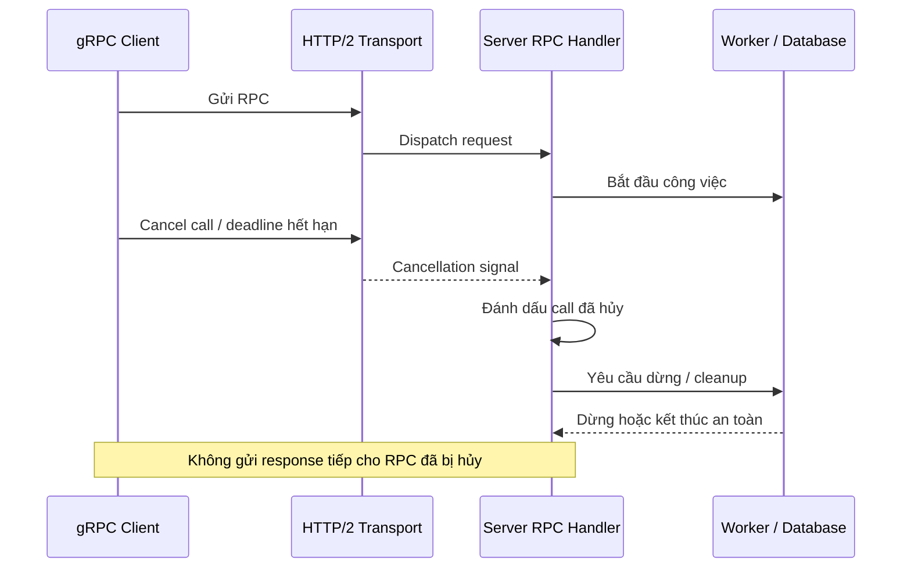

# Server nhận tín hiệu cancellation

Khi client hủy một RPC hoặc deadline của lời gọi hết hạn, server cần biết rằng caller không còn chờ kết quả. Nếu server vẫn tiếp tục truy vấn dữ liệu, chạy tính toán hoặc phát message cho một stream đã bị hủy, tài nguyên sẽ bị tiêu tốn cho công việc không còn giá trị. **Server nhận tín hiệu cancellation** để dừng công việc có thể dừng, giải phóng tài nguyên và ngăn tạo thêm kết quả cho RPC đã kết thúc.

Bài học thuộc chương **Cancellation** của mô-đun **SPRING_GRPC**. Mô-đun phát triển dịch vụ gRPC trong hệ sinh thái Spring từ hợp đồng Protocol Buffers và mã Java được sinh, hỗ trợ unary/streaming RPC, metadata, deadline, status, interceptor, TLS, kiểm thử tích hợp và giám sát. Trọng tâm ở đây là xử lý cancellation ở phía server: nhận tín hiệu, truyền nó tới công việc nền, dọn dẹp tài nguyên và kiểm thử hành vi khi client không còn chờ.

## 1. Server nhận cancellation trong những tình huống nào?

Một RPC có thể kết thúc trước khi server trả response vì:

- Client chủ động gọi `ClientCall.cancel(...)` hoặc hủy `ClientCallStreamObserver`.
- Deadline phía client hết hạn; client kết thúc call và thông báo cancellation tới server khi transport còn khả năng truyền tín hiệu.
- Kết nối hoặc tiến trình client bị mất trong khi RPC đang chạy.
- Một context hoặc tầng điều phối phía server hủy công việc theo chính sách của ứng dụng.

Ở phía server, cancellation là tín hiệu **hợp tác**. gRPC có thể đánh dấu call/context đã bị hủy, nhưng không tự động dừng mọi thread, truy vấn database hoặc tác vụ nền do ứng dụng khởi chạy. Server phải quan sát tín hiệu đó và yêu cầu các thành phần liên quan dừng.



Cancellation không phải rollback. Nếu server đã commit dữ liệu trước khi nhận tín hiệu, việc client hủy không đảo ngược thay đổi đó. Với thao tác ghi, cần idempotency key, transaction boundary và API tra cứu trạng thái khi kết quả phía client không chắc chắn.

## 2. Quan sát cancellation bằng `ServerCallStreamObserver`

Trong gRPC Java, server có thể ép kiểu response observer thành `ServerCallStreamObserver` để kiểm tra trạng thái call và đăng ký handler:

```java
@Override
public void watchUpdates(
        WatchRequest request,
        StreamObserver<Update> responseObserver) {

    ServerCallStreamObserver<Update> call =
            (ServerCallStreamObserver<Update>) responseObserver;

    call.setOnCancelHandler(() -> {
        stopSubscription(request.getSubscriptionId());
    });

    startSendingUpdates(request, call);
}
```

`setOnCancelHandler(...)` đăng ký callback khi call bị hủy từ phía client/transport. Handler nên thực hiện nhanh: đánh dấu cờ, hủy task hoặc đóng subscription. Không chạy một thao tác database blocking hoặc chờ thread khác ngay trong handler, vì callback cancellation cần được xử lý kịp thời.

`call.isCancelled()` cho phép kiểm tra trạng thái hiện tại trước khi tiếp tục gửi dữ liệu hoặc thực hiện một bước tốn tài nguyên. Tuy nhiên, kiểm tra trạng thái chỉ là một snapshot: cancellation có thể xảy ra ngay sau lần kiểm tra. Vì vậy, ngoài kiểm tra `isCancelled()`, producer vẫn cần chịu được việc observer không còn nhận kết quả và phải có cleanup an toàn.

Với unary RPC, server thường chỉ gửi một response rồi `onCompleted()`. Nếu công việc đã bị hủy trước khi tạo response, không nên tiếp tục tính toán chỉ để gọi `onNext`. Với streaming RPC, phải ngừng producer và không phát thêm message sau khi call đã kết thúc.

## 3. Dừng công việc nền bằng cờ cancellation và `Future.cancel(true)`

Một service handler có thể giao công việc blocking cho `ExecutorService`. Khi client hủy RPC, server cần báo cho worker dừng. Ví dụ sau minh họa một unary RPC xử lý bất đồng bộ:

```java
package com.example.server;

import com.example.contract.grpc.GreeterGrpc;
import com.example.contract.grpc.HelloReply;
import com.example.contract.grpc.HelloRequest;
import io.grpc.Status;
import io.grpc.stub.ServerCallStreamObserver;
import io.grpc.stub.StreamObserver;
import java.util.concurrent.ExecutorService;
import java.util.concurrent.Future;
import java.util.concurrent.atomic.AtomicBoolean;
import java.util.concurrent.atomic.AtomicReference;

public class GreeterService extends GreeterGrpc.GreeterImplBase {

    private final ExecutorService workers;
    private final GreetingService greetings;

    public GreeterService(ExecutorService workers, GreetingService greetings) {
        this.workers = workers;
        this.greetings = greetings;
    }

    @Override
    public void sayHello(
            HelloRequest request,
            StreamObserver<HelloReply> responseObserver) {

        ServerCallStreamObserver<HelloReply> call =
                (ServerCallStreamObserver<HelloReply>) responseObserver;
        AtomicBoolean cancelled = new AtomicBoolean();
        AtomicReference<Future<?>> taskRef = new AtomicReference<>();

        call.setOnCancelHandler(() -> {
            cancelled.set(true);
            Future<?> task = taskRef.get();
            if (task != null) {
                task.cancel(true);
            }
        });

        Future<?> task = workers.submit(() -> {
            try {
                if (cancelled.get() || call.isCancelled()) {
                    return;
                }

                String message = greetings.createGreeting(request.getName());

                if (cancelled.get() || call.isCancelled()
                        || Thread.currentThread().isInterrupted()) {
                    return;
                }

                responseObserver.onNext(HelloReply.newBuilder()
                        .setMessage(message)
                        .build());
                responseObserver.onCompleted();
            } catch (InterruptedException interrupted) {
                Thread.currentThread().interrupt();
            } catch (Exception failure) {
                if (!cancelled.get() && !call.isCancelled()) {
                    responseObserver.onError(Status.INTERNAL
                            .withDescription("Không thể xử lý lời chào")
                            .withCause(failure)
                            .asRuntimeException());
                }
            }
        });

        taskRef.set(task);
        // Xử lý trường hợp cancellation đến trước khi taskRef được gán.
        if (cancelled.get() || call.isCancelled()) {
            task.cancel(true);
        }
    }
}
```

Ví dụ giả định `GreetingService.createGreeting(...)` có thể ném `InterruptedException` và `ExecutorService` được Spring quản lý ở cấu hình server. Hai biến atomic giải quyết một race quan trọng: handler cancellation có thể chạy trước khi `taskRef` nhận `Future`; sau khi gán task, handler method kiểm tra lại cờ và hủy task nếu cần.

`Future.cancel(true)` yêu cầu interrupt thread đang chạy, nhưng **không bảo đảm dừng được mọi công việc**. `createGreeting(...)` và các API mà nó gọi phải hợp tác với interrupt hoặc có cơ chế hủy riêng. Nếu đang chờ JDBC, HTTP client hoặc SDK khác, hãy dùng query timeout/cancel API tương ứng. Không nuốt `InterruptedException`; khôi phục interrupt flag như ví dụ và kết thúc công việc.

Callback cancellation chỉ đặt cờ và gọi `cancel`, không gọi `onNext` hay `onError`. Nhờ đó, callback và worker không đồng thời ghi lên `StreamObserver`. Phần gửi response nằm trong một worker; khi worker phát hiện cancellation, nó thoát. Dù vậy, cancellation có thể đua với lần gửi response cuối cùng; transport có thể bỏ kết quả nếu call đã đóng. Server không thể bảo đảm client chưa nhận response chỉ bằng một lần kiểm tra `isCancelled()`.

## 4. Dùng `Context` để truyền cancellation qua các tầng

gRPC Java tạo một `io.grpc.Context` cho RPC phía server. Context này mang thông tin deadline và trạng thái cancellation. Trong handler, có thể lấy context hiện tại:

```java
import io.grpc.Context;

Context rpcContext = Context.current();
```

Nếu handler gọi code đồng bộ trên cùng luồng, tầng xử lý có thể kiểm tra `rpcContext.isCancelled()` ở các điểm an toàn. Khi dispatch sang executor khác, **không giả định `Context.current()` tự động là context của RPC trên thread worker**. Hãy capture context tại handler và truyền nó vào tác vụ, hoặc dùng `Context.currentContextExecutor(executor)` để executor gắn context hiện tại vào mỗi task được submit.

Có thể đăng ký listener khi context bị hủy:

```java
Context rpcContext = Context.current();
Context.CancellationListener listener = cancelledContext ->
        cancellationFlag.set(true);

rpcContext.addListener(listener, Runnable::run);
try {
    performWorkWhileNotCancelled(cancellationFlag, rpcContext);
} finally {
    rpcContext.removeListener(listener);
}
```

`CancellationListener` nên làm công việc rất ngắn; ở đây chỉ đặt cờ. Nếu listener cần hủy task, hãy giữ task handle và gọi `cancel(true)` thay vì chờ worker ngay trong callback. Luôn gỡ listener khi công việc kết thúc để không giữ tham chiếu lâu hơn vòng đời RPC.

`Context` hữu ích khi cancellation cần đi qua nhiều tầng mà không truyền một tham số cờ qua mọi hàm. Tuy nhiên, context propagation chỉ đưa trạng thái tới code đang chạy; các thư viện I/O vẫn cần API riêng để thực sự hủy truy vấn hoặc request đang chờ.

## 5. Xử lý cancellation trong server-streaming

Với server-streaming, producer có thể chạy lâu và gửi nhiều message. Handler cancellation cần dừng producer, đóng tài nguyên và ngăn các message mới:

```java
@Override
public void watchPrices(
        PriceRequest request,
        StreamObserver<PriceUpdate> responseObserver) {

    ServerCallStreamObserver<PriceUpdate> call =
            (ServerCallStreamObserver<PriceUpdate>) responseObserver;
    AtomicBoolean stopped = new AtomicBoolean();
    AtomicReference<Subscription> subscriptionRef = new AtomicReference<>();

    call.setOnCancelHandler(() -> {
        stopped.set(true);
        Subscription current = subscriptionRef.get();
        if (current != null) {
            current.close();
        }
    });

    if (call.isCancelled()) {
        stopped.set(true);
        return;
    }

    Subscription subscription = priceFeed.subscribe(request.getSymbol(), update -> {
        if (!stopped.get() && !call.isCancelled()) {
            responseObserver.onNext(toProto(update));
        }
    });
    subscriptionRef.set(subscription);

    // Cancellation có thể xảy ra trong lúc subscribe đang tạo subscription.
    if (stopped.get() || call.isCancelled()) {
        stopped.set(true);
        subscription.close();
    }
}
```

`Subscription` là handle do `priceFeed` của ứng dụng cung cấp. Handler được đăng ký trước khi bắt đầu subscribe; nếu cancellation xảy ra trước khi handle được lưu, cờ `stopped` sẽ được kiểm tra lại ngay sau khi subscription được tạo và handle sẽ được đóng. Cần tuân thủ contract thread-safety của `priceFeed` và không để callback `onNext` chạy đồng thời từ nhiều thread nếu observer không được thiết kế cho việc đó.

Nếu producer có thể phát dữ liệu nhanh hơn client nhận, cần flow control/backpressure. Cancellation là trường hợp kết thúc toàn bộ stream; nó không thay thế cơ chế `isReady()`/`setOnReadyHandler(...)` để điều tiết tốc độ khi client vẫn còn kết nối.

## 6. Cancellation, deadline và lỗi server

Server cần phân biệt cancellation với lỗi xử lý:

| Tình huống | Dấu hiệu phía server | Hành động phù hợp |
| --- | --- | --- |
| Client chủ động hủy | Call/context chuyển sang cancelled; cancellation handler được gọi khi transport nhận tín hiệu. | Dừng worker, producer và cleanup. |
| Client deadline hết hạn | Context/call bị hủy khi deadline phía client hết hạn. | Dừng công việc còn lại; kiểm tra deadline trước bước tốn tài nguyên. |
| Server phát hiện lỗi nghiệp vụ | Server chủ động gọi `onError(Status...)`. | Trả status phản ánh lỗi, không coi đây là client cancellation. |
| Server tự hủy call | Server kết thúc call theo logic của mình. | Dọn tài nguyên; handler dành cho client cancellation không phải cơ chế báo mọi kiểu kết thúc. |
| Mạng đứt hoặc client process biến mất | Transport có thể phát hiện channel không còn tồn tại và hủy call. | Cleanup theo tín hiệu khi phát hiện được; không giả định phát hiện tức thì. |

Deadline được truyền qua gRPC và server context có thể cung cấp thời điểm hết hạn. Nên kiểm tra ngân sách trước khi bắt đầu một truy vấn đắt đỏ hoặc trước mỗi bước trong chuỗi xử lý. Dù vậy, deadline không thay thế timeout riêng của database/HTTP client; một thư viện blocking không hợp tác có thể tiếp tục chạy sau khi context đã bị hủy.

Khi call đã bị hủy, không cố gửi thêm `onNext` hoặc phát một lỗi nghiệp vụ giả để “thông báo” cho client; client đã kết thúc call. Nếu server gặp lỗi trước khi cancellation tới, hãy trả status đúng. Nếu cancellation đến trước, ưu tiên dừng và cleanup thay vì tiếp tục tạo response.

## 7. Dọn dẹp tài nguyên đúng cách

Cancellation cần được nối tới tài nguyên mà RPC đang giữ:

- **Executor task:** giữ `Future` hoặc cancellation token; yêu cầu dừng và không để worker bị rò rỉ.
- **Database:** dùng query timeout, `Statement.cancel()` hoặc API cancellation của driver khi hỗ trợ; đóng `ResultSet`, statement và connection theo ownership.
- **HTTP call tới dependency khác:** chuyển cancellation xuống HTTP client nếu API đó hỗ trợ; không chỉ ngừng chờ response ở gRPC server.
- **Subscription/message consumer:** hủy đăng ký và ngừng phát sự kiện.
- **Stream producer:** ngừng đọc nguồn dữ liệu, giải phóng buffer và đóng file/cursor.

Đặt cleanup trong `finally`, `try-with-resources` hoặc callback lifecycle tương ứng để nó chạy cả khi công việc kết thúc bình thường, ném lỗi hay bị interrupt. Cancellation handler nên idempotent: gọi cleanup nhiều lần không làm hỏng trạng thái hoặc đóng tài nguyên không thuộc quyền sở hữu của RPC.

## 8. Kiểm thử server nhận cancellation

Một test in-process có thể chứng minh server nhận tín hiệu hủy. Tạo server giữ một RPC đang mở và đếm latch khi `setOnCancelHandler` được gọi:

```java
CountDownLatch cancelled = new CountDownLatch(1);

Server server = InProcessServerBuilder.forName(serverName)
        .directExecutor()
        .addService(new GreeterGrpc.GreeterImplBase() {
            @Override
            public void sayHello(
                    HelloRequest request,
                    StreamObserver<HelloReply> responseObserver) {
                ServerCallStreamObserver<HelloReply> call =
                        (ServerCallStreamObserver<HelloReply>) responseObserver;
                call.setOnCancelHandler(cancelled::countDown);
            }
        })
        .build()
        .start();

ManagedChannel channel = InProcessChannelBuilder.forName(serverName)
        .directExecutor()
        .build();

ClientCallStreamObserver<HelloRequest> callHandle = startCancellableCall(channel);
callHandle.cancel("test cancellation", null);
assertTrue(cancelled.await(2, TimeUnit.SECONDS));
```

Đoạn test giả định `startCancellableCall(...)` dùng `ClientResponseObserver.beforeStart(...)` để trả về call handle. Cần khai báo imports/fixture tương ứng và đóng channel/server trong `finally`. `directExecutor()` giúp test đơn giản; test concurrency và worker cancellation nên dùng executor riêng để quan sát interrupt, cleanup và race condition.

Các kiểm tra nên bao gồm:

1. Client cancel trước khi server trả response; xác minh handler được gọi.
2. Client deadline hết hạn; xác minh server dừng công việc và không tiếp tục truy vấn vô ích.
3. Worker đang chạy nhận interrupt; xác minh nó kết thúc và giải phóng tài nguyên.
4. Cancellation xảy ra trước khi task handle được lưu; xác minh cờ cancellation vẫn làm task dừng.
5. Streaming producer bị hủy; xác minh subscription đóng và không phát message mới.
6. Server tự trả lỗi trước khi client cancel; xác minh không nhầm lỗi server với cancellation.

In-process test kiểm tra logic gRPC nhưng không thay thế kiểm thử qua TCP/TLS, proxy hoặc ingress. Mạng thật có thể phát hiện cancellation trễ hơn; server cần chịu được việc peer biến mất đột ngột.

## 9. Những lỗi thường gặp

| Hiện tượng | Nguyên nhân | Cách xử lý |
| --- | --- | --- |
| Client đã cancel nhưng worker vẫn chạy | Chỉ kiểm tra observer mà không dừng task nền. | Kết nối handler với cờ, `Future.cancel(true)` hoặc API cancellation của tác vụ. |
| `Future.cancel(true)` không dừng truy vấn | API bên dưới không hợp tác với interrupt. | Dùng query timeout/cancel API của database hoặc HTTP client. |
| Server gửi message sau cancellation | Producer không kiểm tra trạng thái và không được dừng. | Dừng producer, kiểm tra call state và xử lý race an toàn. |
| `Context.current()` trả context khác trong worker | Context không được propagate sang executor. | Capture context và dùng context-aware executor hoặc truyền token tường minh. |
| Cancellation handler làm RPC chậm kết thúc | Handler thực hiện I/O hoặc chờ task blocking. | Chỉ phát tín hiệu/hủy task nhanh trong handler. |
| Cleanup chạy hai lần gây lỗi | Callback và `finally` cùng đóng tài nguyên không idempotent. | Xác định owner và làm cleanup idempotent. |
| Coi cancellation là rollback | Server có thể đã commit side effect. | Dùng idempotency key và kiểm tra trạng thái nghiệp vụ. |
| Test chỉ xác minh client future bị cancel | Chưa chứng minh server nhận và dừng công việc. | Dùng latch/flag ở server và xác minh cleanup hoàn tất. |

## 10. Bài tập thực hành

1. Tạo server unary RPC có công việc nền chạy trên `ExecutorService`; dùng `ServerCallStreamObserver.setOnCancelHandler(...)` để dừng task khi client hủy.
2. Thêm cờ cancellation và `Future.cancel(true)`; mô phỏng cancellation trước khi `Future` được lưu để kiểm tra race.
3. Tạo một service phụ thuộc database hoặc HTTP client; xác minh cancellation thực sự dừng I/O thay vì chỉ interrupt thread.
4. Dùng `Context.current()` để quan sát deadline/cancellation; truyền context sang executor và kiểm tra trạng thái trong worker.
5. Tạo server-streaming RPC phát dữ liệu liên tục; hủy từ client và xác minh subscription, producer và buffer được dọn dẹp.
6. Viết in-process test xác minh server nhận cancellation, đồng thời có integration test qua TCP/TLS để đánh giá hành vi khi kết nối bị ngắt.

Sau bài này, bạn cần biết server nhận cancellation qua `ServerCallStreamObserver` hoặc gRPC `Context`, truyền tín hiệu đó tới worker và các API I/O, dừng producer và cleanup an toàn. Cancellation là cơ chế hợp tác ở phạm vi một RPC; xử lý đúng giúp Spring gRPC server tránh lãng phí tài nguyên và giữ độ tin cậy khi client hủy request hoặc deadline hết hạn.
