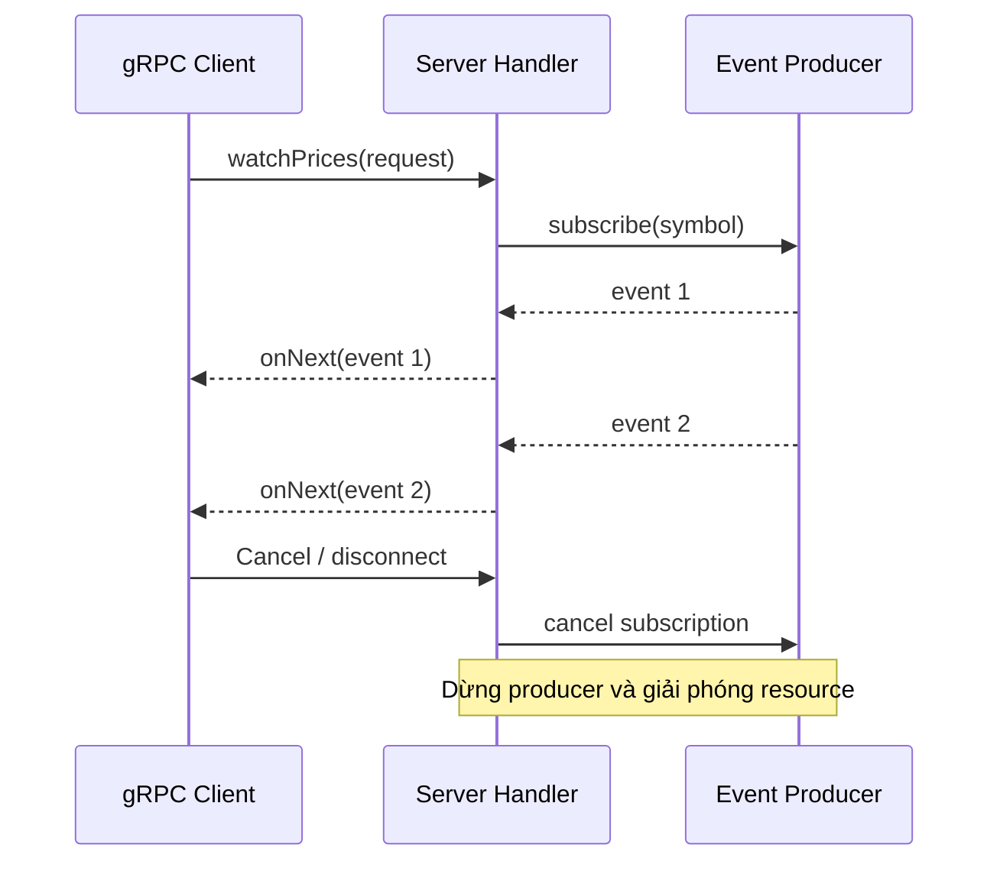

# Hủy stream khi client ngắt kết nối

Server-streaming RPC có thể tồn tại lâu hơn một HTTP request thông thường: server đăng ký nguồn sự kiện, đọc dữ liệu hoặc chạy một producer rồi gửi nhiều message về client. Nếu client đóng màn hình, chủ động hủy call hoặc mất kết nối, server cần dừng producer và giải phóng subscription. Nếu không, công việc tiếp tục chạy dù không còn nơi nhận dữ liệu.

**Hủy stream khi client ngắt kết nối** tập trung vào vòng đời của một server-streaming RPC: nhận tín hiệu call bị hủy, dừng nguồn dữ liệu, xử lý race khi subscription đang được tạo, không gửi message sau khi stream kết thúc và kiểm thử cleanup. Bài thuộc chương **Cancellation** của mô-đun **SPRING_GRPC**, nơi xây dựng dịch vụ gRPC bằng Protocol Buffers, mã Java sinh ra và Spring, bao gồm unary/streaming RPC, metadata, deadline, status, interceptor, TLS, kiểm thử và giám sát.

## 1. Client ngắt kết nối được server nhận biết thế nào?

Có hai tình huống thường gặp:

- **Client hủy RPC có chủ đích:** ứng dụng gọi API cancel trên client call, ví dụ người dùng rời màn hình hoặc tầng HTTP không còn cần kết quả. Với HTTP/2, client thường gửi tín hiệu reset cho stream.
- **Kết nối bị mất đột ngột:** thiết bị tắt, mạng đổi, process client chết hoặc TCP connection biến mất. Server chỉ biết khi transport phát hiện peer không còn khả dụng, chẳng hạn qua lỗi ghi hoặc cơ chế phát hiện kết nối.

Ở server gRPC Java, khi call bị hủy, ServerCallStreamObserver.setOnCancelHandler(...) cho phép đăng ký callback. isCancelled() cho biết call đã bị hủy tại thời điểm kiểm tra. Context.current() cũng cung cấp trạng thái cancellation/deadline của RPC.

**Không phải mọi lần mất mạng đều được phát hiện ngay lập tức.** Với kết nối bị đứt âm thầm, server có thể chỉ phát hiện sau khi gửi dữ liệu hoặc sau một khoảng thời gian transport/keepalive phát hiện peer không còn phản hồi. Vì vậy, cancellation handler là điểm nhận tín hiệu khi gRPC đã biết call kết thúc; nó không phải cảm biến tức thời cho mọi sự cố mạng.

## 2. Vì sao server-streaming cần cleanup riêng?

Một server-streaming handler thường đăng ký một subscription hoặc tạo producer tồn tại trong suốt stream:



Nếu handler chỉ ngừng gọi onNext() nhưng không hủy subscription, producer vẫn có thể:

- Đọc database hoặc message broker liên tục.
- Giữ buffer, cursor, file descriptor hoặc connection.
- Tạo message rồi bỏ đi vì client không còn nhận.
- Giữ tham chiếu tới observer, request và context của RPC, khiến bộ nhớ không được thu hồi.

Do đó, server phải nối tín hiệu cancellation tới **nguồn tạo dữ liệu**, chứ không chỉ kiểm tra trạng thái trước mỗi lần gửi message.

## 3. Đăng ký cancellation handler trước khi tạo subscription

Ví dụ dưới đây dùng một abstraction của ứng dụng để minh họa nguồn sự kiện. EventSubscription.cancel() phải là thao tác hủy nhanh, thread-safe và idempotent; EventSource.subscribe(...) trả về handle để owner có thể dừng nguồn.

```java
interface EventSubscription {
    void cancel();
}

interface EventSource {
    EventSubscription subscribe(
            String topic,
            java.util.function.Consumer<PriceEvent> onNext,
            java.util.function.Consumer<Throwable> onError,
            Runnable onComplete);
}
```

Handler server-streaming:

```java
@Override
public void watchPrices(
        PriceRequest request,
        StreamObserver<PriceUpdate> responseObserver) {

    ServerCallStreamObserver<PriceUpdate> call =
            (ServerCallStreamObserver<PriceUpdate>) responseObserver;
    AtomicBoolean stopped = new AtomicBoolean(call.isCancelled());
    AtomicReference<EventSubscription> subscriptionRef =
            new AtomicReference<>();

    Runnable stopSource = () -> {
        stopped.set(true);
        EventSubscription subscription = subscriptionRef.getAndSet(null);
        if (subscription != null) {
            subscription.cancel();
        }
    };

    // Đăng ký trước khi subscribe để không bỏ lỡ cancellation sớm.
    call.setOnCancelHandler(stopSource);

    if (stopped.get() || call.isCancelled()) {
        stopSource.run();
        return;
    }

    try {
        EventSubscription subscription = eventSource.subscribe(
                request.getSymbol(),
                event -> {
                    if (!stopped.get() && !call.isCancelled()) {
                        responseObserver.onNext(toProto(event));
                    }
                },
                failure -> {
                    stopSource.run();
                    if (!call.isCancelled()) {
                        responseObserver.onError(Status.INTERNAL
                                .withDescription("Nguồn giá gặp lỗi")
                                .withCause(failure)
                                .asRuntimeException());
                    }
                },
                () -> {
                    stopSource.run();
                    if (!call.isCancelled()) {
                        responseObserver.onCompleted();
                    }
                });

        subscriptionRef.set(subscription);

        // Cancellation có thể xảy ra khi subscribe đang tạo handle.
        if (stopped.get() || call.isCancelled()) {
            stopSource.run();
        }
    } catch (RuntimeException failure) {
        stopSource.run();
        if (!call.isCancelled()) {
            responseObserver.onError(Status.INTERNAL
                    .withDescription("Không thể đăng ký nguồn giá")
                    .withCause(failure)
                    .asRuntimeException());
        }
    }
}
```

Các thành phần quan trọng:

1. Ép kiểu observer thành ServerCallStreamObserver để truy cập API cancellation của server.
2. Đăng ký setOnCancelHandler trước khi tạo subscription.
3. stopSource đặt cờ dừng và lấy subscription bằng getAndSet(null), nhờ đó nhiều đường kết thúc không cùng lấy một handle để cancel.
4. Sau khi subscribe(...) trả handle, lưu nó rồi kiểm tra lại stopped/isCancelled(). Điều này xử lý trường hợp client ngắt kết nối trong lúc nguồn đang được đăng ký.
5. Khi nguồn kết thúc bình thường hoặc báo lỗi, dừng subscription trước rồi mới kết thúc observer nếu call vẫn còn hoạt động.

Ví dụ giả định callback của EventSource được tuần tự hóa hoặc được điều phối qua một executor duy nhất. Nếu nguồn gọi onNext, onError và onComplete đồng thời từ nhiều thread, adapter phải tuần tự hóa các callback theo contract của gRPC. EventSubscription.cancel() không nên block lâu; nếu việc hủy nguồn có thể chậm, callback cancellation chỉ phát tín hiệu và giao việc dừng cho owner/executor có giới hạn.

## 4. Xử lý race giữa disconnect và đăng ký subscription

Race thường gặp: server bắt đầu subscribe(...), nhưng client ngắt kết nối trước khi phương thức này trả về handle. Cancellation handler chạy, thấy subscriptionRef vẫn null nên chưa có gì để hủy. Sau đó subscribe(...) trả về một subscription mới. Nếu không kiểm tra lại trạng thái, subscription sẽ tồn tại mà không có owner nào dừng nó.

Trong ví dụ, race được xử lý bằng hai bước:

- Callback cancellation bật stopped ngay cả khi handle chưa được tạo.
- Ngay sau subscriptionRef.set(subscription), handler kiểm tra lại stopped và call.isCancelled(). Nếu call đã kết thúc, stopSource.run() lấy handle vừa được lưu và hủy nó.

getAndSet(null) giúp thao tác lấy handle chỉ thành công ở một nhánh. Tuy vậy, contract của EventSubscription.cancel() vẫn nên idempotent, vì nguồn sự kiện có thể có cơ chế tự kết thúc đồng thời với cancellation. Nếu subscribe(...) có thể gọi callback terminal đồng bộ trước khi trả handle, bước kiểm tra sau khi lưu handle cũng bảo đảm handle đó được hủy.

Không nên lưu subscription trong field của Spring singleton service. Nhiều client có thể mở stream đồng thời; mỗi RPC phải giữ handle riêng trong biến cục bộ/đối tượng scope riêng, nếu không một client có thể vô tình hủy stream của client khác.

## 5. Dùng gRPC Context khi stream cần truyền cancellation qua nhiều tầng

ServerCallStreamObserver phù hợp để xử lý cancellation trực tiếp ở handler. Nếu stream gọi nhiều tầng nội bộ hoặc dispatch công việc sang executor, có thể dùng Context.current() và Context.CancellationListener để truyền tín hiệu:

```java
Context rpcContext = Context.current();
AtomicBoolean stopped = new AtomicBoolean(rpcContext.isCancelled());

Context.CancellationListener listener = ignored -> stopped.set(true);
rpcContext.addListener(listener, Runnable::run);

workerExecutor.execute(rpcContext.wrap(() -> {
    if (stopped.get() || rpcContext.isCancelled()) {
        return;
    }
    publishNextBatch();
}));

// Trong terminal path của stream, sau khi worker đã dừng:
rpcContext.removeListener(listener);
```

Context không tự động truyền sang mọi thread do ứng dụng tạo. Capture context trong handler và dùng rpcContext.wrap(...), fixedContextExecutor(...) hoặc cơ chế context propagation tương ứng. Listener chỉ nên đặt cờ hoặc phát tín hiệu nhanh; không block để đợi worker dừng ngay trong callback. Lệnh removeListener trong ví dụ phải chạy ở terminal path thực sự của stream, không chạy ngay sau khi submit nếu worker còn phụ thuộc vào listener.

Khi stream kết thúc bình thường hoặc lỗi, gỡ listener bằng rpcContext.removeListener(listener) và giải phóng các tham chiếu. Với worker có Future, giữ task handle để gọi cancel(true) khi cần, đồng thời xử lý race nếu cancellation đến trước lúc handle được lưu. Future.cancel(true) chỉ yêu cầu interrupt; công việc bên dưới phải hợp tác với interrupt hoặc có API cancel riêng.

## 6. Không gửi message sau khi call kết thúc

Trước khi gửi dữ liệu, producer nên kiểm tra trạng thái dừng và call.isCancelled(). Tuy nhiên, cancellation có thể xảy ra ngay sau lần kiểm tra; transport sẽ xử lý call đã đóng. Server không nên cố gửi thêm onError(...) hoặc onCompleted() để báo cho một client đã ngắt kết nối. Những callback terminal chỉ nên được phát khi call vẫn còn hoạt động và server chủ động kết thúc stream.

Flow control là vấn đề khác với cancellation. call.isReady() cho biết phía transport hiện có khả năng nhận thêm message; setOnReadyHandler(...) giúp producer tiếp tục khi call sẵn sàng. Nếu isReady() là false, không được đơn giản bỏ message nếu nghiệp vụ yêu cầu giao đủ dữ liệu. Hãy tạm dừng nguồn, dùng hàng đợi có giới hạn hoặc cơ chế demand-aware. Nếu client đã cancel, dừng toàn bộ producer; nếu client vẫn kết nối nhưng chưa ready, chỉ điều tiết tốc độ.

## 7. Disconnect, deadline và reconnect/resume

Client disconnect và deadline hết hạn đều có thể làm RPC bị cancellation ở server, nhưng nguyên nhân nghiệp vụ khác nhau:

| Tình huống | Ý nghĩa | Hành động server |
| --- | --- | --- |
| Client chủ động cancel | Caller không còn cần stream. | Hủy subscription và dừng producer. |
| Deadline hết hạn | Thời gian cho RPC đã hết. | Dừng công việc còn lại; không tạo thêm dữ liệu. |
| TCP/HTTP/2 connection mất | Peer không còn liên lạc được; thời điểm phát hiện phụ thuộc transport. | Cleanup khi gRPC phát hiện call bị hủy; bảo đảm tài nguyên không phụ thuộc vào callback duy nhất. |
| Server kết thúc stream bình thường | Nguồn đã hết dữ liệu hoặc nghiệp vụ hoàn tất. | Đóng subscription, gỡ listener và gọi onCompleted() nếu call còn hoạt động. |

Nếu client cần tiếp tục nhận dữ liệu sau khi kết nối lại, reconnect tạo **một RPC mới**. Server không thể tiếp tục chính call đã bị hủy. Hợp đồng streaming nên có cursor, sequence number, offset hoặc resume token để client yêu cầu dữ liệu từ vị trí cuối cùng đã xử lý. Dữ liệu có thể được gửi lặp quanh thời điểm mất kết nối; client nên xử lý theo sequence/idempotency để tránh áp dụng một event hai lần.

Không giả định keepalive giải quyết mọi trường hợp disconnect. Keepalive giúp phát hiện kết nối không còn phản hồi theo cấu hình transport; cần chọn interval/timeout phù hợp và tuân thủ chính sách hạ tầng. Nó không thay thế cancellation cleanup hoặc deadline của từng RPC.

## 8. Kiểm thử server dừng stream khi client disconnect

Một test in-process có thể chứng minh cancellation handler được gọi và subscription bị hủy:

```java
CountDownLatch subscriptionCancelled = new CountDownLatch(1);
AtomicBoolean sourceStopped = new AtomicBoolean();

EventSource testSource = (topic, onNext, onError, onComplete) -> {
    return () -> {
        sourceStopped.set(true);
        subscriptionCancelled.countDown();
    };
};
```

Đưa testSource vào service, start server bằng InProcessServerBuilder, tạo channel bằng InProcessChannelBuilder và gọi streaming method từ async stub. Client dùng ClientResponseObserver.beforeStart(...) để giữ ClientCallStreamObserver, sau khi server đã đăng ký subscription thì gọi cancel(...). Test chờ subscriptionCancelled.await(...), rồi xác minh sourceStopped là true. Đóng channel và server trong finally.

Các ca cần kiểm tra:

1. Client cancel sau khi subscription được tạo; xác minh cancel() được gọi đúng một lần.
2. Client cancel trong lúc subscribe(...) chưa trả handle; xác minh handle được hủy ngay sau khi được lưu.
3. Nguồn hoàn tất bình thường; xác minh subscription và listener được dọn trước terminal callback.
4. Nguồn báo lỗi; xác minh cleanup xảy ra và server kết thúc bằng status phù hợp.
5. Deadline hết hạn; xác minh producer dừng tương tự đường cancellation.
6. Client disconnect đột ngột qua transport mạng; xác minh cleanup khi server phát hiện peer đã mất.

In-process test kiểm tra logic call/callback nhưng không mô phỏng đầy đủ TCP disconnect, proxy hoặc ingress. Cần integration test qua TCP/TLS cho tình huống mạng thật và đo thời gian từ lúc peer biến mất đến lúc server phát hiện. Không dùng một timeout test quá ngắn khiến kết quả phụ thuộc lịch chạy của CI.

## 9. Quan sát và vận hành

Để phát hiện stream mồ côi, nên quan sát theo service/method và logical client:

- Số stream đang hoạt động và thời lượng stream.
- Số stream kết thúc bởi CANCELLED, DEADLINE_EXCEEDED, OK hoặc lỗi khác.
- Thời gian từ cancellation signal tới khi subscription/worker thực sự dừng.
- Số subscription đang mở, số lần cleanup và lỗi khi đóng tài nguyên.
- Số message được phát, số message bị chặn bởi flow control và kích thước buffer.

Log nên ghi method, logical client, status, stream ID/correlation ID và thời gian cleanup. Không log token, payload nhạy cảm hoặc toàn bộ metadata. Dùng nhãn metric có cardinality giới hạn; không dùng user ID hoặc một ID ngẫu nhiên cho từng stream làm metric label.

Nếu số stream hoạt động không giảm sau các đợt client disconnect, hãy kiểm tra subscription handle có được lưu đúng không, listener có bị gỡ sớm không, producer có thực sự dừng không và cleanup có bị block trên callback hay không.

## 10. Lỗi thường gặp

| Hiện tượng | Nguyên nhân | Cách xử lý |
| --- | --- | --- |
| Client rời màn hình nhưng producer vẫn chạy | Chưa đăng ký setOnCancelHandler hoặc handler chỉ ghi log. | Nối cancellation tới subscription/worker cancel. |
| Stream bị rò khi disconnect trong lúc subscribe | Handle chưa được tạo khi callback cancellation chạy. | Đặt cờ dừng và kiểm tra lại sau khi lưu handle. |
| Một client hủy stream của client khác | Subscription được lưu trong field dùng chung của singleton. | Giữ handle riêng theo từng RPC. |
| Server gửi lỗi sau khi peer đã ngắt kết nối | Không kiểm tra call state trước terminal callback. | Không gửi callback terminal sau cancellation. |
| Message bị mất khi isReady() false | Producer bỏ message thay vì pause/backpressure. | Dừng nguồn tạm thời hoặc dùng queue có giới hạn. |
| Server phát hiện disconnect chậm | Kết nối mất âm thầm, transport chưa phát hiện. | Cấu hình keepalive hợp lý và vẫn đặt giới hạn tài nguyên/stream lifetime. |
| Reconnect làm event bị lặp hoặc mất | Không có cursor/sequence/resume contract. | Thiết kế resume token và xử lý event idempotent. |
| Cancellation callback bị block | Callback đóng resource hoặc chờ worker trực tiếp. | Callback chỉ phát tín hiệu; owner thực hiện cleanup không blocking. |

## 11. Bài tập thực hành

1. Xây dựng server-streaming RPC phát giá theo symbol; đăng ký setOnCancelHandler trước khi subscribe.
2. Tạo fake EventSource và xác minh client cancel làm subscription bị hủy đúng một lần.
3. Mô phỏng cancellation xảy ra trong lúc subscribe đang tạo handle; kiểm tra race và xác minh không rò subscription.
4. Thêm flow control bằng isReady()/setOnReadyHandler(...) hoặc nguồn có backpressure; bảo đảm không bỏ message khi client tạm thời chưa ready.
5. Thêm cursor/sequence number để client reconnect và resume sau khi stream bị ngắt; kiểm tra xử lý event lặp.
6. Viết in-process test và integration test qua TCP/TLS để phân biệt explicit cancel với phát hiện network disconnect.

Sau bài này, bạn cần biết server phát hiện call bị hủy qua ServerCallStreamObserver, dừng producer/subscription, xử lý race khi handle chưa được tạo và cleanup khi stream kết thúc theo mọi đường. Client disconnect có thể được phát hiện trễ khi mạng mất âm thầm; thiết kế stream có giới hạn tài nguyên và resume contract giúp Spring gRPC server vận hành ổn định khi client rời đi hoặc kết nối bị gián đoạn.
