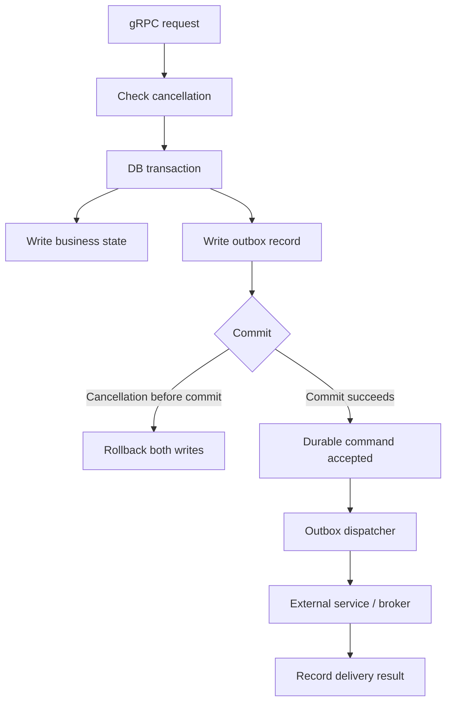

# Không tiếp tục side effect sau cancellation

Khi client hủy một RPC hoặc deadline hết hạn, server có thể đã nhận request và bắt đầu xử lý. Nếu handler tiếp tục ghi dữ liệu, gửi lệnh thanh toán hoặc gọi một dịch vụ khác sau khi caller không còn chờ, hệ thống có thể tạo ra thay đổi mà client không biết kết quả. Đây là tình huống nguy hiểm hơn việc chỉ gửi thừa một response: **side effect có thể đã xảy ra dù RPC kết thúc bằng cancellation**.

Mục tiêu của bài là thiết kế ranh giới để server ngừng khởi tạo tác dụng phụ mới khi RPC bị hủy, xử lý cancellation trong transaction, kiểm soát lời gọi downstream và bảo vệ thao tác ghi bằng idempotency. Nội dung thuộc chương **Cancellation** của mô-đun **SPRING_GRPC**, nơi phát triển dịch vụ gRPC trong hệ sinh thái Spring bằng Protocol Buffers và mã Java sinh ra, với unary/streaming RPC, metadata, deadline, status, interceptor, TLS, kiểm thử tích hợp và giám sát.

## 1. Cancellation không tự hoàn tác side effect

gRPC cancellation báo rằng caller không còn cần kết quả của một RPC. Nó không phải lệnh rollback giao dịch và không thể bảo đảm server chưa thực hiện thay đổi.

Ví dụ, một RPC tạo đơn hàng có thể đi qua các bước:

1. Server nhận request và kiểm tra dữ liệu.
2. Server ghi đơn hàng vào database.
3. Server gửi lệnh giữ hàng tới dịch vụ kho.
4. Client hết deadline trước khi nhận response.

Client có thể thấy timeout hoặc cancellation trong khi đơn hàng đã được ghi và kho đã giữ hàng. Nếu client retry mù quáng, hệ thống có nguy cơ tạo hai đơn hoặc giữ hàng hai lần.

Phân biệt các mốc:

| Mốc | Ý nghĩa của cancellation |
| --- | --- |
| Trước khi bắt đầu side effect | Có thể bỏ qua công việc và kết thúc handler. |
| Trong một transaction chưa commit | Có thể dừng và rollback nếu code/driver phản ứng kịp thời. |
| Sau khi transaction commit | Thay đổi đã bền vững; cancellation không tự đảo ngược. |
| Trong lúc gọi dịch vụ ngoài | Client có thể hủy lời gọi downstream, nhưng dịch vụ kia có thể đã thực hiện side effect. |
| Sau khi command được chấp nhận vào hàng đợi bền vững | Công việc đã có owner độc lập; RPC disconnect không tự hủy command đã chấp nhận. |

Vì vậy, cần xác định **điểm chấp nhận/commit** của từng operation. Trước điểm đó, cancellation có thể ngăn operation bắt đầu hoặc commit. Sau điểm đó, hệ thống phải xử lý kết quả như một công việc đã được chấp nhận, có trạng thái và cơ chế hủy/compensation riêng nếu nghiệp vụ cho phép.

## 2. Kiểm tra cancellation trước các bước có side effect

Ở server handler, lấy context của RPC và kiểm tra trạng thái trước khi bắt đầu công việc có tác dụng phụ:

```java
@Override
public void reserveStock(
        ReserveRequest request,
        StreamObserver<ReserveReply> responseObserver) {

    Context rpcContext = Context.current();

    if (rpcContext.isCancelled()) {
        return;
    }

    ReservationResult result = reservationUseCase.reserve(
            toCommand(request),
            rpcContext::isCancelled);

    if (rpcContext.isCancelled()) {
        return;
    }

    responseObserver.onNext(toReply(result));
    responseObserver.onCompleted();
}
```

Ví dụ truyền một hàm kiểm tra cancellation vào use case. Tuy nhiên, không nên để application/domain package phụ thuộc trực tiếp vào gRPC Context. Có thể định nghĩa một interface nhỏ thuộc application layer:

```java
package com.example.reservation.application;

public interface CancellationToken {
    boolean isCancellationRequested();

    default void throwIfCancellationRequested() {
        if (isCancellationRequested()) {
            throw new OperationCancelledException();
        }
    }
}
```

Adapter gRPC chuyển context thành token bằng method reference:

```java
Context rpcContext = Context.current();
CancellationToken token = rpcContext::isCancelled;

try {
    ReservationResult result =
            reservationUseCase.reserve(toCommand(request), token);

    if (!rpcContext.isCancelled()) {
        responseObserver.onNext(toReply(result));
        responseObserver.onCompleted();
    }
} catch (OperationCancelledException cancelled) {
    // Nếu call đã đóng, không gửi thêm terminal callback.
    if (!rpcContext.isCancelled()) {
        responseObserver.onError(Status.CANCELLED
                .withDescription("Operation đã bị hủy")
                .asRuntimeException());
    }
}
```

Token giúp business code kiểm tra ý định hủy mà không biết gRPC. Cancellation là tín hiệu hợp tác: use case cần kiểm tra trước các bước đắt tiền và trước các điểm commit. Một lần kiểm tra không khóa được trạng thái; cancellation vẫn có thể đến ngay sau đó. Vì thế, với transaction cần một kiểm tra tại ranh giới commit.

## 3. Không commit transaction nếu RPC đã bị hủy

Với thay đổi dữ liệu nằm trong một transaction database, cancellation được phát hiện trước commit có thể làm transaction rollback. Một exception unchecked dùng để biểu diễn operation bị hủy sẽ khiến Spring transaction interceptor rollback theo mặc định:

```java
public final class OperationCancelledException extends RuntimeException {
    public OperationCancelledException() {
        super("Operation bị hủy trước khi commit");
    }
}
```

Use case có thể đăng ký kiểm tra ở callback trước commit:

```java
@Service
public class ReservationUseCase {

    private final ReservationRepository repository;

    public ReservationUseCase(ReservationRepository repository) {
        this.repository = repository;
    }

    @Transactional
    public ReservationResult reserve(
            ReserveCommand command,
            CancellationToken cancellation) {

        cancellation.throwIfCancellationRequested();

        TransactionSynchronizationManager.registerSynchronization(
                new TransactionSynchronization() {
                    @Override
                    public void beforeCommit(boolean readOnly) {
                        cancellation.throwIfCancellationRequested();
                    }
                });

        Reservation existing =
                repository.findByIdempotencyKey(command.idempotencyKey())
                        .orElse(null);
        if (existing != null) {
            return ReservationResult.from(existing);
        }

        cancellation.throwIfCancellationRequested();
        Reservation reservation = Reservation.pending(
                command.orderId(), command.sku(), command.quantity(),
                command.idempotencyKey());
        repository.save(reservation);

        cancellation.throwIfCancellationRequested();
        return ReservationResult.from(reservation);
    }
}
```

Spring gọi TransactionSynchronization.beforeCommit(...) trước khi transaction commit. Nếu token đã báo cancellation, exception unchecked làm quá trình commit thất bại và transaction manager rollback thay đổi trong transaction đó. Đây là một chốt bảo vệ bổ sung cho các kiểm tra giữa các bước.

Các giới hạn cần hiểu rõ:

- Callback trước commit chỉ bảo vệ transaction mà nó tham gia. Không đặt lệnh gọi hệ thống ngoài hoặc side effect không transactional trong callback này.
- Cancellation có thể xảy ra ngay sau lần kiểm tra cuối và trong lúc transaction manager bắt đầu commit. Không thể biến một lần đọc cờ thành khóa nguyên tử giữa client disconnect và database commit.
- JDBC driver/database có thể không dừng query tức thì; đặt query timeout và dùng API cancel phù hợp.
- Nếu operation đã commit, không được báo với client rằng dữ liệu chắc chắn chưa thay đổi chỉ vì RPC kết thúc bằng cancellation.

Nếu nghiệp vụ yêu cầu một quy tắc chặt hơn, ví dụ “lệnh hủy phải thắng nếu đến trước lệnh commit”, cần mô hình hóa trạng thái và điểm tuyến tính hóa trong database: khóa hàng, compare-and-set hoặc cập nhật có điều kiện để chỉ một chuyển trạng thái được chấp nhận. Không thể đạt bảo đảm đó chỉ bằng kiểm tra Context ở Java.

## 4. Phân biệt side effect trong database và side effect bên ngoài

Một transaction database có thể rollback các thay đổi trong cùng transaction. Nó không tự rollback được lệnh đã gửi tới payment gateway, email provider, message broker hoặc một gRPC service khác.

| Side effect | Có thể rollback cùng DB transaction? | Thiết kế phù hợp |
| --- | --- | --- |
| Insert/update trong cùng database transaction | Có, nếu chưa commit và transaction manager/driver hoạt động đúng. | Transaction boundary, kiểm tra cancellation trước commit. |
| Gửi HTTP/gRPC request tới hệ thống khác | Không. Hệ thống ngoài có vòng đời và transaction riêng. | Cancellation downstream, idempotency key, saga/compensation. |
| Publish event trực tiếp lên broker | Thường không nguyên tử với DB nếu không dùng cơ chế tích hợp phù hợp. | Transactional outbox hoặc broker transaction theo kiến trúc. |
| Gửi email hoặc notification | Không thể thu hồi chắc chắn sau khi provider nhận. | Chỉ phát lệnh sau điểm commit; dùng outbox và trạng thái gửi. |
| Ghi file/object storage | Không nằm trong DB transaction. | Upload staging, xác nhận trạng thái, cleanup/compensation riêng. |

Không gọi dịch vụ ngoài bên trong một transaction DB với kỳ vọng transaction rollback sẽ hoàn tác lời gọi đó. Nếu DB rollback sau khi payment gateway đã nhận lệnh, hệ thống có thể rơi vào trạng thái không nhất quán.

## 5. Dừng downstream RPC khi parent RPC bị hủy

Nếu server gọi tiếp một gRPC service khác, cancellation của RPC cha nên được truyền tới call con. Với async stub, lấy call handle qua ClientResponseObserver.beforeStart(...), rồi gọi cancel khi context cha bị hủy:

```java
Context parentContext = Context.current();
AtomicReference<ClientCallStreamObserver<PaymentRequest>> downstreamCall =
        new AtomicReference<>();
AtomicBoolean stopped = new AtomicBoolean(parentContext.isCancelled());

Context.CancellationListener listener = ignored -> {
    stopped.set(true);
    ClientCallStreamObserver<PaymentRequest> call = downstreamCall.get();
    if (call != null) {
        call.cancel("Parent RPC cancelled", null);
    }
};
parentContext.addListener(listener, Runnable::run);

ClientResponseObserver<PaymentRequest, PaymentReply> observer =
        new ClientResponseObserver<>() {
            @Override
            public void beforeStart(
                    ClientCallStreamObserver<PaymentRequest> call) {
                downstreamCall.set(call);
                if (stopped.get() || parentContext.isCancelled()) {
                    call.cancel("Parent RPC already cancelled", null);
                }
            }

            @Override
            public void onNext(PaymentReply reply) {
                handlePaymentReply(reply);
            }

            @Override
            public void onError(Throwable failure) {
                finishParentWithFailure(failure);
            }

            @Override
            public void onCompleted() {
                finishParentSuccessfully();
            }
        };

paymentStub.authorize(paymentRequest, observer);
```

Đây là mẫu minh họa cho một downstream async call; code thực tế cần gỡ listener trong terminal path của parent RPC, xử lý executor rejection và bảo đảm observer không gửi terminal callback sau khi parent call đã bị hủy. Nếu cancellation đến trước khi downstream call handle được tạo, cờ stopped được kiểm tra lại trong beforeStart(...).

Điểm quan trọng: downstream cancel chỉ báo cho dịch vụ payment rằng caller không còn chờ. Payment service có thể đã nhận và xử lý yêu cầu. Vì vậy, request thanh toán cần idempotency key ổn định; trạng thái giao dịch phải có API truy vấn/đối soát. Không xem việc gọi cancel thành bằng chứng giao dịch chưa được thực hiện.

## 6. Dùng idempotency key cho thao tác ghi

Client có thể không nhận response vì cancellation xảy ra sau khi server commit. Khi retry, client cần gửi cùng một idempotency key để server nhận diện đây là cùng một ý định nghiệp vụ.

Ví dụ request Protobuf:

```protobuf
message ReserveRequest {
  string order_id = 1;
  string sku = 2;
  int32 quantity = 3;
  string idempotency_key = 4;
}
```

Server lưu key cùng kết quả operation và đặt unique constraint trong database. Khi nhận lại key:

1. Nếu operation đã hoàn tất, trả kết quả đã lưu.
2. Nếu operation đang xử lý, trả trạng thái đang xử lý hoặc cho caller chờ theo hợp đồng.
3. Nếu key đã tồn tại với payload khác, từ chối vì cùng key không được đại diện cho hai ý định khác nhau.
4. Nếu chưa tồn tại, tạo operation mới trong transaction.

Idempotency key nên được tạo ở biên nơi ý định nghiệp vụ phát sinh và giữ nguyên qua các lần retry. Không tạo key ngẫu nhiên mới trong server cho mỗi lần RPC, vì như vậy retry sẽ không được nhận diện là cùng một operation.

Idempotency không ngăn mọi side effect; nó làm cho việc lặp request an toàn hơn nếu được triển khai đúng với unique constraint và trạng thái operation. Với external provider, truyền key xuống provider nếu họ hỗ trợ, hoặc duy trì bảng deduplication và reconciliation ở phía mình.

## 7. Dùng transactional outbox để tách command bền vững khỏi RPC

Khi một request cần ghi dữ liệu và phát event/command ra hệ thống ngoài, transactional outbox giúp lưu ý định phát trong cùng transaction với dữ liệu nghiệp vụ:



Nếu cancellation được phát hiện trước commit, cả business row và outbox row rollback cùng nhau. Nếu transaction đã commit, command đã được chấp nhận bền vững. RPC có thể bị hủy sau đó, nhưng dispatcher vẫn tiếp tục xử lý vì quyền sở hữu công việc đã chuyển sang workflow nền.

Đây là ranh giới quan trọng: nếu API có nghĩa “đăng ký một yêu cầu xử lý”, response bị mất không đồng nghĩa yêu cầu bị hủy. Client có thể retry bằng idempotency key hoặc gọi API truy vấn trạng thái. Nếu nghiệp vụ cần hủy một command đã commit, hãy định nghĩa operation cancel riêng và state machine có quy tắc như PENDING -> CANCELLED, PENDING -> PROCESSING -> COMPLETED; việc hủy có thể không còn được chấp nhận sau một điểm nhất định. Với side effect đã xảy ra, dùng compensation thay vì giả vờ rollback.

Outbox thường mang semantics at-least-once khi dispatcher retry. Consumer cần idempotent/deduplicate theo event ID hoặc operation key. Outbox không tự cung cấp exactly-once delivery tới hệ thống ngoài.

## 8. Không khởi tạo side effect mới sau khi cancellation đã được ghi nhận

Với chuỗi nhiều bước, kiểm tra cancellation giữa các bước giúp ngăn bắt đầu công việc tiếp theo:

```java
public ReservationResult reserve(
        ReserveCommand command,
        CancellationToken cancellation) {

    cancellation.throwIfCancellationRequested();
    validate(command);

    cancellation.throwIfCancellationRequested();
    StockAvailability stock = inventoryPort.getAvailability(command.sku());

    cancellation.throwIfCancellationRequested();
    if (stock.availableUnits() < command.quantity()) {
        throw new InsufficientStockException();
    }

    cancellation.throwIfCancellationRequested();
    return reservationPort.createPendingReservation(command);
}
```

Ví dụ minh họa kiểm tra trước mỗi bước có thể tạo tải hoặc thay đổi trạng thái. Nhưng createPendingReservation(...) cần tự bảo vệ transaction/commit như phần 3. Nếu inventoryPort gọi downstream, adapter cần truyền deadline và cancellation xuống call con. Một token không thay thế timeout cho I/O đang block.

Không nên rải kiểm tra ở mọi dòng tính toán nhỏ. Đặt chúng tại ranh giới có ý nghĩa: trước I/O đắt tiền, trước lời gọi downstream, trước khi tạo command bền vững và trước commit. Việc này giữ code dễ đọc mà vẫn giới hạn side effect mới.

## 9. Xử lý response và status khi call đã bị hủy

Khi server nhận cancellation, call có thể đã đóng. Handler không nên gửi onNext, onCompleted hoặc onError sau đó. Với cancellation do caller, thường không có response để nhận; client đã tự kết thúc call.

Nếu server tự phát hiện một operation không thể tiếp tục trong khi call vẫn còn hoạt động, có thể trả status phù hợp. Nhưng cần phân biệt:

| Trạng thái | Cách xử lý |
| --- | --- |
| Context đã cancelled | Dừng công việc, cleanup; không gửi terminal callback mới. |
| Deadline đã hết | Dừng phần còn lại; không khởi tạo side effect mới. |
| Business validation thất bại trước commit | Trả status nghiệp vụ phù hợp nếu call còn mở. |
| Transaction rollback do cancellation token | Không báo thành công; nếu call còn mở, có thể kết thúc bằng CANCELLED. |
| Transaction đã commit rồi client ngắt | Không thể hoàn tác bằng cancellation; ghi nhận operation đã được chấp nhận và cho phép truy vấn trạng thái. |

Không chuyển mọi cancellation thành retry. CANCELLED thường có nghĩa caller không còn cần kết quả; retry tự động có thể tạo side effect trái ý định. DEADLINE_EXCEEDED cũng không chứng minh operation chưa commit.

## 10. Kiểm thử để chứng minh side effect không tiếp tục

Test cần quan sát trạng thái nghiệp vụ và số lần side effect, không chỉ kiểm tra client nhận status CANCELLED.

Một số ca quan trọng:

1. **Cancel trước transaction:** hủy client call trước khi handler bắt đầu; xác minh repository không ghi dữ liệu.
2. **Cancel trong transaction trước commit:** dùng latch để dừng ở giữa transaction, hủy client, giải phóng latch; xác minh transaction rollback và không có business row/outbox row.
3. **Cancel sau commit:** để transaction commit rồi hủy trước khi response tới client; xác minh operation vẫn tồn tại và client có thể truy vấn bằng idempotency key.
4. **Cancel khi downstream đang chạy:** xác minh adapter yêu cầu hủy downstream call; test riêng rằng downstream có thể đã commit và cần idempotency/reconciliation.
5. **Retry cùng key:** gửi lại request sau khi client không nhận response; xác minh chỉ có một operation và cùng kết quả được trả lại.
6. **Task/worker bị hủy:** xác minh worker dừng, resource được đóng và không bắt đầu bước tiếp theo.
7. **Outbox:** cancellation trước commit không tạo event; cancellation sau commit không xóa event đã được chấp nhận.

Với Spring, dùng integration test có transaction manager và database phù hợp để kiểm tra rollback/commit. Với gRPC, in-process server hữu ích để điều khiển call cancellation; test qua TCP/TLS cần thiết để xác minh transport và proxy. Dùng latch/barrier thay cho sleep tùy tiện để tạo race có thể lặp lại ổn định.

## 11. Quan sát cancellation và side effect

Log/metrics nên giúp trả lời: cancellation đến ở giai đoạn nào, operation đã commit chưa, side effect nào bị bỏ qua và worker nào đã dừng. Các tín hiệu hữu ích:

- Số RPC bị CANCELLED hoặc DEADLINE_EXCEEDED, phân theo method.
- Số operation bị dừng trước commit và số operation đã commit nhưng caller không nhận response.
- Số lần downstream cancel, thời gian từ cancellation tới khi worker dừng.
- Số outbox record được tạo, đang chờ, retry hoặc hoàn tất.
- Số request trùng idempotency key và số lần deduplicate.

Ghi operation ID/idempotency key theo chính sách bảo mật, method, trạng thái transaction và trace ID. Không log token hoặc payload nhạy cảm. Không dùng idempotency key hoặc user ID làm metric label có cardinality cao.

## 12. Lỗi thường gặp

| Lỗi | Hệ quả | Cách xử lý |
| --- | --- | --- |
| Cho rằng client cancel sẽ rollback database | Dữ liệu có thể đã commit. | Kiểm tra cancellation trước commit và cung cấp idempotency/status lookup. |
| Chỉ kiểm tra cancellation ở đầu handler | Cancellation có thể tới giữa chuỗi xử lý. | Kiểm tra tại ranh giới trước I/O và side effect mới, thêm chốt trước commit. |
| Gọi external service trong DB transaction rồi mong rollback cả hai | External side effect không thuộc transaction DB. | Dùng outbox, idempotency và saga/compensation. |
| Retry mỗi khi nhận CANCELLED | Tạo thao tác lặp ngoài ý muốn. | Tôn trọng cancellation; retry chỉ theo chính sách nghiệp vụ. |
| Tạo idempotency key mới mỗi lần retry | Server coi retry là operation mới. | Giữ một key ổn định cho cùng ý định nghiệp vụ. |
| Hủy downstream call rồi coi như chưa có side effect | Downstream có thể đã xử lý request. | Truy vấn trạng thái hoặc deduplicate bằng key. |
| Dùng cancellation listener để gọi transaction rollback từ thread khác | Transaction thường gắn với thread và transaction context cụ thể. | Phát tín hiệu; worker sở hữu transaction tự thoát bằng exception/rollback. |
| Tiếp tục gửi response sau khi call đóng | Gây lỗi callback hoặc công việc thừa. | Kiểm tra call state và dừng terminal callback khi đã cancelled. |

## 13. Bài tập thực hành

1. Thêm CancellationToken vào use case tạo reservation; kiểm tra trước mỗi bước có side effect.
2. Dùng TransactionSynchronization.beforeCommit(...) để từ chối commit khi RPC đã bị hủy; xác minh rollback bằng integration test.
3. Thêm idempotency key và unique constraint; retry cùng request sau cancellation và xác minh không tạo reservation trùng.
4. Gọi downstream gRPC bất đồng bộ, nối parent cancellation tới downstream call handle và kiểm tra giới hạn của cancellation khi downstream đã commit.
5. Chuyển phát event sang transactional outbox; kiểm tra khác biệt giữa cancellation trước commit và sau khi command đã được chấp nhận.
6. Viết test có latch cho cancellation ở các thời điểm trước transaction, trong transaction và sau commit.
7. Thêm metrics cho operation bị dừng trước commit, operation đã commit sau khi caller disconnect và số lần deduplicate.

Sau bài này, bạn cần phân biệt cancellation của RPC với rollback nghiệp vụ, xác định điểm commit, ngăn side effect mới sau khi cancellation được ghi nhận và bảo vệ thao tác ghi bằng idempotency. Với công việc đã commit hoặc chuyển sang hệ thống ngoài, cần trạng thái bền vững, truy vấn kết quả và compensation/cancel command riêng. Thiết kế rõ ranh giới đó giúp Spring gRPC server không tạo thay đổi ngoài ý muốn khi client hủy request hoặc deadline hết hạn.
