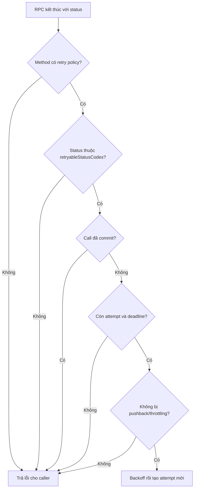

# Retry policy và điều kiện áp dụng

## 1. Retry policy quyết định điều gì?

Trong **Spring gRPC**, một lời gọi có thể thất bại vì dịch vụ tạm thời không khả dụng, tài nguyên quá tải hoặc kết nối bị gián đoạn. Retry policy quy định khi nào client được phép gửi lại một RPC, gửi tối đa bao nhiêu lần và chờ bao lâu giữa các lần thử.

Một policy đúng phải thỏa đồng thời nhiều điều kiện:

- RPC khớp service/method được cấu hình retry.
- Lời gọi kết thúc bằng một status nằm trong danh sách retryable.
- Chưa vượt số lần thử tối đa và còn ngân sách deadline.
- RPC chưa bị **commit** theo cơ chế retry của gRPC.
- Việc thực thi lại an toàn theo semantics nghiệp vụ, hoặc server có cơ chế idempotency.

Retry không phải cách sửa mọi lỗi. Gửi lại một request sai dữ liệu vẫn sai; gửi lại một thao tác ghi không có idempotency có thể tạo tác dụng phụ trùng lặp.

Sau bài này, người học có thể cấu hình retry policy ở client channel, phân tích điều kiện để một lần gọi thực sự được retry, phân biệt retry tự động với retry ở tầng ứng dụng và đánh giá giới hạn của retry trong streaming RPC.

## 2. Các điều kiện để một lần retry được thực hiện

Một retry policy được cấu hình không có nghĩa mọi lỗi đều tự động được thử lại. Runtime cần kiểm tra các điều kiện sau:

| Điều kiện | Câu hỏi cần trả lời | Khi không thỏa |
| --- | --- | --- |
| Method match | RPC có khớp service và method trong service config? | Không áp dụng policy đó |
| Retryable status | Status kết thúc có nằm trong `retryableStatusCodes`? | Trả lỗi cho caller |
| Attempt budget | Đã đạt `maxAttempts` chưa? | Dừng retry |
| Retry commitment | Call đã commit chưa? | Không replay call đã commit |
| Deadline | Còn đủ thời gian cho lần thử tiếp không? | Kết thúc theo deadline |
| Retry throttling/pushback | Runtime hoặc server có yêu cầu giảm/ngừng retry? | Giảm tốc hoặc dừng retry |
| Replay safety | Thực thi lại có an toàn không? | Cần idempotency hoặc xử lý ở tầng nghiệp vụ |

Có thể mô hình hóa luồng quyết định:



Sơ đồ thể hiện các điều kiện chính. Runtime còn áp dụng chi tiết về retry buffer và throttling; ứng dụng vẫn phải bảo đảm thao tác có thể thực hiện lại an toàn.

## 3. Cấu hình retry policy theo service và method

gRPC dùng **service config** ở client để gắn policy vào một method. Các trường thường dùng:

| Trường | Ý nghĩa |
| --- | --- |
| `maxAttempts` | Tổng số attempt tối đa, **bao gồm lần đầu** |
| `initialBackoff` | Thời gian chờ trước lần retry đầu |
| `maxBackoff` | Giới hạn thời gian chờ |
| `backoffMultiplier` | Hệ số tăng thời gian chờ sau mỗi lần thất bại |
| `retryableStatusCodes` | Những gRPC status có thể kích hoạt retry |

Ví dụ policy cho RPC unary `catalog.v1.CatalogService/GetItem`:

```json
{
  "methodConfig": [
    {
      "name": [
        {
          "service": "catalog.v1.CatalogService",
          "method": "GetItem"
        }
      ],
      "retryPolicy": {
        "maxAttempts": 4,
        "initialBackoff": "0.2s",
        "maxBackoff": "2s",
        "backoffMultiplier": 2,
        "retryableStatusCodes": [
          "UNAVAILABLE"
        ]
      }
    }
  ]
}
```

Policy trên cho phép tối đa bốn attempt tổng cộng. Nếu server trả `INVALID_ARGUMENT`, client không retry theo policy này. Chỉ thêm `RESOURCE_EXHAUSTED` khi hệ thống xác định status đó biểu thị quá tải tạm thời và có cơ chế backoff/pushback phù hợp; không retry trường hợp quota cố định hoặc payload vượt giới hạn.

### 3.1. Gắn service config vào gRPC Java channel

Với gRPC Java, có thể chuyển service config thành `Map` và gắn vào `ManagedChannelBuilder`:

```java
import io.grpc.ManagedChannel;
import io.grpc.ManagedChannelBuilder;
import java.util.List;
import java.util.Map;

Map<String, Object> retryPolicy = Map.of(
        "maxAttempts", 4.0,
        "initialBackoff", "0.2s",
        "maxBackoff", "2s",
        "backoffMultiplier", 2.0,
        "retryableStatusCodes", List.of("UNAVAILABLE"));

Map<String, Object> methodConfig = Map.of(
        "name", List.of(Map.of(
                "service", "catalog.v1.CatalogService",
                "method", "GetItem")),
        "retryPolicy", retryPolicy);

Map<String, Object> serviceConfig =
        Map.of("methodConfig", List.of(methodConfig));

ManagedChannel channel = ManagedChannelBuilder
        .forAddress("catalog.internal", 9090)
        .defaultServiceConfig(serviceConfig)
        .build();
```

Trong ứng dụng Spring gRPC, cấu hình này phải được áp dụng lên **client channel** do factory hoặc cấu hình client của ứng dụng tạo ra. API tích hợp cụ thể phụ thuộc phiên bản Spring gRPC và cách dự án quản lý channel; policy vẫn phải khớp chính xác tên service/method của Protobuf. Không đặt retry policy trên server rồi kỳ vọng server tự gửi lại RPC thay client.

Một policy theo method giúp giới hạn retry vào những thao tác có semantics phù hợp. Tránh áp dụng cùng một policy cho toàn bộ service nếu service có cả thao tác đọc, ghi và command không idempotent.

## 4. Backoff, jitter và ngân sách retry

Nếu nhiều client cùng retry ngay khi một dependency phục hồi, chúng có thể tạo một đợt tải đột biến. Retry policy dùng **exponential backoff** để tăng khoảng chờ:

[
t_n = \min(t_{initial} \times m^{n-1},\ t_{max})
]

Trong đó (n) là số thứ tự lần chờ, (m) là `backoffMultiplier`; runtime có thể thêm jitter để các client không đồng bộ hóa thời điểm retry.

Ví dụ với `initialBackoff = 200 ms`, `backoffMultiplier = 2`, `maxBackoff = 2 s`, các khoảng chờ cơ sở lần lượt tăng khoảng 200 ms, 400 ms, 800 ms rồi bị chặn ở 2 giây. Đây là giá trị minh họa; thời gian thực tế có thể thay đổi do jitter và pushback.

Retry policy cần phối hợp với deadline:

- Deadline là ngân sách thời gian cho toàn RPC, không phải ngân sách mới cho mỗi attempt.
- Nếu thời gian còn lại không đủ cho backoff và một attempt hữu ích, lời gọi sẽ kết thúc thay vì retry vô nghĩa.
- Không tăng deadline vô hạn chỉ để làm retry thành công; điều đó có thể giữ request và tài nguyên quá lâu.
- Theo dõi latency tổng, số attempt và status cuối để biết retry có cải thiện độ tin cậy hay chỉ kéo dài lỗi.

## 5. Retry commitment và retry buffer

Một điều kiện quan trọng là **call chưa commit**. gRPC chỉ có thể replay một RPC tự động khi còn đủ dữ liệu request để phát lại và chưa nhận được tín hiệu cho biết server đã bắt đầu xử lý call theo cơ chế commitment.

Các tình huống thường làm call commit:

- Client nhận response headers từ server.
- Dữ liệu request được gửi vượt giới hạn retry buffer mà runtime có thể lưu để replay.

Sau khi call đã commit, lỗi tiếp theo không làm gRPC tự phát lại toàn bộ RPC. Điều này ngăn client vô tình thực thi lại một lời gọi mà server có thể đã xử lý.

Retry buffer cũng là tài nguyên hữu hạn. Nếu request payload lớn hoặc stream gửi nhiều message, dữ liệu cần giữ để replay có thể vượt giới hạn buffer và làm call commit sớm hơn. Vì vậy không nên xem retry buffer như một kho lưu trữ vô hạn.

### 5.1. Transparent retry và configured retry

| Loại | Cách hoạt động | Ai cấu hình? |
| --- | --- | --- |
| Transparent retry | Runtime có thể thử lại trong một số tình huống mà nó biết request chưa được server xử lý | gRPC runtime |
| Configured retry | Thử lại theo status, attempt limit và backoff của service config | Client/application owner |

Transparent retry không thay thế retry policy và cũng không tạo bảo đảm exactly-once. Nếu thao tác có tác dụng phụ, vẫn cần đánh giá khả năng thực thi trùng và idempotency.

## 6. Chọn status phù hợp với nguyên nhân

Retry policy chỉ hoạt động đáng tin cậy khi server trả đúng status:

| Status | Điều kiện thường gặp | Cách xử lý |
| --- | --- | --- |
| `UNAVAILABLE` | Service hoặc dependency tạm thời không sẵn sàng | Ứng viên retry chính, có backoff |
| `RESOURCE_EXHAUSTED` | Quá tải tạm thời hoặc quota/tài nguyên đã hết | Chỉ retry khi nguyên nhân có thể phục hồi và policy cho phép |
| `ABORTED` | Xung đột đồng thời trong giao dịch | Thường cần retry toàn bộ thao tác nghiệp vụ sau khi đọc lại state |
| `DEADLINE_EXCEEDED` | Hết thời hạn RPC | Chỉ retry nếu còn ngân sách và thao tác an toàn |
| `INVALID_ARGUMENT` | Payload không hợp lệ | Sửa request, không retry mù quáng |
| `FAILED_PRECONDITION` | Trạng thái hệ thống chưa đáp ứng điều kiện | Chờ hoặc thay đổi điều kiện trước khi thử lại |
| `UNAUTHENTICATED`, `PERMISSION_DENIED` | Credential hoặc quyền không hợp lệ | Sửa xác thực/phân quyền |
| `INTERNAL` | Lỗi nội bộ ngoài dự kiến | Không đưa vào policy đại trà nếu chưa xác định tính tạm thời |

Server nên dùng `Status.UNAVAILABLE` cho lỗi dependency tạm thời, `INVALID_ARGUMENT` cho dữ liệu sai và `RESOURCE_EXHAUSTED` cho tình huống quá tải/quota. Không trả `UNAVAILABLE` chỉ để client retry một lỗi nghiệp vụ cố định.

Nếu server hỗ trợ retry pushback, client cần tôn trọng hướng dẫn đó. Một server có thể yêu cầu client chờ một khoảng thời gian hoặc ngừng retry; không nên tạo vòng lặp retry thủ công để vượt qua quyết định bảo vệ tải của server.

## 7. Điều kiện nghiệp vụ: idempotency và tác dụng phụ

Retry commitment bảo vệ giao thức, nhưng không thay thế **idempotency**. Có trường hợp server đã ghi dữ liệu hoặc thực hiện tác dụng phụ nhưng response bị mất trước khi client nhận. Client không thể chỉ dựa vào status để biết chắc thao tác đã chạy hay chưa.

Với một thao tác ghi, hãy dùng idempotency key ổn định:

1. Client tạo key cho một thao tác logic và giữ nguyên key qua các attempt.
2. Server lưu key cùng payload fingerprint và kết quả trong kho có tính nhất quán.
3. Nếu key đã hoàn tất, server trả lại kết quả đã lưu thay vì thực thi lần nữa.
4. Nếu key đang chạy, server trả trạng thái đang xử lý hoặc cho client theo dõi.
5. Nếu key trùng nhưng payload khác, từ chối bằng lỗi phù hợp.

Thao tác đọc thường an toàn hơn để retry, nhưng vẫn cần xem xét side effect như ghi audit, tính phí hoặc tạo snapshot. Chỉ bật retry khi biết rõ hành vi khi cùng một request được thực thi nhiều lần.

## 8. Retry policy với streaming RPC

Retry tự động không phải cơ chế resume một stream đang hoạt động. Với client streaming hoặc bidirectional streaming:

- Trước khi call commit, gRPC có thể replay những request message còn nằm trong retry buffer nếu gặp lỗi phù hợp.
- Khi response headers đã được nhận hoặc call commit theo giới hạn buffer, retry tự động không còn áp dụng cho lần lỗi tiếp theo.
- Bidi stream thường bắt đầu trao đổi response sớm và có thể gửi nhiều request; do đó call thường commit sớm. Không nên thiết kế dựa trên giả định toàn bộ stream sẽ được phát lại sau khi mạng đứt.
- Response lỗi ở tầng Protobuf như `TaskRejected` hoặc `TaskFailed` là message nghiệp vụ, không phải terminal status của RPC; chúng không kích hoạt retry policy.

Khi một stream đã commit bị ngắt, ứng dụng thường phải mở RPC mới và thực hiện **resume**:

1. Gắn `request_id` ổn định cho từng command.
2. Dùng cursor/sequence để ghi nhận message cuối đã được xác nhận.
3. Gửi lại command chưa được xác nhận theo idempotency policy.
4. Server deduplicate request đã xử lý và có thể trả lại kết quả đã lưu.
5. Client bỏ qua event trùng và phát hiện khoảng trống sequence.

Retry một command trong stream là logic tầng ứng dụng. Không restart toàn RPC chỉ vì một command bị từ chối nếu các command khác vẫn có thể tiếp tục.

## 9. Kiểm thử điều kiện áp dụng retry

Kiểm thử phải chứng minh không chỉ kết quả cuối mà cả số lần thử và điều kiện khiến retry dừng:

| Kịch bản | Kết quả mong đợi |
| --- | --- |
| Method khớp policy, server trả `UNAVAILABLE` rồi thành công | Client retry và nhận kết quả |
| Method không có retry policy | Không áp dụng configured retry của method khác |
| Server trả `INVALID_ARGUMENT` | Không retry theo policy chỉ có `UNAVAILABLE` |
| Server trả `UNAVAILABLE` liên tục | Dừng khi đạt `maxAttempts` hoặc deadline |
| Deadline hết trong backoff | Không tạo attempt vượt deadline |
| Call đã commit rồi server trả lỗi | Không kỳ vọng configured retry replay call |
| Request lớn vượt retry buffer | Xác minh commitment và hành vi retry theo runtime/config |
| Thao tác ghi được retry | Cùng idempotency key không tạo tác dụng phụ trùng |
| Streaming call bị ngắt sau commit | Client mở RPC mới và resume theo cursor |
| Server gửi pushback | Client tôn trọng chỉ dẫn retry hoặc stop |

Dùng server test có thể điều khiển status theo attempt, đếm số request đã nhận và kiểm tra payload/ID giữa các lần thử. Với retry timing, ưu tiên kiểm tra khoảng thời gian trong biên cho phép thay vì assertion chính xác từng mili giây do jitter và scheduler.

## 10. Sai lầm thường gặp

1. **Cho rằng thêm status vào `retryableStatusCodes` là đủ.** Call còn phải chưa commit, còn attempt và còn deadline.
2. **Nhầm `maxAttempts` với số lần retry bổ sung.** Giá trị này bao gồm attempt ban đầu.
3. **Retry mọi method cùng một policy.** Thao tác ghi và command không idempotent có thể gây tác dụng phụ trùng.
4. **Bỏ qua retry buffer.** Request lớn hoặc stream dài có thể commit trước khi lỗi xảy ra.
5. **Dùng retry thay reconnect/resume cho bidi stream.** Stream đã commit cần protocol khôi phục ở tầng ứng dụng.
6. **Coi response lỗi trong Protobuf là gRPC status.** Retry policy chỉ xét status kết thúc RPC.
7. **Không giới hạn deadline và backoff.** Retry có thể kéo dài sự cố và tăng tải.
8. **Server trả status không đúng nguyên nhân.** Client sẽ retry sai loại lỗi hoặc bỏ lỡ cơ hội phục hồi.

## 11. Bài tập vận dụng

Với `catalog.v1.CatalogService/GetItem`:

1. Cấu hình `maxAttempts=4`, backoff tăng dần và chỉ retry `UNAVAILABLE`.
2. Viết server test trả `UNAVAILABLE` hai lần rồi thành công; xác minh số attempt.
3. Viết test `INVALID_ARGUMENT` không retry và test deadline hết trong backoff.
4. Tạo một RPC ghi có idempotency key; mô phỏng server đã ghi nhưng response bị mất, rồi xác minh retry không ghi hai lần.
5. Với một bidi stream, mô phỏng lỗi sau khi nhận response headers; xây dựng reconnect/resume theo cursor thay vì chờ automatic retry.

**Tiêu chí hoàn thành:** người học giải thích và kiểm thử được đầy đủ điều kiện retry: method match, status, attempt budget, commitment, deadline, pushback và tính an toàn nghiệp vụ; đồng thời phân biệt configured retry với resume của streaming RPC.

### Tài liệu tham khảo

- [gRPC Retry](https://grpc.io/docs/guides/retry/): retry policy, commitment, backoff và giới hạn retry.
- [gRPC Status Codes](https://grpc.io/docs/guides/status-codes/): ý nghĩa status của RPC.
- [gRPC Service Config](https://grpc.io/docs/guides/service-config/): cấu hình client theo service và method.
- [gRPC Java ManagedChannelBuilder](https://grpc.github.io/grpc-java/javadoc/io/grpc/ManagedChannelBuilder.html): gắn service config vào channel.
- [Spring gRPC Reference](https://docs.spring.io/spring-grpc/reference/): tích hợp gRPC client/server trong Spring.
