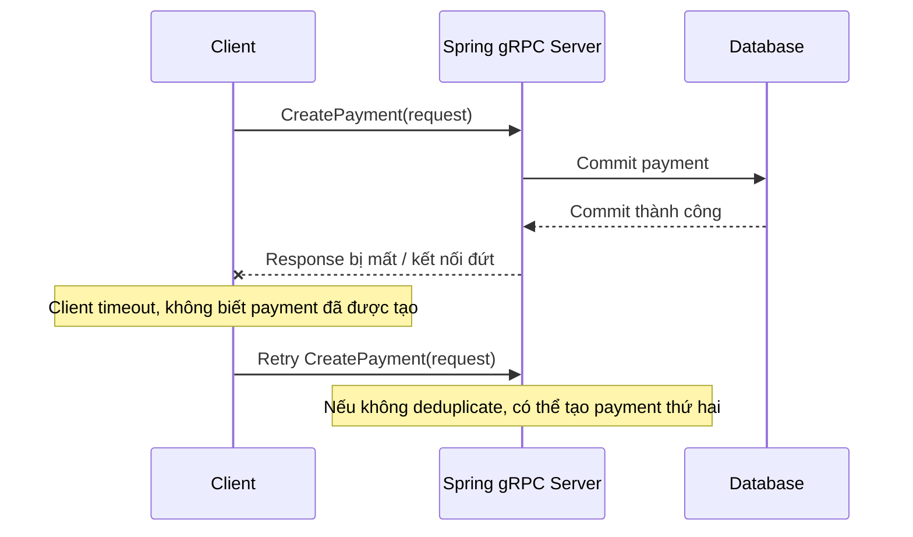
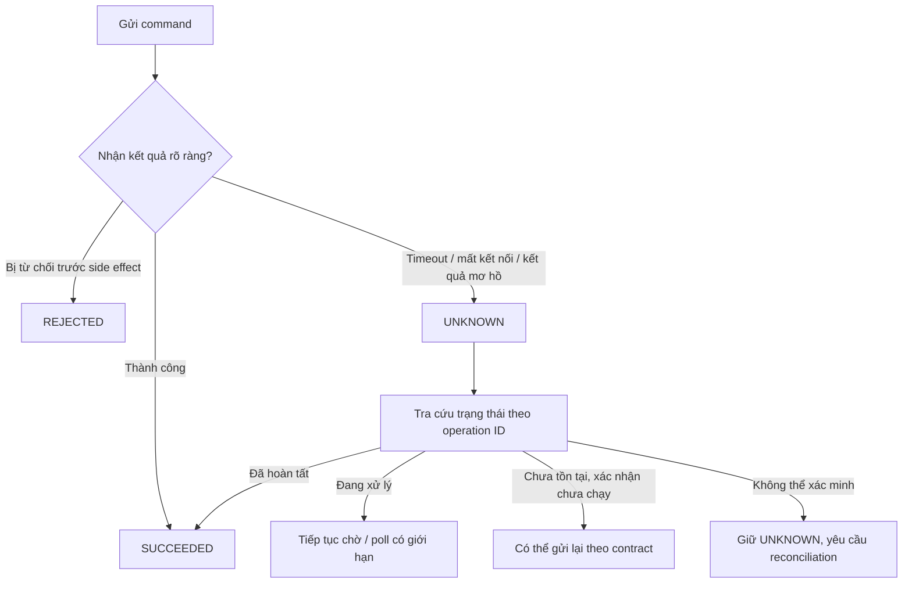

# Không retry non-idempotent command tùy ý

## 1. Vì sao retry một command có thể gây tác dụng phụ trùng?

Trong **Spring gRPC**, một command thường yêu cầu server thay đổi trạng thái: tạo đơn hàng, trừ tồn kho, chuyển tiền, phát hành vé hoặc kích hoạt một quy trình. Những thao tác này không mặc nhiên an toàn khi gửi lại.

Ví dụ client gọi `CreatePayment`. Server đã ghi nhận thanh toán, nhưng response bị mất trên đường về. Client chỉ thấy timeout hoặc `UNAVAILABLE`. Nếu gửi lại command như một yêu cầu mới, server có thể thu tiền lần thứ hai.

Đây là **ambiguous outcome**: client không biết chắc thao tác đã được thực hiện hay chưa. Status lỗi của RPC mô tả kết quả của lời gọi ở tầng giao tiếp; nó không phải lúc nào cũng chứng minh server chưa tạo tác dụng phụ.

Nguyên tắc của bài này:

- Không tự động retry command không idempotent chỉ vì nhận được lỗi tạm thời.
- Chỉ retry khi biết chắc lần trước chưa được thực thi, hoặc command đã có cơ chế idempotency bảo vệ.
- Khi kết quả không rõ, tra cứu trạng thái thao tác trước khi quyết định gửi lại.

## 2. Idempotent và non-idempotent command

Một thao tác **idempotent** có cùng kết quả nghiệp vụ khi được thực hiện một hay nhiều lần với cùng định danh/đầu vào. Một thao tác **non-idempotent** có thể tạo thêm tác dụng phụ mỗi lần thực thi.

| Command | Hành vi khi gửi lại | Nhận xét |
| --- | --- | --- |
| `GetOrder` | Đọc cùng trạng thái, nếu không có side effect | Thường idempotent |
| `SetShippingAddress(order, address)` | Ghi cùng địa chỉ đích | Có thể idempotent nếu semantics không phát side effect lặp |
| `IncrementInventory(product, 1)` | Tăng tồn kho thêm một lần nữa | Non-idempotent |
| `CreateOrder` | Có thể tạo thêm đơn hàng | Non-idempotent nếu không deduplicate |
| `ChargeCard(amount)` | Có thể thu tiền lần nữa | Non-idempotent nếu provider không hỗ trợ idempotency |
| `SendEmail` | Có thể gửi nhiều email | Non-idempotent nếu không có deduplication |

Tên method không quyết định tính idempotent. Ví dụ `SetStatus` có vẻ idempotent, nhưng nếu mỗi lần gọi đều phát event, gửi thông báo hoặc tính phí thì tác dụng phụ vẫn có thể lặp. Phải đánh giá toàn bộ hành vi của command và các dependency mà nó gọi.

## 3. Lỗi RPC không chứng minh command chưa chạy

Trong unary RPC, client gửi request và chờ response. Có thể xảy ra các tình huống:



Các status thường gặp trong tình huống không rõ kết quả:

| Status client nhận | Có thể kết luận server chưa thực hiện command? | Cách xử lý an toàn |
| --- | --- | --- |
| `UNAVAILABLE` | Không. Lỗi có thể xảy ra trước hoặc sau khi server xử lý | Tra cứu trạng thái hoặc dùng idempotency trước khi gửi lại |
| `DEADLINE_EXCEEDED` | Không. Server có thể đã commit nhưng response đến muộn | Không suy luận command thất bại; reconcile |
| `CANCELLED` | Không. Cancellation không rollback side effect đã commit | Tra cứu trạng thái nếu command đã được gửi |
| `UNKNOWN` / lỗi transport | Không nhất thiết | Xử lý như kết quả chưa xác định |
| `INVALID_ARGUMENT` | Chỉ kết luận chưa thực hiện nếu server bảo đảm validation xảy ra trước side effect | Sửa dữ liệu; gửi lại là một command đã thay đổi |
| `UNAUTHENTICATED` / `PERMISSION_DENIED` | Chỉ kết luận chưa thực hiện nếu authentication/authorization được kiểm tra trước side effect | Sửa credential/quyền; không retry mù quáng |

Chỉ khi hệ thống có bằng chứng đáng tin cậy rằng request chưa được chuyển tới logic xử lý, hoặc server xác nhận chưa thực hiện, client mới có thể kết luận lần gửi đó không tạo tác dụng phụ. Đừng dùng riêng tên status để suy ra điều này.

## 4. Phân biệt ba kết quả ở client

Client nên lưu trạng thái của command thay vì chỉ có hai nhánh success/failure:

| Trạng thái | Ý nghĩa | Hành động tiếp theo |
| --- | --- | --- |
| `SUCCEEDED` | Đã nhận kết quả thành công hoặc xác minh được server đã thực hiện | Không gửi lại |
| `REJECTED` | Server xác nhận command không được thực hiện do validation/quyền/điều kiện | Sửa nguyên nhân trước khi tạo command mới |
| `UNKNOWN` | Request đã gửi nhưng client không biết server đã commit hay chưa | Tra cứu theo operation ID; chưa retry command mù quáng |

Luồng xử lý:



Không biến mọi exception thành `REJECTED`. Một exception ở client thường chỉ cho biết client không nhận được response; nó không chứng minh server đã rollback.

## 5. Không cấu hình automatic retry cho command không idempotent

Retry policy của gRPC được áp dụng theo service/method trên client channel. Chỉ gắn policy cho những method có semantics an toàn khi retry. Ví dụ có thể retry thao tác đọc `GetBalance`, nhưng không thêm `CreateTransfer` vào policy khi chưa có idempotency:

```json
{
  "methodConfig": [
    {
      "name": [
        {
          "service": "wallet.v1.WalletService",
          "method": "GetBalance"
        }
      ],
      "retryPolicy": {
        "maxAttempts": 3,
        "initialBackoff": "0.2s",
        "maxBackoff": "1s",
        "backoffMultiplier": 2,
        "retryableStatusCodes": ["UNAVAILABLE"]
      }
    }
  ]
}
```

`CreateTransfer` không có entry retry policy trong cấu hình này. Điều đó loại bỏ **configured retry** cho method đó. Tuy nhiên, gRPC có thể thực hiện transparent retry trong một số trường hợp rất sớm khi runtime biết request chưa được server application xử lý. Transparent retry không phải bảo đảm exactly-once; logic nghiệp vụ vẫn cần được thiết kế an toàn với các lần gửi lặp có thể xảy ra.

Trong Spring gRPC, service config phải được áp dụng lên client channel do ứng dụng quản lý. Không dùng một policy chung cho mọi method chỉ vì chúng cùng nằm trong một service.

## 6. Tra cứu trạng thái trước khi gửi lại

Với command có tác dụng phụ, một cách xử lý kết quả mơ hồ là cấp một **operation ID** ổn định và cung cấp RPC tra cứu trạng thái:

```proto
syntax = "proto3";

package wallet.v1;

option java_multiple_files = true;
option java_package = "com.example.wallet.v1";

service WalletService {
  rpc CreateTransfer(CreateTransferRequest)
      returns (CreateTransferResponse);
  rpc GetTransferStatus(GetTransferStatusRequest)
      returns (GetTransferStatusResponse);
}

message CreateTransferRequest {
  string operation_id = 1;
  string source_account = 2;
  string destination_account = 3;
  int64 amount_minor = 4;
}

message CreateTransferResponse {
  string transfer_id = 1;
  string status = 2;
}

message GetTransferStatusRequest {
  string operation_id = 1;
}

message GetTransferStatusResponse {
  enum State {
    STATE_UNSPECIFIED = 0;
    NOT_FOUND = 1;
    PROCESSING = 2;
    SUCCEEDED = 3;
    REJECTED = 4;
  }
  State state = 1;
  string transfer_id = 2;
  string reason = 3;
}
```

Client tạo `operation_id` một lần cho ý định chuyển tiền và lưu nó cùng request. Nếu `CreateTransfer` timeout:

1. Gọi `GetTransferStatus(operation_id)`.
2. Nếu `SUCCEEDED`, hiển thị kết quả đã lưu; không gửi lại.
3. Nếu `PROCESSING`, chờ hoặc poll theo backoff có giới hạn.
4. Nếu `REJECTED`, hiển thị lý do; muốn thực hiện ý định mới phải tạo command mới theo contract.
5. Nếu `NOT_FOUND`, chỉ gửi lại cùng operation ID khi server bảo đảm tra cứu nhất quán và trạng thái đó có nghĩa command chưa được nhận.

`NOT_FOUND` cần được định nghĩa cẩn thận. Nếu truy vấn đọc từ replica trễ hoặc record chưa được ghi nhìn thấy, kết quả không tồn tại tạm thời không chứng minh request trước chưa chạy. Dùng nguồn dữ liệu nhất quán phù hợp hoặc một khoảng reconciliation trước khi cho phép gửi lại.

## 7. Khi nào có thể retry command?

Có ba trường hợp chính:

| Trường hợp | Có thể gửi lại? | Điều kiện |
| --- | --- | --- |
| Chắc chắn request chưa tới server application | Có thể | Bằng chứng transport/runtime đáng tin cậy; vẫn tuân thủ deadline và attempt limit |
| Server từ chối rõ ràng trước side effect | Không gửi lại nguyên request lỗi; có thể tạo request đã sửa | Sửa validation, quyền hoặc precondition |
| Không rõ server đã thực hiện hay chưa | Không retry tùy ý | Tra cứu operation ID hoặc dùng idempotency key |
| Command có idempotency bền vững | Có thể theo policy | Cùng key, cùng payload fingerprint; server deduplicate nguyên tử |

Một command không idempotent có thể trở nên an toàn khi server triển khai deduplication đủ mạnh. Khi đó, các lần gọi cùng key không còn là các thao tác nghiệp vụ độc lập: chúng cùng tham chiếu một operation và trả lại cùng kết quả.

## 8. Idempotency nếu nghiệp vụ bắt buộc phải retry

Nếu yêu cầu hệ thống cần tự phục hồi sau lỗi mạng, hãy bổ sung idempotency thay vì chỉ tăng `maxAttempts`:

1. Client tạo `idempotency_key` hoặc `operation_id` ổn định trước attempt đầu.
2. Server xác định scope, ví dụ `tenant + method + key`.
3. Server tính fingerprint từ các trường ảnh hưởng kết quả.
4. Unique constraint trong database bảo đảm chỉ một request trở thành owner.
5. Tác dụng phụ trong database và response được lưu trong cùng transaction.
6. Request lặp cùng key/fingerprint nhận lại kết quả đã lưu; cùng key nhưng payload khác bị từ chối.
7. Side effect ngoài database dùng downstream idempotency hoặc transactional outbox.

Không được tạo key mới ở mỗi lần retry; làm vậy phá vỡ deduplication. Không xóa record ngay sau khi trả response đầu tiên; retention phải bao phủ khoảng thời gian client có thể retry hoặc phục hồi.

## 9. Ví dụ client xử lý kết quả không xác định

Đoạn mã sau minh họa cách tách lỗi giao tiếp khỏi kết quả nghiệp vụ. `operationId` được lưu bền vững trước khi gọi; khi RPC lỗi, client tra cứu trạng thái thay vì gửi lại command ngay:

Đây là method bên trong client component. `stub` và `statusStub` là blocking stub được tạo từ channel; `TransferOutcome` và `toOutcome()` là kiểu kết quả/helper do ứng dụng định nghĩa.

```java
import io.grpc.Status;
import io.grpc.StatusRuntimeException;
import java.util.concurrent.TimeUnit;
import com.example.wallet.v1.CreateTransferRequest;
import com.example.wallet.v1.GetTransferStatusRequest;
import com.example.wallet.v1.GetTransferStatusResponse;

public TransferOutcome createTransferSafely(
        CreateTransferRequest request) {
    try {
        return toOutcome(stub
                .withDeadlineAfter(2, TimeUnit.SECONDS)
                .createTransfer(request));
    } catch (StatusRuntimeException error) {
        Status.Code code = Status.fromThrowable(error).getCode();

        if (code == Status.Code.INVALID_ARGUMENT
                || code == Status.Code.PERMISSION_DENIED
                || code == Status.Code.UNAUTHENTICATED) {
            return TransferOutcome.rejected(code.name());
        }

        // UNAVAILABLE/DEADLINE_EXCEEDED/CANCELLED có thể là kết quả mơ hồ.
        try {
            GetTransferStatusResponse transferStatus = statusStub
                    .withDeadlineAfter(1, TimeUnit.SECONDS)
                    .getTransferStatus(GetTransferStatusRequest.newBuilder()
                            .setOperationId(request.getOperationId())
                            .build());

            return switch (transferStatus.getState()) {
                case SUCCEEDED -> TransferOutcome.succeeded(
                        transferStatus.getTransferId());
                case PROCESSING -> TransferOutcome.pending(
                        request.getOperationId());
                case REJECTED -> TransferOutcome.rejected(
                        transferStatus.getReason());
                case NOT_FOUND, STATE_UNSPECIFIED ->
                        TransferOutcome.unknown(request.getOperationId());
                default -> TransferOutcome.unknown(request.getOperationId());
            };
        } catch (StatusRuntimeException lookupError) {
            // Không tra cứu được cũng không chứng minh command chưa chạy.
            return TransferOutcome.unknown(request.getOperationId());
        }
    }
}
```

Ví dụ không tự gửi lại `CreateTransfer` khi trạng thái chưa rõ. Nếu cần retry, một bước riêng phải kiểm tra tính nhất quán của trạng thái và gửi lại **cùng operation ID** theo contract idempotency của server. Với hệ thống thực, không nên chuyển một `NOT_FOUND` chưa chắc chắn thành quyền gửi lại.

## 10. Kiểm thử không retry command tùy ý

Các test cần chứng minh cả số lần thực thi nghiệp vụ và cách client xử lý kết quả mơ hồ:

| Kịch bản | Assertion |
| --- | --- |
| `CreateTransfer` không có configured retry policy, server trả `UNAVAILABLE` | Client không tạo vòng retry ứng dụng ngoài ý muốn |
| Server commit transfer rồi response bị mất | Client chuyển sang `UNKNOWN`, tra cứu trạng thái |
| Tra cứu trả `SUCCEEDED` | Client không gửi lại command |
| Tra cứu trả `PROCESSING` | Client tiếp tục chờ/poll có giới hạn |
| Cùng operation ID được gửi lại theo idempotency contract | Chỉ có một transfer; response được replay |
| Cùng operation ID nhưng amount khác | Server từ chối conflict; không tạo transfer thứ hai |
| Request bị validation từ chối trước side effect | Client sửa request hoặc báo lỗi; không retry nguyên payload |
| Client deadline/cancel sau khi gửi request | Không suy luận rằng server đã rollback |
| Retry policy chỉ áp dụng cho `GetBalance` | Method `CreateTransfer` không nhận configured retry policy |

Test nên đếm số lần side effect xảy ra ở database/provider, không chỉ đếm số lần RPC được gọi. Một RPC có thể có nhiều attempt nhưng vẫn chỉ một tác dụng phụ nếu idempotency đúng; ngược lại, một lần RPC ở client có thể đã tạo side effect dù client không nhận được response.

## 11. Sai lầm thường gặp

1. **Retry mọi `UNAVAILABLE` hoặc `DEADLINE_EXCEEDED`.** Status không chứng minh command chưa được thực hiện.
2. **Tạo operation ID mới cho mỗi attempt.** Server không nhận ra các lần gửi thuộc cùng một ý định.
3. **Coi timeout là rollback.** Timeout chỉ cho biết client hết thời gian chờ.
4. **Chỉ tắt configured retry rồi cho rằng không thể có lần gửi lặp nào.** Transparent retry và retry ở tầng khác vẫn cần được tính đến.
5. **Tra cứu trạng thái từ nguồn eventual-consistent rồi tin `NOT_FOUND`.** Có thể record đã tồn tại nhưng chưa nhìn thấy.
6. **Retry command sau khi sửa payload nhưng giữ nguyên key.** Cùng key với fingerprint khác phải bị từ chối; thao tác đã thay đổi là một ý định mới.
7. **Chỉ deduplicate trong memory.** Restart hoặc nhiều replica có thể thực hiện cùng command hai lần.
8. **Cho rằng transaction database bảo vệ side effect ngoài hệ thống.** Cần idempotency ở downstream hoặc outbox.

## 12. Bài tập vận dụng

Với `wallet.v1.WalletService/CreateTransfer`:

1. Không cấu hình automatic retry cho method khi chưa có idempotency.
2. Mô phỏng server ghi transfer thành công nhưng response bị mất; client phải chuyển sang `UNKNOWN`.
3. Bổ sung `operation_id` và RPC `GetTransferStatus` để reconciliation.
4. Kiểm thử `NOT_FOUND` trên nguồn dữ liệu nhất quán và trên replica trễ; xác định khi nào được phép gửi lại.
5. Thêm idempotency key với unique constraint, fingerprint và transaction; gửi hai request đồng thời cùng key.
6. Mô phỏng downstream payment provider và bảo vệ side effect bằng key riêng hoặc outbox.

**Tiêu chí hoàn thành:** người học không retry command non-idempotent chỉ dựa trên status lỗi; phân biệt được kết quả thất bại với kết quả chưa xác định; biết tra cứu trạng thái và chỉ retry khi có bằng chứng chưa thực thi hoặc idempotency bảo vệ.

### Tài liệu tham khảo

- [gRPC Retry](https://grpc.io/docs/guides/retry/): configured retry, transparent retry và commitment.
- [gRPC Status Codes](https://grpc.io/docs/guides/status-codes/): ý nghĩa status của RPC.
- [gRPC Service Config](https://grpc.io/docs/guides/service-config/): cấu hình hành vi retry theo method.
- [Spring Transaction Management](https://docs.spring.io/spring-framework/reference/data-access/transaction.html): transaction trong ứng dụng Spring.
- [Spring gRPC Reference](https://docs.spring.io/spring-grpc/reference/): tích hợp gRPC client/server trong Spring.
