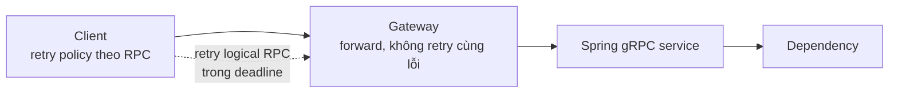
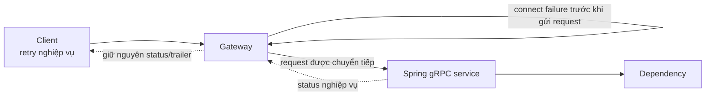

# Retry ở client hay ở gateway

## 1. Hai vị trí retry, hai góc nhìn khác nhau

Trong hệ thống **Spring gRPC**, một request có thể đi từ ứng dụng client qua API gateway hoặc reverse proxy rồi tới gRPC service. Khi upstream tạm thời lỗi, cả client và gateway đều có thể có khả năng thử lại. Nếu cả hai cùng retry mà không có quy ước, một lỗi nhỏ có thể tạo ra nhiều request hơn dự kiến.

**Retry ở client** diễn ra trong gRPC channel/stub của ứng dụng gọi. Client hiểu method đang gọi, deadline của thao tác và ý nghĩa nghiệp vụ của request. Nó có thể chọn policy theo từng RPC và kết hợp với idempotency key.

**Retry ở gateway** diễn ra tại tầng trung gian chuyển tiếp request tới upstream. Gateway thường nhìn thấy kết nối, HTTP/2 stream, status/trailer và tình trạng upstream. Nó có thể bảo vệ client khỏi một số lỗi hạ tầng, nhưng không phải lúc nào cũng hiểu đầy đủ tác dụng phụ nghiệp vụ của command.

Không có một vị trí luôn đúng cho mọi hệ thống. Cần chọn nơi sở hữu retry dựa trên thông tin mà tầng đó có, khả năng replay request, semantics của method và deadline tổng.

## 2. So sánh client retry và gateway retry

| Tiêu chí | Retry ở client | Retry ở gateway |
| --- | --- | --- |
| Nơi thực hiện | gRPC client channel/stub | Proxy, API gateway hoặc service mesh |
| Hiểu method nghiệp vụ | Thường rõ hơn; biết RPC và request | Có thể chỉ biết route/cluster và metadata |
| Chọn policy theo RPC | Có thể match service/method trong service config | Phụ thuộc khả năng route/method matching của gateway |
| Quan sát upstream | Thấy kết quả cuối qua gateway | Thấy từng lần chuyển tiếp tới upstream |
| Idempotency | Có thể giữ key qua các attempt | Có thể chuyển tiếp key, nhưng không tự tạo guarantee |
| Deadline | Gắn trực tiếp với logical RPC của caller | Phải tuân thủ timeout/deadline nhận từ downstream |
| Replay request | Stub/runtime quản lý request retry buffer | Cần request body/stream replayable và proxy hỗ trợ |
| Thay đổi policy | Cần cập nhật client/config hoặc service config | Có thể cập nhật tập trung ở gateway |
| Rủi ro chính | Retry lồng với gateway hoặc dependency | Nhân tải, replay command đã được upstream thực thi |

Client phù hợp khi quyết định retry cần hiểu status gRPC, idempotency và ý nghĩa thao tác. Gateway phù hợp với một số lỗi vận chuyển có thể xác định rõ, khi gateway có thể replay request an toàn và có giới hạn tải phù hợp.

## 3. Quy tắc chọn tầng sở hữu retry

Một logical operation nên có **một tầng retry chính**. Tầng khác chỉ nên retry một phạm vi lỗi hẹp, được định nghĩa rõ, chẳng hạn lỗi kết nối xảy ra trước khi request được gửi tới upstream.

Một cách phân công thường dùng:

- **Client:** sở hữu retry theo gRPC status, method semantics, deadline và idempotency.
- **Gateway:** chỉ retry lỗi kết nối/upstream rất sớm khi có bằng chứng request chưa được xử lý, hoặc khi route có contract replay an toàn.
- **Service:** không tự retry lại request đến chính nó; nếu gọi dependency, quản lý retry cho dependency đó theo ngân sách riêng và truyền tiếp deadline.

Nếu gateway cần retry một số lỗi upstream, client nên có policy hẹp hơn hoặc không bật configured retry cho cùng phạm vi lỗi. Nếu client là tầng sở hữu retry, gateway thường chuyển tiếp status/trailer chính xác và không tự replay request.

### 3.1. Sơ đồ một tầng retry chính



Trong mô hình này client chịu trách nhiệm retry RPC. Gateway vẫn có thể load balance hoặc chọn upstream, nhưng không tạo thêm một vòng retry độc lập cho cùng status.

### 3.2. Gateway retry hẹp cho lỗi kết nối trước khi xử lý



Gateway chỉ retry ở nhánh mà nó xác định được request chưa tới application handler. Khi request đã được gửi tới service và kết quả không rõ, gateway không được suy luận rằng thao tác chưa xảy ra chỉ từ việc upstream connection bị reset.

## 4. Tránh retry multiplication

Giả sử client cho phép tối đa ba attempt tổng cộng và gateway cũng cho phép ba lần chuyển tiếp cho mỗi request client gửi. Trong trường hợp xấu nhất:

[
3 \times 3 = 9
]

Một logical RPC từ client có thể tạo tới chín lần xử lý ở upstream. Nếu service tiếp tục retry dependency ba lần, số lần gọi dependency có thể tăng tới:

[
3_{client} \times 3_{gateway} \times 3_{service} = 27
]

Đây là biên trên minh họa khi các tầng đều dùng hết attempt budget; thực tế còn phụ thuộc lỗi, commitment và việc request có tới tầng tiếp theo hay không.

| Client attempts | Gateway attempts mỗi request | Upstream attempts tối đa |
| ---: | ---: | ---: |
| 1 | 1 | 1 |
| 3 | 1 | 3 |
| 1 | 3 | 3 |
| 3 | 3 | 9 |
| 3 | 2 | 6 |

Jitter chỉ phân tán thời điểm retry, không giảm số attempt tối đa. Muốn hạn chế amplification cần thống nhất ngân sách attempt, deadline, retry budget, throttling và rate limit.

## 5. Client retry trong Spring gRPC

Với gRPC Java, retry policy được cấu hình trong service config của client channel. Ví dụ chỉ retry method đọc `catalog.v1.CatalogService/GetItem` khi nhận `UNAVAILABLE`:

```java
import io.grpc.ManagedChannel;
import io.grpc.ManagedChannelBuilder;
import java.util.List;
import java.util.Map;
import java.util.concurrent.TimeUnit;
import com.example.catalog.v1.CatalogServiceGrpc;
import com.example.catalog.v1.GetItemRequest;
import com.example.catalog.v1.GetItemResponse;

Map<String, Object> retryPolicy = Map.of(
        "maxAttempts", 3.0,
        "initialBackoff", "0.2s",
        "maxBackoff", "1s",
        "backoffMultiplier", 2.0,
        "retryableStatusCodes", List.of("UNAVAILABLE"));

Map<String, Object> methodConfig = Map.of(
        "name", List.of(Map.of(
                "service", "catalog.v1.CatalogService",
                "method", "GetItem")),
        "retryPolicy", retryPolicy);

Map<String, Object> serviceConfig =
        Map.of("methodConfig", List.of(methodConfig));

ManagedChannel channel = ManagedChannelBuilder
        .forAddress("catalog.internal", 9090)
        .enableRetry()
        .defaultServiceConfig(serviceConfig)
        .build();

CatalogServiceGrpc.CatalogServiceBlockingStub stub =
        CatalogServiceGrpc.newBlockingStub(channel);

GetItemRequest request = GetItemRequest.newBuilder()
        .setItemId("item-42")
        .build();

GetItemResponse response = stub
        .withDeadlineAfter(2, TimeUnit.SECONDS)
        .getItem(request);
```

Policy này là ví dụ cho thao tác đọc. Không sao chép nguyên policy sang `CreateOrder` hoặc `ChargePayment` nếu các method đó chưa có idempotency. `maxAttempts=3` là ba attempt tổng cộng, không phải ba retry bổ sung.

Trong ứng dụng Spring gRPC, gắn service config vào channel do cấu hình/factory client quản lý trước khi build channel. Nếu dự án dùng channel factory có sẵn, tùy biến builder tại điểm tích hợp đó; không tạo một channel mới cho mỗi RPC.

## 6. Gateway retry cần hiểu gRPC

gRPC chạy trên HTTP/2, nhưng status nghiệp vụ của RPC thường được truyền trong trailer `grpc-status`, không nhất thiết tương ứng với HTTP status 5xx. Một RPC có thể có HTTP status 200 nhưng kết thúc bằng `grpc-status: UNAVAILABLE`.

Do đó, một gateway chỉ retry theo HTTP 5xx có thể bỏ lỡ lỗi gRPC cần xử lý. Ngược lại, gateway chuyển mọi HTTP 200 thành success mà không đọc trailer có thể che mất lỗi RPC.

Khi cấu hình gateway, cần xác minh:

- Gateway hỗ trợ gRPC/HTTP2 end-to-end và đọc được gRPC trailers.
- Retry policy có thể chọn status gRPC cụ thể, không chỉ HTTP status.
- Request body có thể replay; gateway có đủ dữ liệu để gửi lại cùng request.
- Có giới hạn số lần retry, per-try timeout và tổng route timeout.
- Gateway không retry một command non-idempotent sau khi request có thể đã tới upstream, trừ khi có idempotency contract.
- Gateway giữ nguyên deadline/timeout và các metadata cần thiết khi chuyển tiếp.

Tên trường cấu hình và khả năng retry gRPC phụ thuộc sản phẩm gateway/proxy. Không lấy cấu hình retry HTTP tổng quát rồi mặc định rằng nó hiểu `grpc-status`.

## 7. Gateway không thể suy ra idempotency từ HTTP method

Một gateway có thể thấy request là HTTP POST hoặc một gRPC POST tới path của RPC. Điều đó không đủ để biết thao tác có idempotent hay không:

- Một RPC đọc có thể được ánh xạ thành POST nhưng không có side effect.
- Một RPC ghi có thể dùng HTTP/2 POST và tạo giao dịch.
- Một gateway có thể replay body thành công về mặt transport nhưng gây side effect lặp ở service.

Với command ghi, cần idempotency key/operation ID ổn định. Gateway phải chuyển tiếp nguyên key qua các attempt; server deduplicate theo scope và request fingerprint. Nếu không có cơ chế này, chỉ retry khi gateway có bằng chứng request chưa được gửi tới application handler.

Không để gateway tự tạo idempotency key mới cho từng attempt. Làm vậy khiến server nhìn mỗi lần replay như một thao tác mới.

## 8. Deadline và timeout qua các tầng

Deadline của client là ngân sách cho logical RPC. Gateway retry phải tiêu thụ cùng ngân sách đó; không được cấp một timeout đầy đủ mới cho mỗi upstream attempt.

Ví dụ:

| Giai đoạn | Thời gian |
| --- | ---: |
| Client đặt deadline tổng | 2.000 ms |
| Gateway nhận request và xử lý route | 100 ms |
| Upstream attempt 1 | 600 ms |
| Backoff ở gateway | 200 ms |
| Upstream attempt 2 còn ngân sách | khoảng 1.100 ms |

Số liệu chỉ minh họa. Gateway phải tính timeout còn lại, áp dụng per-try timeout nhỏ hơn hoặc bằng ngân sách còn lại và dừng retry trước khi deadline tổng hết. Client và gateway không nên có hai timeout độc lập khiến gateway tiếp tục xử lý sau khi caller đã hết hạn.

Với gRPC, deadline được biểu diễn qua timeout metadata `grpc-timeout` theo thời gian còn lại. Proxy cần xử lý đúng semantics và tránh reset thành một timeout dài hơn ở mỗi hop. Service downstream cũng cần nhận deadline/cancellation phù hợp.

## 9. Chọn tầng theo loại lỗi

| Loại lỗi | Client retry | Gateway retry | Gợi ý |
| --- | --- | --- | --- |
| DNS/connect failure trước khi request được gửi | Có thể | Thường phù hợp nếu gateway xác định chắc | Chỉ một tầng nên retry cùng sự cố |
| Connection reset sau khi request đã được gửi | Kết quả có thể mơ hồ | Rủi ro replay side effect | Tra cứu/idempotency trước khi retry command |
| gRPC `UNAVAILABLE` từ application | Có thể theo method policy | Chỉ nếu gateway hiểu trailer và route cho phép | Chọn một tầng sở hữu retry |
| gRPC `INVALID_ARGUMENT` | Không | Không | Sửa request |
| gRPC `PERMISSION_DENIED` | Không | Không | Sửa quyền/credential |
| gRPC `RESOURCE_EXHAUSTED` do quá tải tạm thời | Có thể với backoff/pushback | Có thể nếu có retry budget | Tránh retry đồng loạt |
| `DEADLINE_EXCEEDED` | Chỉ khi semantics cho phép | Không mặc định | Server có thể đã thực hiện side effect |
| Lỗi một dependency bên trong service | Client không biết chi tiết | Gateway thường cũng không biết | Service sở hữu retry dependency |

Gateway có thể là nơi thích hợp để xử lý lỗi kết nối trước khi request tới service. Client thường là nơi thích hợp hơn để quyết định retry theo semantics của RPC. Lỗi nội bộ dependency nên được xử lý tại service đang gọi dependency vì tầng đó hiểu transaction và idempotency của thao tác.

## 10. Một policy vận hành có kiểm soát

Khi kết hợp client và gateway, ghi rõ trách nhiệm bằng một bảng policy:

| Phạm vi | Owner retry | Điều kiện | Giới hạn |
| --- | --- | --- | --- |
| `GetItem` unary | Client | `UNAVAILABLE`, call chưa commit | 3 attempts, deadline 2 s |
| Kết nối gateway tới upstream trước khi gửi request | Gateway | Connect failure được xác định trước khi chuyển request | 1 retry bổ sung, nằm trong deadline gốc |
| `CreateOrder` | Không tự retry nếu chưa có idempotency | Kết quả mơ hồ thì tra cứu operation ID | Không replay tùy ý |
| Service gọi database/dependency | Service | Lỗi tạm thời có thể phục hồi | Budget nhỏ, deadline còn lại |
| Server/bidi stream đã commit | Ứng dụng stream | Resume bằng cursor/sequence | Reconnect có backoff và dedup |

Các giá trị là ví dụ, không phải mặc định cho mọi hệ thống. Điểm quan trọng là mỗi phạm vi có một owner, điều kiện retry, attempt budget và deadline được xác định.

## 11. Kiểm thử retry ở client và gateway

Kiểm thử phải quan sát số lần request tới upstream, không chỉ kết quả cuối ở client:

| Kịch bản | Điều cần xác minh |
| --- | --- |
| Client retry, gateway không retry | Upstream nhận số attempt theo client policy |
| Gateway retry, client chỉ gửi một lần | Gateway không vượt giới hạn upstream attempts |
| Cả hai policy vô tình bật | Đo retry multiplication và phát hiện cấu hình xung đột |
| HTTP 200 với trailer `grpc-status: UNAVAILABLE` | Gateway gRPC-aware phân loại đúng status |
| HTTP 503 trước khi có gRPC trailers | Gateway áp dụng đúng policy transport đã định nghĩa |
| Reset sau khi request tới upstream | Command không bị thực thi trùng; có idempotency/reconciliation |
| Deadline hết trong gateway backoff | Không có upstream attempt sau deadline |
| Gateway nhận pushback | Không bỏ qua chỉ dẫn dừng/chờ của server |
| `INVALID_ARGUMENT` hoặc `PERMISSION_DENIED` | Không retry |
| Client cancel khi gateway đang retry | Gateway dừng attempt tiếp theo và hủy upstream call nếu có thể |

Trong test, thêm request ID và attempt number vào log test ở client, gateway và server. So sánh:

- Số logical call từ client.
- Số upstream attempt do gateway tạo.
- Số lần service handler thực sự chạy.
- Số side effect đã commit.

Các con số này khác nhau trong trường hợp connect failure, request bị từ chối trước handler hoặc gateway retry sau reset. Đếm riêng từng tầng giúp tìm đúng nơi tạo request lặp.

## 12. Quan sát và bảo vệ tải

Theo dõi các metric:

- Logical RPC count và attempt count ở client.
- Upstream request/attempt count ở gateway theo route/cluster.
- Tỷ lệ retry, retry success rate và status của từng attempt.
- Deadline còn lại khi bắt đầu mỗi attempt.
- Retry budget/throttling, pushback và số lần gateway từ chối retry.
- Số duplicate bị deduplicate và số conflict idempotency.
- Queue depth, concurrency và latency của upstream.

Đừng chỉ nhìn tỷ lệ success cuối. Một tỷ lệ success 99,9% có thể che giấu việc mỗi logical call tạo ra nhiều upstream attempts và làm chi phí/tải tăng mạnh.

Khi outage xảy ra, retry cần giảm tải cho hệ thống phục hồi. Giới hạn concurrency, rate limit, circuit breaker và load shedding vẫn cần thiết; retry không thay thế các cơ chế này.

## 13. Sai lầm thường gặp

1. **Bật retry ở cả client và gateway mà không tính tích lũy.** Upstream có thể nhận nhiều lần request hơn dự kiến.
2. **Cho rằng gateway hiểu mọi gRPC status qua HTTP code.** Cần đọc đúng gRPC trailers.
3. **Retry command chỉ vì connection reset.** Request có thể đã tới service và tạo side effect.
4. **Đặt timeout mới ở gateway cho mỗi attempt.** Tổng thời gian có thể vượt deadline của caller.
5. **Để gateway tạo key mới mỗi lần replay.** Server không thể deduplicate cùng một ý định.
6. **Dùng retry policy cấp service cho mọi RPC.** Có thể retry nhầm method không idempotent.
7. **Không phân biệt retry trước khi gửi request và retry sau khi upstream đã nhận.** Mức độ an toàn khác nhau.
8. **Không đo attempt ở từng tầng.** Khó phát hiện retry multiplication.
9. **Coi retry gateway là thay thế retry trong service.** Gateway không hiểu trạng thái transaction hoặc dependency nội bộ.

## 14. Bài tập vận dụng

Với `catalog.v1.CatalogService` qua một gateway:

1. Cấu hình client retry `GetItem` khi `UNAVAILABLE`, tối đa ba attempt.
2. Cấu hình gateway chỉ retry một connect failure được xác định trước khi request được chuyển tới upstream.
3. Mô phỏng gRPC HTTP 200 kèm trailer `grpc-status: UNAVAILABLE`; xác minh gateway/client phân loại đúng.
4. Bật retry đồng thời ở cả hai tầng trong môi trường test; tính số upstream attempts tối đa và quan sát metric.
5. Tạo `CreateOrder` không idempotent, mô phỏng reset sau khi service commit; xác minh không retry mù quáng và status lookup/idempotency ngăn tạo order trùng.
6. Đặt deadline ngắn, tạo backoff ở gateway và xác minh attempt tiếp theo không vượt deadline gốc.

**Tiêu chí hoàn thành:** người học chọn được tầng sở hữu retry cho từng loại lỗi, giải thích được retry multiplication, cấu hình client/gateway theo phạm vi rõ ràng, giữ deadline xuyên các hop và bảo vệ command bằng idempotency hoặc reconciliation.

### Tài liệu tham khảo

- [gRPC Retry](https://grpc.io/docs/guides/retry/): retry policy, commitment, backoff và retry throttling ở client.
- [gRPC Service Config](https://grpc.io/docs/guides/service-config/): cấu hình retry theo service và method.
- [gRPC Deadlines](https://grpc.io/docs/guides/deadlines/): deadline và truyền ngân sách thời gian qua các service.
- [gRPC HTTP/2 Protocol](https://github.com/grpc/grpc/blob/master/doc/PROTOCOL-HTTP2.md): gRPC status và trailers trên HTTP/2.
- [Spring gRPC Reference](https://docs.spring.io/spring-grpc/reference/): tích hợp gRPC client/server trong Spring.
