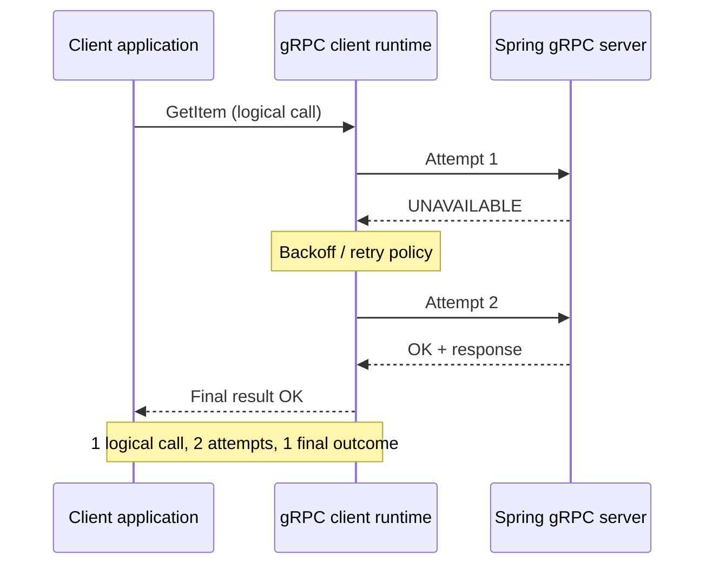

# Quan sát số lần thử và kết quả cuối

## 1. Vì sao phải quan sát cả attempt và logical RPC?

Trong **Spring gRPC**, một lời gọi logic từ client có thể tạo nhiều lần thực thi RPC khi retry xảy ra. Ví dụ client gọi `GetItem`, lần đầu server trả `UNAVAILABLE`, lần sau thành công. Ở phía client, người dùng chỉ nhận một kết quả cuối là thành công; ở phía server, có thể đã có hai lần request được tiếp nhận.

Nếu chỉ đếm số RPC thành công cuối cùng, hệ thống có thể trông khỏe mạnh dù đang tạo rất nhiều retry và gây tải lên upstream. Nếu chỉ đếm request ở server, đội vận hành lại khó biết bao nhiêu logical call từ client đã hoàn tất và bao nhiêu lần thử thuộc cùng một thao tác.

Cần quan sát hai cấp:

- **Logical call:** một thao tác RPC mà ứng dụng client khởi tạo; có một kết quả cuối cùng.
- **Attempt:** một lần thực thi cụ thể của logical call. Attempt có thể thất bại, bị hủy hoặc thành công; nhiều attempt có thể thuộc cùng một logical call.

Mục tiêu là trả lời được: bao nhiêu logical call được gọi, mỗi call có bao nhiêu attempt, attempt nào thất bại với status gì, retry có phục hồi được không, và kết quả cuối cùng mà caller nhận là gì.

## 2. Vòng đời quan sát



Trong ví dụ:

- Client khởi tạo một logical call.
- Server nhận hai request attempt; attempt đầu kết thúc lỗi, attempt sau thành công.
- Client nhận một terminal callback với status cuối `OK`.
- Retry đã phục hồi lỗi, nhưng vẫn tiêu thụ tài nguyên của hai lần thực thi.

Không đồng nhất số callback cuối ở client với số attempt. Đây là nền tảng để thiết kế metric, trace và log.

## 3. Phân biệt dữ liệu ở client và server

| Nơi quan sát | Thường nhìn thấy gì? | Giới hạn |
| --- | --- | --- |
| Client application | Một logical call, deadline và status cuối | Không nhất thiết nhìn thấy từng attempt nội bộ của configured retry |
| gRPC client retry instrumentation | Attempt count, thời lượng từng attempt và logical call duration nếu runtime/instrumentation hỗ trợ | Phụ thuộc phiên bản và cách tích hợp telemetry |
| Client interceptor thông thường | Vòng đời của call mà interceptor bọc, thường là một logical call | Không nên giả định nó được gọi lại cho từng substream nội bộ |
| Server interceptor | Mỗi RPC attempt đã tới server application | Không thấy lỗi kết nối xảy ra trước khi server nhận request |
| Gateway/proxy | Số lần chuyển tiếp tới upstream và status/trailer quan sát được | Có thể không biết side effect nghiệp vụ đã commit hay chưa |

Đặc biệt trong gRPC Java, một `ClientInterceptor` bọc call ở phía trên retry machinery của channel. Nó phù hợp để ghi nhận logical call và kết quả cuối; không nên dùng riêng interceptor này để kết luận số attempt nội bộ. Muốn có attempt-level telemetry, dùng metric/instrumentation của gRPC runtime nếu có, hoặc tự quản lý retry ở tầng ứng dụng với một bộ đếm rõ ràng.

Server-side interceptor có thể đếm những RPC attempt thực sự tới handler. Nhưng nó không thấy attempt bị lỗi trước khi request được chuyển tới server. Vì vậy, khi so sánh số liệu client/server, phải ghi rõ phạm vi đo.

## 4. Bộ metric tối thiểu

Một bộ metric có ích nên phân biệt logical call, attempt và kết quả cuối:

| Metric | Loại | Ý nghĩa |
| --- | --- | --- |
| `app.grpc.client.logical_calls.started` | Counter | Số logical call client bắt đầu |
| `app.grpc.client.logical_calls.completed` | Counter | Số logical call kết thúc, gắn status cuối |
| `app.grpc.client.logical_call.duration` | Histogram | Thời gian từ lúc bắt đầu tới terminal callback cuối |
| `grpc.client.attempt.started` | Counter | Số attempt client runtime bắt đầu, nếu instrumentation hỗ trợ |
| `grpc.client.attempt.duration` | Histogram | Thời lượng mỗi attempt |
| `app.grpc.client.attempts_per_call` | Histogram | Số attempt trong một logical call |
| `app.grpc.server.received_calls.started` | Counter | Số RPC request/attempt server thực sự nhận |
| `app.grpc.server.received_call.duration` | Histogram | Thời gian xử lý một server call |
| `app.grpc.client.retry.recovered` | Counter | Logical call cuối cùng thành công sau ít nhất một retry |
| `app.grpc.client.retry.exhausted` | Counter | Logical call kết thúc lỗi sau khi dùng hết attempt budget |

Các metric có prefix `app.grpc` là quy ước riêng của ứng dụng trong ví dụ. Với gRPC OpenTelemetry instrumentation, các tên thường gặp gồm `grpc.client.attempt.started`, `grpc.client.attempt.duration`, `grpc.client.call.duration`, `grpc.server.call.started` và `grpc.server.call.duration`. Hãy xác nhận tên và mức hỗ trợ theo phiên bản runtime/exporter đang dùng; không tạo metric trùng với metric chuẩn đã được instrumentation phát ra.

### 4.1. Các phép tính hữu ích

Giả sử instrumentation cung cấp attempt count chính xác cho từng logical call:

[
retryCount = attempts - 1
]

[
recoveryRate =
\frac{logicalCalls_{final=OK,\ attempts>1}}
{logicalCalls_{attempts>1}}
\]

[
attemptAmplification =
\frac{clientAttempts}
{clientLogicalCalls}
\]

Diễn giải:

- `retryCount` là số lần thử bổ sung ngoài attempt đầu.
- `recoveryRate` cho biết tỷ lệ logical call có retry và cuối cùng thành công.
- `attemptAmplification` cho biết trung bình một logical call tạo bao nhiêu attempt ở phạm vi đo đó.

Nếu chỉ có số server call, không được lấy `server_calls - client_calls` rồi gọi đó là số retry chính xác. Request có thể bị chặn ở gateway, lỗi trước server, hoặc gateway có retry riêng. Hãy đặt tên metric theo đúng phạm vi: `server_received_calls`, `gateway_upstream_attempts`, `client_logical_calls`.

## 5. Quan sát logical call ở client bằng interceptor

Một client interceptor thông thường phù hợp để đo thời gian và status cuối của logical call. Ví dụ dùng Micrometer `MeterRegistry`:

```java
import io.grpc.CallOptions;
import io.grpc.Channel;
import io.grpc.ClientCall;
import io.grpc.ClientInterceptor;
import io.grpc.ForwardingClientCall;
import io.grpc.ForwardingClientCallListener;
import io.grpc.Metadata;
import io.grpc.MethodDescriptor;
import io.grpc.Status;
import io.micrometer.core.instrument.MeterRegistry;
import io.micrometer.core.instrument.Timer;

public final class LogicalCallMetricsInterceptor
        implements ClientInterceptor {

    private final MeterRegistry registry;

    public LogicalCallMetricsInterceptor(MeterRegistry registry) {
        this.registry = registry;
    }

    @Override
    public <ReqT, RespT> ClientCall<ReqT, RespT> interceptCall(
            MethodDescriptor<ReqT, RespT> method,
            CallOptions callOptions,
            Channel next) {

        String methodName = method.getFullMethodName();
        return new ForwardingClientCall
                .SimpleForwardingClientCall<>(
                        next.newCall(method, callOptions)) {

            @Override
            public void start(
                    Listener<RespT> listener,
                    Metadata headers) {
                Timer.Sample sample = Timer.start(registry);
                registry.counter(
                        "app.grpc.client.logical_calls.started",
                        "method", methodName).increment();

                Listener<RespT> measured =
                        new ForwardingClientCallListener
                                .SimpleForwardingClientCallListener<>(listener) {
                    @Override
                    public void onClose(Status status, Metadata trailers) {
                        String code = status.getCode().name();
                        sample.stop(Timer.builder(
                                        "app.grpc.client.logical_call.duration")
                                .tag("method", methodName)
                                .tag("status", code)
                                .register(registry));
                        registry.counter(
                                "app.grpc.client.logical_calls.completed",
                                "method", methodName,
                                "status", code).increment();
                        super.onClose(status, trailers);
                    }
                };
                super.start(measured, headers);
            }
        };
    }
}
```

Interceptor này ghi một lần bắt đầu và một lần hoàn tất cho call mà nó bọc. Status lấy từ terminal callback phản ánh **kết quả cuối mà client nhận**, sau khi retry runtime đã xử lý xong. Nếu lần đầu `UNAVAILABLE` rồi lần sau `OK`, metric logical call chỉ ghi status cuối `OK`.

Không thêm bộ đếm attempt vào interceptor này rồi giả định nó đếm từng lần retry nội bộ. Với configured retry, các substream có thể được tạo bên dưới call đã được interceptor bọc.

## 6. Quan sát các request tới server

Server interceptor có thể ghi nhận mỗi call mà server nhận được. Trong trường hợp retry tạo một request mới tới server, interceptor sẽ thấy một server call riêng:

```java
import io.grpc.ForwardingServerCall;
import io.grpc.Metadata;
import io.grpc.ServerCall;
import io.grpc.ServerCallHandler;
import io.grpc.ServerInterceptor;
import io.grpc.Status;
import io.micrometer.core.instrument.MeterRegistry;
import io.micrometer.core.instrument.Timer;

public final class ServerCallMetricsInterceptor
        implements ServerInterceptor {

    private final MeterRegistry registry;

    public ServerCallMetricsInterceptor(MeterRegistry registry) {
        this.registry = registry;
    }

    @Override
    public <ReqT, RespT> ServerCall.Listener<ReqT> interceptCall(
            ServerCall<ReqT, RespT> call,
            Metadata headers,
            ServerCallHandler<ReqT, RespT> next) {

        String methodName = call.getMethodDescriptor().getFullMethodName();
        Timer.Sample sample = Timer.start(registry);
        registry.counter(
                "app.grpc.server.received_calls.started",
                "method", methodName).increment();

        ServerCall<ReqT, RespT> measured =
                new ForwardingServerCall
                        .SimpleForwardingServerCall<>(call) {
            @Override
            public void close(Status status, Metadata trailers) {
                String code = status.getCode().name();
                sample.stop(Timer.builder("app.grpc.server.received_call.duration")
                        .tag("method", methodName)
                        .tag("status", code)
                        .register(registry));
                registry.counter(
                        "app.grpc.server.received_calls.completed",
                        "method", methodName,
                        "status", code).increment();
                super.close(status, trailers);
            }
        };

        return next.startCall(measured, headers);
    }
}
```

Đây là số server call được chấp nhận ở application layer, không phải số attempt tuyệt đối của client runtime. Một attempt lỗi trước khi tới server sẽ không xuất hiện ở metric này. Một gateway retry cũng có thể làm tăng server call count dù client chỉ tạo một logical call.

Trong Spring gRPC, đăng ký interceptor qua cơ chế server interceptor của phiên bản đang dùng. Đảm bảo metric được ghi đúng một lần khi call đóng; nếu có đường kết thúc bất thường ở tầng transport, bổ sung telemetry tương ứng ở runtime/proxy để không coi số server handler là toàn bộ attempt.

## 7. Attempt-level telemetry từ gRPC runtime

Muốn biết chính xác số attempt nội bộ của configured retry, cần instrumentation quan sát được retry machinery. Tùy phiên bản gRPC Java và OpenTelemetry integration, có thể có metric cho:

- Số attempt bắt đầu.
- Thời lượng attempt.
- Thời lượng logical call.
- Status cuối và method.

Khi dùng các metric attempt-level, cần phân biệt chúng với metric do client interceptor tự ghi. Không cộng hai nguồn nếu chúng đo cùng một event.

Nếu runtime không cung cấp attempt metric trong môi trường hiện tại:

1. Dùng client interceptor để đo logical call và final status.
2. Dùng server interceptor để đếm request thực sự tới server.
3. Bật telemetry của gateway/load balancer nếu có.
4. Ghi rõ số server call là số request được nhận, không phải mọi attempt client đã khởi tạo.
5. Nếu cần attempt chính xác, đánh giá instrumentation/runtime hỗ trợ trước khi viết retry loop riêng.

Không nên thay configured retry bằng một vòng lặp tự viết chỉ để có counter. Điều đó có thể làm thay đổi semantics commitment, backoff, pushback, cancellation và deadline của gRPC.

## 8. Trace: nối logical call với các attempt

Metrics cho biết xu hướng tổng thể; trace giúp điều tra một logical call cụ thể. Một mô hình trace hữu ích:

```text
Client logical RPC span: GetItem
  ├─ Attempt 1 span: UNAVAILABLE, duration=80ms
  └─ Attempt 2 span: OK, duration=35ms
       └─ Server span: GetItem, duration=28ms
```

Nếu instrumentation runtime hỗ trợ span cho từng attempt, dùng quan hệ parent/child hoặc link do instrumentation định nghĩa. Nếu không, không tự tạo span giả và khẳng định đó là attempt nội bộ; chỉ có thể tạo span cho các lần retry do ứng dụng tự điều khiển.

Các thuộc tính hữu ích:

- RPC service/method.
- Attempt ordinal hoặc previous-attempt count nếu runtime cung cấp.
- Status của attempt và status cuối logical call.
- Backoff duration và deadline remaining.
- Upstream target/peer hoặc gateway route.
- Retry reason: status retryable, connection failure, pushback hoặc policy exhausted.

Một logical call cuối cùng thành công nên có span cuối phản ánh `OK`, dù child attempt trước đó có lỗi. Child span/log của attempt thất bại vẫn phải giữ status lỗi để điều tra. Đừng đánh dấu logical call là lỗi cuối chỉ vì một attempt trung gian thất bại.

## 9. Log có cấu trúc và correlation

Một log record hữu ích có thể chứa:

```json
{
  "event": "grpc.logical_call.completed",
  "rpc.method": "catalog.v1.CatalogService/GetItem",
  "grpc.final_status": "OK",
  "grpc.attempt_count": 2,
  "grpc.retry_count": 1,
  "grpc.deadline_ms": 2000,
  "grpc.duration_ms": 318,
  "trace_id": "trace-id",
  "logical_call_id": "call-id"
}
```

Log attempt riêng có thể ghi:

```json
{
  "event": "grpc.attempt.completed",
  "rpc.method": "catalog.v1.CatalogService/GetItem",
  "attempt": 1,
  "grpc.status": "UNAVAILABLE",
  "grpc.attempt_duration_ms": 80,
  "grpc.retry_delay_ms": 120,
  "trace_id": "trace-id",
  "logical_call_id": "call-id"
}
```

Đây là schema minh họa. Chỉ ghi `attempt_count` nếu nguồn telemetry thật sự đo được số attempt; nếu chỉ có server call count, hãy dùng tên phản ánh đúng phạm vi. Không ghi payload, access token, idempotency key hoặc dữ liệu cá nhân vào log mặc định.

## 10. Metric cardinality và dashboard

Metric label nên có tập giá trị hữu hạn:

- `rpc.service` hoặc `method`.
- `grpc.status`.
- `retry.outcome`: `not_retried`, `recovered`, `exhausted`, `cancelled`.
- `peer.type` hoặc tên cluster/route có giới hạn.

Không dùng các giá trị sau làm metric label:

- `request_id`, `logical_call_id`, `trace_id`.
- `tenant_id` nếu có số lượng lớn.
- User ID, order ID, idempotency key.
- Payload, error description hoặc exception message.

Những giá trị có cardinality cao phù hợp hơn với log hoặc trace có kiểm soát. Nếu đưa chúng vào label, số time series có thể tăng rất lớn và làm monitoring backend quá tải.

Dashboard nên có:

1. Logical calls theo method và final status.
2. Attempt count trên mỗi logical call (histogram/p50/p95/p99).
3. Retry recovery rate.
4. Retry exhausted và deadline exceeded.
5. Attempt duration so với logical call duration.
6. Server received calls và gateway upstream attempts.
7. Retry amplification theo từng phạm vi.

Một tín hiệu cảnh báo quan trọng là final success rate vẫn cao nhưng attempts-per-call và upstream load tăng nhanh. Điều đó cho thấy retry đang che giấu lỗi tạm thời bằng cách tiêu thụ thêm tài nguyên.

## 11. Phân biệt status attempt và final status

| Tình huống | Status attempt | Status cuối logical call | Ý nghĩa |
| --- | --- | --- | --- |
| Thành công ngay | `OK` | `OK` | Không cần retry |
| Lần đầu lỗi, lần hai thành công | `UNAVAILABLE`, rồi `OK` | `OK` | Retry phục hồi |
| Tất cả attempt lỗi | Nhiều status lỗi | Status cuối của call | Retry không phục hồi |
| Caller hủy trong backoff | Attempt trước có thể lỗi | `CANCELLED` | Không tạo attempt tiếp |
| Deadline hết trong lúc chờ | Attempt trước có thể lỗi | `DEADLINE_EXCEEDED` | Hết ngân sách tổng |
| Status không retryable | Status lỗi | Cùng status đó | Dừng sớm |

Client application thường chỉ nhận final status. Server và attempt-level instrumentation có thể ghi status của từng lần thực thi. Khi phân tích incident, cần đặt hai góc nhìn cạnh nhau.

## 12. Kiểm thử quan sát số lần thử

Một test integration có thể dùng server giả lập: hai lần đầu trả `UNAVAILABLE`, lần thứ ba trả `OK`. Cần kiểm tra cả:

- Client nhận một logical result thành công.
- Runtime attempt metric (nếu có) ghi ba attempt.
- Server interceptor ghi số server call thực tế đã nhận.
- Final logical call metric chỉ ghi một completion với status `OK`.

Các kịch bản bổ sung:

| Kịch bản | Assertion |
| --- | --- |
| Thành công ngay | 1 logical call, 1 attempt |
| Retry phục hồi | 1 logical call, nhiều attempt, final `OK` |
| Retry hết `maxAttempts` | 1 logical call, attempt count không vượt policy, final status lỗi |
| Status không retryable | 1 attempt, final status tương ứng |
| Deadline hết trong backoff | Final `DEADLINE_EXCEEDED`, không có attempt sau deadline |
| Call bị cancel | Final `CANCELLED`, timer/attempt tiếp theo dừng |
| Request không tới server | Client/runtime có thể ghi attempt; server không có call tương ứng |
| Gateway retry | Gateway upstream attempts tăng; client logical call vẫn có thể chỉ là một |
| Retry thành công sau lỗi | Child attempt giữ lỗi, logical call giữ final `OK` |

Không kiểm thử bằng cách chỉ đếm số lần handler được gọi rồi khẳng định đó là tất cả attempt. Một attempt có thể không tới handler; gateway có thể tạo attempt riêng; instrumentation có thể đo ở tầng khác.

## 13. Sai lầm thường gặp

1. **Chỉ đo final status.** Retry có thể che giấu lỗi ở các attempt trước và làm tăng tải.
2. **Coi một client interceptor là attempt counter.** Interceptor thông thường quan sát logical call, không phải mọi substream retry nội bộ.
3. **Coi server call count là attempt count tuyệt đối.** Attempt lỗi trước khi tới server không được đếm ở handler.
4. **Gộp status attempt và final status.** Logical call có thể cuối cùng thành công sau một attempt lỗi.
5. **Gắn request ID hoặc tenant ID làm metric label.** Cardinality tăng nhanh.
6. **Tạo span attempt giả khi runtime không expose attempt.** Trace sẽ mô tả sai hành vi thật.
7. **Chỉ quan sát client mà bỏ gateway/server.** Không thể xác định tầng nào tạo request lặp.
8. **Không phân biệt logical call và server received call.** Retry multiplication khó được phát hiện.
9. **Ghi log payload hoặc credential để điều tra.** Tạo rủi ro lộ dữ liệu mà không cần thiết cho retry telemetry.

## 14. Bài tập vận dụng

Với `catalog.v1.CatalogService/GetItem`:

1. Cấu hình retry policy tối đa ba attempt cho `UNAVAILABLE`.
2. Tạo client interceptor đo logical call duration và final status.
3. Tạo server interceptor đếm số server call nhận được và thời lượng từng call.
4. Bật gRPC/OpenTelemetry attempt instrumentation nếu phiên bản runtime hỗ trợ; đối chiếu với metric client/server.
5. Mô phỏng lần đầu `UNAVAILABLE`, lần hai `OK`; xác minh một logical call nhưng có nhiều attempt.
6. Mô phỏng gateway retry và tính riêng client logical calls, gateway upstream attempts, server received calls.
7. Tạo dashboard attempts-per-call, recovery rate, retry exhausted và deadline exceeded; kiểm tra metric không có label cardinality cao.

**Tiêu chí hoàn thành:** người học phân biệt logical call, attempt và final outcome; biết giới hạn của client/server interceptor; thiết kế metric, trace, log có correlation; tính được retry amplification và kiểm thử được cả kết quả cuối lẫn số lần thử thực tế.

### Tài liệu tham khảo

- [gRPC Retry](https://grpc.io/docs/guides/retry/): vòng đời attempt, commitment và retry policy.
- [gRPC Observability](https://grpc.io/docs/guides/opentelemetry-metrics/): metric gRPC và quan sát client/server.
- [gRPC Java ClientInterceptor API](https://grpc.github.io/grpc-java/javadoc/io/grpc/ClientInterceptor.html): interceptor ở client.
- [gRPC Java ServerInterceptor API](https://grpc.github.io/grpc-java/javadoc/io/grpc/ServerInterceptor.html): interceptor ở server.
- [Micrometer](https://docs.micrometer.io/micrometer/reference/): counter, timer và histogram cho ứng dụng Spring.
- [Spring gRPC Reference](https://docs.spring.io/spring-grpc/reference/): tích hợp gRPC client/server trong Spring.
