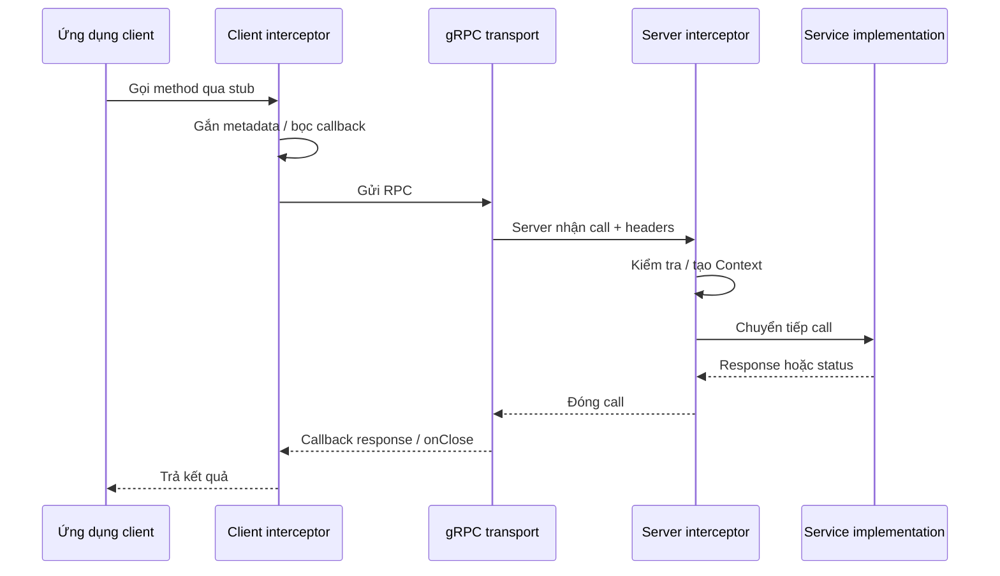

# Client interceptor và server interceptor

Trong gRPC, một RPC thường cần những xử lý dùng chung như gắn request ID, truyền trace context, xác thực caller, ghi nhận status hoặc đo thời gian. Nếu lặp các bước này trong từng method của service và từng lời gọi client, logic nghiệp vụ sẽ bị trộn với vận hành. **Client interceptor** và **server interceptor** cung cấp điểm mở rộng ở ranh giới lời gọi để thực hiện các xử lý đó một cách nhất quán.

Trong hệ sinh thái **Spring gRPC**, interceptor dựa trên API của gRPC Java. Spring quản lý cấu hình và vòng đời ứng dụng; interceptor can thiệp vào lời gọi trước khi client gửi request hoặc trước khi server chuyển request tới implementation. Bài này tập trung vào hai phía, metadata, context, thứ tự xử lý và cách kiểm thử.

## 1. Interceptor chạy ở đâu trong vòng đời RPC?

Client interceptor nhận thông tin method và `CallOptions`, sau đó tạo hoặc bọc `ClientCall` trước khi call bắt đầu. Server interceptor nhận `ServerCall` cùng metadata từ client, rồi quyết định chuyển tiếp lời gọi tới handler như thế nào.



| Phía | API chính | Có thể làm gì? |
| --- | --- | --- |
| Client | `ClientInterceptor` | Gắn metadata, bọc `ClientCall`, quan sát callback, ghi nhận method/status |
| Server | `ServerInterceptor` | Đọc metadata, từ chối call sớm, tạo `Context`, bọc `ServerCall` hoặc listener |

Interceptor không thay thế implementation của service. Nó nên xử lý chính sách xuyên suốt nhiều RPC; quy tắc riêng như tính giá, kiểm tra tồn kho hay cập nhật đơn hàng vẫn thuộc application/domain service.

## 2. Client interceptor: gắn metadata cho mỗi call

Metadata là tập header/trailer của gRPC, thường dùng cho thông tin điều khiển như correlation ID, trace context và thông tin xác thực. Không dùng metadata để truyền payload nghiệp vụ lớn; dữ liệu nghiệp vụ thuộc request message.

Ví dụ client interceptor bảo đảm mỗi call có `x-request-id`:

```java
import io.grpc.CallOptions;
import io.grpc.Channel;
import io.grpc.ClientCall;
import io.grpc.ClientInterceptor;
import io.grpc.ForwardingClientCall;
import io.grpc.Metadata;
import io.grpc.MethodDescriptor;
import java.util.UUID;

public final class RequestIdClientInterceptor implements ClientInterceptor {
    static final Metadata.Key<String> REQUEST_ID =
            Metadata.Key.of("x-request-id", Metadata.ASCII_STRING_MARSHALLER);

    @Override
    public <ReqT, RespT> ClientCall<ReqT, RespT> interceptCall(
            MethodDescriptor<ReqT, RespT> method,
            CallOptions callOptions,
            Channel next) {

        ClientCall<ReqT, RespT> delegate = next.newCall(method, callOptions);
        return new ForwardingClientCall.SimpleForwardingClientCall<>(delegate) {
            @Override
            public void start(Listener<RespT> listener, Metadata headers) {
                if (headers.get(REQUEST_ID) == null) {
                    headers.put(REQUEST_ID, UUID.randomUUID().toString());
                }
                super.start(listener, headers);
            }
        };
    }
}
```

Điểm quan trọng:

- `interceptCall` chạy khi tạo call; `start` là thời điểm metadata headers được gửi cùng call.
- `next.newCall(...)` tạo call tiếp theo trong chain. Interceptor bọc call đó để bổ sung hành vi rồi vẫn phải gọi phương thức delegate tương ứng.
- Không ghi đè request ID đã được caller cung cấp nếu hợp đồng cho phép caller truyền ID.
- Tên metadata key phải viết thường; `ASCII_STRING_MARSHALLER` dùng cho giá trị chuỗi ASCII. Với dữ liệu nhị phân, dùng key có hậu tố `-bin` và marshaller nhị phân tương ứng.

Ví dụ tạo ID ngẫu nhiên trong interceptor phù hợp để correlation cho từng call. Nếu retry nhiều lần phải được xem là **cùng một thao tác nghiệp vụ**, hãy tạo operation ID ở tầng ứng dụng và truyền cùng ID cho các lần thử; không tạo ID mới ở mỗi attempt rồi coi chúng là một giao dịch duy nhất.

## 3. Server interceptor: đọc metadata và truyền Context

Server interceptor có thể đọc headers trước khi service method chạy. Nếu cần đưa request ID tới handler và các thành phần phía dưới, dùng gRPC `Context` thay vì thêm tham số vào mọi RPC.

```java
import io.grpc.Context;
import io.grpc.Contexts;
import io.grpc.Metadata;
import io.grpc.ServerCall;
import io.grpc.ServerCallHandler;
import io.grpc.ServerInterceptor;

public final class RequestContextServerInterceptor
        implements ServerInterceptor {

    static final Metadata.Key<String> REQUEST_ID =
            Metadata.Key.of("x-request-id", Metadata.ASCII_STRING_MARSHALLER);

    public static final Context.Key<String> REQUEST_ID_CONTEXT =
            Context.key("request-id");

    @Override
    public <ReqT, RespT> ServerCall.Listener<ReqT> interceptCall(
            ServerCall<ReqT, RespT> call,
            Metadata headers,
            ServerCallHandler<ReqT, RespT> next) {

        String requestId = headers.get(REQUEST_ID);
        if (requestId == null || requestId.isBlank()) {
            requestId = "generated-" + java.util.UUID.randomUUID();
        }

        Context context = Context.current()
                .withValue(REQUEST_ID_CONTEXT, requestId);
        return Contexts.interceptCall(context, call, headers, next);
    }
}
```

Trong service implementation, có thể đọc giá trị hiện hành:

```java
String requestId = RequestContextServerInterceptor.REQUEST_ID_CONTEXT.get();
```

`Contexts.interceptCall` gắn context vào vòng đời callback của call được chuyển tiếp. Khi handler được gọi, context chứa request ID có thể được truy cập mà không phải thay đổi protobuf request. Nếu handler chuyển công việc sang executor riêng, cần truyền context một cách tường minh, ví dụ dùng `Context.current().wrap(runnable)` hoặc executor được bọc bởi gRPC Context. Không giả định mọi thread pool tùy ý đều tự kế thừa context.

Trong ví dụ, server tạo ID nếu client không gửi. Với hệ thống yêu cầu request ID phải do gateway tin cậy cấp, hãy validate và từ chối metadata thiếu/sai bằng status phù hợp; không tự tạo fallback rồi coi đó là danh tính đã được xác thực.

## 4. Xác thực và từ chối call ở server interceptor

Server interceptor phù hợp để áp dụng một chính sách chung trước khi request vào service, chẳng hạn kiểm tra bearer credential hoặc xác minh caller có được phép gọi một nhóm method. Nếu không đạt, interceptor có thể đóng call sớm:

```java
import io.grpc.Metadata;
import io.grpc.ServerCall;
import io.grpc.ServerCallHandler;
import io.grpc.ServerInterceptor;
import io.grpc.Status;

public final class AuthenticationServerInterceptor
        implements ServerInterceptor {

    static final Metadata.Key<String> AUTHORIZATION =
            Metadata.Key.of("authorization", Metadata.ASCII_STRING_MARSHALLER);

    private final CredentialVerifier verifier;

    public AuthenticationServerInterceptor(CredentialVerifier verifier) {
        this.verifier = verifier;
    }

    @Override
    public <ReqT, RespT> ServerCall.Listener<ReqT> interceptCall(
            ServerCall<ReqT, RespT> call,
            Metadata headers,
            ServerCallHandler<ReqT, RespT> next) {

        String authorization = headers.get(AUTHORIZATION);
        if (!verifier.isValid(authorization)) {
            call.close(Status.UNAUTHENTICATED
                    .withDescription("valid credentials are required"),
                    new Metadata());
            return new ServerCall.Listener<>() {};
        }
        return next.startCall(call, headers);
    }
}
```

`CredentialVerifier` là dependency do ứng dụng cung cấp; ví dụ này chỉ minh họa vị trí kiểm tra. Trong production:

- Không ghi token hoặc toàn bộ authorization header vào log.
- Dùng TLS để bảo vệ credential trên đường truyền; interceptor không thay thế TLS.
- `UNAUTHENTICATED` biểu thị thiếu/sai thông tin xác thực; `PERMISSION_DENIED` phù hợp khi caller đã được xác thực nhưng không có quyền thực hiện hành động.
- Tránh gọi dịch vụ xác thực từ xa theo cách blocking trên thread xử lý transport. Nếu cần tra cứu, dùng cache/chính sách timeout hoặc cơ chế async phù hợp.
- Authorization chi tiết theo tài nguyên vẫn có thể cần ở application service, nơi biết product/order cụ thể. Interceptor không nên thay thế kiểm tra quyền ở domain.

## 5. Bọc call để ghi nhận status và thời gian

Interceptor cũng có thể quan sát thời điểm kết thúc call. Ví dụ server bọc `ServerCall` để ghi nhận method và status khi call đóng:

```java
import io.grpc.ForwardingServerCall;
import io.grpc.Metadata;
import io.grpc.ServerCall;
import io.grpc.ServerCallHandler;
import io.grpc.ServerInterceptor;
import io.grpc.Status;

public final class RpcMetricsServerInterceptor implements ServerInterceptor {
    private final RpcMetrics metrics;

    public RpcMetricsServerInterceptor(RpcMetrics metrics) {
        this.metrics = metrics;
    }

    @Override
    public <ReqT, RespT> ServerCall.Listener<ReqT> interceptCall(
            ServerCall<ReqT, RespT> call,
            Metadata headers,
            ServerCallHandler<ReqT, RespT> next) {

        String method = call.getMethodDescriptor().getFullMethodName();
        long startedAt = System.nanoTime();

        ServerCall<ReqT, RespT> monitored =
                new ForwardingServerCall.SimpleForwardingServerCall<>(call) {
                    @Override
                    public void close(Status status, Metadata trailers) {
                        metrics.record(method, status.getCode(),
                                System.nanoTime() - startedAt);
                        super.close(status, trailers);
                    }
                };
        return next.startCall(monitored, headers);
    }
}
```

Đo thời gian bằng `System.nanoTime()` vì đây là đồng hồ đơn điệu phù hợp để đo duration; không dùng `currentTimeMillis()` để tính khoảng thời gian. Chỉ ghi những nhãn có cardinality kiểm soát, ví dụ full method name và gRPC status. Không đưa request ID, user ID hoặc giá trị metadata tùy ý thành metric label vì số lượng nhãn có thể tăng không giới hạn.

Với streaming RPC, `close` thường xảy ra khi toàn bộ call kết thúc, nên duration đo được là tuổi thọ của stream chứ không phải thời gian xử lý một message. Nếu cần đo message latency hoặc số message, bọc thêm listener/call callback phù hợp và phân biệt rõ loại metric.

## 6. Thứ tự interceptor và nguyên tắc thiết kế chain

Một ứng dụng có thể dùng nhiều interceptor: tracing, authentication, metrics, logging và policy theo method. Chúng tạo thành chain; interceptor ngoài có thể gọi interceptor kế tiếp, quan sát kết quả và bọc callback/call.

Ví dụ tư duy thứ tự:

```text
Client: Trace -> RequestId -> gRPC call
Server: Metrics -> Authentication -> Context -> Service
```

Đây chỉ là thứ tự minh họa. Thứ tự thực tế phụ thuộc cách đăng ký và API builder/framework đang dùng; hãy kiểm tra tài liệu phiên bản và viết test để xác nhận. Thứ tự có ý nghĩa: metrics có thể cần ghi nhận cả call bị authentication từ chối; context phải được thiết lập trước khi handler cần đọc; authentication phải chạy trước khi request chạm domain.

Một interceptor tốt nên:

- Có một trách nhiệm rõ ràng và có thể bật/tắt độc lập.
- Gọi delegate đúng một lần trong đường đi thành công, trừ trường hợp chủ động từ chối call.
- Không tiêu thụ hoặc sửa request/response ngoài ý nghĩa đã công bố.
- Không giữ mutable state dùng chung giữa nhiều RPC; interceptor thường được chia sẻ đồng thời.
- Không thực hiện công việc blocking dài hoặc truy cập I/O không kiểm soát trong callback.
- Không che mất status gốc khi chỉ muốn ghi log hoặc metrics.

Không nên đặt mọi logic vào một interceptor khổng lồ. Authentication, correlation và metrics có vòng đời, yêu cầu bảo mật và cách kiểm thử khác nhau.

## 7. Đăng ký interceptor trong ứng dụng Spring gRPC

API gRPC Java cung cấp điểm gắn interceptor trực tiếp ở channel và server builder. Ví dụ ở mức core API:

```java
ManagedChannel channel = ManagedChannelBuilder
        .forAddress("catalog.internal", 9090)
        .useTransportSecurity()
        .intercept(new RequestIdClientInterceptor())
        .build();
```

Với server được tạo trực tiếp:

```java
Server server = ServerBuilder.forPort(9090)
        .intercept(new RequestContextServerInterceptor())
        .intercept(new RpcMetricsServerInterceptor(metrics))
        .addService(new CatalogGrpcEndpoint(catalogService))
        .build();
```

Trong ứng dụng Spring gRPC, endpoint và channel thường được framework auto-configure. Hãy đăng ký client/server interceptor qua extension point hoặc cấu hình interceptor mà **đúng phiên bản Spring gRPC của dự án hỗ trợ**. Việc chỉ khai báo một class component hoặc bean không tự bảo đảm interceptor được gắn vào mọi channel/server. Xác minh cấu hình bằng test tích hợp: gọi RPC thật và kiểm tra metadata/context/status được quan sát.

Nếu ứng dụng có nhiều channel tới các backend khác nhau, quyết định interceptor nào dùng global và interceptor nào chỉ áp dụng cho một channel. Ví dụ request ID có thể dùng chung, nhưng credential của Catalog không nên tự động gắn vào channel gọi Payment nếu hai dịch vụ có phạm vi quyền khác nhau.

## 8. Kiểm thử interceptor

Nên kiểm thử hành vi qua gRPC call thay vì chỉ gọi trực tiếp `interceptCall`, vì nhiều lỗi nằm ở metadata propagation, callback và thứ tự chain.

| Ca kiểm thử | Kết quả mong đợi |
| --- | --- |
| Client không gửi request ID | Client interceptor bổ sung ID theo chính sách |
| Client đã gửi request ID | Giá trị được giữ nguyên nếu interceptor được cấu hình không ghi đè |
| Server nhận metadata | Request ID có thể đọc từ gRPC Context trong handler |
| Thiếu/sai credential | Server trả `UNAUTHENTICATED`, service implementation không chạy |
| Credential hợp lệ nhưng không có quyền | Chính sách authorization trả `PERMISSION_DENIED` ở đúng tầng |
| RPC kết thúc `OK` hoặc lỗi | Metrics ghi method, status và duration |
| Streaming bị hủy | Call được đóng; metric phản ánh trạng thái kết thúc, không coi stream dở dang là thành công |
| Nhiều RPC đồng thời | Không rò request ID/context giữa các call |

Với gRPC Java, có thể dùng in-process server/channel cho test interceptor mà không cần mở cổng mạng thật. Trong test Spring, nên khởi động cấu hình server/client tương ứng để xác nhận cơ chế auto-configuration thực sự gắn interceptor.

## 9. Checklist chọn đúng phía

- [ ] Thông tin được thêm vào trước khi gửi request? Cân nhắc client interceptor.
- [ ] Cần kiểm tra headers, xác thực caller hoặc tạo context trước service? Cân nhắc server interceptor.
- [ ] Cần đo status/duration cho mọi method? Bọc call hoặc listener tại phía phù hợp.
- [ ] Metadata key viết thường, dùng đúng ASCII/binary marshaller và không chứa payload lớn.
- [ ] Không log credential, token hoặc dữ liệu nhạy cảm.
- [ ] Context được truyền tường minh khi chuyển sang executor/thread khác.
- [ ] Chain order được xác minh bằng test, không chỉ suy đoán từ thứ tự khai báo.
- [ ] Interceptor an toàn khi chạy đồng thời và không giữ state riêng của từng call trong field dùng chung.
- [ ] Cấu hình Spring thực sự đăng ký interceptor vào đúng channel/server.
- [ ] Test có call thành công, lỗi, từ chối sớm, concurrency và streaming cancellation nếu áp dụng.

**Tự kiểm tra**

**Câu 1.** Client interceptor và server interceptor khác nhau ở điểm nào?

*Đáp án:* Client interceptor bọc call trước khi gửi và có thể bổ sung metadata/quan sát callback. Server interceptor chạy khi server nhận call, có thể đọc headers, từ chối sớm, tạo Context hoặc bọc ServerCall/listener.

**Câu 2.** Có nên đặt toàn bộ request payload vào metadata để server interceptor đọc không?

*Đáp án:* Không. Metadata dành cho header/trailer điều khiển như request ID, trace context và credential. Dữ liệu nghiệp vụ thuộc protobuf request message.

**Câu 3.** Vì sao cần Context thay vì thêm request ID vào từng service method?

*Đáp án:* Context cho phép chia sẻ thông tin call-scoped qua callback trong cùng RPC mà không thay đổi mọi chữ ký method. Khi chuyển thread/executor tùy chỉnh, vẫn phải truyền context tường minh.

**Câu 4.** Interceptor xác thực trả UNAUTHENTICATED trong trường hợp nào?

*Đáp án:* Khi credential thiếu hoặc không hợp lệ. Nếu caller đã xác thực nhưng không có quyền thực hiện thao tác, thường dùng PERMISSION_DENIED.

**Câu 5.** Một interceptor metrics ghi duration ở ServerCall.close. Với server streaming, duration này đại diện điều gì?

*Đáp án:* Tuổi thọ toàn bộ stream từ lúc call bắt đầu đến khi đóng, không phải latency của từng message.

Client và server interceptor là lớp xử lý xuyên suốt tại ranh giới gRPC. Dùng client interceptor cho hành vi trước khi gửi, server interceptor cho chính sách và context ở phía nhận; giữ logic nghiệp vụ trong service, truyền metadata có kiểm soát và kiểm thử thứ tự chain để các RPC unary lẫn streaming có hành vi nhất quán.
