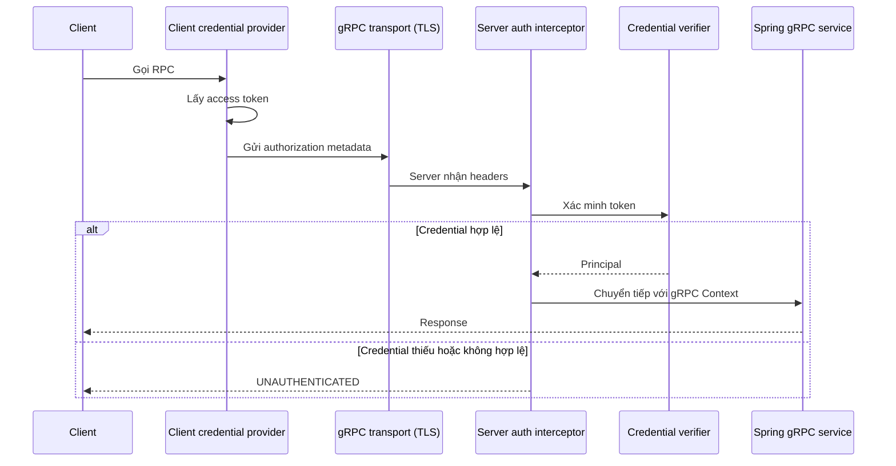

# Xác thực metadata

gRPC metadata mang thông tin điều khiển đi kèm RPC. Một client thường gửi credential trong header `authorization` để server xác định caller trước khi chuyển request tới service implementation. Với Spring gRPC, **server interceptor** là điểm phù hợp để đọc và xác thực metadata dùng chung; sau khi xác thực, interceptor đưa principal vào gRPC `Context` để application service kiểm tra quyền trên tài nguyên cụ thể.

Metadata chỉ là nơi vận chuyển credential. Nó không tự xác thực token, không mã hóa dữ liệu và không thay thế authorization. Một thiết kế đúng cần kiểm tra credential, bảo vệ kênh truyền bằng TLS, phân biệt `UNAUTHENTICATED` với `PERMISSION_DENIED` và tránh làm lộ token trong log.

## 1. Authentication metadata đi qua RPC như thế nào?

Một client có thể gửi bearer token:

```text
authorization: Bearer <access-token>
```

Server nhận header trong `Metadata` trước khi gọi method của service. Luồng xử lý điển hình:



`authorization` là metadata key dạng ASCII, tên key viết thường. Dùng metadata cho token hoặc thông tin xác thực ngắn; request message vẫn chứa dữ liệu nghiệp vụ như `product_id` hay `order_id`.

## 2. Định nghĩa metadata key và principal

Khai báo key dùng chung giữa client/server:

```java
import io.grpc.Metadata;

public final class AuthMetadata {
    private AuthMetadata() {
    }

    public static final Metadata.Key<String> AUTHORIZATION =
            Metadata.Key.of(
                    "authorization",
                    Metadata.ASCII_STRING_MARSHALLER);
}
```

Sau khi xác thực, server cần một đối tượng đại diện caller. Chỉ đưa các claim cần thiết cho authorization vào principal:

```java
package com.myshop.security;

import java.util.Set;

public record AuthenticatedPrincipal(
        String subject,
        String tenantId,
        Set<String> authorities) {
}
```

Không lưu access token nguyên bản vào principal hoặc gRPC Context. Token là credential; principal là kết quả đã xác minh gồm định danh và quyền cần thiết. Nếu cần thêm claim, chỉ giữ dữ liệu tối thiểu phục vụ request hiện tại.

## 3. Xác thực token trong server interceptor

Tách phần kiểm tra token khỏi interceptor bằng một abstraction. Ví dụ verifier nhận token đã bỏ tiền tố `Bearer ` và trả principal hoặc ném lỗi credential:

```java
public interface CredentialVerifier {
    AuthenticatedPrincipal verify(String accessToken)
            throws InvalidCredentialException;
}
```

Interceptor đọc metadata, kiểm tra scheme và xác minh credential trước khi gọi handler:

```java
package com.myshop.grpc.security;

import com.myshop.security.AuthenticatedPrincipal;
import com.myshop.security.CredentialVerifier;
import com.myshop.security.InvalidCredentialException;
import io.grpc.Context;
import io.grpc.Contexts;
import io.grpc.Metadata;
import io.grpc.ServerCall;
import io.grpc.ServerCallHandler;
import io.grpc.ServerInterceptor;
import io.grpc.Status;

public final class AuthenticationServerInterceptor
        implements ServerInterceptor {

    public static final Context.Key<AuthenticatedPrincipal> PRINCIPAL =
            Context.key("authenticated-principal");

    private final CredentialVerifier verifier;

    public AuthenticationServerInterceptor(CredentialVerifier verifier) {
        this.verifier = verifier;
    }

    @Override
    public <ReqT, RespT> ServerCall.Listener<ReqT> interceptCall(
            ServerCall<ReqT, RespT> call,
            Metadata headers,
            ServerCallHandler<ReqT, RespT> next) {

        String value = headers.get(AuthMetadata.AUTHORIZATION);
        if (value == null || !value.startsWith("Bearer ")) {
            return reject(call, "authentication credentials are required");
        }

        String token = value.substring("Bearer ".length()).trim();
        if (token.isEmpty()) {
            return reject(call, "authentication credentials are required");
        }

        final AuthenticatedPrincipal principal;
        try {
            principal = verifier.verify(token);
        } catch (InvalidCredentialException ex) {
            return reject(call, "authentication credentials are invalid");
        }

        Context context = Context.current().withValue(PRINCIPAL, principal);
        return Contexts.interceptCall(context, call, headers, next);
    }

    private static <ReqT, RespT> ServerCall.Listener<ReqT> reject(
            ServerCall<ReqT, RespT> call,
            String safeDescription) {
        call.close(Status.UNAUTHENTICATED
                .withDescription(safeDescription), new Metadata());
        return new ServerCall.Listener<>() {};
    }
}
```

Điểm quan trọng:

- Không có header, sai scheme hoặc token rỗng đều bị từ chối trước khi service chạy.
- Verifier chỉ được gọi sau khi kiểm tra định dạng cơ bản.
- `Contexts.interceptCall` gắn principal đã xác thực vào vòng đời callback của RPC.
- Client chỉ nhận mô tả lỗi tổng quát; không trả chi tiết như token hết hạn, chữ ký sai hay user không tồn tại nếu thông tin đó có thể hỗ trợ dò tìm tài khoản.

`CredentialVerifier` là thành phần ứng dụng cần triển khai bằng thư viện xác minh phù hợp. Với JWT, verifier phải kiểm tra chữ ký bằng thuật toán được cho phép, issuer, audience, thời hạn `exp`, thời điểm hiệu lực `nbf` nếu có và key rotation. Không chỉ decode payload rồi tin các claim. Nếu dùng opaque token, verifier cần introspection/cache với timeout rõ ràng; tránh gọi dịch vụ xác thực từ xa theo cách blocking trên transport thread.

Chỉ coi token sai/hết hạn là lỗi credential. Nếu verifier không truy cập được kho khóa hoặc dịch vụ introspection gặp sự cố, đó là lỗi hạ tầng; không nên giả vờ token sai hoặc chấp nhận token theo kiểu fail-open. Ánh xạ lỗi vận hành sang status phù hợp như `UNAVAILABLE`/`INTERNAL` theo chính sách của hệ thống và ghi log nội bộ đã loại bỏ bí mật.

## 4. Phân biệt authentication và authorization

Hai bước trả lời hai câu hỏi khác nhau:

| Bước | Câu hỏi | gRPC status khi thất bại |
| --- | --- | --- |
| Authentication | Caller là ai? Credential có hợp lệ không? | `UNAUTHENTICATED` |
| Authorization | Caller đã xác thực có được phép làm việc này không? | `PERMISSION_DENIED` |

Interceptor thường thực hiện authentication và có thể kiểm tra quyền ở mức method chung. Quyền trên một tài nguyên cụ thể thường cần application service, vì chỉ tầng đó mới biết `product_id`, tenant ownership hoặc trạng thái nghiệp vụ.

Ví dụ trong endpoint:

```java
AuthenticatedPrincipal principal =
        AuthenticationServerInterceptor.PRINCIPAL.get();

if (principal == null) {
    observer.onError(Status.UNAUTHENTICATED
            .withDescription("authentication required")
            .asRuntimeException());
    return;
}

if (!authorizationService.canReadProduct(
        principal, request.getProductId())) {
    observer.onError(Status.PERMISSION_DENIED
            .withDescription("not allowed to read this product")
            .asRuntimeException());
    return;
}
```

Đây là kiểm tra quyền theo tài nguyên. Không dùng `UNAUTHENTICATED` cho caller đã xác thực nhưng không có quyền; cũng không dùng `PERMISSION_DENIED` để che một credential không hợp lệ.

## 5. Client gửi bearer token

Client có thể gắn credential vào metadata bằng interceptor:

```java
import io.grpc.CallOptions;
import io.grpc.Channel;
import io.grpc.ClientCall;
import io.grpc.ClientInterceptor;
import io.grpc.ForwardingClientCall;
import io.grpc.Metadata;
import io.grpc.MethodDescriptor;
import java.util.function.Supplier;

public final class BearerTokenClientInterceptor
        implements ClientInterceptor {

    private final Supplier<String> accessTokenProvider;

    public BearerTokenClientInterceptor(
            Supplier<String> accessTokenProvider) {
        this.accessTokenProvider = accessTokenProvider;
    }

    @Override
    public <ReqT, RespT> ClientCall<ReqT, RespT> interceptCall(
            MethodDescriptor<ReqT, RespT> method,
            CallOptions callOptions,
            Channel next) {

        ClientCall<ReqT, RespT> delegate =
                next.newCall(method, callOptions);
        return new ForwardingClientCall.SimpleForwardingClientCall<>(delegate) {
            @Override
            public void start(Listener<RespT> listener, Metadata headers) {
                if (headers.get(AuthMetadata.AUTHORIZATION) == null) {
                    String token = accessTokenProvider.get();
                    if (token != null && !token.isBlank()) {
                        headers.put(
                                AuthMetadata.AUTHORIZATION,
                                "Bearer " + token);
                    }
                }
                super.start(listener, headers);
            }
        };
    }
}
```

Ví dụ này phù hợp để minh họa việc thêm header cho mỗi call. Trong production, nếu credential cần làm mới bất đồng bộ, ưu tiên cơ chế `CallCredentials` của gRPC Java hoặc integration credential tương ứng của framework. Cách đó phù hợp hơn việc thực hiện refresh token đồng bộ bên trong interceptor. Token provider không được ghi token ra log và cần xử lý refresh/expiry có giới hạn thời gian.

Không gắn một token cố định vào metadata dùng chung khi tạo channel nếu token có thời hạn hoặc khác nhau theo người dùng. Credential cần được chọn theo từng call và đúng identity của caller.

## 6. TLS, proxy và ranh giới tin cậy

Metadata đi qua transport như header. Nếu dùng plaintext, bearer token có thể bị đọc bởi bên quan sát được lưu lượng mạng. Vì vậy:

- Dùng TLS cho kết nối client-server; xác minh certificate và hostname của server.
- Với môi trường nội bộ, cân nhắc mTLS để xác thực danh tính workload ở tầng transport; vẫn cần authorization cho user hoặc hành động nghiệp vụ nếu có.
- Không coi TLS là thay thế việc xác minh bearer token. TLS bảo vệ kênh và xác thực peer theo cấu hình; token vẫn cần được kiểm tra theo issuer/audience/expiry.
- Cấu hình proxy, gateway và access log để redact `authorization` header. Không ghi metadata đầy đủ khi debug.
- Giới hạn kích thước metadata và không gửi token trong protobuf payload, query string hoặc log.

Khi service A gọi service B, không tự động chuyển tiếp nguyên bearer token nhận từ client. Token có thể có audience chỉ dành cho A. Hãy dùng service identity riêng, token exchange/delegation hoặc credential có audience dành cho B. Chỉ forward user token khi kiến trúc xác thực cho phép và verifier của B có thể kiểm tra đúng issuer, audience, scope.

## 7. Public method và chính sách interceptor

Không phải RPC nào cũng cần cùng chính sách. Health check hoặc reflection có thể cần được truy cập bởi hệ thống vận hành chưa có user token; RPC nghiệp vụ thì phải xác thực. Nếu có method public:

1. Khai báo allowlist theo **full method name**, không dựa trên substring tùy tiện.
2. Giới hạn allowlist vào các method thật sự cần public.
3. Không bỏ qua authentication cho toàn bộ package chỉ vì một health method.
4. Kiểm thử rằng method nghiệp vụ vẫn bị chặn khi thiếu credential.

Nếu authorization theo method được đặt trong interceptor, giữ policy tập trung và dễ review. Kiểm tra quyền theo resource/tenant vẫn nên ở application layer để tránh bỏ sót khi cùng use case được gọi từ một entry point khác.

## 8. Đăng ký interceptor trong Spring gRPC

Core gRPC Java cho phép đăng ký server interceptor ở builder:

```java
Server server = ServerBuilder.forPort(9090)
        .intercept(new AuthenticationServerInterceptor(credentialVerifier))
        .addService(new CatalogGrpcEndpoint(catalogService))
        .build();
```

Trong ứng dụng Spring gRPC, server thường do framework auto-configure. Đăng ký interceptor qua extension point mà phiên bản Spring gRPC của dự án hỗ trợ; chỉ khai báo một class thành bean không tự chứng minh nó đã được gắn vào server. Xác minh bằng integration test khởi động cấu hình ứng dụng và gọi RPC thực.

Nếu có nhiều server hoặc channel, phân biệt rõ interceptor nào là global và interceptor nào chỉ dùng cho một service. Không áp dụng chính sách bỏ qua authentication của health check cho toàn bộ server.

## 9. Kiểm thử metadata authentication

| Ca kiểm thử | Kết quả mong đợi |
| --- | --- |
| Không gửi `authorization` | `UNAUTHENTICATED`; handler không chạy |
| Scheme không phải Bearer hoặc token rỗng | `UNAUTHENTICATED` |
| Token sai chữ ký, hết hạn hoặc sai audience | `UNAUTHENTICATED`; không lộ lý do nội bộ |
| Token hợp lệ | Principal có mặt trong gRPC Context |
| Principal không có quyền trên product | `PERMISSION_DENIED` |
| RPC public trong allowlist | Chỉ method được công bố bỏ qua authentication |
| Hai caller đồng thời | Principal không bị trộn giữa các Context |
| Client gọi qua TLS | Credential được bảo vệ trên transport |
| Log/proxy access log | Không xuất hiện bearer token |
| Gọi downstream | Không forward token sai audience |

Nên có test riêng cho verifier để kiểm tra chữ ký, issuer, audience, expiry và key rotation; test interceptor để xác minh metadata/status/context; test tích hợp để xác minh Spring thực sự đăng ký interceptor. Một test chỉ gọi trực tiếp `CredentialVerifier` không chứng minh RPC đã được bảo vệ.

## 10. Checklist triển khai

- [ ] Dùng metadata key `authorization` viết thường và scheme `Bearer` rõ ràng.
- [ ] Kiểm tra header thiếu, sai scheme và token rỗng trước khi gọi handler.
- [ ] Xác minh chữ ký/opaque token, issuer, audience, expiry và các claim cần thiết.
- [ ] Không decode JWT rồi tin claim khi chưa xác minh chữ ký.
- [ ] Đưa principal đã xác thực vào gRPC Context; không lưu raw token trong Context.
- [ ] Dùng `UNAUTHENTICATED` cho credential sai và `PERMISSION_DENIED` cho caller không có quyền.
- [ ] Kiểm tra quyền tài nguyên ở application service.
- [ ] Bảo vệ metadata bằng TLS; cân nhắc mTLS cho workload identity.
- [ ] Redact authorization header trong log, proxy và telemetry.
- [ ] Không forward token sang downstream nếu audience/delegation không phù hợp.
- [ ] Đăng ký interceptor qua cấu hình Spring gRPC đúng phiên bản và kiểm thử RPC thực.

**Tự kiểm tra**

**Câu 1.** Vì sao bearer token thường được gửi trong metadata `authorization`?

*Đáp án:* Đây là header điều khiển chuẩn cho credential của RPC; interceptor có thể đọc trước khi gọi service mà không trộn token vào protobuf payload.

**Câu 2.** Token hợp lệ nhưng caller không được đọc một sản phẩm. Nên trả status nào?

*Đáp án:* `PERMISSION_DENIED`, vì caller đã được xác thực nhưng không có quyền với tài nguyên. Credential thiếu/sai dùng `UNAUTHENTICATED`.

**Câu 3.** Giải mã JWT và đọc claim `sub` có đủ để xác thực không?

*Đáp án:* Không. Phải xác minh chữ ký bằng thuật toán được cho phép và kiểm tra issuer, audience, thời hạn cùng các claim bắt buộc.

**Câu 4.** TLS có thay thế việc xác minh bearer token không?

*Đáp án:* Không. TLS bảo vệ kênh và xác thực peer theo cấu hình; server vẫn phải xác minh credential và quyền của caller.

**Câu 5.** Có nên chuyển tiếp nguyên authorization token từ service A sang service B?

*Đáp án:* Không mặc định. Token có thể không dành cho audience của B. Dùng service credential, token exchange hoặc delegation theo chính sách được thiết kế.

Xác thực metadata hiệu quả khi server kiểm tra credential trước handler, đặt principal đã xác minh vào Context và để application layer quyết định quyền trên tài nguyên. Kết hợp TLS, quản lý token theo từng call, redact log và kiểm thử cả status lẫn Context để bảo vệ nhất quán các RPC trong Spring gRPC.
