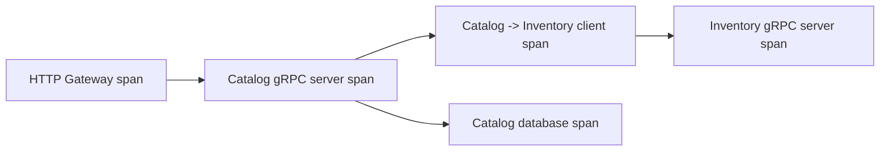

# Tracing interceptor

Một request gRPC thường đi qua nhiều service trước khi hoàn tất. Log cho biết từng thành phần đã làm gì, nhưng khó thể hiện quan hệ cha/con và thời gian của từng chặng. **Distributed tracing** giải quyết việc đó bằng trace và span: trace đại diện toàn bộ luồng xử lý; mỗi span ghi một operation như nhận RPC, gọi backend hoặc truy vấn dữ liệu.

Trong Spring gRPC, tracing cần truyền trace context qua metadata và giữ context đúng trong các callback bất đồng bộ. Interceptor có thể tham gia vào ranh giới này, nhưng việc tự tạo span, propagate context và quản lý lifecycle bằng tay dễ sai. Với production, ưu tiên OpenTelemetry gRPC instrumentation hoặc Java agent đã được cấu hình; chỉ viết interceptor tùy chỉnh khi có yêu cầu riêng và không trùng chức năng với instrumentation hiện có.

## 1. Trace, span và context propagation

Một trace thường có cấu trúc:



Các khái niệm:

| Thành phần | Vai trò |
| --- | --- |
| Trace ID | Định danh toàn bộ luồng xử lý phân tán |
| Span ID | Định danh một operation trong trace |
| Parent span ID | Liên kết span con với span cha |
| Span attributes | Thuộc tính mô tả operation, ví dụ RPC method và status |
| Span events | Sự kiện tại một thời điểm, ví dụ retry hoặc message event |
| Trace context | Dữ liệu cần truyền qua process boundary để service sau tiếp tục trace hiện tại |

OpenTelemetry thường dùng W3C Trace Context với các header như `traceparent` và `tracestate`. gRPC mang các giá trị này trong metadata. Khi service A gọi service B, B dùng context được truyền để tạo span con thuộc cùng trace thay vì bắt đầu một trace không liên quan.

## 2. Vì sao cần tracing ở interceptor hoặc instrumentation?

Interceptor quan sát được method và vòng đời call mà không phải sửa từng service method. Nó là điểm phù hợp để:

- Tạo hoặc tiếp tục span cho RPC inbound/outbound.
- Truyền trace context qua metadata.
- Gắn full method name, RPC type và status vào span.
- Ghi nhận lỗi, cancellation và thời gian call.
- Giữ trace context trong callback khi RPC xử lý bất đồng bộ hoặc streaming.

Tuy nhiên, tracing instrumentation thường làm nhiều việc hơn một interceptor tự viết: quản lý parent context, span lifecycle, status mapping, message events, sampling và propagation. Dùng thư viện OpenTelemetry tương thích gRPC Java hoặc Java agent giúp giảm nguy cơ bỏ sót callback và kết thúc span sai thời điểm.

**Không bật hai cơ chế cùng tạo span cho một RPC.** Nếu Java agent hoặc gRPC OpenTelemetry instrumentation đã tự động tạo client/server span và propagate context, đừng thêm interceptor khác cũng tạo span cho cùng call. Có thể bổ sung interceptor cho thuộc tính riêng, nhưng phải tránh duplicate span và duplicate propagation.

## 3. Metadata mang trace context

Trace context là metadata điều khiển, không phải dữ liệu nghiệp vụ. Ví dụ header W3C:

```text
traceparent: 00-4bf92f3577b34da6a3ce929d0e0e4736-00f067aa0ba902b7-01
tracestate: vendor=value
```

Không tự tạo chuỗi `traceparent` bằng correlation ID. W3C Trace Context có định dạng, trace flags và semantics riêng; hãy để OpenTelemetry propagator tạo và đọc header. `tracestate` có thể chứa thông tin vendor, nên chỉ truyền theo chính sách propagation đã cấu hình.

Không đưa token, email, số điện thoại, dữ liệu cá nhân hoặc payload vào trace baggage/attributes. Baggage có thể được truyền tiếp qua nhiều service; chỉ bật các key đã được phê duyệt và giới hạn kích thước.

## 4. Dùng OpenTelemetry instrumentation trước khi tự viết interceptor

Với Spring gRPC, có thể tích hợp tracing theo một trong các cách sau, tùy dependency và phiên bản nền tảng:

1. **OpenTelemetry Java agent:** tự instrument các lời gọi gRPC được hỗ trợ, tạo span và propagate context mà không cần sửa từng channel/service.
2. **gRPC OpenTelemetry instrumentation/library:** cấu hình instrumentation cho server và client builder/channel để tạo span và propagate W3C context.
3. **Spring observability integration:** nếu phiên bản Spring gRPC/Spring Boot đang dùng cung cấp auto-configuration tương ứng, cấu hình exporter, sampler và resource qua cơ chế của framework.

Chọn một cơ chế chính cho RPC instrumentation. Kiểm tra tài liệu đúng phiên bản dependency trong dự án vì tên class, artifact và điểm đăng ký có thể khác giữa các thế hệ gRPC Java/Spring. Sau khi cấu hình, xác minh trace có server span, client span và parent-child link đúng; đừng chỉ kiểm tra rằng header `traceparent` xuất hiện.

Các thành phần nền tảng thường cần:

- `OpenTelemetry` SDK hoặc runtime cung cấp tracer và propagator.
- Exporter gửi spans tới backend tương thích OTLP hoặc hệ thống observability đang dùng.
- Resource attributes như service name, service version và deployment environment.
- Sampler phù hợp tải hệ thống; không mặc định export mọi trace ở lưu lượng lớn.
- Propagator W3C Trace Context được cấu hình nhất quán giữa gateway và các service.

## 5. Interceptor tùy chỉnh để propagate context

Nếu cần tích hợp propagation riêng, OpenTelemetry cung cấp `TextMapPropagator` để inject/extract context. Ví dụ sau chỉ minh họa **truyền context**; nó không tự tạo span. Dùng nó khi không có instrumentation khác đảm nhiệm propagation.

Trước tiên định nghĩa getter/setter cho gRPC `Metadata`:

```java
import io.grpc.Metadata;
import io.opentelemetry.context.propagation.TextMapGetter;
import io.opentelemetry.context.propagation.TextMapSetter;

final class GrpcMetadataPropagation {
    private GrpcMetadataPropagation() {
    }

    static final TextMapSetter<Metadata> SETTER = (carrier, key, value) -> {
        Metadata.Key<String> metadataKey =
                Metadata.Key.of(key, Metadata.ASCII_STRING_MARSHALLER);
        carrier.discardAll(metadataKey);
        carrier.put(metadataKey, value);
    };

    static final TextMapGetter<Metadata> GETTER = new TextMapGetter<>() {
        @Override
        public Iterable<String> keys(Metadata carrier) {
            return carrier.keys();
        }

        @Override
        public String get(Metadata carrier, String key) {
            if (key.endsWith("-bin")) {
                return null;
            }
            Metadata.Key<String> metadataKey =
                    Metadata.Key.of(key, Metadata.ASCII_STRING_MARSHALLER);
            return carrier.get(metadataKey);
        }
    };
}
```

Setter ghi các header ASCII do propagator yêu cầu; getter đọc header theo key. Metadata key phải viết thường. Không dùng marshaller ASCII cho binary metadata có hậu tố `-bin`.

### Client: inject context trước khi gửi call

Client interceptor lấy OpenTelemetry context đang active tại thời điểm `start` và inject vào headers:

```java
import io.grpc.CallOptions;
import io.grpc.Channel;
import io.grpc.ClientCall;
import io.grpc.ClientInterceptor;
import io.grpc.ForwardingClientCall;
import io.grpc.Metadata;
import io.grpc.MethodDescriptor;
import io.opentelemetry.api.OpenTelemetry;
import io.opentelemetry.context.propagation.TextMapPropagator;

public final class TracePropagationClientInterceptor
        implements ClientInterceptor {

    private final TextMapPropagator propagator;

    public TracePropagationClientInterceptor(OpenTelemetry openTelemetry) {
        this.propagator = openTelemetry.getPropagators()
                .getTextMapPropagator();
    }

    @Override
    public <ReqT, RespT> ClientCall<ReqT, RespT> interceptCall(
            MethodDescriptor<ReqT, RespT> method,
            CallOptions callOptions,
            Channel next) {
        ClientCall<ReqT, RespT> delegate = next.newCall(method, callOptions);
        return new ForwardingClientCall.SimpleForwardingClientCall<>(delegate) {
            @Override
            public void start(Listener<RespT> listener, Metadata headers) {
                propagator.inject(
                        io.opentelemetry.context.Context.current(),
                        headers,
                        GrpcMetadataPropagation.SETTER);
                super.start(listener, headers);
            }
        };
    }
}
```

Đoạn code giả định lời gọi stub được thực hiện khi span cha đã active. Nếu ứng dụng gọi từ executor tự quản lý, phải propagate OpenTelemetry Context sang executor; nếu không, `Context.current()` có thể không chứa span cha.

### Server: extract context và gắn vào callback

Server interceptor extract trace context từ metadata rồi gắn OpenTelemetry Context vào gRPC Context theo từng call. Ví dụ này không tự tạo server span; instrumentation có thể tạo span từ context đã extract.

```java
import io.grpc.Contexts;
import io.grpc.ForwardingServerCallListener;
import io.grpc.Metadata;
import io.grpc.ServerCall;
import io.grpc.ServerCallHandler;
import io.grpc.ServerInterceptor;
import io.opentelemetry.api.OpenTelemetry;
import io.opentelemetry.context.Scope;
import io.opentelemetry.context.propagation.TextMapPropagator;
import java.util.function.Supplier;

public final class TracePropagationServerInterceptor
        implements ServerInterceptor {

    public static final io.grpc.Context.Key<
            io.opentelemetry.context.Context> OTEL_CONTEXT =
            io.grpc.Context.key("otel-context");

    private final TextMapPropagator propagator;

    public TracePropagationServerInterceptor(OpenTelemetry openTelemetry) {
        this.propagator = openTelemetry.getPropagators()
                .getTextMapPropagator();
    }

    @Override
    public <ReqT, RespT> ServerCall.Listener<ReqT> interceptCall(
            ServerCall<ReqT, RespT> call,
            Metadata headers,
            ServerCallHandler<ReqT, RespT> next) {

        io.opentelemetry.context.Context extracted = propagator.extract(
                io.opentelemetry.context.Context.current(),
                headers,
                GrpcMetadataPropagation.GETTER);

        io.grpc.Context grpcContext = io.grpc.Context.current()
                .withValue(OTEL_CONTEXT, extracted);

        return Contexts.interceptCall(grpcContext, call, headers, (c, h) -> {
            ServerCall.Listener<ReqT> delegate =
                    callWithContext(extracted, () -> next.startCall(c, h));

            return new ForwardingServerCallListener
                    .SimpleForwardingServerCallListener<>(delegate) {
                @Override
                public void onMessage(ReqT message) {
                    runWithContext(extracted, () -> super.onMessage(message));
                }

                @Override
                public void onHalfClose() {
                    runWithContext(extracted, super::onHalfClose);
                }

                @Override
                public void onCancel() {
                    runWithContext(extracted, super::onCancel);
                }

                @Override
                public void onComplete() {
                    runWithContext(extracted, super::onComplete);
                }

                @Override
                public void onReady() {
                    runWithContext(extracted, super::onReady);
                }
            };
        });
    }

    private static void runWithContext(
            io.opentelemetry.context.Context context,
            Runnable action) {
        try (Scope scope = context.makeCurrent()) {
            action.run();
        }
    }

    private static <T> T callWithContext(
            io.opentelemetry.context.Context context,
            Supplier<T> action) {
        try (Scope scope = context.makeCurrent()) {
            return action.get();
        }
    }
}
```

Ví dụ trên minh họa cách giữ context OpenTelemetry trong các callback gRPC; cần kiểm thử với phiên bản gRPC Java đang dùng và không đăng ký nếu instrumentation hiện tại đã tự extract/propagate context. Khi service chuyển việc sang executor khác, tiếp tục bọc task bằng OpenTelemetry Context hoặc executor propagation tương ứng.

Trong callback đang được bọc, service cũng có thể lấy context đang active bằng `io.opentelemetry.context.Context.current()`. Nếu một thành phần cần đọc giá trị đã lưu trong gRPC Context, có thể dùng `TracePropagationServerInterceptor.OTEL_CONTEXT.get()`; không lưu context này vào field mutable của singleton service.

## 6. Span lifecycle, status và lỗi

Propagation chỉ mang context qua ranh giới. Một trace hữu ích còn cần span được tạo, gắn thuộc tính và kết thúc đúng lúc:

- Client span bắt đầu khi client call được khởi tạo và kết thúc khi call đóng.
- Server span bao quanh thời gian xử lý RPC phía server.
- Span status phản ánh lỗi theo quy ước OpenTelemetry; không đánh dấu mọi gRPC status khác `OK` là lỗi ngoài ý nghĩa của hệ thống. Ví dụ `NOT_FOUND` có thể là kết quả nghiệp vụ dự kiến.
- Khi có exception, ghi exception event/attributes theo chính sách dữ liệu; không đính kèm request payload hoặc token.
- Với streaming, span thường tồn tại tới khi stream kết thúc hoặc bị hủy; không kết thúc span ngay sau message đầu tiên.

Instrumentation gRPC có thể tự map status và quản lý span. Nếu tự tạo span trong interceptor, phải bảo đảm kết thúc span đúng một lần khi `close`, cancellation hoặc lỗi khởi tạo; cũng phải khôi phục Scope trong mọi callback. Tránh tự tạo span thứ hai bao quanh span mà instrumentation đã tạo.

## 7. Sampling và dữ liệu trong span

Tracing có thể tạo lượng dữ liệu lớn. Sampler quyết định trace nào được giữ lại:

- Head sampling quyết định sớm khi trace bắt đầu, giảm overhead nhưng có thể bỏ lỡ lỗi xảy ra về sau.
- Tail sampling quyết định sau khi collector/backend quan sát trace, có thể giữ trace lỗi hoặc latency cao nhưng cần hạ tầng và bộ nhớ bổ sung.
- Tỷ lệ sampling phải nhất quán phù hợp giữa các service để trace không bị đứt đoạn.

Chỉ thêm span attributes có ích cho điều tra, chẳng hạn `rpc.method`, `rpc.system`, service name và deployment version. Không gắn user ID, token, email hoặc giá trị metadata tùy ý làm attribute. Dữ liệu cardinality cao có thể làm tăng chi phí backend; thông tin nhạy cảm có thể tạo rủi ro riêng tư.

## 8. Đăng ký tracing trong Spring gRPC

Khi dùng instrumentation library, cần áp dụng cho cả server và outbound channel/client. Nếu chỉ instrument server, trace có thể dừng tại service đầu tiên; nếu chỉ instrument client, thiếu span nhận RPC ở backend.

Trong Spring gRPC, server và channel có thể do framework auto-configure. Đăng ký interceptor qua extension point của đúng phiên bản Spring gRPC; không giả định class `@Component` hoặc `@Bean` tự động được gắn vào mọi channel/server. Nếu dùng Java agent hoặc auto-instrumentation, kiểm tra xem framework đã được instrument chưa trước khi thêm interceptor thủ công.

Kiểm tra sau cấu hình:

1. Gọi một unary RPC qua client instrumented.
2. Xác nhận client span và server span cùng trace ID.
3. Xác nhận server span là child của client span hoặc parent hợp lệ theo topology.
4. Gọi tiếp một backend khác và xác nhận có span con tương ứng.
5. Kiểm tra status, duration, service/resource attributes và sampling.
6. Thử lỗi, deadline, cancellation và streaming để xác minh span kết thúc đúng lifecycle.

## 9. Kiểm thử tracing interceptor

| Ca kiểm thử | Điều cần xác minh |
| --- | --- |
| Incoming request có `traceparent` hợp lệ | Server tiếp tục đúng trace context |
| Header trace context không hợp lệ | Propagator xử lý theo chuẩn; không crash RPC vì metadata lỗi |
| Outbound gRPC call | Trace context được inject vào metadata |
| Hai RPC đồng thời | Context/span không bị trộn giữa các call |
| Async executor | Span cha vẫn hiện diện trong downstream call khi context được propagate |
| RPC lỗi hoặc bị hủy | Span được kết thúc và status/event phản ánh kết quả |
| Streaming | Span giữ đúng tuổi thọ stream |
| Java agent và custom interceptor cùng bật | Không tạo duplicate client/server span hoặc duplicate propagation |
| Attributes/log | Không chứa token, payload hoặc dữ liệu cá nhân |

Có thể kiểm tra propagation ở mức unit test với getter/setter và integration test qua in-process channel/server. Để xác minh trace thực sự được export, dùng in-memory exporter hoặc test exporter của OpenTelemetry SDK thay vì chỉ assert rằng metadata header tồn tại.

## 10. Checklist triển khai

- [ ] Dùng OpenTelemetry instrumentation tương thích gRPC Java hoặc Java agent làm cơ chế tracing chính.
- [ ] Không tạo span trùng với auto-instrumentation.
- [ ] Propagate W3C Trace Context qua metadata bằng propagator, không tự ghép `traceparent`.
- [ ] Instrument cả server inbound và client outbound.
- [ ] Giữ OpenTelemetry Context qua callback và executor bất đồng bộ.
- [ ] Span kết thúc đúng khi call close/cancel; streaming span theo tuổi thọ stream.
- [ ] Status/error mapping phản ánh semantics của ứng dụng.
- [ ] Sampling phù hợp lưu lượng và mục tiêu điều tra.
- [ ] Chỉ thêm attributes đã được duyệt; không đưa token, PII hoặc payload vào span.
- [ ] Kiểm thử parent-child relationship, lỗi, cancellation, streaming và export.

**Tự kiểm tra**

**Câu 1.** Trace ID và span ID khác nhau thế nào?

*Đáp án:* Trace ID định danh toàn bộ luồng phân tán; span ID định danh từng operation trong trace. Nhiều span có cùng trace ID nhưng span ID khác nhau.

**Câu 2.** Vì sao không nên tự tạo `traceparent` từ correlation ID?

*Đáp án:* W3C Trace Context có cấu trúc và semantics riêng, gồm trace ID, parent span ID và flags. Dùng OpenTelemetry propagator để inject/extract đúng chuẩn.

**Câu 3.** Client interceptor inject context có tự tạo client span không?

*Đáp án:* Không. Inject chỉ truyền context hiện có. Muốn có span cho RPC, dùng gRPC OpenTelemetry instrumentation/Java agent hoặc tự quản lý span lifecycle đầy đủ.

**Câu 4.** Vì sao phải instrument cả client lẫn server?

*Đáp án:* Client span thể hiện outbound call; server span thể hiện xử lý inbound. Cả hai giúp trace nối qua process boundary và xác định chặng phát sinh latency.

**Câu 5.** Với streaming RPC, khi nào server span nên kết thúc?

*Đáp án:* Khi toàn bộ stream kết thúc hoặc bị hủy, không phải ngay sau message đầu tiên.

Tracing interceptor có ích khi nó duy trì trace context xuyên suốt các RPC và callback, đồng thời span phản ánh đúng vòng đời của call. Ưu tiên instrumentation OpenTelemetry đã được hỗ trợ, chỉ viết propagation interceptor khi thực sự cần, và kiểm tra parent-child, status, sampling cùng dữ liệu nhạy cảm trước khi đưa tracing vào production.
