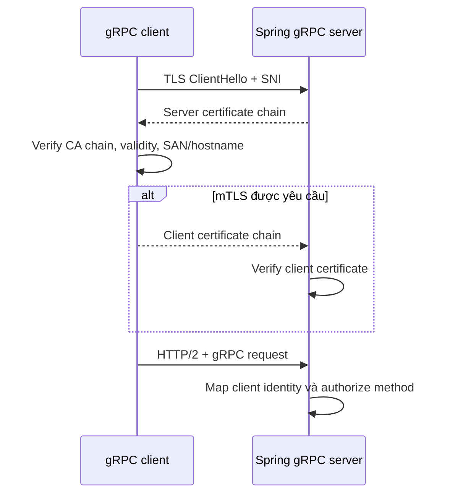

# TLS transport security và identity

## 1. TLS bảo vệ kết nối và xác minh peer

gRPC chạy trên HTTP/2. Trong môi trường production, TLS bảo vệ dữ liệu trên đường truyền bằng mã hóa, kiểm tra tính toàn vẹn và xác minh danh tính peer thông qua chứng thư số.

Có hai câu hỏi khác nhau:

- **Transport security:** client có đang kết nối tới đúng server và dữ liệu có được bảo vệ trên đường truyền không?
- **Application identity và authorization:** caller là principal nào, và principal đó được phép gọi method hoặc truy cập tài nguyên nào?

TLS server authentication xác minh danh tính server với client. **Mutual TLS (mTLS)** bổ sung xác minh client certificate ở phía server. Tuy vậy, mTLS chỉ chứng minh peer sở hữu private key tương ứng với certificate được CA tin cậy cấp; ứng dụng vẫn phải ánh xạ certificate sang principal và kiểm tra quyền.



TLS handshake diễn ra trước khi protobuf request được xử lý. Nếu handshake thất bại, handler unary chưa được gọi; lỗi xuất hiện ở tầng kết nối/transport.

## 2. Certificate, private key, CA và SAN

Một triển khai TLS thường có các thành phần:

| Thành phần | Vai trò |
| --- | --- |
| Server certificate | Chứng minh danh tính server cho client. |
| Server private key | Chứng minh server sở hữu certificate; phải được bảo vệ. |
| CA certificate / trust bundle | Gốc tin cậy để xác minh chuỗi certificate. |
| Intermediate certificate | Nối leaf certificate với CA gốc trong chuỗi tin cậy. |
| Client certificate và private key | Dùng khi server yêu cầu mTLS. |
| Subject Alternative Name (SAN) | Chứa DNS name, IP hoặc URI identity được xác minh theo mục đích certificate. |

Khi client kết nối tới `pricing.internal.example`, certificate server cần có DNS SAN phù hợp với hostname đó. Client xác minh chuỗi certificate tới CA tin cậy, thời hạn hiệu lực, mục đích sử dụng và hostname/SAN. Không dựa vào Common Name (CN) như cơ chế hostname verification hiện đại.

**Trust store và certificate chain có vai trò khác nhau:** server gửi certificate chain của nó; client dùng trust store để quyết định CA nào đáng tin. Không nên tắt certificate validation hoặc hostname verification để “sửa” lỗi kết nối.

## 3. Cấu hình TLS cho gRPC Java server

Ví dụ dưới đây dùng Netty transport của gRPC Java. Các lớp được import từ artifact grpc-netty-shaded; nếu dự án dùng grpc-netty không shaded, package Netty tương ứng sẽ khác. Không trộn hai biến thể trong cùng ứng dụng.

Server chỉ xác thực client bằng server certificate:

```java
import io.grpc.Server;
import io.grpc.netty.shaded.io.grpc.netty.GrpcSslContexts;
import io.grpc.netty.shaded.io.grpc.netty.NettyServerBuilder;
import io.grpc.netty.shaded.io.netty.handler.ssl.SslContext;

import java.io.File;

SslContext serverTls = GrpcSslContexts.forServer(
        new File("certs/server-chain.pem"),
        new File("certs/server-key.pem"))
        .build();

Server server = NettyServerBuilder.forPort(9090)
        .sslContext(serverTls)
        .addService(productQueryGrpcService)
        .build()
        .start();
```

server-chain.pem cần chứa leaf certificate và intermediate certificate cần thiết. server-key.pem là private key tương ứng. Private key phải được bảo vệ bằng quyền file, secret manager hoặc cơ chế quản lý khóa của nền tảng; không commit vào repository.

Server TLS một chiều mã hóa và xác thực server với client, nhưng không xác thực danh tính client bằng certificate. Nếu hệ thống dùng bearer token hoặc một cơ chế application authentication khác, xác thực đó vẫn cần được thực hiện riêng.

### Cấu hình mTLS trên server

Để yêu cầu client certificate, server cần trust CA phát hành certificate cho client và đặt client authentication thành REQUIRE:

```java
import io.grpc.Server;
import io.grpc.netty.shaded.io.grpc.netty.GrpcSslContexts;
import io.grpc.netty.shaded.io.grpc.netty.NettyServerBuilder;
import io.grpc.netty.shaded.io.netty.handler.ssl.ClientAuth;
import io.grpc.netty.shaded.io.netty.handler.ssl.SslContext;

SslContext mutualTls = GrpcSslContexts.forServer(
        new File("certs/server-chain.pem"),
        new File("certs/server-key.pem"))
        .trustManager(new File("certs/client-ca-bundle.pem"))
        .clientAuth(ClientAuth.REQUIRE)
        .build();

Server server = NettyServerBuilder.forPort(9090)
        .sslContext(mutualTls)
        .addService(productQueryGrpcService)
        .build()
        .start();
```

Các lựa chọn thường gặp của Netty:

- ClientAuth.NONE: không yêu cầu client certificate.
- ClientAuth.OPTIONAL: client có thể gửi certificate; nếu gửi thì server kiểm tra.
- ClientAuth.REQUIRE: client phải gửi certificate hợp lệ.

Chỉ dùng OPTIONAL khi có lý do tương thích rõ ràng và handler có chính sách cho peer không có certificate. Với mTLS bắt buộc, REQUIRE làm handshake thất bại nếu client không cung cấp certificate được chấp nhận.

## 4. Cấu hình TLS trên gRPC client

Client phải tin CA phát hành server certificate và kết nối bằng hostname có trong SAN:

```java
import io.grpc.ManagedChannel;
import io.grpc.netty.shaded.io.grpc.netty.GrpcSslContexts;
import io.grpc.netty.shaded.io.grpc.netty.NettyChannelBuilder;
import io.grpc.netty.shaded.io.netty.handler.ssl.SslContext;

SslContext clientTls = GrpcSslContexts.forClient()
        .trustManager(new File("certs/server-ca-bundle.pem"))
        .build();

ManagedChannel channel = NettyChannelBuilder
        .forAddress("pricing.internal.example", 9090)
        .sslContext(clientTls)
        .build();
```

Không dùng usePlaintext() cho kết nối production cần TLS. Cũng không dùng overrideAuthority(...) để né hostname mismatch; phương thức này thay đổi authority dùng trong xác minh và chỉ phù hợp với một số cấu hình test/proxy được kiểm soát.

### Client certificate cho mTLS

Nếu server yêu cầu mTLS, client phải gửi certificate chain và private key của chính nó:

```java
SslContext clientMtls = GrpcSslContexts.forClient()
        .trustManager(new File("certs/server-ca-bundle.pem"))
        .keyManager(
                new File("certs/checkout-client-chain.pem"),
                new File("certs/checkout-client-key.pem"))
        .build();

ManagedChannel channel = NettyChannelBuilder
        .forAddress("pricing.internal.example", 9090)
        .sslContext(clientMtls)
        .build();
```

trustManager(...) xác minh **server**; keyManager(...) cung cấp danh tính **client** cho server. Hai cấu hình này giải quyết hai chiều xác thực khác nhau. Certificate client phải có mục đích sử dụng phù hợp và được CA mà server tin cậy phát hành.

## 5. Tích hợp trong ứng dụng Spring gRPC

Trong ứng dụng Spring gRPC dùng auto-configuration, server, channel và stub thường do framework quản lý. TLS nên được cấu hình trên **server/channel được quản lý đó**, để giữ đúng lifecycle, interceptor, health service và các cấu hình channel khác.

Các ví dụ Netty builder ở trên minh họa các thành phần TLS nền tảng của gRPC Java. Khi dùng Spring Boot starter:

- Khai báo certificate chain, private key, trust bundle và client-auth policy qua cấu hình SSL mà phiên bản Spring gRPC của dự án hỗ trợ.
- Với client channel có tên, cấu hình trust material và client key material cho đúng channel.
- Nếu framework cho phép customizer hoặc SSL context tùy chỉnh, gắn cấu hình vào factory/channel/server được auto-configure.
- Không khởi tạo một Netty server thứ hai song song chỉ để bật TLS nếu Spring đã quản lý server chính.
- Xác minh dependency đang dùng là grpc-netty hay grpc-netty-shaded, tránh import nhầm package.

Tên property và extension point có thể khác giữa các phiên bản Spring gRPC. Dùng đúng reference của phiên bản dependency trong dự án trước khi đưa cấu hình vào application.yml; không sao chép property của phiên bản khác mà không kiểm chứng.

## 6. Lấy client identity từ mTLS

Khi mTLS thành công, server có thể lấy peer certificate từ SSLSession gắn với ServerCall. Identity nên được lấy từ SAN theo quy ước của tổ chức, chẳng hạn URI SAN dạng workload identity; không nên dùng chuỗi CN tùy ý làm principal.

Ví dụ interceptor đọc URI SAN:

```java
import io.grpc.Context;
import io.grpc.Contexts;
import io.grpc.Grpc;
import io.grpc.Metadata;
import io.grpc.ServerCall;
import io.grpc.ServerCallHandler;
import io.grpc.ServerInterceptor;
import io.grpc.Status;

import java.security.cert.Certificate;
import java.security.cert.X509Certificate;
import java.util.Collection;
import java.util.List;
import javax.net.ssl.SSLPeerUnverifiedException;
import javax.net.ssl.SSLSession;

public final class MtlsIdentityInterceptor
        implements ServerInterceptor {

    public static final Context.Key<String> CLIENT_ID =
            Context.key("mtls-client-id");

    @Override
    public <ReqT, RespT> ServerCall.Listener<ReqT> interceptCall(
            ServerCall<ReqT, RespT> call,
            Metadata headers,
            ServerCallHandler<ReqT, RespT> next) {

        SSLSession session =
                call.getAttributes().get(Grpc.TRANSPORT_ATTR_SSL_SESSION);

        if (session == null) {
            call.close(
                    Status.UNAUTHENTICATED
                            .withDescription("TLS client identity is required"),
                    new Metadata());
            return new ServerCall.Listener<>() {};
        }

        try {
            Certificate[] peerCertificates = session.getPeerCertificates();
            X509Certificate peer =
                    (X509Certificate) peerCertificates[0];

            String clientId = findUriSan(peer);
            if (clientId == null) {
                call.close(
                        Status.UNAUTHENTICATED
                                .withDescription("Client certificate has no URI SAN"),
                        new Metadata());
                return new ServerCall.Listener<>() {};
            }

            Context context = Context.current()
                    .withValue(CLIENT_ID, clientId);

            return Contexts.interceptCall(
                    context, call, headers, next);

        } catch (SSLPeerUnverifiedException
                 | java.security.cert.CertificateParsingException
                 | ClassCastException invalidPeer) {
            call.close(
                    Status.UNAUTHENTICATED
                            .withDescription("Client certificate is not valid"),
                    new Metadata());
            return new ServerCall.Listener<>() {};
        }
    }

    private static String findUriSan(X509Certificate certificate)
            throws java.security.cert.CertificateParsingException {

        Collection<List<?>> names =
                certificate.getSubjectAlternativeNames();

        if (names == null) {
            return null;
        }

        return names.stream()
                .filter(entry -> Integer.valueOf(6).equals(entry.get(0)))
                .map(entry -> (String) entry.get(1))
                .findFirst()
                .orElse(null);
    }
}
```

Mã trên giả định server đã bật mTLS bắt buộc ở transport. Nếu không có client certificate, TLS handshake thường thất bại trước khi interceptor chạy; nhánh session == null là lớp phòng vệ cho cấu hình hoặc transport không cung cấp SSL session.

URI SAN type 6 là URI trong Subject Alternative Name. Quy ước identity cụ thể phải được CA và tổ chức thống nhất, ví dụ spiffe://example.org/ns/commerce/sa/checkout. Không lấy URI bất kỳ làm quyền truy cập ngay lập tức.

Handler có thể đọc identity đã được interceptor đưa vào Context:

```java
String clientId = MtlsIdentityInterceptor.CLIENT_ID.get();

if (!authorizationService.mayReadProduct(clientId, productId)) {
    observer.onError(Status.PERMISSION_DENIED
            .withDescription("Client không có quyền đọc sản phẩm")
            .asRuntimeException());
    return;
}
```

authorizationService ánh xạ client identity sang policy/role và kiểm tra tài nguyên cụ thể. Nếu certificate hợp lệ nhưng identity không được cấp quyền, kết quả nên là PERMISSION_DENIED, không phải UNAUTHENTICATED.

## 7. TLS identity không tự động là application authorization

Cần phân biệt ba bước:

1. **Certificate path validation:** certificate được CA tin cậy phát hành, còn hiệu lực, đúng mục đích và chưa bị từ chối theo chính sách.
2. **Peer identity extraction:** lấy identity từ SAN hoặc claim được tổ chức quy định.
3. **Authorization:** xác định identity có được gọi method và truy cập tài nguyên cụ thể hay không.

Một certificate hợp lệ chỉ xác minh danh tính cryptographic theo trust policy. Nó không mặc nhiên có quyền gọi mọi RPC. Quyền có thể phụ thuộc tenant, service, method, môi trường hoặc resource.

Nếu TLS kết thúc tại ingress/proxy, gRPC server phía sau có thể chỉ nhìn thấy certificate của proxy. Khi đó không được tin một header identity do mạng gửi tùy ý. Cần một trust boundary rõ ràng: proxy xác thực client, truyền identity qua token/metadata được ký hoặc kênh nội bộ được bảo vệ, và backend chỉ chấp nhận thông tin từ proxy được xác thực.

## 8. Certificate rotation và vận hành

Certificate có thời hạn; TLS cần quy trình gia hạn và thay thế không gây gián đoạn:

- Theo dõi ngày hết hạn của server và client certificate.
- Phát hành certificate mới trước khi certificate cũ hết hạn.
- Khi đổi CA, triển khai trust bundle có cả CA cũ và mới trong giai đoạn chuyển tiếp.
- Cập nhật certificate/key trên server và client theo thứ tự tương thích; xác minh kết nối mới trước khi thu hồi CA cũ.
- Bảo vệ private key bằng secret manager, file permission hoặc hardware-backed key store.
- Không ghi private key, token hoặc toàn bộ certificate material vào log.
- Kiểm tra thu hồi certificate theo khả năng và chính sách của hạ tầng PKI.
- Có cảnh báo handshake failure, certificate expiry và số kết nối bị từ chối.

Channel và TLS context có thể giữ certificate đã nạp trong bộ nhớ. Thay file trên disk không bảo đảm các kết nối đang chạy tự động dùng certificate mới. Cần theo dõi cơ chế reload của framework/transport; nếu không hỗ trợ reload an toàn, triển khai channel/server replacement hoặc rolling restart theo quy trình vận hành.

## 9. Kiểm thử TLS và mTLS

InProcessServerBuilder không thực hiện TLS handshake như TCP transport, nên không thể chứng minh certificate chain, hostname verification hay mTLS hoạt động. Dùng integration test với Netty transport và certificate test được tạo riêng.

| Kịch bản | Kết quả mong đợi |
| --- | --- |
| Client tin đúng CA, hostname khớp SAN | TLS handshake thành công và unary RPC chạy được. |
| Client không tin CA server | Handshake thất bại; handler không được gọi. |
| Hostname không khớp SAN | Client từ chối xác minh server identity. |
| Server yêu cầu mTLS, client không gửi certificate | Handshake thất bại. |
| Client gửi certificate do CA không tin cậy cấp | Server từ chối handshake. |
| Certificate hợp lệ nhưng identity không có quyền | Handshake thành công; RPC bị từ chối ở authorization bằng PERMISSION_DENIED. |
| Certificate gần hết hạn hoặc hết hạn | Hệ thống cảnh báo và handshake tuân theo certificate validity/policy. |

Lỗi TLS handshake có thể được biểu diễn ở client bằng status transport như UNAVAILABLE kèm cause; không khẳng định mọi lỗi certificate đều thành một gRPC status nghiệp vụ cố định. Test nên xác minh call thất bại và handler không xử lý request, đồng thời kiểm tra cause/log phù hợp.

Ngoài test certificate, cần kiểm tra rotation: client mới tin CA mới, client cũ còn hoạt động trong giai đoạn overlap, rồi CA cũ được loại bỏ sau khi toàn bộ certificate cũ đã được thay thế.

## 10. Lỗi thường gặp

1. **Dùng plaintext cho production.** Dữ liệu và danh tính server không được bảo vệ. Cấu hình TLS cho channel/server production.
2. **Tắt hostname verification để khắc phục mismatch.** Client có thể chấp nhận nhầm server. Sửa SAN hoặc hostname kết nối.
3. **Chỉ cài server certificate mà quên intermediate chain.** Một số client không xây dựng được trust path. Gửi chain đầy đủ.
4. **Nhầm trust manager với key manager.** Trust manager xác minh peer; key manager cung cấp certificate/private key của local endpoint.
5. **Bật mTLS nhưng không cấu hình client CA trust.** Server không thể xác minh client certificate. Cấu hình trust bundle và client-auth policy.
6. **Coi certificate hợp lệ là được phép gọi mọi method.** TLS authentication không thay authorization. Ánh xạ SAN identity sang policy cụ thể.
7. **Dùng CN làm identity duy nhất.** CN không phải lựa chọn phù hợp cho định danh workload hiện đại. Dùng SAN theo quy ước đã thống nhất.
8. **Tin metadata identity sau khi TLS terminate ở proxy.** Backend có thể nhận header giả mạo nếu trust boundary không được bảo vệ. Dùng signed identity hoặc kênh proxy-backend được xác thực.
9. **Thay file certificate và cho rằng channel tự reload.** TLS context có thể đã nạp material cũ. Kiểm tra cơ chế reload hoặc rolling replacement.
10. **Chỉ test bằng in-process transport.** Test đó không kiểm tra TLS. Dùng integration test trên TCP/Netty với test CA.

## 11. Bài thực hành

Triển khai ProductQueryService qua TLS và mTLS:

1. Tạo test CA, server certificate có DNS SAN catalog.test.internal và client certificate có URI SAN spiffe://example.org/ns/catalog/sa/checkout.
2. Cấu hình server tin CA của client và yêu cầu ClientAuth.REQUIRE.
3. Cấu hình client tin CA của server, gửi client certificate và kết nối bằng hostname khớp SAN.
4. Dùng server interceptor lấy URI SAN, đưa identity vào io.grpc.Context, rồi kiểm tra authorization ở handler.
5. Viết test cho client hợp lệ, thiếu certificate, CA không tin cậy, hostname mismatch và identity hợp lệ nhưng không có quyền.
6. Mô phỏng đổi CA bằng trust bundle overlap và xác minh kết nối trước/sau rotation.

**Tự kiểm tra:** TLS bảo vệ transport và xác minh peer certificate. mTLS xác minh cả server lẫn client; server có thể lấy client identity từ certificate SAN, nhưng vẫn phải ánh xạ identity sang principal và kiểm tra authorization. Quản lý CA, hostname verification, private key, rotation và test trên transport thật là các phần bắt buộc của một triển khai Spring gRPC an toàn.

