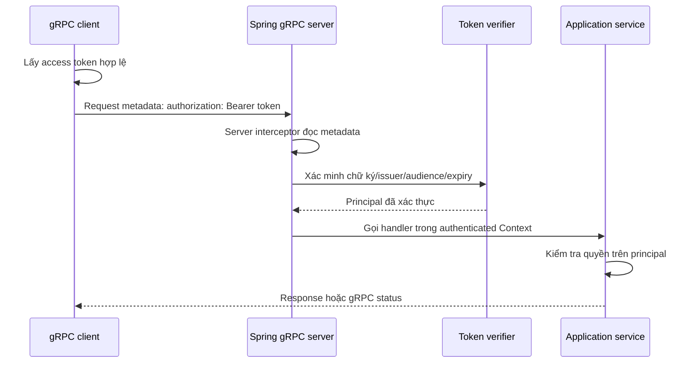

# Bearer token trong metadata

## 1. Bearer token xác thực caller ở tầng ứng dụng

gRPC truyền protobuf message qua HTTP/2. Ngoài request và response, client có thể gửi metadata để cung cấp thông tin xác thực. Quy ước phổ biến là đặt access token trong metadata `authorization`:

`authorization: Bearer <access-token>`

Server đọc token, xác minh token và tạo principal đại diện cho caller. Sau đó, tầng nghiệp vụ kiểm tra principal có quyền gọi method hoặc truy cập tài nguyên hay không.

Cần phân biệt hai lớp bảo vệ:

- **TLS** mã hóa đường truyền và xác minh server; mTLS có thể xác minh thêm certificate của client.
- **Bearer token** xác thực danh tính và quyền ở tầng ứng dụng. Token không thay thế TLS.

Bearer token có nghĩa là bên sở hữu token có thể sử dụng token. Nếu token bị lộ, kẻ khác có thể giả làm caller trong thời hạn và phạm vi quyền của token. Vì vậy, chỉ gửi token qua transport bảo mật, giữ thời hạn ngắn và tránh ghi token vào log.



## 2. Metadata key và định dạng Authorization

Trong gRPC Java, metadata key phải dùng chữ thường. Header `authorization` chứa văn bản ASCII nên dùng `Metadata.ASCII_STRING_MARSHALLER`:

```java
import io.grpc.Metadata;

public final class AuthMetadata {

    private AuthMetadata() {}

    public static final Metadata.Key<String> AUTHORIZATION =
            Metadata.Key.of(
                    "authorization",
                    Metadata.ASCII_STRING_MARSHALLER);
}
```

Giá trị gửi đi có scheme `Bearer`, một dấu cách và access token:

```java
Metadata headers = new Metadata();
headers.put(
        AuthMetadata.AUTHORIZATION,
        "Bearer " + accessToken);
```

Không đặt token trong protobuf request, query string, tên method hoặc custom field nghiệp vụ. Metadata được gửi ở tầng RPC và có thể được interceptor đọc trước khi handler chạy.

Nguyên tắc:

- Dùng key `authorization` viết thường.
- Chỉ gửi access token, không gửi refresh token cho resource server.
- Không gửi nhiều giá trị `authorization` trong cùng một RPC.
- Không tự base64 hóa JWT; truyền token nguyên văn theo định dạng issuer cấp.
- Giữ token và metadata nhỏ để không vượt giới hạn header của client, server hoặc proxy.

## 3. Gửi token theo từng RPC bằng CallCredentials

Không nên gắn một token cố định vào singleton interceptor nếu token có thể hết hạn hoặc được làm mới. gRPC Java cung cấp `CallCredentials` để cấp credentials cho từng call. Credential có thể lấy token hiện hành ngay trước khi metadata được gửi.

Ví dụ contract của bộ cấp token:

```java
public interface AccessTokenProvider {
    CompletionStage<String> getAccessToken();
}
```

`getAccessToken()` có thể trả token từ cache còn hiệu lực hoặc làm mới token qua OAuth2 client. Phần refresh nên được quản lý bởi security component của ứng dụng.

Credential gắn access token vào metadata:

```java
package com.example.orders.client;

import io.grpc.CallCredentials;
import io.grpc.Metadata;
import io.grpc.Status;

import java.util.concurrent.CompletionStage;
import java.util.concurrent.Executor;

public final class BearerTokenCredentials extends CallCredentials {

    private final AccessTokenProvider tokenProvider;

    public BearerTokenCredentials(AccessTokenProvider tokenProvider) {
        this.tokenProvider = tokenProvider;
    }

    @Override
    public void applyRequestMetadata(
            RequestInfo requestInfo,
            Executor appExecutor,
            MetadataApplier applier) {

        final CompletionStage<String> tokenStage;

        try {
            tokenStage = tokenProvider.getAccessToken();
        } catch (RuntimeException failure) {
            applier.fail(Status.UNAUTHENTICATED
                    .withDescription("Không lấy được access token"));
            return;
        }

        tokenStage.whenCompleteAsync((token, failure) -> {
            if (failure != null || token == null || token.isBlank()) {
                applier.fail(Status.UNAUTHENTICATED
                        .withDescription("Access token không khả dụng"));
                return;
            }

            Metadata headers = new Metadata();
            headers.put(
                    AuthMetadata.AUTHORIZATION,
                    "Bearer " + token);

            applier.apply(headers);
        }, appExecutor);
    }

    @Override
    public boolean requireTransportSecurity() {
        return true;
    }
}
```

`CallCredentials` được gọi trong quá trình chuẩn bị metadata cho RPC. `appExecutor` là executor do gRPC cung cấp để hoàn tất thao tác bất đồng bộ; không chặn thread transport bằng cách chờ token qua `get()` hoặc `join()`.

`requireTransportSecurity()` trả về `true` để credential chỉ được sử dụng khi transport đáp ứng yêu cầu bảo mật. Channel vẫn phải được cấu hình TLS đúng và xác minh server certificate/hostname.

Gắn credentials vào stub:

```java
OrderCommandServiceGrpc.OrderCommandServiceBlockingStub securedStub =
        baseStub.withCallCredentials(
                new BearerTokenCredentials(accessTokenProvider));

CreateOrderResponse response = securedStub
        .withDeadlineAfter(800, TimeUnit.MILLISECONDS)
        .createOrder(request);
```

`withCallCredentials(...)` trả về stub dẫn xuất. Stub có thể được quản lý dùng chung, trong khi `AccessTokenProvider` cấp token mới hoặc token cache hợp lệ cho từng call. Không lưu token của một người dùng vào field mutable dùng chung giữa các request.

### Tránh gắn token tĩnh khi token có thể thay đổi

`MetadataUtils.newAttachHeadersInterceptor(...)` có thể hữu ích trong test hoặc với header tĩnh không nhạy cảm. Với access token ngắn hạn, interceptor giữ metadata cố định có thể tiếp tục gửi token đã hết hạn. `CallCredentials` phù hợp hơn vì nó lấy credentials theo vòng đời từng RPC.

## 4. Xác minh token ở server bằng ServerInterceptor

Server nên xác minh token trước khi gọi handler nghiệp vụ. Một `ServerInterceptor` đọc `authorization`, kiểm tra Bearer scheme và chuyển token cho thành phần xác minh chuyên trách.

Ví dụ contract xác minh:

```java
public interface AccessTokenVerifier {
    AuthenticatedPrincipal verify(String accessToken)
            throws InvalidAccessTokenException;
}

public record AuthenticatedPrincipal(
        String subject,
        String tenantId,
        Set<String> scopes) {}
```

`AccessTokenVerifier` có trách nhiệm xác minh token theo chính sách tin cậy của hệ thống. Với JWT, không chỉ decode payload: phải xác minh chữ ký bằng key đáng tin cậy, thuật toán được cho phép, `iss`, `aud`, `exp`, `nbf` và các claim bắt buộc. Với opaque token, gọi introspection endpoint qua kênh bảo mật và cache kết quả trong thời gian ngắn theo chính sách.

Interceptor minh họa:

```java
package com.example.orders.server;

import io.grpc.Context;
import io.grpc.Contexts;
import io.grpc.Metadata;
import io.grpc.ServerCall;
import io.grpc.ServerCallHandler;
import io.grpc.ServerInterceptor;
import io.grpc.Status;

import java.util.Iterator;

public final class BearerTokenServerInterceptor
        implements ServerInterceptor {

    public static final Context.Key<AuthenticatedPrincipal> PRINCIPAL =
            Context.key("authenticated-principal");

    private final AccessTokenVerifier tokenVerifier;

    public BearerTokenServerInterceptor(
            AccessTokenVerifier tokenVerifier) {
        this.tokenVerifier = tokenVerifier;
    }

    @Override
    public <ReqT, RespT> ServerCall.Listener<ReqT> interceptCall(
            ServerCall<ReqT, RespT> call,
            Metadata headers,
            ServerCallHandler<ReqT, RespT> next) {

        Iterable<String> values =
                headers.getAll(AuthMetadata.AUTHORIZATION);

        if (values == null) {
            return reject(call, Status.UNAUTHENTICATED
                    .withDescription("Thiếu bearer token"));
        }

        Iterator<String> iterator = values.iterator();
        if (!iterator.hasNext()) {
            return reject(call, Status.UNAUTHENTICATED
                    .withDescription("Thiếu bearer token"));
        }

        String authorization = iterator.next();

        if (iterator.hasNext()
                || authorization == null
                || !authorization.regionMatches(
                        true, 0, "Bearer ", 0, 7)) {
            return reject(call, Status.UNAUTHENTICATED
                    .withDescription("Authorization header không hợp lệ"));
        }

        String token = authorization.substring(7).trim();
        if (token.isEmpty()
                || token.chars().anyMatch(Character::isWhitespace)) {
            return reject(call, Status.UNAUTHENTICATED
                    .withDescription("Bearer token không hợp lệ"));
        }

        try {
            AuthenticatedPrincipal principal =
                    tokenVerifier.verify(token);

            Context context = Context.current()
                    .withValue(PRINCIPAL, principal);

            return Contexts.interceptCall(
                    context, call, headers, next);

        } catch (InvalidAccessTokenException invalid) {
            return reject(call, Status.UNAUTHENTICATED
                    .withDescription("Access token không hợp lệ"));
        } catch (RuntimeException unexpected) {
            // Ghi log lỗi nội bộ nhưng tuyệt đối không log token.
            return reject(call, Status.INTERNAL
                    .withDescription("Không thể xác minh credentials"));
        }
    }

    private static <ReqT, RespT> ServerCall.Listener<ReqT> reject(
            ServerCall<ReqT, RespT> call,
            Status status) {
        call.close(status, new Metadata());
        return new ServerCall.Listener<>() {};
    }
}
```

Các kiểu `AuthenticatedPrincipal`, `AccessTokenVerifier` và `InvalidAccessTokenException` là thành phần ứng dụng minh họa. Trong production, nên log lỗi xác minh với correlation ID và loại lỗi an toàn; không ghi raw token, authorization header hoặc toàn bộ claim nhạy cảm.

`Contexts.interceptCall(...)` gắn principal vào `io.grpc.Context` trong suốt callback của RPC. Handler và service có thể lấy principal từ context thay vì tin user ID do client truyền trong protobuf.

## 5. Authentication khác authorization

Xác minh token thành công chỉ trả lời **caller là ai**. Server vẫn phải kiểm tra caller có được phép thực hiện hành động cụ thể hay không.

- Token thiếu, sai chữ ký, sai issuer/audience, hết hạn hoặc bị thu hồi: `UNAUTHENTICATED`.
- Token hợp lệ nhưng thiếu scope hoặc không có quyền trên tài nguyên: `PERMISSION_DENIED`.
- Request sai định dạng hoặc thiếu field bắt buộc: thường là `INVALID_ARGUMENT`.

Ví dụ handler kiểm tra scope và quyền tài nguyên:

```java
AuthenticatedPrincipal principal =
        BearerTokenServerInterceptor.PRINCIPAL.get();

if (principal == null) {
    observer.onError(Status.UNAUTHENTICATED
            .withDescription("Caller chưa được xác thực")
            .asRuntimeException());
    return;
}

if (!principal.scopes().contains("orders:read")
        || !authorizationService.canReadOrder(
                principal.subject(),
                principal.tenantId(),
                request.getOrderId())) {
    observer.onError(Status.PERMISSION_DENIED
            .withDescription("Caller không có quyền đọc đơn hàng")
            .asRuntimeException());
    return;
}
```

`authorizationService` ánh xạ principal sang policy và kiểm tra tài nguyên cụ thể. Kiểm tra scope chỉ là một phần của authorization. Server vẫn phải kiểm tra ownership, tenant boundary và policy trên tài nguyên. Không tin `tenant_id`, `role` hoặc `scope` do client tự gửi trong metadata hay protobuf request; lấy quyền đã xác minh từ principal và policy server-side.

Không chuyển access token nguyên bản sang mọi downstream service một cách mặc định. Nếu service cần gọi thay mặt người dùng, dùng token exchange/delegation hoặc credentials riêng theo audience và scope của downstream.

## 6. Đưa credentials vào Spring gRPC

Trong ứng dụng Spring, nên quản lý `AccessTokenProvider`, `CallCredentials`, channel và stub bằng dependency injection. Ví dụ cấu hình client:

```java
@Configuration
public class OrderGrpcClientConfiguration {

    @Bean
    BearerTokenCredentials bearerTokenCredentials(
            AccessTokenProvider tokenProvider) {
        return new BearerTokenCredentials(tokenProvider);
    }

    @Bean
    OrderCommandServiceGrpc.OrderCommandServiceBlockingStub orderStub(
            GrpcChannelFactory channelFactory,
            BearerTokenCredentials credentials) {

        return OrderCommandServiceGrpc.newBlockingStub(
                channelFactory.createChannel("orders"))
                .withCallCredentials(credentials);
    }
}
```

`GrpcChannelFactory` tạo channel đã được cấu hình trong Spring. Channel `orders` cần có TLS và trust material phù hợp. Nếu dùng Spring gRPC auto-configuration, hãy đăng ký `BearerTokenServerInterceptor` qua cơ chế global hoặc service-specific interceptor mà phiên bản framework đang sử dụng hỗ trợ. Không tạo server/channel phụ chỉ để gắn credentials nếu framework đã quản lý lifecycle của chúng.

Không đặt access token cá nhân vào `application.yml`, environment dùng chung hoặc source code. Cấu hình nơi lấy token, client registration, issuer và audience; token động phải được lấy từ security component theo request/caller phù hợp.

## 7. Refresh token và vòng đời access token

Access token thường có thời hạn ngắn. `AccessTokenProvider` cần phối hợp với OAuth2 client hoặc identity provider để cấp token hợp lệ:

1. Kiểm tra token cache còn đủ thời gian sống trước khi dùng.
2. Nếu token sắp hết hạn, làm mới bằng refresh token hoặc client credentials theo grant được cấp.
3. Đồng bộ refresh để nhiều RPC đồng thời không cùng tạo hàng loạt request cấp token.
4. Chỉ cache token trong phạm vi principal/client registration phù hợp; không dùng chung token người dùng giữa các caller.
5. Nếu issuer thu hồi hoặc refresh thất bại, từ chối call với lỗi xác thực phù hợp và yêu cầu luồng đăng nhập/cấp quyền lại.

Dành một khoảng clock skew nhỏ khi đánh giá `exp` để tránh token hết hạn đúng lúc request tới server. Không kéo dài thời hạn token tùy tiện chỉ để giảm số lần refresh.

Với client credentials flow, token đại diện cho service account. Với authorization code hoặc delegated flow, token có thể đại diện cho người dùng. Phải chọn flow theo mô hình tin cậy và audience của service đích; không giả định mọi RPC đều nên dùng cùng một loại token.

## 8. Bảo vệ token và metadata trong vận hành

Bearer token là bí mật có khả năng cấp quyền. Các nguyên tắc vận hành:

- Chỉ truyền token qua TLS; xác minh CA chain và hostname của server.
- Không log header `authorization`, token, refresh token hoặc cookie.
- Không đưa token vào exception description, trailers, metric label hay trace attribute.
- Giới hạn audience và scope theo service/method cần truy cập.
- Dùng token thời hạn ngắn và cơ chế thu hồi phù hợp.
- Bảo vệ cache/token store bằng quyền truy cập tối thiểu và mã hóa khi lưu nếu cần.
- Không forward token tới host hoặc service không nằm trong trust boundary.
- Giữ metadata nhỏ và chỉ chứa thông tin cần thiết.

Nếu TLS kết thúc ở ingress/proxy, cần xác định proxy nào được tin cậy và cách identity được chuyển đến backend. Không tin `authorization` hoặc header identity do một hop không xác thực thêm vào. Backend nên nhận token để tự xác minh hoặc nhận assertion được ký từ proxy tin cậy qua kênh nội bộ bảo vệ.

## 9. Kiểm thử Bearer authentication

Có thể kiểm thử interceptor và handler bằng in-process gRPC transport, dùng token giả và verifier test:

| Tình huống | Kết quả mong đợi |
| --- | --- |
| Không có `authorization` | `UNAUTHENTICATED`; handler không chạy. |
| Sai scheme hoặc token rỗng | `UNAUTHENTICATED`; handler không chạy. |
| Có nhiều giá trị authorization | Từ chối request; không chọn tùy tiện một token. |
| Token giả hoặc hết hạn | `UNAUTHENTICATED`. |
| Token hợp lệ và có scope phù hợp | Handler nhận principal trong context và xử lý request. |
| Token hợp lệ nhưng thiếu scope/quyền tài nguyên | `PERMISSION_DENIED`. |
| Token sắp hết hạn | Provider làm mới hoặc lấy token hợp lệ trước call. |
| Hai caller đồng thời | Principal/token của các RPC không bị trộn lẫn. |

In-process test xác minh metadata, interceptor, principal context và status mapping. Nó không kiểm tra TLS handshake hoặc chứng minh `CallCredentials.requireTransportSecurity()` hoạt động trên transport mạng. Cần thêm integration test dùng Netty TLS với test CA để xác minh credential chỉ được gửi qua secure channel.

Không dùng access token production trong test. Với JWT, tạo token test ký bằng key test; với opaque token, dùng verifier/introspection stub. Kiểm tra log và exception để bảo đảm token không bị lộ.

## 10. Lỗi thường gặp

1. **Gửi token trong protobuf hoặc query string.** Token dễ bị lưu vào payload/log. Dùng request metadata `authorization`.
2. **Dùng plaintext cùng bearer token.** Token có thể bị nghe lén. Bắt buộc TLS và xác minh server certificate.
3. **Gắn token tĩnh vào singleton interceptor.** Token có thể hết hạn hoặc thuộc caller khác. Dùng `CallCredentials` và provider theo từng call.
4. **Chỉ decode JWT mà không xác minh chữ ký.** Kẻ tấn công có thể tự tạo claim. Kiểm tra chữ ký, issuer, audience, expiry, not-before và thuật toán.
5. **Coi token hợp lệ là được phép truy cập mọi tài nguyên.** Authentication không thay authorization. Kiểm tra scope, tenant và quyền tài nguyên.
6. **Dùng refresh token như bearer token gửi đến resource server.** Refresh token có quyền và vòng đời khác. Chỉ gửi access token phù hợp audience.
7. **Log authorization header để debug.** Làm lộ bí mật có thể dùng lại. Che hoặc loại bỏ toàn bộ giá trị token.
8. **Chọn tùy tiện một trong nhiều authorization header.** Có thể tạo hành vi xác thực không nhất quán. Từ chối header trùng.
9. **Forward token đến mọi downstream.** Có thể làm lộ quyền vượt phạm vi. Dùng token exchange hoặc service credentials đúng audience.
10. **Chỉ test interceptor mà bỏ qua TLS.** Không chứng minh token được bảo vệ trên đường truyền. Bổ sung test Netty TLS/mTLS.

## 11. Bài thực hành

Bảo vệ unary method `GetOrder` bằng Bearer token:

1. Tạo `AccessTokenProvider` lấy token từ OAuth2 client hoặc test provider.
2. Gắn `BearerTokenCredentials` vào generated blocking stub bằng `withCallCredentials(...)`.
3. Cấu hình channel TLS và xác minh hostname server.
4. Đăng ký `BearerTokenServerInterceptor` trong Spring gRPC server.
5. Xác minh JWT hoặc opaque token và đưa `AuthenticatedPrincipal` vào `io.grpc.Context`.
6. Kiểm tra scope `orders:read`, tenant và quyền trên order ID ở handler.
7. Viết test cho token thiếu, token sai, token hết hạn, token hợp lệ, thiếu quyền và hai caller đồng thời.
8. Kiểm tra log, trace và exception không chứa token; thêm test transport TLS để xác minh credentials không chạy trên plaintext.

**Tự kiểm tra:** Client gửi `authorization: Bearer <access-token>` qua metadata bằng `CallCredentials` theo từng RPC. Server interceptor xác minh token, tạo principal trong gRPC Context; handler tiếp tục kiểm tra authorization trên tài nguyên. TLS bảo vệ token trên đường truyền, còn token ngắn hạn, audience/scope tối thiểu, refresh an toàn và log không chứa bí mật giúp giảm rủi ro lộ credentials.

