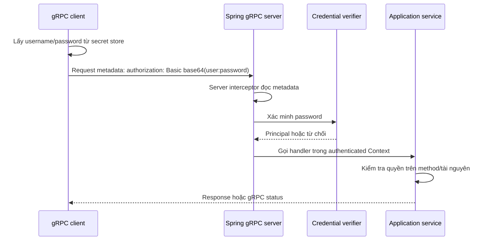

# Basic credential và giới hạn sử dụng

## 1. Basic authentication hoạt động như thế nào?

gRPC truyền protobuf message qua HTTP/2. Ngoài request và response, client có thể gửi metadata để cung cấp thông tin xác thực. Quy ước phổ biến là đặt access credential trong metadata:

`authorization: Basic <base64(username:password)>`

Server đọc header, giải mã Base64, tách username/password và xác minh thông tin đăng nhập bằng kho tài khoản hoặc identity provider.

Base64 chỉ là cách biểu diễn bytes thành ký tự truyền được trong header. Nó **không mã hóa và không bảo vệ bí mật**. Bất kỳ ai quan sát được kết nối không mã hóa đều có thể khôi phục username/password. Vì vậy, Basic authentication chỉ được dùng trên gRPC transport có TLS và client phải xác minh đúng certificate/hostname của server.

Basic cũng có giới hạn quan trọng: client gửi lại cùng thông tin đăng nhập trong mỗi RPC; cơ chế này không tự cung cấp access token ngắn hạn, scope, audience, delegation hay refresh token. Với ứng dụng người dùng và hệ thống phân tán hiện đại, OAuth2/OIDC hoặc workload identity thường phù hợp hơn.



Authentication và authorization là hai bước khác nhau: xác minh đúng mật khẩu chỉ xác định caller; server vẫn phải kiểm tra caller có quyền thực hiện thao tác hay không.

## 2. Metadata key và định dạng Basic

Metadata key trong gRPC Java dùng chữ thường và marshaller phù hợp với kiểu dữ liệu. Header authorization là văn bản ASCII:

```java
import io.grpc.Metadata;

public final class BasicAuthMetadata {

    private BasicAuthMetadata() {}

    public static final Metadata.Key<String> AUTHORIZATION =
            Metadata.Key.of(
                    "authorization",
                    Metadata.ASCII_STRING_MARSHALLER);
}
```

Giá trị header có cấu trúc gồm scheme, một dấu cách và chuỗi Base64:

```java
String userPass = username + ":" + password;

String encoded = Base64.getEncoder().encodeToString(
        userPass.getBytes(StandardCharsets.UTF_8));

Metadata headers = new Metadata();
headers.put(
        BasicAuthMetadata.AUTHORIZATION,
        "Basic " + encoded);
```

Basic dùng dấu hai chấm đầu tiên để phân cách username và password. Username không được chứa dấu hai chấm; password có thể chứa dấu hai chấm. Không tự ý trim password vì khoảng trắng có thể là một phần của mật khẩu.

Ví dụ thống nhất UTF-8 ở cả client và server để mã hóa cặp username/password. Basic ban đầu có quy tắc charset lịch sử; vì vậy, khi tích hợp client khác nền tảng, phải công bố rõ charset mà service chấp nhận và kiểm thử ký tự ngoài ASCII.

Không đặt username/password trong protobuf request, query string, tên method hoặc custom field nghiệp vụ. Không gửi nhiều giá trị authorization trong một RPC. Server nên từ chối header trùng thay vì chọn một giá trị tùy ý.

## 3. Gửi Basic credential theo từng RPC bằng CallCredentials

Không nên gắn một token cố định vào singleton interceptor nếu credential có thể được xoay vòng hoặc thay đổi theo caller. gRPC Java cung cấp CallCredentials để cung cấp metadata trong quá trình tạo từng RPC.

Định nghĩa credential provider lấy secret từ cấu hình bảo mật hoặc secret manager:

```java
public record BasicCredential(
        String username,
        String password) {}

public interface BasicCredentialProvider {
    CompletionStage<BasicCredential> currentCredential();
}
```

Provider có thể trả credential của service account đã được giới hạn quyền. Nếu credential đại diện cho từng người dùng, provider phải lấy đúng credential trong request context; không chia sẻ credential của một người dùng qua các request khác.

Triển khai CallCredentials:

```java
package com.example.catalog.client;

import io.grpc.CallCredentials;
import io.grpc.Metadata;
import io.grpc.Status;

import java.nio.charset.StandardCharsets;
import java.util.Base64;
import java.util.concurrent.CompletionStage;
import java.util.concurrent.Executor;

public final class BasicCallCredentials extends CallCredentials {

    private final BasicCredentialProvider provider;

    public BasicCallCredentials(BasicCredentialProvider provider) {
        this.provider = provider;
    }

    @Override
    public void applyRequestMetadata(
            RequestInfo requestInfo,
            Executor appExecutor,
            MetadataApplier applier) {

        final CompletionStage<BasicCredential> stage;

        try {
            stage = provider.currentCredential();
        } catch (RuntimeException failure) {
            applier.fail(Status.UNAUTHENTICATED
                    .withDescription("Không có Basic credential"));
            return;
        }

        stage.whenCompleteAsync((credential, failure) -> {
            if (failure != null) {
                applier.fail(Status.UNAVAILABLE
                        .withDescription("Không thể lấy credential"));
                return;
            }

            if (credential == null
                    || credential.username() == null
                    || credential.username().isBlank()
                    || credential.password() == null) {
                applier.fail(Status.UNAUTHENTICATED
                        .withDescription("Basic credential không hợp lệ"));
                return;
            }

            String userPass =
                    credential.username() + ":" + credential.password();
            String encoded = Base64.getEncoder().encodeToString(
                    userPass.getBytes(StandardCharsets.UTF_8));

            Metadata headers = new Metadata();
            headers.put(
                    BasicAuthMetadata.AUTHORIZATION,
                    "Basic " + encoded);

            applier.apply(headers);
        }, appExecutor);
    }

    @Override
    public boolean requireTransportSecurity() {
        return true;
    }
}
```

Các điểm cần hiểu:

- applyRequestMetadata(...) được gọi trong quá trình chuẩn bị một RPC; provider lấy credential hiện hành cho call đó.
- appExecutor cho phép hoàn tất việc cấp metadata bất đồng bộ. Không chặn thread transport bằng cách chờ token qua get() hoặc join().
- Provider lỗi do secret store tạm thời không sẵn sàng được phân biệt với credential bị thiếu hoặc cấu hình sai.
- requireTransportSecurity() trả true, yêu cầu credential chỉ được sử dụng với transport bảo mật.
- Đoạn code minh họa tạo chuỗi Java chứa password để mã hóa Base64. String là immutable và không thể xóa nội dung ngay; trong hệ thống có yêu cầu bảo mật cao, giảm thời gian tồn tại của secret, dùng secret manager và ưu tiên cơ chế token thay vì Basic.

Gắn credentials vào generated stub:

```java
ProductQueryServiceGrpc.ProductQueryServiceBlockingStub securedStub =
        baseStub.withCallCredentials(
                new BasicCallCredentials(basicCredentialProvider));

GetProductResponse response = securedStub
        .withDeadlineAfter(700, TimeUnit.MILLISECONDS)
        .getProduct(request);
```

withCallCredentials(...) trả về stub dẫn xuất. Có thể quản lý stub trong Spring bean nếu provider thực sự cấp credential đúng caller ở mỗi call. Không lưu password người dùng vào field singleton rồi dùng chung cho mọi request.
## 4. Xác minh Basic credential ở server

Server nên đọc metadata và xác minh thông tin đăng nhập trong ServerInterceptor, trước khi handler nghiệp vụ chạy. Không lưu password dạng plaintext. Với tài khoản nội bộ, có thể lưu password hash bằng Spring Security PasswordEncoder như BCrypt hoặc Argon2 và dùng một service xác minh chuyên trách.

Contract minh họa:

```java
public interface BasicCredentialVerifier {
    Optional<AuthenticatedPrincipal> authenticate(
            String username,
            String rawPassword);
}

public record AuthenticatedPrincipal(
        String subject,
        String tenantId,
        Set<String> authorities) {}
```

Implementation của verifier tìm tài khoản, kiểm tra trạng thái tài khoản và gọi PasswordEncoder.matches(rawPassword, storedPasswordHash). Không so sánh password thô với một chuỗi lưu trong database. Nếu dùng LDAP hoặc identity provider, verifier nên ủy quyền xác minh cho hệ thống đó thay vì sao chép kho mật khẩu.

Interceptor đọc header, kiểm tra scheme và giải mã:

```java
package com.example.catalog.server;

import io.grpc.Context;
import io.grpc.Contexts;
import io.grpc.Metadata;
import io.grpc.ServerCall;
import io.grpc.ServerCallHandler;
import io.grpc.ServerInterceptor;
import io.grpc.Status;

import java.nio.ByteBuffer;
import java.nio.charset.CharacterCodingException;
import java.nio.charset.CodingErrorAction;
import java.nio.charset.StandardCharsets;
import java.util.Base64;
import java.util.Iterator;
import java.util.Optional;

public final class BasicAuthServerInterceptor
        implements ServerInterceptor {

    public static final Context.Key<AuthenticatedPrincipal> PRINCIPAL =
            Context.key("authenticated-principal");

    private final BasicCredentialVerifier verifier;

    public BasicAuthServerInterceptor(
            BasicCredentialVerifier verifier) {
        this.verifier = verifier;
    }

    @Override
    public <ReqT, RespT> ServerCall.Listener<ReqT> interceptCall(
            ServerCall<ReqT, RespT> call,
            Metadata headers,
            ServerCallHandler<ReqT, RespT> next) {

        Iterable<String> values =
                headers.getAll(BasicAuthMetadata.AUTHORIZATION);

        if (values == null) {
            return reject(call, Status.UNAUTHENTICATED
                    .withDescription("Thiếu Basic credential"));
        }

        Iterator<String> iterator = values.iterator();
        if (!iterator.hasNext()) {
            return reject(call, Status.UNAUTHENTICATED
                    .withDescription("Thiếu Basic credential"));
        }

        String header = iterator.next();

        if (iterator.hasNext()
                || header == null
                || !header.regionMatches(true, 0, "Basic ", 0, 6)) {
            return reject(call, Status.UNAUTHENTICATED
                    .withDescription("Authorization header không hợp lệ"));
        }

        String encoded = header.substring(6);
        if (encoded.isBlank()
                || encoded.length() > 8192
                || encoded.chars().anyMatch(Character::isWhitespace)) {
            return reject(call, Status.UNAUTHENTICATED
                    .withDescription("Basic credential không hợp lệ"));
        }

        byte[] decoded;
        try {
            decoded = Base64.getDecoder().decode(encoded);
        } catch (IllegalArgumentException malformed) {
            return reject(call, Status.UNAUTHENTICATED
                    .withDescription("Basic credential không hợp lệ"));
        }

        try {
            String userPass = StandardCharsets.UTF_8.newDecoder()
                    .onMalformedInput(CodingErrorAction.REPORT)
                    .onUnmappableCharacter(CodingErrorAction.REPORT)
                    .decode(ByteBuffer.wrap(decoded))
                    .toString();

            int separator = userPass.indexOf(':');
            if (separator <= 0 || separator == userPass.length() - 1) {
                return reject(call, Status.UNAUTHENTICATED
                        .withDescription("Basic credential không hợp lệ"));
            }

            String username = userPass.substring(0, separator);
            String password = userPass.substring(separator + 1);

            Optional<AuthenticatedPrincipal> principal =
                    verifier.authenticate(username, password);

            if (principal.isEmpty()) {
                return reject(call, Status.UNAUTHENTICATED
                        .withDescription("Thông tin đăng nhập không hợp lệ"));
            }

            Context context = Context.current()
                    .withValue(PRINCIPAL, principal.get());

            return Contexts.interceptCall(
                    context, call, headers, next);

        } catch (CharacterCodingException malformedUtf8) {
            return reject(call, Status.UNAUTHENTICATED
                    .withDescription("Basic credential không hợp lệ"));
        } catch (AuthenticationStoreUnavailableException unavailable) {
            return reject(call, Status.UNAVAILABLE
                    .withDescription("Dịch vụ xác minh credential tạm thời không sẵn sàng"));
        } catch (RuntimeException unexpected) {
            // Log lỗi nội bộ với correlation ID; không ghi credential.
            return reject(call, Status.INTERNAL
                    .withDescription("Không thể xác minh credential"));
        } finally {
            java.util.Arrays.fill(decoded, (byte) 0);
        }
    }

    private static <ReqT, RespT> ServerCall.Listener<ReqT> reject(
            ServerCall<ReqT, RespT> call,
            Status status) {
        call.close(status, new Metadata());
        return new ServerCall.Listener<>() {};
    }
}
```

BasicCredentialVerifier, AuthenticatedPrincipal và AuthenticationStoreUnavailableException là kiểu ứng dụng minh họa. Trong production, nên log lỗi xác minh với correlation ID và loại lỗi an toàn; không ghi raw credential, authorization header hoặc toàn bộ thông tin nhạy cảm.

Contexts.interceptCall(...) gắn principal vào io.grpc.Context trong suốt callback của RPC. Handler và service có thể lấy principal từ context thay vì tin user ID do client truyền trong protobuf.

Username không được chứa dấu hai chấm theo định dạng Basic; server dùng dấu hai chấm đầu tiên để tách password, do đó password vẫn có thể chứa dấu hai chấm. Nếu ứng dụng cho phép password rỗng, hãy thay điều kiện kiểm tra theo policy rõ ràng thay vì vô tình chấp nhận.

## 5. Gắn principal vào Spring gRPC và kiểm tra quyền

Handler lấy principal đã xác minh từ context:

```java
AuthenticatedPrincipal principal =
        BasicAuthServerInterceptor.PRINCIPAL.get();

if (principal == null) {
    observer.onError(Status.UNAUTHENTICATED
            .withDescription("Caller chưa được xác thực")
            .asRuntimeException());
    return;
}

if (!principal.authorities().contains("PRODUCT_READ")
        || !authorizationService.canReadProduct(
                principal.subject(),
                principal.tenantId(),
                request.getProductId())) {
    observer.onError(Status.PERMISSION_DENIED
            .withDescription("Caller không có quyền đọc sản phẩm")
            .asRuntimeException());
    return;
}
```

Password hợp lệ chỉ xác minh danh tính. Quyền vẫn phải được kiểm tra theo method, tenant và tài nguyên. Không tin tenant_id, role hoặc username do client gửi trong protobuf như bằng chứng về principal.

Trong Spring gRPC, đăng ký interceptor qua cơ chế global hoặc service-specific interceptor mà phiên bản framework của dự án hỗ trợ. Có thể quản lý verifier như Spring bean để dùng PasswordEncoder, repository hoặc identity provider. Không chỉ tạo bean ServerInterceptor rồi giả định mọi phiên bản framework tự động gắn nó vào tất cả service.

## 6. Cấu hình client trong Spring

Quản lý provider, credentials, channel và stub qua dependency injection:

```java
@Configuration
public class CatalogGrpcClientConfiguration {

    @Bean
    BasicCallCredentials basicCallCredentials(
            BasicCredentialProvider provider) {
        return new BasicCallCredentials(provider);
    }

    @Bean
    ProductQueryServiceGrpc.ProductQueryServiceBlockingStub productStub(
            GrpcChannelFactory channelFactory,
            BasicCallCredentials credentials) {

        return ProductQueryServiceGrpc.newBlockingStub(
                channelFactory.createChannel("catalog"))
                .withCallCredentials(credentials);
    }
}
```

GrpcChannelFactory tạo channel do Spring quản lý. Channel catalog cần được cấu hình TLS, trust bundle và hostname verification phù hợp. requireTransportSecurity() là hàng rào bổ sung ở credentials; nó không tự cấu hình TLS cho channel.

Không đặt username/password trực tiếp trong source code hoặc file cấu hình được commit. Nạp secret từ secret manager hoặc cơ chế quản lý secret của nền tảng, giới hạn quyền đọc và có quy trình rotation. Với credential theo người dùng, bảo đảm provider lấy đúng principal của request hiện tại, kể cả khi RPC chạy bất đồng bộ hoặc đổi thread.

## 7. Giới hạn sử dụng của Basic authentication

Basic đơn giản và được hỗ trợ rộng, nhưng có những giới hạn khiến nó chỉ phù hợp trong một số môi trường kiểm soát:

| Giới hạn | Hệ quả | Hướng xử lý |
| --- | --- | --- |
| Gửi username/password ở mỗi RPC | Mỗi call đều mang credential có giá trị cao. | Bắt buộc TLS, không log header, giới hạn quyền và phạm vi mạng. |
| Base64 không phải mã hóa | Kẻ nghe lén có thể khôi phục credential. | Không bao giờ dùng plaintext; xác minh certificate server. |
| Không có expiry hoặc scope trong bản thân Basic | Credential thường tồn tại lâu và quyền gắn với tài khoản. | Dùng account chuyên dụng, quyền tối thiểu, rotation; ưu tiên access token ngắn hạn. |
| Khó đại diện người dùng trong hệ thống nhiều service | Dùng một account chung làm mất audit identity của người dùng. | OAuth2/OIDC delegation hoặc token exchange. |
| Không có refresh protocol | Khi password đổi, client phải lấy secret mới và cập nhật cấu hình. | Secret manager và rotation có kiểm soát. |
| Dễ bị brute force hoặc credential stuffing | Endpoint xác minh có thể bị dò mật khẩu. | Rate limit, lockout có kiểm soát, audit và cảnh báo. |
| Khó thu hồi một phiên cụ thể | Đổi password có thể ảnh hưởng mọi client dùng cùng account. | Tài khoản/secret riêng cho từng workload; chuyển sang token có vòng đời ngắn. |

Basic có thể chấp nhận trong mạng nội bộ tin cậy, cho một integration cũ hoặc service account có phạm vi hẹp khi hệ thống chưa hỗ trợ token-based authentication. Không nên dùng nó làm cơ chế đăng nhập người dùng mới cho hệ thống phân tán công khai nếu đã có OAuth2/OIDC.

### Khi nào nên chuyển sang OAuth2/OIDC?

Dùng OAuth2/OIDC khi cần một hoặc nhiều khả năng sau:

- Access token có thời hạn ngắn và có thể thu hồi/đổi mới theo policy.
- Scope và audience giới hạn theo service hoặc nhóm RPC.
- Delegation, service-to-service identity hoặc token exchange.
- Tích hợp identity provider, SSO, MFA và vòng đời tài khoản.
- Audit theo user/service principal mà không gửi password cho mọi resource server.

Không chuyển refresh token đến gRPC resource server. Client lấy access token từ authorization server và gửi access token qua metadata bằng CallCredentials.

## 8. Rotation và vận hành credential

Nếu vẫn phải dùng Basic, hãy coi username/password là secret có vòng đời:

1. Tạo service account riêng cho từng workload hoặc integration.
2. Cấp quyền tối thiểu; không dùng tài khoản quản trị.
3. Lưu secret trong secret manager hoặc kho bí mật có kiểm soát truy cập.
4. Xoay password định kỳ và khi có dấu hiệu lộ lọt.
5. Có giai đoạn chuyển tiếp để client cập nhật secret trước khi credential cũ bị vô hiệu hóa.
6. Theo dõi số lần xác thực thất bại, account bị khóa và lỗi truy cập bất thường.
7. Không ghi password, Base64 credential hoặc authorization header vào log, trace, metric hay exception.

Base64 không che giấu password. Không được ghi cả giá trị Base64 vì nó có thể được giải mã trực tiếp. Khi ghi log, chỉ ghi method, kết quả xác thực, account ID đã được kiểm soát và correlation ID; tránh ghi username nếu policy dữ liệu yêu cầu ẩn danh.
## 9. Kiểm thử Basic authentication

Dùng in-process transport để kiểm tra metadata, interceptor và principal mà không cần mở cổng TCP. Dùng verifier giả với tài khoản test; không dùng password production.

| Tình huống | Kết quả mong đợi |
| --- | --- |
| Thiếu authorization header | `UNAUTHENTICATED`; handler không chạy. |
| Sai scheme, Base64 lỗi hoặc UTF-8 không hợp lệ | `UNAUTHENTICATED`. |
| Header authorization xuất hiện nhiều lần | Từ chối, không chọn tùy tiện một giá trị. |
| Username không tồn tại hoặc password sai | `UNAUTHENTICATED`; không tiết lộ tài khoản nào tồn tại. |
| Verifier/store tạm thời không sẵn sàng | `UNAVAILABLE`, không giả thành lỗi mật khẩu. |
| Credential hợp lệ | Handler nhận principal trong context. |
| Principal hợp lệ nhưng thiếu quyền | `PERMISSION_DENIED`. |
| Hai caller đồng thời | Principal của từng RPC không bị trộn lẫn. |
| Channel plaintext | Credentials không được áp dụng do yêu cầu transport security; integration test xác minh hành vi trên transport thực. |

Ví dụ khung kiểm thử server interceptor với in-process transport:

```java
String serverName = InProcessServerBuilder.generateName();

Server server = InProcessServerBuilder.forName(serverName)
        .directExecutor()
        .intercept(basicAuthServerInterceptor)
        .addService(testProductService)
        .build()
        .start();

ManagedChannel channel = InProcessChannelBuilder.forName(serverName)
        .directExecutor()
        .build();

try {
    ProductQueryServiceGrpc.ProductQueryServiceBlockingStub stub =
            ProductQueryServiceGrpc.newBlockingStub(channel)
                    .withCallCredentials(testBasicCredentials);

    // Gọi RPC và assert response/status theo từng trường hợp.
} finally {
    channel.shutdownNow();
    server.shutdownNow();
}
```

In-process transport không thực hiện TLS handshake. Cần integration test riêng với Netty TLS và test certificate để xác minh `requireTransportSecurity()` cùng cấu hình channel/server hoạt động đúng. Có thể kiểm tra log capture để bảo đảm không xuất hiện password hoặc chuỗi Base64.

## 10. Lỗi thường gặp

1. **Cho rằng Base64 bảo vệ password.** Base64 có thể giải mã trực tiếp. Chỉ gửi Basic qua TLS.
2. **Dùng Basic trên plaintext channel.** Username/password có thể bị nghe lén. Bắt buộc TLS và xác minh server identity.
3. **Lưu password plaintext trong database.** Rò rỉ database sẽ làm lộ mật khẩu. Lưu password hash bằng PasswordEncoder phù hợp.
4. **Gắn credential tĩnh vào singleton stub.** Secret hết hạn hoặc bị xoay vòng nhưng client vẫn gửi giá trị cũ. Dùng provider và CallCredentials theo từng RPC.
5. **Dùng một service account cho mọi người dùng.** Audit không phân biệt caller và quyền dễ quá rộng. Tạo account theo workload hoặc dùng token delegation.
6. **Chấp nhận nhiều authorization header.** Có thể tạo khác biệt giữa proxy và server. Từ chối header trùng.
7. **Log header hoặc chuỗi Base64 để debug.** Chuỗi này chứa password có thể khôi phục. Che hoặc loại bỏ toàn bộ credential.
8. **Gộp authentication với authorization.** Password đúng không đồng nghĩa có quyền truy cập mọi tài nguyên. Kiểm tra principal, role, tenant và resource.
9. **Không có rate limit hoặc rotation.** Tăng nguy cơ brute force và credential tồn tại quá lâu. Giới hạn request xác thực, audit và xoay secret.
10. **Dùng Basic cho mọi nhu cầu identity hiện đại.** Basic thiếu expiry, scope và delegation. Chuyển sang OAuth2/OIDC khi cần các khả năng đó.

## 11. Bài thực hành

Bảo vệ unary method `GetProduct` bằng Basic credential trong một môi trường test có TLS:

1. Tạo service account `catalog-reader` với quyền chỉ đọc sản phẩm.
2. Lưu password dưới dạng hash trong kho tài khoản; dùng `PasswordEncoder` để xác minh.
3. Viết `BasicCredentialProvider` lấy secret từ nguồn cấu hình bảo mật.
4. Gắn `BasicCallCredentials` vào generated stub và bắt buộc transport security.
5. Đăng ký `BasicAuthServerInterceptor` trong Spring gRPC server; đưa principal đã xác minh vào `io.grpc.Context`.
6. Kiểm tra quyền đọc sản phẩm ở handler; trả `PERMISSION_DENIED` nếu principal không đủ quyền.
7. Viết test cho header thiếu, scheme sai, Base64 lỗi, password sai, credential đúng, thiếu quyền và verifier unavailable.
8. Xác minh log không chứa password hoặc Base64 credential; thực hiện rotation password và kiểm tra client cập nhật secret.

**Tự kiểm tra:** Basic gửi username/password trong metadata theo dạng `Basic Base64(username:password)`. Base64 không mã hóa, nên TLS và server certificate validation là bắt buộc. Dùng `CallCredentials` để cấp credential theo từng RPC, `ServerInterceptor` để xác minh password hash và đưa principal vào `io.grpc.Context`, rồi kiểm tra authorization riêng. Basic phù hợp với một số integration nội bộ có phạm vi hẹp; khi cần expiry, scope, delegation và identity hiện đại, hãy dùng OAuth2/OIDC.


