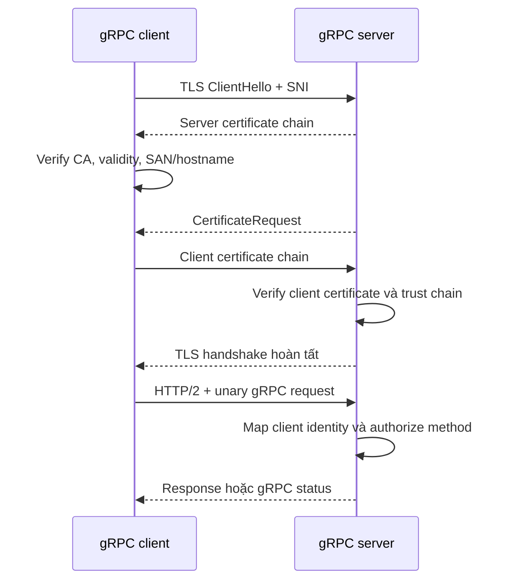

# mTLS giữa client và server

## 1. Mutual TLS giải quyết vấn đề gì?

gRPC chạy trên HTTP/2. Trong môi trường production, TLS mã hóa dữ liệu trên đường truyền, bảo vệ tính toàn vẹn và xác minh danh tính server với client. Với **mutual TLS (mTLS)**, server cũng yêu cầu client trình certificate để xác minh danh tính peer ở chiều ngược lại.

TLS một chiều và mTLS khác nhau ở bước xác thực client:

- **TLS server authentication:** client xác minh certificate của server; server không yêu cầu client certificate.
- **mTLS:** client xác minh server certificate, đồng thời server xác minh client certificate trước khi chấp nhận kết nối.

mTLS phù hợp cho giao tiếp service-to-service, workload trong cluster hoặc hệ thống cần định danh cryptographic ở tầng transport. Certificate hợp lệ chứng minh peer sở hữu private key tương ứng và certificate được trust policy chấp nhận. Nó chưa tự cấp quyền gọi mọi RPC; ứng dụng vẫn phải ánh xạ identity sang principal và kiểm tra authorization.



TLS handshake xảy ra trước khi handler protobuf được gọi. Nếu certificate không hợp lệ hoặc client không cung cấp certificate khi server yêu cầu, kết nối bị từ chối ở tầng transport.

## 2. Certificate và trust material ở hai phía

Mỗi peer cần hai loại thông tin: danh tính của chính nó và CA mà nó tin cậy để xác minh peer bên kia.

| Phía | Danh tính local | Trust material |
| --- | --- | --- |
| Server | Server certificate chain và private key | CA bundle phát hành client certificate |
| Client | Client certificate chain và private key | CA bundle phát hành server certificate |

Certificate chain thường gồm leaf certificate và intermediate certificate cần thiết. Trust bundle chứa CA root hoặc CA được policy tin cậy. Không nhầm certificate chain với trust store: một bên chứng minh danh tính local, bên kia xác minh danh tính remote.

Certificate cần có SAN và mục đích sử dụng phù hợp:

- Server certificate có DNS SAN khớp hostname client dùng để kết nối, ví dụ `catalog.internal.example`.
- Client certificate có identity SAN theo quy ước của tổ chức, thường là URI SAN cho workload, ví dụ `spiffe://example.org/ns/catalog/sa/checkout`.
- Server certificate có Extended Key Usage phù hợp cho `serverAuth`; client certificate có `clientAuth`.
- Private key phải tương ứng với leaf certificate và được bảo vệ bằng secret manager, file permission hoặc hardware-backed key store.

Client phải xác minh CA chain, thời hạn hiệu lực và hostname/SAN của server. Server phải xác minh CA chain và chính sách certificate client. Không tắt hostname verification hoặc chấp nhận mọi certificate để khắc phục lỗi cấu hình.

## 3. Cấu hình mTLS trên gRPC Java server

Ví dụ dùng Netty transport từ artifact `grpc-netty-shaded`. Các package Netty được shaded nằm dưới `io.grpc.netty.shaded`; nếu dự án dùng `grpc-netty` không shaded thì import tương ứng khác. Không trộn hai biến thể dependency.

Server nạp certificate chain/private key của chính nó, trust CA cấp client certificate và bắt buộc client authentication:

```java
import io.grpc.Server;
import io.grpc.netty.shaded.io.grpc.netty.GrpcSslContexts;
import io.grpc.netty.shaded.io.grpc.netty.NettyServerBuilder;
import io.grpc.netty.shaded.io.netty.handler.ssl.ClientAuth;
import io.grpc.netty.shaded.io.netty.handler.ssl.SslContext;

import java.io.File;

SslContext serverTls = GrpcSslContexts.forServer(
        new File("certs/catalog-server-chain.pem"),
        new File("certs/catalog-server-key.pem"))
        .trustManager(new File("certs/workload-client-ca.pem"))
        .clientAuth(ClientAuth.REQUIRE)
        .build();

Server server = NettyServerBuilder.forPort(9090)
        .sslContext(serverTls)
        .addService(productQueryGrpcService)
        .build()
        .start();
```

Ý nghĩa cấu hình:

- `forServer(certificateChain, privateKey)` cung cấp danh tính TLS của server.
- `trustManager(clientCaBundle)` xác minh client certificate theo CA được tin cậy.
- `clientAuth(ClientAuth.REQUIRE)` yêu cầu client gửi certificate hợp lệ.
- `sslContext(serverTls)` gắn TLS context vào gRPC Netty server.

Các chế độ client authentication của Netty:

| Chế độ | Hành vi |
| --- | --- |
| `ClientAuth.NONE` | Không yêu cầu client certificate. |
| `ClientAuth.OPTIONAL` | Client có thể gửi certificate; nếu gửi, server xác minh. |
| `ClientAuth.REQUIRE` | Client phải gửi certificate hợp lệ. |

Với mTLS bắt buộc, chọn `REQUIRE`. `OPTIONAL` chỉ phù hợp khi có yêu cầu tương thích rõ ràng và ứng dụng có policy cho peer không có certificate. Khi dùng `REQUIRE`, handshake thường thất bại trước khi server interceptor hoặc handler được gọi nếu client thiếu certificate.

## 4. Cấu hình mTLS trên gRPC Java client

Client vừa xác minh server bằng trust bundle, vừa cung cấp certificate/private key của chính nó:

```java
import io.grpc.ManagedChannel;
import io.grpc.netty.shaded.io.grpc.netty.GrpcSslContexts;
import io.grpc.netty.shaded.io.grpc.netty.NettyChannelBuilder;
import io.grpc.netty.shaded.io.netty.handler.ssl.SslContext;

import java.io.File;

SslContext clientTls = GrpcSslContexts.forClient()
        .trustManager(new File("certs/server-ca-bundle.pem"))
        .keyManager(
                new File("certs/checkout-client-chain.pem"),
                new File("certs/checkout-client-key.pem"))
        .build();

ManagedChannel channel = NettyChannelBuilder
        .forAddress("catalog.internal.example", 9090)
        .sslContext(clientTls)
        .build();
```

Hai cấu hình giải quyết hai chiều khác nhau:

- `trustManager(serverCaBundle)` xác minh server certificate.
- `keyManager(clientChain, clientKey)` cung cấp client identity cho server xác minh.

Hostname trong `forAddress(...)` phải khớp DNS SAN trên server certificate. Không dùng authority override để bỏ qua hostname mismatch. Không gọi `usePlaintext()` trên channel cần mTLS.

Sau khi tạo channel, generated stub sử dụng channel đó như bình thường:

```java
import java.util.concurrent.TimeUnit;

ProductQueryServiceGrpc.ProductQueryServiceBlockingStub stub =
        ProductQueryServiceGrpc.newBlockingStub(channel);

GetProductResponse response = stub
        .withDeadlineAfter(700, TimeUnit.MILLISECONDS)
        .getProduct(request);
```

Channel là tài nguyên dài hạn: tái sử dụng channel/stub thay vì tạo mới cho từng RPC và đóng channel theo lifecycle ứng dụng.

## 5. Tích hợp mTLS với Spring gRPC

Trong ứng dụng Spring gRPC dùng auto-configuration, framework thường quản lý server, channel và stub. Cần cấu hình TLS trên server/channel được Spring quản lý để giữ đúng lifecycle, interceptor, health service và các cấu hình transport khác.

Các ví dụ Netty builder ở trên mô tả API nền tảng của gRPC Java. Khi tích hợp Spring Boot:

- Cấu hình server certificate, private key, trust bundle và client-auth policy qua SSL configuration mà phiên bản Spring gRPC đang dùng hỗ trợ.
- Cấu hình trust bundle, client certificate và client key cho đúng named channel.
- Nếu phiên bản cung cấp customizer hoặc SSL context factory, gắn cấu hình vào server/channel do auto-configuration tạo.
- Không khởi tạo Netty server thứ hai song song chỉ để bật mTLS khi Spring đã quản lý server chính.
- Xác minh dependency là `grpc-netty` hay `grpc-netty-shaded` trước khi dùng package hoặc customizer.

Tên property và extension point phụ thuộc phiên bản Spring gRPC. Dùng reference đúng phiên bản dependency trong dự án trước khi thêm property vào `application.yml`; không sao chép cấu hình của phiên bản khác mà chưa kiểm chứng. Dù cấu hình qua property hay customizer, server phải yêu cầu client certificate và channel phải có cả trust material lẫn key material.


## 6. Lấy client identity từ TLS session

Sau khi mTLS handshake thành công, gRPC server có thể đọc TLS session từ attributes của `ServerCall`. Peer certificate chain được transport xác minh; ứng dụng lấy leaf certificate và trích identity theo quy ước SAN.

Ví dụ `ServerInterceptor` đọc URI SAN và đặt identity vào `io.grpc.Context`:

```java
import io.grpc.Context;
import io.grpc.Contexts;
import io.grpc.Grpc;
import io.grpc.Metadata;
import io.grpc.ServerCall;
import io.grpc.ServerCallHandler;
import io.grpc.ServerInterceptor;
import io.grpc.Status;

import java.security.cert.Certificate;
import java.security.cert.CertificateParsingException;
import java.security.cert.X509Certificate;
import java.util.Collection;
import java.util.List;
import javax.net.ssl.SSLPeerUnverifiedException;
import javax.net.ssl.SSLSession;

public final class MtlsIdentityInterceptor implements ServerInterceptor {

    public static final Context.Key<String> CLIENT_ID =
            Context.key("mtls-client-id");

    @Override
    public <ReqT, RespT> ServerCall.Listener<ReqT> interceptCall(
            ServerCall<ReqT, RespT> call,
            Metadata headers,
            ServerCallHandler<ReqT, RespT> next) {

        SSLSession session =
                call.getAttributes().get(Grpc.TRANSPORT_ATTR_SSL_SESSION);

        if (session == null) {
            return reject(call, "TLS peer identity is unavailable");
        }

        try {
            Certificate[] chain = session.getPeerCertificates();
            if (chain.length == 0 || !(chain[0] instanceof X509Certificate leaf)) {
                return reject(call, "Client certificate is unavailable");
            }

            String clientId = findUriSan(leaf);
            if (clientId == null) {
                return reject(call, "Client certificate has no URI SAN");
            }

            Context context = Context.current().withValue(CLIENT_ID, clientId);
            return Contexts.interceptCall(context, call, headers, next);

        } catch (SSLPeerUnverifiedException
                 | CertificateParsingException invalidPeer) {
            return reject(call, "Client certificate identity is invalid");
        }
    }

    private static String findUriSan(X509Certificate certificate)
            throws CertificateParsingException {

        Collection<List<?>> names =
                certificate.getSubjectAlternativeNames();

        if (names == null) {
            return null;
        }

        String foundUri = null;
        for (List<?> entry : names) {
            if (entry.size() >= 2
                    && Integer.valueOf(6).equals(entry.get(0))
                    && entry.get(1) instanceof String uri) {
                if (uri.isBlank() || foundUri != null) {
                    return null;
                }
                foundUri = uri;
            }
        }
        return foundUri;
    }

    private static <ReqT, RespT> ServerCall.Listener<ReqT> reject(
            ServerCall<ReqT, RespT> call,
            String description) {
        call.close(
                Status.UNAUTHENTICATED.withDescription(description),
                new Metadata());
        return new ServerCall.Listener<>() {};
    }
}
```

Với `ClientAuth.REQUIRE`, client thiếu certificate hoặc certificate không được trust thường bị từ chối ngay trong handshake; khi đó interceptor không chạy. Nhánh `session == null` là phòng vệ cho trường hợp transport không cung cấp TLS session. Lỗi parse SAN cũng không được xem là principal hợp lệ.

URI SAN type `6` là Subject Alternative Name dạng URI. Ví dụ workload identity có thể theo dạng `spiffe://example.org/ns/commerce/sa/checkout`. Quy ước URI phải được CA và tổ chức thống nhất; không lấy URI tùy ý làm quyền truy cập.

## 7. Từ certificate identity đến authorization

mTLS xác thực peer ở tầng transport. Ứng dụng cần thêm bước ánh xạ identity và policy:

Identity mTLS gắn với TLS connection/channel, không phải từng RPC riêng lẻ. HTTP/2 có thể multiplex nhiều RPC trên cùng connection, nên các call dùng chung channel sẽ cùng mang workload identity của client certificate đó. Nếu cần xác thực người dùng khác nhau theo từng RPC, dùng cơ chế credentials ở metadata theo call (chẳng hạn Bearer token qua `CallCredentials`) bên cạnh mTLS; không dùng một channel certificate của service để suy ra danh tính người dùng cuối.

1. Transport xác minh certificate chain, validity, key usage và trust anchor.
2. Interceptor lấy identity từ SAN đã quy định.
3. Identity provider hoặc policy registry ánh xạ identity sang service principal/role.
4. Handler kiểm tra principal có quyền gọi method và truy cập tài nguyên cụ thể.

Ví dụ handler giới hạn quyền đọc sản phẩm:

```java
String clientId = MtlsIdentityInterceptor.CLIENT_ID.get();

if (clientId == null
        || !authorizationService.canReadProduct(
                clientId, request.getProductId())) {
    observer.onError(Status.PERMISSION_DENIED
            .withDescription("Workload không có quyền đọc sản phẩm")
            .asRuntimeException());
    return;
}
```

Certificate hợp lệ nhưng workload không có quyền nên nhận `PERMISSION_DENIED`. Thiếu hoặc không xác minh được peer identity là lỗi authentication. Không coi certificate của một workload là quyền truy cập mọi service hoặc mọi tenant.

Nếu TLS kết thúc tại ingress/proxy, backend có thể chỉ thấy certificate của proxy. Không tin header identity do client tự gửi. Cần một trust boundary rõ ràng: proxy xác thực client, truyền identity bằng assertion được ký hoặc kênh nội bộ được xác thực; backend chỉ chấp nhận thông tin từ proxy tin cậy.

## 8. Certificate rotation và vận hành

Certificate và CA có thời hạn. Rotation phải giữ khả năng xác minh liên tục trong giai đoạn chuyển đổi:

- Phát hành server/client certificate mới trước khi certificate cũ hết hạn.
- Khi đổi CA, triển khai trust bundle có cả CA cũ và mới trước khi thay leaf certificate.
- Cập nhật certificate/key theo từng phía; xác minh kết nối mới hoạt động rồi mới loại CA cũ.
- Giữ private key trong secret manager hoặc key store có kiểm soát; giới hạn quyền đọc và audit truy cập.
- Theo dõi ngày hết hạn, handshake failure, certificate bị từ chối và số kết nối mTLS thất bại.
- Có quy trình thu hồi certificate bị lộ theo khả năng CRL/OCSP hoặc policy của hạ tầng PKI.
- Không log private key, PEM content hoặc toàn bộ certificate material.

Không mặc định rằng chỉ cấu hình trust bundle là đã bật kiểm tra thu hồi certificate. CRL/OCSP và các policy revocation cần được cấu hình, kiểm thử theo khả năng của TLS provider và hạ tầng PKI. Giữ TLS 1.2 trở lên và cipher suite an toàn theo cấu hình được hỗ trợ; không bật lại giao thức hoặc cipher đã lỗi thời để tương thích với client cũ.

Channel và TLS context có thể giữ certificate đã nạp trong bộ nhớ. Thay file trên disk không bảo đảm channel hiện tại tự reload. Kiểm tra cơ chế reload của phiên bản transport/framework; nếu không hỗ trợ reload an toàn, dùng channel/server replacement hoặc rolling restart. Giữ channel cũ hoạt động trong thời gian drain phù hợp để tránh cắt các RPC đang chạy.

## 9. Kiểm thử mTLS trên transport thật

In-process transport hữu ích cho handler và interceptor, nhưng không thực hiện TLS handshake như TCP/Netty. Nó không thể chứng minh certificate chain, hostname verification hay yêu cầu client certificate. Cần integration test với Netty transport và test CA riêng.

| Kịch bản | Kết quả mong đợi |
| --- | --- |
| Client tin CA server, hostname khớp SAN, client certificate được server trust | Handshake thành công; unary RPC chạy được. |
| Client không tin CA server | Handshake thất bại; handler không chạy. |
| Hostname kết nối không khớp DNS SAN | Client từ chối server identity. |
| Server yêu cầu mTLS nhưng client không gửi certificate | Handshake thất bại. |
| Client certificate do CA không tin cậy cấp | Server từ chối handshake. |
| Certificate hợp lệ nhưng URI SAN không nằm trong policy | TLS thành công; authorization từ chối bằng `PERMISSION_DENIED`. |
| Certificate hết hạn hoặc sai key usage | Handshake bị từ chối theo validation policy. |

Có thể dựng test server trên port động bằng `NettyServerBuilder.forPort(0)` và lấy port sau khi server start. Dùng client `NettyChannelBuilder` trỏ tới hostname có trong test server certificate. Kiểm tra RPC hợp lệ thành công, rồi chạy các client có trust bundle hoặc key material sai.

Không khẳng định mọi lỗi handshake đều ánh xạ thành một gRPC status cố định; client có thể thấy lỗi transport như `UNAVAILABLE` kèm cause. Test nên xác minh call thất bại và handler không được gọi, đồng thời kiểm tra nguyên nhân TLS trong log/test diagnostics.

Với authorization, dùng certificate hợp lệ nhưng URI SAN không có quyền để chứng minh handshake thành công vẫn có thể bị handler từ chối. Test này xác minh ranh giới authentication/authorization.

## 10. Lỗi thường gặp

1. **Chỉ cấu hình server certificate.** Server chưa yêu cầu xác thực client. Bật trust manager cho client CA và `ClientAuth.REQUIRE`.
2. **Nhầm trust manager với key manager.** Trust manager xác minh peer; key manager cung cấp danh tính local.
3. **Thiếu intermediate certificate.** Peer có thể không xây dựng được trust chain. Gửi chain đầy đủ.
4. **Server certificate thiếu DNS SAN.** Client không xác minh được hostname. Cấp certificate với SAN khớp endpoint.
5. **Client certificate thiếu clientAuth EKU hoặc SAN identity.** Certificate không đáp ứng mục đích hoặc không ánh xạ được principal. Cấp certificate đúng policy.
6. **Coi mTLS là authorization.** Certificate hợp lệ không có nghĩa được gọi mọi method. Ánh xạ SAN identity sang policy và kiểm tra tài nguyên.
7. **Dùng plaintext hoặc bỏ qua hostname verification.** Peer có thể bị giả mạo hoặc dữ liệu bị nghe lén. Giữ TLS validation mặc định.
8. **Tin header identity sau TLS termination tại proxy.** Backend có thể nhận identity giả nếu proxy boundary không được xác thực. Dùng assertion ký hoặc kênh proxy-backend tin cậy.
9. **Thay PEM file và cho rằng channel tự reload.** TLS context có thể vẫn dùng certificate cũ. Dùng reload được hỗ trợ hoặc rolling replacement.
10. **Chỉ dùng in-process test để xác nhận mTLS.** In-process không kiểm tra handshake. Bổ sung TCP/Netty integration test.

## 11. Bài thực hành

Bảo vệ unary `ProductQueryService` bằng mTLS:

1. Tạo test CA; cấp server certificate có DNS SAN `catalog.test.internal` và EKU `serverAuth`.
2. Cấp client certificate có URI SAN `spiffe://example.org/ns/catalog/sa/checkout` và EKU `clientAuth`.
3. Cấu hình server trust CA client và `ClientAuth.REQUIRE`.
4. Cấu hình client trust CA server, nạp client certificate/private key và kết nối bằng hostname khớp SAN.
5. Đăng ký `MtlsIdentityInterceptor`, ánh xạ URI SAN sang service principal và kiểm tra quyền ở handler.
6. Viết transport test cho client hợp lệ, thiếu certificate, CA sai, hostname mismatch, certificate hết hạn và identity không có quyền.
7. Mô phỏng CA rotation bằng trust bundle overlap; xác minh client/server mới hoạt động trước khi loại CA cũ.

**Tự kiểm tra:** mTLS xác minh cả server lẫn client trong TLS handshake. Server dùng trust policy để chấp nhận client certificate, sau đó lấy SAN identity và ánh xạ sang principal. Authorization vẫn phải kiểm tra method, tenant và tài nguyên. Bảo vệ private key, xác minh hostname, rotation có overlap và test trên TCP/TLS thực là các phần thiết yếu của triển khai mTLS trong Spring gRPC.

