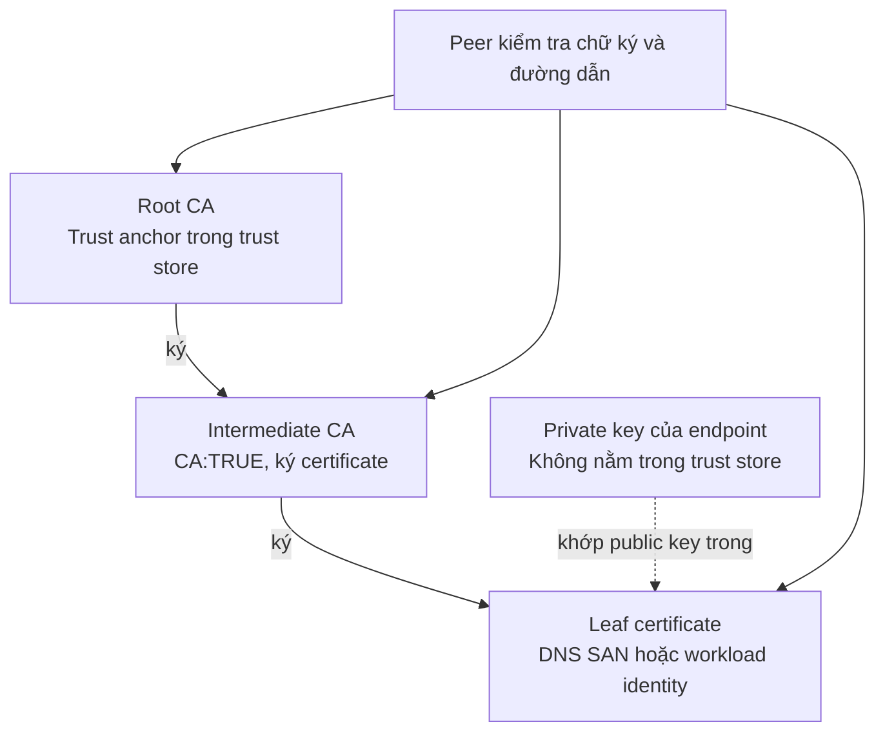

# Certificate chain và trust store

## 1. Certificate chain là gì?

TLS không chỉ kiểm tra một certificate riêng lẻ. Peer cần chứng minh certificate của nó được phát hành qua một chuỗi chữ ký dẫn tới **trust anchor** mà bên nhận đã tin cậy. Chuỗi này thường có ba lớp:

1. **Leaf certificate:** certificate của server hoặc client đang tham gia kết nối. Nó chứa public key và danh tính của endpoint.
2. **Intermediate CA certificate:** CA trung gian ký leaf certificate hoặc CA trung gian kế tiếp.
3. **Root CA certificate:** trust anchor ở đầu chuỗi. Private key của root thường được giữ ngoại tuyến hoặc bảo vệ nghiêm ngặt.



Khi server gửi certificate chain, thông thường nó gửi leaf certificate trước, sau đó là các intermediate certificate cần để xây dựng đường dẫn tới root. Server thường không cần gửi root certificate vì client phải có trust anchor trong trust store. Gửi root trong chain cũng không làm root tự động trở thành đáng tin.

Một chain hợp lệ cần đáp ứng nhiều điều kiện: chữ ký của mỗi certificate được xác minh bằng public key của issuer, thời hạn hiệu lực còn phù hợp, CA certificate có ràng buộc CA đúng, key usage/EKU phù hợp và đường dẫn kết thúc ở trust anchor được chấp nhận.

## 2. Trust store khác certificate chain và keystore ra sao?

Ba khái niệm thường bị nhầm:

| Thành phần | Chứa gì | Dùng để làm gì |
| --- | --- | --- |
| Certificate chain | Leaf certificate và các intermediate certificate liên quan | Peer gửi để bên kia xây dựng và xác minh đường dẫn chứng thư. |
| Trust store | Certificate CA hoặc trust anchor được tin cậy | Xác định ai có thể phát hành certificate được chấp nhận. |
| Keystore identity | Private key cùng certificate chain của endpoint | Chứng minh endpoint sở hữu danh tính certificate đó. |

Trong Java, KeyStore là API/container; tên “trust store” hay “keystore” mô tả vai trò sử dụng. Một file PKCS#12 có thể chứa private key và certificate chain, hoặc chỉ chứa certificate entry được dùng làm trust store. Không suy luận vai trò chỉ từ phần mở rộng .p12 hoặc .jks.

**Trust store không chứa private key của peer.** Nó chứa certificate mà ứng dụng tin cậy. Private key của endpoint nằm trong key entry của keystore hoặc được cung cấp qua secret manager/HSM. Không xuất private key vào trust store chỉ để thiết lập niềm tin.

## 3. TLS xây dựng và xác minh certificate path

Khi client kết nối tới catalog.internal.example, TLS stack thực hiện các bước khái quát:

1. Nhận leaf certificate và các intermediate certificate do server gửi.
2. Tìm issuer certificate phù hợp để xây dựng đường dẫn tới trust anchor.
3. Kiểm tra chữ ký trên từng certificate và ràng buộc CA như basicConstraints, keyCertSign, path length và name constraints.
4. Kiểm tra validity (notBefore, notAfter), key usage, Extended Key Usage và policy áp dụng.
5. Xác minh đường dẫn kết thúc ở trust anchor trong trust store.
6. Xác minh danh tính endpoint, chẳng hạn DNS hostname có khớp DNS SAN của server hay không.

**Path validation và hostname verification là hai kiểm tra riêng.** Một certificate có thể được CA tin cậy ký nhưng vẫn không đại diện cho hostname mà client đang gọi. Tương tự, SAN khớp hostname không cứu được một chain có chữ ký sai hoặc CA không được tin cậy.

Root CA thường là trust anchor được cấu hình trước; nó không nhất thiết được xử lý giống các certificate thông thường trong path validation. Trust anchor là quyết định chính sách của bên nhận, không phải kết luận do certificate tự khai báo.

## 4. CA constraints, SAN và EKU

Một CA certificate trung gian cần có basicConstraints cho phép làm CA (CA:TRUE) và key usage phù hợp, thường gồm keyCertSign. Nếu certificate trung gian không có quyền ký certificate, path validation phải từ chối chain.

Leaf certificate của server/client thường có CA:FALSE và Extended Key Usage phù hợp:

- Server certificate cần mục đích serverAuth.
- Client certificate dùng cho mTLS cần mục đích clientAuth.
- DNS SAN trên server certificate phải khớp hostname mà client xác minh.
- URI SAN hoặc một SAN type đã thống nhất có thể biểu diễn workload identity của client.

Không dùng Common Name (CN) làm thay thế cho DNS SAN trong hostname verification hiện đại. Cũng không lấy một URI SAN tùy ý làm quyền truy cập: sau khi transport xác minh certificate, ứng dụng vẫn phải ánh xạ identity sang principal và kiểm tra authorization.

## 5. Tạo trust store bằng keytool

Java keytool có thể nhập CA certificate vào PKCS#12 trust store. Ví dụ tạo trust store cho client tin một root CA:

```bash
keytool -importcert \
  -alias catalog-root-ca \
  -file certs/catalog-root-ca.pem \
  -keystore certs/catalog-truststore.p12 \
  -storetype PKCS12
```

keytool sẽ hỏi mật khẩu trust store và yêu cầu xác nhận certificate fingerprint. Chỉ chấp nhận fingerprint sau khi đối chiếu qua kênh tin cậy độc lập. Không tự động chấp nhận certificate chỉ vì nó được gửi cùng server đang gặp lỗi TLS.

Kiểm tra nội dung trust store:

```bash
keytool -list -v \
  -keystore certs/catalog-truststore.p12 \
  -storetype PKCS12
```

Trust store chỉ nên chứa CA hoặc trust anchor đã được phê duyệt. Không nhập leaf certificate bất kỳ để “làm cho kết nối chạy được”; việc pin leaf certificate là một chính sách riêng, có yêu cầu rotation và quản lý fingerprint rõ ràng.

Mật khẩu trust store bảo vệ quyền truy cập và tính toàn vẹn của file theo cơ chế keystore provider. Certificate CA là dữ liệu public; mật khẩu không biến certificate thành bí mật và không thay thế việc quản lý private key.

## 6. Dùng trust store PKCS#12 với gRPC Java Netty

gRPC Java Netty dùng io.netty.handler.ssl.SslContext để cấu hình TLS. Khi dùng grpc-netty-shaded, các lớp Netty nằm dưới package io.grpc.netty.shaded. Có thể nạp PKCS#12 trust store bằng Java KeyStore, tạo TrustManagerFactory, rồi đưa trust manager vào GrpcSslContexts:

```java
import io.grpc.netty.shaded.io.grpc.netty.GrpcSslContexts;
import io.grpc.netty.shaded.io.netty.handler.ssl.SslContext;

import javax.net.ssl.TrustManagerFactory;
import java.io.InputStream;
import java.nio.file.Files;
import java.nio.file.Path;
import java.security.KeyStore;

char[] trustStorePassword = loadTrustStorePassword();

KeyStore trustStore = KeyStore.getInstance("PKCS12");
try (InputStream input =
             Files.newInputStream(Path.of("certs/catalog-truststore.p12"))) {
    trustStore.load(input, trustStorePassword);
}

TrustManagerFactory trustManagers = TrustManagerFactory.getInstance(
        TrustManagerFactory.getDefaultAlgorithm());
trustManagers.init(trustStore);

SslContext clientTls = GrpcSslContexts.forClient()
        .trustManager(trustManagers)
        .build();
```

loadTrustStorePassword() là hàm lấy secret từ nguồn cấu hình bảo mật của ứng dụng; không hard-code password trong source code. Nếu ứng dụng chỉ dùng PEM CA bundle, có thể truyền trực tiếp file PEM qua trustManager(File) và không cần tạo PKCS#12.

Dùng SslContext đó cho channel:

```java
import io.grpc.ManagedChannel;
import io.grpc.netty.shaded.io.grpc.netty.NettyChannelBuilder;

ManagedChannel channel = NettyChannelBuilder
        .forAddress("catalog.internal.example", 9090)
        .sslContext(clientTls)
        .build();
```

Trust manager quyết định CA nào được tin. Client vẫn phải xác minh hostname theo SAN của endpoint. Không tắt hostname verification khi chain đã đúng; nếu hostname sai, sửa endpoint hoặc cấp lại certificate với SAN chính xác.

### Trust store mặc định của JVM và Netty

javax.net.ssl.trustStore là cấu hình thường dùng với JSSE. Khi ứng dụng tự tạo Netty SslContext, hãy cấu hình trust manager rõ ràng như ví dụ trên; không mặc định rằng mọi custom context đều tự đọc cùng trust store hoặc property của JVM. Hành vi phụ thuộc cách tạo context và TLS provider. Kiểm tra chính xác transport đang dùng và viết integration test để xác minh trust material thực sự được nạp.

## 7. Trust store phía server khi bật mTLS

Trong mTLS, mỗi bên xác minh certificate của bên kia. Vì vậy trust store có hướng sử dụng riêng:

- Client trust CA phát hành server certificate.
- Server trust CA phát hành client certificate.

Ví dụ server dùng certificate chain của chính nó, đồng thời chỉ chấp nhận client certificate do CA trong bundle phát hành:

```java
import io.grpc.Server;
import io.grpc.netty.shaded.io.grpc.netty.GrpcSslContexts;
import io.grpc.netty.shaded.io.grpc.netty.NettyServerBuilder;
import io.grpc.netty.shaded.io.netty.handler.ssl.ClientAuth;
import io.grpc.netty.shaded.io.netty.handler.ssl.SslContext;

import java.io.File;

SslContext serverTls = GrpcSslContexts.forServer(
        new File("certs/catalog-server-chain.pem"),
        new File("certs/catalog-server-key.pem"))
        .trustManager(new File("certs/workload-client-ca-bundle.pem"))
        .clientAuth(ClientAuth.REQUIRE)
        .build();

Server server = NettyServerBuilder.forPort(9090)
        .sslContext(serverTls)
        .addService(productQueryGrpcService)
        .build()
        .start();
```

Trust bundle của server phải chứa CA tin cậy để xác minh client certificate. Server identity chain (catalog-server-chain.pem) là certificate server gửi cho client; đó không phải trust store của server.

Client mTLS cần cả trust bundle để xác minh server lẫn key material để trình client identity:

```java
import io.grpc.netty.shaded.io.grpc.netty.GrpcSslContexts;
import io.grpc.netty.shaded.io.netty.handler.ssl.SslContext;

import java.io.File;

SslContext clientMtls = GrpcSslContexts.forClient()
        .trustManager(new File("certs/server-ca-bundle.pem"))
        .keyManager(
                new File("certs/checkout-client-chain.pem"),
                new File("certs/checkout-client-key.pem"))
        .build();
```

trustManager(...) và keyManager(...) giải quyết hai chiều khác nhau. Chỉ nạp client certificate mà không có trust bundle server phù hợp sẽ không xác minh được server; chỉ nạp trust bundle mà không có client key material sẽ không đáp ứng server yêu cầu mTLS.

## 8. Intermediate certificate bị thiếu hoặc chain sai

Lỗi thường gặp là server chỉ gửi leaf certificate nhưng không gửi intermediate certificate cần thiết. Client có root CA đúng trong trust store nhưng vẫn không thể xây dựng path vì thiếu mắt xích trung gian.

Kiểm tra các điểm sau:

- Server certificate có đúng issuer và được ký bởi intermediate tương ứng không?
- Server có gửi leaf trước rồi tới các intermediate theo chain phù hợp không?
- Intermediate có CA:TRUE, key usage và validity hợp lệ không?
- Trust store có đúng root CA hoặc trust anchor được policy chấp nhận không?
- Client có vô tình tin một CA khác môi trường (test, staging, production) không?
- Có certificate cross-signed nào khiến path builder chọn nhánh không mong muốn không?

Không khắc phục chain thiếu bằng cách tắt xác minh hoặc thêm tất cả certificate nhận được vào trust store. Sửa chain server gửi hoặc cập nhật trust anchor có kiểm soát.

## 9. Chẩn đoán chain và trust store

Có thể dùng keytool để xem subject, issuer, validity, SAN và fingerprint:

```bash
keytool -printcert -file certs/catalog-server-leaf.pem
keytool -printcert -file certs/catalog-intermediate.pem
```

Dùng OpenSSL để kiểm tra path với root CA và intermediate được cung cấp:

```bash
openssl verify \
  -CAfile certs/catalog-root-ca.pem \
  -untrusted certs/catalog-intermediate.pem \
  certs/catalog-server-leaf.pem
```

Kiểm tra chain server thực sự gửi qua TLS:

```bash
openssl s_client \
  -connect catalog.internal.example:9090 \
  -servername catalog.internal.example \
  -alpn h2 \
  -showcerts
```

openssl verify hữu ích để phân biệt chain thiếu, issuer không khớp hoặc trust anchor sai. s_client -showcerts cho thấy certificate server gửi trong handshake. Kết quả OpenSSL không bảo đảm mọi chi tiết cấu hình Java/Netty giống hệt; hãy xác minh lại bằng chính client transport của ứng dụng.

Các lỗi nên được phân loại:

| Triệu chứng | Khả năng cần kiểm tra |
| --- | --- |
| unable to get local issuer certificate | Thiếu intermediate hoặc thiếu CA trong trust store. |
| certificate has expired | Leaf hoặc intermediate hết hạn; kiểm tra thời gian hệ thống. |
| PKIX path building failed | Không xây dựng được path tới trust anchor được tin cậy. |
| Hostname/SAN mismatch | Chain có thể hợp lệ nhưng certificate không đại diện hostname kết nối. |
| Client certificate rejected | Server thiếu CA client trong trust bundle, chain client thiếu intermediate hoặc EKU không phù hợp. |

Không dựa duy nhất vào một chuỗi exception vì TLS provider có thể diễn đạt lỗi khác nhau. Thu thập cause chain, certificate subject/issuer và fingerprint đã được phép log; không ghi private key hay secret.

## 10. Trust store, rotation và thu hồi certificate

Trust store là một phần của chính sách tin cậy, do đó thay đổi trust anchor có thể mở rộng hoặc thu hẹp tập peer được chấp nhận. Quản lý nó như cấu hình bảo mật có kiểm soát:

1. Lưu CA bundle trong secret/config management có version và audit.
2. Xác minh fingerprint CA qua kênh độc lập trước khi thêm trust anchor.
3. Khi đổi CA, triển khai trust bundle có CA cũ và CA mới trong giai đoạn overlap.
4. Cấp và triển khai leaf certificate mới; xác minh kết nối trên mọi client/server.
5. Chỉ loại CA cũ sau khi không còn endpoint phụ thuộc certificate cũ.
6. Theo dõi expiry, handshake failures và trust-store version đang được các instance sử dụng.

Thay file trust store trên disk không bảo đảm SslContext hoặc channel đang chạy tự nạp lại. TLS context có thể giữ trust manager đã tạo trước đó. Kiểm tra cơ chế reload của phiên bản framework/transport; nếu không hỗ trợ, thay context/channel hoặc rolling restart theo quy trình, có drain kết nối cũ.

Việc nhập CA vào trust store **không tự động bật certificate revocation checking**. CRL/OCSP hoặc PKIXRevocationChecker cần được cấu hình theo khả năng TLS provider và policy của PKI. Xác minh revocation trong integration test; không giả định chỉ có trust anchor là đủ để từ chối certificate đã bị thu hồi.

## 11. Tích hợp với Spring gRPC

Trong Spring gRPC, server và named client channel thường do auto-configuration quản lý. Cấu hình trust material trên đúng server/channel được quản lý để giữ lifecycle, interceptor và health service nhất quán.

- Với server mTLS, cung cấp server identity chain/private key và trust bundle của client CA; bật chính sách yêu cầu client certificate.
- Với client TLS, cung cấp trust bundle của server CA.
- Với client mTLS, bổ sung client certificate chain/private key cho named channel.
- Nếu dùng customizer hoặc SSL context factory, gắn trust manager vào context mà Spring thực sự dùng để tạo server/channel.
- Không tạo Netty server/channel phụ song song chỉ để nạp trust store khi framework đã quản lý transport chính.

Tên property và extension point phụ thuộc phiên bản Spring gRPC và starter. Dùng tài liệu đúng phiên bản dependency trong dự án trước khi cấu hình application.yml; không tự suy diễn tên property. Dù dùng PEM hay PKCS#12, cần xác minh trust manager cuối cùng được gắn vào transport đang phục vụ RPC.

## 12. Kiểm thử và lỗi thường gặp

Một bộ integration test dùng TCP/Netty nên có các trường hợp:

| Kịch bản | Kết quả mong đợi |
| --- | --- |
| Chain server đầy đủ, root CA có trong client trust store, hostname khớp SAN | TLS thành công và RPC chạy được. |
| Client không tin root CA server | Handshake thất bại; handler không chạy. |
| Server thiếu intermediate cần thiết | Path validation thất bại nếu client không có đường dẫn thay thế. |
| Certificate hết hạn hoặc sai EKU | Bị từ chối theo validation policy. |
| Chain hợp lệ nhưng hostname không khớp SAN | Hostname verification thất bại. |
| mTLS: client chain hợp lệ và server trust đúng client CA | Handshake thành công. |
| mTLS: client certificate do CA không tin cậy cấp | Server từ chối handshake. |
| CA rotation có overlap | Kết nối với certificate cũ và mới hoạt động trong giai đoạn chuyển đổi theo policy. |

In-process transport phù hợp để test handler/interceptor nhưng không kiểm tra TLS handshake hoặc trust store. Dùng Netty transport trên port động với test CA để xác minh chain, hostname, trust anchor và mTLS thực tế.

Các lỗi cần tránh:

1. **Nhầm certificate chain với trust store.** Chain là dữ liệu peer gửi; trust store là CA mà bên nhận tin.
2. **Cho rằng server phải gửi root CA.** Thông thường server gửi leaf và intermediate; client giữ root trust anchor.
3. **Đưa leaf certificate tùy ý vào trust store để chữa lỗi.** Điều này thay đổi chính sách trust và làm rotation khó kiểm soát.
4. **Nhầm trust store với keystore identity.** Trust store xác minh peer; keystore/key manager cung cấp private key và certificate local.
5. **Tin javax.net.ssl.trustStore luôn áp dụng cho custom Netty context.** Cấu hình trust manager rõ ràng trên context mà channel sử dụng.
6. **Chỉ kiểm tra chữ ký mà quên hostname, EKU hoặc validity.** Path hợp lệ không đồng nghĩa endpoint identity hợp lệ.
7. **Cho rằng import CA tự bật CRL/OCSP.** Revocation cần policy và cấu hình riêng.
8. **Thay truststore file và mong channel đang chạy tự reload.** Thay hoặc reload TLS context theo cơ chế được hỗ trợ.

## 13. Bài thực hành

Thiết lập trust chain cho ProductQueryService:

1. Tạo test root CA, intermediate CA, server certificate có DNS SAN catalog.test.internal và client certificate có URI SAN dành cho workload.
2. Tạo PKCS#12 trust store cho client từ root CA server; kiểm tra alias, subject và fingerprint bằng keytool.
3. Cấu hình server gửi leaf cùng intermediate certificate; xác minh chain bằng OpenSSL và gRPC Netty client.
4. Bật mTLS: server trust client CA và yêu cầu client certificate; client trust server CA và gửi client key material.
5. Viết test cho chain đầy đủ, thiếu intermediate, CA không tin cậy, hostname mismatch, certificate hết hạn và client certificate sai EKU.
6. Thực hiện CA rotation với trust bundle overlap; xác minh instance dùng trust store mới trước khi loại CA cũ.
7. Ghi lại cách ứng dụng nạp trust store, cách reload context và policy revocation thực tế.

**Tự kiểm tra:** Certificate chain cung cấp các mắt xích từ leaf tới CA; trust store quyết định trust anchor mà peer chấp nhận. Trong mTLS, client trust CA server còn server trust CA client. Path validation, hostname/SAN, EKU và revocation là các kiểm tra riêng cần được cấu hình và kiểm thử. Với gRPC Netty, gắn trust manager rõ ràng vào SslContext được channel/server sử dụng và quản lý rotation như một thay đổi chính sách bảo mật.

