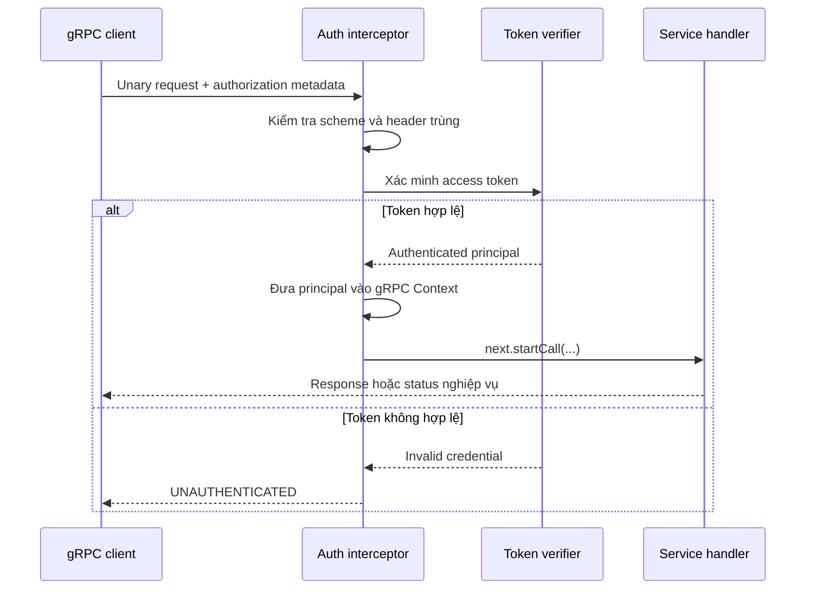

# Auth interceptor

## 1. Vai trò của authentication interceptor

Trong gRPC, một request unary đi qua transport, metadata và các interceptor trước khi tới handler của service. **Authentication interceptor** xác minh danh tính caller ở ranh giới server, rồi gắn principal đã xác minh vào `io.grpc.Context` để handler và các thành phần phía sau sử dụng.

Với Bearer authentication, client gửi access token trong metadata:

`authorization: Bearer <access-token>`

Interceptor đọc header, kiểm tra cấu trúc, chuyển token cho thành phần xác minh và chỉ gọi `next.startCall(...)` khi xác minh thành công. Nếu credential thiếu hoặc không hợp lệ, interceptor đóng RPC bằng `UNAUTHENTICATED`.

Authentication và authorization cần được tách rõ:

- **Authentication:** xác minh caller là ai, ví dụ token có chữ ký hợp lệ và thuộc issuer/audience được tin cậy.
- **Authorization:** kiểm tra caller có quyền gọi method hoặc thao tác trên tài nguyên hay không.

Token hợp lệ không đồng nghĩa caller được phép gọi mọi RPC. Authentication interceptor có thể thiết lập principal; policy interceptor hoặc handler tiếp tục kiểm tra quyền.



## 2. Xác định contract của principal và token verifier

Không để interceptor tự giải mã JWT rồi tự quyết định toàn bộ policy. Tách phần xác minh thành interface để có thể dùng JWT verifier, opaque-token introspection hoặc identity provider mà không thay đổi luồng gRPC.

Principal nên chứa thông tin tối thiểu đã được xác minh:

```java
import java.util.Set;

public record AuthenticatedPrincipal(
        String subject,
        String tenantId,
        Set<String> scopes) {

    public AuthenticatedPrincipal {
        scopes = Set.copyOf(scopes);
    }
}
```

Interface xác minh token:

```java
public interface AccessTokenVerifier {

    AuthenticatedPrincipal verify(String accessToken)
            throws InvalidAccessTokenException,
                   TokenVerifierUnavailableException;
}
```

`InvalidAccessTokenException` đại diện token sai chữ ký, hết hạn, sai issuer/audience, bị thu hồi hoặc không đáp ứng claim bắt buộc. `TokenVerifierUnavailableException` biểu diễn verifier hoặc kho khóa tạm thời không sẵn sàng.

Với JWT, verifier phải xác minh chữ ký bằng key tin cậy, chỉ cho phép thuật toán đã cấu hình, kiểm tra `iss`, `aud`, `exp`, `nbf` và các claim bắt buộc. Chỉ decode payload không phải là xác thực. Với opaque token, verifier có thể dùng introspection endpoint và cache kết quả theo chính sách.

`AuthenticatedPrincipal` là dữ liệu đã xác minh, không chứa raw access token hoặc refresh token. Tạo principal bất biến giúp tránh một RPC sửa dữ liệu identity đang được các thành phần khác dùng.

## 3. Cài đặt Bearer authentication bằng ServerInterceptor

Trong gRPC Java, `ServerInterceptor` chạy trước handler. Ví dụ dưới đây:

- Chỉ chấp nhận một giá trị `authorization`.
- Kiểm tra scheme `Bearer` và token không rỗng.
- Gọi verifier.
- Đưa principal vào `io.grpc.Context`.
- Kết thúc RPC bằng status phù hợp nếu xác thực thất bại.

```java
package com.example.orders.grpc;

import io.grpc.Context;
import io.grpc.Contexts;
import io.grpc.Metadata;
import io.grpc.ServerCall;
import io.grpc.ServerCallHandler;
import io.grpc.ServerInterceptor;
import io.grpc.Status;

import java.util.Iterator;

public final class BearerAuthInterceptor implements ServerInterceptor {

    public static final Context.Key<AuthenticatedPrincipal> PRINCIPAL =
            Context.key("authenticated-principal");

    private static final Metadata.Key<String> AUTHORIZATION =
            Metadata.Key.of(
                    "authorization",
                    Metadata.ASCII_STRING_MARSHALLER);

    private final AccessTokenVerifier tokenVerifier;

    public BearerAuthInterceptor(AccessTokenVerifier tokenVerifier) {
        this.tokenVerifier = tokenVerifier;
    }

    @Override
    public <ReqT, RespT> ServerCall.Listener<ReqT> interceptCall(
            ServerCall<ReqT, RespT> call,
            Metadata headers,
            ServerCallHandler<ReqT, RespT> next) {

        Iterable<String> values = headers.getAll(AUTHORIZATION);
        if (values == null) {
            return reject(call, Status.UNAUTHENTICATED
                    .withDescription("Thiếu access token"));
        }

        Iterator<String> iterator = values.iterator();
        if (!iterator.hasNext()) {
            return reject(call, Status.UNAUTHENTICATED
                    .withDescription("Thiếu access token"));
        }

        String authorization = iterator.next();
        if (iterator.hasNext()
                || authorization == null
                || !authorization.regionMatches(
                        true, 0, "Bearer ", 0, 7)) {
            return reject(call, Status.UNAUTHENTICATED
                    .withDescription("Authorization metadata không hợp lệ"));
        }

        String token = authorization.substring(7).trim();
        if (token.isEmpty()
                || token.chars().anyMatch(Character::isWhitespace)) {
            return reject(call, Status.UNAUTHENTICATED
                    .withDescription("Bearer token không hợp lệ"));
        }

        try {
            AuthenticatedPrincipal principal =
                    tokenVerifier.verify(token);

            if (principal == null) {
                return reject(call, Status.UNAUTHENTICATED
                        .withDescription("Access token không hợp lệ"));
            }

            Context context = Context.current()
                    .withValue(PRINCIPAL, principal);

            return Contexts.interceptCall(
                    context, call, headers, next);

        } catch (InvalidAccessTokenException invalid) {
            return reject(call, Status.UNAUTHENTICATED
                    .withDescription("Access token không hợp lệ"));
        } catch (TokenVerifierUnavailableException unavailable) {
            return reject(call, Status.UNAVAILABLE
                    .withDescription("Dịch vụ xác minh credentials tạm thời không sẵn sàng"));
        } catch (RuntimeException unexpected) {
            // Ghi log nội bộ với correlation ID; tuyệt đối không log token.
            return reject(call, Status.INTERNAL
                    .withDescription("Không thể xác minh credentials"));
        }
    }

    private static <ReqT, RespT> ServerCall.Listener<ReqT> reject(
            ServerCall<ReqT, RespT> call,
            Status status) {
        call.close(status, new Metadata());
        return new ServerCall.Listener<>() {};
    }
}
```

Các kiểu `AccessTokenVerifier`, `InvalidAccessTokenException` và `TokenVerifierUnavailableException` là contract ứng dụng cần triển khai. Ví dụ dùng `Status.UNAVAILABLE` khi verifier không sẵn sàng để client phân biệt sự cố xác thực hạ tầng với credential không hợp lệ. Không đưa chi tiết nội bộ hoặc token vào status description.

`Contexts.interceptCall(...)` gắn context trong suốt callback của server call và gọi handler trong context đó. Nếu xác thực thất bại, interceptor gọi `call.close(...)` và trả listener rỗng; không gọi `next.startCall(...)` nên service handler không được thực thi.

## 4. Principal được dùng trong handler như thế nào?

Handler lấy principal từ context thay vì đọc user ID, tenant hoặc role do client tự khai báo trong protobuf:

```java
AuthenticatedPrincipal principal =
        BearerAuthInterceptor.PRINCIPAL.get();

if (principal == null) {
    observer.onError(Status.UNAUTHENTICATED
            .withDescription("Caller chưa được xác thực")
            .asRuntimeException());
    return;
}

if (!principal.scopes().contains("orders:read")
        || !authorizationService.canReadOrder(
                principal.subject(),
                principal.tenantId(),
                request.getOrderId())) {
    observer.onError(Status.PERMISSION_DENIED
            .withDescription("Caller không có quyền đọc đơn hàng")
            .asRuntimeException());
    return;
}
```

Ở đây, scope là điều kiện method-level; `authorizationService` kiểm tra ownership, tenant boundary và policy của order cụ thể. Chỉ kiểm tra scope là chưa đủ nếu quyền phụ thuộc tài nguyên.

Phân loại status:

| Trường hợp | gRPC status |
| --- | --- |
| Thiếu token, token sai, hết hạn hoặc không xác minh được | `UNAUTHENTICATED` |
| Token hợp lệ nhưng thiếu scope/quyền tài nguyên | `PERMISSION_DENIED` |
| Verifier hoặc kho khóa tạm thời không sẵn sàng | `UNAVAILABLE` |
| Lỗi nội bộ ngoài dự kiến | `INTERNAL` với mô tả đã làm sạch |

Không trả `PERMISSION_DENIED` cho token sai chỉ để che lỗi; status này nói rằng caller đã được xác thực nhưng không được phép. Ngược lại, không trả `UNAUTHENTICATED` cho mọi lỗi nghiệp vụ.

## 5. Public method và chính sách mặc định

Một số RPC có thể công khai, ví dụ health check hoặc discovery. Nếu cần bỏ qua authentication, dùng allowlist theo **full method name**, không dùng so khớp chuỗi con hoặc bỏ qua toàn bộ service theo tên gần đúng.

Tên method trong gRPC Java thường có dạng `package.Service/Method`. Allowlist phải được review cùng API contract và test. Mặc định nên yêu cầu authentication; chỉ method được khai báo rõ mới được miễn.

Có thể thêm nhánh đầu interceptor trước khi đọc token:

```java
String method = call.getMethodDescriptor().getFullMethodName();

if (publicMethods.contains(method)) {
    return next.startCall(call, headers);
}
```

`publicMethods` nên là immutable set được cấu hình rõ ràng. Không đưa các method đọc dữ liệu nhạy cảm vào allowlist chỉ để giải quyết lỗi client chưa gửi credentials.

## 6. Thứ tự interceptor và ranh giới trách nhiệm

Authentication interceptor thường cần chạy trước các interceptor cần principal, chẳng hạn authorization, audit theo caller hoặc tenant policy. Thứ tự đăng ký/wrapping cụ thể phụ thuộc API server và framework; hãy xác minh bằng integration test thay vì giả định từ thứ tự bean được tạo.

Một pipeline có thể được tổ chức như sau:

1. Transport TLS xác minh peer certificate và bảo vệ kết nối.
2. Authentication interceptor xác minh Bearer token hoặc lấy identity từ mTLS.
3. Authorization interceptor kiểm tra quyền gọi method.
4. Handler kiểm tra quyền trên dữ liệu cụ thể và chạy nghiệp vụ.
5. Logging/metrics ghi method, principal ID đã được phép và status, không ghi credential.

Không nên gộp tất cả logic vào một interceptor. Authentication xử lý credential và principal; authorization xử lý policy; handler hiểu tài nguyên và nghiệp vụ. Cách phân chia này giúp test từng lớp và thay cơ chế token mà không viết lại logic quyền.

Nếu dùng đồng thời mTLS và Bearer token, xác định rõ token đại diện cho workload hay người dùng. Certificate thường định danh workload ở cấp connection; Bearer token có thể định danh user/delegated principal ở cấp RPC. Không tự động ghi đè một identity bằng identity kia. Policy phải xác định cách kết hợp, ví dụ chỉ chấp nhận token có client/workload claim phù hợp với certificate peer.

## 7. Tích hợp interceptor trong Spring gRPC

Trong ứng dụng Spring gRPC, interceptor cần được đăng ký vào server do framework quản lý. Có thể quản lý verifier và interceptor bằng dependency injection:

```java
@Configuration
public class GrpcSecurityConfiguration {

    @Bean
    BearerAuthInterceptor bearerAuthInterceptor(
            AccessTokenVerifier tokenVerifier) {
        return new BearerAuthInterceptor(tokenVerifier);
    }
}
```

Việc tạo Spring bean không tự bảo đảm interceptor đã được gắn vào mọi service. Hãy đăng ký nó bằng cơ chế global hoặc service-specific server interceptor mà **phiên bản Spring gRPC/starter của dự án hỗ trợ**. Nếu dùng gRPC Java server builder trực tiếp, interceptor có thể được gắn bằng `ServerBuilder.intercept(...)` trước khi server start.

Không tạo server phụ song song nếu Spring đã quản lý server chính. Xác minh cấu hình tích hợp thực tế bằng test gọi qua channel tới server Spring, và kiểm tra handler không chạy khi thiếu token.

## 8. Tránh chặn transport thread khi xác minh token

`ServerInterceptor.interceptCall(...)` là điểm đồng bộ trước khi handler được khởi chạy. Nếu verifier thực hiện HTTP introspection blocking tới identity provider, nó có thể giữ thread xử lý call và làm giảm khả năng phục vụ RPC.

Các hướng xử lý:

- Với JWT, xác minh chữ ký cục bộ bằng key đã cache; làm mới JWKS theo lịch hoặc khi gặp key ID mới theo cơ chế có giới hạn.
- Với opaque token, dùng cache kết quả introspection có TTL ngắn và chính sách invalidation rõ ràng.
- Không gọi `Future.get()`, `join()` hoặc chờ network trong interceptor.
- Nếu cache miss bắt buộc phải introspect từ xa bất đồng bộ, thiết kế điểm xác thực bất đồng bộ phù hợp với kiến trúc server/gateway; không ép một API interceptor đồng bộ chờ kết quả.
- Đặt timeout, giới hạn concurrency và circuit breaker cho dependency xác minh.

Không cache token invalid hoặc valid vô thời hạn. TTL phải tính tới expiry, thu hồi, thay đổi quyền và độ trễ chấp nhận được của hệ thống.

## 9. Truyền gRPC Context qua tác vụ bất đồng bộ

`io.grpc.Context` được gắn quanh callback do `Contexts.interceptCall(...)` quản lý. Nhưng khi handler đẩy công việc sang executor tùy chỉnh, không mặc định context tự truyền sang thread khác.

Chụp context hiện tại và wrap tác vụ:

```java
Context rpcContext = Context.current();

executor.execute(rpcContext.wrap(() -> {
    AuthenticatedPrincipal principal =
            BearerAuthInterceptor.PRINCIPAL.get();

    orderWorker.process(request, principal);
}));
```

Chỉ truyền principal tối thiểu cần thiết tới tác vụ. Nếu tác vụ tồn tại lâu hơn RPC, cần xác định rõ thời hạn sử dụng identity, cancellation và audit context; không giữ context của request vô thời hạn. Không dùng `ThreadLocal` hoặc field mutable của singleton để lưu principal vì các RPC đồng thời có thể bị trộn identity.

## 10. Kiểm thử Auth interceptor

Dùng in-process transport để kiểm tra metadata, interceptor, context và status mà không cần mở TCP port. Các test quan trọng:

| Kịch bản | Kết quả mong đợi |
| --- | --- |
| Không có authorization metadata | `UNAUTHENTICATED`; handler không chạy. |
| Sai scheme, token rỗng hoặc header trùng | `UNAUTHENTICATED`; không chọn tùy tiện một token. |
| Token sai chữ ký/hết hạn/sai audience | `UNAUTHENTICATED`. |
| Token hợp lệ | Handler đọc được đúng principal từ `Context`. |
| Token hợp lệ nhưng thiếu scope | `PERMISSION_DENIED`. |
| Verifier không sẵn sàng | `UNAVAILABLE`; handler không chạy. |
| Public method nằm trong allowlist | Được gọi không cần token; method khác vẫn yêu cầu xác thực. |
| Hai RPC đồng thời với hai principal | Mỗi handler nhận đúng principal của call tương ứng. |
| Handler chuyển việc sang executor | Principal chỉ được đọc khi context đã được wrap/propagate. |

Ví dụ fixture in-process:

```java
String serverName = InProcessServerBuilder.generateName();

Server server = InProcessServerBuilder.forName(serverName)
        .directExecutor()
        .intercept(bearerAuthInterceptor)
        .addService(testOrderService)
        .build()
        .start();

ManagedChannel channel = InProcessChannelBuilder.forName(serverName)
        .directExecutor()
        .build();

try {
    OrderQueryServiceGrpc.OrderQueryServiceBlockingStub stub =
            OrderQueryServiceGrpc.newBlockingStub(channel);

    // Gọi RPC với test credentials và assert response/status.
} finally {
    channel.shutdownNow();
    server.shutdownNow();
}
```

`testOrderService` và `bearerAuthInterceptor` là fixture do test tạo. Có thể dùng verifier giả để kiểm soát token hợp lệ/không hợp lệ và principal mong đợi. Không dùng token production trong test. Với TLS hoặc mTLS, bổ sung integration test trên TCP/Netty vì in-process transport không thực hiện handshake.

## 11. Lỗi thường gặp

1. **Đưa logic xác minh token vào mọi handler.** Dễ bỏ sót method và lặp code. Đặt authentication ở server interceptor.
2. **Chỉ decode JWT mà không xác minh chữ ký.** Claim có thể bị giả mạo. Dùng verifier kiểm tra chữ ký, issuer, audience và expiry.
3. **Chấp nhận nhiều authorization header.** Proxy và server có thể diễn giải khác nhau. Từ chối header trùng.
4. **Gọi verifier từ xa theo cách blocking.** Có thể giữ thread xử lý RPC. Dùng local verification/cache hoặc thiết kế luồng xác thực bất đồng bộ.
5. **Đưa raw token vào Context hoặc log.** Tăng nguy cơ lộ bí mật. Chỉ đưa principal tối thiểu vào context.
6. **Coi authentication là authorization.** Caller hợp lệ vẫn có thể không có quyền truy cập order. Kiểm tra scope, tenant và resource.
7. **Cho phép public method bằng so khớp chuỗi lỏng.** Có thể vô tình bỏ qua bảo vệ RPC khác. Dùng allowlist full method name.
8. **Không truyền Context khi đổi thread.** Tác vụ bất đồng bộ mất principal hoặc đọc nhầm ThreadLocal. Dùng `Context.wrap(...)`.
9. **Tạo bean interceptor nhưng quên đăng ký vào server.** RPC vẫn chạy mà không qua xác thực. Test qua server/channel tích hợp thực tế.
10. **Trả cùng một status cho mọi lỗi.** Client không phân biệt credential sai, thiếu quyền và verifier outage. Dùng status theo đúng lớp lỗi.

## 12. Bài thực hành

Bảo vệ unary `GetOrder` bằng Bearer authentication interceptor:

1. Tạo `AccessTokenVerifier` xác minh JWT theo issuer, audience, chữ ký và expiry.
2. Cài `BearerAuthInterceptor`, từ chối header thiếu, sai scheme và header trùng.
3. Đưa `AuthenticatedPrincipal` bất biến vào `io.grpc.Context`.
4. Đăng ký interceptor vào Spring gRPC server bằng extension point đúng phiên bản.
5. Thêm authorization cho scope `orders:read`, tenant và quyền trên order ID.
6. Viết in-process test cho token thiếu, token sai, token hợp lệ, thiếu scope, verifier unavailable và hai caller đồng thời.
7. Thêm test cho public-method allowlist và tác vụ executor có truyền context.
8. Xác minh log, exception và status description không chứa raw token hoặc secret.

**Tự kiểm tra:** Auth interceptor xác minh credentials trước khi gọi handler và đưa principal đã xác minh vào `io.grpc.Context`. Handler hoặc authorization interceptor kiểm tra quyền theo method, tenant và tài nguyên. Dùng status `UNAUTHENTICATED` cho lỗi identity, `PERMISSION_DENIED` cho thiếu quyền, và tránh blocking token introspection trên thread xử lý RPC. Đăng ký interceptor rõ ràng trong Spring gRPC và kiểm thử cả status lẫn việc principal được cô lập giữa các call.

