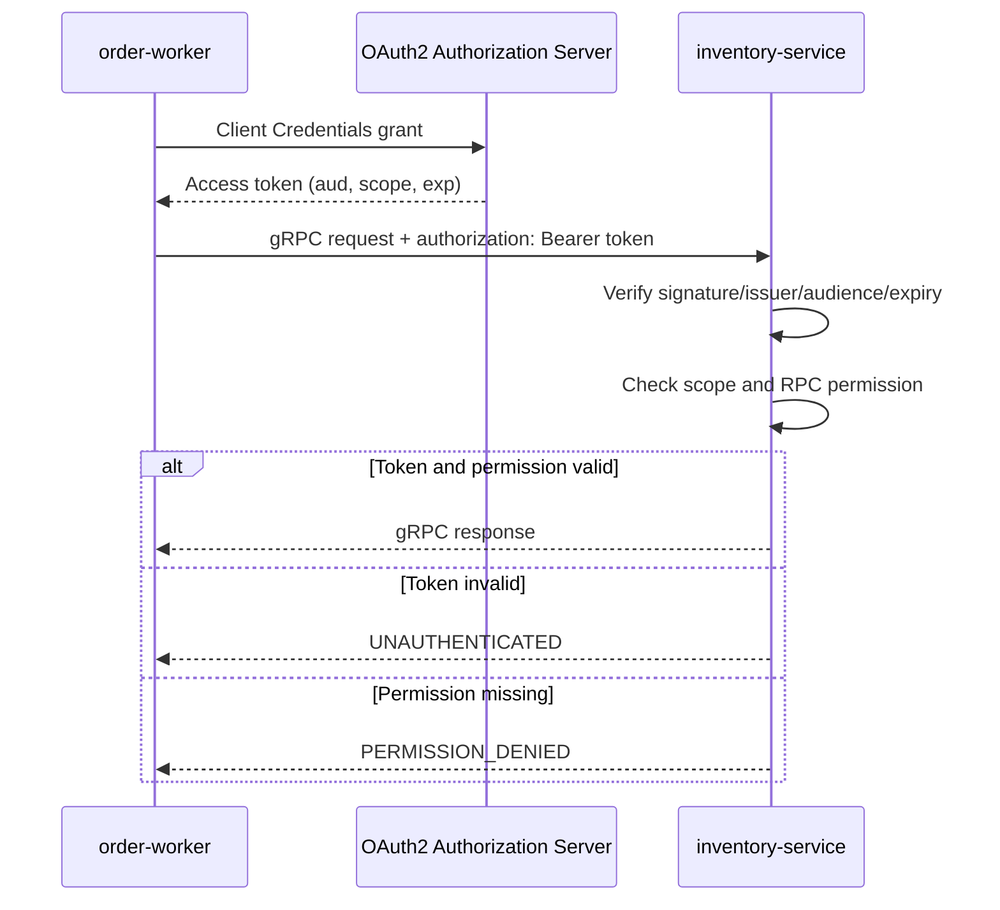

# Xác thực service account cho Spring gRPC

Trong hệ thống **SPRING_GRPC**, service account là danh tính máy đại diện cho một ứng dụng hoặc workload khi gọi dịch vụ khác. Ví dụ, `order-worker` cần gọi `inventory-service` để đọc tồn kho. Thay vì dùng tài khoản của một người dùng, client lấy access token cho chính danh tính service account, gửi token theo từng RPC và để server xác minh danh tính cùng quyền được cấp.

Một triển khai an toàn cần đủ ba phần: **cấp token cho workload**, **gửi token qua gRPC metadata**, và **xác thực/ủy quyền ở server**. Với Spring, có thể dùng OAuth2 Client ở phía gọi và OAuth2 Resource Server kết hợp Spring gRPC Security ở phía nhận. Bài này tập trung vào mô hình service-to-service dùng OAuth2 Client Credentials; các nền tảng dùng workload identity hoặc service account assertion có thể thay nguồn cấp token nhưng vẫn giữ nguyên nguyên tắc xác minh phía server.

## 1. Service account là danh tính của workload

Service account là principal không đại diện cho con người. Nó thường gắn với một ứng dụng, job, pod, VM hoặc workload cụ thể.

| Thành phần | Danh tính | Quyền cần có |
| --- | --- | --- |
| `order-worker` | `orders-writer` | Gọi `CreateOrder` và đọc tồn kho |
| `inventory-service` | `inventory-api` | Nhận request từ workload được phép |
| `billing-worker` | `billing-reader` | Chỉ gọi API đọc thông tin thanh toán |

Cần phân biệt:

- **Authentication:** xác minh caller thực sự là service account nào.
- **Authorization:** quyết định service account đó được gọi method nào và thao tác trên tài nguyên nào.
- **Transport security:** mã hóa kết nối và có thể xác thực certificate của hai đầu bằng TLS/mTLS.

Một token hợp lệ chỉ chứng minh danh tính/claims được issuer xác nhận. Nó không tự động cấp quyền gọi mọi RPC.

## 2. Luồng xác thực service-to-service

Với OAuth2 Client Credentials, client dùng thông tin đăng ký của workload để lấy access token từ authorization server. Sau đó gRPC client gửi token trong metadata `authorization` theo dạng Bearer.



Token nên có thời hạn ngắn, audience dành riêng cho API đích và scope tối thiểu. Client cần lấy token mới khi token hết hạn; không gắn token cố định vào source code hoặc giữ token vô thời hạn trong cấu hình.

## 3. Cấu hình OAuth2 Client cho service account

Trong Spring Boot, khai báo một client registration dùng grant type `client_credentials`. Ví dụ:

```yaml
spring:
  security:
    oauth2:
      client:
        registration:
          inventory-service:
            provider: company-idp
            client-id: ${INVENTORY_CLIENT_ID}
            client-secret: ${INVENTORY_CLIENT_SECRET}
            authorization-grant-type: client_credentials
            scope:
              - stock.read
        provider:
          company-idp:
            token-uri: ${OAUTH_TOKEN_URI}

  grpc:
    client:
      channel:
        inventory:
          target: static://inventory.internal:9090
          ssl:
            enabled: true
```

Trong ví dụ:

- `inventory-service` là registration ID trong cấu hình Spring.
- `client-id` nhận diện workload tại authorization server.
- `client-secret` là credential để client chứng minh danh tính khi xin token; lấy từ secret manager hoặc workload identity integration.
- `stock.read` là scope client yêu cầu.
- Channel `inventory` trỏ đến gRPC server và dùng TLS.

Một số authorization server yêu cầu thêm audience/resource parameter hoặc dùng JWT client assertion thay cho client secret. Cần cấu hình token request theo đặc tả của nhà cung cấp. Không giả định chỉ khai báo scope là đủ để token có audience đúng.

### 3.1. Dependency cần có

Với Spring Boot gRPC, client và server dùng starter tương ứng; OAuth2 client và resource server là hai vai trò dependency khác nhau:

| Ứng dụng | Dependency chính |
| --- | --- |
| Service gọi RPC | `spring-boot-starter-grpc-client` và `spring-boot-starter-oauth2-client` |
| Service nhận RPC | `spring-boot-starter-grpc-server` và `spring-boot-starter-oauth2-resource-server` |

Nếu dự án quản lý dependency bằng BOM của Spring Boot, để BOM chọn các phiên bản tương thích. Không tự ghép các phiên bản Spring Security/Spring gRPC rời rạc.

### 3.2. Quản lý credential của workload

Ưu tiên theo thứ tự phù hợp với nền tảng:

1. Workload identity hoặc federation để workload nhận danh tính từ môi trường chạy.
2. Managed identity/metadata service hoặc SDK chính thức của cloud provider để lấy token ngắn hạn.
3. Client secret được lưu trong secret manager và tự động xoay vòng.
4. Private key/service account key tĩnh chỉ khi nền tảng không hỗ trợ phương án an toàn hơn, kèm kiểm soát truy cập, rotation và thu hồi.

Không commit client secret, private key, file service account JSON hoặc access token vào Git, Docker image, log hay file cấu hình dùng chung. Không dùng cùng một service account cho mọi workload; tách danh tính để thu hẹp phạm vi ảnh hưởng khi credential bị lộ.

## 4. Gắn Bearer token vào gRPC client

Spring gRPC cung cấp `BearerTokenAuthenticationInterceptor` để thêm Bearer token vào metadata của từng RPC. Có thể kết hợp với `OAuth2AuthorizedClientManager` của Spring Security để lấy và quản lý access token theo client registration.

Ví dụ cấu hình manager cho ứng dụng chạy nền, không phụ thuộc phiên đăng nhập người dùng:

```java
@Configuration
class ServiceAccountOAuth2Configuration {

    @Bean
    OAuth2AuthorizedClientManager authorizedClientManager(
            ClientRegistrationRepository registrations,
            OAuth2AuthorizedClientService authorizedClients) {

        var manager = new AuthorizedClientServiceOAuth2AuthorizedClientManager(
                registrations, authorizedClients);

        manager.setAuthorizedClientProvider(
                OAuth2AuthorizedClientProviderBuilder.builder()
                        .clientCredentials()
                        .build());

        return manager;
    }
}
```

Tạo một provider dùng registration ID và principal name cố định cho workload:

```java
@Component
class ServiceAccountTokenProvider {

    private final OAuth2AuthorizedClientManager manager;

    ServiceAccountTokenProvider(OAuth2AuthorizedClientManager manager) {
        this.manager = manager;
    }

    String accessToken() {
        OAuth2AuthorizeRequest request = OAuth2AuthorizeRequest
                .withClientRegistrationId("inventory-service")
                .principal("order-worker")
                .build();

        OAuth2AuthorizedClient client = manager.authorize(request);
        if (client == null) {
            throw new IllegalStateException(
                    "Cannot obtain service account access token");
        }

        return client.getAccessToken().getTokenValue();
    }
}
```

`AuthorizedClientServiceOAuth2AuthorizedClientManager` lưu authorized client qua `OAuth2AuthorizedClientService` và provider `clientCredentials()` có thể cấp lại token khi cần. Principal name ở đây là định danh workload trong kho authorized client; nó không phải mật khẩu hay user login.

Tạo stub cho channel cần bảo vệ:

```java
@Configuration
class InventoryGrpcClientConfiguration {

    @Bean
    StockServiceGrpc.StockServiceBlockingStub stockStub(
            GrpcChannelFactory channels,
            ServiceAccountTokenProvider tokens) {

        var auth = new BearerTokenAuthenticationInterceptor(
                tokens::accessToken);

        var options = ChannelBuilderOptions.defaults()
                .withInterceptors(List.of(auth));

        return StockServiceGrpc.newBlockingStub(
                channels.createChannel("inventory", options));
    }
}
```

Cách này gắn interceptor vào channel được tạo với options tương ứng. Nếu dùng `@GlobalClientInterceptor`, token sẽ được thêm vào mọi channel phù hợp; chỉ dùng cách global khi mọi đích đều chấp nhận cùng service identity. Với nhiều service account hoặc nhiều audience, tạo interceptor/channel riêng cho từng đích.

Token supplier có thể cần gọi token endpoint khi cache chưa có token hoặc token hết hạn. Nếu việc lấy token là thao tác đồng bộ, hãy cân nhắc warm-up, timeout và cách xử lý lỗi để tránh làm RPC bị chậm bất ngờ ở lần gọi đầu tiên hoặc lúc refresh.

## 5. Xác thực token ở gRPC server

Server không được tin token chỉ vì client đã gửi header. Nó phải xác minh chữ ký hoặc introspect token với authorization server, kiểm tra issuer, audience, thời hạn và các claim cần thiết.

Với JWT, cấu hình OAuth2 Resource Server bằng issuer URI:

```yaml
spring:
  security:
    oauth2:
      resourceserver:
        jwt:
          issuer-uri: ${OAUTH_ISSUER_URI}
```

Spring Security có thể khám phá metadata/JWK của issuer để xác minh chữ ký và các claim thời gian/issuer theo cấu hình. Với token opaque, dùng introspection endpoint và credential riêng của resource server. Không cố giải mã token opaque như JWT.

### 5.1. Bảo vệ RPC bằng Spring gRPC Security

Khi có dependency OAuth2 Resource Server tương ứng, Spring gRPC hỗ trợ cấu hình `GrpcSecurity` và đăng ký `AuthenticationProcessInterceptor` toàn cục:

```java
@Configuration
class GrpcServiceSecurityConfiguration {

    @Bean
    @GlobalServerInterceptor
    AuthenticationProcessInterceptor grpcAuthentication(
            GrpcSecurity grpc) throws Exception {

        return grpc
                .authorizeRequests(requests -> requests
                        .methods(
                                "learning.stock.v1.StockService/GetStock")
                        .hasAuthority("SCOPE_stock.read")
                        .methods(
                                "learning.stock.v1.StockService/WatchStock")
                        .hasAuthority("SCOPE_stock.read")
                        .allRequests()
                        .denyAll())
                .oauth2ResourceServer(oauth2 ->
                        oauth2.jwt(Customizer.withDefaults()))
                .build();
    }
}
```

Các method name trong rule phải khớp full gRPC service/method name do contract sinh ra. `SCOPE_stock.read` là authority thường được Spring Security ánh xạ từ scope `stock.read` của JWT. Nếu authorization server dùng claim tùy chỉnh như `roles` hoặc `permissions`, cấu hình converter để ánh xạ claim thành authorities phù hợp.

`allRequests().denyAll()` tạo mặc định từ chối. Chỉ thêm các RPC cần công khai hoặc health/reflection vào danh sách permit khi có chủ đích. Có thể dùng `@PreAuthorize` trên service method để biểu diễn authorization gần nghiệp vụ; tránh tạo hai bộ rule mâu thuẫn nhau.

## 6. Kiểm tra identity, audience và scope

Với service account, server nên xác định rõ token đại diện cho workload nào. Các claim thường được xem xét:

| Claim | Mục đích |
| --- | --- |
| `iss` | Issuer đã phát hành token |
| `sub` hoặc `client_id` | Principal/service account |
| `aud` | API hoặc resource server được phép nhận token |
| `exp`, `nbf` | Thời điểm hết hạn và thời điểm bắt đầu hợp lệ |
| `scope` hoặc `scp` | Quyền mà client được cấp |
| Claim tenant/project | Phân vùng tài nguyên nếu hệ thống có mô hình tenant |

Issuer validation không đồng nghĩa audience validation. Cần bảo đảm token được phát hành cho đúng API gRPC; nếu IdP không kiểm tra audience thay cho resource server, thêm validator cho `aud` hoặc dùng cấu hình introspection phù hợp.

Một ví dụ mapping quyền:

| Service account | Scope | RPC |
| --- | --- | --- |
| `orders-writer` | `stock.read` | `GetStock` |
| `orders-writer` | `stock.reserve` | `ReserveStock` |
| `report-reader` | `stock.read` | `GetStock` |
| `report-reader` | Không có `stock.reserve` | Bị từ chối `ReserveStock` |

Không dùng một scope tổng quát như `admin` cho mọi workload nếu chỉ cần quyền đọc một vài RPC. Quyền nên gắn với hành động cụ thể và được kiểm tra ở server.

## 7. Service account authentication khác TLS/mTLS như thế nào?

| Cơ chế | Xác minh điều gì? | Phạm vi |
| --- | --- | --- |
| TLS server authentication | Client đang kết nối đúng server có certificate hợp lệ | Kết nối |
| mTLS | Cả client và server có certificate được tin cậy | Kết nối |
| OAuth2 Bearer token | Principal và claims do issuer xác nhận | Từng RPC |
| Authorization theo scope/role | Principal được phép gọi method nào | Từng RPC/nghiệp vụ |

TLS bảo vệ token khỏi bị đọc hoặc sửa trên đường truyền. Bearer token xác định service account và quyền được cấp. mTLS có thể bổ sung một lớp danh tính ở tầng kết nối; nó không tự thay thế scope authorization nếu ứng dụng cần quyền theo method.

Không gửi Bearer token qua plaintext channel trên mạng không tin cậy. Cũng không coi certificate client hợp lệ là quyền truy cập toàn bộ service.

## 8. Xử lý lỗi xác thực và phân quyền

Phân biệt lỗi xác thực với lỗi phân quyền giúp client và vận hành xử lý đúng:

| Trường hợp | gRPC status thường dùng | Ý nghĩa |
| --- | --- | --- |
| Không gửi token | `UNAUTHENTICATED` | Chưa có danh tính được xác minh |
| Token sai chữ ký, issuer, audience hoặc hết hạn | `UNAUTHENTICATED` | Credential không hợp lệ |
| Token hợp lệ nhưng thiếu scope | `PERMISSION_DENIED` | Đã xác thực nhưng không có quyền |
| Token hợp lệ nhưng gọi sai method không được phép | `PERMISSION_DENIED` | Chính sách từ chối RPC |

Client không nên retry vô hạn khi nhận `UNAUTHENTICATED` hoặc `PERMISSION_DENIED`. Khi token hết hạn, token provider cần xin token mới theo OAuth2 client credentials; chỉ retry có giới hạn nếu lỗi thực sự có thể phục hồi và thao tác RPC an toàn để lặp lại.

Không trả chi tiết nội bộ như JWK, client secret, token hoặc nguyên nhân xác minh mật mã ra response. Log mã lỗi, method, issuer/principal đã chuẩn hóa và correlation ID theo chính sách; không log raw Authorization metadata.

## 9. Kiểm thử service account authentication

Một bộ integration test nên có cả trường hợp được phép và bị từ chối:

1. Token do issuer tin cậy cấp, đúng audience và có `stock.read`: `GetStock` thành công.
2. Không gửi Authorization metadata: server trả `UNAUTHENTICATED`.
3. Token hết hạn, sai chữ ký hoặc sai issuer: server trả `UNAUTHENTICATED`.
4. Token hợp lệ nhưng thiếu `stock.reserve`: `ReserveStock` trả `PERMISSION_DENIED`.
5. Token có audience của API khác: server từ chối.
6. Token sắp hết hạn: client provider lấy token mới và RPC tiếp tục thành công.
7. Certificate TLS không tin cậy: handshake thất bại trước khi request tới interceptor xác thực.

Có thể kiểm tra thủ công bằng grpcurl khi server có reflection:

```bash
grpcurl \
  -cacert server-ca.pem \
  -H "Authorization: Bearer ${ACCESS_TOKEN}" \
  -d '{"sku":"BOOK-101"}' \
  inventory.internal:9090 \
  learning.stock.v1.StockService/GetStock
```

Không đưa token thật vào tài liệu, shell history hoặc log CI. Trong automated test, dùng issuer giả lập/test key và token ngắn hạn; kiểm tra cả gRPC status code, không chỉ kiểm tra rằng client nhận một exception.

Một in-process test có thể kiểm tra interceptor và authorization logic, nhưng không xác minh TLS handshake. Muốn kiểm tra kết hợp TLS với service account token, cần chạy server network thật trong test hoặc môi trường integration.

## 10. Vận hành và rotation credential

- Dùng một service account riêng cho từng workload hoặc nhóm workload có cùng quyền.
- Cấp scope và audience tối thiểu cho từng API.
- Ưu tiên workload identity/federation và token ngắn hạn thay cho private key dài hạn.
- Nếu dùng client secret, lưu trong secret manager, giới hạn quyền đọc và có lịch rotation.
- Theo dõi token acquisition failure, tỷ lệ `UNAUTHENTICATED`/`PERMISSION_DENIED` và thời gian phản hồi token endpoint.
- Không cache token lâu hơn `exp`; refresh trước khi hết hạn với khoảng đệm hợp lý.
- Khi credential bị lộ, thu hồi hoặc vô hiệu hóa principal, phát hành credential mới và rà soát log truy cập.
- Bảo đảm TLS được bật trên channel production và server xác minh đúng CA/hostname.

## 11. Bài tập thực hành

1. Tạo OAuth2 client registration `inventory-service` dùng grant type `client_credentials`.
2. Cấu hình channel Spring gRPC `inventory` trỏ tới server TLS.
3. Dùng `OAuth2AuthorizedClientManager` để lấy token theo service account principal.
4. Gắn `BearerTokenAuthenticationInterceptor` vào đúng channel và gọi generated blocking stub.
5. Cấu hình server OAuth2 Resource Server với issuer URI và audience phù hợp.
6. Dùng `GrpcSecurity` để chỉ cho phép `SCOPE_stock.read` gọi `GetStock`.
7. Thử gọi bằng token thiếu scope và xác nhận `PERMISSION_DENIED`.
8. Thử token sai issuer/audience hoặc hết hạn và xác nhận `UNAUTHENTICATED`.
9. Kiểm tra token refresh sau khi access token hết hạn.
10. Bổ sung integration test TLS thật và ghi nhận kết quả theo từng lớp authentication/authorization.

### Ghi nhớ

**Xác thực service account là xác thực danh tính workload cho từng lời gọi giữa các service.** Client dùng OAuth2 Client Credentials hoặc cơ chế workload identity của nền tảng để lấy access token ngắn hạn; Spring gRPC gắn token qua Bearer interceptor; server xác minh issuer, chữ ký, audience và thời hạn, sau đó kiểm tra scope/authority cho từng RPC. Kết hợp với TLS, secret management, token refresh và test cả trường hợp hợp lệ lẫn bị từ chối để bảo vệ giao tiếp service-to-service.

## Tài liệu tham khảo

- [Spring gRPC — Client Security and OAuth2 Clients](https://docs.spring.io/spring-grpc/reference/client.html)
- [Spring gRPC — Server Security](https://docs.spring.io/spring-grpc/reference/server.html)
- [Spring Boot — gRPC and OAuth2 Resource Server](https://docs.spring.io/spring-boot/reference/io/grpc.html)
- [Spring gRPC API — BearerTokenAuthenticationInterceptor](https://docs.spring.io/spring-grpc/reference/api/java/org/springframework/grpc/client/interceptor/security/BearerTokenAuthenticationInterceptor.html)
- [Spring gRPC API — ClientCredentialsTokenSupplier](https://docs.spring.io/spring-grpc/reference/api/java/org/springframework/grpc/client/interceptor/security/ClientCredentialsTokenSupplier.html)
- [gRPC — Authentication](https://grpc.io/docs/guides/auth/)
