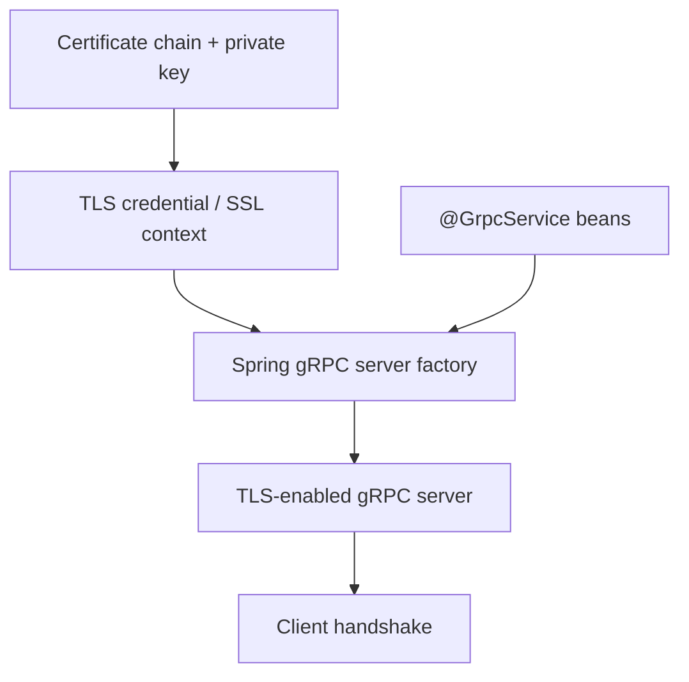

# Tạo server credential từ certificate

## Mục tiêu bài học

Trong **SPRING_GRPC**, TLS bảo vệ kết nối giữa client và server, xác thực danh tính server và mã hóa dữ liệu truyền qua HTTP/2. Để bật TLS phía server, ứng dụng cần một **certificate chain** chứng minh danh tính server và **private key** tương ứng. Hai thành phần này được dùng để tạo server credential mà gRPC transport sử dụng trong quá trình bắt tay TLS.

Bài học tập trung vào việc tạo credential từ certificate: chuẩn bị PEM certificate chain và private key, kiểm tra chúng khớp nhau, tạo credential bằng gRPC Java, tích hợp đúng với server do Spring gRPC quản lý, phân biệt TLS một chiều với mutual TLS (mTLS), và xác minh handshake từ client.

Sau bài này, bạn có thể:

1. Phân biệt certificate, certificate chain, private key và trust anchor.
2. Chuẩn bị certificate có SAN phù hợp với hostname mà client sử dụng.
3. Kiểm tra thời hạn, chain, mục đích sử dụng và sự tương ứng giữa certificate với private key.
4. Tạo server TLS credential từ certificate chain và private key bằng gRPC Java.
5. Cấu hình server Spring gRPC sử dụng credential theo extension point của phiên bản đang chạy.
6. Bật client certificate verification khi cần mTLS.
7. Kiểm thử handshake, chẩn đoán lỗi và vận hành certificate an toàn.

> **Phạm vi:** Ví dụ dùng gRPC Java và Spring gRPC chính thức. API credential cụ thể phụ thuộc phiên bản gRPC Java và server factory. Mẫu standalone bên dưới minh họa gRPC Java; khi Spring quản lý server, cấu hình credential qua cơ chế SSL/server factory được phiên bản Spring gRPC hỗ trợ.

## 1. Server credential gồm những gì?

Khi client kết nối tới endpoint TLS, server cần chứng minh mình sở hữu danh tính tương ứng với hostname. Server gửi certificate chain trong handshake và chứng minh quyền sở hữu private key bằng thao tác mật mã của TLS.

| Thành phần | Vai trò | Có được công khai? |
| --- | --- | --- |
| **Server certificate** | Chứa public key, subject, SAN, issuer, thời hạn và chữ ký CA | Có thể gửi cho client |
| **Intermediate certificate(s)** | Nối certificate server với CA root mà client tin cậy | Có thể gửi trong chain |
| **Private key** | Chứng minh server sở hữu public key trong certificate | **Không**; phải được bảo vệ như secret |
| **Root CA certificate** | Trust anchor để client xác minh chain | Thường được phân phối cho client qua trust store |
| **Client CA certificate** | Dùng ở server để xác minh certificate của client khi bật mTLS | Có thể công khai, nhưng phải được quản lý như trust configuration |

**Server credential không chỉ là file certificate.** Nếu thiếu private key khớp với public key của certificate, server không thể hoàn tất TLS handshake. Nếu thiếu intermediate cần thiết, client có thể không xây dựng được chain tới CA root mà nó tin cậy.

TLS server authentication và client authentication là hai hướng kiểm tra khác nhau:

- Trong TLS một chiều thông thường, server trình certificate; client xác minh certificate server.
- Trong mTLS, client cũng trình certificate; server xác minh certificate client bằng trust roots dành cho client.

## 2. Chuẩn bị certificate chain và private key

Giả sử server có DNS name `grpc.example.com`. Bộ file triển khai có thể gồm:

```text
certs/
├── server-chain.pem
├── server-key.pem
└── client-ca.pem       # Chỉ cần khi xác minh client certificate (mTLS)
```

### 2.1. Certificate phải đại diện đúng hostname

Certificate server cần có Subject Alternative Name (SAN) phù hợp với tên client dùng để kết nối:

- Nếu client kết nối `grpc.example.com`, certificate cần DNS SAN `DNS:grpc.example.com`.
- Nếu client kết nối bằng IP literal, certificate cần IP SAN tương ứng.
- Không dựa vào Common Name (CN) như cơ chế thay thế SAN hiện đại.
- Tên trong SAN phải khớp hostname được client xác minh; SNI có thể được client gửi để server chọn certificate phù hợp khi có nhiều hostname.

Certificate còn phải trong thời hạn hiệu lực, được ký bởi CA mà client tin cậy, có mục đích sử dụng phù hợp với server authentication (EKU `serverAuth` nếu EKU được khai báo), và dùng thuật toán/chìa khóa được TLS provider hỗ trợ.

### 2.2. Nội dung certificate chain

`server-chain.pem` thường chứa certificate server (leaf) trước, sau đó là các intermediate certificate theo thứ tự nối lên CA root:

```text
-----BEGIN CERTIFICATE-----
(server leaf certificate)
-----END CERTIFICATE-----
-----BEGIN CERTIFICATE-----
(intermediate CA certificate)
-----END CERTIFICATE-----
```

Root CA thường đã nằm trong trust store của client nên không cần gửi lại trong chain. Cấu trúc chính xác phụ thuộc CA và client trust configuration. Không đưa private key vào file chain.

### 2.3. Private key phải khớp với leaf certificate

`server-key.pem` chứa private key của server. File phải ở định dạng PEM mà TLS provider/transport đang dùng hỗ trợ; ví dụ phổ biến là PKCS#8. Một số provider hỗ trợ thêm định dạng khác, nhưng không nên giả định mọi phiên bản đều đọc được mọi kiểu key hoặc key được mã hóa bằng passphrase.

Kiểm tra certificate và key trước khi cấu hình server:

```bash
openssl x509 -in certs/server-chain.pem -noout \
  -subject -issuer -dates -ext subjectAltName

openssl x509 -in certs/server-chain.pem -pubkey -noout \
  | openssl pkey -pubin -outform DER \
  | openssl dgst -sha256

openssl pkey -in certs/server-key.pem -pubout -outform DER \
  | openssl dgst -sha256
```

Hai digest public key ở hai lệnh cuối phải giống nhau. Nếu không giống, certificate và private key không phải một cặp.

Kiểm tra chain với CA root và intermediate tương ứng:

```bash
openssl verify \
  -CAfile certs/root-ca.pem \
  -untrusted certs/intermediate-ca.pem \
  certs/server-chain.pem
```

Kết quả thành công có dạng `server-chain.pem: OK`. Lệnh này chỉ kiểm tra chain theo file CA được cung cấp; nó không thay thế việc kiểm tra hostname, EKU, cấu hình TLS hoặc handshake thật từ client.

## 3. Tạo server TLS credential bằng gRPC Java

gRPC Java cung cấp API credential để mô tả danh tính và chính sách TLS của server. Với server chỉ xác thực danh tính server, credential cần certificate chain và private key:

```java
import io.grpc.Grpc;
import io.grpc.Server;
import io.grpc.ServerCredentials;
import io.grpc.TlsServerCredentials;

import java.io.ByteArrayInputStream;
import java.nio.file.Files;
import java.nio.file.Path;

byte[] certificateChain =
        Files.readAllBytes(Path.of("certs/server-chain.pem"));
byte[] privateKey =
        Files.readAllBytes(Path.of("certs/server-key.pem"));

ServerCredentials credentials = TlsServerCredentials.newBuilder()
        .keyManager(
                new ByteArrayInputStream(certificateChain),
                new ByteArrayInputStream(privateKey))
        .build();

Server server = Grpc.newServerBuilderForPort(9090, credentials)
        .addService(new InventoryGrpcEndpoint())
        .build()
        .start();
```

Trong ví dụ:

1. Đọc PEM certificate chain và private key từ nguồn cấu hình được bảo vệ.
2. `keyManager(...)` đưa cặp certificate/key vào TLS server credentials.
3. `Grpc.newServerBuilderForPort(...)` tạo server builder dùng credential đó.
4. Service được bind vào server và server bắt đầu lắng nghe bằng TLS.

Đây là API gRPC Java; import và overload cụ thể cần khớp phiên bản dependency của dự án. Với file deployment hoặc secret provider, dùng API đọc file/stream được phiên bản hỗ trợ thay cho việc tự giữ byte array nếu phù hợp. Không ghi nội dung private key ra log hoặc exception message.

### 3.1. Cách ngắn hơn với ServerBuilder

gRPC Java cũng có convenience API cho certificate chain và private key dạng file:

```java
Server server = ServerBuilder.forPort(9090)
        .useTransportSecurity(
                new File("certs/server-chain.pem"),
                new File("certs/server-key.pem"))
        .addService(new InventoryGrpcEndpoint())
        .build()
        .start();
```

Cách này phù hợp với server builder hỗ trợ `useTransportSecurity(File, File)`. Khi cần trust manager, client certificate authentication hoặc chính sách TLS chi tiết hơn, dùng credential API phù hợp với phiên bản gRPC Java và transport.

Hai ví dụ trên là hai cách cấu hình một server gRPC Java. Không áp dụng cả hai đồng thời cho cùng server.

## 4. Tích hợp credential vào server do Spring gRPC quản lý

Trong Spring gRPC, endpoint thường được Spring phát hiện qua `@GrpcService` và server factory quản lý việc bind service, start/stop transport. Khi bật TLS, cần cấu hình **server instance do Spring quản lý** sử dụng certificate chain và private key.



Các nguyên tắc tích hợp:

- Dùng cấu hình SSL hoặc server factory customization được tài liệu của **đúng phiên bản Spring gRPC** hỗ trợ.
- Cấu hình certificate chain và private key ở server side; không cấu hình client trust file như thể đó là server identity.
- Để Spring gRPC quản lý server lifecycle và service registration. Không tạo thêm một server độc lập chỉ để bật TLS nếu ứng dụng đã có server do starter quản lý.
- Đặt file path hoặc secret reference ngoài source code; đảm bảo process có quyền đọc nhưng user/group không cần thiết không thể đọc private key.
- Nếu dùng custom server factory, bảo đảm các `@GrpcService` bean vẫn được bind vào server đã cấu hình credential.

Không sao chép một tên property SSL từ phiên bản hoặc starter khác mà chưa kiểm tra tài liệu tương ứng. Các starter gRPC khác nhau có thể dùng package, property và server factory khác nhau. Hãy xác minh cấu hình đang dùng thực sự được áp dụng cho listener mà client kết nối.

### 4.1. Credential và service registration là hai việc riêng

Credential bảo vệ transport; nó không định nghĩa RPC service. Các bean `@GrpcService` vẫn cung cấp service definition như Inventory hoặc Pricing. Server có thể phục vụ nhiều service qua cùng listener TLS nếu tất cả được bind vào server instance đó.

Nếu một ứng dụng có nhiều server/listener, mỗi listener có thể cần credential riêng. Không giả định việc cấu hình certificate cho một server tự động bảo vệ một server khác hoặc một HTTP management port.

## 5. Kiểm tra certificate server từ phía client

Client phải tin CA đã ký certificate server và kết nối bằng hostname khớp SAN. Trong production, client dùng TLS credentials/trust configuration phù hợp; không tắt hostname verification để sửa lỗi certificate.

Ví dụ kiểm tra TLS bằng OpenSSL:

```bash
openssl s_client \
  -connect grpc.example.com:9090 \
  -servername grpc.example.com \
  -alpn h2 \
  -CAfile certs/root-ca.pem \
  -verify_return_error \
  -showcerts
```

Các điểm cần xem:

- Server gửi đúng leaf certificate và intermediate chain.
- Hostname được gửi qua SNI là hostname dự kiến.
- ALPN thương lượng được `h2` cho gRPC qua HTTP/2.
- Certificate chain được xác minh tới CA root.
- Certificate còn hiệu lực và SAN khớp hostname.

Có thể gọi RPC bằng grpcurl nếu server cho phép reflection hoặc client cung cấp proto descriptor:

```bash
grpcurl -cacert certs/root-ca.pem \
  grpc.example.com:9090 list
```

Nếu server không bật reflection, dùng `-proto`/`-import-path` hoặc descriptor set để gọi method. Với môi trường phát triển dùng CA tự ký, client cần trust đúng CA; không nên dùng insecure mode như giải pháp production.

## 6. Bật mutual TLS khi cần xác thực client

TLS một chiều xác thực server với client. Nếu server cần xác thực danh tính của client ở tầng TLS, bật mTLS. Khi đó server có thêm trust manager chứa CA được phép cấp client certificate và yêu cầu client trình certificate.

Ví dụ với gRPC Java credential API:

```java
TlsServerCredentials credentials = TlsServerCredentials.newBuilder()
        .keyManager(
                new ByteArrayInputStream(serverCertificateChain),
                new ByteArrayInputStream(serverPrivateKey))
        .trustManager(new ByteArrayInputStream(clientCaCertificates))
        .clientAuth(TlsServerCredentials.ClientAuth.REQUIRE)
        .build();
```

Tên enum và builder API cần khớp phiên bản gRPC Java đang dùng. Ý nghĩa cấu hình:

- `keyManager` cung cấp danh tính server.
- `trustManager` cung cấp trust roots để server xác minh client certificate.
- `ClientAuth.REQUIRE` yêu cầu client gửi certificate hợp lệ trong handshake.

Nếu chỉ cần TLS server authentication, không bật client certificate requirement một cách vô tình. Nếu bật mTLS mà không cấu hình trust manager đúng, client không có certificate hoặc certificate không được CA tin cậy sẽ không kết nối được.

### 6.1. mTLS không thay thế authorization

Client certificate chứng minh danh tính ở tầng transport, nhưng ứng dụng vẫn cần ánh xạ certificate identity sang principal/tenant/role và kiểm tra quyền trên từng RPC. Một certificate hợp lệ không có nghĩa client được phép gọi mọi service hoặc truy cập mọi tài nguyên.

Có thể kết hợp mTLS với gRPC interceptor để đọc SSL session/peer identity theo API transport hỗ trợ, tạo caller identity và áp dụng authorization policy. Không tự phân tích chuỗi subject bằng cách tách text tùy tiện; dùng thông tin certificate đã được xác minh và quy tắc identity mapping được định nghĩa rõ.

## 7. Phân biệt các loại lỗi TLS

| Triệu chứng | Nguyên nhân có thể | Cách kiểm tra |
| --- | --- | --- |
| Server không khởi động | File không tồn tại, không có quyền đọc, PEM lỗi hoặc private key không parse được | Kiểm tra path, quyền file và định dạng PEM |
| Key/certificate mismatch | Private key không khớp public key trong leaf certificate | So sánh digest public key |
| Client báo unknown CA | Client không tin root CA hoặc server thiếu intermediate | Kiểm tra trust store và chain server gửi |
| Hostname verification failed | SAN không chứa hostname client dùng | Kiểm tra SAN và authority/hostname thực tế |
| Certificate expired/not yet valid | Thời hạn cert hoặc đồng hồ hệ thống sai | Kiểm tra notBefore/notAfter và clock sync |
| Handshake protocol/ALPN error | TLS version/cipher/ALPN không tương thích hoặc client không dùng HTTP/2 | Kiểm tra TLS config và ALPN `h2` |
| mTLS handshake failed | Client không gửi certificate hoặc server không tin CA của client | Kiểm tra client cert, client CA bundle và clientAuth policy |
| Kết nối TLS thành công nhưng RPC UNIMPLEMENTED | Transport hoạt động nhưng method/service không được bind hoặc path sai | Kiểm tra full service name, method và service registration |

Không dùng `-insecure`, tắt certificate verification hoặc bỏ hostname check để che lỗi trust. Cần xác định đúng nguyên nhân rồi sửa certificate, trust bundle, DNS hoặc cấu hình transport.

## 8. Bảo vệ private key và vận hành certificate

Private key là tài sản nhạy cảm nhất trong credential. Certificate có thể được gửi cho mọi client; private key không được commit vào Git, đóng gói vào image công khai, đưa vào log, hoặc lưu trong thư mục có quyền đọc rộng.

Thực hành vận hành:

- Lưu private key trong secret manager, KMS/HSM hoặc secret mount được bảo vệ theo môi trường.
- Giới hạn quyền file ở user chạy server; không cấp quyền đọc cho nhóm/người không cần.
- Tách certificate/key theo môi trường và hostname; không dùng cùng private key cho mọi ứng dụng.
- Theo dõi ngày hết hạn và cảnh báo trước khi certificate hết hạn.
- Có quy trình rotate certificate: phát hành cert mới, triển khai chain/key mới, xác minh handshake, sau đó thu hồi hoặc loại bỏ cert cũ theo chính sách.
- Khi rotate, hiểu cách TLS provider/server factory reload material. Một số cấu hình chỉ đọc certificate lúc server khởi động; khi đó cần restart/reload có kiểm soát.
- Giữ đồng hồ máy chủ đồng bộ; thời gian sai có thể làm certificate hợp lệ bị coi là chưa có hiệu lực hoặc đã hết hạn.

Không ghi private key dưới dạng text vào application properties hoặc biến môi trường nếu cơ chế triển khai có thể cung cấp secret file/reference an toàn hơn. Không in object/exception chứa key material khi debug.

## 9. Kiểm thử server credential

Một kiểm thử TLS có giá trị cần xác minh cả certificate và RPC, không chỉ kiểm tra server process đã start.

### 9.1. Kiểm tra file và cặp key trước startup

Trong pipeline triển khai hoặc bước kiểm tra certificate, xác minh:

1. Certificate parse được.
2. Private key parse được.
3. Public key digest khớp giữa certificate và private key.
4. Certificate chain xác minh được với CA dự kiến.
5. SAN khớp DNS/IP client sử dụng.
6. Thời hạn certificate còn hợp lệ và EKU phù hợp.

Các lệnh OpenSSL ở phần trên hữu ích cho bước kiểm tra trước khi khởi động server.

### 9.2. Integration test qua TLS

Khởi động Spring gRPC server test với certificate test do test fixture tạo hoặc certificate test được quản lý an toàn. Tạo client channel tin CA test, kết nối bằng hostname khớp SAN và gọi một RPC qua generated stub.

Test nên xác minh:

- Client tin đúng CA thì handshake và RPC thành công.
- Client không tin CA thì handshake thất bại.
- Hostname không khớp SAN thì client từ chối certificate.
- Nếu bật mTLS, client không có certificate bị từ chối.
- Client certificate do CA được tin cậy cấp thì kết nối thành công; certificate ngoài trust chain bị từ chối.

Không dùng certificate/private key production trong unit test hoặc repository. Dùng fixture test riêng với thời hạn và quyền hạn tối thiểu.

### 9.3. Kiểm tra vận hành sau rotate

Sau khi thay certificate, kiểm tra kết nối mới bằng client tin CA đúng, xem server đang trình certificate mới, và theo dõi handshake failure/UNAVAILABLE. Nếu server chỉ load certificate khi startup, thực hiện rolling restart hoặc reload theo cơ chế được hỗ trợ; không giả định file được thay là TLS context tự cập nhật.

## 10. Lỗi thường gặp

| Lỗi thiết kế/vận hành | Hệ quả | Cách xử lý |
| --- | --- | --- |
| Chỉ cung cấp certificate, không có private key | Server không chứng minh được quyền sở hữu public key | Cung cấp cặp certificate/key tương ứng |
| Dùng nhầm client CA làm server certificate | Server trình danh tính sai mục đích hoặc chain không hợp lệ | Dùng certificate có SAN/EKU phù hợp server authentication |
| Certificate không có SAN phù hợp | Client từ chối hostname verification | Phát hành certificate có DNS/IP SAN chính xác |
| Thiếu intermediate certificate | Một số client không xây được chain | Cung cấp leaf cùng intermediate chain theo thứ tự |
| Gửi root CA trong chain nhưng thiếu intermediate | Không sửa được trust path | Phân phối intermediate đúng; root là trust anchor phía client |
| Private key lưu trong source/image | Lộ credential, khó rotate | Dùng secret manager/secret mount và quyền file tối thiểu |
| Tạo server thủ công bên cạnh Spring server | Hai listener hoặc service registration bị tách | Cấu hình credential trên server factory Spring đang quản lý |
| Tắt certificate verification để test | Che giấu lỗi trust/hostname và tạo thói quen nguy hiểm | Dùng CA test và cấu hình trust đúng |
| Bật mTLS nhưng thiếu client trust roots | Client handshake bị từ chối | Cấu hình trust manager và clientAuth có chủ đích |
| Chỉ test server startup | Không chứng minh client xác minh được cert hoặc gọi RPC thành công | Integration test TLS với trust bundle và hostname thật |
| Thay file cert nhưng không reload TLS context | Server tiếp tục dùng certificate cũ | Thực hiện reload/restart theo khả năng của server factory |

## 11. Bài tập thực hành

1. Tạo một CA test, phát hành server certificate có SAN `DNS:localhost` hoặc hostname test riêng, và tạo private key tương ứng.
2. Dùng OpenSSL kiểm tra subject, issuer, validity, SAN, chain và public key digest; giải thích từng kết quả.
3. Tạo `TlsServerCredentials` từ certificate chain/private key và khởi động một gRPC server test.
4. Tích hợp credential vào Spring gRPC server factory của phiên bản dự án; xác minh các `@GrpcService` bean vẫn được bind vào listener TLS.
5. Gọi RPC bằng client tin CA test; thử client không trust CA và hostname không khớp SAN.
6. Bật mTLS với client CA riêng. Kiểm tra client không có certificate, client certificate không được tin cậy và client certificate hợp lệ.
7. Thay certificate bằng một cặp mới và xây quy trình rotate/restart có kiểm tra handshake.
8. Viết checklist triển khai: secret location, file permission, expiry alert, trust bundle, SAN, TLS version, ALPN `h2` và rollback khi rotate lỗi.

### Câu hỏi tự kiểm tra

- Vì sao server credential cần cả certificate chain và private key?
- Certificate leaf và intermediate certificate có vai trò gì trong chain?
- Vì sao SAN quan trọng hơn việc chỉ kiểm tra CN?
- Client dùng trust store nào để xác minh server certificate?
- `keyManager` khác `trustManager` ở phía server như thế nào?
- Khi nào cần `ClientAuth.REQUIRE`?
- Vì sao mTLS không thay thế authorization ở application layer?
- Vì sao `usePlaintext()` không phù hợp với production?
- Làm thế nào xác minh certificate và private key là một cặp?
- Sau khi rotate file certificate, điều gì quyết định server có dùng certificate mới ngay hay không?

## Tài liệu tham khảo

- [gRPC — Authentication](https://grpc.io/docs/guides/auth/): TLS và cơ chế xác thực cho gRPC.
- [gRPC Java — TlsServerCredentials](https://grpc.github.io/grpc-java/javadoc/io/grpc/TlsServerCredentials.html): tạo server TLS credentials từ key material và client trust.
- [gRPC Java — ServerBuilder](https://grpc.github.io/grpc-java/javadoc/io/grpc/ServerBuilder.html): cấu hình transport security và đăng ký service.
- [Spring gRPC — GRPC Server](https://docs.spring.io/spring-grpc/reference/server.html): server integration và cấu hình server trong Spring.
- [OpenSSL — x509](https://docs.openssl.org/3.0/man1/openssl-x509/): đọc và kiểm tra certificate.
- [OpenSSL — verify](https://docs.openssl.org/3.0/man1/openssl-verify/): xác minh certificate chain.
- [OpenSSL — s_client](https://docs.openssl.org/3.0/man1/openssl-s_client/): kiểm tra TLS handshake từ client.

**Kết quả mong đợi:** Người học tạo được server TLS credential từ certificate chain và private key tương ứng, hiểu cách gRPC dùng credential để bảo vệ listener, tích hợp cấu hình vào server Spring gRPC đang quản lý, xác minh hostname/trust/handshake, và mở rộng sang mTLS khi cần xác thực client.
