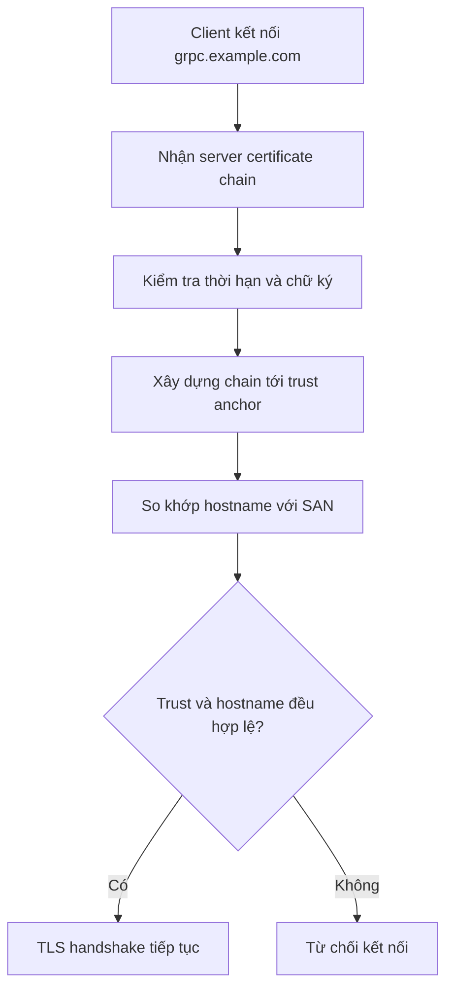

# Server certificate và hostname

## Mục tiêu bài học

Trong **SPRING_GRPC**, TLS xác minh danh tính server trước khi client gửi dữ liệu RPC. Certificate server phải đại diện đúng hostname mà client dùng để kết nối. Nếu certificate được CA tin cậy ký nhưng không chứa hostname đó trong Subject Alternative Name (SAN), client vẫn phải từ chối kết nối.

Bài học tập trung vào mối quan hệ giữa **server certificate và hostname**: cách chọn DNS/IP SAN, cách client xác định tên cần kiểm tra, vai trò của SNI và authority, quy tắc wildcard, trust chain, và cách kiểm thử lỗi hostname mismatch trong gRPC.

Sau bài này, bạn có thể:

1. Giải thích hostname verification độc lập với certificate chain validation.
2. Thiết kế SAN cho DNS name và IP address của gRPC endpoint.
3. Phân biệt hostname client kết nối, SNI server nhận và authority của RPC.
4. Hiểu quy tắc wildcard và các trường hợp không khớp.
5. Cấu hình client gRPC dùng đúng hostname và trust roots.
6. Chẩn đoán lỗi SAN, CA chain, expiry và routing.
7. Kiểm thử certificate bằng OpenSSL và generated gRPC client.

> **Phạm vi:** Ví dụ dùng gRPC Java, Spring gRPC và OpenSSL. Server credential được tạo ở bài trước; ở đây trọng tâm là danh tính trong certificate và cách client xác minh tên server. Tên cấu hình cụ thể vẫn phụ thuộc phiên bản transport/server factory.

## 1. Certificate phải khớp tên client sử dụng

Giả sử gRPC server được công bố tại:

```text
grpc.example.com:9090
```

Client tạo channel tới hostname grpc.example.com. Trong TLS handshake, server trình certificate chain. Client phải xác minh ít nhất hai điều độc lập:

1. **Trust chain:** certificate được ký bởi CA nằm trong trust roots mà client tin cậy, chain hợp lệ và certificate còn hiệu lực.
2. **Server identity:** tên server mà client định kết nối khớp với một SAN phù hợp trong leaf certificate.

Một certificate do CA tin cậy cấp vẫn có thể sai hostname. Ví dụ certificate hợp lệ cho api.example.com không chứng minh danh tính của grpc.example.com. Ngược lại, SAN có đúng hostname nhưng certificate do CA không tin cậy ký cũng không được chấp nhận.



Hostname verification là một phần của xác thực server trong TLS. Không tắt bước này để bỏ qua certificate mismatch.

## 2. Subject Alternative Name (SAN)

SAN là nơi certificate hiện đại khai báo các danh tính mà nó đại diện. Với gRPC endpoint, hai loại SAN thường gặp:

- **dNSName:** tên DNS, ví dụ grpc.example.com.
- **iPAddress:** địa chỉ IP, ví dụ 10.20.0.15.

Client phải dùng đúng loại SAN theo cách nó định danh server. Nếu channel target là hostname DNS, certificate cần DNS SAN khớp. Nếu client kết nối bằng IP literal và xác minh theo IP, certificate cần IP SAN tương ứng; DNS SAN chứa chuỗi giống địa chỉ IP không thay thế được IP SAN.

### 2.1. Ví dụ SAN cho nhiều endpoint

Một certificate có thể đại diện nhiều DNS name nếu các tên cùng thuộc một danh tính server và được CA phê duyệt:

```text
X509v3 Subject Alternative Name:
    DNS:grpc.example.com,
    DNS:grpc.internal.example.com,
    DNS:grpc-canary.example.com
```

Nếu một client thực sự kết nối bằng IP, certificate có thể thêm IP SAN:

```text
X509v3 Subject Alternative Name:
    DNS:grpc.example.com,
    IP Address:10.20.0.15
```

Không thêm hàng loạt SAN “cho tiện”. Mỗi tên bổ sung mở rộng phạm vi danh tính mà private key của certificate có thể chứng minh. Chỉ đưa hostname/IP mà server thực sự sở hữu và cần phục vụ.

### 2.2. CN không thay thế SAN

Subject Common Name (CN) từng được dùng trong một số hệ thống cũ để biểu diễn hostname. Với xác minh hostname hiện đại, client nên dựa vào SAN. Không phát hành certificate mới chỉ có CN rồi kỳ vọng mọi client gRPC sẽ chấp nhận.

Ví dụ subject có thể là:

```text
CN = grpc.example.com
```

Nhưng nếu SAN không chứa DNS:grpc.example.com, certificate có thể vẫn thất bại hostname verification. CN không phải cách sửa cho SAN thiếu.

## 3. Quy tắc wildcard hostname

Wildcard SAN thường được dùng cho nhiều host cùng một cấp DNS:

```text
DNS:*.example.com
```

Wildcard này có thể khớp grpc.example.com hoặc inventory.example.com. Nó không khớp:

- example.com (apex/root domain).
- a.grpc.example.com (nhiều cấp con).
- grpc.example.org (khác domain).

Không nên dựa vào wildcard rộng để bao phủ các domain không liên quan. Certificate wildcard vẫn cần chain tin cậy, thời hạn hợp lệ và mục đích server authentication phù hợp. Nếu một service có hostname ổn định, certificate SAN cụ thể thường dễ review và giới hạn phạm vi hơn.

## 4. Hostname, SNI và authority trong gRPC

Ba khái niệm này liên quan nhưng không đồng nhất:

| Khái niệm | Vai trò | Ví dụ |
| --- | --- | --- |
| **Target hostname** | Tên client dùng để định vị endpoint trong channel target | grpc.example.com |
| **SNI (Server Name Indication)** | Tên client gửi trong TLS ClientHello để server/proxy chọn certificate hoặc virtual host phù hợp | grpc.example.com |
| **HTTP/2 authority** | Authority của request, thường chứa host và có thể kèm port; được dùng trong routing/policy | grpc.example.com:9090 |
| **Certificate SAN** | Các DNS/IP identity mà certificate server chứng minh | DNS:grpc.example.com |

Trong cấu hình thông thường, target hostname là đầu vào quan trọng để gRPC client xác định server identity và gửi SNI. Proxy hoặc load balancer có thể dùng SNI để chọn certificate phù hợp. HTTP/2 authority lại thuộc lớp RPC sau khi TLS đã thiết lập.

### 4.1. DNS name và địa chỉ IP

Ưu tiên dùng DNS name ổn định trong môi trường triển khai:

```java
ManagedChannel channel = ManagedChannelBuilder
        .forAddress("grpc.example.com", 9090)
        .useTransportSecurity()
        .build();
```

Với cách này, client xác minh server theo hostname grpc.example.com. Certificate cần SAN tương ứng và chain phải được client tin cậy.

Nếu client dùng:

```java
ManagedChannel channel = ManagedChannelBuilder
        .forAddress("10.20.0.15", 9090)
        .useTransportSecurity()
        .build();
```

thì danh tính được kiểm tra theo IP mà client sử dụng. Certificate chỉ có DNS:grpc.example.com không tự động khớp IP 10.20.0.15. Có hai hướng thiết kế:

- Client dùng DNS name đã có trong certificate, DNS resolver/load balancer ánh xạ tên đó tới IP.
- Nếu endpoint thực sự được định danh bằng IP, phát hành certificate có IP SAN chính xác.

### 4.2. Authority override chỉ dành cho trường hợp có chủ đích

gRPC Java có API như **overrideAuthority(...)** trên channel builder để thay authority dùng cho call/TLS name trong một số cấu hình routing đặc biệt. Đây không phải cách chung để bỏ hostname verification. Nếu target kết nối là IP nhưng logical server identity là DNS name, chỉ override khi kiến trúc thực sự quy định identity đó và bạn đã xác minh SNI, authority, certificate SAN cùng hành vi của transport.

Không dùng authority tùy ý do client nhập vào. Việc override sai có thể làm routing và danh tính TLS không còn phản ánh endpoint mong muốn.

## 5. Cấp phát certificate có SAN

Certificate server thường được CA nội bộ hoặc CA công khai cấp dựa trên CSR. Khi tạo CSR, khai báo SAN trong request. Ví dụ file cấu hình OpenSSL:

```ini
[ req ]
prompt = no
distinguished_name = subject
req_extensions = request_extensions

[ subject ]
CN = grpc.example.com

[ request_extensions ]
subjectAltName = @server_names

[ server_names ]
DNS.1 = grpc.example.com
DNS.2 = grpc.internal.example.com
IP.1 = 10.20.0.15
```

Tạo private key và CSR:

```bash
openssl genpkey -algorithm RSA \
  -pkeyopt rsa_keygen_bits:3072 \
  -out server-key.pem

openssl req -new \
  -key server-key.pem \
  -out server.csr \
  -config server-san.cnf
```

CSR chỉ **yêu cầu** CA đưa SAN vào certificate; CA có thể áp dụng policy riêng và từ chối hoặc thay đổi SAN. Khi ký certificate, CA profile phải phát hành SAN đã được phê duyệt, cùng các extension phù hợp như extendedKeyUsage serverAuth và key usage theo thuật toán/TLS profile. Không coi việc CSR có SAN là bằng chứng certificate cuối cùng đã có SAN.

Kiểm tra certificate đã cấp:

```bash
openssl x509 -in server.pem -noout \
  -subject -issuer -dates \
  -ext subjectAltName \
  -ext extendedKeyUsage
```

Đọc output để xác nhận đúng DNS/IP SAN, thời hạn và EKU. Certificate dành cho server TLS cần mục đích sử dụng server authentication phù hợp với CA/TLS profile.

## 6. Cấu hình gRPC client xác minh hostname

### 6.1. Dùng trust store mặc định

Nếu CA phát hành certificate đã được cài vào trust store mà JVM/TLS provider sử dụng, client có thể dùng transport security:

```java
ManagedChannel channel = ManagedChannelBuilder
        .forAddress("grpc.example.com", 9090)
        .useTransportSecurity()
        .build();
```

Không gọi usePlaintext() trong production. Địa chỉ channel phải là hostname được certificate đại diện, không phải một IP khác chỉ vì IP đó dễ cấu hình hơn.

### 6.2. Dùng private CA riêng

Nếu server certificate do private CA ký, client phải tin CA đó. Có thể cài CA vào JVM trust store hoặc cấu hình trust roots cho channel bằng credential API phù hợp với phiên bản gRPC Java.

Ví dụ dùng TlsChannelCredentials:

```java
ChannelCredentials credentials;

try (InputStream roots =
        Files.newInputStream(Path.of("certs/internal-root-ca.pem"))) {
    credentials = TlsChannelCredentials.newBuilder()
            .trustManager(roots)
            .build();
}

ManagedChannel channel = Grpc.newChannelBuilder(
        "dns:///grpc.example.com:9090",
        credentials)
        .build();
```

Ví dụ dùng trust root riêng cho channel; API và overload cần khớp phiên bản gRPC Java đang dùng. Trust manager chỉ quyết định CA nào được tin. Nó không làm certificate có hostname khác trở nên hợp lệ. Client vẫn phải xác minh SAN của server theo target identity grpc.example.com.

### 6.3. Không tắt hostname verification

Không sử dụng custom verifier luôn trả true, không bỏ kiểm tra peer name, và không dùng insecure trust manager để né lỗi. Những cách đó cho phép một server có certificate không đại diện đúng hostname giả danh endpoint.

Nếu cần kiểm thử certificate tự ký, tạo CA test riêng và cấu hình client tin CA test. Kiểm thử phải vẫn xác minh hostname.

## 7. Kiểm tra hostname và chain bằng OpenSSL

Có thể kiểm tra endpoint qua IP nhưng xác minh đúng DNS identity bằng cách chỉ rõ SNI và hostname:

```bash
openssl s_client \
  -connect 10.20.0.15:9090 \
  -servername grpc.example.com \
  -verify_hostname grpc.example.com \
  -alpn h2 \
  -CAfile certs/root-ca.pem \
  -verify_return_error \
  -showcerts
```

Ý nghĩa các tham số:

- -connect: địa chỉ mạng thực tế để mở TCP connection.
- -servername: SNI gửi trong TLS ClientHello để chọn virtual host/certificate.
- -verify_hostname: tên DNS cần được xác minh trong certificate.
- -alpn h2: yêu cầu thương lượng HTTP/2, cần thiết cho gRPC.
- -CAfile: trust anchor mà client dùng để xác minh chain.
- -verify_return_error: dừng với lỗi xác minh thay vì chỉ in cảnh báo.

Để xác minh chain và DNS name offline:

```bash
openssl verify \
  -CAfile certs/root-ca.pem \
  -untrusted certs/intermediate-ca.pem \
  -verify_hostname grpc.example.com \
  certs/server.pem
```

Nếu client dùng IP identity, kiểm tra bằng -verify_ip thay cho -verify_hostname:

```bash
openssl verify \
  -CAfile certs/root-ca.pem \
  -verify_ip 10.20.0.15 \
  certs/server.pem
```

Lệnh offline cần cung cấp đủ intermediate certificate nếu chain có intermediate. Kiểm tra offline cũng không chứng minh listener đang trình đúng certificate; cần kết hợp handshake tới endpoint thật.

## 8. Chẩn đoán lỗi hostname mismatch

| Lỗi | Nguyên nhân thường gặp | Hướng xử lý |
| --- | --- | --- |
| Certificate valid nhưng hostname mismatch | SAN không chứa hostname client dùng | Phát hành certificate có DNS SAN chính xác hoặc dùng đúng DNS target |
| DNS name hoạt động, IP không hoạt động | Certificate có DNS SAN nhưng không có IP SAN | Dùng DNS name hoặc phát hành IP SAN nếu IP là identity cần thiết |
| Một hostname hoạt động, hostname alias thất bại | Alias chưa nằm trong SAN | Bổ sung SAN được CA phê duyệt hoặc chuẩn hóa endpoint |
| Kết nối tới load balancer trả sai certificate | SNI thiếu/sai hoặc virtual host mapping sai | Kiểm tra SNI, listener TLS và certificate selection ở proxy |
| Trust chain failed | Client không tin CA hoặc server thiếu intermediate | Sửa trust store hoặc chain server trình |
| Certificate expired/not yet valid | Thời hạn certificate hoặc đồng hồ hệ thống sai | Kiểm tra validity và đồng bộ clock |
| Wildcard không khớp hostname nhiều cấp | Wildcard chỉ bao phủ một label | Cấp SAN cụ thể cho hostname sâu hơn |
| TLS thành công nhưng RPC UNIMPLEMENTED | Handshake xong nhưng service/method path sai | Kiểm tra Protobuf package, service name và method |

Không đổi hostname để trùng certificate nếu điều đó làm client kết nối nhầm service hoặc bypass DNS policy. Sửa đúng certificate, DNS, SNI hoặc target authority theo kiến trúc.

## 9. Integration test cho server certificate và hostname

Một test có giá trị cần kiểm tra cả positive và negative case:

1. Client trust đúng CA, target đúng hostname trong SAN: handshake và RPC thành công.
2. Client không trust CA: handshake thất bại dù hostname đúng.
3. Client trust CA nhưng target sai hostname: hostname verification thất bại.
4. Client kết nối bằng IP trong khi certificate chỉ có DNS SAN: xác minh IP thất bại.
5. Client dùng DNS alias không nằm trong SAN: xác minh thất bại.
6. Nếu dùng SNI virtual hosting, client gửi đúng SNI nhận certificate đúng; SNI sai có thể nhận certificate khác và handshake thất bại.

Với test Spring gRPC, dùng certificate/CA fixture riêng. Client channel phải dùng trust roots fixture và target hostname nằm trong SAN. Nếu test server bind loopback IP nhưng muốn kiểm tra DNS identity, cấu hình test resolver/target phù hợp; không vô hiệu hóa hostname verification để làm test qua.

Sau khi handshake thành công, gọi một generated stub để chứng minh HTTP/2 và RPC hoạt động. Có thể dùng reflection hoặc descriptor set để kiểm tra method, nhưng reflection không thay thế kiểm tra certificate.

## 10. Vận hành hostname và certificate qua các môi trường

Hostname trong certificate gắn với danh tính server, vì vậy cần được quản lý cùng DNS, load balancer và môi trường triển khai.

- Dùng DNS name ổn định làm endpoint cho client thay vì phụ thuộc IP pod/instance có thể thay đổi.
- Phát hành certificate SAN đúng các tên client thực sự dùng: internal DNS, public DNS hoặc service mesh name.
- Giữ DNS, SNI routing, load balancer và certificate SAN nhất quán.
- Khi đổi domain, migration client sang domain mới phải có giai đoạn overlap: certificate cũ và mới cùng chứa tên cần thiết hoặc có kế hoạch rollout tương thích.
- Theo dõi hạn certificate và kiểm thử renewal/rotation trước ngày hết hạn.
- Tránh dùng wildcard rộng nếu SAN cụ thể đáp ứng được nhu cầu.
- Không đưa hostname nội bộ vào certificate public nếu policy không cho phép; dùng CA/private PKI và trust distribution phù hợp.

Certificate có thể được rotate mà hostname giữ nguyên. Ngược lại, đổi hostname có thể đòi hỏi phát hành certificate mới ngay cả khi public key không đổi.

## 11. Lỗi thường gặp

| Cách làm sai | Hệ quả | Cách làm đúng |
| --- | --- | --- |
| Chỉ đặt CN, bỏ SAN | Client hiện đại có thể từ chối hostname | Phát hành DNS/IP SAN phù hợp |
| Kết nối bằng IP nhưng chỉ có DNS SAN | IP identity không khớp | Dùng DNS target hoặc thêm IP SAN |
| Tin CA nhưng bỏ hostname verification | Có thể chấp nhận server sai danh tính | Luôn xác minh SAN theo target identity |
| Dùng wildcard *.example.com cho mọi domain | Wildcard không khớp apex hoặc nhiều cấp | Cấp SAN chính xác hoặc wildcard đúng phạm vi |
| SNI trỏ tới virtual host khác | Server trình certificate không phù hợp | Đồng bộ target hostname, SNI và cấu hình proxy |
| CSR có SAN nhưng cert cuối không có | CA không copy/không cho phép SAN request | Kiểm tra certificate sau khi CA ký |
| Override authority tùy tiện | TLS identity và HTTP/2 routing có thể sai | Chỉ override theo kiến trúc và xác minh transport |
| Dùng trust-all verifier để test | Che giấu lỗi certificate | Dùng CA test và hostname test hợp lệ |
| Kiểm tra chain nhưng không kiểm tra SAN | Chain pass nhưng server identity vẫn sai | Kiểm tra cả trust path và hostname |
| Chỉ test bằng OpenSSL không gọi RPC | TLS có thể đúng nhưng gRPC service chưa hoạt động | Integration test bằng generated gRPC stub |

## 12. Bài tập thực hành

1. Phát hành certificate test với SAN DNS:grpc.test.local và IP:127.0.0.1. Kiểm tra certificate bằng OpenSSL.
2. Kết nối gRPC client bằng DNS name và bằng IP; giải thích vì sao từng trường hợp pass/fail theo SAN.
3. Cấu hình client trust private CA; sau đó đổi sang CA không tin cậy và xác minh handshake bị từ chối.
4. Tạo certificate có DNS:*.example.test; kiểm tra các tên grpc.example.test, example.test và a.grpc.example.test.
5. Dùng OpenSSL s_client chỉ định -servername, -verify_hostname và -alpn h2; so sánh khi SNI đúng/sai.
6. Cấu hình integration test Spring gRPC dùng certificate fixture, gọi một RPC qua channel TLS và thêm negative test hostname mismatch.
7. Mô phỏng đổi DNS endpoint trong một đợt rollout; thiết kế SAN overlap để client cũ và mới cùng hoạt động trong giai đoạn chuyển đổi.

### Câu hỏi tự kiểm tra

- Vì sao certificate được CA tin cậy ký vẫn có thể bị client từ chối?
- SAN DNS khác IP SAN như thế nào?
- Vì sao kết nối bằng IP yêu cầu IP SAN?
- CN có thay thế SAN trong certificate mới không?
- SNI được gửi ở giai đoạn nào và dùng để làm gì?
- HTTP/2 authority có phải là certificate identity không?
- Wildcard *.example.com khớp và không khớp những hostname nào?
- Trust manager và hostname verification giải quyết hai vấn đề gì?
- Khi nào overrideAuthority có thể được dùng và vì sao không nên dùng tùy tiện?
- Làm thế nào test đúng cả chain trust, hostname và gRPC RPC?

## Tài liệu tham khảo

- [RFC 9525 — Service Identity in TLS](https://www.rfc-editor.org/rfc/rfc9525): quy tắc xác minh danh tính server trong TLS.
- [RFC 5280 — Internet X.509 PKI Certificate and CRL Profile](https://www.rfc-editor.org/rfc/rfc5280): cấu trúc certificate và extension SAN.
- [gRPC — Authentication](https://grpc.io/docs/guides/auth/): TLS và xác thực transport cho gRPC.
- [gRPC Java — ManagedChannelBuilder](https://grpc.github.io/grpc-java/javadoc/io/grpc/ManagedChannelBuilder.html): target, authority và cấu hình channel.
- [gRPC Java — TlsChannelCredentials](https://grpc.github.io/grpc-java/javadoc/io/grpc/TlsChannelCredentials.html): trust roots và TLS channel credentials.
- [OpenSSL — x509](https://docs.openssl.org/3.0/man1/openssl-x509/): kiểm tra subject, SAN, thời hạn và extension.
- [OpenSSL — verify](https://docs.openssl.org/3.0/man1/openssl-verify/): kiểm tra chain và hostname/IP.
- [OpenSSL — s_client](https://docs.openssl.org/3.0/man1/openssl-s_client/): kiểm tra SNI, ALPN và TLS handshake.

**Kết quả mong đợi:** Người học phát hành và vận hành server certificate có SAN đúng hostname/IP mà gRPC client sử dụng, hiểu sự khác nhau giữa trust chain, hostname verification, SNI và authority, cấu hình client tin đúng CA, và chẩn đoán được lỗi certificate mismatch mà không vô hiệu hóa xác minh danh tính server.
