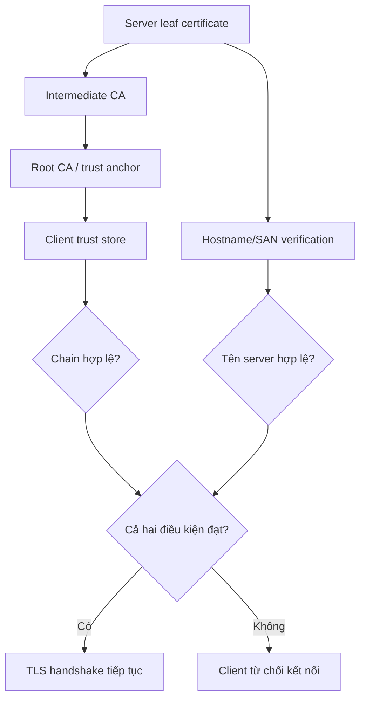

# Client trust certificate

## Mục tiêu bài học

Trong **SPRING_GRPC**, trước khi gửi request qua TLS, client phải xác minh certificate server được ký bởi một CA mà client tin cậy và certificate đại diện đúng hostname của endpoint. Với CA công khai, trust roots có thể đã nằm trong trust store mặc định của JVM. Với private PKI hoặc môi trường nội bộ, ứng dụng cần phân phối và cấu hình trust certificate phù hợp.

Bài học tập trung vào **client trust certificate**: hiểu trust anchor và certificate chain, chọn trust store, cấu hình gRPC Java channel bằng trust roots PEM, tích hợp channel vào Spring, phân biệt server trust với client identity trong mTLS, và kiểm thử cả trường hợp được tin cậy lẫn bị từ chối.

Sau bài này, bạn có thể:

1. Phân biệt trust certificate, server certificate, intermediate CA và private key.
2. Giải thích cách client xây dựng và xác minh certificate path tới trust anchor.
3. Chọn giữa JVM default trust store, custom trust store và trust roots riêng cho channel.
4. Cấu hình gRPC Java channel tin một private CA mà vẫn xác minh hostname.
5. Phân biệt trust manager với key manager trong mTLS.
6. Quản lý CA rotation và thu hồi trust anchor theo quy trình.
7. Chẩn đoán lỗi unknown CA, incomplete chain, hostname mismatch và certificate expiry.

> **Phạm vi:** Ví dụ dùng gRPC Java, Spring gRPC và Java TLS. API cụ thể cần khớp phiên bản gRPC Java/transport của dự án. Trọng tâm là trust phía client; cấu hình server certificate được trình bày ở bài tạo server credential.

## 1. Client trust certificate là gì?

Khi client kết nối tới server gRPC qua TLS, server gửi certificate chain. Client cần một tập **trust anchors** để quyết định certificate chain nào được chấp nhận. Trust anchor thường là root CA certificate được cài trong trust store của JVM hoặc được cung cấp riêng cho channel.

Một trust certificate không phải private key và cũng không phải certificate identity của client. Nó là public certificate được client dùng làm điểm tin cậy khi xác minh chữ ký trong certificate path.

| Thành phần | Vai trò ở phía client | Có cần giữ bí mật? |
| --- | --- | --- |
| **Trust anchor / root CA certificate** | Điểm tin cậy để xác minh chain của server | Không, nhưng cần kiểm soát tính toàn vẹn và nguồn phân phối |
| **Intermediate CA certificate** | Nối leaf certificate với root CA | Không; thường server gửi trong chain |
| **Server leaf certificate** | Chứa public key và SAN của server | Không; server gửi trong TLS handshake |
| **Client private key** | Chứng minh client sở hữu identity khi mTLS yêu cầu | **Có**; phải bảo vệ như secret |
| **Client certificate** | Danh tính public mà client trình cho server trong mTLS | Có thể công khai, nhưng cần quản lý lifecycle |

**Client trust certificate trả lời câu hỏi “Tôi tin CA nào cấp danh tính server?”** Hostname verification trả lời câu hỏi “Certificate đó có đại diện đúng server tôi định kết nối không?”. Cả hai đều cần thành công.

## 2. Certificate path validation hoạt động ra sao?

Giả sử server trình:

1. Leaf certificate cho `grpc.internal.example.com`.
2. Intermediate CA certificate ký leaf.
3. Root CA certificate là trust anchor đã được client tin cậy.

Client xác minh chữ ký và các ràng buộc của từng certificate trên đường dẫn, sau đó kiểm tra các điều kiện như thời hạn, key usage/EKU, thuật toán và chính sách path. Client thường không cần server gửi root CA; root đã được cài trong trust store. Server cần gửi các intermediate cần thiết để client xây dựng chain.



Trust store chỉ định CA mà client chấp nhận làm gốc tin cậy. Nó không tự sửa một chain sai, không thêm SAN bị thiếu và không làm certificate hết hạn trở nên hợp lệ.

### 2.1. Trust root và intermediate không giống nhau

Trong PKI thông thường:

- Root CA là trust anchor được phân phối ngoài băng qua kênh tin cậy.
- Intermediate CA được root hoặc một CA cấp cao hơn ký và thường được server gửi cùng leaf certificate.
- Leaf certificate đại diện cho server endpoint và có SAN chứa hostname/IP.

Không nên thêm mọi intermediate hoặc leaf certificate vào trust store một cách tùy tiện. Nếu trust trực tiếp một leaf certificate, client đang áp dụng một dạng pinning chặt hơn và phải có kế hoạch thay certificate rõ ràng. Mô hình CA trust thông thường cho phép CA cấp lại leaf certificate mà không cần cập nhật từng client, miễn chain và identity vẫn hợp lệ.

## 3. Chọn nguồn trust cho gRPC client

Có ba cách triển khai thường gặp:

| Cách | Khi phù hợp | Đặc điểm |
| --- | --- | --- |
| **JVM default trust store** | Server dùng CA công khai hoặc CA đã được cài vào trust store hệ thống/JVM | Client dùng cấu hình trust mặc định của runtime |
| **Custom JVM trust store** | Nhiều client trong cùng process cần tin một tập CA chung | Cấu hình trust ở cấp JVM/process; ảnh hưởng các TLS client dùng cấu hình đó |
| **Trust roots riêng cho channel** | Một gRPC client cần tin private CA riêng, độc lập với client khác | Phạm vi trust hẹp ở channel; dễ phân tách môi trường/service |

Chọn phạm vi trust nhỏ nhất đáp ứng kiến trúc. Nếu một channel chỉ gọi một private service, trust roots riêng cho channel giúp giảm nguy cơ vô tình mở rộng tập CA tin cậy của toàn process.

### 3.1. Dùng JVM default trust store

Nếu server certificate được ký bởi CA công khai mà JVM tin cậy, client thường chỉ cần bật TLS transport:

```java
ManagedChannel channel = ManagedChannelBuilder
        .forAddress("grpc.example.com", 9090)
        .useTransportSecurity()
        .build();
```

gRPC Java transport sử dụng trust configuration mặc định của TLS provider theo phiên bản/runtime. Không cần nhúng CA certificate vào ứng dụng nếu trust store mặc định đã có CA phù hợp.

Nếu server dùng private CA, default trust store có thể không chứa CA đó. Khi ấy client có thể báo lỗi dạng unknown CA hoặc unable to find valid certification path.

### 3.2. Dùng custom JVM trust store

Có thể tạo trust store chứa root CA nội bộ bằng keytool:

```bash
keytool -importcert \
  -alias company-grpc-root \
  -file certs/company-root-ca.pem \
  -keystore certs/grpc-truststore.p12 \
  -storetype PKCS12
```

Sau đó cấu hình JVM properties trước khi khởi tạo TLS client:

```text
-Djavax.net.ssl.trustStore=certs/grpc-truststore.p12
-Djavax.net.ssl.trustStoreType=PKCS12
-Djavax.net.ssl.trustStorePassword=<secret-from-runtime>
```

Không ghi mật khẩu thật vào script được commit hoặc command history dùng chung. Cung cấp secret qua cơ chế quản lý secret của runtime.

Custom JVM trust store có phạm vi process-wide đối với các thành phần sử dụng JSSE default context. Điều này có thể ảnh hưởng HTTP client hoặc TLS connection khác trong cùng process. Nếu mỗi downstream service có trust policy riêng, cân nhắc trust roots riêng cho channel.

### 3.3. Dùng trust roots riêng cho một gRPC channel

gRPC Java có credential API để tạo TLS channel credentials từ CA certificate. Ví dụ dưới đây đọc PEM root CA và cấu hình cho một channel:

```java
import io.grpc.ChannelCredentials;
import io.grpc.Grpc;
import io.grpc.ManagedChannel;
import io.grpc.TlsChannelCredentials;

import java.io.InputStream;
import java.nio.file.Files;
import java.nio.file.Path;

ChannelCredentials credentials;
try (InputStream roots =
        Files.newInputStream(Path.of("certs/internal-root-ca.pem"))) {
    credentials = TlsChannelCredentials.newBuilder()
            .trustManager(roots)
            .build();
}

ManagedChannel channel = Grpc.newChannelBuilder(
        "dns:///grpc.internal.example.com:9090",
        credentials)
        .build();
```

Trong ví dụ:

1. PEM chứa public certificate của CA được client tin cậy.
2. `trustManager(roots)` cấu hình trust roots cho TLS channel.
3. Target dùng DNS name ổn định mà server certificate phải đại diện.
4. gRPC client vẫn xác minh hostname; custom trust roots không tắt SAN verification.

Tên method/overload cần khớp phiên bản gRPC Java của dự án. Nếu CA bundle chứa nhiều trust certificate, kiểm tra API/provider hỗ trợ PEM bundle theo cách đang dùng. Không đưa private key server vào client trust file.

## 4. Tích hợp channel vào Spring application

Trong Spring, channel thường là tài nguyên dùng chung theo endpoint. Tạo channel một lần dưới dạng bean, inject vào client adapter/stub factory và đóng khi ApplicationContext dừng.

Ví dụ cấu hình channel tin private CA:

```java
@Configuration(proxyBeanMethods = false)
public class InventoryGrpcClientConfiguration {

    @Bean(destroyMethod = "shutdown")
    ManagedChannel inventoryChannel(
            @Value("${grpc.clients.inventory.target}") String target,
            @Value("${grpc.clients.inventory.ca-file}") Resource caFile)
            throws IOException {

        ChannelCredentials credentials;
        try (InputStream roots = caFile.getInputStream()) {
            credentials = TlsChannelCredentials.newBuilder()
                    .trustManager(roots)
                    .build();
        }

        return Grpc.newChannelBuilder(target, credentials)
                .build();
    }

    @Bean
    InventoryGrpc.InventoryBlockingStub inventoryStub(
            ManagedChannel inventoryChannel) {
        return InventoryGrpc.newBlockingStub(inventoryChannel);
    }
}
```

Cấu hình ngoài source code:

```yaml
grpc:
  clients:
    inventory:
      target: dns:///inventory.internal.example.com:9090
      ca-file: file:/run/secrets/company-root-ca.pem
```

Đây là ví dụ minh họa; tên properties do ứng dụng định nghĩa, không phải property built-in của Spring gRPC. Có thể dùng stub async/future thay blocking stub theo use case. Nếu ứng dụng có nhiều downstream với trust roots khác nhau, tạo channel bean riêng cho từng trust policy.

`destroyMethod = "shutdown"` khởi động quá trình graceful shutdown của channel. Nếu ứng dụng cần chờ RPC đang in-flight hoàn tất trong thời hạn rồi mới force shutdown, dùng lifecycle owner có `awaitTermination` và `shutdownNow` theo grace period. Không tạo channel mới trong mỗi method call và không đóng channel sau từng RPC.

## 5. Trust roots không thay thế hostname verification

Một client có thể tin CA nhưng vẫn phải từ chối server certificate nếu SAN không khớp target hostname. Ví dụ:

- Client kết nối `inventory.internal.example.com`.
- Trust store chứa root CA đúng.
- Server trình leaf certificate chỉ có `DNS:pricing.internal.example.com`.

Chain có thể hợp lệ, nhưng identity sai nên TLS handshake phải thất bại.

Không dùng custom hostname verifier luôn trả true, không vô hiệu hóa endpoint identification, và không override authority tùy tiện để né mismatch. Nếu endpoint được truy cập qua alias DNS, certificate phải có SAN cho alias đó hoặc client cần dùng canonical hostname được thiết kế trong kiến trúc.

### 5.1. Phân biệt trust error và hostname error

| Lỗi | Điều đang thất bại | Cách xử lý |
| --- | --- | --- |
| Unknown CA / PKIX path building failed | Không xây được chain tới trust anchor | Cài đúng root CA hoặc sửa intermediate chain |
| Certificate expired | Certificate không còn hiệu lực theo thời gian | Phát hành/triển khai certificate mới và kiểm tra clock |
| SAN/hostname mismatch | Certificate không đại diện target identity | Sửa DNS target hoặc phát hành certificate có SAN đúng |
| Certificate purpose/key usage invalid | Extension không phù hợp TLS server authentication | Dùng certificate profile serverAuth hợp lệ |
| TLS protocol/ALPN error | TLS/HTTP2 negotiation không tương thích | Kiểm tra TLS version, cipher, ALPN h2 và transport |

Đừng thay trust store khi lỗi thực chất là hostname mismatch; thêm CA sẽ không giải quyết được tên server sai.

## 6. mTLS: trust server và trình client identity

Trong TLS một chiều, client xác minh server certificate. Trong mutual TLS (mTLS), server còn yêu cầu client trình certificate để xác thực danh tính client.

Hai cấu hình có vai trò khác nhau:

- **Trust manager:** CA mà client tin để xác minh certificate server.
- **Key manager:** client certificate chain và private key mà client trình cho server.

Ví dụ client credentials cho mTLS:

```java
TlsChannelCredentials.Builder builder =
        TlsChannelCredentials.newBuilder()
                .trustManager(serverRootCaInputStream)
                .keyManager(
                        clientCertificateChainInputStream,
                        clientPrivateKeyInputStream);

ChannelCredentials credentials = builder.build();
```

`trustManager` vẫn cần để client xác minh server. `keyManager` cung cấp client identity. Không đưa client private key vào trust store và không nhầm CA dùng xác minh server với CA mà server dùng để xác minh client.

Server phải cấu hình client authentication và trust roots dành cho client certificate. Certificate client cần identity/EKU phù hợp client authentication theo TLS policy. Sau handshake, ứng dụng vẫn cần authorization: certificate hợp lệ không tự động cấp quyền gọi mọi RPC.

## 7. Kiểm tra CA certificate và trust store

Trước khi triển khai, xác minh CA certificate đến từ nguồn tin cậy. Không chỉ dựa vào tên file hoặc subject text; fingerprint phải được đối chiếu qua kênh phân phối đáng tin cậy.

Xem subject, issuer, validity và fingerprint:

```bash
openssl x509 -in certs/internal-root-ca.pem -noout \
  -subject -issuer -dates -fingerprint -sha256
```

Xem các extension CA:

```bash
openssl x509 -in certs/internal-root-ca.pem -noout \
  -ext basicConstraints -ext keyUsage
```

Root CA thông thường có basic constraints `CA:TRUE`. Certificate CA cần đáp ứng profile và policy PKI của tổ chức. Không tự tin một certificate chỉ vì file có tên root-ca.pem.

Có thể liệt kê nội dung trust store PKCS#12:

```bash
keytool -list -v \
  -keystore certs/grpc-truststore.p12 \
  -storetype PKCS12
```

Kiểm tra alias, subject, issuer, fingerprint và validity. Trust store chỉ nên chứa các CA được phê duyệt cho đúng phạm vi client đó.

## 8. Kiểm thử kết nối gRPC với trust roots

### 8.1. Kiểm tra handshake bằng OpenSSL

Dùng CA root để xác minh server và chỉ rõ hostname:

```bash
openssl s_client \
  -connect 10.20.0.15:9090 \
  -servername inventory.internal.example.com \
  -verify_hostname inventory.internal.example.com \
  -alpn h2 \
  -CAfile certs/internal-root-ca.pem \
  -verify_return_error \
  -showcerts
```

Kết quả cần xác nhận:

- Server gửi leaf và intermediate chain cần thiết.
- Chain xây dựng được tới CA root được chỉ định.
- Hostname trong SAN khớp inventory.internal.example.com.
- ALPN thương lượng h2 cho gRPC qua HTTP/2.
- Certificate còn hiệu lực.

OpenSSL là bước kiểm tra độc lập hữu ích; integration test bằng gRPC client vẫn cần thiết để xác nhận channel credentials và RPC thực tế.

### 8.2. Positive và negative integration tests

Dùng CA và certificate test riêng, không dùng production key material. Các trường hợp nên kiểm tra:

1. Client tin đúng root CA, target hostname đúng SAN: handshake và RPC thành công.
2. Client dùng CA không liên quan: handshake thất bại do trust path.
3. Client tin đúng CA nhưng target hostname sai: hostname verification thất bại.
4. Server thiếu intermediate cần thiết: kiểm tra client có xây được chain hay không theo chain server gửi và provider.
5. Certificate hết hạn hoặc chưa có hiệu lực: client từ chối.
6. Với mTLS, client không có certificate hoặc dùng certificate ngoài trust policy: server từ chối handshake.

Trong test Spring, tạo channel với trust roots fixture, gọi generated stub và kiểm tra status/handshake failure. Đảm bảo negative test thật sự thất bại ở TLS handshake, không phải do port đóng hoặc service method sai.

## 9. CA rotation và quản lý trust

Trust anchor có vòng đời riêng với server leaf certificate. Khi CA root sắp hết hạn hoặc tổ chức chuyển sang CA mới, client phải được cập nhật trust configuration có kế hoạch.

Quy trình overlap thường gồm:

1. Phân phối root CA mới tới client qua kênh đáng tin cậy, trong khi CA cũ vẫn được tin.
2. Xác minh fingerprint và cài trust bundle chứa cả root cũ lẫn root mới.
3. Chuyển server certificate sang chain mới.
4. Theo dõi handshake success/failure từ các client và môi trường.
5. Sau khi không còn server/client cần CA cũ, loại bỏ root cũ theo change plan.
6. Kiểm thử rollback và đảm bảo trust bundle được cập nhật nhất quán.

Không xóa root cũ trước khi toàn bộ server/endpoint đã chuyển chain. Cũng không giữ CA cũ vô thời hạn nếu CA đã bị compromise hoặc không còn được phép tin cậy; khi có sự cố bảo mật, quy trình thu hồi có thể cần khẩn cấp và phải chấp nhận ảnh hưởng kết nối.

Nếu channel credentials đọc CA từ file lúc khởi tạo, thay file trên đĩa có thể không cập nhật trust manager đã tạo. Cần biết transport có hỗ trợ reload hay không; nếu không, recreate channel hoặc restart/rollout client theo cách có kiểm soát.

## 10. Lỗi thường gặp

| Triệu chứng | Nguyên nhân | Cách xử lý |
| --- | --- | --- |
| Client báo unknown CA | Root CA không có trong trust store hoặc CA bundle sai | Xác minh fingerprint và cài đúng trust anchor |
| PKIX path building failed | Thiếu intermediate hoặc chain server không hợp lệ | Sửa chain server gửi và trust roots |
| Trust đúng nhưng hostname mismatch | SAN không khớp target hostname | Sửa target DNS hoặc certificate SAN |
| Client dùng CA test nhưng vẫn không kết nối | Channel vẫn dùng default trust store hoặc đọc nhầm file CA | Xác minh credential gắn đúng channel và trust file |
| Tất cả TLS client trong JVM bị ảnh hưởng | Thay JVM trust store process-wide | Dùng trust roots riêng cho từng channel nếu policy tách biệt |
| mTLS không hoạt động | Có trust manager nhưng không có client key manager, hoặc server không trust client CA | Cấu hình client certificate/key và server client trust riêng |
| Rotate CA làm gián đoạn RPC | Client xóa root cũ trước khi server chuyển chain | Triển khai trust bundle overlap rồi mới loại root cũ |
| Thay file CA nhưng client không nhận thay đổi | Channel/TLS context đã nạp trust material từ trước | Recreate channel hoặc dùng reload mechanism được hỗ trợ |
| Thêm nhiều CA tùy tiện | Tập server identity mà client chấp nhận bị mở rộng | Chỉ tin CA cần thiết cho endpoint và use case |
| Test TLS thất bại nhưng không rõ nguyên nhân | Không phân biệt handshake failure với RPC/service failure | Dùng OpenSSL và integration test có assertion riêng cho từng lớp |

## 11. Bài tập thực hành

1. Tạo một private root CA test và phát hành server certificate cho `inventory.internal.test`.
2. Tạo trust bundle PEM chỉ chứa root CA; cấu hình gRPC Java channel bằng `TlsChannelCredentials`.
3. Gọi RPC bằng target hostname đúng SAN và xác minh handshake thành công.
4. Thay trust roots bằng CA khác; xác minh client từ chối chain.
5. Giữ nguyên CA nhưng đổi target sang hostname không có trong SAN; xác minh hostname verification thất bại.
6. Tạo custom PKCS#12 trust store bằng keytool và so sánh với trust roots riêng của channel.
7. Cấu hình mTLS: thêm client certificate/key, cấu hình server trust client CA và kiểm tra ba trường hợp client certificate hợp lệ, thiếu và không được tin.
8. Diễn tập CA rotation với trust bundle chứa CA cũ và mới; chuyển server chain rồi loại CA cũ sau khi rollout hoàn tất.

### Câu hỏi tự kiểm tra

- Trust anchor khác server leaf certificate như thế nào?
- Vì sao client thường không cần server gửi root CA?
- Certificate chain validation khác hostname verification ở điểm nào?
- Khi nào nên dùng JVM default trust store và khi nào nên dùng trust roots riêng cho channel?
- `trustManager` và `keyManager` có trách nhiệm gì trong mTLS?
- Vì sao thêm CA vào trust store không sửa được hostname mismatch?
- Làm thế nào xác minh fingerprint của CA trước khi tin?
- Vì sao thay file trust bundle chưa chắc cập nhật channel đang chạy?
- Làm thế nào triển khai CA rotation mà client cũ và mới vẫn kết nối được?
- Vì sao không nên dùng trust-all verifier hoặc tắt hostname verification?

## Tài liệu tham khảo

- [gRPC — Authentication](https://grpc.io/docs/guides/auth/): TLS, trust và xác thực cho gRPC.
- [gRPC Java — TlsChannelCredentials](https://grpc.github.io/grpc-java/javadoc/io/grpc/TlsChannelCredentials.html): cấu hình trust manager và client key manager.
- [gRPC Java — ManagedChannelBuilder](https://grpc.github.io/grpc-java/javadoc/io/grpc/ManagedChannelBuilder.html): tạo client channel và cấu hình transport.
- [Java Security — JSSE Reference Guide](https://docs.oracle.com/en/java/javase/17/security/java-secure-socket-extension-jsse-reference-guide.html): trust store, key store và TLS trong JVM.
- [Java keytool](https://docs.oracle.com/en/java/javase/17/docs/specs/man/keytool.html): quản lý certificate và trust store.
- [OpenSSL — verify](https://docs.openssl.org/3.0/man1/openssl-verify/): xác minh certificate path.
- [OpenSSL — s_client](https://docs.openssl.org/3.0/man1/openssl-s_client/): kiểm tra TLS handshake và trust.
- [RFC 5280 — Internet X.509 PKI Certificate and CRL Profile](https://www.rfc-editor.org/rfc/rfc5280): certificate path và trust anchor.

**Kết quả mong đợi:** Người học cấu hình được gRPC client tin đúng CA certificate, xác minh được certificate chain và hostname server, phân biệt trust manager với client key manager trong mTLS, quản lý CA rotation có overlap, và kiểm thử được cả kết nối hợp lệ lẫn các trường hợp trust/identity bị từ chối.
