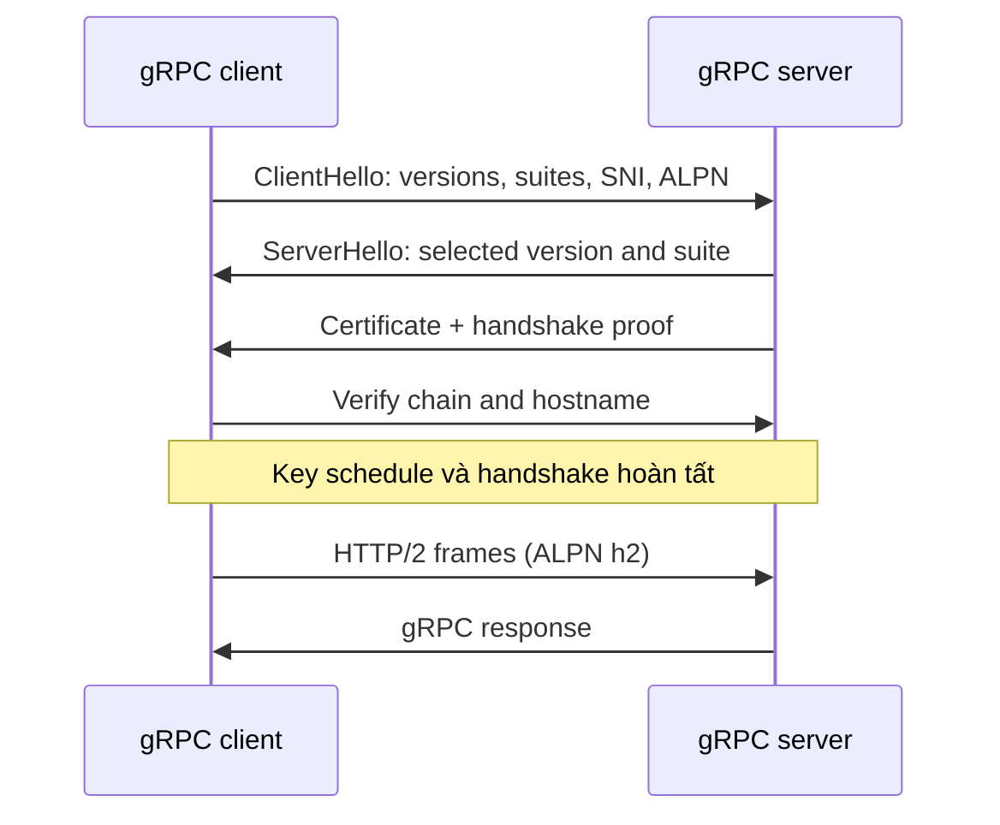

# TLS version và cipher policy

## Mục tiêu bài học

Trong **SPRING_GRPC**, gRPC chạy trên HTTP/2 và thường dùng TLS để bảo vệ transport. Việc bật TLS mới chỉ là bước đầu: server và client còn phải thống nhất phiên bản TLS, cipher suite, nhóm khóa và thuật toán chữ ký mà cả hai hỗ trợ. Một policy quá yếu có thể cho phép thuật toán lỗi thời; policy quá chặt có thể làm client hợp lệ không bắt tay được.

Bài học tập trung vào **TLS version và cipher policy**: chọn TLS 1.2/1.3, hiểu cipher suite và thuộc tính bảo mật của nó, giới hạn protocol/cipher ở gRPC Java, tích hợp policy vào Spring-managed server/client, và kiểm tra cấu hình thực sự được thương lượng khi chạy.

Sau bài này, bạn có thể:

1. Giải thích vai trò của TLS version, cipher suite, key exchange và signature scheme.
2. Chọn TLS 1.3 làm ưu tiên và giữ TLS 1.2 khi cần tương thích.
3. Chọn cipher suite hiện đại có AEAD và forward secrecy cho TLS 1.2.
4. Phân biệt cách đặt cipher suite của TLS 1.2 và TLS 1.3.
5. Cấu hình protocol/cipher policy cho gRPC Java server và channel.
6. Hiểu tác động của certificate RSA/ECDSA, JDK và TLS provider tới khả năng thương lượng.
7. Kiểm tra negotiated protocol/cipher, ALPN h2 và chẩn đoán handshake failure.

> **Phạm vi:** Ví dụ dùng gRPC Java, Spring gRPC, JSSE/Netty và OpenSSL. API cấu hình cụ thể phụ thuộc phiên bản gRPC Java, server factory và TLS provider. Khi Spring quản lý server, áp dụng policy qua cơ chế được phiên bản Spring gRPC hỗ trợ trên đúng listener đang phục vụ RPC.

## 1. TLS version và cipher suite giải quyết việc gì?

TLS handshake thống nhất một bộ tham số bảo mật trước khi truyền RPC:

- **TLS version:** phiên bản giao thức, ví dụ TLS 1.2 hoặc TLS 1.3.
- **Cipher suite:** bộ thuật toán bảo vệ dữ liệu, chủ yếu xác định symmetric encryption và hash/AEAD construction.
- **Key exchange:** cách hai phía thiết lập secret chung, ví dụ ECDHE hoặc cơ chế TLS 1.3 tương ứng.
- **Signature scheme:** thuật toán chữ ký dùng để xác thực handshake/certificate, ví dụ RSA-PSS hoặc ECDSA.
- **Certificate:** danh tính server (và client nếu dùng mTLS), cùng public key và SAN.
- **ALPN:** thương lượng application protocol; gRPC qua HTTP/2 cần `h2`.

Các yếu tố này liên quan nhưng không thể thay thế nhau. Một certificate hợp lệ không tự bảo đảm cipher policy tốt; cipher suite hiện đại cũng không sửa được hostname mismatch hoặc CA không được tin cậy.



Client và server chỉ có thể chọn trong phần giao nhau của các khả năng được hỗ trợ, được bật và được TLS provider chấp nhận. Nếu không có protocol/cipher chung, handshake thất bại trước khi RPC handler chạy.

## 2. Chọn phiên bản TLS

### 2.1. TLS 1.3 là lựa chọn ưu tiên

TLS 1.3 loại bỏ nhiều cơ chế cũ, rút gọn handshake và chỉ dùng cipher suite dựa trên AEAD. Các suite phổ biến gồm:

- `TLS_AES_128_GCM_SHA256`
- `TLS_AES_256_GCM_SHA384`
- `TLS_CHACHA20_POLY1305_SHA256`

TLS 1.3 tách cipher suite khỏi key exchange và signature scheme. Tên suite không còn mã hóa loại certificate/key exchange như nhiều suite TLS 1.2.

### 2.2. Giữ TLS 1.2 khi cần tương thích

TLS 1.2 vẫn có thể được cấu hình an toàn nếu chỉ bật cipher suite hiện đại. Các suite thường gặp:

- `TLS_ECDHE_RSA_WITH_AES_128_GCM_SHA256`
- `TLS_ECDHE_RSA_WITH_AES_256_GCM_SHA384`
- `TLS_ECDHE_ECDSA_WITH_AES_128_GCM_SHA256`
- `TLS_ECDHE_ECDSA_WITH_AES_256_GCM_SHA384`
- `TLS_ECDHE_RSA_WITH_CHACHA20_POLY1305_SHA256`
- `TLS_ECDHE_ECDSA_WITH_CHACHA20_POLY1305_SHA256`

`ECDHE` dùng ephemeral key exchange, hỗ trợ forward secrecy. `AES_GCM` và `CHACHA20_POLY1305` là AEAD construction, cung cấp confidentiality và integrity trong cùng cơ chế xác thực.

TLS 1.2 có thể cần thiết khi một client hoặc runtime chưa hỗ trợ TLS 1.3. Hãy dùng TLS 1.2 như compatibility floor có chủ đích, đồng thời theo dõi client cũ để có kế hoạch loại bỏ khi không còn cần.

### 2.3. Không bật protocol lỗi thời

Thông thường không nên cho phép:

- SSLv3.
- TLS 1.0.
- TLS 1.1.

Các protocol này đã lỗi thời và không phù hợp cho dịch vụ mới. Không cấu hình danh sách protocol quá rộng chỉ để “hỗ trợ mọi client”. Nếu một client chỉ kết nối được bằng TLS 1.0/1.1, cần nâng cấp runtime/client thay vì hạ policy của toàn server.

### 2.4. Policy mẫu

Một policy phổ biến cho service hiện đại là:

| Thuộc tính | Policy đề xuất |
| --- | --- |
| TLS versions | TLS 1.3 ưu tiên; TLS 1.2 khi cần tương thích |
| TLS 1.3 cipher suites | AES-GCM hoặc ChaCha20-Poly1305 |
| TLS 1.2 cipher suites | ECDHE kết hợp AES-GCM hoặc ChaCha20-Poly1305 |
| Key exchange | Ephemeral key exchange với nhóm được TLS provider hỗ trợ |
| Certificate signature | Thuật toán/chữ ký hiện đại được client và server hỗ trợ |
| ALPN | Bắt buộc thương lượng h2 cho gRPC HTTP/2 |
| Legacy algorithms | Tắt SSLv3, TLS 1.0/1.1, RC4, 3DES, NULL, EXPORT và suite yếu |

Policy thực tế phải xét JDK, TLS provider, loại certificate, proxy/load balancer và tập client được hỗ trợ. Không sao chép cipher list mà chưa kiểm tra trên runtime triển khai.

## 3. Hiểu cipher suite trước khi cấu hình

Tên cipher suite TLS 1.2 chứa nhiều thành phần. Ví dụ:

```text
TLS_ECDHE_RSA_WITH_AES_128_GCM_SHA256
```

- `ECDHE`: ephemeral Elliptic Curve Diffie-Hellman key exchange.
- `RSA`: certificate/server authentication dùng RSA trong suite này.
- `AES_128_GCM`: mã hóa AEAD bằng AES-GCM với key 128 bit.
- `SHA256`: hash liên quan tới PRF/handshake suite theo định nghĩa TLS 1.2.

Với suite TLS 1.3:

```text
TLS_AES_128_GCM_SHA256
```

Tên suite mô tả AEAD và hash. Key exchange group và signature scheme được thương lượng riêng. Vì vậy không thể suy ra TLS 1.3 dùng RSA key exchange chỉ vì server certificate có RSA public key.

### 3.1. Thuộc tính nên ưu tiên

- **AEAD:** dùng AES-GCM hoặc ChaCha20-Poly1305; tránh cipher không xác thực hoặc cơ chế cũ.
- **Forward secrecy:** với TLS 1.2, ưu tiên ECDHE thay cho static RSA key exchange.
- **Certificate compatibility:** suite TLS 1.2 có hậu tố RSA/ECDSA tương ứng loại certificate và signature capability.
- **Provider support:** cipher phải có trong JDK/Netty/OpenSSL provider đang dùng.
- **HTTP/2 compatibility:** gRPC qua HTTP/2 cần TLS profile tương thích HTTP/2; với TLS 1.2, tránh suite không AEAD và các suite bị HTTP/2 cấm.

Không dùng các suite cũ như RC4, 3DES, NULL, EXPORT, anonymous DH, static RSA key exchange hoặc CBC suite không còn phù hợp policy HTTP/2 hiện đại.

### 3.2. Certificate RSA và ECDSA

Certificate RSA có thể dùng các suite TLS 1.2 dạng `ECDHE_RSA`; certificate ECDSA tương ứng với `ECDHE_ECDSA`. Nếu policy chỉ cho phép ECDHE_ECDSA nhưng server chỉ có certificate RSA, hai bên có thể không tìm được phương thức authentication tương thích.

TLS 1.3 tách cipher suite khỏi signature scheme, nhưng certificate key type và signature algorithm vẫn phải tương thích. Khi rollout cipher policy, kiểm tra cả certificate đang được deploy, signature scheme mà JDK/provider hỗ trợ và khả năng của client.

## 4. Cấu hình protocol và cipher trong gRPC Java

gRPC Java có credential builders cho TLS server và client. Các phiên bản hỗ trợ cấu hình protocol/cipher cho credential có thể dùng `protocols(...)` và `ciphers(...)`.

### 4.1. Server credentials

Ví dụ cấu hình server chỉ cho TLS 1.3 và TLS 1.2, với các suite hiện đại:

```java
List<String> protocols = List.of("TLSv1.3", "TLSv1.2");

List<String> cipherSuites = List.of(
        "TLS_AES_128_GCM_SHA256",
        "TLS_AES_256_GCM_SHA384",
        "TLS_CHACHA20_POLY1305_SHA256",
        "TLS_ECDHE_RSA_WITH_AES_128_GCM_SHA256",
        "TLS_ECDHE_RSA_WITH_AES_256_GCM_SHA384",
        "TLS_ECDHE_ECDSA_WITH_AES_128_GCM_SHA256",
        "TLS_ECDHE_ECDSA_WITH_AES_256_GCM_SHA384",
        "TLS_ECDHE_RSA_WITH_CHACHA20_POLY1305_SHA256",
        "TLS_ECDHE_ECDSA_WITH_CHACHA20_POLY1305_SHA256"
);

ServerCredentials credentials = TlsServerCredentials.newBuilder()
        .keyManager(serverCertificateChain, serverPrivateKey)
        .protocols(protocols)
        .ciphers(cipherSuites)
        .build();
```

Đây là ví dụ minh họa danh sách policy. Mỗi TLS provider có tập suite được hỗ trợ khác nhau; nếu một suite không có trong provider, server có thể từ chối cấu hình hoặc bỏ suite theo implementation. Hãy kiểm tra capability của runtime trước khi đưa danh sách vào production.

Nếu server dùng mTLS, bổ sung trust manager và client authentication policy theo nhu cầu. Client CA trust không thay đổi cách chọn protocol/cipher; đó là phần xác minh client identity riêng.

### 4.2. Client channel credentials

Client cũng có thể giới hạn protocol/cipher ở credential của channel:

```java
ChannelCredentials credentials = TlsChannelCredentials.newBuilder()
        .trustManager(serverRootCa)
        .protocols(List.of("TLSv1.3", "TLSv1.2"))
        .ciphers(cipherSuites)
        .build();

ManagedChannel channel = Grpc.newChannelBuilder(
        "dns:///grpc.example.com:9090",
        credentials)
        .build();
```

Client policy phải giao nhau với server policy. Nếu client chỉ bật TLS 1.3 nhưng server chỉ bật TLS 1.2, handshake thất bại. Nếu hai bên bật cùng version nhưng cipher list không có suite chung, handshake cũng thất bại.

### 4.3. Credential API và TLS provider

Các method builder và mức độ hỗ trợ phụ thuộc phiên bản gRPC Java, transport và provider (JSSE hoặc Netty/OpenSSL). Một số deployment cấu hình TLS qua SSL context/server factory thay vì trực tiếp truyền credential builder. Đọc API của đúng dependency đang chạy và kiểm tra server thực sự sử dụng credential đó.

Không giả định các property dành cho HTTPS servlet/Tomcat tự động áp dụng cho native gRPC listener. Cấu hình TLS của HTTP web server và gRPC transport có thể là hai listener, hai SSL context và hai policy riêng.

## 5. Tích hợp policy vào Spring gRPC

Trong Spring gRPC, server factory quản lý listener, service registration và lifecycle. Khi áp dụng TLS policy:

1. Xác định server factory/transport thực tế (native Netty, servlet hoặc transport được dự án chọn).
2. Xác định nơi cấu hình SSL/TLS credentials mà phiên bản Spring gRPC hỗ trợ.
3. Áp dụng protocol và cipher policy lên đúng server listener.
4. Giữ certificate chain/private key và các service definition được bind vào server đó.
5. Kiểm tra server startup log hoặc negotiated session để xác nhận policy đã có hiệu lực.
6. Kiểm thử client tương thích và client bị policy từ chối.

Không tự đặt một property Spring chung như `spring.grpc.server.ssl.ciphers` nếu chưa xác minh nó tồn tại trong phiên bản đang dùng. Tên property, SSL bundle và customization hook có thể khác theo starter/transport. Nếu cần custom server factory, dùng extension point được tài liệu của phiên bản đó công bố.

### 5.1. Phân biệt native gRPC và HTTP server TLS

Một ứng dụng Spring Boot có thể đồng thời có:

- HTTP server cho REST/Actuator.
- Native gRPC server lắng nghe một port riêng.

Cấu hình cipher trên web server không có nghĩa native gRPC server đã nhận policy. Ngược lại, cấu hình gRPC TLS không tự bảo vệ management HTTP endpoint. Kiểm tra từng listener và từng port trong môi trường triển khai.

## 6. JVM security policy và phạm vi ảnh hưởng

Java có security properties như `jdk.tls.disabledAlgorithms` để loại bỏ protocol, cipher, key size hoặc signature algorithm không còn được phép. Đây là lớp policy của JSSE/JVM, có thể ảnh hưởng nhiều TLS connection trong process, không chỉ một gRPC channel.

Cần phân biệt:

| Cơ chế | Phạm vi |
| --- | --- |
| `TlsServerCredentials.protocols/ciphers` | Credential/server transport cụ thể nếu provider hỗ trợ |
| `TlsChannelCredentials.protocols/ciphers` | Channel/client transport cụ thể nếu provider hỗ trợ |
| SSLContext/SSLParameters | Các TLS connection dùng context/parameters đó |
| `jdk.tls.disabledAlgorithms` | Security policy JSSE ở cấp runtime/JVM |
| TLS policy tại proxy/load balancer | Listener hoặc hop TLS tại proxy đó |

Không chỉnh `jdk.tls.disabledAlgorithms` chỉ để sửa một gRPC connection lỗi nếu chưa đánh giá tác động đến toàn bộ process. Cũng không giả định `https.protocols` hoặc property riêng của HTTP client tự động điều khiển Netty gRPC transport.

Với Netty dùng native OpenSSL provider, tập cipher/protocol thực tế có thể khác JSSE. Xác minh provider đang chạy và kiểm tra kết quả handshake ở đúng listener.

## 7. TLS 1.2/1.3 và HTTP/2 gRPC

gRPC dùng HTTP/2 framing. Khi chạy qua TLS, ALPN thương lượng application protocol h2. Một TLS handshake thành công nhưng ALPN không chọn h2 chưa đủ để chứng minh endpoint có thể phục vụ gRPC.

Các điều cần xác minh:

- TLS version nằm trong policy cho phép.
- Cipher suite được chọn thuộc danh sách được duyệt.
- Certificate chain và hostname hợp lệ.
- ALPN chọn h2.
- HTTP/2 connection được thiết lập và RPC method được dispatch.

Với TLS 1.2, HTTP/2 yêu cầu các cipher suite đáp ứng profile an toàn; các suite không AEAD hoặc không có forward secrecy không phù hợp. Dùng ECDHE + AES-GCM/ChaCha20-Poly1305 để có profile tương thích tốt hơn. TLS 1.3 có bộ cipher suite AEAD riêng.

Không nhầm cipher suite với compression. TLS compression đã lỗi thời và nên bị vô hiệu hóa; HTTP/2 cũng có các quy tắc riêng về header compression HPACK, không phải TLS cipher policy.

## 8. Kiểm tra negotiated protocol và cipher

### 8.1. Dùng OpenSSL kiểm tra TLS 1.2

OpenSSL dùng option `-cipher` cho bộ cipher TLS 1.2. Ví dụ ép client thử TLS 1.2 với nhóm ECDHE + AEAD:

```bash
openssl s_client \
  -connect grpc.example.com:9090 \
  -servername grpc.example.com \
  -alpn h2 \
  -tls1_2 \
  -cipher 'ECDHE+AESGCM:ECDHE+CHACHA20' \
  -CAfile certs/root-ca.pem \
  -verify_hostname grpc.example.com \
  -verify_return_error
```

### 8.2. Dùng OpenSSL kiểm tra TLS 1.3

TLS 1.3 dùng option `-ciphersuites` thay cho `-cipher`:

```bash
openssl s_client \
  -connect grpc.example.com:9090 \
  -servername grpc.example.com \
  -alpn h2 \
  -tls1_3 \
  -ciphersuites 'TLS_AES_128_GCM_SHA256:TLS_AES_256_GCM_SHA384:TLS_CHACHA20_POLY1305_SHA256' \
  -CAfile certs/root-ca.pem \
  -verify_hostname grpc.example.com \
  -verify_return_error
```

Xem output để xác nhận protocol, cipher, certificate verification và ALPN. Nếu ép TLS 1.3 mà server chỉ bật TLS 1.2, handshake phải thất bại; đó là test policy có chủ đích. OpenSSL client không thay thế generated gRPC call, nhưng giúp khoanh vùng TLS negotiation.

### 8.3. Quan sát SSL session trong server

Với gRPC Java transport cung cấp SSL session attribute, server interceptor có thể đọc protocol và cipher đã thương lượng:

```java
SSLSession session =
        call.getAttributes().get(Grpc.TRANSPORT_ATTR_SSL_SESSION);

if (session != null) {
    String protocol = session.getProtocol();
    String cipherSuite = session.getCipherSuite();

    // Ghi metric/log đã chuẩn hóa, không ghi secret hoặc key material.
}
```

Đoạn trích đặt trong server interceptor. Nó giúp xác minh phiên TLS thực tế của RPC. Nếu transport không cung cấp SSL session attribute, dùng observability/API của provider hoặc proxy nơi TLS được terminate.

Không ghi toàn bộ SSL session, certificate private material hoặc dữ liệu nhạy cảm vào log. Chỉ ghi protocol, cipher suite, listener và thông tin kết nối đã được phép.

## 9. Kiểm thử compatibility và negative cases

Một bộ test policy nên chứng minh cả kết nối hợp lệ và cấu hình bị từ chối:

| Test | Client policy | Server policy | Kết quả mong đợi |
| --- | --- | --- | --- |
| TLS 1.3 bình thường | TLS 1.3 + suite được duyệt | TLS 1.3 + suite được duyệt | Handshake và RPC thành công |
| TLS 1.2 compatibility | TLS 1.2 + ECDHE/AEAD | TLS 1.2 được bật | Thành công nếu có suite chung |
| Protocol bị cấm | Chỉ TLS 1.0/1.1 | TLS 1.2/1.3 | Handshake thất bại |
| Không có cipher chung | Chỉ suite ngoài allowlist | Suite allowlist hiện đại | Handshake thất bại |
| Certificate key type không tương thích | Chỉ suite/auth phù hợp ECDSA | Server chỉ có RSA cert | Có thể không có suite/signature chung ở TLS 1.2 |
| ALPN không có h2 | Client không thương lượng h2 | gRPC server yêu cầu HTTP/2 | TLS có thể xong nhưng gRPC không hoạt động đúng |
| Certificate sai hostname | Cipher/version tương thích | Server cert SAN khác target | Client từ chối identity |
| mTLS client không hợp lệ | Thiếu/sai client certificate | Server yêu cầu mTLS | Handshake thất bại |

Test bằng gRPC integration client sau khi kiểm tra TLS bằng OpenSSL. Thu negotiated protocol/cipher từ server session hoặc TLS provider để chứng minh kết quả, không chỉ dựa vào việc channel tạo thành công.

### 9.1. Compatibility matrix

Trước rollout, lập ma trận các loại client đang được hỗ trợ:

- JDK/runtime version.
- gRPC Java version.
- Netty/Native OpenSSL hay JSSE provider.
- Hệ điều hành/crypto provider.
- TLS 1.2/1.3 support.
- Certificate key type và signature scheme.
- Cipher suites được hỗ trợ.
- ALPN h2 support.

Chạy thử trên các runtime đại diện. Nếu bỏ một suite cũ, cần biết client nào sẽ mất khả năng kết nối và có kế hoạch nâng cấp rõ ràng.

## 10. Rollout và vận hành cipher policy

Không thay policy trên toàn bộ fleet cùng lúc nếu chưa kiểm tra compatibility. Một rollout an toàn có thể gồm:

1. Thu thập protocol/cipher hiện tại từ telemetry ở server/proxy.
2. Xác định client cũ và các suite đang dùng.
3. Bật TLS 1.3 cùng TLS 1.2 hiện đại trên staging.
4. Kiểm thử client matrix và mTLS.
5. Triển khai theo canary/rolling deployment.
6. Theo dõi handshake failure, protocol distribution, cipher distribution và RPC error rate.
7. Loại suite/protocol cũ sau khi client đã nâng cấp.
8. Có rollback policy được kiểm soát nếu phát hiện client hợp lệ không tương thích.

Các metric nên có:

- TLS handshake success/failure.
- Protocol version distribution.
- Cipher suite distribution.
- ALPN negotiation failure.
- Certificate expiry và trust failure.
- Client/runtime fingerprint ở mức được phép và không xâm phạm riêng tư.
- gRPC RPC status/latency sau handshake.

Đừng chỉ nhìn RPC UNAVAILABLE để kết luận cipher lỗi; có thể lỗi DNS, TCP, certificate, ALPN hoặc service registration. Kết hợp TLS diagnostics với gRPC metrics để phân biệt lớp lỗi.

## 11. Lỗi thường gặp

| Triệu chứng | Nguyên nhân | Cách xử lý |
| --- | --- | --- |
| Client cũ không kết nối sau rollout | Client chỉ hỗ trợ protocol/cipher đã bị loại | Xác định runtime và nâng cấp; chỉ giữ compatibility suite nếu được phê duyệt |
| Không có cipher suite chung | Allowlist hai phía không giao nhau | So sánh capability client/server/provider và điều chỉnh policy |
| TLS 1.3 không được thương lượng | JDK/provider/transport hoặc một phía không hỗ trợ | Kiểm tra runtime và protocol list thực tế |
| TLS 1.2 thất bại dù version được bật | Suite bị HTTP/2 cấm, không có AEAD hoặc không tương thích certificate | Chọn ECDHE + AEAD và kiểm tra RSA/ECDSA certificate |
| Cấu hình ciphers không có tác dụng | Đã cấu hình nhầm listener hoặc property không được transport dùng | Kiểm tra đúng server factory và negotiated session |
| Web HTTPS đã đổi cipher nhưng gRPC không đổi | REST và native gRPC dùng listener/SSL context riêng | Cấu hình gRPC transport riêng |
| OpenSSL test pass nhưng RPC fail | TLS handshake pass nhưng ALPN/service/RPC có lỗi | Xác minh h2 và gọi generated stub |
| Java test khác OpenSSL | Khác TLS provider, trust store hoặc cipher naming | Kiểm tra provider/runtime của cả hai phía |
| mTLS fail sau đổi policy | Client cert signature/key type không còn tương thích hoặc trust khác | Kiểm thử client certificate, signature scheme và trust roots |
| Handshake failure tăng đột ngột | Policy rollout loại suite client đang dùng | Canary, telemetry theo cipher/version và rollback có kiểm soát |

## 12. Bài tập thực hành

1. Lập allowlist TLS 1.3 và TLS 1.2 cho service, ghi rõ cipher suite, key exchange và loại certificate tương thích.
2. Cấu hình gRPC Java server credentials chỉ bật TLS 1.2/1.3 và cipher suite AEAD được provider hỗ trợ.
3. Cấu hình client channel tương thích, sau đó thử client chỉ bật TLS 1.2 và chỉ TLS 1.3.
4. Dùng OpenSSL `s_client` với `-tls1_2 -cipher` và `-tls1_3 -ciphersuites`; xác minh protocol/cipher được thương lượng.
5. Bổ sung server interceptor ghi metric protocol/cipher từ SSL session.
6. Kiểm tra ALPN `h2` và gọi generated stub để xác nhận RPC thực sự hoạt động.
7. Thử bỏ một suite khỏi allowlist và quan sát client nào không còn kết nối; giải thích nguyên nhân theo runtime/certificate.
8. Viết rollout plan có compatibility matrix, canary, telemetry và rollback cho việc loại TLS 1.2 hoặc cipher cũ.

### Câu hỏi tự kiểm tra

- TLS version khác cipher suite như thế nào?
- Vì sao TLS 1.3 cipher suite không mã hóa key exchange/authentication như TLS 1.2?
- AEAD và forward secrecy bảo vệ những thuộc tính nào?
- Vì sao TLS 1.2 suite cần tương thích với loại certificate RSA/ECDSA?
- Tại sao gRPC qua HTTP/2 cần ALPN h2?
- Vì sao không nên bật TLS 1.0/1.1 để hỗ trợ một client cũ?
- `-cipher` khác `-ciphersuites` trong OpenSSL như thế nào?
- Vì sao cấu hình HTTPS servlet không nhất thiết ảnh hưởng native gRPC server?
- `jdk.tls.disabledAlgorithms` có phạm vi tác động ra sao?
- Làm thế nào xác nhận negotiated protocol/cipher thay vì chỉ đọc cấu hình?

## Tài liệu tham khảo

- [RFC 8446 — TLS 1.3](https://www.rfc-editor.org/rfc/rfc8446): protocol, cipher suites và handshake TLS 1.3.
- [RFC 5246 — TLS 1.2](https://www.rfc-editor.org/rfc/rfc5246): protocol và cipher suite TLS 1.2.
- [RFC 9113 — HTTP/2](https://www.rfc-editor.org/rfc/rfc9113): yêu cầu TLS và ALPN cho HTTP/2.
- [gRPC — Authentication](https://grpc.io/docs/guides/auth/): bảo mật transport và TLS trong gRPC.
- [gRPC Java — TlsServerCredentials](https://grpc.github.io/grpc-java/javadoc/io/grpc/TlsServerCredentials.html): protocol/cipher và server credential.
- [gRPC Java — TlsChannelCredentials](https://grpc.github.io/grpc-java/javadoc/io/grpc/TlsChannelCredentials.html): protocol/cipher và client credential.
- [Java Security — JSSE Reference Guide](https://docs.oracle.com/en/java/javase/17/security/java-secure-socket-extension-jsse-reference-guide.html): TLS provider, cipher suites và JSSE.
- [OpenSSL — s_client](https://docs.openssl.org/3.0/man1/openssl-s_client/): ép protocol/cipher và quan sát handshake.

**Kết quả mong đợi:** Người học xây dựng được TLS policy hiện đại cho gRPC bằng cách giới hạn TLS 1.2/1.3 và cipher suite phù hợp, hiểu sự khác nhau giữa cipher TLS 1.2/1.3, giữ tương thích HTTP/2 ALPN h2, áp dụng cấu hình vào đúng Spring-managed gRPC listener, và xác minh protocol/cipher thực tế qua handshake cùng integration test.
