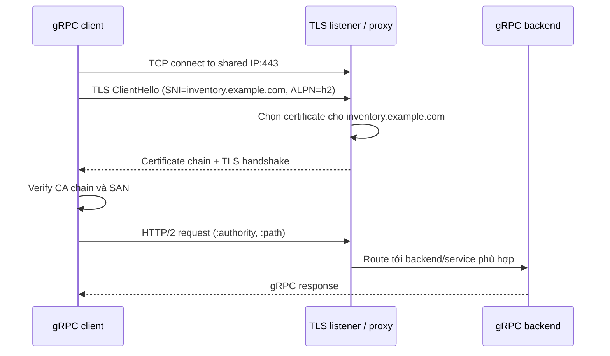
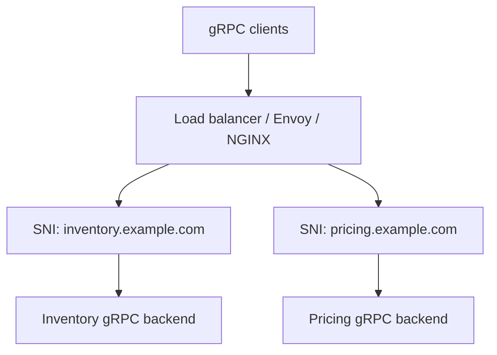

# SNI và nhiều hostname

## Mục tiêu bài học

Một gRPC server có thể được truy cập bằng nhiều hostname, chẳng hạn `inventory.example.com` và `pricing.example.com`. Khi các hostname cùng trỏ tới một IP và port TLS, server cần biết client muốn kết nối tới tên nào để chọn certificate phù hợp. TLS giải quyết việc này bằng **Server Name Indication (SNI)**: client gửi hostname dự kiến trong TLS ClientHello trước khi server trình certificate.

Bài học tập trung vào **SNI và nhiều hostname** trong SPRING_GRPC: hiểu SNI, liên hệ SNI với DNS, certificate SAN, hostname verification và HTTP/2 authority; chọn giữa một certificate nhiều SAN với nhiều certificate được chọn theo SNI; cấu hình gRPC client; tích hợp TLS termination hoặc custom server factory trong Spring; và kiểm thử các trường hợp nhiều hostname.

Sau bài này, bạn có thể:

1. Giải thích SNI được gửi ở đâu và giúp server chọn virtual host/certificate như thế nào.
2. Phân biệt SNI, certificate SAN, channel target và HTTP/2 authority.
3. Chọn một certificate nhiều SAN hoặc nhiều certificate theo SNI.
4. Hiểu giới hạn của cấu hình server credential một certificate và khi nào cần TLS terminator hoặc SNI-aware provider.
5. Cấu hình gRPC client dùng đúng hostname dù DNS phân giải tới cùng IP.
6. Thiết kế routing nhiều hostname mà vẫn giữ TLS identity và HTTP/2 routing nhất quán.
7. Kiểm thử certificate selection, hostname verification, ALPN h2 và lỗi SNI.

> **Phạm vi:** Ví dụ dùng gRPC Java, Spring gRPC, OpenSSL và proxy HTTP/2. Chi tiết tích hợp phụ thuộc server factory/transport của phiên bản đang dùng. SNI chọn danh tính TLS ở handshake; việc route RPC tới service/method vẫn là trách nhiệm của gRPC server hoặc proxy.

## 1. SNI giải quyết vấn đề gì?

TLS handshake bắt đầu trước khi client gửi HTTP/2 request. Khi nhiều hostname cùng dùng một địa chỉ IP và port, server chưa thể đọc HTTP/2 authority để biết hostname của request vì TLS handshake chưa hoàn tất. SNI cho phép client gửi tên DNS ngay trong ClientHello để server chọn certificate hoặc cấu hình virtual host phù hợp.

Ví dụ một listener phục vụ:

- `inventory.example.com`
- `pricing.example.com`
- `orders.example.com`

DNS của cả ba tên có thể trỏ tới cùng load balancer và port 443. Client gửi SNI tương ứng hostname nó định kết nối. TLS terminator chọn certificate có SAN phù hợp, hoàn tất handshake, sau đó HTTP/2 request mang authority và gRPC path để tiếp tục routing.



SNI là extension trong TLS ClientHello, thường chứa DNS hostname dạng plaintext trong handshake thông thường. SNI không phải bí mật xác thực và không thay thế certificate validation. Một client có thể khai báo SNI bất kỳ; server vẫn phải trình certificate hợp lệ và client phải xác minh identity mà nó định kết nối.

## 2. Phân biệt SNI, SAN, target và authority

Các giá trị thường giống nhau trong cấu hình đơn giản nhưng có vai trò khác nhau:

| Thành phần | Lớp giao thức | Ý nghĩa |
| --- | --- | --- |
| **Channel target hostname** | gRPC client/name resolver | Tên client dùng để định vị endpoint; DNS resolver có thể ánh xạ tới một hoặc nhiều IP |
| **SNI** | TLS ClientHello | Tên client gửi để server chọn certificate/virtual host TLS |
| **Certificate SAN** | X.509 certificate | Các DNS/IP identity mà certificate đại diện |
| **HTTP/2 :authority** | HTTP/2 request headers | Authority của request, thường gồm host và có thể kèm port |
| **gRPC :path** | HTTP/2 request headers | Đường dẫn method, dạng `/package.Service/Method` |

Ví dụ một call tới `inventory.example.com` có thể có:

- Target hostname: `inventory.example.com`.
- SNI: `inventory.example.com`.
- SAN của server certificate: `DNS:inventory.example.com`.
- HTTP/2 authority: `inventory.example.com:443`.
- gRPC path: `/commerce.v1.Inventory/GetStock`.

SNI giúp chọn certificate trong handshake. SAN được client dùng để xác minh certificate có đại diện đúng hostname hay không. Authority có thể được proxy dùng để route request sau handshake. gRPC path chọn service và method.

Không dùng metadata do client tự khai báo làm căn cứ tin cậy cho danh tính TLS. SNI và authority là dữ liệu routing; danh tính server vẫn phải được client xác minh bằng trust chain và SAN.

## 3. Hai cách phục vụ nhiều hostname

### 3.1. Một certificate có nhiều SAN

Nếu các hostname cùng thuộc một endpoint và cùng dùng một danh tính vận hành, có thể cấp một certificate với nhiều DNS SAN:

```text
X509v3 Subject Alternative Name:
    DNS:inventory.example.com,
    DNS:pricing.example.com,
    DNS:orders.example.com
```

Cách này đơn giản: một certificate chain và private key phục vụ cả ba hostname. Client kết nối bằng tên nào thì certificate vẫn hợp lệ nếu tên đó nằm trong SAN và chain được client tin cậy.

Ưu điểm:

- Cấu hình server đơn giản, phù hợp một certificate/key pair.
- Không cần lựa chọn key manager theo SNI.
- Dễ triển khai với server credential cơ bản của gRPC Java.

Giới hạn:

- Mọi hostname dùng chung private key và chu kỳ rotate.
- Không tách biệt quyền sở hữu certificate giữa các nhóm/tenant.
- Certificate cần được cấp lại khi danh sách SAN thay đổi.
- Một lỗi quản lý key ảnh hưởng tất cả hostname trong certificate.

Chỉ đưa vào SAN các hostname thực sự thuộc endpoint và được CA phê duyệt. Không gom hostname của tenant hoặc ứng dụng không liên quan chỉ để giảm số certificate.

### 3.2. Nhiều certificate được chọn theo SNI

Nếu mỗi hostname cần certificate/key riêng, TLS terminator phải hỗ trợ lựa chọn certificate dựa trên SNI:

| SNI client gửi | Certificate server trình |
| --- | --- |
| `inventory.example.com` | Certificate Inventory |
| `pricing.example.com` | Certificate Pricing |
| `orders.example.com` | Certificate Orders |

Cách này tách biệt private key và lifecycle giữa các hostname. Nó phù hợp khi các hostname thuộc tenant, nhóm vận hành hoặc trust domain khác nhau.

Việc lựa chọn certificate diễn ra trong TLS layer trước khi gRPC service dispatch. Một gRPC server builder đơn giản chỉ nhận một certificate chain/key pair không tự động trở thành SNI router chỉ vì có nhiều `@GrpcService` bean.

Các lựa chọn triển khai thường gặp:

- TLS terminate tại Envoy, NGINX hoặc load balancer hỗ trợ SNI và HTTP/2.
- Dùng TLS provider/server transport có SNI-aware key manager hoặc Netty SNI handler/SSL context phù hợp.
- Dùng listener riêng khi yêu cầu cô lập certificate, network policy hoặc tenant isolation đủ lớn.

## 4. Cấp phát certificate cho nhiều hostname

Certificate phải có SAN chứa đúng các hostname client sử dụng. Nếu dùng một certificate nhiều SAN, yêu cầu CA cấp tất cả tên được phê duyệt. Nếu dùng nhiều certificate, mỗi certificate có SAN tương ứng hostname riêng.

Ví dụ cấu hình OpenSSL CSR cho một certificate dùng chung:

```ini
[ req ]
prompt = no
distinguished_name = subject
req_extensions = server_extensions

[ subject ]
CN = grpc.example.com

[ server_extensions ]
subjectAltName = @server_names
extendedKeyUsage = serverAuth

[ server_names ]
DNS.1 = inventory.example.com
DNS.2 = pricing.example.com
DNS.3 = orders.example.com
```

Tạo key và CSR:

```bash
openssl genpkey -algorithm RSA -pkeyopt rsa_keygen_bits:3072 -out grpc-key.pem
openssl req -new -key grpc-key.pem -out grpc.csr -config grpc-san.cnf
```

CSR chỉ yêu cầu CA cấp SAN. CA có thể áp dụng policy và phát hành certificate khác với yêu cầu. Sau khi nhận certificate, kiểm tra nội dung thực tế:

```bash
openssl x509 -in grpc-chain.pem -noout -subject -issuer -dates -ext subjectAltName -ext extendedKeyUsage
```

Với nhiều certificate riêng, tạo key/CSR/chain độc lập cho từng hostname hoặc nhóm hostname. Không dùng chung private key nếu mục tiêu của việc tách certificate là cô lập danh tính và khả năng thu hồi.

### 4.1. Wildcard certificate

Wildcard như `DNS:*.example.com` có thể đại diện các hostname một cấp như `inventory.example.com` và `pricing.example.com`. Nó không đại diện `example.com` hoặc `a.inventory.example.com`. Wildcard không phải cách thay thế cho SNI: server vẫn cần biết virtual host nào client yêu cầu nếu có nhiều certificate hoặc policy khác nhau.

Wildcard certificate giảm số SAN nhưng mở rộng phạm vi danh tính mà một private key đại diện. Chỉ dùng khi policy PKI cho phép và phạm vi domain được kiểm soát.

## 5. Cấu hình gRPC client gửi đúng hostname

Client nên dùng DNS target của service thay vì IP backend trực tiếp. DNS resolver có thể phân giải hostname thành IP load balancer, trong khi logical target vẫn giữ hostname cần dùng cho TLS identity và routing.

Ví dụ:

```java
ManagedChannel channel = ManagedChannelBuilder
        .forAddress("inventory.example.com", 443)
        .useTransportSecurity()
        .build();
```

Nếu dùng custom trust root:

```java
ChannelCredentials credentials = TlsChannelCredentials.newBuilder()
        .trustManager(serverRootCa)
        .build();

ManagedChannel channel = Grpc.newChannelBuilder(
        "dns:///inventory.example.com:443",
        credentials)
        .build();
```

Trong cấu hình thông thường, gRPC client dùng logical server name của target cho TLS hostname verification và SNI theo transport. Certificate server phải có `DNS:inventory.example.com` trong SAN và chain phải được client tin cậy.

### 5.1. Khi địa chỉ kết nối là IP nhưng identity là DNS

Một số môi trường cần kết nối tới IP cụ thể nhưng vẫn xác minh logical hostname. Có thể dùng DNS resolver trỏ hostname tới IP, hoặc cấu hình authority override có chủ đích:

```java
ManagedChannel channel = ManagedChannelBuilder
        .forAddress("10.20.0.15", 443)
        .overrideAuthority("inventory.example.com")
        .useTransportSecurity()
        .build();
```

`overrideAuthority` thay đổi authority mà channel sử dụng; ảnh hưởng chính xác tới TLS name/SNI phụ thuộc gRPC transport và phiên bản. Chỉ dùng khi đã kiểm tra hành vi của implementation, certificate SAN, SNI và HTTP/2 authority. Ưu tiên target DNS bình thường khi có thể.

Không override authority theo dữ liệu tùy ý do người gọi cung cấp. Việc này có thể làm client xác minh một identity khác với endpoint mà hệ thống dự định kết nối hoặc làm proxy route nhầm virtual host.

## 6. Server chọn certificate theo SNI

### 6.1. TLS termination tại proxy

Đây thường là cách dễ vận hành khi cần nhiều certificate riêng. Proxy nhận TLS connection, đọc SNI, chọn certificate phù hợp, hoàn tất handshake và chuyển HTTP/2/gRPC request tới backend.



Cấu hình proxy cần bảo đảm:

- Listener TLS có certificate mapping theo SNI.
- ALPN thương lượng `h2`.
- Proxy hỗ trợ HTTP/2 ở upstream khi chuyển tiếp gRPC.
- Authority/path được route đúng backend/service.
- Nếu proxy kết nối upstream bằng TLS, upstream certificate cũng phải được xác minh đúng hostname.
- Timeout, flow control, trailer và status gRPC được proxy hỗ trợ đúng.

TLS termination nghĩa proxy giải mã TLS ở edge. Nếu cần mã hóa cả hop proxy-to-backend, cấu hình TLS/mTLS riêng cho upstream. SNI phía client và SNI proxy gửi tới upstream có thể là hai giá trị khác nhau; phải thiết kế rõ hostname backend được xác minh.

### 6.2. TLS passthrough

Với passthrough, load balancer định tuyến TCP connection dựa trên SNI nhưng không giải mã TLS. Backend nhận ClientHello ban đầu và tự hoàn tất handshake bằng certificate của mình.

Cách này giữ TLS end-to-end tới backend, nhưng khả năng routing phụ thuộc proxy/L4 load balancer hỗ trợ đọc SNI từ ClientHello. Sau khi mã hóa, proxy passthrough không đọc được HTTP/2 authority hoặc gRPC path để route từng method. Nó thường chọn backend ở cấp hostname/connection.

### 6.3. SNI-aware TLS provider trong server

Nếu muốn một JVM server trực tiếp chọn nhiều key pair theo SNI, TLS stack phải hỗ trợ SNI-aware certificate selection, ví dụ custom JSSE X509ExtendedKeyManager hoặc Netty SNI handler/SSL context phù hợp. Sau đó server factory của Spring gRPC phải cho phép cài SSL context/transport customization này.

Không giả định `TlsServerCredentials.keyManager(chain, key)` cơ bản tự nhận nhiều hostname và tự chọn nhiều certificate. Nếu server factory của phiên bản dự án không công bố hook cần thiết, dùng proxy TLS terminator hoặc listener riêng thay vì tự tạo server thứ hai bên cạnh server Spring đang quản lý.

## 7. SNI không phải gRPC service routing

Một server có thể dùng cùng certificate cho nhiều hostname nhưng vẫn route RPC tới các service khác nhau. Hai quyết định xảy ra ở các lớp khác nhau:

1. **TLS certificate selection:** dựa trên SNI trong ClientHello.
2. **HTTP/2/gRPC routing:** dựa trên authority, path và cấu hình proxy/server.

Ví dụ:

| Hostname | SNI certificate | HTTP/2 authority | gRPC path |
| --- | --- | --- | --- |
| `inventory.example.com` | Inventory cert hoặc SAN chung | `inventory.example.com` | `/commerce.v1.Inventory/GetStock` |
| `pricing.example.com` | Pricing cert hoặc SAN chung | `pricing.example.com` | `/commerce.v1.Pricing/GetPrice` |

Nếu cả hai hostname cùng trỏ tới một gRPC server và cùng certificate multi-SAN, server vẫn có thể dispatch theo service path. Nếu cần route theo hostname, cấu hình virtual host ở proxy hoặc application routing policy tương ứng; không mặc định gRPC Java tự tách service theo SNI.

Không dùng SNI làm authorization. Client có thể tự đặt SNI; quyền truy cập phải dựa trên authentication đã xác minh và authorization policy của method/resource.

## 8. Kiểm tra SNI và certificate selection

### 8.1. Dùng OpenSSL

Kiểm tra hostname Inventory:

```bash
openssl s_client \
  -connect 10.20.0.15:443 \
  -servername inventory.example.com \
  -verify_hostname inventory.example.com \
  -alpn h2 \
  -CAfile certs/root-ca.pem \
  -verify_return_error \
  -showcerts
```

Kiểm tra hostname Pricing:

```bash
openssl s_client \
  -connect 10.20.0.15:443 \
  -servername pricing.example.com \
  -verify_hostname pricing.example.com \
  -alpn h2 \
  -CAfile certs/root-ca.pem \
  -verify_return_error \
  -showcerts
```

So sánh leaf certificate, SAN, issuer, fingerprint và ALPN. Nếu hai hostname dùng certificate riêng, server phải trình đúng certificate tương ứng SNI. Nếu dùng certificate multi-SAN, cùng leaf certificate có thể hợp lệ cho cả hai.

Thử không gửi SNI hoặc gửi hostname không được cấu hình để kiểm tra default certificate/fallback behavior. Không nên để fallback trình một certificate không liên quan mà client dễ hiểu nhầm là endpoint hợp lệ.

### 8.2. Kiểm tra RPC sau TLS

Sau khi handshake thành công, gọi generated stub tới từng hostname và xác minh RPC đi đúng service. Nếu reflection được bật, có thể dùng grpcurl để khám phá service; nếu không, dùng proto/descriptor set.

TLS test pass chỉ chứng minh kết nối và certificate negotiation. Nó không chứng minh authority/path routing tới đúng service. Integration test cần xác minh cả response của từng RPC.

## 9. Kiểm thử nhiều hostname

Bộ kiểm thử nên có cả positive và negative case:

| Test | Cấu hình | Kết quả mong đợi |
| --- | --- | --- |
| Hostname Inventory | SNI và target Inventory, SAN phù hợp | Đúng certificate, handshake và RPC thành công |
| Hostname Pricing | SNI và target Pricing, SAN phù hợp | Đúng certificate, handshake và RPC thành công |
| Certificate multi-SAN | Một certificate chứa cả hai DNS SAN | Cả hai hostname đều xác minh được |
| SNI không biết | Client gửi hostname không được cấu hình | Fallback/default policy được áp dụng; client không chấp nhận identity sai |
| SAN thiếu hostname | SNI/target Pricing nhưng certificate chỉ có Inventory SAN | Hostname verification thất bại |
| CA không tin cậy | SNI đúng nhưng client không trust issuer | Chain validation thất bại |
| Authority/path sai | TLS thành công nhưng HTTP/2 authority hoặc gRPC path không đúng route | RPC bị route sai hoặc trả status tương ứng |
| ALPN thiếu h2 | TLS listener không thương lượng HTTP/2 | gRPC call không hoạt động đúng |

Trong Spring gRPC integration test, khởi động đúng server/proxy topology dùng ở môi trường triển khai. Tạo channel cho từng hostname, dùng trust roots test, gọi method tương ứng và xác minh certificate/route. Không chỉ test một hostname rồi suy ra mọi SNI mapping đều đúng.

## 10. Vận hành certificate và hostname

Nhiều hostname làm tăng số mapping cần quản lý giữa DNS, certificate, listener và backend. Nên duy trì một inventory có owner rõ ràng:

| Trường | Ví dụ |
| --- | --- |
| Hostname | `inventory.example.com` |
| DNS target | Load balancer address |
| SNI certificate | Inventory certificate |
| SAN | `DNS:inventory.example.com` |
| TLS termination point | Edge proxy |
| Upstream target | `inventory-grpc.internal:9090` |
| Certificate expiry | Ngày hết hạn theo certificate |
| Owner | Nhóm vận hành service |

Khi thêm hoặc đổi hostname:

1. Đăng ký DNS và xác định listener/route.
2. Cấp certificate có SAN đúng hoặc cập nhật SNI certificate mapping.
3. Phân phối trust roots cần thiết tới client nếu CA thay đổi.
4. Cấu hình proxy/target/authority và upstream TLS nếu có.
5. Kiểm tra SNI, SAN, ALPN h2 và RPC route trên staging.
6. Rollout mapping/certificate có kiểm soát; theo dõi handshake failure.
7. Thu hồi hostname/certificate cũ sau khi client đã chuyển.

Theo dõi metric handshake success/failure theo listener và hostname ở mức được phép, certificate expiry, SNI không khớp, ALPN negotiation và gRPC status/latency. Tránh log dữ liệu nhạy cảm; hostname thường không phải secret nhưng có thể tiết lộ cấu trúc nội bộ.

## 11. Lỗi thường gặp

| Triệu chứng | Nguyên nhân | Cách xử lý |
| --- | --- | --- |
| Mọi hostname nhận cùng certificate nhưng một số client fail | Certificate không có đủ SAN | Bổ sung SAN hoặc dùng certificate riêng theo SNI |
| SNI đúng nhưng server trả certificate mặc định | SNI mapping không khớp hoặc TLS terminator chưa nạp certificate | Kiểm tra listener virtual host và reload certificate |
| Certificate đúng nhưng RPC tới sai backend | Authority/path routing sai sau TLS | Kiểm tra HTTP/2 authority, gRPC path và proxy route |
| DNS trỏ đúng IP nhưng hostname verification fail | Target dùng IP hoặc alias không có trong SAN | Dùng logical DNS target hoặc cấp SAN phù hợp |
| Thêm @GrpcService nhưng không có certificate riêng | Service bean không điều khiển TLS certificate selection | Cấu hình SNI-aware TLS layer hoặc proxy |
| Proxy passthrough không route theo method | TLS payload không được giải mã | Dùng routing theo SNI/connection hoặc TLS termination nếu cần path routing |
| gRPC lỗi sau khi proxy terminate TLS | Upstream không dùng HTTP/2/gRPC đúng cách | Bật HTTP/2 upstream và kiểm tra trailer/status |
| SNI mới hoạt động nhưng hostname cũ lỗi | Certificate rotation/mapping loại SAN cũ quá sớm | Dùng overlap và rollout theo thứ tự |
| Không có SNI từ client | Client/transport cũ hoặc target không có DNS identity | Kiểm tra client target và dùng fallback policy an toàn |
| Dùng overrideAuthority làm lỗi xác minh | Logical authority không khớp certificate hoặc proxy route | Đồng bộ target, authority, SNI và SAN; không bypass verification |

## 12. Bài tập thực hành

1. Tạo một certificate có SAN inventory.example.test và pricing.example.test; xác minh cả hai hostname bằng OpenSSL.
2. Dùng cùng một gRPC listener với certificate multi-SAN và gọi hai service qua hai channel target khác nhau.
3. Tạo hai certificate riêng, cấu hình SNI-aware proxy để chọn certificate theo ClientHello hostname.
4. Dùng OpenSSL s_client gửi SNI Inventory và Pricing; xác minh leaf certificate/fingerprint được chọn.
5. Thử SNI không xác định và không gửi SNI; ghi nhận default certificate policy và kết quả hostname verification.
6. Cấu hình HTTP/2 authority/path routing cho hai service; chứng minh TLS certificate selection không tự quyết định gRPC method routing.
7. Thử TLS passthrough và TLS termination; so sánh khả năng route theo hostname, authority và path.
8. Viết integration test cho đúng hostname, sai SAN, CA không tin cậy, SNI không xác định và ALPN không có h2.
9. Lập inventory hostname/certificate/owner/expiry và quy trình thêm, rotate, thu hồi hostname.

### Câu hỏi tự kiểm tra

- Vì sao server cần SNI khi nhiều hostname cùng dùng một IP và port?
- SNI được gửi ở giai đoạn nào của kết nối TLS?
- SNI khác SAN và HTTP/2 authority như thế nào?
- Một certificate multi-SAN có thể phục vụ nhiều hostname ra sao?
- Khi nào nên dùng nhiều certificate được chọn theo SNI?
- Vì sao nhiều `@GrpcService` bean không tự tạo nhiều TLS certificate?
- TLS passthrough khác TLS termination ở điểm nào?
- Khi nào proxy có thể route theo SNI và khi nào cần đọc HTTP/2 authority/path?
- `overrideAuthority` có thể ảnh hưởng identity/routing như thế nào?
- Làm thế nào kiểm thử đồng thời certificate selection và gRPC service routing?

## Tài liệu tham khảo

- [RFC 6066 — TLS Extensions: Server Name Indication](https://www.rfc-editor.org/rfc/rfc6066): định nghĩa SNI trong TLS ClientHello.
- [RFC 8446 — TLS 1.3](https://www.rfc-editor.org/rfc/rfc8446): TLS handshake và certificate authentication.
- [RFC 9525 — Service Identity in TLS](https://www.rfc-editor.org/rfc/rfc9525): xác minh hostname/server identity.
- [gRPC — Authentication](https://grpc.io/docs/guides/auth/): TLS transport và xác thực trong gRPC.
- [gRPC Java — ManagedChannelBuilder](https://grpc.github.io/grpc-java/javadoc/io/grpc/ManagedChannelBuilder.html): target và authority của client channel.
- [gRPC Java — TlsServerCredentials](https://grpc.github.io/grpc-java/javadoc/io/grpc/TlsServerCredentials.html): server certificate credentials.
- [OpenSSL — s_client](https://docs.openssl.org/3.0/man1/openssl-s_client/): gửi SNI và kiểm tra certificate/ALPN.
- [Envoy — TLS](https://www.envoyproxy.io/docs/envoy/latest/intro/arch_overview/security/ssl): TLS termination và certificate selection trong proxy.

**Kết quả mong đợi:** Người học thiết kế được endpoint gRPC phục vụ nhiều hostname bằng certificate multi-SAN hoặc certificate selection theo SNI, cấu hình client giữ đúng logical hostname, phân biệt TLS identity với HTTP/2/gRPC routing, tích hợp đúng TLS termination/server factory trong Spring, và kiểm thử được certificate cùng RPC route cho từng hostname.
