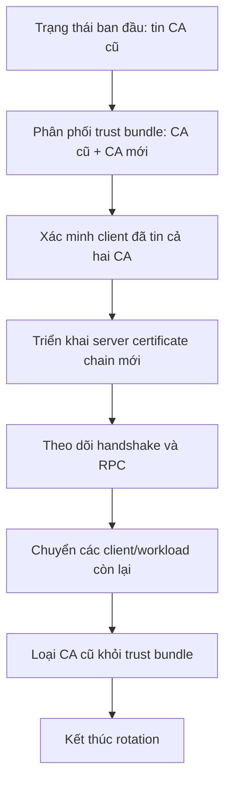

# Trust manager và certificate rotation

## Mục tiêu bài học

Trong **SPRING_GRPC**, TLS không chỉ cần certificate và private key. Mỗi phía còn cần một thành phần quyết định certificate của peer có được tin cậy hay không. Trong Java, vai trò này thường do `TrustManager` đảm nhiệm; trust manager kiểm tra certificate chain dựa trên trust anchors và chính sách PKI. Khi certificate hoặc CA thay đổi, ứng dụng phải cập nhật trust material và credential theo quy trình rotation để kết nối mới tiếp tục hoạt động an toàn.

Bài học tập trung vào **trust manager và certificate rotation**: hiểu `X509TrustManager` và `TrustManagerFactory`, phân biệt trust store với key store, áp dụng trust roots cho gRPC client và server mTLS, hiểu hostname verification là bước riêng, và lập kế hoạch xoay vòng leaf certificate, client certificate và CA với giai đoạn overlap có kiểm soát.

Sau bài này, bạn có thể:

1. Giải thích vai trò của trust manager trong TLS client và server.
2. Tạo trust manager từ trust store bằng `TrustManagerFactory`.
3. Phân biệt trust manager, key manager, trust store và key store.
4. Cấu hình trust roots cho gRPC channel và server mTLS.
5. Nhận biết trust chain validation khác hostname verification.
6. Xoay vòng leaf certificate, private key và CA mà không gây gián đoạn ngoài kế hoạch.
7. Xác định khi nào phải tạo lại channel/server và cách kiểm thử rotation.

> **Phạm vi:** Ví dụ dùng Java JSSE, gRPC Java và Spring gRPC. API cấu hình TLS phụ thuộc phiên bản gRPC Java và transport. Với server do Spring quản lý, áp dụng credential/SSL material qua extension point của server factory đang dùng; không giả định mọi starter có cùng property reload.

## 1. Trust manager làm nhiệm vụ gì?

TLS peer authentication cần xác minh certificate chain mà phía bên kia trình. Java cung cấp các interface trust manager để thực hiện việc này.

- **Trust manager** quyết định certificate của peer có được tin cậy theo trust anchors và chính sách xác minh hay không.
- **Key manager** chọn certificate và private key mà chính phía local trình cho peer khi được yêu cầu.
- **Trust store** chứa CA certificate hoặc trust anchor mà ứng dụng tin cậy.
- **Key store** thường chứa private key cùng certificate chain tương ứng mà ứng dụng sở hữu.

Trong TLS một chiều:

- Client dùng trust manager để xác minh server certificate.
- Server trình server certificate và chứng minh quyền sở hữu private key qua key manager/credential.

Trong mTLS:

- Client vẫn xác minh server bằng trust manager, đồng thời trình client certificate/private key qua key manager.
- Server dùng trust manager để xác minh client certificate, đồng thời trình server certificate/private key.

| Thành phần | Client | Server |
| --- | --- | --- |
| Trust manager | Xác minh server certificate | Xác minh client certificate khi mTLS |
| Key manager | Trình client certificate khi mTLS | Trình server certificate |
| Trust store | CA cấp server certificate | CA cấp client certificate |
| Key store/secret | Client identity key material | Server identity key material |

Không nhầm certificate của peer với trust anchor. Thông thường trust store chứa root CA được phê duyệt; peer gửi leaf và intermediate chain trong handshake. Client/server xây dựng path từ leaf tới trust anchor.

## 2. X509TrustManager và TrustManagerFactory

### 2.1. X509TrustManager

`X509TrustManager` là trust manager cho certificate X.509. Các phương thức cốt lõi gồm:

- `checkServerTrusted(chain, authType)`: xác minh chain do server trình cho client.
- `checkClientTrusted(chain, authType)`: xác minh chain do client trình cho server.
- `getAcceptedIssuers()`: trả về các CA certificate được trust manager chấp nhận theo cấu hình.

`X509ExtendedTrustManager` mở rộng khả năng xác minh bằng cách nhận thêm `Socket` hoặc `SSLEngine`. Thông tin kết nối này cho phép implementation áp dụng chính sách phù hợp với transport/context. Khi viết custom trust manager, ưu tiên delegate tới implementation chuẩn của JSSE rồi bổ sung policy hẹp; không tự viết lại thuật toán PKIX nếu không có yêu cầu chuyên biệt.

### 2.2. Tạo trust manager từ trust store

Ví dụ nạp PKCS#12 trust store chứa CA nội bộ:

```java
KeyStore trustStore = KeyStore.getInstance("PKCS12");

try (InputStream input =
        Files.newInputStream(Path.of("certs/grpc-truststore.p12"))) {
    trustStore.load(input, trustStorePassword);
}

TrustManagerFactory trustManagerFactory =
        TrustManagerFactory.getInstance(
                TrustManagerFactory.getDefaultAlgorithm());

trustManagerFactory.init(trustStore);

X509TrustManager trustManager = Arrays.stream(
        trustManagerFactory.getTrustManagers())
        .filter(X509TrustManager.class::isInstance)
        .map(X509TrustManager.class::cast)
        .findFirst()
        .orElseThrow(() ->
                new IllegalStateException("Không có X509TrustManager"));
```

`TrustManagerFactory` tạo trust manager theo provider và thuật toán mặc định của JVM, dựa trên trust store đã nạp. Trong ứng dụng thực tế:

- Lấy mật khẩu trust store từ secret provider.
- Kiểm tra fingerprint CA qua kênh tin cậy trước khi import.
- Chỉ thêm CA được phê duyệt cho đúng client/server.
- Đóng stream và không log mật khẩu hoặc private material.

Nếu gọi `trustManagerFactory.init((KeyStore) null)`, JSSE thường dùng trust store mặc định theo runtime/system properties. Hành vi cụ thể phụ thuộc provider và cấu hình JVM; cần kiểm tra môi trường triển khai thay vì giả định một trust store cố định.

### 2.3. Trust manager không tự động xác minh hostname

Trust chain validation và endpoint identity verification là hai kiểm tra khác nhau:

1. Trust manager xác minh chữ ký, path, validity, CA constraints và các điều kiện PKI của certificate chain.
2. TLS endpoint identification xác minh SAN của leaf certificate khớp hostname client định kết nối.

Một chain có thể hợp lệ nhưng certificate thuộc hostname khác. Không viết custom trust manager chỉ kiểm tra issuer rồi bỏ qua các bước xác minh chuẩn. Với gRPC client, giữ hostname verification mặc định và dùng target DNS name được certificate đại diện.

## 3. Trust store và key store trong cấu hình gRPC

### 3.1. Client trust server certificate

Với gRPC Java, `TlsChannelCredentials` có thể nhận CA certificate PEM để tạo trust configuration cho channel:

```java
ChannelCredentials credentials;

try (InputStream serverRoots =
        Files.newInputStream(Path.of("certs/server-root-ca.pem"))) {
    credentials = TlsChannelCredentials.newBuilder()
            .trustManager(serverRoots)
            .build();
}

ManagedChannel channel = Grpc.newChannelBuilder(
        "dns:///inventory.internal.example.com:9090",
        credentials)
        .build();
```

`trustManager(serverRoots)` cung cấp trust roots cho TLS channel. Nó không tắt hostname verification. Server certificate vẫn phải có SAN chứa `inventory.internal.example.com`.

Đây là cách cấu hình theo trust roots PEM của gRPC Java, không phải truyền một instance `X509TrustManager` tùy ý. Nếu cần custom JSSE trust manager hoặc custom Netty SSL context, phải dùng transport extension point tương ứng với dependency và Spring gRPC version đang chạy.

### 3.2. Server xác minh client certificate trong mTLS

Server cần trust CA cấp client certificate và yêu cầu client trình certificate:

```java
ServerCredentials credentials;

try (InputStream serverChain =
         Files.newInputStream(Path.of("certs/server-chain.pem"));
     InputStream serverKey =
         Files.newInputStream(Path.of("secrets/server-key.pem"));
     InputStream clientRoots =
         Files.newInputStream(Path.of("certs/client-ca-bundle.pem"))) {

    credentials = TlsServerCredentials.newBuilder()
            .keyManager(serverChain, serverKey)
            .trustManager(clientRoots)
            .clientAuth(TlsServerCredentials.ClientAuth.REQUIRE)
            .build();
}
```

Trong ví dụ:

- `keyManager` cung cấp server certificate chain và private key.
- `trustManager` cung cấp CA roots để xác minh client certificate.
- `ClientAuth.REQUIRE` yêu cầu client gửi certificate hợp lệ trong TLS handshake.

Với server TLS một chiều, server vẫn cần key material nhưng không nhất thiết yêu cầu client certificate. Chỉ bật mTLS khi kiến trúc cần xác thực client ở transport layer.

### 3.3. Tích hợp với Spring gRPC

Trong ứng dụng Spring, channel và server thường do bean/factory quản lý:

- Client channel có thể được tạo từ `ChannelCredentials` chứa trust roots riêng cho downstream.
- Server factory cần nhận server key material và, nếu mTLS, client CA trust bundle cùng client-auth policy.
- Các `@GrpcService` bean vẫn được bind vào server instance do Spring quản lý.
- Nếu cần custom `SSLContext` hoặc Netty `SslContext`, dùng customization hook được tài liệu đúng phiên bản transport công bố.

Không giả định property TLS của embedded servlet server tự động áp dụng native gRPC listener. Cũng không tự tạo một gRPC server phụ để nạp trust manager nếu starter đã sở hữu server đang phục vụ.

## 4. Khi nào cần custom trust manager?

Trust manager mặc định từ `TrustManagerFactory` thường là lựa chọn tốt nhất. Chỉ tạo custom implementation khi có yêu cầu rõ ràng như:

- Dùng trust anchors khác nhau theo endpoint/tenant.
- Áp dụng policy bổ sung cho issuer, certificate pinning hoặc certificate attributes.
- Tích hợp PKI nội bộ có quy tắc xác minh riêng.
- Thực hiện revocation checking theo CRL/OCSP nếu provider và chính sách hệ thống yêu cầu.

Nếu cần policy bổ sung, hãy bọc/delegate tới trust manager PKIX mặc định trước, rồi kiểm tra thêm điều kiện cần thiết. Ví dụ về cấu trúc, không phải implementation hoàn chỉnh:

```java
final class PolicyTrustManager extends X509ExtendedTrustManager {

    private final X509ExtendedTrustManager delegate;

    PolicyTrustManager(X509ExtendedTrustManager delegate) {
        this.delegate = delegate;
    }

    @Override
    public void checkServerTrusted(
            X509Certificate[] chain,
            String authType,
            SSLEngine engine) throws CertificateException {
        delegate.checkServerTrusted(chain, authType, engine);
        verifyApprovedIssuerAndPolicy(chain);
    }

    // Các overload checkClientTrusted/checkServerTrusted cho Socket
    // và overload cơ bản cũng phải delegate đầy đủ.
    // getAcceptedIssuers() trả về issuers của delegate.
}
```

Khi triển khai thật, phải override đầy đủ các overload mà interface yêu cầu, delegate chính xác theo context, xử lý chain rỗng/null, và kiểm thử cả certificate hợp lệ lẫn không hợp lệ. Không trả về thành công vô điều kiện. Một trust manager “trust all” sẽ vô hiệu hóa xác thực TLS và tạo lỗ hổng giả mạo server/client.

### 4.1. Certificate pinning không thay thế PKI tùy tiện

Pinning một leaf certificate hoặc public key có thể giới hạn peer được chấp nhận, nhưng tạo thêm trách nhiệm rotation. Nếu pinning, cần:

- Có pin hiện tại và pin kế tiếp để overlap.
- Có cơ chế cập nhật pin an toàn ngoài băng.
- Có kế hoạch khôi phục khi key bị lộ.
- Vẫn giữ hostname verification và các kiểm tra certificate cần thiết.

Chỉ so sánh issuer/subject text không phải xác minh danh tính mật mã. Dùng certificate/public key fingerprint hoặc PKI policy có định nghĩa rõ.

## 5. Các loại certificate rotation

“Certificate rotation” có thể chỉ nhiều thay đổi khác nhau. Phải xác định material nào đổi trước khi lên kế hoạch:

| Loại rotation | Material thay đổi | Trust store có cần đổi? |
| --- | --- | --- |
| Leaf certificate renewal, cùng CA | Server/client leaf certificate, có thể cả key | Thường không, nếu chain vẫn tới CA đang tin và identity/policy hợp lệ |
| Private key rotation, cùng CA | Key pair và leaf certificate mới | Thường không; triển khai key/cert pair đồng bộ |
| Intermediate CA rotation | Intermediate chain | Có thể không nếu root trust anchor giữ nguyên và chain mới hợp lệ |
| Root CA rotation | Trust anchor và chain được CA mới cấp | Có; cần cập nhật trust bundle theo giai đoạn |
| Client CA rotation cho mTLS | CA server dùng để xác minh client | Trust manager phía server cần tin CA mới trong thời gian chuyển đổi |
| Server CA rotation | CA client dùng để xác minh server | Trust manager phía client cần tin CA mới trong thời gian chuyển đổi |

Nếu leaf certificate được cấp lại bởi cùng CA, client không cần import từng leaf certificate khi đang dùng CA trust thông thường. Nếu chuyển root CA, cần thay đổi trust bundle. Không thêm leaf certificate vào trust store chỉ để chữa lỗi thiếu intermediate; hãy sửa chain server gửi.

## 6. Rotation có overlap để tránh gián đoạn

Với CA rotation thông thường, không nên thay trust root và server certificate cùng lúc trên toàn hệ thống mà không có giai đoạn chuyển tiếp.



Quy trình điển hình:

1. **Inventory:** xác định issuer, serial, SAN, EKU, ngày hết hạn, nơi nạp trust/key material và owner của mỗi certificate.
2. **Preload trust:** phân phối CA mới tới client (khi server CA đổi) hoặc tới server (khi client CA mTLS đổi), giữ CA cũ trong trust bundle.
3. **Verify:** kiểm tra fingerprint, chain và thời hạn của CA mới trước khi tin.
4. **Deploy identity mới:** triển khai leaf certificate/private key mới trên server hoặc client theo từng workload.
5. **Probe:** mở kết nối mới, xác minh handshake, hostname, mTLS và RPC.
6. **Observe:** theo dõi handshake failure, client còn dùng issuer cũ và RPC error rate.
7. **Retire:** chỉ loại CA cũ khi không còn workload hợp lệ cần nó và rollback window đã kết thúc.

Với server certificate rotation cùng CA, có thể triển khai certificate mới theo rolling restart/replace server instance. Client trust store không cần thay đổi nếu CA và identity policy vẫn hợp lệ.

### 6.1. Rotation client certificate trong mTLS

Khi client thay leaf certificate nhưng CA giữ nguyên, server vẫn có thể tin chain mới mà không đổi trust manager. Nếu client CA đổi, server phải tin cả CA cũ và mới trong giai đoạn overlap.

Client certificate có thể được thay theo workload. Đừng dùng một channel cũ mang identity cũ rồi kỳ vọng file key mới tự áp dụng. Tạo channel/credential mới với client certificate mới, chuyển traffic sang channel mới, rồi drain và shutdown channel cũ.

### 6.2. Trường hợp compromise cần xử lý khẩn cấp

Overlap không phải quy tắc tuyệt đối. Nếu private key hoặc CA bị compromise, tiếp tục tin CA cũ chỉ để giữ tương thích có thể duy trì rủi ro. Cần áp dụng incident response: chặn/revoke identity bị lộ, cập nhật trust policy khẩn cấp, rotate key/certificate, và chấp nhận từ chối kết nối từ workload chưa được cập nhật.

Revocation checking không tự động được bật giống nhau ở mọi JDK/provider. Nếu yêu cầu CRL/OCSP, cấu hình PKIX revocation theo TLS provider và kiểm thử hành vi thực tế; không giả định gRPC tự truy vấn revocation service mặc định.

## 7. Khi nào channel/server cần được tạo lại?

Một trong các lỗi vận hành phổ biến là thay file certificate trên đĩa nhưng kỳ vọng TLS context đang chạy tự đọc lại.

- **Client channel:** credential/trust material thường được tạo khi cấu hình channel. Thay file PEM sau đó không bảo đảm channel đang chạy nạp lại trust roots hoặc client key. Với rotation cần chắc chắn, tạo channel mới từ material mới, kiểm tra kết nối, chuyển traffic, drain rồi shutdown channel cũ.
- **Server:** server factory thường nạp certificate/key/trust material khi tạo SSL context hoặc start server. Reload chỉ xảy ra nếu transport/server factory có cơ chế reload được hỗ trợ. Nếu không, triển khai server instance mới hoặc rolling restart.
- **Proxy TLS terminator:** reload semantics phụ thuộc proxy. Kiểm tra tài liệu và xác minh certificate được trình trên kết nối mới sau reload.

Các kết nối TLS đã thiết lập không tự động đổi certificate/key chỉ vì file nguồn thay đổi. Rotation chủ yếu tác động tới handshake mới; vì vậy cần kiểm tra bằng kết nối mới sau mỗi bước.

### 7.1. Thay channel không làm gián đoạn caller

Một client manager có thể giữ channel hiện tại trong reference, dựng channel mới trước, kiểm tra health/RPC, rồi chuyển các call mới sang channel mới. Channel cũ được drain với grace period hữu hạn trước khi đóng.

Nếu ứng dụng dùng generated stub, tạo stub mới từ channel mới cùng lúc publish channel. Không publish stub mới trước khi channel sẵn sàng. Cần xử lý lỗi khi channel mới không kết nối được: giữ channel cũ nếu certificate cũ vẫn an toàn và còn được tin cậy.

## 8. Kiểm thử trust manager và rotation

### 8.1. Kiểm tra trust store trước triển khai

Dùng OpenSSL xem fingerprint và validity của CA:

```bash
openssl x509 -in new-root-ca.pem -noout \
  -subject -issuer -dates -fingerprint -sha256
```

Liệt kê trust store Java:

```bash
keytool -list -v -keystore grpc-truststore.p12 -storetype PKCS12
```

Đối chiếu fingerprint với giá trị được CA/platform team phân phối qua kênh tin cậy. Không import CA chỉ dựa vào tên file hoặc subject.

### 8.2. Positive và negative tests

Bộ test nên bao gồm:

| Trường hợp | Kết quả mong đợi |
| --- | --- |
| Server chain tới CA đang tin, hostname đúng | TLS và RPC thành công |
| Server chain tới CA không được tin | Handshake thất bại |
| Chain hợp lệ nhưng hostname sai | Client từ chối identity |
| Thiếu intermediate | Validation thất bại nếu client không thể xây path hợp lệ |
| Leaf mới cùng CA cũ | Kết nối thành công mà không cần đổi trust root |
| Leaf mới do CA mới cấp, CA mới đã preload | Kết nối thành công |
| CA mới chưa được preload | Handshake thất bại |
| Client certificate mới trong mTLS, CA client đã được server tin | Handshake và RPC thành công |
| Client certificate do CA không được server tin cấp | mTLS handshake thất bại |
| CA cũ bị loại sau migration | Certificate chain chỉ dựa vào CA cũ bị từ chối |

Kiểm thử cả handshake lẫn RPC bằng generated stub. Với mTLS, xác minh trường hợp handshake thất bại trước interceptor và trường hợp certificate hợp lệ nhưng identity thiếu quyền trả `PERMISSION_DENIED`.

### 8.3. Kiểm tra kết nối mới sau rotation

Sau khi thay certificate hoặc trust bundle:

1. Tạo channel mới hoặc kết nối mới tới server.
2. Xác minh protocol, issuer, serial/fingerprint và SAN của certificate được trình.
3. Kiểm tra trust chain và hostname.
4. Gọi một RPC đại diện qua HTTP/2.
5. Kiểm tra log/metric handshake failure và gRPC status.
6. Chỉ retire material cũ sau khi xác nhận toàn bộ client/server đã chuyển.

Không dùng một kết nối cũ đã tồn tại để kết luận certificate mới đã được nạp.

## 9. Quan sát và vận hành certificate

Nên theo dõi các thông tin không nhạy cảm sau:

- Thời gian còn lại tới expiry của server/client certificate.
- Issuer, serial hoặc fingerprint đã chuẩn hóa theo policy audit.
- Số handshake thành công/thất bại và nhóm nguyên nhân.
- Số client còn dùng CA/certificate cũ trong giai đoạn overlap.
- Số channel/server instance đã chuyển sang credential mới.
- RPC latency/status sau khi TLS handshake thành công.

Không log PEM private key, password, secret mount content hoặc toàn bộ TLS session. Nếu cần điều tra, log fingerprint/issuer/serial và correlation ID theo policy bảo mật.

Một rotation tốt có rollback rõ: biết certificate/key cũ còn hợp lệ tới khi nào, trust bundle cũ có thể phục hồi ra sao, và điều kiện nào buộc phải dừng rollback (ví dụ key cũ đã bị compromise).

## 10. Lỗi thường gặp

| Triệu chứng | Nguyên nhân | Cách xử lý |
| --- | --- | --- |
| Unknown CA sau deploy | Trust manager chưa có root mới | Preload CA mới và xác minh fingerprint |
| Certificate mới hợp lệ nhưng hostname mismatch | SAN không chứa target hostname | Phát hành certificate có SAN đúng; không tắt hostname verification |
| Thay file CA nhưng channel vẫn báo unknown CA | Channel giữ trust material đã nạp lúc tạo | Tạo channel mới hoặc dùng reload mechanism được hỗ trợ |
| Server vẫn trình certificate cũ | Server SSL context chưa reload | Rolling restart hoặc reload theo server factory/transport |
| Rotation leaf cùng CA làm client fail | Key/certificate pair không khớp hoặc chain thiếu intermediate | Kiểm tra public key digest và chain |
| Xóa CA cũ quá sớm | Một số client/server chưa chuyển certificate | Khôi phục trust overlap nếu CA cũ vẫn an toàn; hoàn tất rollout |
| Trust manager custom chấp nhận certificate sai | Delegate bị bỏ qua hoặc policy quá rộng | Delegate PKIX chuẩn và bổ sung policy hẹp |
| mTLS server không xác minh client | Dùng nhầm trust roots server CA hoặc chưa bật client auth | Cấu hình client CA trust và REQUIRE theo policy |
| Revoked certificate vẫn kết nối | CRL/OCSP/revocation policy chưa được bật hoặc cập nhật | Cấu hình revocation checking hoặc denylist có kiểm thử |
| Rotation gây tăng UNAVAILABLE | Channel/server thay credential không đồng bộ hoặc không có overlap | Triển khai theo thứ tự, canary và theo dõi handshake |

## 11. Bài tập thực hành

1. Tạo PKCS#12 trust store chứa một root CA test và tạo `X509TrustManager` qua `TrustManagerFactory`.
2. Giải thích trust manager kiểm tra certificate chain nào ở client TLS một chiều và ở server mTLS.
3. Cấu hình gRPC Java client bằng `TlsChannelCredentials.trustManager` với CA test; xác minh hostname vẫn được kiểm tra.
4. Cấu hình Spring gRPC server mTLS với server key material và client CA trust bundle.
5. Phát hành leaf server certificate mới từ cùng CA; xác minh client hiện tại kết nối được mà không đổi trust root.
6. Tạo CA mới, preload cả CA cũ và mới vào trust bundle, chuyển server certificate sang CA mới rồi loại CA cũ sau rollout.
7. Tạo channel mới với client certificate mới, chuyển traffic, drain channel cũ và kiểm tra RPC đang in-flight.
8. Thử custom trust manager delegate PKIX rồi thêm policy issuer; xác minh certificate ngoài policy bị từ chối.
9. Viết test cho unknown CA, hostname mismatch, thiếu intermediate, leaf rotation và CA rotation.
10. Diễn tập trường hợp private key bị compromise và giải thích vì sao có thể cần thu hồi khẩn cấp thay vì overlap.

### Câu hỏi tự kiểm tra

- Trust manager và key manager khác nhau như thế nào?
- `X509TrustManager` xác minh server certificate ở phía nào?
- `TrustManagerFactory` lấy trust anchors từ đâu?
- Trust chain validation có thay thế hostname verification không?
- Khi nào leaf certificate rotation không cần đổi trust store?
- Khi root CA đổi, tại sao nên preload CA mới trước khi thay server certificate?
- Vì sao thay file PEM chưa chắc cập nhật channel hoặc server đang chạy?
- Khi nào phải tạo channel mới và drain channel cũ?
- Tại sao custom trust manager cần delegate tới PKIX validator?
- Khi private key bị compromise, vì sao quy trình overlap thông thường có thể không phù hợp?

## Tài liệu tham khảo

- [Java — X509TrustManager](https://docs.oracle.com/en/java/javase/17/docs/api/java.base/javax/net/ssl/X509TrustManager.html): kiểm tra certificate chain của peer.
- [Java — X509ExtendedTrustManager](https://docs.oracle.com/en/java/javase/17/docs/api/java.base/javax/net/ssl/X509ExtendedTrustManager.html): trust validation có ngữ cảnh Socket/SSLEngine.
- [Java — TrustManagerFactory](https://docs.oracle.com/en/java/javase/17/docs/api/java.base/javax/net/ssl/TrustManagerFactory.html): tạo trust manager từ trust store.
- [Java Security — JSSE Reference Guide](https://docs.oracle.com/en/java/javase/17/security/java-secure-socket-extension-jsse-reference-guide.html): trust store, key store và TLS.
- [gRPC Java — TlsChannelCredentials](https://grpc.github.io/grpc-java/javadoc/io/grpc/TlsChannelCredentials.html): trust roots và client credentials.
- [gRPC Java — TlsServerCredentials](https://grpc.github.io/grpc-java/javadoc/io/grpc/TlsServerCredentials.html): server key material và client trust trong mTLS.
- [Spring gRPC — GRPC Server](https://docs.spring.io/spring-grpc/reference/server.html): tích hợp server và service bean trong Spring.
- [OpenSSL — verify](https://docs.openssl.org/3.0/man1/openssl-verify/): kiểm tra certificate path và purpose.
- [RFC 5280 — Internet X.509 PKI Certificate and CRL Profile](https://www.rfc-editor.org/rfc/rfc5280): certificate path, CA constraints và CRL.

**Kết quả mong đợi:** Người học cấu hình được trust manager phù hợp cho gRPC client và server mTLS, phân biệt trust chain với hostname verification, lập quy trình rotation leaf certificate và CA có overlap, biết lúc nào phải tạo lại channel/server, và xác minh rotation bằng handshake cùng RPC integration test.
