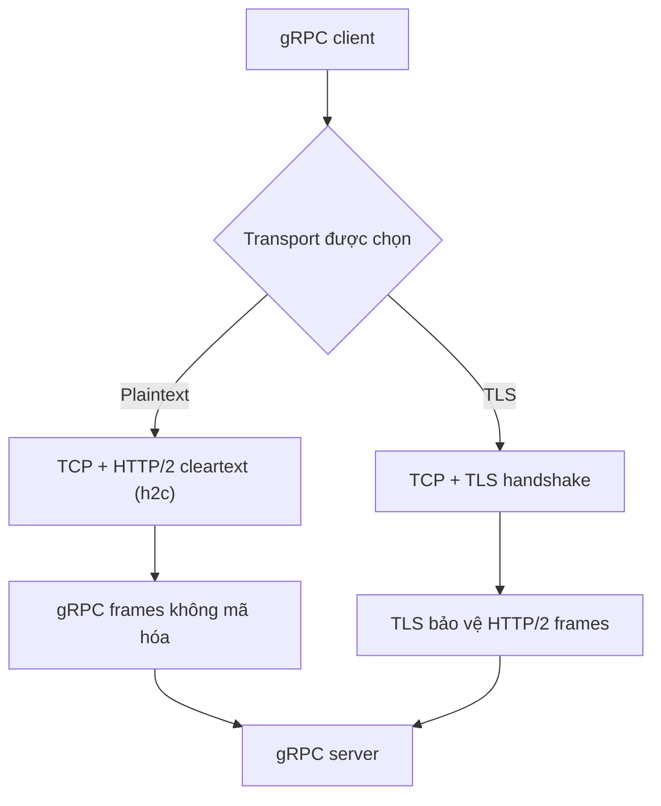

# Plaintext chỉ dùng trong môi trường phù hợp

## Mục tiêu bài học

Trong **SPRING_GRPC**, gRPC có thể chạy trên HTTP/2 với TLS hoặc trên kết nối không mã hóa (plaintext). Plaintext thường được gọi là h2c: HTTP/2 cleartext. Nó hữu ích cho kiểm thử cục bộ, giao tiếp trong cùng process hoặc một hop mạng đã được cô lập và bảo vệ bằng lớp khác. Tuy nhiên, plaintext không xác thực danh tính peer và không bảo vệ dữ liệu khỏi nghe lén hay sửa đổi trên đường truyền.

Bài học tập trung vào **khi nào plaintext phù hợp và cách giới hạn rủi ro khi sử dụng**. Người học phân biệt in-process transport, loopback và network plaintext; cấu hình gRPC Java client/server; hiểu ranh giới TLS khi đi qua proxy/service mesh; và kiểm thử để bảo đảm plaintext chỉ được bật ở nơi có chủ đích.

Sau bài này, bạn có thể:

1. Giải thích plaintext gRPC và h2c khác TLS gRPC như thế nào.
2. Đánh giá một kết nối theo network trust boundary thay vì chỉ dựa vào nhãn “internal”.
3. Chọn plaintext cho in-process, loopback hoặc môi trường test cô lập khi phù hợp.
4. Cấu hình gRPC Java client/server dùng plaintext và tích hợp đúng với Spring-managed server.
5. Nhận diện rủi ro khi truyền token, metadata hoặc dữ liệu nhạy cảm qua plaintext.
6. Phân tích từng hop khi TLS được terminate tại proxy hoặc service mesh.
7. Kiểm thử protocol mismatch và xác minh môi trường production vẫn dùng TLS/mTLS theo policy.

> **Phạm vi:** Ví dụ dùng gRPC Java và Spring gRPC. Server factory, transport và property thay đổi theo phiên bản. Ví dụ standalone minh họa API gRPC Java; nếu Spring đang quản lý server, cấu hình transport qua extension point được phiên bản dự án hỗ trợ thay vì khởi động một server phụ.

## 1. Plaintext gRPC là gì?

gRPC dùng HTTP/2 framing để truyền request, response, metadata và status. Khi không dùng TLS, client mở TCP connection rồi trao đổi HTTP/2 cleartext (h2c). Không có TLS handshake, certificate exchange, encryption hoặc TLS peer authentication.

| Đặc điểm | Plaintext (h2c) | TLS gRPC |
| --- | --- | --- |
| HTTP/2 framing | Có | Có |
| TLS handshake | Không | Có |
| Mã hóa dữ liệu trên hop | Không | Có |
| Integrity chống sửa đổi trên đường truyền | Không được TLS bảo vệ | Được TLS bảo vệ |
| Xác thực server bằng certificate | Không | Có |
| Xác thực client ở transport | Không có mTLS | Có thể dùng mTLS |
| ALPN | Không thương lượng qua TLS | Thường thương lượng h2 |
| Dùng khi | In-process, loopback, test hoặc hop đã được bảo vệ phù hợp | Mạng có thể bị quan sát/kiểm soát bởi bên khác và môi trường production thông thường |

Plaintext không có nghĩa gRPC bỏ HTTP/2 hoặc bỏ cơ chế status. Các RPC vẫn dùng service/method path, metadata, deadline, cancellation và status code. Khác biệt nằm ở bảo vệ transport.



Với TLS, ALPN thường chọn h2 trong handshake. Với h2c, không có ALPN vì không có TLS handshake; hai đầu phải được cấu hình để trao đổi HTTP/2 cleartext theo cơ chế transport hỗ trợ.

## 2. Những bảo vệ bị mất khi dùng plaintext

Khi một gRPC connection chạy plaintext, bất kỳ thành phần nào có khả năng quan sát hoặc can thiệp vào network path đều có thể đọc hoặc sửa traffic.

Các rủi ro chính:

- **Confidentiality:** payload protobuf, metadata, header và trailer truyền dưới dạng không mã hóa. Nội dung nhạy cảm có thể bị đọc qua packet capture hoặc thiết bị mạng bị xâm nhập.
- **Integrity:** bên trung gian có thể thay đổi hoặc chèn dữ liệu. TCP checksum không phải cơ chế xác thực mật mã.
- **Server identity:** client không xác minh certificate/hostname, nên không có bằng chứng TLS rằng endpoint là server dự kiến.
- **Client identity:** server không nhận được client certificate từ TLS. Network source IP hoặc một metadata tự khai báo không phải bằng chứng danh tính mật mã.
- **Credential exposure:** bearer token, API key hoặc cookie gửi trong metadata có thể bị nghe lén và tái sử dụng.
- **Compliance:** nhiều môi trường yêu cầu mã hóa dữ liệu khi truyền; plaintext có thể vi phạm policy dù traffic chỉ ở mạng nội bộ.

Application authentication/authorization vẫn có thể được triển khai ở tầng RPC, nhưng gửi credential qua plaintext làm lộ credential trên network. Network ACL, firewall hoặc private subnet có thể giảm bề mặt truy cập, nhưng không cung cấp confidentiality và integrity tương đương TLS.

Không gửi bearer token, mật khẩu, private data hoặc dữ liệu được phân loại nhạy cảm qua plaintext network connection. Nếu ứng dụng cần xác thực workload, dùng TLS/mTLS hoặc một cơ chế bảo vệ hop đã được kiến trúc phê duyệt.

## 3. Khi nào plaintext phù hợp?

Đánh giá theo nơi traffic đi qua, ai có thể truy cập đường truyền và dữ liệu nào được truyền.

| Môi trường | Đánh giá | Điều kiện |
| --- | --- | --- |
| gRPC in-process transport | Phù hợp cho test/communication trong cùng process | Không có network socket; không dùng để suy ra cấu hình TLS production |
| Loopback trên cùng host | Có thể phù hợp cho local development hoặc sidecar hop | Cả hai endpoint nằm cùng host/network namespace; port không bị expose ra interface khác |
| Integration test trên máy developer/CI | Có thể phù hợp | Test network cô lập, dữ liệu giả, không dùng production credentials |
| Container cùng host | Chỉ phù hợp khi đã xác minh network boundary | Container network và port exposure phải được giới hạn; container không mặc nhiên là trust boundary |
| Kubernetes cluster/VPC/private subnet | Không mặc nhiên phù hợp | Traffic có thể đi qua node, overlay, shared network hoặc tenant khác; cần policy rõ và bảo vệ hop |
| Proxy-to-backend trong private segment | Có thể phù hợp trong kiến trúc được phê duyệt | Segment được cô lập, kiểm soát truy cập, không mang dữ liệu/credential cần bảo mật trên hop đó |
| Internet hoặc mạng không tin cậy | Không phù hợp | Dùng TLS; cân nhắc mTLS cho service-to-service |

### 3.1. In-process transport

gRPC Java có in-process transport để client và server giao tiếp trong cùng process mà không mở TCP socket. Đây là lựa chọn tốt cho unit/integration test khi muốn kiểm tra generated stub và service behavior nhanh.

```java
String serverName = InProcessServerBuilder.generateName();

Server server = InProcessServerBuilder
        .forName(serverName)
        .directExecutor()
        .addService(new InventoryGrpcEndpoint())
        .build()
        .start();

ManagedChannel channel = InProcessChannelBuilder
        .forName(serverName)
        .directExecutor()
        .build();
```

Ví dụ minh họa transport test; cần đóng channel và server trong teardown. In-process không phải plaintext network: không có socket TCP hoặc packet truyền trên network. Nó cũng không chứng minh TLS configuration, HTTP/2 network negotiation hay certificate validation hoạt động.

### 3.2. Loopback trên cùng host

Một client local có thể kết nối tới 127.0.0.1 hoặc ::1 nếu server bind đúng loopback interface. Điều này giới hạn listener ở host đó, trong phạm vi network namespace tương ứng.

Không nhầm loopback của host với loopback trong container. 127.0.0.1 bên trong container chỉ trỏ về container đó. Nếu client và server ở hai container khác nhau, chúng thường cần một network interface/bridge; lúc đó cần đánh giá lại boundary.

Trong development, dùng dữ liệu giả và không expose port ra LAN/public interface. Trên container, bind interface phù hợp để service hoạt động nhưng giới hạn reachability bằng network policy/firewall và không coi private bridge là mã hóa.

## 4. Cấu hình plaintext client bằng gRPC Java

Với gRPC Java, client channel dùng `usePlaintext()` để chọn transport không TLS:

```java
ManagedChannel channel = ManagedChannelBuilder
        .forAddress("127.0.0.1", 9090)
        .usePlaintext()
        .build();

try {
    InventoryGrpc.InventoryBlockingStub stub =
            InventoryGrpc.newBlockingStub(channel);

    StockReply reply = stub
            .withDeadlineAfter(500, TimeUnit.MILLISECONDS)
            .getStock(GetStockRequest.newBuilder()
                    .setSku("SKU-LOCAL-01")
                    .build());
} finally {
    channel.shutdown();
    if (!channel.awaitTermination(5, TimeUnit.SECONDS)) {
        channel.shutdownNow();
    }
}
```

Điểm cần lưu ý:

- `usePlaintext()` là lựa chọn transport của channel; nó không chỉ tắt certificate validation mà loại bỏ TLS trên connection.
- Target phải trỏ tới listener chấp nhận h2c.
- Deadline và lifecycle của channel vẫn cần quản lý như các client khác.
- Không tạo channel mới cho từng RPC.
- Không đưa token/secret production vào metadata của channel plaintext.

Trong Spring application, có thể quản lý channel như bean cho profile local/test. Tên property bên dưới là cấu hình do ứng dụng tự định nghĩa, không phải property built-in áp dụng cho mọi Spring gRPC version:

```yaml
grpc:
  clients:
    inventory:
      target: 127.0.0.1:9090
      transport: plaintext
```

Profile production cần cấu hình riêng và kiểm thử để bảo đảm channel dùng TLS credentials. Không để một property plaintext mặc định được kế thừa vô tình sang production.

## 5. Cấu hình server plaintext

Với gRPC Java API hỗ trợ credential-based server builder, server plaintext có thể dùng `InsecureServerCredentials`:

```java
Server server = Grpc.newServerBuilderForPort(
        9090,
        InsecureServerCredentials.create())
        .addService(new InventoryGrpcEndpoint())
        .build()
        .start();
```

Ví dụ trên minh họa một gRPC Java server không bật TLS. Listener này chỉ nên được bind vào loopback hoặc network segment đã được đánh giá và bảo vệ. API credential/transport cần khớp version gRPC Java của dự án.

### 5.1. Spring-managed server

Trong ứng dụng Spring gRPC, service thường được khai báo bằng `@GrpcService` và server factory quản lý registration/lifecycle. Nếu cần plaintext cho local/test:

- Chọn đúng server transport và profile local/test.
- Cấu hình server factory theo cơ chế plaintext được phiên bản Spring gRPC hỗ trợ.
- Giới hạn listener/port ở phạm vi network phù hợp.
- Không tạo một `ServerBuilder` độc lập nếu starter đã quản lý server.
- Xác minh server thực sự nhận h2c và không có TLS terminator khác đứng trước listener.

Không tự đặt property như `spring.grpc.server.plaintext=true` nếu chưa xác minh nó tồn tại trong version đang chạy. Native gRPC server và servlet/HTTP server có thể có cấu hình TLS/HTTP2 khác nhau. Đọc đúng tài liệu của starter/transport đang dùng trước khi triển khai.

## 6. TLS termination và plaintext giữa các hop

Một hệ thống có thể có nhiều connection hop. TLS ở edge không tự động mã hóa các hop phía sau.

Ví dụ:


Trong topology này, client-to-proxy được TLS bảo vệ; proxy-to-backend là plaintext. Hop nội bộ chỉ có thể dùng plaintext khi kiến trúc đã đánh giá network segment đó, giới hạn quyền truy cập và chấp nhận rủi ro còn lại.

Nếu proxy và backend chạy trên host/network namespace riêng, hoặc traffic đi qua shared node/network, cân nhắc TLS/mTLS upstream:


Service mesh có thể tự động mã hóa hop giữa sidecar proxies. Cần xác định rõ đoạn app-to-sidecar có plaintext hay không, sidecar có terminate/originate TLS ở đâu và policy nào được enforce. Đừng kết luận “mesh có mTLS” đồng nghĩa mọi byte từ process này tới process kia đều được mã hóa.

## 7. Authentication và metadata khi plaintext

gRPC hỗ trợ metadata và application authentication, nhưng plaintext không bảo vệ metadata trên đường truyền.

Ví dụ metadata authorization:

```text
authorization: Bearer <token>
x-request-id: 9f2...
```

Nếu connection là plaintext network traffic, bearer token có thể bị đọc và tái sử dụng. Vì vậy:

- Không gửi bearer token, session cookie hoặc API key production qua plaintext.
- Không coi IP allowlist là xác thực peer đủ mạnh cho workload nhạy cảm.
- Không dùng metadata do client tự khai báo như `x-client-name` làm identity đã xác minh.
- Nếu cần authentication giữa workloads, dùng TLS/mTLS hoặc cơ chế identity bảo vệ toàn bộ hop.
- Authorization theo method/resource vẫn cần áp dụng kể cả khi transport đã dùng mTLS.

Plaintext có thể phù hợp với test dùng fixture identity không nhạy cảm hoặc local fake data. Không dùng test shortcut này để kết luận auth flow production an toàn.

## 8. Những hiểu lầm thường gặp

**“Mạng nội bộ thì dữ liệu tự an toàn.”** Private subnet có thể giảm khả năng truy cập từ Internet, nhưng không ngăn mọi node, workload, administrator, packet capture hoặc thành phần bị xâm nhập đọc traffic.

**“Có firewall nên không cần TLS.”** Firewall kiểm soát reachability; TLS bảo vệ nội dung và xác minh peer. Hai cơ chế có mục tiêu khác nhau.

**“Có authentication interceptor nên plaintext an toàn.”** Interceptor có thể kiểm tra token, nhưng token vẫn truyền không mã hóa và có thể bị đánh cắp trước khi tới interceptor.

**“Chỉ có một service nên có thể dùng plaintext.”** Số lượng service không quyết định trust boundary. Một service duy nhất vẫn cần TLS nếu traffic đi qua network không tin cậy.

**“TLS đã terminate ở ingress nên backend luôn an toàn.”** Chỉ hop client-to-ingress được TLS bảo vệ. Cần đánh giá riêng ingress-to-backend.

**“Plaintext client chỉ bỏ qua lỗi certificate.”** `usePlaintext()` loại bỏ TLS handshake. Nó không kiểm tra certificate theo cách lỏng hơn; connection chuyển sang protocol không TLS.

**“gRPC compression bảo vệ dữ liệu.”** Compression không phải encryption và không xác thực peer. Không dùng compression thay TLS.

## 9. Kiểm thử và xác minh transport mode

Bộ test nên xác minh rõ client/server đang dùng cùng chế độ transport:

| Client | Server | Kết quả mong đợi |
| --- | --- | --- |
| Plaintext | Plaintext h2c | RPC hoạt động nếu HTTP/2 cleartext được hỗ trợ |
| TLS | TLS với certificate/trust hợp lệ | Handshake và RPC thành công |
| Plaintext | TLS-only listener | Kết nối thất bại |
| TLS | Plaintext-only listener | Handshake thất bại |
| TLS với CA sai | TLS | Client từ chối certificate |
| TLS với hostname sai | TLS | Hostname verification thất bại |
| In-process channel | In-process server | Test service behavior; không kiểm tra network/TLS |

### 9.1. Kiểm tra plaintext endpoint

Có thể dùng grpcurl với chế độ plaintext:

```bash
grpcurl -plaintext 127.0.0.1:9090 list
```

Lệnh cần server reflection hoặc descriptor/proto input phù hợp. `-plaintext` yêu cầu grpcurl dùng h2c; nếu server chỉ nhận TLS, kết nối sẽ thất bại. Không dùng lệnh này như health check production nếu endpoint yêu cầu TLS.

### 9.2. Kiểm tra TLS endpoint

Với TLS endpoint, dùng grpcurl cùng CA trust phù hợp:

```bash
grpcurl -cacert certs/root-ca.pem grpc.example.com:9090 list
```

Nếu server không bật reflection, cung cấp proto/descriptor set. Xác minh hostname và CA trust vẫn được bật; không chuyển sang `-insecure` để làm test pass.

### 9.3. Integration test trong Spring

Với test Spring gRPC:

- Dùng in-process transport cho unit/service behavior khi không cần kiểm tra socket.
- Dùng loopback plaintext test riêng nếu cần xác minh h2c.
- Dùng TLS integration test với certificate fixture để kiểm tra trust/hostname.
- Gọi generated stub qua đúng channel để chứng minh RPC thực sự hoạt động.
- Đóng channel/server trong teardown và không chia sẻ port test ngoài phạm vi test.

Không để test plaintext là test duy nhất cho service sẽ chạy production qua TLS/mTLS.

## 10. Quản lý profile và ngăn plaintext lọt vào production

Nên thể hiện transport mode rõ ràng theo profile/environment thay vì chọn ngầm từ một default khó thấy.

Một cách tổ chức cấu hình:

```yaml
# application-local.yml
grpc:
  clients:
    inventory:
      target: 127.0.0.1:9090
      transport: plaintext

# application-prod.yml
grpc:
  clients:
    inventory:
      target: dns:///inventory.internal.example.com:9090
      transport: tls
      trust-bundle: file:/run/secrets/server-ca.pem
```

Đây là schema cấu hình ví dụ của ứng dụng. Khi khởi tạo client/server, validate giá trị theo profile và fail-fast nếu production chọn plaintext ngoài policy cho phép.

Các kiểm soát nên có:

1. Production profile không dùng `usePlaintext()` cho endpoint qua network.
2. CI kiểm tra cấu hình deployment không bật plaintext ngoài allowlist.
3. Network policy/firewall chỉ mở port cần thiết cho workload được phép.
4. Secret/token không được inject vào plaintext client.
5. Quan sát TLS handshake và RPC error để phát hiện protocol mismatch.
6. Tài liệu hóa hop nào được TLS terminate và hop nào còn plaintext.
7. Có owner, lý do, phạm vi và thời hạn cho mọi exception plaintext.

Nếu có ngoại lệ plaintext ở một hop nội bộ, cần ghi rõ data classification, network boundary, access control, threat model, monitoring và điều kiện loại bỏ ngoại lệ.

## 11. Lỗi thường gặp

| Triệu chứng | Nguyên nhân | Cách xử lý |
| --- | --- | --- |
| Plaintext client không kết nối server | Server chỉ nhận TLS hoặc transport không hỗ trợ h2c | Xác nhận listener mode và HTTP/2 cleartext support |
| TLS client báo handshake failure với plaintext server | Client gửi TLS ClientHello tới listener h2c | Dùng đúng channel credentials và server transport |
| Plaintext client lỗi khi gọi TLS endpoint | Client không thực hiện TLS handshake | Dùng TLS credentials; không hạ server production xuống plaintext |
| Local test pass nhưng production fail | Test chỉ dùng in-process/h2c, production yêu cầu TLS | Bổ sung TLS integration test với trust roots/certificate |
| Token xuất hiện trong packet capture | Credential được gửi qua plaintext | Thu hồi/rotate token bị lộ và chuyển hop sang TLS |
| Proxy nhận TLS nhưng backend traffic lộ | Upstream hop dùng plaintext qua network boundary rộng | Bật upstream TLS/mTLS hoặc cô lập hop theo policy |
| Container client không tới loopback server | Loopback trỏ về network namespace khác | Dùng service DNS/container network và đánh giá bảo vệ hop |
| Đổi profile nhưng transport không đổi | Bean/channel được tạo từ config khác hoặc profile không active | Kiểm tra active profile và cấu hình channel/server thực tế |
| Có firewall nhưng vẫn lo ngại sniffing | Firewall không mã hóa payload | Dùng TLS để bảo vệ confidentiality/integrity |
| Reflection hoạt động trên plaintext public port | Port không được giới hạn, schema bị công khai ngoài ý muốn | Giới hạn exposure; dùng TLS/auth và policy reflection phù hợp |

## 12. Bài tập thực hành

1. Tạo một gRPC in-process test và giải thích vì sao nó không kiểm tra network TLS.
2. Khởi chạy gRPC Java server h2c trên loopback, gọi bằng channel usePlaintext() và generated stub.
3. Thử gọi plaintext client tới TLS-only server và TLS client tới plaintext-only server; ghi nhận lỗi handshake/protocol.
4. Tạo một local Spring profile dùng plaintext với dữ liệu giả và một production profile dùng TLS trust bundle.
5. Dùng grpcurl `-plaintext` kiểm tra h2c local endpoint, sau đó dùng `-cacert` kiểm tra TLS endpoint.
6. Vẽ topology có ingress terminate TLS và backend h2c; đánh dấu trust boundary của từng hop.
7. Thêm network policy/firewall giới hạn plaintext hop vào workload cần thiết và xác minh từ workload ngoài phạm vi không kết nối được.
8. Viết kiểm tra CI để fail khi production profile cấu hình plaintext ngoài allowlist.
9. Tạo integration test TLS xác minh CA/hostname để tránh phụ thuộc duy nhất vào test plaintext.
10. Viết exception record cho một plaintext hop: mục đích, data classification, owner, access control, monitoring và ngày review.

### Câu hỏi tự kiểm tra

- Plaintext gRPC dùng HTTP/2 cleartext (h2c) hay HTTP/1.1?
- Vì sao plaintext không có ALPN h2 negotiation?
- Plaintext mất những bảo vệ nào mà TLS cung cấp?
- Khi nào in-process transport phù hợp và nó khác h2c ra sao?
- Loopback trong container có giống loopback trên host không?
- Vì sao private subnet không tự động là trust boundary đủ an toàn?
- Điều gì xảy ra với bearer token gửi qua plaintext?
- TLS termination tại ingress bảo vệ những hop nào?
- Khi nào proxy-to-backend plaintext có thể được chấp nhận?
- Làm thế nào bảo đảm profile local plaintext không lọt vào production?

## Tài liệu tham khảo

- [gRPC — Core Concepts](https://grpc.io/docs/what-is-grpc/core-concepts/): transport, channel, server và RPC lifecycle.
- [gRPC — Authentication](https://grpc.io/docs/guides/auth/): TLS và authentication cho gRPC.
- [gRPC Java — ManagedChannelBuilder](https://grpc.github.io/grpc-java/javadoc/io/grpc/ManagedChannelBuilder.html): cấu hình client channel, gồm plaintext transport.
- [gRPC Java — InsecureServerCredentials](https://grpc.github.io/grpc-java/javadoc/io/grpc/InsecureServerCredentials.html): server credentials không TLS.
- [gRPC Java — InProcessServerBuilder](https://grpc.github.io/grpc-java/javadoc/io/grpc/inprocess/InProcessServerBuilder.html): server transport trong cùng process.
- [gRPC Java — InProcessChannelBuilder](https://grpc.github.io/grpc-java/javadoc/io/grpc/inprocess/InProcessChannelBuilder.html): in-process client channel.
- [grpcurl](https://github.com/fullstorydev/grpcurl): công cụ gọi và kiểm tra gRPC endpoint.
- [RFC 9113 — HTTP/2](https://www.rfc-editor.org/rfc/rfc9113): giao thức HTTP/2 và framing.

**Kết quả mong đợi:** Người học phân biệt được plaintext h2c, in-process transport và TLS gRPC; chỉ chọn plaintext cho môi trường/hop có trust boundary rõ, không truyền credential hoặc dữ liệu nhạy cảm qua network không mã hóa, cấu hình đúng client/server Spring gRPC, và kiểm thử được transport mode để plaintext không vô tình xuất hiện trong production.
