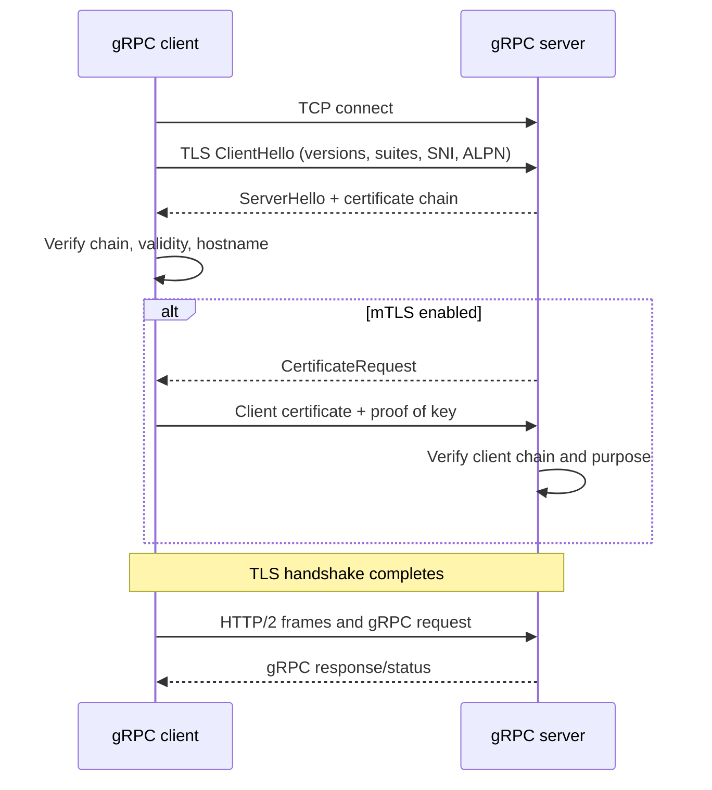
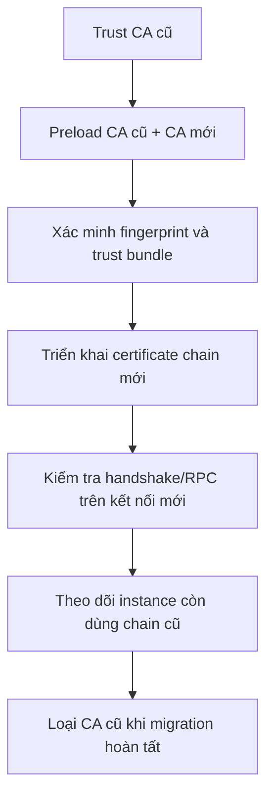

# Lỗi handshake và chứng chỉ hết hạn

## Mục tiêu bài học

Trong **SPRING_GRPC**, TLS bảo vệ kết nối gRPC qua HTTP/2 và xác minh danh tính peer trước khi RPC được xử lý. Một kết nối có thể thất bại ngay trong TLS handshake do certificate hết hạn, chưa có hiệu lực, thiếu CA trung gian, hostname không khớp, trust store sai hoặc policy TLS không tương thích. Khi dùng mutual TLS (mTLS), lỗi còn có thể xuất phát từ certificate phía client.

Bài học tập trung vào **lỗi handshake và chứng chỉ hết hạn**: xác định handshake dừng ở giai đoạn nào, đọc thông tin certificate chain và thời hạn, chẩn đoán lỗi từ cả client/server, kiểm tra bằng OpenSSL và Java, khắc phục đúng nguyên nhân, đồng thời xây dựng quy trình theo dõi expiry và gia hạn/rotation không gây gián đoạn.

Sau bài này, bạn có thể:

1. Phân biệt lỗi TLS handshake với lỗi gRPC xảy ra sau khi kết nối đã thiết lập.
2. Nhận diện certificate hết hạn, chưa có hiệu lực và lỗi đồng hồ hệ thống.
3. Chẩn đoán trust chain, hostname/SAN, SNI, EKU, key mismatch và mTLS.
4. Kiểm tra certificate đang được listener thực sự trình ra.
5. Dùng OpenSSL và Java TLS diagnostics để khoanh vùng lỗi.
6. Gia hạn và rotate certificate có overlap, kiểm tra reload/restart semantics.
7. Thiết lập cảnh báo expiry và integration tests cho các lỗi TLS quan trọng.

> **Phạm vi:** Ví dụ dùng gRPC Java, Spring gRPC, Java JSSE và OpenSSL. Cách cấu hình/reload TLS phụ thuộc phiên bản gRPC Java, transport và Spring server factory. Bài tập trung vào chẩn đoán và vận hành; không giả định một property TLS chung cho mọi starter.

## 1. Handshake thất bại ở giai đoạn nào?

Khi gRPC client kết nối tới server TLS, transport phải hoàn tất TLS handshake trước khi gửi HTTP/2 frames và RPC message. Client gửi ClientHello với protocol/cipher khả dụng, SNI và ALPN; server chọn tham số, trình certificate chain và chứng minh quyền sở hữu private key. Client xác minh chain và hostname. Với mTLS, server còn yêu cầu client certificate và xác minh certificate đó.



Nếu certificate validation hoặc thương lượng TLS thất bại, RPC handler và server interceptor thường chưa được gọi. Client có thể quan sát lỗi kết nối/channel, thường được biểu diễn thành `UNAVAILABLE` hoặc lỗi transport/TLS tùy thời điểm và implementation. Không suy ra nguyên nhân cụ thể chỉ từ gRPC status; cần xem root cause trong exception, log của transport và kết quả kiểm tra TLS độc lập.

Nếu handshake đã thành công nhưng RPC trả `UNAUTHENTICATED`, `PERMISSION_DENIED`, `UNIMPLEMENTED` hoặc lỗi nghiệp vụ, hãy điều tra tầng RPC/authentication/authorization/service routing. Đây là nhóm vấn đề khác với certificate handshake failure.

## 2. Các nguyên nhân certificate thường gặp

| Nguyên nhân | Dấu hiệu | Điều cần xác minh |
| --- | --- | --- |
| Certificate hết hạn | certificate has expired, expired certificate | notAfter của leaf và mọi intermediate trong chain |
| Certificate chưa có hiệu lực | not yet valid, validity check failed | notBefore và đồng hồ client/server |
| CA không được tin | unknown CA, PKIX path building failed | Trust anchor, fingerprint và chain |
| Thiếu intermediate | Không xây dựng được certification path | Intermediate server gửi và chain được CA cấp |
| Hostname mismatch | No subject alternative DNS name matching | DNS/IP SAN và target hostname |
| Certificate sai mục đích | Key usage/EKU validation failure | serverAuth hoặc clientAuth phù hợp |
| Certificate/key không khớp | Server không start hoặc handshake không hoàn tất | Public key trong certificate so với key pair được nạp |
| SNI chọn sai certificate | Một hostname hoạt động, hostname khác thất bại | SNI, virtual host mapping và certificate listener trình |
| Protocol/cipher không tương thích | handshake_failure, protocol_version, no cipher suites in common | TLS version, cipher allowlist, provider và certificate key type |
| mTLS client certificate lỗi | Server từ chối client ở handshake | Client chain, EKU, expiry, CA trust và private key |

Một lỗi có thể có nhiều nguyên nhân đồng thời. Ví dụ certificate leaf chưa hết hạn nhưng intermediate đã hết hạn; hoặc chain được tin cậy nhưng SAN không khớp hostname. Kiểm tra từng lớp theo thứ tự thay vì chỉ đổi trust store hoặc tắt verification.

## 3. Kiểm tra thời hạn certificate

### 3.1. Hiểu notBefore và notAfter

X.509 certificate có khoảng thời gian hiệu lực:

- `notBefore`: thời điểm certificate bắt đầu có hiệu lực.
- `notAfter`: thời điểm certificate hết hiệu lực.

TLS validator kiểm tra thời gian hiện tại của máy theo các mốc này. Certificate có thể bị từ chối trước ngày hết hạn nếu đồng hồ hệ thống chạy nhanh/chậm đáng kể hoặc certificate chưa đến `notBefore`.

Phải kiểm tra toàn bộ chain, không chỉ leaf certificate. Một leaf còn hạn vẫn có thể không xác minh được nếu intermediate CA hoặc root CA đã hết hạn/không còn được tin theo policy.

### 3.2. Xem thời hạn và SAN bằng OpenSSL

```bash
openssl x509 -in server.pem -noout \
  -subject -issuer -dates -ext subjectAltName -ext extendedKeyUsage
```

Kiểm tra certificate có hết hạn hoặc sẽ hết hạn trong 30 ngày (2.592.000 giây):

```bash
openssl x509 -in server.pem -noout -checkend 2592000
```

- Exit code `0`: certificate chưa hết hạn trong khoảng thời gian kiểm tra.
- Exit code khác `0`: certificate đã hết hạn hoặc sẽ hết hạn trong khoảng thời gian đó.

`-checkend` chỉ kiểm tra certificate được chỉ định. Lặp lại cho từng intermediate hoặc kiểm tra cả chain bằng công cụ PKI phù hợp.

### 3.3. Kiểm tra đồng hồ hệ thống

Nếu lỗi là `not yet valid` hoặc `expired` bất thường:

1. So sánh thời gian UTC trên client, server, container và node host.
2. Kiểm tra NTP/time synchronization.
3. Kiểm tra timezone chỉ để hiển thị; certificate validity được biểu diễn theo thời điểm tuyệt đối.
4. Kiểm tra clock drift sau khi VM/container suspend hoặc node mất đồng bộ.
5. Chỉ phát hành lại certificate khi thời gian hệ thống đã đúng và certificate thực sự sai hạn.

Không kéo dài thời gian chấp nhận certificate bằng cách tắt validity check. Đồng hồ sai có thể ảnh hưởng token expiry, deadline, log correlation và nhiều cơ chế bảo mật khác.

## 4. Kiểm tra certificate server thực sự được trình

Đừng chỉ đọc file certificate trên disk. Listener có thể vẫn đang dùng certificate cũ do TLS context được tạo từ trước, proxy có certificate riêng hoặc SNI chọn một certificate khác.

Kiểm tra endpoint thật:

```bash
openssl s_client \
  -connect grpc.example.com:9090 \
  -servername grpc.example.com \
  -alpn h2 \
  -CAfile certs/root-ca.pem \
  -verify_hostname grpc.example.com \
  -verify_return_error \
  -showcerts
```

Xem các thông tin:

- Leaf certificate thực sự được server gửi.
- Subject, issuer, SAN, serial/fingerprint và validity.
- Intermediate certificates có được gửi đủ không.
- Trust chain có xác minh được tới CA root đã chỉ định không.
- Hostname có khớp SAN không.
- ALPN có thương lượng `h2` không.

Có thể lấy fingerprint của file local và so sánh với certificate endpoint đang trình:

```bash
openssl x509 -in server.pem -noout -fingerprint -sha256
```

Nếu fingerprint khác, có thể server/proxy đang dùng certificate khác, reload chưa thành công hoặc SNI đang chọn virtual host khác. Kiểm tra từng hostname nếu listener dùng nhiều certificate.

## 5. Chẩn đoán trust chain và hostname

### 5.1. Trust chain

Client phải tin CA root đã cấp server certificate. Server thường gửi leaf và intermediate chain; root CA thường được cài trong trust store client thay vì gửi lại.

Kiểm tra chain offline:

```bash
openssl verify \
  -CAfile certs/root-ca.pem \
  -untrusted certs/intermediate-ca.pem \
  -verify_hostname grpc.example.com \
  server.pem
```

Nếu chain fail:

- Xác minh fingerprint root CA qua kênh phân phối tin cậy.
- Kiểm tra intermediate đúng issuer và đúng thứ tự.
- Kiểm tra validity, CA constraints và key usage.
- Xác minh server listener gửi intermediate cần thiết.
- Kiểm tra trust store mà đúng gRPC client/Java process đang dùng.

Không thêm leaf certificate hoặc CA không rõ nguồn vào trust store để “làm cho kết nối chạy”. Việc mở rộng trust anchors có thể khiến client chấp nhận nhiều server identity ngoài dự kiến.

### 5.2. Hostname/SAN

Chain hợp lệ không có nghĩa hostname hợp lệ. Nếu client kết nối tới `grpc.example.com`, leaf certificate phải có DNS SAN phù hợp. Nếu client dùng IP literal, cần IP SAN tương ứng.

Kiểm tra SNI và hostname cùng lúc bằng OpenSSL. Đừng override authority hoặc tắt endpoint identification chỉ để bỏ qua SAN mismatch; hãy sửa target DNS, certificate SAN hoặc SNI mapping theo thiết kế.

## 6. Chẩn đoán lỗi mTLS phía client

Khi server yêu cầu mTLS, server còn xác minh certificate client. Các lỗi phổ biến:

- Client không gửi certificate dù server yêu cầu.
- Client certificate hết hạn hoặc chưa có hiệu lực.
- Client certificate không được CA mà server trust chấp nhận.
- Thiếu intermediate trong client chain.
- EKU/key usage không phù hợp client authentication.
- Client private key không khớp leaf certificate.
- Client dùng certificate của workload/tenant khác với identity được cấp quyền.

Kiểm tra client certificate:

```bash
openssl x509 -in client-chain.pem -noout \
  -subject -issuer -dates -ext subjectAltName -ext extendedKeyUsage

openssl verify -purpose sslclient \
  -CAfile client-root-ca.pem \
  -untrusted client-intermediate.pem \
  client-chain.pem
```

So sánh public key digest của certificate và private key:

```bash
openssl x509 -in client-chain.pem -pubkey -noout \
  | openssl pkey -pubin -outform DER \
  | openssl dgst -sha256

openssl pkey -in client-key.pem -pubout -outform DER \
  | openssl dgst -sha256
```

Hai digest phải giống nhau. Không in private key ra terminal/log; chỉ so sánh digest public key.

Phân biệt handshake rejection với authorization failure: client certificate không hợp lệ bị từ chối trước khi RPC được dispatch; certificate hợp lệ nhưng identity không được phép gọi method có thể nhận `PERMISSION_DENIED` từ application/interceptor.

## 7. Kiểm tra protocol, cipher và ALPN

Không phải mọi `handshake_failure` đều do certificate hết hạn. Hai phía có thể không có TLS version/cipher suite chung, certificate key type không tương thích signature scheme hoặc ALPN không thương lượng HTTP/2.

Kiểm tra TLS 1.2:

```bash
openssl s_client \
  -connect grpc.example.com:9090 \
  -servername grpc.example.com \
  -alpn h2 \
  -tls1_2 \
  -CAfile certs/root-ca.pem \
  -verify_hostname grpc.example.com \
  -verify_return_error
```

Kiểm tra TLS 1.3:

```bash
openssl s_client \
  -connect grpc.example.com:9090 \
  -servername grpc.example.com \
  -alpn h2 \
  -tls1_3 \
  -CAfile certs/root-ca.pem \
  -verify_hostname grpc.example.com \
  -verify_return_error
```

Nếu TLS handshake thành công nhưng ALPN không chọn `h2`, endpoint vẫn có thể không phục vụ gRPC qua HTTP/2 đúng cách. Kiểm tra negotiated protocol, cipher, certificate verification và ALPN trong output. Sau đó gọi generated stub để xác nhận RPC thực sự hoạt động.

## 8. Chẩn đoán từ Java và Spring gRPC

### 8.1. Đọc root cause, không chỉ status cuối

Ở client, lỗi TLS có thể được bọc trong exception/channel status. Ghi nhận:

- gRPC status code và description.
- Root cause exception class/message.
- Target hostname và port đã cấu hình (không log secret).
- Thời điểm lỗi, correlation ID và phiên bản runtime/transport.
- Server/proxy listener mà client thực sự kết nối.

Ở server, kiểm tra log của TLS provider, server factory và proxy. Nếu handshake bị từ chối trước khi RPC được dispatch, interceptor nghiệp vụ không có đủ thông tin để giải thích nguyên nhân.

### 8.2. Bật Java TLS debug có giới hạn

Khi cần điều tra JSSE, có thể chạy một tiến trình test với:

```text
-Djavax.net.debug=ssl,handshake,trustmanager
```

Debug có thể tạo lượng log rất lớn và chứa hostname, certificate metadata cùng thông tin môi trường. Chỉ bật trong môi trường kiểm soát, giới hạn thời gian, bảo vệ log và tắt sau khi thu thập đủ bằng chứng. Một số transport dùng Netty/OpenSSL native thay vì JSSE; khi đó JSSE debug có thể không phản ánh handshake của gRPC listener.

### 8.3. Kiểm tra đúng listener Spring đang quản lý

Một ứng dụng Spring Boot có thể có HTTP server và native gRPC server ở port riêng. Cấu hình/reload certificate của servlet container không nhất thiết tác động tới native gRPC listener.

Với Spring gRPC:

1. Xác định transport và server factory thực tế.
2. Xác minh certificate/key/trust material được nạp vào đúng listener.
3. Kiểm tra service bean vẫn được bind vào server đó.
4. Xác minh certificate qua kết nối mới tới port gRPC, không chỉ đọc cấu hình.
5. Nếu TLS terminate tại proxy, kiểm tra cả client-to-proxy và proxy-to-backend TLS hop.

Không giả định mọi server factory tự reload certificate khi file đổi. Nếu không có reload hook được tài liệu hỗ trợ, dùng rolling restart hoặc thay server instance có kiểm soát.

## 9. Gia hạn và rotation certificate trước khi hết hạn

Certificate renewal nên diễn ra trước `notAfter`, với thời gian đủ để phát hiện lỗi cấp phát, phân phối và reload.

### 9.1. Quy trình renewal leaf certificate

1. Lập inventory hostname, issuer, serial, SAN, EKU, expiry, listener và owner.
2. Tạo key mới nếu policy yêu cầu rotation key; nếu không, thực hiện theo quy trình bảo vệ key đã phê duyệt.
3. Tạo CSR với SAN/EKU đúng; gửi CA cấp phát.
4. Kiểm tra certificate mới: chain, validity, SAN, EKU và key pair.
5. Đưa certificate/key mới vào secret store hoặc mount được bảo vệ.
6. Triển khai lên staging/canary; xác minh handshake và RPC bằng kết nối mới.
7. Reload/restart server hoặc proxy theo cơ chế được hỗ trợ.
8. Theo dõi handshake failures và certificate fingerprint/serial được trình.
9. Loại bỏ key/certificate cũ sau khi rollback window kết thúc và không còn instance sử dụng.

### 9.2. Rotation CA có overlap

Nếu đổi root CA, client/server cần trust bundle chứa CA cũ và mới trong giai đoạn chuyển đổi:



Không xóa CA cũ trước khi tất cả endpoint cần thiết đã chuyển sang chain mới. Nếu CA/private key cũ bị compromise, ưu tiên incident response và thu hồi khẩn cấp thay vì giữ overlap chỉ để duy trì tương thích.

### 9.3. Reload semantics

Thay file PEM không bảo đảm TLS context đang chạy tự nạp nội dung mới:

- Client channel thường giữ credential/trust material đã nạp khi tạo. Tạo channel mới với credential mới, kiểm tra kết nối, chuyển traffic, drain và shutdown channel cũ.
- Server có thể chỉ nạp key/trust material khi server/SSL context khởi tạo. Dùng reload mechanism được hỗ trợ hoặc rolling restart.
- Proxy có semantics reload riêng; xác minh certificate được trình trên kết nối mới sau reload.

Kết nối TLS đã thiết lập không tự đổi certificate chỉ vì file nguồn thay đổi. Luôn kiểm tra handshake mới.

## 10. Theo dõi expiry và handshake failures

Một quy trình vận hành tốt không chờ client báo lỗi mới phát hiện certificate hết hạn.

Theo dõi tối thiểu:

- Số ngày còn lại của leaf và intermediate certificate.
- Certificate expiry theo hostname/listener.
- Handshake success/failure theo nhóm nguyên nhân.
- Unknown CA, hostname mismatch, expired/not-yet-valid và mTLS rejection.
- TLS version, cipher và ALPN negotiation failure.
- Certificate issuer/serial/fingerprint đã chuẩn hóa theo chính sách audit.
- Số instance đã nhận certificate mới và số instance còn trình certificate cũ.

Đặt nhiều ngưỡng cảnh báo theo thời gian gia hạn thực tế, ví dụ 30 ngày, 14 ngày và 7 ngày trước expiry. Ngưỡng phải tính tới lead time của CA, approval, deployment và rollback. Với certificate ngắn hạn, chọn ngưỡng tương ứng chu kỳ cấp phát.

Không log private key, trust store password hoặc nội dung secret. Dùng fingerprint/serial và thông tin trạng thái không nhạy cảm để điều tra.

## 11. Kiểm thử lỗi handshake và expiry

Dùng CA/certificate fixture riêng cho test. Không đưa certificate/private key production vào repository hoặc test artifact.

| Test | Cấu hình | Kết quả mong đợi |
| --- | --- | --- |
| Certificate hợp lệ | Chain trusted, SAN đúng, còn hạn | TLS handshake và RPC thành công |
| Leaf hết hạn | notAfter trong quá khứ | Client từ chối certificate |
| Leaf chưa có hiệu lực | notBefore trong tương lai | Client từ chối certificate |
| Intermediate hết hạn | Leaf còn hạn, intermediate hết hạn | Chain validation thất bại |
| CA không được tin | Root không có trong trust store | Unknown CA/path validation failure |
| Hostname mismatch | Chain hợp lệ, SAN khác target | Hostname verification thất bại |
| Thiếu intermediate | Server không gửi intermediate cần thiết | Path validation thất bại nếu không có nguồn bổ sung |
| mTLS client hết hạn | Server REQUIRE, client leaf hết hạn | Server từ chối handshake |
| Client key mismatch | Certificate và private key không cùng cặp | Client không chứng minh được key possession |
| TLS version không tương thích | Client/server không có protocol chung | Handshake thất bại |
| ALPN không có h2 | Listener không thương lượng HTTP/2 | gRPC không hoạt động đúng dù TLS có thể hoàn tất |

Các negative test phải chứng minh lỗi xảy ra ở đúng lớp. Ví dụ hostname mismatch không được pass chỉ vì port đóng; mTLS rejection không được nhầm với authorization `PERMISSION_DENIED`.

### 11.1. Kiểm thử cảnh báo expiry

Có thể kiểm thử job cảnh báo bằng certificate fixture có ngày hết hạn gần, hoặc mock clock trong logic tính expiry. Xác minh:

- Cảnh báo được phát trước hạn theo ngưỡng.
- Certificate mới sau rotation làm cảnh báo cũ được đóng.
- Mỗi hostname/instance được theo dõi riêng.
- Intermediate và client certificate mTLS cũng được kiểm tra.
- Lỗi không gửi cảnh báo không làm lộ secret hoặc khiến job giám sát dừng âm thầm.

## 12. Lỗi thường gặp và cách xử lý

| Triệu chứng | Nguyên nhân có thể | Cách xử lý |
| --- | --- | --- |
| Kết nối đột ngột fail vào ngày certificate hết hạn | Renewal không chạy hoặc server vẫn trình leaf cũ | Kiểm tra endpoint fingerprint/expiry, renew và reload đúng listener |
| File certificate mới còn hạn nhưng client vẫn báo expired | Server/proxy đang trình certificate cũ hoặc intermediate hết hạn | Kiểm tra chain qua endpoint và từng certificate trong chain |
| Certificate báo not yet valid | Clock drift hoặc notBefore được cấp trong tương lai | Đồng bộ thời gian và kiểm tra validity |
| PKIX path building failed | Sai trust root hoặc thiếu intermediate | Xác minh fingerprint, trust store và chain server gửi |
| Hostname mismatch | SAN không chứa target hostname | Sửa DNS/target hoặc cấp lại certificate có SAN đúng |
| Server khởi động lỗi khi nạp TLS | PEM sai định dạng, key mismatch hoặc file permission | Kiểm tra PEM, public key digest và quyền đọc secret |
| mTLS fail dù server certificate hợp lệ | Client cert hết hạn/sai CA/sai EKU hoặc key mismatch | Kiểm tra client chain, clientAuth purpose và key pair |
| Một hostname fail, hostname khác pass | SNI mapping trình certificate khác | Kiểm tra SNI, virtual host và certificate từng hostname |
| TLS pass nhưng RPC fail | ALPN, HTTP/2, authority/path hoặc service registration lỗi | Xác minh h2 rồi gọi generated stub |
| Restart xong vẫn dùng certificate cũ | Restart nhầm process/listener hoặc secret mount chưa cập nhật | Xác minh instance, mount version và certificate endpoint đang trình |
| Java log không có handshake detail | Transport dùng Netty/OpenSSL native | Dùng diagnostics của provider/proxy và OpenSSL tới listener |
| Cảnh báo expiry không xuất hiện | Monitoring chỉ quét leaf hoặc sai timezone/target | Quét cả chain, mTLS client cert và kiểm tra clock/job |

## 13. Bài tập thực hành

1. Dùng OpenSSL xem notBefore, notAfter, SAN và EKU của server certificate cùng intermediate.
2. Dùng `-checkend` tạo cảnh báo kiểm tra certificate sẽ hết hạn trong 30 ngày.
3. Khởi động test server với certificate hợp lệ; xác minh handshake, hostname và ALPN h2.
4. Thay bằng certificate fixture đã hết hạn; xác minh client từ chối trước khi RPC handler chạy.
5. Thử certificate chưa có hiệu lực và mô phỏng clock sai trong test có kiểm soát.
6. Tạo lỗi unknown CA, thiếu intermediate và hostname mismatch; ghi lại root cause khác nhau.
7. Với mTLS, thử client certificate hết hạn, sai EKU và private key không khớp.
8. Cấu hình cảnh báo expiry cho leaf, intermediate và client certificate; xác minh ngưỡng 30/14/7 ngày.
9. Diễn tập leaf renewal cùng CA và CA rotation có trust overlap; kiểm tra certificate qua kết nối mới sau reload.
10. Viết runbook phân loại lỗi TLS handshake, chỉ rõ lệnh kiểm tra, listener/owner và điều kiện rollback.

### Câu hỏi tự kiểm tra

- Vì sao TLS handshake failure thường xảy ra trước khi gRPC interceptor chạy?
- notBefore và notAfter biểu thị điều gì?
- Vì sao leaf còn hạn nhưng chain vẫn có thể bị từ chối?
- Làm thế nào phân biệt expired certificate với unknown CA và hostname mismatch?
- openssl s_client giúp kiểm tra certificate nào thực sự được listener trình ra?
- Vì sao phải kiểm tra đồng hồ client/server khi gặp not yet valid?
- Trong mTLS, certificate hết hạn ở phía client được phát hiện tại đâu?
- Thay file PEM có bảo đảm channel/server đang chạy nạp certificate mới không?
- Khi nào CA rotation cần trust overlap và khi nào cần thu hồi khẩn cấp?
- Làm thế nào chứng minh một lỗi là handshake failure thay vì lỗi RPC?

## Tài liệu tham khảo

- [RFC 5280 — Internet X.509 PKI Certificate and CRL Profile](https://www.rfc-editor.org/rfc/rfc5280): certificate validity, path validation và CA constraints.
- [RFC 8446 — TLS 1.3](https://www.rfc-editor.org/rfc/rfc8446): TLS handshake và certificate authentication.
- [RFC 9525 — Service Identity in TLS](https://www.rfc-editor.org/rfc/rfc9525): xác minh server identity và hostname.
- [gRPC — Authentication](https://grpc.io/docs/guides/auth/): TLS và mTLS trong gRPC.
- [gRPC Java — TlsChannelCredentials](https://grpc.github.io/grpc-java/javadoc/io/grpc/TlsChannelCredentials.html): trust roots và client certificate credentials.
- [gRPC Java — TlsServerCredentials](https://grpc.github.io/grpc-java/javadoc/io/grpc/TlsServerCredentials.html): server key material và client authentication.
- [Java — X509Certificate](https://docs.oracle.com/en/java/javase/17/docs/api/java.base/java/security/cert/X509Certificate.html): validity, SAN và certificate metadata.
- [Java Security — JSSE Reference Guide](https://docs.oracle.com/en/java/javase/17/security/java-secure-socket-extension-jsse-reference-guide.html): trust manager, TLS diagnostics và JSSE.
- [OpenSSL — x509](https://docs.openssl.org/3.0/man1/openssl-x509/): kiểm tra certificate validity và extension.
- [OpenSSL — s_client](https://docs.openssl.org/3.0/man1/openssl-s_client/): kiểm tra TLS handshake, chain, SNI và ALPN.

**Kết quả mong đợi:** Người học chẩn đoán được lỗi TLS handshake và certificate hết hạn ở cả client lẫn server, xác minh đúng chain/hostname/thời hạn/mTLS, phân biệt lỗi transport với lỗi RPC, và vận hành renewal/rotation cùng cảnh báo expiry để tránh gián đoạn dịch vụ gRPC.
