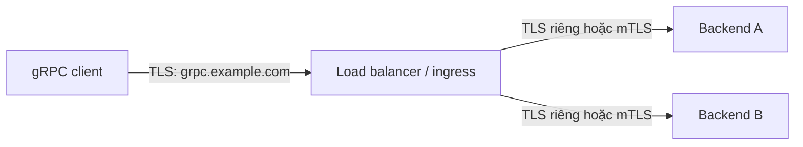

# Không bỏ qua xác minh hostname trong production

TLS chỉ bảo vệ kết nối đúng nghĩa khi client xác minh được server đang kết nối là endpoint mà client định gọi. Certificate được ký bởi một CA đáng tin cậy vẫn chưa đủ: certificate còn phải đại diện cho đúng hostname của service. Nếu bỏ qua hostname verification, client có thể chấp nhận certificate hợp lệ của một hệ thống khác và thiết lập kết nối mã hóa tới nhầm endpoint hoặc một máy chủ giả mạo.

Trong **SPRING_GRPC**, client thường kết nối qua DNS name, service discovery hoặc load balancer. Cần giữ hostname logic của service xuyên suốt quá trình phân giải địa chỉ, cấu hình TLS và kiểm thử. Không tắt endpoint identification, không dùng trust-all manager trong production và không dùng authority override để che một certificate sai. Certificate phải có Subject Alternative Name (SAN) phù hợp với tên mà client xác minh.

## 1. Trust chain và hostname verification là hai kiểm tra khác nhau

Khi gRPC client thiết lập TLS, hai câu hỏi bảo mật cần được trả lời:

1. **Certificate có được tin cậy không?** Certificate phải tạo được trust chain tới CA mà client tin cậy, còn hiệu lực và đáp ứng các kiểm tra certificate khác.
2. **Certificate có thuộc đúng server mà client muốn gọi không?** DNS name hoặc IP address của endpoint phải khớp với SAN trong certificate theo quy tắc hostname/IP verification.

Hai kiểm tra này không thay thế nhau:

| Trust chain | Hostname verification | Kết quả |
| --- | --- | --- |
| Hợp lệ | Khớp | Client có thể xác minh đúng server và tiếp tục TLS |
| Hợp lệ | Không khớp | Phải từ chối; certificate đáng tin nhưng thuộc tên endpoint khác |
| Không hợp lệ | Khớp | Phải từ chối; đúng tên nhưng issuer/certificate không được tin cậy |
| Không hợp lệ | Không khớp | Phải từ chối |

Ví dụ, client gọi grpc.orders.example.com. Certificate được CA nội bộ ký nhưng chỉ có SAN DNS:grpc.billing.example.com. Trust chain hợp lệ không làm certificate đó trở thành certificate hợp lệ cho grpc.orders.example.com.

Hostname verification ngăn client chấp nhận một certificate chỉ vì nó được ký bởi CA đáng tin cậy. Đây là lớp xác minh danh tính endpoint, độc lập với việc dữ liệu trên kênh đã được mã hóa.

## 2. SAN là nguồn định danh hostname/IP

Certificate server nên khai báo endpoint trong extension **Subject Alternative Name (SAN)**:

- dNSName cho hostname, ví dụ DNS:grpc.example.com.
- iPAddress cho IP address, ví dụ IP:10.20.0.15.

Client hiện đại phải dựa vào SAN để xác minh endpoint. Không thiết kế certificate mới chỉ dựa vào Common Name (CN); CN không còn là cơ chế thay thế đáng tin cậy cho SAN trong hostname verification hiện đại.

Ví dụ certificate cho service DNS:

```text
X509v3 Subject Alternative Name:
    DNS:grpc.example.com
    DNS:grpc.internal.example.com
```

Ví dụ certificate cho endpoint được gọi trực tiếp bằng IP:

```text
X509v3 Subject Alternative Name:
    IP Address:10.20.0.15
```

Nếu client gọi grpc.example.com, SAN phải có DNS name tương ứng. Nếu client gọi trực tiếp 10.20.0.15, certificate cần SAN kiểu IP address. Một SAN dạng DNS:10.20.0.15 không tương đương SAN kiểu iPAddress.

### 2.1. Wildcard certificate có phạm vi giới hạn

Wildcard SAN như DNS:*.example.com thường khớp một nhãn ở vị trí wildcard, ví dụ grpc.example.com. Nó không tự động khớp grpc.internal.example.com hoặc example.com.

Chỉ dùng wildcard khi phạm vi tên được quản lý rõ ràng. Certificate wildcard có phạm vi rộng có thể làm tăng tác động nếu private key bị lộ. Với service quan trọng, certificate có SAN cụ thể thường giúp giới hạn danh tính mà key đại diện.

## 3. Hostname, SNI và địa chỉ IP trong gRPC

Ba khái niệm liên quan nhưng có vai trò khác nhau:

- **Target/hostname:** tên client dùng để xác định service cần gọi, ví dụ grpc.example.com.
- **SNI (Server Name Indication):** hostname client gửi trong TLS ClientHello để server hoặc TLS proxy chọn certificate phù hợp khi một địa chỉ phục vụ nhiều hostname.
- **Hostname verification:** client kiểm tra certificate server có đại diện cho hostname mà client định gọi hay không.

SNI giúp server chọn certificate; nó không thay thế việc client xác minh certificate. Một server có thể trả về certificate theo SNI nhưng client vẫn phải kiểm tra trust chain và SAN.

Khi DNS resolver phân giải grpc.example.com thành một hoặc nhiều IP của load balancer/backend, client vẫn cần giữ danh tính logic grpc.example.com. Không nên thay hostname service bằng IP backend một cách vô tình rồi khiến TLS kiểm tra certificate theo một tên khác.

### 3.1. DNS alias và service discovery

Giả sử client gọi grpc.example.com, DNS trả về 10.20.0.11 và 10.20.0.12. Các địa chỉ này chỉ là kết quả định tuyến. Certificate được trình bày cho client cần đại diện cho hostname logic grpc.example.com mà client sử dụng.

Với gRPC name resolver, load balancing và service discovery, hãy phân biệt:

- Tên service mà client dùng làm target.
- Địa chỉ IP mà resolver trả về.
- Authority/SNI dùng trong TLS và HTTP/2.
- SAN mà certificate server công bố.

Nếu thay đổi resolver hoặc chuyển sang kết nối trực tiếp IP, phải kiểm tra lại identity semantics. Đừng sửa lỗi mismatch bằng cách tắt hostname verification.

## 4. Cấu hình client gRPC Java với TLS

Với endpoint DNS có certificate hợp lệ và CA đã nằm trong trust store mặc định của JVM, client có thể bật transport security:

```java
ManagedChannel channel = ManagedChannelBuilder
    .forAddress("grpc.example.com", 8443)
    .useTransportSecurity()
    .build();
```

Hostname truyền vào forAddress là một phần quan trọng của endpoint identity. Khi dùng DNS resolver hoặc target URI, cần bảo đảm target giữ đúng tên service được certificate đại diện.

Nếu service dùng CA riêng, client cần tin cậy CA đó. Ví dụ với Netty gRPC transport và CA certificate được quản lý riêng:

```java
SslContext sslContext = GrpcSslContexts.forClient()
    .trustManager(new File("config/trust/service-ca.pem"))
    .build();

ManagedChannel channel = NettyChannelBuilder
    .forAddress("grpc.example.com", 8443)
    .sslContext(sslContext)
    .build();
```

Ví dụ này dùng API của gRPC Netty và cần dependency tương ứng. trustManager cấu hình CA được tin cậy; nó không phải lý do để bỏ qua hostname verification. Giữ endpoint DNS chính xác và để TLS client xác minh certificate theo authority tương ứng.

### 4.1. Quản lý ManagedChannel trong Spring

Trong ứng dụng Spring, channel thường được tạo và quản lý theo lifecycle của bean:

```java
@Configuration
class GrpcClientConfiguration {

    @Bean(destroyMethod = "shutdown")
    ManagedChannel ordersChannel() {
        return ManagedChannelBuilder
            .forAddress("grpc.orders.example.com", 8443)
            .useTransportSecurity()
            .build();
    }

    @Bean
    OrderServiceGrpc.OrderServiceBlockingStub orderStub(
            ManagedChannel ordersChannel) {
        return OrderServiceGrpc.newBlockingStub(ordersChannel);
    }
}
```

Đây là cấu hình gRPC Java tiêu chuẩn được quản lý bằng Spring bean. Với Spring gRPC starter cụ thể, ứng dụng có thể dùng property, channel factory hoặc customizer riêng; tên property phụ thuộc phiên bản/thư viện. Dù cách tạo channel khác nhau, target hostname và trust configuration phải được giữ đúng. Không tạo channel bằng plaintext hoặc trust-all chỉ để tránh lỗi certificate trong môi trường production.

## 5. Sử dụng authority override đúng cách

gRPC Java cung cấp overrideAuthority trên channel builder để chỉ định authority khác với địa chỉ kết nối. Tính năng này có thể hữu ích trong môi trường kiểm thử, proxy hoặc routing có virtual host, nhưng authority còn liên quan đến identity mà TLS client xác minh.

Ví dụ kết nối đến địa chỉ IP nhưng service identity là DNS name:

```java
ManagedChannel channel = NettyChannelBuilder
    .forAddress("10.20.0.15", 8443)
    .overrideAuthority("grpc.example.com")
    .useTransportSecurity()
    .build();
```

Chỉ dùng cấu hình như vậy khi grpc.example.com là identity service đã được xác nhận, certificate có SAN tương ứng và proxy/server được cấu hình phục vụ hostname đó. Đây không phải cách hợp lệ để chấp nhận một certificate bất kỳ.

Không:

- Đặt authority thành một hostname tùy ý chỉ để handshake thành công.
- Dùng hostname của service khác có certificate đang được tin cậy.
- Đưa authority override vào production mà không có kiểm soát cấu hình và kiểm thử.
- Xem việc đổi authority là cách sửa certificate thiếu SAN.

Nếu target và certificate identity không khớp, hãy sửa DNS, resolver, certificate SAN hoặc cấu hình virtual host theo kiến trúc đã định. Không làm yếu xác minh danh tính để che mismatch.

## 6. Certificate cho load balancer, ingress và proxy

Khi gRPC đi qua load balancer hoặc ingress, nơi kết thúc TLS quyết định certificate mà client nhìn thấy:



Nếu TLS kết thúc tại load balancer:

- Client xác minh certificate của load balancer theo hostname service.
- Load balancer chịu trách nhiệm xác minh backend trên kết nối upstream nếu upstream dùng TLS.
- Upstream TLS cần trust store và hostname/authority verification riêng.

Nếu TLS passthrough:

- Backend hoặc proxy cuối cùng thực hiện TLS handshake với client.
- Certificate được trình bày phải khớp hostname client dùng.

Không giả định rằng certificate của backend tự động được client xác minh khi TLS đã kết thúc ở ingress. Mỗi TLS hop có một peer identity riêng. Với mTLS, client certificate xác minh danh tính client ở phía server; nó không thay thế server hostname verification ở phía client.

## 7. Không tắt hostname verification trong production

Các cách làm sau làm suy yếu hoặc loại bỏ một phần bảo vệ TLS:

- Dùng plaintext transport cho kết nối production cần TLS.
- Dùng trust manager chấp nhận mọi certificate.
- Tắt endpoint identification/hostname verification.
- Bỏ qua lỗi certificate mismatch bằng cách đổi authority tùy tiện.
- Dùng certificate tự ký mà không có trust anchor được quản lý rõ ràng.

Một số ví dụ trên mạng dùng InsecureTrustManagerFactory hoặc custom trust manager luôn trả lời certificate hợp lệ. Những cách đó có thể hữu ích trong một thử nghiệm cô lập để chẩn đoán handshake, nhưng không được đưa vào production. Trust-all bỏ qua xác minh chuỗi tin cậy; nếu đồng thời tắt hostname verification, client gần như không còn xác minh server identity.

usePlaintext cũng không phải cách xử lý certificate mismatch. Nó bỏ TLS khỏi transport, khiến dữ liệu và metadata không còn được bảo vệ bởi TLS.

Nếu certificate hợp lệ nhưng hostname sai, cần sửa certificate hoặc tên endpoint. Nếu certificate được CA nội bộ ký, cài đặt CA đúng vào trust store. Không đánh đổi xác minh danh tính để làm cho deployment khởi động được.

## 8. Quản lý certificate và rotation

Hostname verification chỉ hoạt động ổn định nếu certificate lifecycle được quản lý:

1. Cấp certificate với SAN chứa DNS/IP thực tế mà client dùng.
2. Phát hành certificate từ CA được client trust.
3. Theo dõi thời hạn, issuer, SAN và key usage.
4. Cài certificate mới trước khi certificate cũ hết hạn.
5. Trong giai đoạn chuyển CA, cập nhật trust bundle theo quy trình overlap an toàn.
6. Reload/restart thành phần TLS theo khả năng của server/proxy.
7. Kiểm thử handshake sau rotation từ đúng network path của client.
8. Thu hồi hoặc loại bỏ certificate/key cũ theo quy trình.

Không chỉ kiểm tra certificate còn hạn. Một certificate chưa hết hạn nhưng SAN sai vẫn phải bị từ chối. Tương tự, certificate đúng SAN nhưng chain không được trust cũng phải bị từ chối.

### 8.1. Đổi hostname service

Khi đổi hostname, ví dụ từ grpc-old.example.com sang grpc.example.com, cần phối hợp DNS, certificate, SNI, load balancer, client target và thời gian rollout:

- Cấp certificate có cả hostname cũ và mới trong giai đoạn chuyển tiếp nếu cần.
- Cập nhật endpoint clients theo rollout có kiểm soát.
- Duy trì hostname cũ trong thời gian tương thích đã công bố.
- Xác minh cả hai hostname từ client thực tế trước khi loại bỏ tên cũ.
- Không đổi target sang IP tạm thời để né mismatch.

## 9. Kiểm tra certificate và SAN khi chẩn đoán

Có thể xem SAN của certificate bằng OpenSSL:

```bash
openssl x509 -in server.crt -noout -subject -issuer -ext subjectAltName
```

Để kiểm tra certificate mà endpoint đang trình bày, có thể dùng:

```bash
openssl s_client \
  -connect grpc.example.com:8443 \
  -servername grpc.example.com \
  -showcerts
```

Lệnh này giúp quan sát certificate và handshake từ một máy có OpenSSL. Nó không thay thế kiểm thử bằng đúng gRPC Java client, trust store và resolver của ứng dụng. Khi chẩn đoán cần kiểm tra:

- Client thực sự dùng target hostname nào.
- SNI có gửi đúng hostname mong muốn không.
- Certificate server trả về có SAN tương ứng không.
- Certificate chain có đầy đủ intermediate certificate không.
- Trust store của JVM/container có CA cần thiết không.
- Đồng hồ hệ thống có chính xác để kiểm tra validity period không.
- Proxy/load balancer có trình bày certificate khác với backend dự kiến không.

Không gửi private key hoặc secret vào log/chẩn đoán. Certificate public có thể được kiểm tra, nhưng cần quản lý thông tin endpoint theo policy của môi trường.

## 10. Kiểm thử hostname verification

Một test TLS có giá trị phải dùng TCP/TLS transport thực. In-process transport không thực hiện TLS handshake nên không chứng minh hostname verification hoạt động.

Nên chuẩn bị test CA riêng và các certificate test có SAN khác nhau:

| Certificate | Client target | Kết quả mong đợi |
| --- | --- | --- |
| Trusted CA, SAN DNS:grpc.example.test | grpc.example.test | Handshake thành công |
| Trusted CA, SAN DNS:other.example.test | grpc.example.test | Handshake thất bại do hostname mismatch |
| Untrusted CA, SAN đúng hostname | grpc.example.test | Handshake thất bại do trust chain |
| Trusted CA, SAN IP:10.0.0.8 | Kết nối bằng IP 10.0.0.8 | Thành công nếu cấu hình IP identity phù hợp |
| Trusted CA, chỉ có DNS SAN nhưng client gọi IP | IP 10.0.0.8 | Không được coi DNS SAN là IP SAN |
| Certificate hết hạn | Hostname khớp | Handshake thất bại |

### 10.1. Positive test

Khởi động gRPC server trên TCP với certificate test được ký bởi test CA. Client trust đúng CA và gọi bằng hostname có trong SAN. RPC cần hoàn tất thành công; điều này xác minh cấu hình trust và endpoint identity trong môi trường test.

### 10.2. Negative test hostname mismatch

Giữ nguyên CA tin cậy nhưng cấp server certificate chỉ có SAN cho hostname khác. Client vẫn gọi hostname dự kiến. Handshake phải thất bại trước khi business RPC được xử lý.

Test nên xác minh call thất bại và server handler không được thực thi. Không phụ thuộc vào một chuỗi exception message cụ thể vì TLS provider và gRPC transport có thể bọc lỗi khác nhau. Có thể kiểm tra cause chain để xác nhận nhóm lỗi SSL/certificate mismatch, đồng thời giữ assertion chính là kết nối không được chấp nhận.

### 10.3. Tách biệt hostname mismatch với CA không tin cậy

Hai negative test riêng giúp xác định đúng lớp kiểm tra:

- Certificate trusted nhưng SAN sai: hostname verification phải từ chối.
- Certificate SAN đúng nhưng issuer không được trust: trust-chain verification phải từ chối.

Nếu chỉ test một certificate vừa sai SAN vừa không được trust, không thể biết test đang chứng minh kiểm tra nào.

## 11. Lỗi TLS handshake nhìn từ gRPC client

TLS handshake xảy ra trước khi server dispatch RPC đến application handler. Vì vậy, hostname mismatch thường được client quan sát như lỗi kết nối/handshake, đôi khi được gRPC bọc thành UNAVAILABLE cùng nguyên nhân SSL ở cause chain. Client không nhất thiết nhận một gRPC status do business server gửi, bởi RPC có thể chưa tới handler.

Điều này khác với UNAUTHENTICATED ở application layer:

| Tình huống | Lớp xử lý | Kết quả thường thấy |
| --- | --- | --- |
| Certificate hostname không khớp | TLS handshake | Kết nối bị từ chối; client thấy lỗi SSL/transport |
| CA không được trust | TLS handshake | Kết nối bị từ chối |
| TLS thành công nhưng thiếu Bearer token | Application authentication | UNAUTHENTICATED |
| TLS thành công, token hợp lệ nhưng thiếu quyền | Application authorization | PERMISSION_DENIED |

Không sửa lỗi hostname mismatch bằng cách đổi application status hoặc nới lỏng interceptor. Cần xử lý ở đúng lớp TLS identity.

## 12. Tích hợp với Spring gRPC và môi trường triển khai

Khi đưa cấu hình TLS vào Spring application, nên quản lý:

- Target hostname bằng cấu hình môi trường có kiểm soát, tránh hard-code hostname test trong production.
- Trust bundle/CA certificate qua secret hoặc cơ chế phân phối cấu hình an toàn.
- Lifecycle của ManagedChannel và TLS context.
- Cấu hình resolver/load balancer để giữ authority service đúng.
- Certificate server tại ingress hoặc backend đúng với hostname công bố.
- Rotation và reload theo khả năng của starter/transport.
- Test profile tách biệt với cấu hình production; không để test trust-all lọt vào artifact triển khai.

Nếu dùng Spring gRPC starter, kiểm tra tài liệu đúng phiên bản để biết cách khai báo client channel và customizer. Đừng sao chép property từ một starter khác hoặc một phiên bản cũ. Dù cấu hình được tạo bằng property hay Java bean, các bất biến bảo mật vẫn giống nhau: trust chain được xác minh, hostname được xác minh và certificate SAN khớp service identity.

## 13. Những lỗi cấu hình thường gặp

| Sai lầm | Hậu quả | Cách xử lý |
| --- | --- | --- |
| Certificate chỉ có CN, thiếu SAN phù hợp | Client hiện đại có thể từ chối hostname | Cấp lại certificate với DNS/IP SAN |
| Client gọi bằng IP nhưng certificate chỉ có DNS SAN | Identity không khớp | Dùng DNS target hoặc cấp IP SAN phù hợp |
| DNS resolver trả IP và client vô tình dùng IP làm authority | Hostname verification kiểm tra sai tên | Giữ service authority logic ổn định |
| Trust CA đúng nhưng SAN sai | Kết nối tới sai endpoint vẫn có thể bị nhầm là tin cậy | Giữ hostname verification bật |
| Dùng trust-all manager | Không xác minh được chain của server | Cài CA đúng vào trust store |
| Tắt endpoint identification | Client không xác minh đúng server identity | Giữ hostname verification mặc định/bật |
| Override authority tùy tiện | Có thể xác minh nhầm identity | Chỉ override theo service identity đã được xác nhận |
| Chỉ test bằng in-process transport | Không kiểm tra TLS handshake | Dùng TCP/TLS integration test |
| TLS terminate ở proxy nhưng chỉ kiểm tra cert backend | Bỏ sót identity mà client thực sự nhìn thấy | Kiểm tra certificate trên từng TLS hop |

## 14. Checklist production

Trước khi phát hành hoặc thay đổi gRPC TLS configuration, hãy xác nhận:

1. **Target:** client gọi đúng DNS name/IP được công bố cho service.
2. **SAN:** certificate có DNS SAN hoặc IP SAN tương ứng.
3. **Trust:** chain đầy đủ và CA nằm trong trust store được quản lý.
4. **Hostname verification:** endpoint identity verification không bị tắt.
5. **SNI/authority:** resolver, SNI và authority thống nhất với service identity.
6. **Load balancing:** DNS/IP backend không làm thay đổi danh tính logic của service.
7. **Proxy:** mỗi TLS termination/upstream hop xác minh đúng peer identity.
8. **Override:** không dùng overrideAuthority để che certificate sai.
9. **Lifecycle:** certificate expiry, rotation, CA overlap và channel reload có kế hoạch.
10. **Tests:** có positive test, wrong-SAN test, untrusted-CA test và expired-certificate test.
11. **Configuration:** trust-all/plaintext chỉ có thể tồn tại trong fixture cô lập, không trong production profile.
12. **Observability:** handshake failures được ghi nhận mà không log private key, token hoặc secret.

## 15. Ghi nhớ

Hostname verification xác minh certificate server đại diện cho đúng endpoint mà gRPC client định gọi. Trust chain chỉ chứng minh certificate được ký bởi CA được tin cậy; SAN mới xác định DNS name hoặc IP address mà certificate đại diện. SNI giúp server chọn certificate, còn hostname verification là kiểm tra phía client và không thể được thay thế bằng SNI.

Trong Spring gRPC, giữ service hostname nhất quán giữa target, resolver, authority và SAN. Nếu dùng CA nội bộ, cài CA vào trust store; nếu certificate sai hostname, cấp lại SAN hoặc sửa endpoint. Không dùng trust-all manager, không tắt endpoint identification và không override authority tùy tiện trong production. Kiểm thử TLS qua TCP với cả certificate đúng và sai hostname; in-process test không chứng minh handshake. Khi TLS handshake thất bại, lỗi thường xảy ra trước application authentication, nên cần chẩn đoán ở đúng lớp transport.

### Tài liệu tham khảo

- [gRPC – Authentication](https://grpc.io/docs/guides/auth/)
- [gRPC – TLS](https://grpc.io/docs/guides/auth/#tls)
- [gRPC Java – Security](https://grpc.io/docs/languages/java/)
- [RFC 9525 – Service Identity in TLS](https://www.rfc-editor.org/rfc/rfc9525)
- [RFC 6125 – Service Identity](https://www.rfc-editor.org/rfc/rfc6125)
- [Java – X509Certificate](https://docs.oracle.com/en/java/javase/21/docs/api/java.base/java/security/cert/X509Certificate.html)
