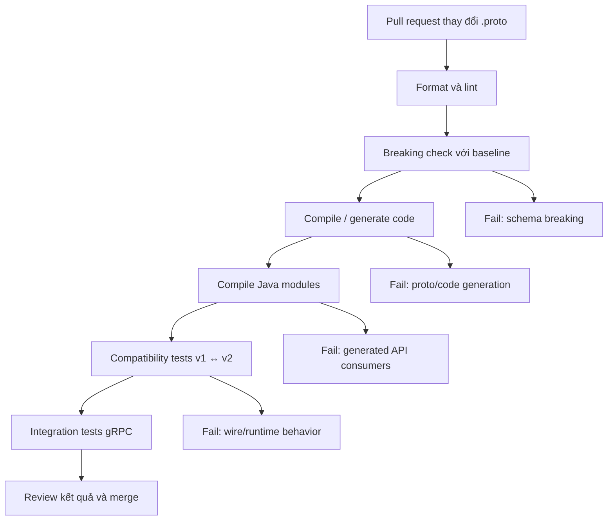

# Kiểm tra breaking change trong CI

## 1. Vì sao cần kiểm tra schema trong CI?

Trong **SPRING_GRPC**, file .proto là hợp đồng dùng chung giữa client, server và các thành phần tích hợp. Một thay đổi schema có thể ảnh hưởng binary wire format, JSON mapping, generated Java API hoặc logic nghiệp vụ. Các nhóm có thể triển khai ở thời điểm khác nhau, vì vậy một thay đổi compile thành công vẫn có thể làm client đang chạy lỗi khi giao tiếp với server mới.

**Breaking change check** là bước so sánh schema đang được đề xuất với một schema baseline đã được chấp nhận hoặc phát hành. CI tự động phát hiện những thay đổi có nguy cơ phá tương thích và chặn merge/release khi vi phạm chính sách.

Bài tập trung vào cách xây dựng cổng kiểm tra đáng tin cậy: chọn baseline đúng; dùng Buf lint và breaking checks; chọn mức tương thích phù hợp; kết hợp kiểm tra schema với generated-code compilation và runtime tests; xử lý ngoại lệ có chủ đích; đưa kiểm tra vào pull request và release pipeline.

## 2. Breaking change có nhiều lớp

Không có một định nghĩa duy nhất cho mọi hệ thống. Một thay đổi có thể giữ binary wire format nhưng vẫn phá source code hoặc JSON API.

| Lớp tương thích | Điều cần bảo vệ | Ví dụ thay đổi có thể ảnh hưởng |
| --- | --- | --- |
| Binary wire | Client/server parse cùng payload đúng cách | Đổi field number, wire type hoặc xóa field đang dùng |
| Protobuf JSON | JSON consumers tiếp tục đọc/ghi key và value | Đổi tên field làm đổi JSON key mặc định |
| Source/generated API | Mã Java sinh ra vẫn tương thích với consumer compile-time | Đổi tên field làm đổi getter/setter |
| Behavioral/semantic | Các bên hiểu cùng ý nghĩa nghiệp vụ | Đổi ý nghĩa enum hoặc field mà không đổi wire encoding |

Một công cụ schema compatibility có thể kiểm tra cấu trúc và một số bề mặt source/JSON, nhưng không thể tự hiểu toàn bộ semantics nghiệp vụ. Ví dụ, đổi `int32` thành `sint32` có thể vẫn dùng varint wire type nhưng cách mã hóa số âm khác nhau. Thêm enum value có thể parse được, nhưng client cũ vẫn cần xử lý unknown value an toàn.

Do đó CI nên có nhiều lớp kiểm tra, mỗi lớp trả lời một câu hỏi cụ thể.

## 3. Baseline phải đại diện cho schema đã được chấp nhận

Breaking check chỉ có ý nghĩa khi biết đang so sánh với phiên bản nào. Baseline không nên là một file bất kỳ trên máy developer; nó phải đại diện cho contract mà hệ thống cam kết hỗ trợ.

Các lựa chọn thường gặp:

- **Target branch:** khi kiểm tra pull request, so schema trong nhánh hiện tại với nhánh đích như main.
- **Release tag:** khi chuẩn bị phát hành contract, so với tag gần nhất đã phát hành.
- **Registry/version đã publish:** nếu dùng Buf Schema Registry (BSR), so với phiên bản module đã được phát hành và dùng bởi consumers.
- **Schema snapshot:** lưu descriptor/schema artifact bất biến của một release để dùng trong CI.

Với pull request, so với target branch giúp phát hiện thay đổi phá schema đang nằm trên nhánh tích hợp. Với release, nên so với baseline của release trước hoặc contract version đang được consumers sử dụng. Nếu main đã có thay đổi chưa phát hành, nó có thể không đại diện cho hợp đồng production; chọn sai baseline có thể tạo cảnh báo giả hoặc bỏ sót breaking change thực tế.

Baseline cần được quản lý như artifact có version:

1. Ghi nhận commit/tag hoặc registry version.
2. Giữ lịch sử thay đổi và người phê duyệt.
3. Không âm thầm thay baseline để làm CI xanh.
4. Khi nâng major contract có chủ đích, cập nhật baseline theo quy trình release rõ ràng.

## 4. Dùng Buf lint và breaking check

Buf cung cấp hai nhóm kiểm tra thường dùng:

- `buf lint`: kiểm tra style, naming, cấu trúc và các quy tắc schema đã cấu hình.
- `buf breaking`: so sánh schema hiện tại với baseline để phát hiện thay đổi bị xem là breaking theo rule set.

Ví dụ lệnh kiểm tra trên pull request:

```bash
buf lint
buf breaking --against ".git#branch=main"
```

Cú pháp Git reference là ví dụ phổ biến; CI cần bảo đảm checkout đủ lịch sử Git và cấu hình đúng thư mục/module Protobuf. Nếu schema nằm trong subdirectory hoặc dùng BSR, điều chỉnh input/reference theo cấu trúc repository và phiên bản Buf đang pin.

Một cấu hình Buf v2 minh họa:

```yaml
version: v2

lint:
  use:
    - STANDARD

breaking:
  use:
    - FILE
```

Các nhóm rule như `FILE`, `PACKAGE`, `WIRE_JSON` và `WIRE` cho phép chọn phạm vi kiểm tra khác nhau, từ tương thích ở mức wire tới các bề mặt source/file. `FILE` là lựa chọn chặt khi muốn bảo vệ source compatibility ở phạm vi file. Hãy đối chiếu rule set với phiên bản Buf và chính sách consumers của dự án; không chọn mức thấp nhất chỉ để giảm số lỗi CI.

### Chọn rule set theo consumer

- Nếu chỉ có binary gRPC consumers và generated code được quản lý đồng bộ, `WIRE` có thể là điểm khởi đầu.
- Nếu có Protobuf JSON, REST transcoding hoặc gateway, cần kiểm tra cả JSON compatibility, ví dụ `WIRE_JSON` hoặc mức chặt hơn.
- Nếu nhiều ứng dụng compile trực tiếp với generated Java API, cân nhắc `PACKAGE` hoặc `FILE`.
- Nếu contract được nhiều ngôn ngữ và công cụ sử dụng, rule set chặt hơn giúp phát hiện sớm thay đổi ở tên/package/file.

Rule set càng chặt càng có thể phát hiện thay đổi source-level vốn không phá binary wire. Đó có thể là kết quả mong muốn nếu generated API là hợp đồng công khai. Nếu thay đổi được chấp nhận, cần ghi rõ bề mặt nào bị ảnh hưởng và kế hoạch cập nhật consumer.

## 5. Những thay đổi cần được CI phát hiện

Một schema check nên phát hiện ít nhất các nhóm thay đổi sau, theo chính sách tương thích đã chọn:

| Nhóm thay đổi | Rủi ro | Hướng xử lý thường dùng |
| --- | --- | --- |
| Xóa field | Payload cũ có thể mất dữ liệu khi đọc; source API biến mất | Giữ field hoặc xóa có kiểm soát, reserve number/name |
| Tái sử dụng field number | Payload cũ bị diễn giải thành field mới | Không tái sử dụng; giữ reserved |
| Đổi field number/type | Parser và semantics có thể lệch | Thêm field mới với number mới, migrate |
| Đổi tên field | JSON key và generated API thay đổi | Giữ wire number; cân nhắc json_name, reserve tên cũ |
| Xóa/đổi enum value | Numeric value cũ có thể mang nghĩa khác | Giữ number, reserve value đã xóa |
| Thêm enum value | Client cũ có thể gặp unknown value | Fallback an toàn và test old client |
| Thay đổi oneof | METHOD_NOT_SET, mất member hoặc thay đổi lựa chọn | Test payload nhiều member và rollout có thứ tự |
| Đổi package/service/RPC | Full method name và generated stub thay đổi | Version API/service có kế hoạch |

Không phải mọi thay đổi trong bảng đều bị mọi rule set xem là breaking. Thêm field mới với number chưa dùng thường tương thích ở binary level; đổi tên field có thể không phá wire nhưng phá source/JSON. CI cần thể hiện đúng chính sách đã chọn thay vì coi mọi thay đổi là giống nhau.

## 6. reserved và breaking check bổ sung cho nhau

Khi xóa field, nên thêm cả number và tên vào reserved trong đúng message. Với enum, reserve numeric value và tên trong enum declaration.

Ví dụ:

```proto
message Invoice {
  string invoice_id = 1;
  int64 amount_cents = 5;

  reserved 4;
  reserved "legacy_label";
}
```

`protoc` có thể từ chối việc khai báo field mới dùng number hoặc tên đã reserve. Tuy nhiên, nếu developer xóa field mà quên thêm reservation, compiler không biết field từng tồn tại trong lịch sử.

Đây là lý do cần breaking check so với baseline: công cụ so sánh có thể nhận ra field đã biến mất so với schema cũ. Kết hợp với lint/review rule về reservation, CI giúp phát hiện cả hành vi xóa lẫn nguy cơ tái sử dụng trong tương lai.

Cần phân biệt hai kết quả:

- **Field deletion detected:** schema mới đã xóa field từng tồn tại; chính sách có thể yêu cầu giữ field hoặc xử lý migration.
- **Reserved declaration present:** schema mới đã khóa number/name cũ để ngăn tái sử dụng về sau.

Có reserved không làm cho mọi field deletion trở nên an toàn; nó chỉ ngăn number/name bị gán lại. Quyết định xóa field vẫn cần xem xét consumers và dữ liệu cũ.

## 7. Pipeline CI theo từng lớp

Một pipeline thực tế nên kiểm tra từ cấu trúc schema đến generated code và hành vi runtime:



Một trình tự shell minh họa:

```bash
buf lint
buf breaking --against ".git#branch=main"
buf generate
```

Trong CI pull request, format nên được kiểm tra theo chế độ không sửa file; nếu pipeline chủ động chạy format có ghi, cần bảo đảm diff được phản ánh vào PR. Các lệnh generation và build tiếp tục dùng toolchain/version đã pin của dự án.

Các bước có vai trò khác nhau:

1. **Format/lint:** phát hiện schema không tuân chuẩn hoặc khó bảo trì.
2. **Breaking check:** so với baseline để chặn thay đổi cấu trúc không tương thích.
3. **Code generation:** xác minh protoc/plugin sinh code thành công.
4. **Compile consumers:** phát hiện getter, type hoặc generated API đã thay đổi.
5. **Compatibility tests:** kiểm tra bytes cũ/mới và fallback.
6. **Integration tests:** xác minh gRPC method, serialization và behavior end-to-end.

## 8. Test runtime vẫn cần thiết

Breaking check tĩnh không thay thế test bằng generated code cũ. Nên lưu contract fixture hoặc generated artifact của ít nhất phiên bản đang được hỗ trợ.

Một số test quan trọng:

- Message v1 serialize rồi v2 parse.
- Message v2 serialize rồi v1 parse.
- Old client gọi new server.
- New client gọi old server nếu rollout có thể tạo tổ hợp này.
- Enum unknown, oneof member mới, field absent/default và boundary values.
- Payload đã lưu trong database/event log được đọc bằng schema mới.
- JSON printer/parser và gateway nếu có dùng Protobuf JSON.

Ví dụ kiểm tra message cũ bằng generated class mới:

```java
// ProductV1 được sinh từ contract đã phát hành.
ProductV1 oldMessage = ProductV1.newBuilder()
    .setSku("SKU-100")
    .setDisplayName("Keyboard")
    .build();

byte[] payload = oldMessage.toByteArray();

// ProductV2 được sinh từ schema đang đề xuất.
ProductV2 newMessage = ProductV2.parseFrom(payload);

assertEquals("SKU-100", newMessage.getSku());
// Nếu field đã được đổi tên nhưng giữ number/type,
// generated API v2 đọc giá trị qua getter mới.
assertEquals("Keyboard", newMessage.getLabel());
```

Đây là ví dụ message-level; fixture v1/v2 cần nằm trong module hoặc artifact riêng để tránh trùng fully qualified Java class name. Integration test nên bổ sung RPC thật vì message parse thành công chưa xác minh service path, TLS, interceptor hoặc business mapping.

## 9. Baseline, branch và release phải nhất quán

Một lỗi CI thường gặp là so sánh schema với sai baseline.

Ví dụ:

- PR so với main nhưng main đã chứa một breaking change chưa phát hành.
- Release candidate so với nhánh phát triển thay vì schema version đang chạy production.
- CI checkout shallow history nên Buf không tìm được Git reference.
- Repository monorepo có nhiều module Protobuf nhưng command chỉ kiểm tra một module.
- Baseline registry được cập nhật trước khi consumers được xác nhận.

Để tránh:

1. Pull request dùng target branch thực tế của PR.
2. Release dùng tag hoặc registry version của contract gần nhất đã phát hành.
3. Pin phiên bản Buf, protoc và plugin sinh code.
4. Xác định rõ root/module path khi chạy command.
5. Kiểm tra mọi module và dependency schema liên quan.
6. Lưu kết quả check cùng commit và baseline đã dùng để có thể tái lập.

Không cập nhật baseline chỉ để làm pipeline xanh. Nếu cần thay đổi hợp đồng có chủ đích, tạo version/major migration riêng, ghi rõ consumer bị ảnh hưởng và yêu cầu phê duyệt phù hợp.

## 10. Xử lý breaking change có chủ đích

Có những thay đổi thật sự cần thiết, chẳng hạn thay đổi semantics hoặc loại bỏ API cũ. Không nên vô hiệu hóa breaking check toàn repository để xử lý một thay đổi như vậy.

Một quy trình exception có kiểm soát:

- Xác định chính xác rule và file/field bị vi phạm.
- Chỉ ra consumer nào đang dùng contract cũ.
- Đề xuất lộ trình thêm field mới, dual-read/write, migrate và deprecate.
- Đặt thời điểm/điều kiện để loại bỏ field cũ.
- Reserve number/name sau khi xóa.
- Chạy test với generated client cũ và payload đã lưu.
- Ghi nhận approval của owner contract/API.
- Chỉ dùng ignore/exclusion hẹp khi có lý do kỹ thuật rõ ràng, kèm thời hạn xem xét.

Nếu schema mới là major contract version, baseline và module identity cần phản ánh versioning đó. Không nên coi việc đổi package hoặc tạo file mới là tự động bảo đảm tương thích; consumers phải được chuyển sang endpoint/artifact mới theo kế hoạch.

## 11. Đọc lỗi CI và tìm nguyên nhân

Khi breaking check thất bại, xử lý theo thứ tự:

1. Xác định file/message/field hoặc enum mà report nêu.
2. Đọc rule bị vi phạm và lớp tương thích mà rule bảo vệ.
3. So sánh schema hiện tại với baseline, không chỉ xem diff trong PR.
4. Xác định đây là wire, JSON, source hay semantic issue.
5. Chọn cách sửa: giữ field, thêm field number mới, reserve identifier, giữ json_name, hoặc version hóa API.
6. Chạy lại lint, breaking check, generation, compile và test liên quan.

| Dấu hiệu | Hướng điều tra |
| --- | --- |
| Field bị xóa | Xác định consumers còn đọc field; thêm reservation nếu loại bỏ |
| Field number/type đổi | Kiểm tra wire encoding và payload lịch sử |
| Enum value bị xóa/đổi number | Kiểm tra numeric values và unknown-enum handling |
| Field name đổi | Kiểm tra JSON key, generated getter và FieldMask |
| Package/service đổi | Kiểm tra full gRPC method name và generated stubs |
| CI không tìm thấy baseline | Kiểm tra Git history, ref, registry version và module path |

Một report pass chỉ chứng minh các rule được cấu hình đã pass. Nó không chứng minh nghiệp vụ đúng, không bảo đảm client cũ có fallback phù hợp và không xác nhận dữ liệu lịch sử đã migrate.

## 12. Checklist đưa breaking check vào CI

- Baseline đại diện cho contract đã phát hành hoặc target branch đúng.
- Phiên bản Buf, protoc và plugin sinh code được pin.
- buf lint chạy trên toàn bộ module cần kiểm tra.
- buf breaking dùng rule set phù hợp với wire, JSON và generated source consumers.
- CI không âm thầm thay baseline hoặc bỏ qua toàn bộ breaking rules.
- Schema xóa field/enum có reservation đúng phạm vi.
- Generated Java code được sinh và compile với các consumer liên quan.
- Có fixture/generated artifact từ schema cũ để kiểm tra tương thích hai chiều.
- Có test unknown enum, oneof, default/presence và payload đã lưu nếu liên quan.
- JSON/gateway/FieldMask được test nếu nằm trong contract.
- Exception có phạm vi hẹp, lý do và approval rõ ràng.
- Release check so với schema version đang được consumers sử dụng.

Với **SPRING_GRPC**, breaking change check trong CI là cổng bảo vệ hợp đồng Protobuf trước khi schema mới được merge hoặc phát hành. Baseline chính xác và rule set phù hợp giúp phát hiện thay đổi wire, JSON và source; generated-code compilation cùng compatibility tests kiểm chứng hành vi thực tế. Những thay đổi semantics và migration dữ liệu vẫn cần được review và test riêng, không thể suy ra chỉ từ kết quả của một công cụ tĩnh.
