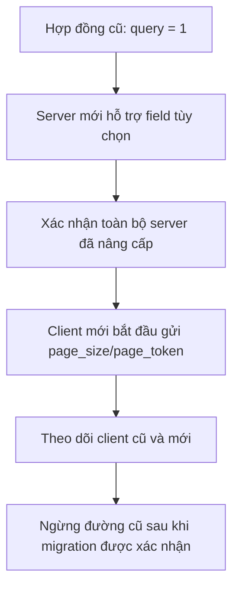

# Thay đổi RPC request mà không phá caller

## 1. Mục tiêu

Một gRPC API có thể được nhiều phiên bản client sử dụng cùng lúc. Trong hệ sinh thái Spring, một service có thể được deploy trước, sau hoặc độc lập với các service gọi nó. Vì vậy, thay đổi cấu trúc request trong file Protocol Buffers phải tính đến client cũ, client mới và server đang chạy phiên bản khác nhau.

Mục tiêu của **API evolution** là mở rộng hoặc thay đổi hợp đồng theo cách các caller hiện hữu vẫn hoạt động trong giai đoạn chuyển đổi. Tương thích không chỉ là parse được message: server mới còn phải giữ ý nghĩa nghiệp vụ cho request cũ.

Sau bài học, bạn có thể:

- Giải thích wire compatibility của Protocol Buffers và vai trò của field number.
- Thêm field request theo hướng tương thích, xử lý default và field presence.
- Nhận diện thay đổi nguy hiểm như đổi tag, đổi wire type, tái sử dụng field number hoặc siết validation.
- Di chuyển field cũ sang field mới theo giai đoạn.
- Triển khai server hỗ trợ cả client cũ và mới trong thời gian rollout.
- Kiểm thử ma trận old client/new server và new client/old server.

## 2. Request Protobuf là hợp đồng trên wire

Trong gRPC, client gọi một method có full name ổn định, ví dụ `catalog.v1.CatalogService/Search`. Request Protobuf được serialize thành các field có **field number** và wire type. Tên biến Java được sinh từ tên field, nhưng binary wire format nhận diện field bằng số.

Hợp đồng ban đầu:

```proto
syntax = "proto3";

package catalog.v1;
option java_package = "dev.example.catalog.v1";
option java_multiple_files = true;

service CatalogService {
  rpc Search(SearchRequest) returns (SearchResponse);
}

message SearchRequest {
  string query = 1;
}

message SearchResponse {
  repeated string product_ids = 1;
}
```

Client cũ gửi `query` với tag `1`. Server đọc message theo descriptor của phiên bản nó đang chạy. Nếu chỉ thêm field có tag mới và server xử lý field đó như tùy chọn, client cũ vẫn gửi message hợp lệ.

Phân biệt ba lớp tương thích:

| Lớp | Câu hỏi | Ví dụ |
|---|---|---|
| **Wire compatibility** | Parser có đọc được bytes của phiên bản kia không? | Field cũ giữ nguyên tag và wire type |
| **Source/API compatibility** | Code Java được sinh có còn biên dịch không? | Đổi tên field có thể đổi accessor |
| **Behavioral compatibility** | Request cũ có còn tạo kết quả đúng như trước không? | Server mới không được bắt buộc field mà client cũ không gửi |

Một thay đổi có thể wire-compatible nhưng vẫn phá source hoặc hành vi. Khi triển khai thực tế, cần đánh giá cả ba lớp.

## 3. Thay đổi an toàn phổ biến: thêm field tùy chọn

Giả sử Catalog cần hỗ trợ phân trang. Ta muốn thêm page size và page token mà không buộc client hiện tại phải nâng cấp ngay.

Hợp đồng cũ:

```proto
message SearchRequest {
  string query = 1;
}
```

Hợp đồng mới:

```proto
message SearchRequest {
  string query = 1;
  optional int32 page_size = 2;
  string page_token = 3;
}
```

Việc thêm field với tag chưa từng dùng thường tương thích ở tầng wire:

- Client cũ chỉ gửi `query = 1`. Server mới đọc được query; các field mới vắng mặt.
- Client mới gửi thêm tag `2` và `3`. Server cũ không biết các tag này và bỏ qua chúng khi parse.
- Server mới phải xác định hành vi hợp lý khi field mới không được gửi.

**Điều kiện quan trọng:** server mới không được coi field mới là bắt buộc ngay khi deploy. Nếu server yêu cầu `page_size` hoặc `page_token` từ mọi caller, client cũ sẽ không còn hoạt động dù message vẫn parse được.

### Ví dụ server xử lý default

```java
@Override
public void search(
        SearchRequest request,
        StreamObserver<SearchResponse> observer) {
    int pageSize = request.hasPageSize()
            ? request.getPageSize()
            : DEFAULT_PAGE_SIZE;

    if (pageSize <= 0 || pageSize > MAX_PAGE_SIZE) {
        observer.onError(Status.INVALID_ARGUMENT
                .withDescription("page_size is out of range")
                .asRuntimeException());
        return;
    }

    String pageToken = request.getPageToken();
    // Token rỗng nghĩa là trang đầu tiên.
    // Thực hiện truy vấn với query, pageSize và pageToken.
}
```

Đoạn code giả định field `page_size` được khai báo là proto3 `optional` để generated Java có `hasPageSize()`. Hằng số giới hạn và phần truy vấn là logic ứng dụng cần triển khai.

Nếu khai báo scalar proto3 không có `optional`, giá trị mặc định như `0` không cho biết chắc caller đã gửi rõ ràng số 0 hay hoàn toàn không gửi field. Dùng `optional` khi cần phân biệt **absent** với **present but default-valued**. Với message field, oneof và một số kiểu khác, presence có quy tắc riêng; hãy kiểm tra API được sinh từ schema thực tế.

## 4. Default phải giữ hành vi của client cũ

Wire compatibility chỉ giúp server đọc message. Server còn phải gán nghĩa cho field bị thiếu.

| Field mới | Khi client cũ không gửi | Hành vi tương thích |
|---|---|---|
| `page_size` | Absent hoặc default | Chọn page size mặc định đã công bố |
| `page_token` | Chuỗi rỗng | Bắt đầu từ trang đầu |
| `locale` | Absent/default | Dùng locale mặc định trước đây |
| `include_archived` | False/absent | Giữ hành vi không bao gồm archived như trước |
| `sort_order` | Enum mặc định | Dùng thứ tự sắp xếp cũ |

Không chọn một default mới làm thay đổi kết quả của request cũ nếu đó không phải thay đổi hành vi đã được chủ động chấp thuận. Ví dụ, thêm `include_archived` rồi mặc định true có thể khiến client cũ bất ngờ nhận thêm dữ liệu.

Khi giá trị mặc định cần phân biệt rõ, khai báo presence tường minh hoặc dùng một message/oneof phù hợp. Đừng suy ra ý định của caller chỉ từ giá trị scalar mặc định.

## 5. Thêm field mới không có nghĩa client cũ dùng được tính năng mới

Khi client mới gửi `page_size` tới server cũ, server cũ có thể bỏ qua tag chưa biết. Request vẫn parse được nhưng server cũ không phân trang theo yêu cầu. Vì vậy:

- **Old client → new server:** thường hoạt động nếu server mới chấp nhận field vắng mặt và giữ default cũ.
- **New client → old server:** có thể parse được, nhưng server cũ không thực hiện semantics của field mới.

Đây là khác biệt giữa wire compatibility và feature compatibility. Nếu client mới phụ thuộc vào semantics mới, phải có rollout hoặc capability negotiation.

### Thứ tự rollout an toàn

1. **Deploy server tương thích trước:** server mới hiểu field mới nhưng vẫn chấp nhận request cũ.
2. **Xác nhận toàn bộ server instance đã nâng cấp:** tránh load balancer gửi client mới tới server cũ chưa hỗ trợ tính năng.
3. **Deploy client mới:** client bắt đầu gửi field mới khi target đã hỗ trợ.
4. **Quan sát mức sử dụng:** đo tỷ lệ request có field mới và lỗi validation.
5. **Giữ fallback trong thời gian chuyển đổi:** client cũ vẫn có thể tiếp tục hoạt động.
6. **Chỉ loại bỏ đường cũ sau khi đã xác minh caller:** việc ngừng hỗ trợ là một thay đổi API có kế hoạch riêng.



Trong môi trường rolling deployment, có thể tồn tại đồng thời server cũ và mới. Nếu client mới gửi field mà server cũ bỏ qua, request có thể thành công nhưng kết quả sai kỳ vọng. Cần hoàn tất rollout server hoặc dùng version/capability routing trước khi bật tính năng ở client.

## 6. Field number là định danh lâu dài

Field number là phần quan trọng nhất của wire identity. Khi xóa một field, **không bao giờ tái sử dụng số tag của nó cho field khác**.

Schema có field cũ:

```proto
message SearchRequest {
  string query = 1;
  string legacy_category = 2;
}
```

Sau khi loại bỏ field:

```proto
message SearchRequest {
  string query = 1;
  reserved 2;
  reserved "legacy_category";
}
```

`reserved` giúp compiler phát hiện việc vô tình tái sử dụng tag hoặc tên đã loại bỏ. Có thể reserve nhiều số, một dải số hoặc nhiều tên:

```proto
message SearchRequest {
  reserved 2, 5 to 8;
  reserved "legacy_category", "old_filter";
}
```

Không xóa rồi dùng lại tag `2` cho `page_size`. Một client cũ có thể vẫn serialize `legacy_category` với tag `2`; server mới sẽ diễn giải bytes đó thành field mới, gây dữ liệu sai hoặc lỗi parse.

Tên field cũng nên được reserve khi xóa. Tên không quyết định binary wire identity nhưng có thể ảnh hưởng generated source, JSON mapping, TextFormat và FieldMask.

## 7. Thay đổi cần tránh

Các thay đổi sau có thể phá wire compatibility, source compatibility hoặc semantics:

| Thay đổi | Rủi ro | Cách xử lý |
|---|---|---|
| Đổi field number | Parser mới đọc bytes cũ như field khác/unknown | Giữ nguyên tag; tạo field mới nếu cần |
| Tái sử dụng tag đã xóa | Dữ liệu cũ bị diễn giải sai | Reserve tag và tên |
| Đổi wire type không tương thích | Bytes cũ không parse đúng | Thêm field mới với tag mới |
| Đổi tên field | Generated accessor, JSON/TextFormat/FieldMask có thể đổi | Giữ tên hoặc migration có chủ đích |
| Đổi scalar thành message hoặc ngược lại | Wire encoding và semantics thay đổi | Thêm field mới |
| Chuyển singular thành repeated | Cách diễn giải dữ liệu và API sinh thay đổi | Tạo field mới |
| Đưa field hiện hữu vào oneof | Thay đổi presence và loại trừ lẫn nhau | Thiết kế oneof mới theo lộ trình riêng |
| Thay default nghiệp vụ | Request cũ có thể cho kết quả khác | Giữ default cũ hoặc version semantics |
| Bắt buộc field mới | Client cũ không gửi field sẽ bị từ chối | Triển khai optional/fallback trước |

Một số kiểu Protobuf có cùng wire type nhưng **không đồng nghĩa an toàn để đổi**. Ví dụ `int32` và `sint32` đều dùng varint nhưng áp dụng cách diễn giải số khác nhau; đổi qua lại có thể làm giá trị bị đọc sai. `string` và `bytes` cùng dùng wire type length-delimited nhưng khác quy tắc UTF-8 và semantics. Đừng chỉ so sánh wire type để kết luận mọi thay đổi đều tương thích.

## 8. Đổi tên hoặc thay thế field request theo giai đoạn

Giả sử request cũ dùng `customer_id`, nhưng hợp đồng mới muốn biểu diễn một định danh tổng quát hơn là `customer_ref`. Đổi tên trực tiếp có thể giữ tag và wire bytes nhưng làm code caller không biên dịch vì generated accessor đã đổi. JSON client hoặc FieldMask cũng có thể bị ảnh hưởng.

Một lộ trình an toàn hơn là thêm field mới với tag mới và tạm thời hỗ trợ cả hai:

```proto
message GetCustomerRequest {
  string customer_id = 1 [deprecated = true];
  string customer_ref = 2;
}
```

Server chuẩn hóa hai cách biểu diễn:

```java
private String resolveCustomerRef(GetCustomerRequest request) {
    String oldId = request.getCustomerId();
    String newRef = request.getCustomerRef();

    if (!oldId.isBlank() && !newRef.isBlank()
            && !oldId.equals(newRef)) {
        throw Status.INVALID_ARGUMENT
                .withDescription("customer_id and customer_ref conflict")
                .asRuntimeException();
    }

    if (!newRef.isBlank()) {
        return newRef;
    }
    if (!oldId.isBlank()) {
        return oldId;
    }
    throw Status.INVALID_ARGUMENT
            .withDescription("customer reference is required")
            .asRuntimeException();
}
```

Quy tắc ưu tiên và lỗi khi hai field xung đột phải được công bố rõ ràng. Không âm thầm chọn một giá trị nếu hai field cùng được gửi nhưng khác nhau.

Lộ trình migration:

1. Deploy server chấp nhận cả `customer_id` và `customer_ref`.
2. Đo request đang dùng field cũ; ghi nhận caller/version nếu có thể.
3. Deploy client mới gửi `customer_ref`. Trong giai đoạn cần hỗ trợ server cũ, có thể dual-write cả hai field nếu semantics giống nhau và server cũ chỉ hiểu field cũ.
4. Xác nhận mọi server đang phục vụ client mới hiểu field mới.
5. Chuyển client còn lại và theo dõi tỷ lệ sử dụng field cũ.
6. Khi không còn caller cũ, ngừng đọc field cũ trong server ở một lần phát hành có kế hoạch; xóa field khỏi schema và reserve cả tag lẫn tên.

Lưu ý: dual-write chỉ là chiến thuật chuyển đổi khi hai field có cùng ý nghĩa. Nếu hai định danh khác semantics, không sao chép giá trị giữa chúng để tạo cảm giác tương thích.

## 9. Field presence và lựa chọn schema

Proto3 scalar thông thường có implicit presence. Ví dụ:

```proto
message UpdateProfileRequest {
  string display_name = 1;
  bool marketing_opt_in = 2;
}
```

Ở server, `getMarketingOptIn()` trả false cả khi caller không gửi field lẫn khi caller gửi false. Nếu cần phân biệt “không yêu cầu thay đổi” với “chủ động tắt”, dùng presence:

```proto
message UpdateProfileRequest {
  optional string display_name = 1;
  optional bool marketing_opt_in = 2;
}
```

Generated Java có các phương thức kiểm tra presence như `hasMarketingOptIn()`. Khi field vắng mặt, server có thể giữ giá trị hiện tại; khi field có mặt và false, server cập nhật thành false.

Đối với update API, dùng `FieldMask` cũng là một cách thể hiện chính xác field nào caller muốn cập nhật:

```proto
import "google/protobuf/field_mask.proto";

message UpdateProfileRequest {
  Profile profile = 1;
  google.protobuf.FieldMask update_mask = 2;
}
```

FieldMask có semantics riêng: server phải kiểm tra path được cho phép, xử lý field vắng mặt và xác định cách áp dụng giá trị mặc định. Thêm FieldMask vào API đang có không tự động bảo đảm tương thích hành vi; cần thiết kế migration và test caller cũ.

## 10. Enum và oneof khi request phát triển

### Thêm enum value

Thêm một enum value với số mới thường giữ wire compatibility:

```proto
enum SortOrder {
  SORT_ORDER_UNSPECIFIED = 0;
  SORT_ORDER_RELEVANCE = 1;
  SORT_ORDER_NEWEST = 2;
  SORT_ORDER_PRICE_ASC = 3;
}
```

Client cũ có thể nhận numeric value chưa biết. Cách generated Java biểu diễn unknown enum phụ thuộc API/runtime; code caller nên có nhánh mặc định và không giả định mọi value đều nằm trong danh sách đã biết. Khi thêm enum value, server/client cũ có thể fallback hoặc từ chối theo semantics được định nghĩa, nhưng không được crash vì thiếu default branch.

Không đổi số enum value đã công bố. Khi loại bỏ value, reserve cả số và tên để tránh tái sử dụng.

### Oneof

`oneof` giúp biểu diễn các lựa chọn loại trừ lẫn nhau:

```proto
message SearchFilter {
  oneof filter {
    string category = 1;
    string brand = 2;
  }
}
```

Thêm một lựa chọn mới vào oneof cần xem xét caller cũ: caller cũ không biết lựa chọn mới, còn server cũ không hiểu tag mới. Không chuyển field hiện hữu vào một oneof mới trong cùng một thay đổi nếu chưa đánh giá tác động presence và generated API. Thay đổi này không tương đương với thêm một field độc lập.

## 11. Thay đổi request khác với thay đổi RPC method

Thêm field vào message request thường giữ nguyên gRPC method path nếu service và method không đổi. Nhưng các thay đổi sau là thay đổi API lớn hơn:

- Đổi package Protobuf có thể đổi full method name.
- Đổi service hoặc method name làm đổi RPC path.
- Đổi kiểu request/response của method có thể phá generated stub và wire contract.
- Chuyển unary thành client/server/bidirectional streaming thay đổi invocation model.

Không dùng việc thêm field request để ngầm thay đổi kiểu giao tiếp. Nếu cần RPC mới với semantics khác, cân nhắc thêm method mới hoặc versioned service, giữ method cũ trong giai đoạn migration.

Ví dụ:

```proto
service CatalogService {
  rpc Search(SearchRequest) returns (SearchResponse);
  rpc SearchV2(SearchV2Request) returns (SearchResponse);
}
```

Method mới có thể phù hợp khi semantics không thể diễn đạt bằng field tùy chọn hoặc khi thay đổi tương thích quá phức tạp. Đổi lại, phải duy trì cả hai method, đo mức sử dụng và có kế hoạch ngừng method cũ.

## 12. Kiểm thử tương thích

Không chỉ biên dịch server mới với proto mới. Cần kiểm tra các cặp phiên bản thực tế:

| Client | Server | Câu hỏi cần trả lời |
|---|---|---|
| Cũ | Cũ | Hành vi chuẩn trước thay đổi |
| Cũ | Mới | Server mới có chấp nhận request thiếu field mới và giữ default cũ không? |
| Mới | Mới | Tính năng mới có hoạt động đúng không? |
| Mới | Cũ | Field mới có bị bỏ qua không; client có xử lý fallback không? |

Các test nên bao gồm:

1. **Golden wire test:** serialize request bằng generated class cũ, parse bằng class mới và kiểm tra field cũ.
2. **Unknown-field test:** serialize request mới có field mới, parse bằng class cũ; xác minh parser không lỗi và ghi nhận field mới không được server cũ áp dụng.
3. **Default/presence test:** kiểm tra absent, explicit zero/false và giá trị hợp lệ.
4. **Behavior test:** request cũ tới server mới cho cùng kết quả nghiệp vụ như trước.
5. **Validation test:** field mới sai miền giá trị trả status phù hợp mà không làm hỏng caller cũ.
6. **Migration test:** cả field cũ và mới được gửi; kiểm tra trường hợp trùng và xung đột.
7. **Rollout test:** chạy nhiều server version sau load balancer để xác nhận thời điểm bật client mới.

Ví dụ kiểm tra presence:

```java
SearchRequest oldStyle = SearchRequest.newBuilder()
        .setQuery("keyboard")
        .build();

assertFalse(oldStyle.hasPageSize());

SearchRequest newStyle = SearchRequest.newBuilder()
        .setQuery("keyboard")
        .setPageSize(20)
        .build();

assertTrue(newStyle.hasPageSize());
assertEquals(20, newStyle.getPageSize());
```

Test giả định `page_size` được khai báo `optional int32`. Khi kiểm tra tương thích giữa generated class từ hai phiên bản schema, hãy biên dịch fixture riêng hoặc dùng artifact proto versioned; không để hai định nghĩa cùng package/class name đè lên nhau trong một source set.

Có thể bổ sung công cụ kiểm tra breaking change trên schema trong CI. Công cụ giúp phát hiện thay đổi descriptor nguy hiểm, nhưng không thay thế test semantics, rollout và caller thực tế.

## 13. Lỗi thường gặp

| Hiện tượng | Nguyên nhân | Cách xử lý |
|---|---|---|
| Client cũ bị `INVALID_ARGUMENT` sau deploy | Server mới bắt buộc field vừa thêm | Giữ field optional và fallback cũ |
| Client mới gọi server cũ nhưng pagination không hoạt động | Server cũ bỏ qua unknown fields | Rollout server trước hoặc capability/version routing |
| Giá trị field bị đọc sai | Đổi/reuse tag hoặc đổi kiểu có semantics khác | Giữ tag, reserve field đã xóa, thêm tag mới |
| Code Java caller không biên dịch | Đổi tên field hoặc đổi message shape | Giữ accessor cũ trong giai đoạn migration |
| Update API không phân biệt bỏ qua và false/zero | Scalar implicit presence | Dùng `optional` hoặc FieldMask |
| Field cũ và mới xung đột | Dual-write không có quy tắc | Định nghĩa validation/precedence và đo caller |
| Client crash khi nhận enum mới | Không có nhánh xử lý unknown/default | Viết default branch và quy định fallback |
| JSON gateway không còn map request | Đổi field name/json_name | Đánh giá JSON mapping cùng wire compatibility |
| Server mới trả kết quả khác cho request cũ | Default nghiệp vụ thay đổi | Giữ semantics cũ hoặc version hóa có kế hoạch |

## 14. Bài tập thực hành

**Tình huống:** Catalog API hiện có `SearchRequest` chỉ gồm `query = 1`. Nhóm muốn thêm phân trang và bộ lọc theo locale. Có nhiều phiên bản Spring service đang chạy rolling deployment; một số client cũ không thể nâng cấp trong cùng đợt.

Hãy thực hiện:

1. Mở rộng request với `optional int32 page_size`, `string page_token` và field locale phù hợp; không đổi tag cũ.
2. Viết server mới dùng default tương thích khi field vắng mặt; validate page size khi caller có gửi.
3. Kiểm thử old client/new server và xác nhận kết quả cũ không đổi.
4. Kiểm thử new client/old server; xác nhận field mới bị bỏ qua và xác định fallback/capability cần thiết.
5. Thiết kế rollout server trước, sau đó mới bật client gửi field mới.
6. Thử thay `customer_id` bằng `customer_ref` theo cách thêm field mới, dual-read/dual-write có kiểm soát và reserve tag cũ khi kết thúc.
7. Thêm golden wire test và kiểm tra schema trong CI.
8. Ghi rõ điều kiện được phép xóa field cũ: caller đã migrate, metrics không còn traffic cũ và phiên bản server còn hỗ trợ đã hết thời hạn.

**Tiêu chí hoàn thành:** client cũ tiếp tục gọi được server mới; field mới có presence/default được định nghĩa; không tái sử dụng tag; client mới chỉ bật tính năng sau khi server hỗ trợ; compatibility được xác minh ở cả wire và behavior.

## 15. Ghi nhớ

Khi thay đổi RPC request, hãy giữ nguyên field number và semantics cũ, thêm field mới bằng tag chưa dùng, xử lý field vắng mặt bằng default tương thích và dùng presence khi cần phân biệt absent với giá trị mặc định. Server mới phải tiếp tục chấp nhận client cũ; client mới chỉ nên dựa vào semantics mới sau khi server hỗ trợ. Khi thay thế field, giữ cả đường cũ và mới qua giai đoạn migration, đo caller, rồi xóa và reserve tag/tên cũ. Wire compatibility là điều kiện cần; source compatibility, behavioral compatibility và rollout mới quyết định thay đổi có thực sự không phá caller hay không.
