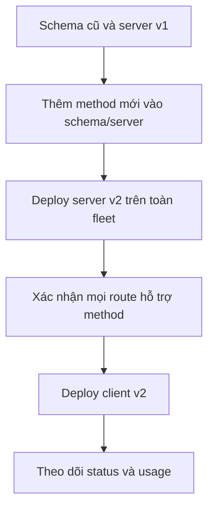

# Thêm method mới

## 1. Mục tiêu

Khi một dịch vụ cần cung cấp thao tác nghiệp vụ mới, ta thường mở rộng Protobuf service bằng một RPC method mới. Ví dụ, Catalog đã có `Search` nhưng nay cần thêm `GetRecommendations`. Thay đổi này cho phép client mới sử dụng khả năng mới trong khi các client hiện tại vẫn tiếp tục gọi method cũ.

Trong hệ sinh thái Spring gRPC, client và server có thể được deploy độc lập, thậm chí nhiều phiên bản server cùng tồn tại trong một đợt rolling deployment. Vì vậy, thêm method phải tính đến contract, generated code, đăng ký service, status khi gọi nhầm server cũ và thứ tự rollout.

Sau bài học, bạn có thể:

- Thêm RPC method vào Protobuf service hiện hữu mà giữ nguyên method cũ.
- Hiểu full method path và cách gRPC định tuyến lời gọi.
- Thiết kế request/response riêng cho thao tác mới.
- Cài đặt method mới trong Spring gRPC server và gọi từ client.
- Phân tích tương thích giữa client cũ/mới và server cũ/mới.
- Xử lý `UNIMPLEMENTED` và rollout server trước client.
- Kiểm thử method mới qua generated stub và transport thật.

## 2. Một RPC method là một phần của contract service

gRPC định danh một method bằng package, service name và method name. Với service:

```proto
package catalog.v1;

service CatalogService {
  rpc Search(SearchRequest) returns (SearchResponse);
}
```

Full method path trên wire có dạng:

```text
/catalog.v1.CatalogService/Search
```

Tên method là một phần của API công khai. Client generated stub gọi đúng path này; server đăng ký service descriptor để định tuyến request đến handler tương ứng.

Khi thêm method, ta thêm một entry mới vào service descriptor. Các method cũ vẫn giữ nguyên tên, kiểu request/response và semantics:

```proto
service CatalogService {
  rpc Search(SearchRequest) returns (SearchResponse);
  rpc GetRecommendations(GetRecommendationsRequest)
      returns (GetRecommendationsResponse);
}
```

Method mới có path:

```text
/catalog.v1.CatalogService/GetRecommendations
```

Thêm method mới theo cách additive thường tương thích với client cũ: client cũ không gọi method mới nên vẫn sử dụng các method đã có. Tuy nhiên, client mới gọi method mới tới server cũ có thể nhận `UNIMPLEMENTED`, vì server đó chưa đăng ký method này.

## 3. Thiết kế request và response cho method mới

Ví dụ Catalog cần đề xuất sản phẩm theo khách hàng. Định nghĩa message riêng cho thao tác:

```proto
syntax = "proto3";

package catalog.v1;
option java_package = "dev.example.catalog.v1";
option java_multiple_files = true;

service CatalogService {
  rpc Search(SearchRequest) returns (SearchResponse);
  rpc GetRecommendations(GetRecommendationsRequest)
      returns (GetRecommendationsResponse);
}

message SearchRequest {
  string query = 1;
}

message SearchResponse {
  repeated string product_ids = 1;
}

message GetRecommendationsRequest {
  string customer_id = 1;
  int32 limit = 2;
}

message GetRecommendationsResponse {
  repeated Recommendation items = 1;
}

message Recommendation {
  string product_id = 1;
  double score = 2;
  string reason = 3;
}
```

Request/response riêng giúp method mới có thể phát triển theo nhu cầu của nó mà không buộc method cũ thay đổi. Khi thiết kế, hãy xác định:

- **Input bắt buộc:** định danh khách hàng, phạm vi dữ liệu và điều kiện truy vấn.
- **Input tùy chọn:** số lượng kết quả, bộ lọc hoặc locale; field mới phải có default tương thích.
- **Output:** dữ liệu caller thực sự cần, tránh trả toàn bộ entity nội bộ.
- **Validation:** giới hạn `limit`, kiểm tra định dạng ID và quyền truy cập.
- **Error semantics:** chọn status ổn định như `INVALID_ARGUMENT`, `NOT_FOUND`, `PERMISSION_DENIED` hoặc `UNAVAILABLE`.
- **Performance:** giới hạn kết quả, deadline và khả năng cache nếu phù hợp.

Không dùng request/response của một method khác chỉ để tiết kiệm vài dòng schema nếu hai thao tác có semantics khác nhau. Message riêng giúp contract dễ hiểu và giảm coupling khi một thao tác cần thêm field.

## 4. Không thay đổi kiểu của method đã công bố

Khi cần một thao tác khác, thêm method mới thay vì đổi method hiện hữu từ unary sang streaming hoặc đổi kiểu request/response tại chỗ.

Ví dụ, nếu `GetRecommendations` hiện là unary:

```proto
rpc GetRecommendations(GetRecommendationsRequest)
    returns (GetRecommendationsResponse);
```

và sau này cần gửi kết quả liên tục, hãy cân nhắc method mới:

```proto
rpc WatchRecommendations(WatchRecommendationsRequest)
    returns (stream Recommendation);
```

Unary, server streaming, client streaming và bidirectional streaming có invocation model khác nhau. Đổi cardinality của method đã phát hành làm thay đổi generated API và contract wire; client cũ không thể coi đó là cùng một thao tác.

Tương tự, không đổi package, service name hoặc method name khi chỉ muốn bổ sung khả năng. Những thành phần này tham gia tạo full method path. Nếu semantics thay đổi lớn đến mức không thể duy trì tương thích, hãy thiết kế method/service version mới và có lộ trình migration.

## 5. Cài đặt method mới trong Spring gRPC server

Protobuf plugin sinh base class cho service. Với Spring gRPC starter cung cấp annotation `@GrpcService`, server có thể triển khai base class và để Spring đăng ký bean:

```java
package dev.example.catalog.server;

import dev.example.catalog.v1.CatalogServiceGrpc;
import dev.example.catalog.v1.GetRecommendationsRequest;
import dev.example.catalog.v1.GetRecommendationsResponse;
import io.grpc.Status;
import io.grpc.stub.StreamObserver;
import org.springframework.grpc.server.service.GrpcService;

@GrpcService
public class CatalogGrpcService
        extends CatalogServiceGrpc.CatalogServiceImplBase {

    private final RecommendationService recommendationService;

    public CatalogGrpcService(
            RecommendationService recommendationService) {
        this.recommendationService = recommendationService;
    }

    @Override
    public void getRecommendations(
            GetRecommendationsRequest request,
            StreamObserver<GetRecommendationsResponse> observer) {
        if (request.getCustomerId().isBlank()) {
            observer.onError(Status.INVALID_ARGUMENT
                    .withDescription("customer_id is required")
                    .asRuntimeException());
            return;
        }

        if (request.getLimit() < 1 || request.getLimit() > 50) {
            observer.onError(Status.INVALID_ARGUMENT
                    .withDescription("limit must be between 1 and 50")
                    .asRuntimeException());
            return;
        }

        try {
            GetRecommendationsResponse response =
                    recommendationService.recommend(
                            request.getCustomerId(), request.getLimit());
            observer.onNext(response);
            observer.onCompleted();
        } catch (CustomerNotFoundException ex) {
            observer.onError(Status.NOT_FOUND
                    .withDescription("customer was not found")
                    .asRuntimeException());
        } catch (RuntimeException ex) {
            observer.onError(Status.INTERNAL
                    .withDescription("recommendation request failed")
                    .asRuntimeException());
        }
    }
}
```

Tên package của annotation và cách đăng ký service phụ thuộc Spring gRPC starter/version đang dùng. Ví dụ trên minh họa mô hình `@GrpcService`; nếu starter của dự án dùng annotation hoặc cơ chế đăng ký khác, giữ đúng integration API của starter đó. Không tự tạo thêm một `Server` trên cùng port khi starter đã sở hữu server.

Generated method trong Java thường dùng lower camel case (`getRecommendations`) dù tên RPC trong `.proto` là `GetRecommendations`. Handler phải kết thúc call đúng một lần bằng `onCompleted()` hoặc `onError()`. Không gọi cả hai cho cùng một RPC.

Đưa nghiệp vụ vào Spring service riêng để handler tập trung chuyển đổi request, validation và status. Không trả stack trace, SQL hoặc thông tin nội bộ trong `Status.description`; ghi chi tiết vào log có kiểm soát và trả mô tả an toàn cho caller.

## 6. Gọi method mới từ Spring client

Sau khi build sinh code từ schema mới, client có method tương ứng trên generated stub:

```java
@Component
public class CatalogGateway {
    private final CatalogServiceGrpc.CatalogServiceBlockingStub stub;

    public CatalogGateway(
            @Qualifier("catalogChannel") ManagedChannel channel) {
        this.stub = CatalogServiceGrpc.newBlockingStub(channel);
    }

    public GetRecommendationsResponse recommendations(
            String customerId, int limit) {
        GetRecommendationsRequest request =
                GetRecommendationsRequest.newBuilder()
                        .setCustomerId(customerId)
                        .setLimit(limit)
                        .build();

        return stub.withDeadlineAfter(800, TimeUnit.MILLISECONDS)
                .getRecommendations(request);
    }
}
```

Channel vẫn được tái sử dụng theo dependency; thêm method không có nghĩa tạo channel mới. Deadline được đặt cho từng RPC, phù hợp với latency budget của thao tác đề xuất. Nếu method cần retry, phải xác định semantics idempotent và retry policy riêng; không retry mọi lỗi một cách vô điều kiện.

Với client streaming hoặc asynchronous stub, cách gọi khác nhau nhưng vẫn sử dụng cùng channel. Chọn blocking stub trong ví dụ chỉ để minh họa unary call; không gọi blocking stub trên event-loop của ứng dụng reactive.

## 7. Điều gì xảy ra khi client mới gọi server cũ?

Giả sử server phiên bản 1 chỉ đăng ký `Search`, còn client phiên bản 2 đã sinh stub có thêm `GetRecommendations`.

Khi client mới gọi method mới tới server cũ:

1. Client gửi RPC tới full method path `/catalog.v1.CatalogService/GetRecommendations`.
2. Server cũ không có handler cho method đó.
3. gRPC thường kết thúc RPC với status `UNIMPLEMENTED`.
4. Client phải quyết định hiển thị lỗi, dùng fallback tương đương hay yêu cầu caller nâng cấp.

`UNIMPLEMENTED` là tín hiệu hữu ích nhưng không chỉ có một nguyên nhân. Nó có thể xuất hiện vì method chưa tồn tại trên server, service/path không được đăng ký hoặc server chủ động đánh dấu thao tác chưa hỗ trợ. Không nên tự động diễn giải mọi `UNIMPLEMENTED` là “server phiên bản cũ”.

Ví dụ xử lý có chủ đích:

```java
try {
    return stub.withDeadlineAfter(800, TimeUnit.MILLISECONDS)
            .getRecommendations(request);
} catch (StatusRuntimeException ex) {
    if (ex.getStatus().getCode() == Status.Code.UNIMPLEMENTED) {
        // Chỉ fallback nếu phương án cũ có semantics tương đương.
        return recommendationFallback(request);
    }
    throw ex;
}
```

Fallback chỉ an toàn khi nó giữ được ý nghĩa nghiệp vụ, quyền truy cập và giới hạn dữ liệu. Nếu không có phương án tương đương, trả lỗi rõ ràng hoặc từ chối bật tính năng mới cho đến khi server đã nâng cấp. Không fallback với mọi status như `UNAVAILABLE`, `PERMISSION_DENIED` hay `DEADLINE_EXCEEDED`; chúng biểu thị các tình huống khác.

## 8. Rollout server trước client

Trong rolling deployment, load balancer có thể đồng thời gửi request tới server cũ và mới. Nếu client mới gọi method mới khi vẫn còn replica cũ, một số request có thể thành công, một số trả `UNIMPLEMENTED`.

Thứ tự triển khai an toàn:

1. **Cập nhật schema và server:** thêm method mới, giữ nguyên các method cũ.
2. **Build và kiểm thử server:** xác nhận handler mới được đăng ký và thực hiện đúng contract.
3. **Deploy toàn bộ server instance:** chờ rollout hoàn tất và xác nhận không còn replica cũ nhận traffic của client mới.
4. **Xác minh capability:** dùng endpoint/version metadata hoặc capability RPC được thiết kế rõ ràng nếu cần xác định server có hỗ trợ method.
5. **Deploy client mới:** chỉ bắt đầu gọi method mới khi target đã hỗ trợ trên toàn bộ đường định tuyến liên quan.
6. **Quan sát:** theo dõi số call, status `UNIMPLEMENTED`, latency, validation error và tỷ lệ fallback.



Nếu không thể nâng cấp toàn bộ server cùng lúc, có thể dùng versioned endpoint, routing theo capability hoặc giữ client mới ở chế độ chưa gọi method mới. Chỉ dựa vào server reflection là chưa đủ nếu reflection không được bật, bị chặn hoặc không đại diện cho endpoint thực tế mà RPC sẽ đi qua.

## 9. Thêm method mới có thể kéo theo policy mới

Method mới thường cần được bổ sung vào các policy vận hành:

| Khu vực | Việc cần kiểm tra |
|---|---|
| Authentication/authorization | Caller nào được gọi method mới? |
| Interceptor | Có cần audit, trace hoặc metadata riêng? |
| Rate limit/quota | Method có chi phí cao hơn method cũ không? |
| Deadline | Ngân sách latency phù hợp với thao tác mới? |
| Retry | Method có idempotent và có retry budget không? |
| Metrics | Có metric theo service/method/status không? |
| Logging | Có log request ID và kết quả mà không lộ payload nhạy cảm? |
| API documentation | Request, response, status và semantics đã được công bố? |

Nếu authorization/interceptor dùng allowlist theo full method name, method mới có thể bị từ chối dù handler đã được đăng ký. Hãy kiểm tra policy ở gateway, service mesh, interceptor và server. Không mặc định method mới tự thừa hưởng đúng quyền từ method cũ.

## 10. Thêm streaming method khi cần luồng dữ liệu

Một thao tác mới có thể cần streaming thay vì unary. Ví dụ client muốn nhận thay đổi đề xuất liên tục:

```proto
message WatchRecommendationsRequest {
  string customer_id = 1;
}

service CatalogService {
  rpc Search(SearchRequest) returns (SearchResponse);
  rpc GetRecommendations(GetRecommendationsRequest)
      returns (GetRecommendationsResponse);
  rpc WatchRecommendations(WatchRecommendationsRequest)
      returns (stream Recommendation);
}
```

Streaming method mới có full path riêng và không làm thay đổi invocation của `Search` hay `GetRecommendations`. Khi triển khai, cần định nghĩa rõ:

- Điều kiện kết thúc stream và cách client cancel.
- Deadline hoặc thời hạn subscription.
- Backpressure/flow control và giới hạn message.
- Resume cursor/sequence nếu client cần tiếp tục sau disconnect.
- Authorization cho thời gian tồn tại của stream.

Không biến một unary method đã phát hành thành streaming method tại cùng tên. Thêm method riêng giúp client cũ tiếp tục dùng contract ban đầu.

## 11. Kiểm thử tương thích và hành vi

Ma trận tối thiểu:

| Client | Server | Kết quả mong đợi |
|---|---|---|
| Cũ | Cũ | Các method cũ hoạt động như baseline |
| Cũ | Mới | Method cũ vẫn hoạt động; không bắt buộc client cũ biết method mới |
| Mới | Mới | Method mới hoạt động theo contract |
| Mới | Cũ | Method mới trả `UNIMPLEMENTED` hoặc fallback có chủ đích |

Các kiểm thử nên có:

1. **Descriptor test:** service descriptor có method mới với đúng request/response type và full method name.
2. **Server integration test:** gọi method mới qua channel tới server thật, xác minh response và status.
3. **Old method regression:** các method hiện hữu vẫn giữ hành vi và path.
4. **Old server test:** client mới gọi method mới tới server cũ và xử lý `UNIMPLEMENTED` đúng thiết kế.
5. **Authorization test:** caller hợp lệ được phép, caller không đủ quyền nhận status phù hợp.
6. **Deadline test:** method mới không vượt latency budget; server xử lý cancellation khi client hết deadline.
7. **Rollout test:** mô phỏng nhiều server version hoặc route để phát hiện replica chưa hỗ trợ.

Ví dụ integration test với stub:

```java
@Test
void getRecommendationsReturnsItems() {
    GetRecommendationsRequest request =
            GetRecommendationsRequest.newBuilder()
                    .setCustomerId("customer-42")
                    .setLimit(5)
                    .build();

    GetRecommendationsResponse response =
            CatalogServiceGrpc.newBlockingStub(channel)
                    .withDeadlineAfter(2, TimeUnit.SECONDS)
                    .getRecommendations(request);

    assertFalse(response.getItemsList().isEmpty());
}
```

Test cần server fixture đã đăng ký `CatalogGrpcService`; không dùng mock stub để kết luận handler được đăng ký đúng trên transport. Với test `UNIMPLEMENTED`, khởi động fixture server chỉ có descriptor cũ hoặc server không đăng ký service/method mới.

## 12. Lỗi thường gặp

| Triệu chứng | Nguyên nhân | Cách xử lý |
|---|---|---|
| Client mới nhận `UNIMPLEMENTED` | Server cũ hoặc handler chưa đăng ký | Deploy server hỗ trợ trước; kiểm tra service registration |
| Một số request thành công, số khác `UNIMPLEMENTED` | Rolling deployment còn replica cũ | Chờ rollout hoặc route theo capability |
| Generated stub không có method mới | Client build từ proto artifact cũ | Cập nhật dependency/schema và chạy code generation |
| Server không vào handler | Bean không được đăng ký hoặc full method path khác | Kiểm tra annotation, package, service name và descriptor |
| Method mới bị `PERMISSION_DENIED` | Authorization allowlist chưa cập nhật | Bổ sung policy đúng caller/method |
| Fallback trả kết quả khác semantics | Dùng method cũ không tương đương | Chỉ fallback khi hợp đồng và dữ liệu tương đương |
| Đổi unary sang streaming làm client cũ lỗi | Thay invocation model của method đã công bố | Thêm method mới với cardinality riêng |
| Method mới gây tải lớn | Thiếu quota, deadline hoặc giới hạn output | Thiết kế resource budget và metrics trước rollout |

## 13. Bài tập thực hành

**Tình huống:** Catalog hiện có RPC `Search`. Product team cần thêm thao tác `GetRecommendations` để trả danh sách sản phẩm phù hợp với một customer. Các Spring service client/server được deploy độc lập và dùng rolling deployment.

Hãy thực hiện:

1. Thêm `GetRecommendationsRequest`, `GetRecommendationsResponse` và RPC mới vào `CatalogService`; giữ nguyên `Search`.
2. Sinh Java code và kiểm tra generated descriptor có full method path đúng.
3. Implement handler trong Spring gRPC server, validate input và ánh xạ lỗi sang gRPC status.
4. Đăng ký handler bằng cơ chế của Spring gRPC starter đang dùng.
5. Tạo gateway client dùng channel hiện có, đặt deadline riêng cho method mới.
6. Kiểm thử client cũ với server mới và client mới với server mới.
7. Kiểm thử client mới với server cũ; xác minh `UNIMPLEMENTED` và quyết định fallback/capability behavior.
8. Bổ sung authorization, metrics và audit cho method mới.
9. Chạy rollout server trước client và xác minh không còn route tới server chưa hỗ trợ.

**Tiêu chí hoàn thành:** method mới có path và message contract riêng; method cũ không thay đổi; Spring server đăng ký handler; client gọi được với deadline; client/server lệch phiên bản có hành vi đã xác định; integration test chứng minh cả compatibility và status.

## 14. Ghi nhớ

Thêm method mới là cách mở rộng Protobuf service theo hướng additive: giữ nguyên package, service, method và semantics hiện hữu; thêm RPC với request/response cùng full method path mới. Spring server phải đăng ký handler và cập nhật policy liên quan; client cần generated stub mới, deadline và cách xử lý `UNIMPLEMENTED`. Vì client mới có thể gặp server cũ trong rolling deployment, hãy triển khai server hỗ trợ trước, xác minh toàn bộ route rồi mới bật client. Nếu invocation model hoặc semantics khác, thêm method riêng thay vì sửa kiểu của method đã công bố.
