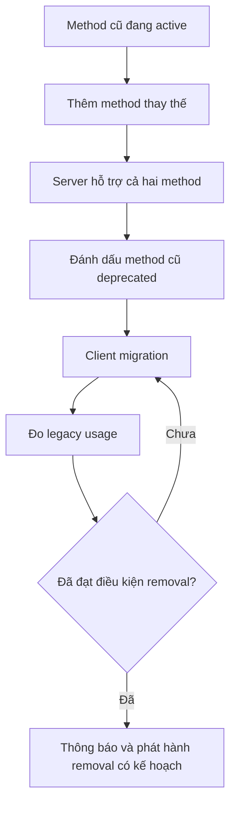

# Deprecate method cũ

## 1. Mục tiêu

Khi một gRPC API có method mới thay thế một thao tác cũ, method cũ thường không thể bị xóa ngay. Nhiều client đã phát hành có thể vẫn gọi method đó; các service Spring cũng có thể được nâng cấp ở thời điểm khác nhau. Nếu server ngừng đăng ký method cũ quá sớm, client chưa migration sẽ nhận lỗi `UNIMPLEMENTED`.

**Deprecation** là quá trình công bố một API không còn được khuyến nghị sử dụng và hướng caller chuyển sang API thay thế. Trong giai đoạn deprecation, method cũ thường vẫn được giữ và phục vụ để bảo vệ caller hiện hữu.

Sau bài học, bạn có thể:

- Đánh dấu RPC method cũ là deprecated trong Protobuf contract.
- Phân biệt deprecation với việc ngừng triển khai hoặc xóa method.
- Giữ method cũ hoạt động bằng cách chuyển đổi request sang nghiệp vụ mới.
- Thông báo migration, đo caller còn sử dụng và đặt thời hạn hỗ trợ.
- Triển khai server/client theo thứ tự phù hợp khi nhiều phiên bản cùng tồn tại.
- Xác định điều kiện loại bỏ method cũ và kiểm thử tương thích.

## 2. Deprecation có ý nghĩa gì?

Giả sử Catalog ban đầu cung cấp `SearchLegacy`, nhận một chuỗi tìm kiếm và trả về danh sách ID. API mới cần bộ lọc, phân trang và thông tin xếp hạng. Ta thêm method mới với request/response rõ ràng hơn, đồng thời đánh dấu method cũ không còn được khuyến nghị.

```proto
syntax = "proto3";

package catalog.v1;
option java_package = "dev.example.catalog.v1";
option java_multiple_files = true;

service CatalogService {
  rpc SearchLegacy(LegacySearchRequest) returns (SearchResponse) {
    option deprecated = true;
  }

  rpc Search(SearchRequest) returns (SearchResponse);
}

message LegacySearchRequest {
  string query = 1;
}

message SearchRequest {
  string query = 1;
  optional int32 page_size = 2;
  string page_token = 3;
  string category = 4;
}

message SearchResponse {
  repeated string product_ids = 1;
  string next_page_token = 2;
}
```

`option deprecated = true` là metadata trong descriptor của RPC method. Nó công bố rằng method không còn là lựa chọn được khuyến nghị; nó **không tự động**:

- Xóa method khỏi service descriptor.
- Ngăn client gọi method.
- Ngừng đăng ký handler ở server.
- Chuyển caller sang method mới.
- Bảo đảm mọi compiler/plugin đều sinh cùng một cảnh báo hoặc annotation Java.

Các generator và công cụ có thể hiển thị deprecation dưới dạng cảnh báo hoặc metadata. Hãy kiểm tra generated code và toolchain của dự án. Nếu API Java wrapper do ứng dụng tự viết cần cảnh báo compile-time, có thể đánh dấu wrapper đó bằng `@Deprecated`; không giả định mọi phiên bản gRPC Java generator tự thêm annotation cho mọi stub method.

## 3. Deprecation khác removal

| Trạng thái | Ý nghĩa | Caller cũ |
|---|---|---|
| Active | Method được hỗ trợ và khuyến nghị sử dụng | Tiếp tục gọi bình thường |
| Deprecated | Method không còn được khuyến nghị; có hướng thay thế | Vẫn có thể gọi nếu server tiếp tục hỗ trợ |
| Disabled/unsupported | Server không còn thực hiện nghiệp vụ của method | Có thể nhận `UNIMPLEMENTED` hoặc status đã công bố |
| Removed | Method không còn trong contract/implementation được phát hành | Caller cũ không thể dựa vào method này |

Đánh dấu deprecated không phải là lý do để server trả lỗi ngay. Trong thời gian migration, server nên tiếp tục xử lý method cũ theo contract đã công bố, trừ khi có vấn đề bảo mật hoặc vận hành cần dừng khẩn cấp.

Nếu handler cũ không còn được đăng ký, gRPC thường trả `UNIMPLEMENTED`. Caller không thể suy ra rằng chỉ cần đổi sang method mới là mọi semantics đều tương đương; request và response có thể đã thay đổi.

## 4. Giữ method cũ và chuyển tiếp vào nghiệp vụ chung

Một cách triển khai thực tế là để cả handler cũ và mới gọi cùng application service. Handler cũ chuyển đổi request legacy sang mô hình nghiệp vụ hiện tại, sau đó ánh xạ kết quả về response cũ.

```java
@GrpcService
public class CatalogGrpcService
        extends CatalogServiceGrpc.CatalogServiceImplBase {

    private final CatalogSearchService searchService;
    private final LegacySearchMapper legacyMapper;

    public CatalogGrpcService(
            CatalogSearchService searchService,
            LegacySearchMapper legacyMapper) {
        this.searchService = searchService;
        this.legacyMapper = legacyMapper;
    }

    @Override
    public void search(
            SearchRequest request,
            StreamObserver<SearchResponse> observer) {
        try {
            SearchCriteria criteria = SearchCriteria.builder()
                    .query(request.getQuery())
                    .pageSize(request.hasPageSize()
                            ? request.getPageSize() : 25)
                    .pageToken(request.getPageToken())
                    .category(request.getCategory())
                    .build();

            SearchResult result = searchService.search(criteria);
            observer.onNext(toResponse(result));
            observer.onCompleted();
        } catch (IllegalArgumentException ex) {
            observer.onError(Status.INVALID_ARGUMENT
                    .withDescription("invalid search request")
                    .asRuntimeException());
        } catch (RuntimeException ex) {
            observer.onError(Status.INTERNAL
                    .withDescription("search failed")
                    .asRuntimeException());
        }
    }

    @Override
    @SuppressWarnings("deprecation")
    public void searchLegacy(
            LegacySearchRequest request,
            StreamObserver<SearchResponse> observer) {
        try {
            SearchCriteria criteria =
                    legacyMapper.toCurrentCriteria(request);
            SearchResult result = searchService.search(criteria);
            observer.onNext(legacyMapper.toLegacyResponse(result));
            observer.onCompleted();
        } catch (RuntimeException ex) {
            observer.onError(Status.INTERNAL
                    .withDescription("legacy search failed")
                    .asRuntimeException());
        }
    }
}
```

Đây là khung minh họa: `CatalogSearchService`, mapper, `SearchCriteria` và `SearchResult` là kiểu ứng dụng cần triển khai. Tên method Java được sinh từ tên RPC trong schema. `@SuppressWarnings("deprecation")` chỉ dùng nếu compiler thực sự phát cảnh báo ở vị trí đó; có thể bỏ nếu không cần.

Lợi ích của cách chuyển tiếp:

- Logic tìm kiếm nằm ở một application service, tránh duy trì hai bản thuật toán.
- Method cũ giữ request/response contract mà client hiện tại đang dùng.
- Method mới có thể nhận thêm bộ lọc và phân trang.
- Có thể đo riêng lưu lượng legacy để biết khi nào migration hoàn tất.

Không gọi lại RPC stub của chính server từ handler cũ chỉ để chuyển sang method mới. Hãy gọi application service chung trực tiếp; việc gọi vòng qua network tạo thêm hop, deadline và nguy cơ đệ quy.

## 5. Chuyển đổi request không phải lúc nào cũng tương đương

Adapter từ method cũ sang nghiệp vụ mới chỉ đúng khi có thể ánh xạ semantics mà không làm caller bất ngờ.

| Request cũ | Mapping sang request/criteria mới |
|---|---|
| `query` | Giữ nguyên query sau khi chuẩn hóa theo quy tắc cũ |
| Không có page size | Dùng giới hạn mặc định tương thích với kết quả cũ |
| Không có category | Không áp dụng category filter |
| Response chỉ có product IDs | Chỉ trả các trường caller cũ đã được cam kết |

Nếu method mới thay đổi thứ tự sắp xếp, cách phân quyền, cách xử lý dữ liệu archived hoặc ý nghĩa của query, không được tự động chuyển method cũ sang semantics mới mà không đánh giá tác động.

Khi không thể giữ tương đương:

1. Duy trì implementation legacy riêng trong thời gian hỗ trợ; hoặc
2. Trả lỗi có chủ đích nếu contract cũ không thể thực hiện an toàn; hoặc
3. Thiết kế versioned API và migration riêng cho thay đổi semantics lớn.

Không trả response của method mới một cách máy móc nếu response đó chứa thêm dữ liệu nhạy cảm hoặc làm thay đổi ý nghĩa của field cũ.

## 6. Deprecate method trong Protobuf và tài liệu API

Đánh dấu method ở đúng vị trí:

```proto
service CatalogService {
  rpc SearchLegacy(LegacySearchRequest) returns (SearchResponse) {
    option deprecated = true;
  }

  rpc Search(SearchRequest) returns (SearchResponse);
}
```

Đây là deprecation của **RPC method**. Nó khác với deprecation của field:

```proto
message LegacySearchRequest {
  string old_query = 1 [deprecated = true];
}
```

Deprecate field không đồng nghĩa deprecate toàn bộ RPC; một method có thể chứa field legacy trong khi các field khác vẫn được dùng. Ngược lại, deprecate method không tự động đánh dấu mọi message/field của method đó deprecated.

Tài liệu API nên ghi rõ:

- Method thay thế và full method path.
- Lý do method cũ được deprecate.
- Khác biệt request/response hoặc semantics.
- Cách chuyển đổi cho client Java và các client khác.
- Ngày bắt đầu deprecation và thời hạn hỗ trợ dự kiến.
- Cách liên hệ hoặc xử lý nếu caller không thể migration đúng hạn.

Chỉ thêm `deprecated = true` mà không cung cấp method thay thế, hướng dẫn migration hoặc thời hạn hỗ trợ sẽ khiến caller không biết cần làm gì tiếp theo.

## 7. Theo dõi caller còn dùng method cũ

Không nên xóa method chỉ dựa trên giả định rằng các nhóm đã nâng cấp. Hãy đo mức sử dụng theo full method name.

Các tín hiệu cần thu thập:

| Tín hiệu | Mục đích |
|---|---|
| RPC count theo method | Biết `SearchLegacy` còn được gọi bao nhiêu |
| Caller identity/client version | Xác định nhóm hoặc phiên bản chưa migration |
| RPC status | Phân biệt call thành công với lỗi |
| Last-seen timestamp | Biết caller nào đã lâu không hoạt động |
| Deadline/latency | Phát hiện method legacy có hành vi khác method mới |
| Owner và migration status | Theo dõi trách nhiệm nâng cấp |

Một server interceptor có thể lấy full method name từ `ServerCall.getMethodDescriptor().getFullMethodName()` và ghi nhận counter:

```java
public final class MethodUsageInterceptor implements ServerInterceptor {
    private final MeterRegistry registry;

    public MethodUsageInterceptor(MeterRegistry registry) {
        this.registry = registry;
    }

    @Override
    public <ReqT, RespT> ServerCall.Listener<ReqT> interceptCall(
            ServerCall<ReqT, RespT> call,
            Metadata headers,
            ServerCallHandler<ReqT, RespT> next) {
        String method = call.getMethodDescriptor().getFullMethodName();
        registry.counter("grpc.server.method.calls",
                "method", method).increment();
        return next.startCall(call, headers);
    }
}
```

Ví dụ chỉ đếm số lần bắt đầu call. Để đếm status và latency, cần bọc listener/call hoặc dùng instrumentation gRPC/Micrometer đã có trong ứng dụng. Không cài interceptor trùng với instrumentation hiện hữu.

Tên method là dimension có cardinality thấp nếu schema ổn định; không đưa request ID, user ID, token hoặc payload vào metric label. Nếu cần nhận diện caller, dùng danh tính service/client version được xác thực và chính sách bảo vệ dữ liệu phù hợp.

## 8. Kế hoạch migration có thời hạn

Một deprecation có thể quản lý theo các giai đoạn:

1. **Công bố method thay thế:** hoàn thiện contract mới và tài liệu mapping.
2. **Phát hành server tương thích:** đăng ký cả method cũ và mới; method cũ delegate hoặc adapter theo semantics cũ.
3. **Đánh dấu deprecated:** cập nhật Protobuf descriptor, generated artifacts và tài liệu.
4. **Thông báo caller:** xác định owner, phiên bản client, deadline migration và kênh hỗ trợ.
5. **Phát hành client mới:** chuyển call sang method mới; không thay đổi channel chỉ vì method thay đổi.
6. **Đo usage:** theo dõi legacy method theo caller/version và status.
7. **Nhắc trước thời hạn:** liên hệ caller còn hoạt động; xử lý các tích hợp bên ngoài và client ít được deploy.
8. **Quyết định removal:** chỉ khi usage đạt điều kiện đã công bố và có phê duyệt theo quy trình phát hành API.



Thời hạn deprecation cần phù hợp với khả năng nâng cấp caller. Với client nội bộ do cùng một đội quản lý, thời hạn có thể ngắn hơn; với SDK công khai, mobile app hoặc đối tác bên ngoài, cần cửa sổ hỗ trợ dài hơn và thông báo chính thức.

## 9. Tương thích giữa các phiên bản client và server

Ma trận cần xem xét:

| Client | Server | Kết quả mong đợi |
|---|---|---|
| Cũ gọi method cũ | Server mới hỗ trợ cả hai | Call tiếp tục thành công trong thời gian deprecation |
| Mới gọi method mới | Server mới | Call mới thành công |
| Mới có fallback gọi method cũ | Server mới | Chỉ dùng fallback khi semantics tương đương và còn trong support window |
| Mới gọi method mới | Server cũ chưa có method mới | Có thể nhận `UNIMPLEMENTED`; rollout phải ngăn tình huống này hoặc client xử lý rõ |
| Cũ gọi method cũ | Server đã removal | Không còn tương thích; có thể nhận `UNIMPLEMENTED` |

Khi client mới cần chạy trong môi trường còn server cũ, có thể:

- Nâng cấp server trước khi bật client mới.
- Dùng versioned endpoint hoặc routing theo capability.
- Duy trì fallback có thời hạn nếu method cũ vẫn được server hỗ trợ.

Không nên gọi method mới, nhận `UNIMPLEMENTED`, rồi fallback vô hạn mà không đo. Cách đó có thể che giấu rollout lỗi và khiến method cũ không bao giờ được loại bỏ.

## 10. Điều kiện loại bỏ method cũ

Trước khi xóa method, cần có bằng chứng:

- Không còn caller được hỗ trợ gọi method cũ trong khoảng quan sát đã định.
- Các client/SDK nội bộ đã chuyển sang method thay thế.
- Đối tác và caller bên ngoài đã nhận thông báo, hoàn tất migration hoặc hết thời hạn hỗ trợ.
- Method mới đáp ứng semantics, quyền truy cập, latency và reliability mà caller cần.
- Dashboard/alert đã theo dõi được legacy usage và không có traffic không giải thích được.
- Có kế hoạch rollback hoặc hỗ trợ khẩn cấp nếu phát hiện caller bị bỏ sót.

Sau đó, loại bỏ handler và method khỏi schema trong một release có chủ đích. Việc xóa RPC method là thay đổi contract: client cũ vẫn có thể gửi full method path nhưng server mới không còn handler và thường trả `UNIMPLEMENTED`. Không tái sử dụng tên method cũ cho thao tác khác; tên path đã công bố nên được xem là đã dùng.

Nếu vẫn cần giữ wire endpoint cho một nhóm caller đặc biệt, tiếp tục giữ method và handler hoặc chuyển sang versioned service rõ ràng. Đừng xóa khỏi schema nhưng âm thầm giữ implementation ngoài generated descriptor mà không có kiểm thử và tài liệu.

## 11. Kiểm thử deprecation và removal

Các kiểm thử cần bao gồm:

1. **Descriptor test:** method cũ có option `deprecated = true`; method mới vẫn được khai báo.
2. **Legacy behavior test:** request cũ cho kết quả và status tương thích trong thời gian hỗ trợ.
3. **New method test:** method thay thế xử lý request mới đúng contract.
4. **Adapter test:** mapping từ request cũ sang domain model không làm mất semantics.
5. **Usage metric test:** call method cũ được ghi nhận đúng full method name.
6. **Client migration test:** client mới gọi method mới; fallback chỉ hoạt động khi được bật và có lý do.
7. **Mixed-version test:** client/server cũ và mới được kiểm tra theo ma trận rollout.
8. **Removal test:** sau release loại bỏ, client cũ nhận status đã dự kiến và client mới không còn tham chiếu method cũ.

Ví dụ kiểm tra descriptor:

```java
Descriptors.MethodDescriptor legacyMethod =
        LegacySearchRequest.getDescriptor()
                .getFile()
                .findServiceByName("CatalogService")
                .findMethodByName("SearchLegacy");

assertNotNull(legacyMethod);
assertTrue(legacyMethod.getOptions().getDeprecated());
```

`LegacySearchRequest.getDescriptor()` lấy file descriptor từ generated message; từ đó có thể tra service và method trong Protobuf schema. `MethodDescriptor` ở đây là descriptor của Protobuf (`Descriptors.MethodDescriptor`), không phải `io.grpc.MethodDescriptor`. Tên lớp generated có thể thay đổi theo `java_outer_classname` và cấu hình code generation; dùng một message class thuộc đúng file `.proto`.

Không chỉ test option metadata. Cần test server thực sự vẫn đăng ký handler legacy trong thời gian hỗ trợ và client mới gọi được method thay thế qua transport.

## 12. Lỗi thường gặp

| Hiện tượng | Nguyên nhân | Cách xử lý |
|---|---|---|
| Client cũ nhận `UNIMPLEMENTED` ngay sau deploy | Handler cũ bị xóa cùng lúc thêm method mới | Giữ handler cũ trong support window |
| Có option deprecated nhưng caller không migration | Không thông báo, không đo usage hoặc không có thời hạn | Gắn owner, dashboard và kế hoạch migration |
| Method cũ và mới trả kết quả khác nhau | Adapter thay đổi semantics | Viết contract mapping và regression test |
| Client mới gọi server cũ bị `UNIMPLEMENTED` | Server rollout chưa hoàn tất | Deploy server trước hoặc route theo capability |
| Fallback che lỗi rollout | Fallback tự động và không có metrics | Giới hạn thời gian, ghi nhận fallback và cảnh báo |
| Generated Java không cảnh báo deprecated | Generator/version không tạo annotation như kỳ vọng | Kiểm tra descriptor và đánh dấu wrapper API nếu cần |
| Xóa method nhưng vẫn có caller ngoài hệ thống | Chỉ đo traffic nội bộ | Xác định SDK, đối tác và client ít hoạt động |
| Dùng lại tên method cũ | Xem tên method là tài nguyên có thể tái sử dụng | Tạo method/version mới với path riêng |

## 13. Bài tập thực hành

**Tình huống:** Catalog đang cung cấp `SearchLegacy(LegacySearchRequest)`. API mới `Search(SearchRequest)` hỗ trợ category filter và pagination. Có nhiều phiên bản Spring service cùng gọi Catalog; một số client đối tác chỉ nâng cấp theo quý.

Hãy thực hiện:

1. Thêm `Search` với request/response phù hợp và giữ nguyên `SearchLegacy`.
2. Đặt `option deprecated = true` cho `SearchLegacy` trong Protobuf service.
3. Triển khai cả hai handler trong Spring gRPC server; cho handler legacy chuyển đổi request vào application service chung khi semantics cho phép.
4. Viết regression test để chứng minh response của method cũ vẫn giữ hành vi đã cam kết.
5. Cập nhật client nội bộ sang `Search`; không tạo channel mới chỉ vì method thay đổi.
6. Ghi metrics theo full method name và xác định caller/version còn dùng `SearchLegacy`.
7. Công bố thời hạn deprecation, hướng dẫn migration và kế hoạch hỗ trợ đối tác.
8. Mô phỏng server cũ/new client và server mới/old client; kiểm tra `UNIMPLEMENTED` cùng fallback có kiểm soát.
9. Đề xuất điều kiện removal dựa trên usage thực tế, không chỉ dựa vào ngày phát hành.

**Tiêu chí hoàn thành:** method cũ được đánh dấu deprecated nhưng vẫn hoạt động trong thời gian hỗ trợ; method mới có contract và handler riêng; caller có lộ trình migration; usage được đo; removal chỉ diễn ra khi có bằng chứng tương thích và kế hoạch phát hành.

## 14. Ghi nhớ

Deprecate một RPC method là công bố rằng caller nên chuyển sang method thay thế; nó không tự xóa method hoặc ngăn client tiếp tục gọi. Giữ handler cũ trong thời gian hỗ trợ, chuyển request vào nghiệp vụ chung khi semantics tương đương, công bố hướng dẫn và đo usage theo full method name. Triển khai server hỗ trợ cả hai method trước khi chuyển client; chỉ removal khi đã xác nhận caller cũ hoàn tất migration và có kế hoạch xử lý client còn sót. `deprecated = true` là metadata hữu ích, còn compatibility thực tế phụ thuộc handler, rollout, hành vi và kỷ luật hỗ trợ API.
