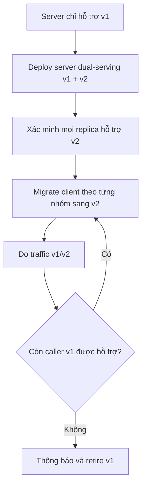

# Giữ service cũ trong thời gian chuyển đổi

## 1. Mục tiêu

Khi một gRPC contract thay đổi lớn, đôi khi không thể giữ nguyên service cũ bằng cách chỉ thêm field hoặc method. Ví dụ, Catalog v1 trả danh sách ID đơn giản, còn Catalog v2 cần filter, pagination và thông tin xếp hạng với semantics khác. Client nội bộ, SDK và đối tác không thể nâng cấp cùng lúc.

Trong trường hợp đó, có thể phát hành service version mới và **giữ service cũ hoạt động song song trong thời gian chuyển đổi**. Server mới đăng ký cả service v1 và v2; caller được migration dần; chỉ loại bỏ v1 sau khi đã xác minh không còn traffic cần hỗ trợ.

Sau bài học, bạn có thể:

- Phân biệt service version cũ/mới qua Protobuf package và full method path.
- Đăng ký đồng thời service v1 và v2 trong Spring gRPC server.
- Chia sẻ application/domain logic mà vẫn giữ contract riêng.
- Lập kế hoạch server-first rollout và client migration.
- Xử lý client mới gặp server cũ, rollback và routing theo phiên bản.
- Theo dõi usage của service cũ và xác định điều kiện retirement.
- Kiểm thử tương thích khi nhiều phiên bản client/server cùng tồn tại.

## 2. Vì sao cần giữ service cũ?

Giả sử Catalog v1 đã được nhiều ứng dụng gọi. V1 có method `Search` với request chỉ chứa query và response chỉ trả product ID. V2 cần filter, phân trang và score. Thay đổi này có thể làm request/response và semantics khác đáng kể.

Thay vì sửa package hoặc contract v1 tại chỗ, tạo service v2 riêng:

```proto
// catalog-v1.proto
syntax = "proto3";

package catalog.v1;
option java_package = "dev.example.catalog.v1";
option java_multiple_files = true;

service CatalogService {
  rpc Search(SearchRequest) returns (SearchResponse);
}

message SearchRequest {
  string query = 1;
}

message SearchResponse {
  repeated string product_ids = 1;
}
```

```proto
// catalog-v2.proto
syntax = "proto3";

package catalog.v2;
option java_package = "dev.example.catalog.v2";
option java_multiple_files = true;

service CatalogService {
  rpc Search(SearchRequest) returns (SearchResponse);
}

message SearchRequest {
  string query = 1;
  string category = 2;
  optional int32 page_size = 3;
  string page_token = 4;
}

message SearchResponse {
  repeated Product items = 1;
  string next_page_token = 2;
}

message Product {
  string product_id = 1;
  double score = 2;
}
```

Hai service có cùng tên ngắn `CatalogService`, nhưng package khác nhau nên full method path khác:

```text
/catalog.v1.CatalogService/Search
/catalog.v2.CatalogService/Search
```

Server có thể đăng ký cả hai service trên cùng gRPC server vì full service name khác nhau. Client v1 tiếp tục gọi path v1; client v2 gọi path v2. Không cần tạo một process hoặc port riêng chỉ vì contract có version mới, trừ khi có yêu cầu triển khai hoặc bảo mật riêng.

## 3. Version service ở Protobuf contract

Khi tạo version mới, cần quyết định rõ phạm vi version:

- **Package version:** `catalog.v1`, `catalog.v2` tạo namespace và full method path khác nhau.
- **Java package:** `dev.example.catalog.v1`, `dev.example.catalog.v2` tránh generated class trùng tên trong cùng ứng dụng.
- **Request/response:** mỗi version có message phù hợp với contract của nó.
- **Semantics:** mô tả rõ khác biệt về filter, sorting, default, validation và status.

Không đổi package của service đang phát hành rồi coi đó là nâng cấp trong suốt. Đổi package làm thay đổi full method path; client cũ tiếp tục gửi path cũ và không tự động được định tuyến sang path mới.

Không tái sử dụng cùng tên message Java trong một package cho hai schema khác nhau. Đặt `java_package` riêng để code sinh từ v1 và v2 cùng tồn tại mà không xung đột.

Version mới không nhất thiết phải đổi mọi message. Có thể tái sử dụng message dùng chung nếu contract và semantics thật sự giống nhau, nhưng không nên chia sẻ chỉ để tránh viết schema. Một kiểu dữ liệu dùng chung làm hai version phụ thuộc vào nhau; thay đổi sau này có thể buộc cả hai version phát hành cùng lúc.

## 4. Đăng ký song song service cũ và mới trong Spring

Với Spring gRPC starter có annotation `@GrpcService`, mỗi service adapter có thể là một bean riêng. Cả hai adapter cùng delegate vào application service dùng chung.

Ví dụ adapter v1:

```java
package dev.example.catalog.server;

import dev.example.catalog.v1.CatalogServiceGrpc;
import dev.example.catalog.v1.SearchRequest;
import dev.example.catalog.v1.SearchResponse;
import io.grpc.Status;
import io.grpc.stub.StreamObserver;
import org.springframework.grpc.server.service.GrpcService;

@GrpcService
public class CatalogV1GrpcService
        extends CatalogServiceGrpc.CatalogServiceImplBase {

    private final CatalogSearchUseCase searchUseCase;

    public CatalogV1GrpcService(CatalogSearchUseCase searchUseCase) {
        this.searchUseCase = searchUseCase;
    }

    @Override
    public void search(
            SearchRequest request,
            StreamObserver<SearchResponse> observer) {
        try {
            SearchCriteria criteria = SearchCriteria.legacy(
                    request.getQuery());
            SearchResult result = searchUseCase.search(criteria);

            SearchResponse response = SearchResponse.newBuilder()
                    .addAllProductIds(result.productIds())
                    .build();
            observer.onNext(response);
            observer.onCompleted();
        } catch (IllegalArgumentException ex) {
            observer.onError(Status.INVALID_ARGUMENT
                    .withDescription("invalid search request")
                    .asRuntimeException());
        } catch (RuntimeException ex) {
            observer.onError(Status.INTERNAL
                    .withDescription("catalog search failed")
                    .asRuntimeException());
        }
    }
}
```

Adapter v2:

```java
package dev.example.catalog.server;

import dev.example.catalog.v2.CatalogServiceGrpc;
import dev.example.catalog.v2.SearchRequest;
import dev.example.catalog.v2.SearchResponse;
import dev.example.catalog.v2.Product;
import io.grpc.Status;
import io.grpc.stub.StreamObserver;
import org.springframework.grpc.server.service.GrpcService;

@GrpcService
public class CatalogV2GrpcService
        extends CatalogServiceGrpc.CatalogServiceImplBase {

    private final CatalogSearchUseCase searchUseCase;

    public CatalogV2GrpcService(CatalogSearchUseCase searchUseCase) {
        this.searchUseCase = searchUseCase;
    }

    @Override
    public void search(
            SearchRequest request,
            StreamObserver<SearchResponse> observer) {
        try {
            int pageSize = request.hasPageSize()
                    ? request.getPageSize() : 25;
            SearchCriteria criteria = SearchCriteria.v2(
                    request.getQuery(),
                    request.getCategory(),
                    pageSize,
                    request.getPageToken());
            SearchResult result = searchUseCase.search(criteria);

            SearchResponse.Builder response = SearchResponse.newBuilder()
                    .setNextPageToken(result.nextPageToken());
            result.products().forEach(item ->
                    response.addItems(Product.newBuilder()
                            .setProductId(item.id())
                            .setScore(item.score())
                            .build()));
            observer.onNext(response.build());
            observer.onCompleted();
        } catch (IllegalArgumentException ex) {
            observer.onError(Status.INVALID_ARGUMENT
                    .withDescription("invalid search request")
                    .asRuntimeException());
        } catch (RuntimeException ex) {
            observer.onError(Status.INTERNAL
                    .withDescription("catalog search failed")
                    .asRuntimeException());
        }
    }
}
```

Ví dụ minh họa cơ chế đăng ký song song; `CatalogSearchUseCase`, `SearchCriteria`, `SearchResult` và model `Product` thuộc application layer cần được định nghĩa trong dự án. Package annotation và cách đăng ký service tùy thuộc phiên bản Spring gRPC starter. Nếu starter của dự án dùng API đăng ký khác, áp dụng đúng API đó; không tự tạo thêm `Server` trên cùng port khi framework đã sở hữu server.

Điểm quan trọng là hai adapter không gọi RPC qua network của nhau. Chúng chuyển request version-specific sang application model rồi gọi cùng use case. Việc này giữ transport contract độc lập và tránh thêm hop, deadline hoặc nguy cơ đệ quy.

## 5. Chia sẻ nghiệp vụ, không ép hai contract giống nhau

Service v1 và v2 có thể dùng chung:

- Application use case.
- Domain model và business rules.
- Repository và transaction boundary.
- Authorization policy ở tầng nghiệp vụ.
- Logic quan sát, tracing và audit phù hợp.

Nhưng mỗi adapter vẫn phải chịu trách nhiệm:

- Parse và validate request theo contract version.
- Chuyển request sang application model.
- Chuyển kết quả domain sang response version tương ứng.
- Ánh xạ lỗi sang status đã cam kết.
- Giữ semantics cũ trong v1.

Ví dụ, nếu v1 luôn trả danh sách ID theo relevance và không có pagination, adapter v1 phải giữ cách hiểu đó. Không tự áp dụng page size hoặc sorting mới của v2 vào v1 nếu điều đó làm thay đổi kết quả caller cũ.

Nếu v2 thay đổi semantics đến mức không thể dùng chung một use case mà vẫn giữ kết quả v1, có thể giữ một nhánh nghiệp vụ riêng trong thời gian hỗ trợ. Chỉ hợp nhất khi có thể chứng minh hai contract có cùng quy tắc nghiệp vụ.

## 6. Client chọn service version nào?

Client v1 dùng generated stub từ package v1:

```java
@Component
public class CatalogV1Gateway {
    private final dev.example.catalog.v1.CatalogServiceGrpc
            .CatalogServiceBlockingStub stub;

    public CatalogV1Gateway(
            @Qualifier("catalogChannel") ManagedChannel channel) {
        this.stub = dev.example.catalog.v1.CatalogServiceGrpc
                .newBlockingStub(channel);
    }

    public List<String> search(String query) {
        var request = dev.example.catalog.v1.SearchRequest.newBuilder()
                .setQuery(query)
                .build();
        var response = stub.withDeadlineAfter(1, TimeUnit.SECONDS)
                .search(request);
        return response.getProductIdsList();
    }
}
```

Client v2 dùng stub và message từ package v2. Cả hai có thể dùng cùng `ManagedChannel` nếu cùng target và transport/security configuration; khác version service path không tự yêu cầu channel riêng.

Nếu muốn client chọn version qua cấu hình, hãy tạo gateway hoặc factory rõ ràng. Tránh quyết định version bằng cách thử gọi v2 trên mọi request rồi bắt `UNIMPLEMENTED` để gọi v1, vì cách đó tạo thêm RPC thất bại, tăng latency và che giấu rollout chưa hoàn tất.

## 7. Tương thích khi client và server lệch phiên bản

Trong giai đoạn chuyển đổi, cần dự đoán các cặp:

| Client | Server | Kết quả |
|---|---|---|
| Client v1 | Server chỉ có v1 | Hoạt động theo contract cũ |
| Client v1 | Server có v1 và v2 | V1 tiếp tục hoạt động |
| Client v2 | Server có v1 và v2 | V2 hoạt động |
| Client v2 | Server chỉ có v1 | V2 thường nhận `UNIMPLEMENTED` |
| Client v1 | Server chỉ có v2 | V1 thường nhận `UNIMPLEMENTED` |

Server dual-serving (đăng ký cả v1 và v2) là cầu nối quan trọng. Nó cho phép triển khai server mới trước, trong khi client vẫn có thể được nâng cấp theo lịch riêng.

Không giả định server v2 có thể tự hiểu request v1 nếu method path v1 đã bị xóa. gRPC định tuyến theo full method path; server phải tiếp tục đăng ký v1 service để giữ caller cũ hoạt động.

## 8. Thứ tự rollout an toàn

Một quy trình thường dùng:

1. **Định nghĩa v2:** tạo package, message và service mới; giữ schema v1.
2. **Nâng cấp server:** triển khai adapter v1 và v2 cùng lúc trên mỗi instance mới.
3. **Hoàn tất server rollout:** xác minh tất cả replica/route nhận client v2 đều hỗ trợ v2.
4. **Phát hành client v2:** chuyển từng caller theo nhóm, cấu hình hoặc release.
5. **Theo dõi:** đo request v1/v2, lỗi, latency, caller version và tỷ lệ migration.
6. **Giữ v1 trong support window:** tiếp tục xử lý client chưa nâng cấp.
7. **Thông báo retirement:** công bố thời hạn, owner và cách xử lý caller còn lại.
8. **Loại bỏ v1 trong release riêng:** chỉ thực hiện khi điều kiện retirement đã được xác minh.



Không bật client v2 khi load balancer vẫn có thể route tới replica chỉ hỗ trợ v1. Nếu không thể nâng cấp server đồng thời, dùng versioned endpoint, routing theo capability hoặc giữ client v2 chưa kích hoạt cho tới khi toàn bộ đường đi hỗ trợ.

## 9. Rollback khi đã có client v2

Rollback là điểm thường bị bỏ quên. Sau khi client v2 đã phát hành, quay server về bản chỉ có v1 sẽ khiến client v2 nhận `UNIMPLEMENTED`.

Các lựa chọn an toàn:

- Rollback client v2 về client v1 trước, nếu client có thể được rollback độc lập.
- Giữ server dual-serving trong các bản rollback; không rollback về server chỉ có v1 khi còn client v2 hoạt động.
- Dùng routing/capability để chỉ gửi client v2 tới server hỗ trợ v2.
- Có fallback có giới hạn nếu v1 thật sự tương đương và còn được hỗ trợ.

Không nên xem fallback như giải pháp rollback mặc định. Nếu v2 có semantics mới như filter hoặc pagination, gọi v1 có thể trả dữ liệu khác. Fallback phải được đo, giới hạn thời gian và có điều kiện rõ ràng.

## 10. Quan sát mức sử dụng service cũ

Trước khi retirement, cần biết chính xác ai còn gọi v1. Ghi nhận full method name để phân biệt version:

```text
catalog.v1.CatalogService/Search
catalog.v2.CatalogService/Search
```

Các tín hiệu nên theo dõi:

| Tín hiệu | Mục đích |
|---|---|
| RPC count theo full method name | So sánh mức dùng v1 và v2 |
| Caller/service identity | Xác định hệ thống còn gọi v1 |
| Client version | Tìm phiên bản SDK hoặc service chưa migration |
| Status code | Phát hiện lỗi khi chuyển version |
| Latency và deadline | So sánh hiệu năng hai contract |
| Last-seen timestamp | Biết caller còn hoạt động hay chỉ chạy theo đợt |
| Migration owner | Theo dõi trách nhiệm nâng cấp |

Một server interceptor có thể lấy full method name:

```java
String fullMethodName =
        call.getMethodDescriptor().getFullMethodName();
```

Dùng tên dependency/service/method làm metric label có cardinality thấp. Không đưa request ID, user ID, token hoặc payload vào metric label. Nếu cần nhận diện caller, dùng identity được xác thực và tuân thủ chính sách bảo vệ dữ liệu.

Traffic bằng zero trong vài giờ chưa chắc đủ chứng minh service cũ không còn caller: batch job, mobile app hoặc đối tác có thể chỉ gọi theo tuần/tháng. Cửa sổ quan sát phải phù hợp chu kỳ hoạt động của caller.

## 11. Bảo mật và policy cho cả hai version

Đăng ký v2 không tự động bảo đảm v2 có đúng authorization. Kiểm tra:

- Authentication và authorization theo full method name.
- Allowlist method trong interceptor, API gateway hoặc service mesh.
- Quota/rate limit riêng nếu chi phí v2 khác v1.
- Audit và data classification cho field mới.
- TLS/mTLS và service identity trên đường kết nối.
- Deadline, retry và giới hạn message cho từng version.

Nếu v2 trả thêm score, giá hoặc dữ liệu cá nhân, không được cho rằng caller có quyền đọc chỉ vì họ từng được gọi v1. Policy phải được đánh giá theo dữ liệu và hành động của contract mới.

Có thể dùng cùng authentication infrastructure nhưng vẫn áp dụng authorization khác nhau cho v1 và v2. Không để việc giữ v1 kéo dài trở thành lý do bỏ qua bản vá bảo mật hoặc policy mới.

## 12. Điều kiện retirement service cũ

Chỉ loại bỏ v1 khi có bằng chứng và kế hoạch:

- Caller nội bộ đã chuyển sang v2.
- Đối tác/SDK bên ngoài đã được thông báo và hoàn tất migration hoặc hết thời hạn hỗ trợ.
- Metrics không còn traffic v1 trong cửa sổ quan sát phù hợp.
- Không có batch job, client ít hoạt động hoặc tích hợp ẩn chưa được xác định.
- V2 đáp ứng semantics, quyền truy cập, latency và reliability mà caller cần.
- Runbook, dashboard, alert và rollback plan đã được cập nhật.
- Có release riêng để xóa adapter v1, service descriptor v1 và schema artifact theo chính sách lưu trữ.

Sau khi xóa v1, client còn gọi `/catalog.v1.CatalogService/Search` thường nhận `UNIMPLEMENTED`. Không tái sử dụng package `catalog.v1` hoặc full method path cũ cho một contract khác.

Nếu một nhóm caller cần thêm thời gian, có thể gia hạn support window hoặc cung cấp endpoint/version riêng. Ghi rõ ngoại lệ, owner và ngày kết thúc; tránh giữ v1 vô thời hạn mà không có quyết định vận hành.

## 13. Kiểm thử coexistence

Integration test cần chứng minh một server Spring có thể phục vụ đồng thời hai service descriptor:

1. Khởi động server với adapter v1 và v2 trên cùng server instance.
2. Tạo client v1 và client v2 dùng cùng target.
3. Gọi method v1 và xác minh response theo contract cũ.
4. Gọi method v2 và xác minh response theo contract mới.
5. Tắt một dependency hoặc tạo lỗi trong nhánh v2; xác nhận v1 không bị ảnh hưởng ngoài phần tài nguyên dùng chung đã xác định.
6. Kiểm tra metrics ghi đúng full method path.
7. Khởi động fixture chỉ có v1; xác minh client v2 nhận `UNIMPLEMENTED`.
8. Kiểm thử shutdown và rollout/rollback theo các phiên bản server dự kiến.

Ví dụ kiểm thử hai gateway:

```java
@Test
void serverSupportsBothCatalogVersions() {
    assertEquals(List.of("p-1", "p-2"),
            catalogV1Gateway.search("keyboard"));

    SearchV2Result result =
            catalogV2Gateway.search("keyboard", "electronics", 10);
    assertFalse(result.items().isEmpty());
}
```

Đây là khung test; hai gateway phải dùng generated stubs tương ứng và server fixture phải đăng ký cả hai adapter. Không chỉ mock application service rồi kết luận routing gRPC đúng.

### Ma trận kiểm thử

| Server fixture | Client | Kết quả cần xác minh |
|---|---|---|
| V1 only | V1 | Hoạt động theo baseline |
| V1 + V2 | V1 | Vẫn giữ semantics v1 |
| V1 + V2 | V2 | Method v2 hoạt động |
| V1 only | V2 | `UNIMPLEMENTED` được xử lý có chủ đích |
| V2 only | V1 | `UNIMPLEMENTED`; chỉ chấp nhận sau retirement |

Kiểm thử thêm authorization, deadline, retry, streaming và dữ liệu nhạy cảm nếu hai version có policy khác nhau.

## 14. Lỗi thường gặp

| Hiện tượng | Nguyên nhân | Cách xử lý |
|---|---|---|
| Client v1 lỗi ngay sau deploy v2 | Server đã xóa service v1 | Giữ adapter và descriptor v1 trong support window |
| Client v2 nhận `UNIMPLEMENTED` ngẫu nhiên | Fleet còn replica chỉ hỗ trợ v1 | Hoàn tất server rollout hoặc route theo capability |
| Hai generated version xung đột class | Dùng chung Java package/class name | Đặt `java_package` riêng cho từng version |
| Logic v1 và v2 dần khác nhau ngoài ý muốn | Duy trì hai bản nghiệp vụ độc lập | Chia sẻ use case khi semantics tương đương |
| V1 trả kết quả khác sau khi delegate | Adapter áp dụng default/semantics v2 | Giữ mapping và regression test cho v1 |
| Rollback server làm client v2 lỗi | Bản rollback không còn đăng ký v2 | Giữ dual-serving hoặc rollback client trước |
| Không biết ai còn gọi v1 | Chỉ đo tổng RPC hoặc không ghi full method path | Đo usage theo version và caller identity |
| Retirement làm đối tác ngừng hoạt động | Không tính client ít hoạt động/chu kỳ batch | Dùng cửa sổ quan sát dài và thông báo chính thức |
| V2 mở thêm dữ liệu ngoài quyền caller | Reuse authorization v1 mà không đánh giá lại | Kiểm tra policy theo method và dữ liệu mới |

## 15. Bài tập thực hành

**Tình huống:** Catalog v1 đang phục vụ nhiều Spring service và một số đối tác. Nhóm cần Catalog v2 với pagination, category filter và product score. Không thể yêu cầu mọi caller nâng cấp cùng ngày.

Hãy thực hiện:

1. Giữ nguyên `catalog.v1.CatalogService` và tạo `catalog.v2.CatalogService` với message riêng.
2. Sinh code Java vào hai package riêng và xác minh full method path không trùng.
3. Triển khai hai Spring gRPC adapter trên cùng server, cùng gọi application use case khi semantics cho phép.
4. Viết regression test bảo đảm v1 giữ đúng kết quả và default cũ.
5. Tạo client v2 dùng channel hiện có; không tạo channel mới chỉ vì service version thay đổi.
6. Deploy server dual-serving trước, xác minh toàn bộ replica hỗ trợ v2 rồi mới migrate client.
7. Ghi metrics theo full method name và caller identity; lập danh sách owner còn dùng v1.
8. Mô phỏng rollback server và client; xác nhận không có client v2 bị route tới server chỉ có v1.
9. Đề xuất support window, tiêu chí retirement và test cho thời điểm loại bỏ v1.

**Tiêu chí hoàn thành:** server mới phục vụ đồng thời v1/v2; client cũ không bị gián đoạn; client mới chỉ gọi v2 khi toàn bộ route hỗ trợ; logic nghiệp vụ được chia sẻ mà semantics từng contract vẫn rõ; usage, rollback và retirement có bằng chứng kiểm chứng.

## 16. Ghi nhớ

Khi không thể thay đổi contract cũ một cách tương thích, phát hành service version mới với package và full method path riêng, đồng thời giữ service cũ trên server trong support window. Trong Spring, đăng ký adapter v1 và v2 song song; chia sẻ application/domain logic khi semantics phù hợp nhưng giữ request/response mapping riêng. Deploy server dual-serving trước, migrate client theo nhóm, đo traffic theo full method name và bảo đảm rollback không đưa client mới về server chỉ có v1. Chỉ retire service cũ sau khi caller đã migration và cửa sổ quan sát đủ dài chứng minh không còn nhu cầu được hỗ trợ.
