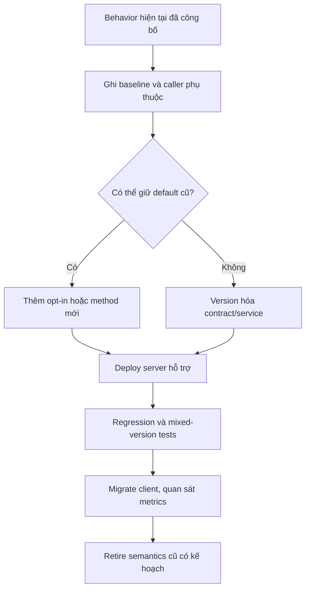

# Thay đổi semantics không chỉ là đổi schema

## 1. Mục tiêu

Một Protobuf schema có thể giữ nguyên hoàn toàn nhưng API vẫn bị phá vỡ nếu server thay đổi ý nghĩa của request, response hoặc lỗi trả về. Ví dụ, `Search` trước đây sắp xếp theo độ liên quan nhưng sau deploy lại sắp xếp theo ngày mới nhất. Request vẫn parse được, generated stub vẫn biên dịch, nhưng caller có thể hiển thị kết quả sai hoặc phân trang không ổn định.

**Semantics** là cách API thực sự hành xử mà caller có thể quan sát: ý nghĩa của từng field, default, điều kiện thành công, status, thứ tự kết quả, side effect, tính lặp an toàn, quyền truy cập và các bảo đảm về thời gian/nhất quán.

Trong Spring gRPC, API evolution phải bảo vệ cả schema contract lẫn behavioral contract. Sau bài học, bạn có thể:

- Phân biệt wire/schema compatibility với behavioral compatibility.
- Nhận diện thay đổi semantics có thể phá caller dù `.proto` không đổi.
- Ghi rõ precondition, postcondition, default và side effect của RPC.
- Giữ hành vi cũ bằng adapter/policy riêng khi phát hành semantics mới.
- Chọn giữa mở rộng có opt-in và version hóa RPC/service.
- Kiểm thử hành vi qua nhiều phiên bản client/server trước rollout.

## 2. Schema tương thích không đồng nghĩa hành vi tương thích

Xem xét ba lớp:

| Lớp tương thích | Điều được bảo vệ | Ví dụ thay đổi có thể phá |
|---|---|---|
| Wire compatibility | Hai phiên bản có thể serialize/parse message | Đổi field number hoặc wire type |
| Source/API compatibility | Generated Java API và caller còn biên dịch | Đổi tên field, đổi kiểu stub |
| Behavioral compatibility | Caller nhận kết quả và side effect như contract đã hứa | Đổi default sorting hoặc status |

Thêm field tùy chọn có thể wire-compatible, nhưng nếu server mới tự động áp dụng một quy tắc mới cho request cũ thì vẫn là breaking change về hành vi. Ngược lại, schema không đổi cũng không đảm bảo caller an toàn nếu server đổi cách diễn giải field.

Ví dụ: `SearchRequest` vẫn chỉ có `query`, nhưng server đổi cách chuẩn hóa chuỗi, mặc định category, thứ tự sắp xếp hoặc cách xử lý query rỗng. Client cũ không thể phát hiện các thay đổi này qua generated code.

**Quy tắc:** đánh giá API theo những gì caller quan sát và dựa vào, không chỉ theo descriptor Protobuf.

## 3. Behavioral contract gồm những gì?

Với mỗi RPC, cần xác định tối thiểu:

| Thành phần | Câu hỏi cần trả lời |
|---|---|
| Precondition | Request nào hợp lệ? Caller cần quyền gì? |
| Field meaning | ID, amount, timestamp, limit hoặc filter có đơn vị/ý nghĩa nào? |
| Default | Khi field absent, empty hoặc bằng zero thì server làm gì? |
| Postcondition | Thành công bảo đảm điều gì? |
| Result shape | Danh sách rỗng, phần tử thiếu hoặc dữ liệu null được biểu diễn ra sao? |
| Ordering | Kết quả được sắp xếp theo tiêu chí nào? Tie-breaker là gì? |
| Error semantics | Trường hợp nào trả `NOT_FOUND`, `INVALID_ARGUMENT`, `FAILED_PRECONDITION`? |
| Side effect | RPC có ghi dữ liệu, tạo giao dịch hoặc gửi sự kiện không? |
| Idempotency | Gọi lại cùng request có tạo thêm tác động không? |
| Consistency | Kết quả phản ánh dữ liệu tại thời điểm nào? |
| Security | Caller được xem/sửa dữ liệu nào? |
| Time/resource | Deadline, giới hạn trang và kích thước response là bao nhiêu? |

Không nhất thiết mọi RPC đều cần tài liệu dài. Nhưng những điểm ảnh hưởng đến logic caller phải được mô tả rõ và có test chứng minh.

## 4. Các thay đổi semantics thường gây breaking change

### 4.1 Thay đổi default

Một request cũ không gửi `sort_order`. Trước đây server mặc định `RELEVANCE`; sau deploy server mặc định `NEWEST`. Schema và bytes không đổi, nhưng caller thấy thứ tự kết quả khác.

Các default cần được xem là một phần contract:

- Thứ tự sắp xếp.
- Page size hoặc giới hạn kết quả.
- Locale/time zone.
- Trạng thái bản ghi được bao gồm.
- Hành vi khi filter vắng mặt.
- Chính sách làm tròn hoặc đơn vị mặc định.

Khi thêm lựa chọn mới, giữ default cũ cho caller hiện hữu. Nếu caller cần semantics mới, hãy cho phép họ opt-in bằng field/method mới và chỉ bật sau khi server hỗ trợ.

### 4.2 Thay đổi ý nghĩa của giá trị

Giả sử `amount` là `int64` và trước đây biểu diễn số cent. Server mới diễn giải cùng giá trị thành số đồng. Wire type vẫn là `int64`, schema không đổi, nhưng giá trị nghiệp vụ sai lệch một bậc độ lớn.

Các trường hợp tương tự:

- Timestamp chuyển từ giây sang mili giây.
- `limit` chuyển từ “số kết quả tối đa” sang “số kết quả chính xác”.
- `customer_id` đổi từ ID nội bộ sang ID toàn cục.
- `distance` đổi đơn vị từ kilomet sang mét.
- `query` đổi từ tìm kiếm literal sang cú pháp biểu thức.

Không thay đổi đơn vị, định dạng hoặc namespace ID ngầm bên trong một field đã công bố. Nếu semantics mới khác, thêm field/method mới có tên rõ nghĩa hoặc phát hành version mới.

### 4.3 Thay đổi kết quả rỗng và lỗi

Ví dụ `GetProduct` trước đây trả `NOT_FOUND` khi không có sản phẩm; server mới trả `OK` với response rỗng. Một caller có thể dựa vào `NOT_FOUND` để hiển thị trang 404, còn caller khác dựa vào response thành công để tạo bản ghi mặc định.

Các thay đổi cần cân nhắc:

| Trước đây | Sau thay đổi | Tác động có thể có |
|---|---|---|
| `NOT_FOUND` | `OK` với message rỗng | Caller không chạy nhánh xử lý lỗi nữa |
| Danh sách rỗng | `NOT_FOUND` | Caller coi truy vấn hợp lệ là lỗi |
| `INVALID_ARGUMENT` | `FAILED_PRECONDITION` | Retry/validation handler có thể khác |
| Bỏ qua field không hợp lệ | Từ chối toàn request | Caller cũ có thể bắt đầu thất bại |
| Trả một phần kết quả | Rollback toàn bộ | Thay đổi kỳ vọng về partial success |

gRPC status là một phần behavioral contract. Không đổi status chỉ vì code server được tái cấu trúc; hãy giữ mapping đã công bố hoặc version hóa nếu semantics thật sự đổi.

### 4.4 Thay đổi ordering và pagination

Nếu `Search` dùng pagination, thứ tự kết quả phải ổn định. Chỉ đổi sort order có thể làm phần tử lặp lại hoặc bị bỏ qua giữa các trang. Khi sort key không duy nhất, cần tie-breaker ổn định, chẳng hạn `product_id`.

Page token thường là opaque token. Caller không nên tự phân tích cấu trúc bên trong; server vẫn phải bảo đảm token của version hiện tại có semantics được mô tả. Nếu thay đổi thuật toán hoặc sort key khiến token cũ không thể dùng, xử lý token cũ có chủ đích và cung cấp migration/expiry rõ ràng.

### 4.5 Thay đổi side effect và idempotency

Một RPC `CreateOrder` trước đây bảo đảm request lặp lại với cùng idempotency key chỉ tạo một đơn hàng. Nếu server mới bỏ qua key và tạo đơn hàng mới mỗi lần, schema vẫn có thể giống hệt nhưng caller retry sau timeout sẽ tạo giao dịch trùng.

Các semantics cần giữ:

- Một request có thể tạo bao nhiêu side effect.
- Idempotency key được lưu trong bao lâu và phạm vi duy nhất là gì.
- Thứ tự commit dữ liệu và phát event.
- Hành vi khi client hủy RPC sau khi server đã commit.
- Caller có thể retry status nào và trong điều kiện nào.

Không thay đổi idempotency hoặc tính nguyên tử chỉ như một tối ưu nội bộ. Đây là cam kết nghiệp vụ có ảnh hưởng trực tiếp đến tiền, đơn hàng và dữ liệu.

### 4.6 Thay đổi authorization hoặc dữ liệu được trả về

Một method trước đây chỉ trả trường công khai, sau deploy trả thêm email hoặc dữ liệu nội bộ. Schema mới có thể chỉ thêm field, nhưng caller cũ có thể nhận dữ liệu mà họ không được phép xem.

Ngược lại, siết quyền có thể khiến caller hợp lệ trước đây nhận `PERMISSION_DENIED`. Cần đánh giá policy theo principal, tenant, resource và method; không coi authorization là chi tiết triển khai nằm ngoài API contract.

## 5. Ví dụ: giữ semantics cũ cho Search

Giả sử `catalog.v1.Search` trước đây có các cam kết:

- Query được chuẩn hóa theo quy tắc cũ.
- Kết quả sắp xếp theo relevance giảm dần.
- Nếu điểm relevance bằng nhau, sắp xếp theo `product_id`.
- Query hợp lệ nhưng không có kết quả trả danh sách rỗng với status `OK`.
- Page size absent tương đương 25.

Nhóm muốn phát hành cách tìm kiếm mới với category filter và sort theo thời gian. Có thể thêm method/version mới thay vì đổi mặc định của v1.

```proto
package catalog.v1;

service CatalogService {
  rpc Search(SearchRequest) returns (SearchResponse);
}

message SearchRequest {
  string query = 1;
}
```

```proto
package catalog.v2;

service CatalogService {
  rpc Search(SearchRequest) returns (SearchResponse);
}

message SearchRequest {
  string query = 1;
  string category = 2;
  optional int32 page_size = 3;
  string page_token = 4;
  SortOrder sort_order = 5;
}

enum SortOrder {
  SORT_ORDER_UNSPECIFIED = 0;
  SORT_ORDER_RELEVANCE = 1;
  SORT_ORDER_NEWEST = 2;
}
```

V1 giữ default relevance và mapping lỗi cũ. V2 có thể hỗ trợ sort mới nhưng phải định nghĩa `UNSPECIFIED`, tie-breaker, page token và status. Việc version hóa chỉ hữu ích khi server thực sự giữ hai hành vi khác nhau; đổi package nhưng để cả hai handler dùng một policy mới giống nhau vẫn phá semantics v1.

## 6. Tách transport adapter khỏi application semantics trong Spring

Một thiết kế hữu ích là để mỗi gRPC adapter chuyển request version-specific thành một command có policy tường minh. Application service không nên tự đoán version từ field vắng mặt hoặc tên package.

```java
public enum SearchPolicy {
    LEGACY_RELEVANCE,
    V2_EXPLICIT_SORT
}
```

Application service nhận policy:

```java
@Service
public class CatalogSearchUseCase {
    public SearchResult search(
            SearchCriteria criteria,
            SearchPolicy policy) {
        return switch (policy) {
            case LEGACY_RELEVANCE ->
                    searchLegacy(criteria);
            case V2_EXPLICIT_SORT ->
                    searchWithV2Rules(criteria);
        };
    }

    private SearchResult searchLegacy(SearchCriteria criteria) {
        // Giữ chuẩn hóa, default, ordering và empty-result behavior của v1.
        return legacySearchEngine.execute(criteria);
    }

    private SearchResult searchWithV2Rules(SearchCriteria criteria) {
        // Áp dụng filter, sort và pagination đã công bố cho v2.
        return currentSearchEngine.execute(criteria);
    }
}
```

Đây là khung minh họa; các engine và criteria thuộc application layer của dự án. Điểm quan trọng là policy được truyền tường minh và có thể kiểm thử độc lập. Không dùng một boolean mơ hồ như `newBehavior=true` nếu có nhiều semantics khác nhau cần lựa chọn.

Adapter v1 luôn chọn policy cũ:

```java
SearchCriteria criteria = SearchCriteria.fromLegacy(request);
SearchResult result = useCase.search(
        criteria, SearchPolicy.LEGACY_RELEVANCE);
```

Adapter v2 xác định policy từ contract v2:

```java
SearchCriteria criteria = SearchCriteria.fromV2(request);
SearchResult result = useCase.search(
        criteria, SearchPolicy.V2_EXPLICIT_SORT);
```

Hai adapter có thể dùng chung repository, transaction và domain services; nhưng mapping request/response và semantics vẫn được tách rõ. Nếu v2 có semantics khác, không cho v1 tự động nhận chúng qua một default dùng chung.

## 7. Mở rộng semantics bằng opt-in

Không phải thay đổi nào cũng cần version service mới. Nếu tính năng mới có thể được bật tường minh và giữ nguyên hành vi khi caller không gửi lựa chọn, có thể mở rộng request:

```proto
enum SearchMode {
  SEARCH_MODE_UNSPECIFIED = 0;
  SEARCH_MODE_LEGACY = 1;
  SEARCH_MODE_SEMANTIC_V2 = 2;
}

message SearchRequest {
  string query = 1;
  optional SearchMode search_mode = 2;
}
```

Server mới có thể áp dụng:

```java
SearchMode mode = request.hasSearchMode()
        ? request.getSearchMode()
        : SearchMode.SEARCH_MODE_LEGACY;
```

Chỉ dùng cách này khi:

- Semantics cũ được giữ làm default cho caller không gửi field.
- Giá trị mode có định nghĩa rõ và không thay đổi ý nghĩa sau này.
- Caller mới chỉ opt-in khi server target đã hỗ trợ mode đó.
- Authorization, metrics và rollback phân biệt được mode đang dùng.

Server cũ sẽ bỏ qua field mới. Vì vậy client gửi `SEARCH_MODE_SEMANTIC_V2` tới server cũ có thể nhận kết quả theo semantics cũ mà không biết lựa chọn đã bị bỏ qua. Cần rollout server trước hoặc capability negotiation/routing. Nếu hai chế độ có request/response hoặc semantics quá khác nhau, versioned RPC/service thường dễ quản lý hơn.

## 8. Quy trình thay đổi semantics an toàn

Trước khi sửa hành vi, lập một behavioral change record:

1. **Ghi baseline:** mô tả request hợp lệ, default, response, status, ordering, side effect và retry behavior hiện tại.
2. **Xác định caller phụ thuộc:** tìm client, service, SDK và quy trình nghiệp vụ đang dựa vào hành vi đó.
3. **Phân loại thay đổi:** additive opt-in, thay đổi mặc định có tương thích, hay breaking semantic change.
4. **Chọn cách tiến hóa:** giữ behavior cũ, thêm field/method opt-in hoặc phát hành service version mới.
5. **Thiết kế adapter:** chuyển từng contract vào application model với policy rõ ràng.
6. **Viết regression test:** chứng minh caller cũ vẫn nhận kết quả và side effect cũ.
7. **Deploy server hỗ trợ trước:** không bật client mới khi một số replica còn semantics cũ không hiểu lựa chọn mới.
8. **Migrate caller và quan sát:** theo dõi version, mode, status, latency và kết quả nghiệp vụ.
9. **Retire có kế hoạch:** chỉ bỏ behavior cũ sau khi caller đã chuyển và support window kết thúc.



Không nên thay đổi default trước rồi chờ caller báo lỗi. Caller có thể không crash mà vẫn xử lý dữ liệu sai, nên cần test contract và quan sát chủ động.

## 9. Kiểm thử behavioral compatibility

Test schema chỉ kiểm tra descriptor hoặc serialize/parse. Để kiểm tra semantics, cần xác nhận kết quả và side effect ở tầng RPC/application.

| Nhóm test | Điều cần xác minh |
|---|---|
| Characterization test | Hành vi hiện tại của v1 được ghi lại trước thay đổi |
| Golden request/response | Ví dụ request cũ vẫn cho response đã cam kết |
| Default test | Absent, empty, zero và explicit value có ý nghĩa đúng |
| Ordering/pagination | Thứ tự ổn định; không trùng/bỏ sót giữa các trang |
| Status test | Mỗi tình huống trả đúng gRPC status |
| Idempotency test | Retry cùng key không tạo side effect trùng |
| Authorization test | Caller chỉ nhận/thay đổi dữ liệu được phép |
| Mixed-version test | Client/server cũ và mới có hành vi đã dự đoán |
| Rollback test | Quay server/client về phiên bản trước không làm sai semantics |

Ví dụ regression test cho thứ tự v1:

```java
@Test
void legacySearchKeepsRelevanceOrdering() {
    SearchResult result = useCase.search(
            SearchCriteria.legacy("keyboard"),
            SearchPolicy.LEGACY_RELEVANCE);

    assertEquals(
            List.of("product-a", "product-c", "product-b"),
            result.productIds());
}
```

Test fixture cần cố định dữ liệu và relevance score để kết quả có tính xác định. Nên bổ sung trường hợp hai sản phẩm bằng điểm để xác minh tie-breaker `product_id`.

Ví dụ test status cho trường hợp không tìm thấy:

```java
StatusRuntimeException error = assertThrows(
        StatusRuntimeException.class,
        () -> gateway.getProduct("missing-id"));

assertEquals(Status.Code.NOT_FOUND,
        error.getStatus().getCode());
```

Nếu contract đã cam kết danh sách rỗng với `OK`, hãy test response rỗng thay vì dùng test `NOT_FOUND`. Điều quan trọng là test khớp semantics được công bố của từng version.

## 10. Quan sát hành vi sau rollout

Không chỉ đếm RPC thành công. Với thay đổi semantics, cần quan sát:

- RPC count theo full method name và client version.
- Mode/policy đang được áp dụng.
- Status code và tỷ lệ lỗi theo method.
- Phân phối số phần tử, page size và empty-result rate.
- Retry count, idempotency conflict và side effect bị trùng.
- Latency, deadline exceeded và cancellation.
- Kết quả nghiệp vụ có thể đối chiếu, chẳng hạn số đơn hàng tạo hoặc số bản ghi được cập nhật.

Metrics label phải có cardinality thấp: service, method, version, mode và status là các dimension phù hợp nếu tập giá trị hữu hạn. Không dùng customer ID, request ID, token hoặc payload làm label. Correlation ID nên nằm trong trace/log có kiểm soát.

Với một thời gian ngắn, có thể chạy shadow comparison: cùng input được tính bằng policy cũ và mới, nhưng chỉ trả kết quả của policy đang có hiệu lực. So sánh kết quả ở môi trường an toàn để phát hiện khác biệt trước khi chuyển caller. Không chạy song song thao tác có side effect nếu không có cơ chế bảo đảm chỉ một nhánh commit.

## 11. Lỗi thường gặp

| Triệu chứng | Nguyên nhân | Cách xử lý |
|---|---|---|
| Client biên dịch bình thường nhưng kết quả thay đổi | Chỉ kiểm tra schema/source compatibility | Thêm behavioral regression tests |
| Request cũ đổi thứ tự kết quả | Thay default sort hoặc thiếu tie-breaker | Giữ ordering cũ cho v1 |
| Giá trị tiền/thời gian sai lớn | Đổi đơn vị nhưng giữ kiểu field | Định nghĩa đơn vị; dùng field/version mới |
| Caller xử lý sai nhánh lỗi | Đổi gRPC status | Giữ error mapping hoặc version hóa |
| Retry tạo side effect trùng | Thay idempotency semantics | Giữ idempotency key và kiểm thử retry |
| Client mới tưởng server cũ áp dụng mode mới | Unknown field bị server cũ bỏ qua | Server-first rollout hoặc capability routing |
| V1 vô tình dùng policy v2 | Application service tự chọn default chung | Truyền policy/version tường minh từ adapter |
| Authorization bị mở rộng ngoài dự kiến | Reuse policy mà không đánh giá dữ liệu mới | Kiểm tra quyền theo principal/resource/method |
| Shadow comparison tạo dữ liệu trùng | Chạy cả hai nhánh có side effect | Chỉ shadow phần read-only hoặc cô lập side effect |

## 12. Bài tập thực hành

**Tình huống:** Catalog `Search` đã được nhiều Spring service sử dụng. Contract hiện tại không đổi trong nhiều năm: query rỗng trả danh sách rỗng, default sort theo relevance, page size tối đa 25 và sản phẩm đồng điểm được sắp theo ID. Nhóm muốn đổi sang semantics mới: query rỗng trả `INVALID_ARGUMENT`, default sort theo thời gian mới nhất và page size mặc định 50.

Hãy thực hiện:

1. Viết behavioral baseline cho RPC hiện tại: default, empty result, ordering, tie-breaker, status và giới hạn.
2. Liệt kê caller có thể phụ thuộc vào từng hành vi, gồm batch job và client ít hoạt động.
3. Thiết kế cách phát hành semantics mới: opt-in mode hoặc `catalog.v2` với contract rõ ràng.
4. Giữ adapter v1 dùng policy cũ; adapter mới áp dụng policy mới.
5. Viết regression test cho request v1 và test riêng cho semantics mới.
6. Kiểm thử absent/empty query, page size, tie ordering, pagination token và status.
7. Deploy server hỗ trợ cả hai hành vi trước khi chuyển client; mô phỏng rollback.
8. Theo dõi usage theo version/mode và xác định điều kiện retirement của behavior cũ.

**Tiêu chí hoàn thành:** giải thích được vì sao schema không đổi vẫn có thể phá caller; ghi rõ behavioral contract; giữ được semantics cũ trong migration; version/mode mới có opt-in và test riêng; rollout, quan sát và retirement có bằng chứng.

## 13. Ghi nhớ

API compatibility không dừng ở việc Protobuf message còn parse được hoặc Java client còn biên dịch. Caller còn phụ thuộc vào default, ý nghĩa field, ordering, status, side effect, idempotency, authorization và consistency. Trước khi đổi hành vi, hãy ghi baseline và caller phụ thuộc; giữ policy cũ cho client hiện tại; dùng opt-in hoặc versioned service khi semantics mới không tương đương. Trong Spring gRPC, tách adapter theo contract và truyền policy tường minh vào application layer. Kiểm thử kết quả, status và side effect qua nhiều phiên bản; chỉ retire semantics cũ sau rollout và migration được xác minh.
