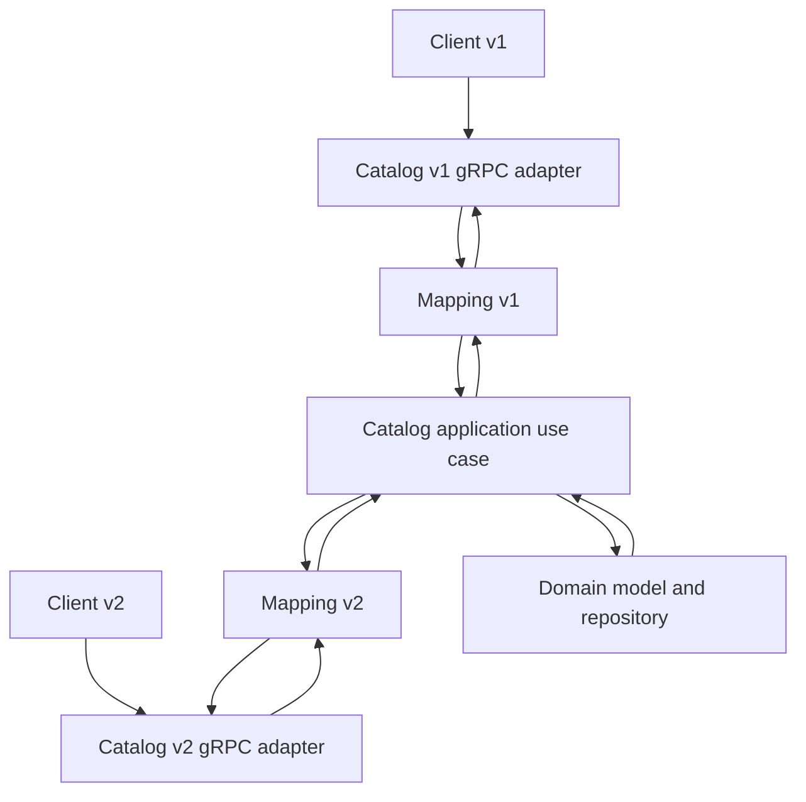
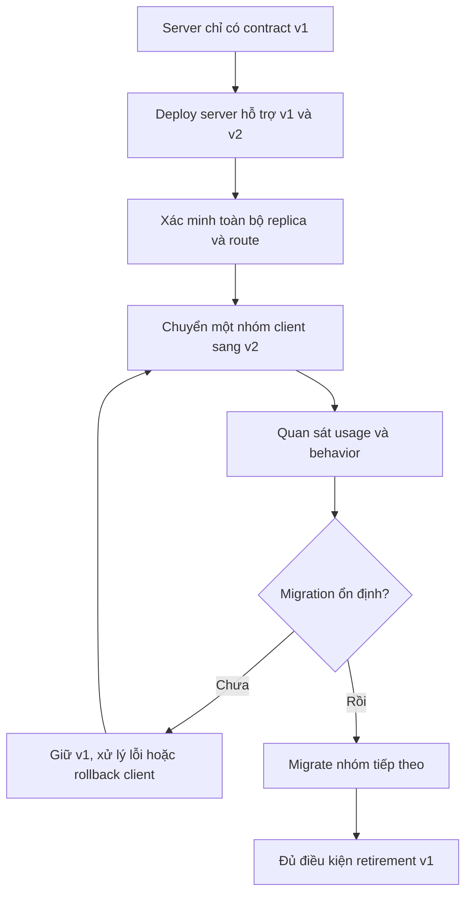

# Song song contract mới và cũ

## 1. Mục tiêu

Trong một hệ thống Spring gRPC, client và server thường được phát hành độc lập. Một service nội bộ có thể nâng cấp trong vài phút, trong khi SDK, ứng dụng di động hoặc đối tác cần nhiều tuần để chuyển đổi. Khi contract mới thay đổi cấu trúc request/response hoặc semantics, không thể giả định mọi caller cùng chuyển sang một thời điểm.

**Chạy song song contract mới và cũ** là giữ nhiều contract có thể được gọi đồng thời trong một giai đoạn chuyển tiếp. Server tiếp tục phục vụ caller dùng contract cũ, đồng thời nhận caller đã chuyển sang contract mới. Hai contract có thể dùng chung application/domain logic, nhưng mỗi contract phải giữ đúng semantics mà caller của nó đã được hứa.

Sau bài học, bạn có thể:

- Chọn giữa mở rộng additive trên một contract và chạy hai version riêng.
- Tổ chức Protobuf package, service và message để hai contract cùng tồn tại.
- Xây adapter chuyển request/response version-specific sang application model chung.
- Tránh nhân đôi nghiệp vụ và side effect khi hai contract cùng gọi một backend.
- Triển khai server hỗ trợ đồng thời contract cũ/mới trong Spring gRPC.
- Migration client theo nhóm, quan sát usage và chuẩn bị rollback.
- Kiểm thử compatibility khi client và server đang ở các version khác nhau.

## 2. Contract là nhiều hơn file .proto

Một contract gRPC có thể được nhìn qua các thành phần:

| Thành phần | Ví dụ | Ảnh hưởng khi thay đổi |
|---|---|---|
| Full method path | `/catalog.v1.CatalogService/Search` | Quyết định RPC được định tuyến tới handler nào |
| Request/response schema | `SearchRequest`, `SearchResponse` | Quyết định dữ liệu có thể serialize/parse |
| Field semantics | `page_size` là số kết quả tối đa | Quyết định server diễn giải giá trị ra sao |
| Status contract | Không tìm thấy trả `NOT_FOUND` | Quyết định caller xử lý lỗi thế nào |
| Behavior | Default sort theo relevance | Quyết định kết quả caller quan sát |
| Operational policy | Deadline, quota, authorization | Quyết định giới hạn và quyền gọi |

Hai file .proto khác nhau chưa chắc là hai contract độc lập nếu chúng tạo cùng full method path và semantics. Ngược lại, hai contract có thể cùng phục vụ một nghiệp vụ nhưng có package, path, request/response và mapping khác nhau.

Trước khi triển khai song song, hãy ghi rõ:

- Caller nào đang sử dụng contract cũ.
- Contract mới thay đổi điều gì và vì sao cần thay đổi.
- Những semantics nào phải giữ nguyên cho caller cũ.
- Dữ liệu/domain operation nào có thể dùng chung.
- Điều kiện để kết thúc giai đoạn coexistence.

## 3. Chọn cách chạy song song phù hợp

Không phải mọi thay đổi đều cần hai service version. Chọn chiến lược theo mức độ thay đổi:

| Tình huống | Chiến lược | Đặc điểm |
|---|---|---|
| Chỉ thêm field tùy chọn, giữ nguyên semantics cũ khi field absent | Additive evolution trên service hiện tại | Một method path; server mới hỗ trợ caller cũ và mới |
| Thêm method mới nhưng method cũ vẫn có ý nghĩa riêng | Hai method trong cùng service | Path method khác nhau, có thể giữ handler cũ |
| Request/response hoặc semantics thay đổi lớn | Versioned service/package | Ví dụ `catalog.v1` và `catalog.v2` có full method path riêng |
| Hai phiên bản cần lịch phát hành, bảo mật hoặc hạ tầng khác nhau | Endpoint/deployment riêng | Cô lập vận hành mạnh hơn, đổi lại tăng chi phí |

Nếu chỉ thêm một field tương thích, tạo hẳn service v2 có thể làm tăng số contract phải duy trì không cần thiết. Nhưng nếu v2 đổi đơn vị, default, ordering, status hoặc cấu trúc dữ liệu, cố nhồi cả hai semantics vào một method path có thể khiến server khó hiểu và caller khó kiểm thử.

Ví dụ trong bài dùng `catalog.v1` và `catalog.v2` để minh họa hai contract có request/response khác nhau.

## 4. Định nghĩa hai contract Protobuf riêng

Contract v1 chỉ hỗ trợ tìm kiếm theo query và trả danh sách ID:

```proto
// catalog-v1.proto
syntax = "proto3";

package catalog.v1;
option java_package = "dev.example.catalog.v1";
option java_multiple_files = true;

service CatalogService {
  rpc Search(SearchRequest) returns (SearchResponse);
}

message SearchRequest {
  string query = 1;
}

message SearchResponse {
  repeated string product_ids = 1;
}
```

Contract v2 hỗ trợ category, pagination và score:

```proto
// catalog-v2.proto
syntax = "proto3";

package catalog.v2;
option java_package = "dev.example.catalog.v2";
option java_multiple_files = true;

service CatalogService {
  rpc Search(SearchRequest) returns (SearchResponse);
}

message SearchRequest {
  string query = 1;
  string category = 2;
  optional int32 page_size = 3;
  string page_token = 4;
}

message SearchResponse {
  repeated Product items = 1;
  string next_page_token = 2;
}

message Product {
  string product_id = 1;
  double score = 2;
}
```

Dù tên service và method ngắn giống nhau, full method path khác nhau:

```text
/catalog.v1.CatalogService/Search
/catalog.v2.CatalogService/Search
```

Hai service có thể được đăng ký trên cùng gRPC server. `java_package` riêng giúp generated Java class của hai contract không xung đột. Giữ nguyên package và path v1 đã phát hành; không đổi v1 thành v2 tại chỗ rồi kỳ vọng client cũ tự định tuyến.

Chỉ chia sẻ message Protobuf giữa hai version khi schema và semantics thật sự giống nhau. Nếu v2 cần tiến hóa độc lập, message riêng giúp tránh một thay đổi trong v2 vô tình buộc client v1 phải nâng cấp.

## 5. Tách contract adapter khỏi application model

Không nên để domain layer phụ thuộc trực tiếp vào generated class của v1 hoặc v2. Mỗi contract có adapter riêng:



Application model biểu diễn nghiệp vụ mà không phụ thuộc cách wire contract đóng gói dữ liệu:

```java
public record SearchCriteria(
        String query,
        String category,
        int pageSize,
        String pageToken,
        SearchPolicy policy) {
}

public enum SearchPolicy {
    LEGACY_RELEVANCE,
    V2_PAGINATED
}

public record ProductSummary(
        String productId,
        double relevanceScore) {
}

public record SearchResult(
        List<ProductSummary> products,
        String nextPageToken) {
}
```

Đây là model minh họa thuộc application layer. Nó không phải Protobuf message và không nên được serialize trực tiếp thành gRPC response. Adapter chịu trách nhiệm:

- Kiểm tra request theo contract version.
- Áp dụng default phù hợp với version đó.
- Chuyển request sang `SearchCriteria`.
- Gọi use case.
- Ánh xạ `SearchResult` về response tương ứng.
- Chuyển lỗi domain thành gRPC status đã cam kết.

## 6. Giữ semantics riêng khi dùng chung nghiệp vụ

Hai contract có thể gọi cùng use case nhưng không được vô tình nhận cùng một policy nếu hành vi phải khác nhau.

Ví dụ adapter v1:

```java
@GrpcService
public class CatalogV1GrpcService
        extends dev.example.catalog.v1.CatalogServiceGrpc
                .CatalogServiceImplBase {

    private final CatalogSearchUseCase useCase;

    public CatalogV1GrpcService(CatalogSearchUseCase useCase) {
        this.useCase = useCase;
    }

    @Override
    public void search(
            dev.example.catalog.v1.SearchRequest request,
            StreamObserver<dev.example.catalog.v1.SearchResponse> observer) {
        try {
            SearchCriteria criteria = new SearchCriteria(
                    request.getQuery(),
                    null,
                    25,
                    "",
                    SearchPolicy.LEGACY_RELEVANCE);
            SearchResult result = useCase.search(criteria);

            var response =
                    dev.example.catalog.v1.SearchResponse.newBuilder()
                            .addAllProductIds(result.products().stream()
                                    .map(ProductSummary::productId)
                                    .toList())
                            .build();
            observer.onNext(response);
            observer.onCompleted();
        } catch (IllegalArgumentException ex) {
            observer.onError(Status.INVALID_ARGUMENT
                    .withDescription("invalid search request")
                    .asRuntimeException());
        } catch (RuntimeException ex) {
            observer.onError(Status.INTERNAL
                    .withDescription("catalog search failed")
                    .asRuntimeException());
        }
    }
}
```

Adapter v2 chuyển các field mới và chọn policy v2:

```java
@GrpcService
public class CatalogV2GrpcService
        extends dev.example.catalog.v2.CatalogServiceGrpc
                .CatalogServiceImplBase {

    private final CatalogSearchUseCase useCase;

    public CatalogV2GrpcService(CatalogSearchUseCase useCase) {
        this.useCase = useCase;
    }

    @Override
    public void search(
            dev.example.catalog.v2.SearchRequest request,
            StreamObserver<dev.example.catalog.v2.SearchResponse> observer) {
        try {
            int pageSize = request.hasPageSize()
                    ? request.getPageSize() : 25;
            SearchCriteria criteria = new SearchCriteria(
                    request.getQuery(),
                    request.getCategory(),
                    pageSize,
                    request.getPageToken(),
                    SearchPolicy.V2_PAGINATED);
            SearchResult result = useCase.search(criteria);

            var response =
                    dev.example.catalog.v2.SearchResponse.newBuilder()
                            .setNextPageToken(result.nextPageToken());
            result.products().forEach(item ->
                    response.addItems(
                            dev.example.catalog.v2.Product.newBuilder()
                                    .setProductId(item.productId())
                                    .setScore(item.relevanceScore())
                                    .build()));
            observer.onNext(response.build());
            observer.onCompleted();
        } catch (IllegalArgumentException ex) {
            observer.onError(Status.INVALID_ARGUMENT
                    .withDescription("invalid search request")
                    .asRuntimeException());
        } catch (RuntimeException ex) {
            observer.onError(Status.INTERNAL
                    .withDescription("catalog search failed")
                    .asRuntimeException());
        }
    }
}
```

Các ví dụ dùng `@GrpcService` để minh họa Spring gRPC starter có hỗ trợ annotation này; package annotation và cách đăng ký service phụ thuộc starter/version của dự án. `CatalogSearchUseCase` cần được triển khai và phải giữ policy v1/v2 rõ ràng. Không tạo thêm `Server` trên cùng port nếu Spring starter đã quản lý server.

Không nhất thiết phải có hai bản thuật toán. Có thể dùng chung repository, domain service và transaction, nhưng mapping và policy phải thể hiện rõ semantics từng contract. Nếu v1 mặc định relevance còn v2 cho phép pagination, không để adapter v1 nhận page size hoặc sort mặc định mới ngoài ý muốn.

## 7. Tránh dual-write và side effect trùng

Chạy hai contract song song không có nghĩa thực hiện nghiệp vụ hai lần. Một client v1 và một client v2 có thể cùng yêu cầu tạo/cập nhật một tài nguyên. Nếu server triển khai hai adapter nhưng mỗi adapter ghi vào một bảng hoặc hệ thống riêng, dữ liệu có thể lệch.

Nguyên tắc:

- Cả hai adapter gọi cùng application use case cho cùng một hành động nghiệp vụ khi semantics tương đương.
- Chỉ có một nơi sở hữu transaction và quyết định commit.
- Dùng idempotency key nếu caller có thể retry sau timeout.
- Không gọi cả RPC v1 và v2 cho cùng request chỉ để “đồng bộ”.
- Nếu cần dual-write trong migration dữ liệu, thiết kế outbox/retry/reconciliation riêng; không đặt side effect kép trong handler gRPC.

Ví dụ `CreateOrder` v1 và v2 có thể có request khác nhau nhưng cùng tạo một `CreateOrderCommand`. Adapter chuyển cả hai về command chung; use case thực hiện một lần và trả kết quả. Nếu v2 thêm trường bắt buộc về địa chỉ giao hàng, cần xác định cách caller v1 được xử lý theo semantics cũ, không tự bịa giá trị từ request thiếu dữ liệu.

## 8. Thay đổi persistence theo expand-migrate-contract

Đôi khi contract mới cần dữ liệu chưa có trong database. Không nên triển khai client v2 trước rồi kỳ vọng server cũ hoặc schema database tự hiểu field mới.

Một cách migration dữ liệu có kiểm soát:

1. **Expand:** thêm cột/bảng/index mới theo cách không làm hỏng code đang chạy.
2. **Deploy reader tương thích:** code có thể đọc cả dạng cũ và mới, với fallback rõ ràng.
3. **Migrate dữ liệu:** backfill dữ liệu cũ sang representation mới; kiểm tra số lượng và tính toàn vẹn.
4. **Enable writer mới:** chỉ ghi representation mới sau khi reader và storage đã sẵn sàng.
5. **Verify:** đối chiếu dữ liệu, lỗi và các invariant nghiệp vụ.
6. **Contract:** chỉ xóa cột/representation cũ sau khi không còn code hoặc caller cần nó.

Đây là quy trình ở tầng persistence, tách khỏi version Protobuf. Contract v1 có thể tiếp tục hoạt động qua adapter trong khi database đã dùng representation mới. Adapter v1 chuyển dữ liệu mới về response cũ; adapter v2 cung cấp trường mới.

Nếu phải ghi hai representation tạm thời, cần xác định nguồn dữ liệu chuẩn, cách xử lý partial failure và quy trình reconciliation. Không coi hai lần ghi độc lập là atomic.

## 9. Client chọn contract nào?

Client v1 dùng generated stub từ package v1; client v2 dùng stub từ package v2. Cả hai có thể tái sử dụng cùng `ManagedChannel` nếu target, TLS identity và transport policy giống nhau:

```java
ManagedChannel channel = channelProvider.catalogChannel();

var v1Stub = dev.example.catalog.v1.CatalogServiceGrpc
        .newBlockingStub(channel);
var v2Stub = dev.example.catalog.v2.CatalogServiceGrpc
        .newBlockingStub(channel);
```

Không tạo channel mới chỉ vì package version khác nhau. Channel đại diện cho kết nối tới dependency/target; generated stub đại diện cho service contract và method path.

Trong Spring, có thể cung cấp gateway v1/v2 riêng và chọn bằng cấu hình hoặc dependency injection. Cách chọn nên rõ ràng theo caller/feature rollout. Tránh gọi v2 trước trên mọi request rồi bắt `UNIMPLEMENTED` để gọi v1: cách này tăng latency, che giấu rollout lỗi và có thể làm side effect bị thực hiện không nhất quán nếu lỗi xảy ra sau khi server đã xử lý.

## 10. Thứ tự rollout

Server phải hỗ trợ contract mới trước khi client phụ thuộc vào nó:

1. **Phát hành schema/artifact v2:** giữ nguyên artifact v1 và full method path v1.
2. **Triển khai server dual-contract:** mỗi instance mới đăng ký cả v1 và v2.
3. **Xác minh fleet:** kiểm tra mọi replica và route mà client v2 có thể đi qua đều hỗ trợ v2.
4. **Chuyển client theo nhóm:** bật caller v2 qua cấu hình, release hoặc feature flag.
5. **Theo dõi kết quả:** so sánh usage, status, latency và dữ liệu nghiệp vụ.
6. **Mở rộng migration:** chuyển các nhóm còn lại khi kết quả ổn định.
7. **Giữ v1 trong support window:** tiếp tục phục vụ caller chưa thể nâng cấp.
8. **Retire v1 có kế hoạch:** chỉ sau khi đạt điều kiện đã công bố.



Nếu không thể deploy đồng thời, dùng endpoint/routing theo capability hoặc giữ client v2 chưa bật cho tới khi toàn bộ đường đi hỗ trợ. Không chỉ dựa vào việc một replica đã nâng cấp.

## 11. Rollback và giới hạn của fallback

Sau khi client v2 đã phát hành, rollback server về bản chỉ có v1 sẽ khiến client v2 nhận `UNIMPLEMENTED`. Một kế hoạch rollback phải xét cả hai phía:

- Có thể rollback client v2 về v1 không?
- Bản server rollback có còn đăng ký v2 không?
- Có thể route client v2 tới fleet hỗ trợ v2 không?
- Dữ liệu đã được ghi bằng representation mới có đọc được bởi code cũ không?
- Có side effect nào không thể đảo ngược sau khi v2 đã chạy?

Giữ server dual-contract trong các bản rollback nếu vẫn còn client v2. Nếu client v2 đã ghi dữ liệu mới mà code server cũ không hiểu, rollback code đơn thuần có thể làm mất khả năng đọc dữ liệu. Khi đó cần expand-migrate-contract và tương thích storage trước khi bật feature.

Fallback từ v2 sang v1 chỉ phù hợp nếu thao tác cũ có semantics tương đương và không làm mất dữ liệu caller yêu cầu. Không fallback vô điều kiện với `UNIMPLEMENTED`, `UNAVAILABLE` hoặc `DEADLINE_EXCEEDED`; các status này có nguyên nhân khác nhau và fallback có thể tạo request lặp hoặc che lỗi hạ tầng.

## 12. Bảo mật và policy theo contract

Hai contract cùng phục vụ một domain không có nghĩa chúng phải có quyền giống hệt nhau. Kiểm tra:

- Authentication và authorization theo full method path.
- Field mới có chứa dữ liệu nhạy cảm hoặc mở rộng phạm vi đọc không.
- Quota/rate limit theo version nếu chi phí khác nhau.
- Audit event và data classification cho thao tác mới.
- Deadline, retry và giới hạn message riêng nếu semantics khác.
- Interceptor, gateway và service mesh allowlist có nhận diện cả hai path.

Không cho caller quyền cao hơn chỉ vì nó gọi v2. Authorization cần dựa trên principal, tenant, resource và hành động; version chỉ giúp xác định contract được yêu cầu.

## 13. Quan sát và quyết định kết thúc coexistence

Ghi nhận usage riêng theo full method name:

```text
catalog.v1.CatalogService/Search
catalog.v2.CatalogService/Search
```

Các tín hiệu cần theo dõi:

| Tín hiệu | Mục đích |
|---|---|
| RPC count theo version/method | Biết mức sử dụng từng contract |
| Caller identity và client version | Xác định nhóm chưa migration |
| Status code | Phát hiện lỗi tương thích và authorization |
| Latency P95/P99 | So sánh hiệu năng v1/v2 |
| Business result metrics | Phát hiện thay đổi semantics ngoài dự kiến |
| Data reconciliation | Xác minh representation cũ/mới nhất quán |
| Last-seen timestamp | Không bỏ sót batch job hoặc caller ít hoạt động |

Không dùng user ID, request ID, token hoặc payload làm metric label vì cardinality và rủi ro dữ liệu. Dùng trace/log có kiểm soát để điều tra một request cụ thể.

Chỉ retirement contract cũ khi:

- Caller nội bộ và SDK đã chuyển.
- Đối tác đã được thông báo và hoàn tất migration hoặc hết support window.
- Không còn traffic v1 trong khoảng quan sát phù hợp chu kỳ hoạt động caller.
- Contract mới đáp ứng semantics, security và reliability đã cam kết.
- Storage không còn code cần representation cũ.
- Dashboard, alert, runbook và rollback plan đã cập nhật.

Sau retirement, client gọi path v1 thường nhận `UNIMPLEMENTED`. Không tái sử dụng package hoặc full method path v1 cho một contract khác.

## 14. Kiểm thử coexistence

Một integration test nên chạy server có cả hai adapter trên cùng gRPC server:

1. Khởi động Spring context với adapter v1 và v2.
2. Tạo client v1 và v2 cùng trỏ tới một target/channel.
3. Gọi RPC v1 và xác minh response cùng semantics cũ.
4. Gọi RPC v2 và xác minh filter, pagination và response mới.
5. Kiểm tra cả hai adapter gọi đúng application use case/policy.
6. Kiểm thử v1 không bị thay đổi khi bật feature v2.
7. Kiểm thử authorization, status, deadline và idempotency theo từng contract.
8. Khởi động fixture chỉ có v1; xác minh client v2 nhận `UNIMPLEMENTED`.
9. Kiểm thử rollback server/client và đọc dữ liệu sau storage migration.

Ví dụ test:

```java
@Test
void bothContractsAreServedByOneServer() {
    var v1Request =
            dev.example.catalog.v1.SearchRequest.newBuilder()
                    .setQuery("keyboard")
                    .build();
    var v1Response = v1Stub.search(v1Request);
    assertFalse(v1Response.getProductIdsList().isEmpty());

    var v2Request =
            dev.example.catalog.v2.SearchRequest.newBuilder()
                    .setQuery("keyboard")
                    .setCategory("electronics")
                    .setPageSize(10)
                    .build();
    var v2Response = v2Stub.search(v2Request);
    assertFalse(v2Response.getItemsList().isEmpty());
}
```

Đây là khung test; `v1Stub` và `v2Stub` dùng generated class từ package tương ứng. Server fixture phải đăng ký thật cả hai service. Mock use case có thể kiểm tra mapping, nhưng không thay thế integration test cho full method path và service registration.

## 15. Lỗi thường gặp

| Hiện tượng | Nguyên nhân | Cách xử lý |
|---|---|---|
| Client v1 lỗi sau khi phát hành v2 | Server bỏ đăng ký v1 quá sớm | Giữ adapter v1 trong support window |
| Client v2 nhận `UNIMPLEMENTED` ngẫu nhiên | Fleet còn replica chỉ có v1 | Hoàn tất server rollout hoặc route theo capability |
| Generated class v1/v2 xung đột | Dùng chung `java_package` | Tách Java package theo version |
| V1 đổi kết quả khi bật v2 | Adapter dùng nhầm policy/default mới | Tách mapping và policy version-specific |
| Một hành động tạo hai side effect | Handler gọi cả hai contract hoặc ghi hai nơi độc lập | Một application use case sở hữu commit |
| Rollback server không đọc được dữ liệu mới | Storage migration chưa tương thích ngược | Expand trước, verify reader và writer |
| Không biết caller nào còn dùng v1 | Chỉ đo tổng RPC | Ghi full method path và caller identity |
| Fallback che lỗi triển khai | Tự động gọi v1 sau mọi lỗi v2 | Chỉ fallback có điều kiện, có metrics và thời hạn |
| V2 mở rộng dữ liệu ngoài quyền caller | Reuse authorization mà không đánh giá | Kiểm tra policy theo resource và method |

## 16. Bài tập thực hành

**Tình huống:** Catalog v1 đang phục vụ nhiều Spring service và đối tác. Nhóm muốn v2 hỗ trợ category filter, pagination và product score. Một số caller có thể nâng cấp ngay, số khác cần thêm vài tháng.

Hãy thực hiện:

1. Giữ nguyên `catalog.v1.CatalogService` và tạo `catalog.v2.CatalogService` với Protobuf message riêng.
2. Sinh code Java vào hai package khác nhau và xác minh full method path.
3. Triển khai adapter v1/v2 trong Spring gRPC server; cả hai gọi cùng application use case khi semantics phù hợp.
4. Giữ default, ordering và status v1; viết regression test chứng minh hành vi cũ không đổi.
5. Tạo client v2 dùng channel hiện có và bật qua feature flag hoặc cấu hình caller.
6. Nếu database cần field mới, lập expand-migrate-contract plan trước khi bật writer v2.
7. Deploy server dual-contract trước, xác minh toàn fleet rồi mới chuyển client theo nhóm.
8. Theo dõi usage v1/v2, latency, status và caller còn lại; không dùng fallback vô thời hạn.
9. Viết rollback plan và xác định điều kiện retirement v1.

**Tiêu chí hoàn thành:** server phục vụ đồng thời hai contract; mỗi adapter giữ đúng semantics; domain operation và side effect không bị nhân đôi; client migration có kiểm soát; rollback và retirement dựa trên dữ liệu quan sát.

## 17. Ghi nhớ

Chạy song song contract mới và cũ cho phép caller migration theo nhịp riêng mà không buộc toàn hệ thống nâng cấp cùng lúc. Chọn additive evolution khi semantics vẫn tương thích; dùng versioned service/package khi request, response hoặc hành vi khác đáng kể. Trong Spring gRPC, đăng ký adapter riêng cho từng contract, chuyển request về application model chung và giữ policy/response mapping riêng. Một use case nên sở hữu side effect và transaction; không dual-write chỉ vì có hai contract. Deploy server hỗ trợ cả hai trước khi chuyển client, quan sát usage theo full method path, chuẩn bị rollback và chỉ retirement contract cũ khi caller cùng storage đã sẵn sàng.
