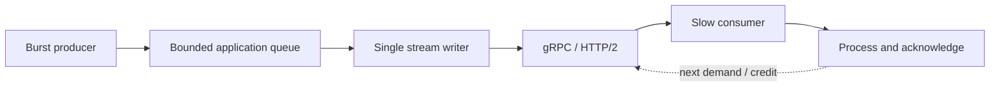

# Kiểm thử burst và consumer chậm

Streaming RPC có thể hoạt động tốt khi producer và consumer chạy cùng tốc độ, nhưng mất ổn định khi producer phát một burst lớn hoặc consumer xử lý chậm. Queue tăng liên tục, độ trễ tích lũy, bộ nhớ bị chiếm và deadline có thể hết hạn trước khi message được xử lý. Kiểm thử cần tái tạo được hai điều kiện này, đo cả tốc độ lẫn lượng công việc đang chờ và xác minh hệ thống có phản ứng đúng khi chạm giới hạn.

Trong Spring gRPC, một stream đi qua application queue, callback executor và flow control của gRPC/HTTP/2. Các lớp này có giới hạn và hành vi khác nhau. Bài này tập trung vào thiết kế burst test, mô phỏng consumer chậm, manual inbound flow control, outbound readiness, bounded queue và các assertion về message, latency, overload, cancellation.

## 1. Burst và slow consumer là hai dạng tải khác nhau

**Burst** là lượng message lớn xuất hiện trong một khoảng thời gian ngắn. **Slow consumer** là phía nhận xử lý mỗi message chậm hơn tốc độ producer tạo ra. Khi kết hợp, tốc độ đầu vào vượt tốc độ đầu ra và backlog tăng.

Ví dụ một pipeline:



Nếu tốc độ producer là 800 message/giây và consumer xử lý 200 message/giây, backlog tăng khoảng 600 message/giây trong lúc burst còn tiếp diễn. Queue không giới hạn chỉ trì hoãn thời điểm sự cố; nó không giải quyết chênh lệch tốc độ.

Kiểm thử cần trả lời:

- Hệ thống giữ được bao nhiêu message đang chờ?
- Khi queue đầy, producer bị backpressure, bị từ chối hay message bị loại bỏ theo policy?
- Thứ tự và tính toàn vẹn message có được giữ không?
- Latency tăng đến mức nào và có trở về bình thường sau burst không?
- Cancellation/deadline có dừng producer và giải phóng tài nguyên không?

## 2. Xác định workload trước khi chạy test

Một burst test có thể thay đổi nhiều yếu tố. Ghi rõ workload để kết quả có thể lặp lại:

| Tham số | Ví dụ | Ý nghĩa |
| --- | --- | --- |
| Burst size | 20.000 message | Tổng số message được tạo trong burst |
| Burst duration | 2 giây | Khoảng thời gian producer phát burst |
| Concurrent streams | 50 | Số RPC streaming hoạt động đồng thời |
| Payload size | 1 KB, 16 KB, 128 KB | Ảnh hưởng bộ nhớ và network |
| Consumer delay | 5–50 ms/message | Mô phỏng tốc độ xử lý phía nhận |
| Queue capacity | 256 message | Giới hạn backlog ở application layer |
| Warm-up / duration | 30 giây / 3 phút | Tách chi phí khởi động khỏi tải ổn định |

Chạy ít nhất ba profile: steady state làm baseline, burst đơn lẻ và burst lặp lại khi consumer vẫn còn backlog. Thử cả payload nhỏ và lớn; số message giống nhau nhưng số byte khác nhau có thể tạo áp lực rất khác.

Đặt một workload deterministic cho test chức năng, chẳng hạn sequence từ 1 đến N và payload có checksum. Với load test, thêm phân phối kích thước và thời gian xử lý gần production. Ghi lại cấu hình máy, JVM, transport, TLS, channel/server options và số stream để so sánh các lần chạy.

## 3. Đo backlog và độ trễ, không chỉ throughput

Throughput cao không chứng minh consumer theo kịp producer. Thu thập các chỉ số sau:

| Chỉ số | Cách hiểu |
| --- | --- |
| Offered rate | Số message producer muốn gửi mỗi giây |
| Accepted rate | Số message được queue/stream chấp nhận mỗi giây |
| Processed rate | Số message consumer xử lý xong mỗi giây |
| Queue depth / high-water mark | Backlog hiện tại và mức cao nhất |
| Queue wait | Thời gian từ lúc enqueue tới lúc consumer bắt đầu xử lý |
| Processing duration | Thời gian consumer xử lý một message |
| End-to-end latency | Từ lúc tạo message tới lúc xử lý xong |
| Rejected/dropped count | Số message bị từ chối hoặc loại bỏ theo policy |
| Heap, GC, CPU, thread/queue | Tài nguyên và dấu hiệu nghẽn |

Đo p50, p95 và p99 của queue wait/end-to-end latency. Trung bình có thể che khuất một nhóm message chờ rất lâu ở cuối burst. Với streaming, ghi cả message count lẫn byte count; payload lớn làm tăng áp lực heap, copy và network.

Phân biệt queue ứng dụng với buffer của gRPC/HTTP/2. `isReady()` phía gửi phản ánh khả năng transport nhận thêm dữ liệu ở thời điểm đó; nó không phải số đo queue depth của ứng dụng. Manual inbound request điều khiển số message được chuyển tới application callback; nó cũng không thay thế giới hạn queue mà ứng dụng tự quản lý.

## 4. Tạo burst có kiểm soát

Producer test nên tạo message theo sequence và có thể phát nhanh hơn consumer có chủ ý. Đặt queue có giới hạn và ghi nhận kết quả `offer`:

```java
BlockingQueue<UploadChunk> outbound =
        new ArrayBlockingQueue<>(256);

AtomicLong accepted = new AtomicLong();
AtomicLong rejected = new AtomicLong();

void produce(UploadChunk chunk) {
    if (outbound.offer(chunk)) {
        accepted.incrementAndGet();
    } else {
        rejected.incrementAndGet();
    }
}
```

Ví dụ này dùng `offer` không chờ để làm rõ policy khi queue đầy. Trong hệ thống thật, policy có thể là chờ trong giới hạn, giảm tốc producer, trả `RESOURCE_EXHAUSTED`, hoặc loại bỏ message nếu hợp đồng cho phép. Không âm thầm bỏ message khi nghiệp vụ yêu cầu giao nhận đầy đủ.

Writer duy nhất lấy message từ queue và gửi qua outbound observer. Với server streaming, writer có thể tạm dừng khi `ServerCallStreamObserver.isReady()` trả false rồi được đánh thức bởi `setOnReadyHandler`. On-ready callback chỉ nên đánh thức cùng writer; không khởi chạy nhiều drain loop cạnh tranh trên một observer.

## 5. Mô phỏng consumer chậm bằng manual inbound flow control

Một cách deterministic để làm chậm phía nhận là dùng `ClientResponseObserver` và chỉ yêu cầu một message tại một thời điểm. Consumer xử lý xong message hiện tại mới cấp credit cho message kế tiếp:

```java
final class SlowProductConsumer
        implements ClientResponseObserver<WatchRequest, ProductEvent> {

    private final ExecutorService consumer =
            Executors.newSingleThreadExecutor();
    private final CountDownLatch processed;
    private final CountDownLatch terminal = new CountDownLatch(1);
    private final AtomicReference<Throwable> failure =
            new AtomicReference<>();
    private volatile ClientCallStreamObserver<WatchRequest> call;

    SlowProductConsumer(int expectedMessages) {
        this.processed = new CountDownLatch(expectedMessages);
    }

    @Override
    public void beforeStart(
            ClientCallStreamObserver<WatchRequest> requestStream) {
        this.call = requestStream;
        requestStream.disableAutoRequestWithInitial(1);
    }

    @Override
    public void onNext(ProductEvent event) {
        consumer.execute(() -> {
            try {
                processSlowly(event);
                processed.countDown();
                // Chỉ xin message tiếp theo sau khi xử lý xong message này.
                call.request(1);
            } catch (RuntimeException error) {
                failure.compareAndSet(null, error);
                call.cancel("slow consumer failed", error);
            }
        });
    }

    @Override
    public void onError(Throwable error) {
        failure.compareAndSet(null, error);
        terminal.countDown();
    }

    @Override
    public void onCompleted() {
        terminal.countDown();
    }

    boolean await(Duration timeout) throws InterruptedException {
        boolean ended = terminal.await(
                timeout.toMillis(), TimeUnit.MILLISECONDS);
        boolean allProcessed = processed.await(
                timeout.toMillis(), TimeUnit.MILLISECONDS);
        return ended && allProcessed && failure.get() == null;
    }

    void shutdown() {
        consumer.shutdown();
    }
}
```

`processSlowly` đại diện cho xử lý có thời gian trễ được kiểm soát trong test. Ví dụ dùng một consumer executor tuần tự để giữ thứ tự xử lý; trong test thực tế cần shutdown executor trong `finally` và kiểm tra cả lỗi/timeout. Nếu server kết thúc stream trong khi consumer vẫn xử lý message cuối, `onCompleted` có thể đến trước khi task xử lý cuối hoàn tất; vì vậy phải đợi cả terminal latch và processed latch.

`disableAutoRequestWithInitial(1)` tắt auto inbound flow control và bắt đầu với một message credit. Sau mỗi message được xử lý, `request(1)` cho phép nhận tiếp. Cách này kiểm soát số message được giao cho application callback; nó không chứng minh transport không buffer bất kỳ byte nào ở tầng thấp hơn.

## 6. Phân biệt inbound demand và outbound readiness

Hai cơ chế thường bị nhầm:

| Cơ chế | Hướng | Ý nghĩa |
| --- | --- | --- |
| `request(n)` / manual inbound flow control | Phía nhận | Cho phép gRPC chuyển thêm tối đa n message tới application |
| `isReady()` và `setOnReadyHandler` | Phía gửi | Báo khả năng transport tiếp nhận thêm message mà không bị buffer quá mức |

Client dùng `ClientCallStreamObserver` để kiểm soát request inbound và readiness khi gửi request stream. Server dùng `ServerCallStreamObserver` để kiểm soát inbound request (nếu bật manual flow control) và readiness khi gửi response stream.

Kiểm thử slow consumer phía client nên đo số message đã được cấp demand và số message đang được application xử lý. Kiểm thử slow receiver ở server nên kiểm tra writer dừng drain khi server observer không ready và tiếp tục khi on-ready handler đánh thức writer. Không dùng `isReady()` như lock; vẫn cần single writer hoặc synchronization cho observer.

## 7. Các kịch bản burst và slow consumer cần chạy

| Kịch bản | Cách tạo tải | Điều cần xác minh |
| --- | --- | --- |
| Burst ngắn | N message phát trong thời gian rất ngắn | Queue không vượt capacity; overload policy hoạt động |
| Burst kéo dài | Producer duy trì rate cao trong vài chục giây | Queue depth và latency không tăng vô hạn |
| Consumer chậm cố định | Delay giống nhau mỗi message | Backlog tăng có kiểm soát; throughput gần khả năng consumer |
| Consumer chậm biến thiên | Một số message xử lý lâu hơn | p95/p99 và thứ tự không bị phá |
| Consumer tạm dừng | Không request credit trong một khoảng thời gian | Producer/queue bị backpressure hoặc chạm giới hạn có kiểm soát |
| Nhiều stream đồng thời | Nhiều burst trên các RPC khác nhau | State, queue và observer không bị trộn |
| Payload lớn | Tăng kích thước message | Heap, GC và byte backlog vẫn trong ngân sách |
| Cancel khi backlog cao | Hủy stream giữa burst | Producer dừng, queue được dọn, không phát message sau terminal |
| Deadline hết hạn | Deadline ngắn hơn thời gian drain backlog | Call kết thúc đúng status và công việc phụ thuộc được dừng |

Chạy từng kịch bản riêng trước để tìm nguyên nhân, sau đó kết hợp burst, nhiều stream và payload lớn để kiểm tra tương tác giữa queue, executor và transport.

## 8. Assertion cần có trong test

Không chỉ assert RPC kết thúc thành công. Với một workload có sequence 1..N, các assertion hữu ích:

- **Integrity:** số message processed bằng số accepted nếu policy yêu cầu không mất message.
- **No duplicates:** mỗi sequence chỉ được xử lý một lần, trừ khi hợp đồng cho phép retry/redelivery.
- **Ordering:** sequence tăng đúng thứ tự nếu stream yêu cầu ordered delivery.
- **Bounded backlog:** queue depth không vượt capacity; ghi nhận high-water mark.
- **Overload behavior:** khi queue đầy, producer bị block/reject/drop đúng policy và có counter tương ứng.
- **Terminal correctness:** chỉ một terminal signal; không có `onNext` sau completion/error/cancel.
- **Cancellation:** producer và worker dừng trong một khoảng thời gian được quy định; queue/state được giải phóng.
- **Recovery:** sau burst, queue depth trở về gần 0 và latency trở lại baseline.

Nếu test cho phép drop, hãy assert chính xác số dropped và xác minh message được chọn để drop theo policy. Không so sánh `processed == offered` khi hệ thống chủ đích từ chối message vượt capacity; khi đó cần phân biệt offered, accepted, rejected và processed.

## 9. Độ ổn định và cách đọc kết quả

Một test chức năng nên dùng in-process server/channel, `CountDownLatch` hoặc barrier để điều khiển consumer và xác minh thứ tự. Không dùng `Thread.sleep` làm cơ chế đồng bộ chính; sleep chỉ mô phỏng thời gian xử lý khi có điều kiện chờ và timeout rõ ràng.

Performance test cần dùng transport, TLS, payload, số channel và cấu hình executor gần production. Tăng tải theo bậc: baseline, mức dự kiến, burst mục tiêu và quá tải có chủ ý. Theo dõi:

- Throughput accepted/processed và tỷ lệ rejection.
- p50/p95/p99 end-to-end latency và queue wait.
- Queue depth/high-water mark theo từng stream hoặc pool.
- Heap, allocation rate, GC pause, CPU và số thread.
- Số call đang hoạt động, status `RESOURCE_EXHAUSTED`, `CANCELLED`, `DEADLINE_EXCEEDED`.

Nếu queue tăng liên tục trong khi processed rate thấp hơn accepted rate, hệ thống chưa có cơ chế điều tiết đủ mạnh. Nếu queue ổn định nhưng p99 cao, điều tra consumer processing time, executor contention và transport. Nếu heap tăng sau khi burst kết thúc, kiểm tra reference tới message, queue hoặc observer chưa được giải phóng.

## 10. Checklist kiểm thử

- [ ] Workload ghi rõ burst size, duration, stream count và payload size.
- [ ] Có baseline steady-state để so sánh.
- [ ] Consumer chậm được mô phỏng bằng delay hoặc manual inbound demand.
- [ ] Queue ứng dụng có capacity hữu hạn và policy khi đầy.
- [ ] Single writer tôn trọng outbound readiness.
- [ ] Đo offered/accepted/processed/rejected và byte count.
- [ ] Đo queue depth, high-water mark, queue wait và p95/p99 latency.
- [ ] Kiểm tra message loss, duplicate, ordering theo hợp đồng.
- [ ] Kiểm tra cancellation, deadline và cleanup khi backlog cao.
- [ ] Xác minh queue drain và latency phục hồi sau burst.
- [ ] Có test in-process cho tính đúng và performance test trên cấu hình gần production.
- [ ] Không nhầm inbound `request(n)` với outbound `isReady()`.

**Tự kiểm tra**

**Câu 1.** Vì sao throughput không đủ để đánh giá burst test?

*Đáp án:* Throughput không cho biết backlog và thời gian chờ. Consumer có thể xử lý đều nhưng queue vẫn tăng nhanh; cần đo queue depth, queue wait và p95/p99 end-to-end latency.

**Câu 2.** Manual inbound flow control với một credit giúp mô phỏng điều gì?

*Đáp án:* Consumer chỉ nhận message tiếp theo sau khi ứng dụng yêu cầu thêm, nên có thể xử lý chậm có kiểm soát và quan sát tác động của demand tới stream.

**Câu 3.** `isReady()` và `request(n)` khác nhau thế nào?

*Đáp án:* `request(n)` điều khiển số inbound message được chuyển tới application; `isReady()` báo khả năng phía gửi tiếp tục ghi mà không vượt readiness của transport.

**Câu 4.** Vì sao queue phải có giới hạn?

*Đáp án:* Queue không giới hạn chỉ tích lũy backlog khi producer nhanh hơn consumer, làm heap và latency tăng cho tới khi hệ thống quá tải. Bounded queue buộc ứng dụng áp dụng backpressure hoặc overload policy.

**Câu 5.** Sau burst, dấu hiệu nào cho thấy hệ thống đã phục hồi?

*Đáp án:* Queue depth giảm về gần 0, processed rate bắt kịp accepted rate, latency trở về gần baseline và tài nguyên như heap/thread không tiếp tục tăng.

Kiểm thử burst và consumer chậm phải chứng minh hệ thống giữ backlog trong giới hạn, áp dụng overload policy rõ ràng và phục hồi sau khi tải giảm. Kết hợp manual inbound demand, outbound readiness, bounded queue và phép đo latency/queue sẽ giúp phát hiện sớm tình trạng consumer không theo kịp producer trong Spring gRPC.
