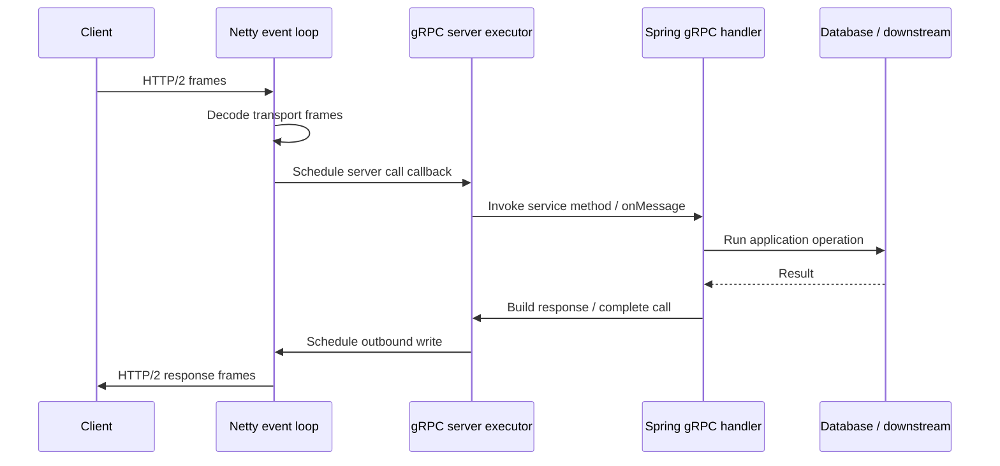

# Thread nào thực thi gRPC handler?

**Chương:** Thread model  
**Phạm vi:** Spring gRPC (`SPRING_GRPC`) dùng hợp đồng Protocol Buffers, mã Java được sinh và server/client cho unary hoặc streaming RPC. Bài này giải thích thread nào nhận dữ liệu mạng, thread nào gọi service handler, cách executor ảnh hưởng đến callback và những điều cần lưu ý khi chuyển công việc sang thread khác.

## 1. Không có một thread duy nhất cho toàn bộ RPC

Khi client gọi một RPC, server xử lý nhiều loại công việc: nhận byte từ socket, giải mã HTTP/2 và protobuf, gọi handler Java, chạy nghiệp vụ, rồi ghi response về mạng. Các công việc này có thể chạy trên những thread khác nhau.

Trong server gRPC Java dùng Netty, cần phân biệt:

- **Netty event-loop thread:** xử lý sự kiện I/O của socket và HTTP/2, như đọc frame, ghi frame và quản lý transport.
- **Server application executor:** thực thi callback của server call, bao gồm việc bắt đầu handler và các callback nhận request message/half-close.
- **Application worker/executor:** thread do ứng dụng tạo hoặc dùng từ Spring để chạy công việc nền, gọi database, HTTP hoặc downstream gRPC.

Thông thường, Netty event loop không phải nơi chạy nghiệp vụ của handler. gRPC chuyển callback ứng dụng sang executor dành cho server. Nếu không cấu hình executor riêng, gRPC Java dùng executor mặc định do thư viện quản lý; chi tiết pool và cách Spring gRPC cấu hình nó phụ thuộc phiên bản starter và cấu hình server.

Vì vậy, câu trả lời thực tế cho “thread nào thực thi handler?” là: **thread từ server application executor đang chạy callback của RPC tại thời điểm đó**. Không nên giả định tên thread cố định hoặc một RPC luôn ở trên cùng một thread vật lý.

## 2. Luồng xử lý từ socket đến handler

Luồng tổng quát:



Sơ đồ mô tả các vai trò chính, không phải mọi bước nội bộ hoặc mọi lần chuyển thread của một phiên bản cụ thể. Transport có thể tiếp tục xử lý I/O trong lúc application executor đang chạy handler; gRPC điều phối dữ liệu giữa hai phía.

### Netty event loop làm gì?

Event loop được thiết kế để xử lý nhiều kết nối I/O hiệu quả. Nó đọc và ghi dữ liệu, xử lý sự kiện transport và thông báo khi stream có dữ liệu hoặc có thể ghi tiếp. Một event loop thường phục vụ nhiều channel/stream.

Nếu handler thực hiện truy vấn database đồng bộ lâu ngay trên event loop, một thread I/O có thể bị giữ lại. Các kết nối khác được event loop đó phục vụ cũng có thể bị chậm. Kiến trúc gRPC Java tách application callback khỏi transport I/O executor để tránh gắn nghiệp vụ vào event loop.

### Server application executor làm gì?

Executor này chạy logic callback của server call. Khi gRPC cần gọi service implementation, nó đưa công việc vào executor và thực thi callback theo thứ tự của call. Nếu ứng dụng cấu hình executor riêng qua server builder, callback handler sẽ được chạy trên pool đó.

Ví dụ cấu hình ở mức gRPC Java:

```java
ExecutorService grpcExecutor = new ThreadPoolExecutor(
        16,
        64,
        60,
        TimeUnit.SECONDS,
        new ArrayBlockingQueue<>(500),
        new NamedThreadFactory("grpc-app-"),
        new ThreadPoolExecutor.AbortPolicy());

NettyServerBuilder.forPort(port)
        .executor(grpcExecutor)
        .addService(service)
        .build();
```

Đây là ví dụ dùng trực tiếp `NettyServerBuilder` để minh họa điểm cấu hình. Trong ứng dụng Spring gRPC, server thường được tạo bởi auto-configuration; hãy cung cấp executor qua extension point/server configurer mà starter đang dùng hỗ trợ, thay vì tự tạo một server thứ hai song song với server Spring.

## 3. Handler và các callback của một RPC

Với unary RPC, generated service method thường được gọi một lần cho mỗi request:

```java
@Override
public void getCustomer(
        GetCustomerRequest request,
        StreamObserver<Customer> responseObserver) {
    Customer customer = applicationService.find(request.getCustomerId());
    responseObserver.onNext(toProto(customer));
    responseObserver.onCompleted();
}
```

Service method chạy trên server application executor. Trong phương thức này, code đồng bộ thường tiếp tục chạy trên thread đang gọi handler cho đến khi method trả về hoặc chuyển công việc sang executor khác.

Với client streaming, gRPC gọi method để tạo inbound observer, rồi gọi các callback theo vòng đời request:

```java
@Override
public StreamObserver<UploadChunk> upload(
        StreamObserver<UploadReceipt> responseObserver) {
    return new StreamObserver<>() {
        @Override
        public void onNext(UploadChunk chunk) {
            acceptChunk(chunk);
        }

        @Override
        public void onError(Throwable error) {
            cleanup();
        }

        @Override
        public void onCompleted() {
            UploadReceipt receipt = finishUpload();
            responseObserver.onNext(receipt);
            responseObserver.onCompleted();
        }
    };
}
```

Các callback inbound của cùng một RPC được gRPC điều phối tuần tự: `onNext` không được gọi đồng thời với `onNext` khác trên cùng observer, và `onCompleted` là tín hiệu kết thúc chiều request. Tuy nhiên, tuần tự không có nghĩa mọi callback phải chạy trên cùng một thread vật lý. Executor có thể dùng thread khác cho callback tiếp theo.

Vì thế:

- Có thể giữ state riêng của một RPC trong observer nếu chỉ được truy cập từ các callback tuần tự đó.
- Không được suy luận thread identity từ callback đầu tiên để dùng lại ở callback sau.
- Khi tự tạo tác vụ bất đồng bộ hoặc nhiều worker, state cần đồng bộ/thread-safe theo cách mới.
- Không dùng field mutable của singleton Spring service để lưu state của một RPC; nhiều call có thể chạy đồng thời.

## 4. Cấu hình executor và tác động tới tải

Server application executor là tài nguyên hữu hạn. Kích thước pool, hàng đợi và chính sách từ chối ảnh hưởng trực tiếp đến độ trễ và khả năng chịu tải.

| Cấu hình | Tác động | Rủi ro |
| --- | --- | --- |
| Pool quá nhỏ | Ít callback được chạy đồng thời | RPC xếp hàng, latency tăng |
| Pool quá lớn | Nhiều callback đồng thời | Tăng context switching, memory và áp lực lên database |
| Hàng đợi không giới hạn | Chấp nhận nhiều việc chờ | Bộ nhớ tăng không giới hạn khi quá tải |
| Hàng đợi có giới hạn | Giới hạn lượng công việc đang chờ | Cần xử lý overload/rejection phù hợp |
| Pool dùng chung với tác vụ nền nặng | Dễ cấu hình ban đầu | Tác vụ nền có thể làm đói callback RPC |
| Pool riêng theo workload | Cô lập tải | Cần quản lý thêm thread và giới hạn tổng tài nguyên |

Không có một con số thread phù hợp cho mọi server. Hãy căn cứ vào số CPU, thời gian CPU của handler, thời gian chờ I/O, giới hạn connection pool, số RPC đồng thời và mục tiêu latency. Nếu handler chủ yếu chờ database, tăng vô hạn số thread chỉ làm database và hàng đợi chịu tải lớn hơn.

### Phân tách workload

Có thể dùng:

- Server executor cho callback RPC ngắn và điều phối request.
- Worker pool giới hạn riêng cho tác vụ blocking hoặc CPU-intensive.
- Client channel/executor và connection pool riêng theo dependency nếu cần cô lập.

Tránh gửi mọi callback sang một cached thread pool không giới hạn. Khi tải tăng đột biến, pool không giới hạn có thể tạo quá nhiều thread và làm hệ thống mất ổn định.

## 5. Xử lý blocking I/O đúng cách

Nếu handler gọi JDBC đồng bộ, thread application executor bị giữ trong suốt thời gian query. Điều này không làm Netty event loop trực tiếp bị khóa, nhưng làm giảm số RPC mà application pool có thể xử lý.

Có ba lựa chọn thường gặp:

1. **Giữ xử lý đồng bộ trên server executor:** phù hợp khi thời gian xử lý ngắn, giới hạn rõ và tải đã được đo.
2. **Chuyển blocking operation sang worker pool riêng:** giúp cô lập server callback thread; cần giới hạn pool và hàng đợi, truyền deadline/cancellation và trả response đúng một lần.
3. **Dùng API non-blocking/reactive phù hợp:** tránh giữ thread trong lúc chờ I/O, nhưng vẫn cần quản lý concurrency, backpressure và lỗi.

Ví dụ chuyển JDBC/blocking service sang worker pool:

```java
@GrpcService
public class CustomerGrpcService
        extends CustomerServiceGrpc.CustomerServiceImplBase {

    private final CustomerApplicationService service;
    private final Executor customerIoExecutor;

    public CustomerGrpcService(
            CustomerApplicationService service,
            @Qualifier("customerIoExecutor") Executor customerIoExecutor) {
        this.service = service;
        this.customerIoExecutor = customerIoExecutor;
    }

    @Override
    public void getCustomer(
            GetCustomerRequest request,
            StreamObserver<Customer> responseObserver) {

        customerIoExecutor.execute(() -> {
            try {
                Customer customer =
                        service.find(request.getCustomerId());
                responseObserver.onNext(toProto(customer));
                responseObserver.onCompleted();
            } catch (CustomerNotFoundException missing) {
                responseObserver.onError(
                        Status.NOT_FOUND
                                .withDescription("Customer not found")
                                .asRuntimeException());
            } catch (Exception failure) {
                responseObserver.onError(
                        Status.INTERNAL
                                .withDescription("Internal server error")
                                .asRuntimeException());
            }
        });
    }
}
```

Trong ví dụ, response observer được gọi từ worker thread. Đây là cách dùng phổ biến cho server async, nhưng cần bảo đảm một nơi duy nhất kết thúc call và xử lý cancellation/deadline. Không để exception thoát khỏi task vì callback gRPC ban đầu đã trả về; global interceptor trên call stack ban đầu không tự bắt được lỗi ở worker thread.

Executor nên là bean Spring có lifecycle rõ ràng, queue hữu hạn và chính sách từ chối. Nếu `execute()` bị từ chối, adapter phải chuyển overload thành kết quả phù hợp thay vì để lỗi rơi ra ngoài. Không gọi `onError` hai lần nếu call đã bị hủy hoặc đã kết thúc.

## 6. Thread model không thay thế flow control

Một pool có nhiều thread không có nghĩa server có thể nhận và xử lý message vô hạn. Streaming RPC còn chịu ảnh hưởng của HTTP/2 flow control và gRPC readiness.

Với server streaming hoặc bidirectional streaming, dùng `ServerCallStreamObserver.isReady()` và `setOnReadyHandler()` để chỉ phát dữ liệu khi transport sẵn sàng:

```java
ServerCallStreamObserver<Update> call =
        (ServerCallStreamObserver<Update>) responseObserver;

call.setOnReadyHandler(() -> {
    while (call.isReady() && hasNextUpdate()) {
        call.onNext(nextUpdate());
    }
});
```

Đây là phác thảo: producer thực tế cần kiểm soát state và đảm bảo không gọi observer đồng thời từ nhiều thread. Nếu producer chạy trên worker thread, đồng bộ việc phát message và dừng producer khi cancellation.

Flow control điều tiết lượng dữ liệu đang gửi; executor điều tiết nơi callback được chạy. Hai cơ chế giải quyết hai vấn đề khác nhau và cần được thiết kế cùng nhau.

## 7. Context và SecurityContext khi đổi thread

gRPC `Context` thường chứa deadline, cancellation và dữ liệu theo RPC như principal đã xác thực. Trong lúc callback đang chạy, `Context.current()` trả context gắn với call đó.

Khi chuyển công việc sang executor tùy ý, không nên giả định context tự động được truyền sang thread mới. Có thể capture context hiện tại và bọc executor:

```java
Context callContext = Context.current();
Executor contextAwareExecutor =
        callContext.fixedContextExecutor(customerIoExecutor);

contextAwareExecutor.execute(() -> {
    AuthenticatedPrincipal principal = PRINCIPAL.get();
    Deadline deadline = Context.current().getDeadline();
    processFor(principal, deadline);
});
```

`fixedContextExecutor` gắn context đã capture vào task khi chạy. Một lựa chọn khác là `Context.currentContextExecutor(delegate)`, nơi context hiện tại được capture khi submit task. Chọn cách phù hợp với thời điểm cần capture; không dùng nhầm context của một RPC cho task thuộc RPC khác.

Spring Security `SecurityContext` là một context riêng. Nếu ứng dụng dùng nó trong tác vụ bất đồng bộ, cần cơ chế truyền context tương ứng (ví dụ `DelegatingSecurityContextExecutor`) hoặc truyền principal một cách tường minh. Không giả định gRPC Context tự động sao chép Spring SecurityContext và ngược lại.

## 8. Deadline và cancellation khi công việc chạy trên worker

Client có thể hủy RPC hoặc deadline có thể hết trong khi worker đang truy vấn database. Việc client ngừng chờ không tự động dừng mọi tác vụ blocking phía server.

Khi chuyển việc sang worker:

- Kiểm tra `Context.current().isCancelled()` trước khi bắt đầu công việc tốn kém.
- Đăng ký cancellation handler phù hợp với `ServerCallStreamObserver` để phát tín hiệu dừng.
- Truyền deadline còn lại vào timeout của JDBC/HTTP/downstream gRPC.
- Nếu dùng future/task, giữ handle để cancel hoặc interrupt khi thư viện hỗ trợ.
- Cleanup tài nguyên và không gửi response sau khi call đã bị hủy.

Cancellation là tín hiệu hợp tác. JDBC driver hoặc thư viện blocking có thể không dừng ngay khi thread bị interrupt; vẫn cần timeout ở tầng dependency và transaction boundary.

## 9. Quan sát thread model trong vận hành

Nên theo dõi:

- Tên thread khi vào handler và trong worker task.
- Số thread active, queue depth và số task bị reject của từng executor.
- Thời gian chờ trong queue tách biệt với thời gian xử lý.
- Latency handler, thời gian chờ database và downstream.
- Số RPC bị hủy hoặc hết deadline trong khi worker còn chạy.
- Số lần flow control chuyển sang not-ready và thời gian producer bị dừng.

Tên thread có prefix riêng như `grpc-app-` hoặc `customer-io-` giúp đọc thread dump dễ hơn. Tránh chỉ log thread name rồi kết luận toàn bộ call dùng một thread; cần correlation ID/RPC method và trace để theo dõi các bước qua nhiều executor.

Nếu latency tăng:

- Server executor queue tăng: callback đang chờ được chạy hoặc pool quá nhỏ/bị block.
- Worker queue tăng: workload blocking/CPU đang quá tải.
- Database pool chờ lâu: tăng thread RPC không giải quyết được giới hạn database.
- Event loop CPU cao: kiểm tra transport/I/O, TLS, serialization và callback có vô tình chạy trên event loop do cấu hình tùy biến hay không.

## 10. Kiểm thử thread model

Không nên viết test khẳng định một tên thread cố định nếu hợp đồng ứng dụng không cam kết điều đó. Thay vào đó, kiểm tra thuộc tính cần bảo vệ:

| Mục tiêu | Cách kiểm thử |
| --- | --- |
| Handler không chạy trên Netty event loop | Ghi thread name/type trong handler khi dùng transport Netty |
| Custom server executor được dùng | Dùng executor có thread name riêng và xác nhận callback chạy trên pool đó |
| Callback của cùng RPC không đồng thời | Dùng counter/lock probe trong callback và xác nhận max concurrent = 1 |
| RPC khác nhau có thể chạy song song | Dùng barrier cho hai call và xác nhận cả hai được tiến hành |
| Context được truyền sang worker | Đặt Context key/deadline trước submit và xác nhận worker đọc được |
| Cancellation dừng công việc | Hủy client call, xác nhận cancellation signal và cleanup |
| Executor overload được xử lý | Dùng pool nhỏ/queue hữu hạn, xác nhận rejection được chuyển thành lỗi an toàn |

Ví dụ probe callback serialization:

```java
AtomicInteger active = new AtomicInteger();
AtomicInteger maxActive = new AtomicInteger();

void observeCallback() {
    int current = active.incrementAndGet();
    maxActive.accumulateAndGet(current, Math::max);
    try {
        performShortTestStep();
    } finally {
        active.decrementAndGet();
    }
}
```

Chạy probe trong các callback inbound của cùng một RPC. Nếu code tự chuyển callback sang nhiều worker, probe cần đặt tại vùng worker đó để kiểm tra concurrency do ứng dụng tạo ra, không quy kết kết quả cho guarantee tuần tự của gRPC listener.

## 11. Tự luyện tập

1. Vì sao không nên chạy JDBC query dài trên Netty event-loop thread?
2. Server handler chạy trên application executor. Điều gì xảy ra với callback của cùng RPC khi callback tiếp theo được schedule trên thread khác?
3. Một service chuyển công việc sang worker pool. Vì sao global interceptor không tự bắt exception phát sinh sau khi task được submit?
4. Thiết kế cách truyền gRPC Context và deadline vào executor riêng; phân biệt với Spring SecurityContext.
5. Khi worker queue đầy, server nên xử lý rejection thế nào để không treo RPC hoặc gọi terminal callback hai lần?

**Ghi nhớ:** Trong gRPC Java với Netty, event loop chủ yếu xử lý transport I/O; service handler và listener callback chạy trên **server application executor**. Callback của cùng RPC được điều phối tuần tự nhưng không nhất thiết cùng thread vật lý. Khi chuyển sang worker pool, ứng dụng phải tự quản lý context propagation, deadline, cancellation, flow control và terminal state.
