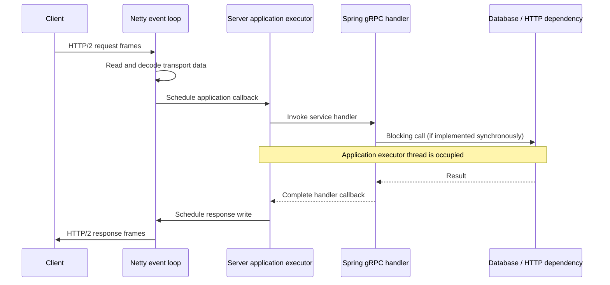

# Netty event loop và blocking work

**Chương:** Thread model  
**Phạm vi:** Spring gRPC (`SPRING_GRPC`) sử dụng Protocol Buffers, mã Java được sinh và các RPC unary hoặc streaming. Bài này tập trung vào vai trò của Netty event loop, vì sao blocking work có thể làm nghẽn transport, và cách tách công việc blocking khỏi luồng xử lý I/O mà vẫn giữ deadline, cancellation và tính an toàn của response observer.

## 1. Netty event loop chịu trách nhiệm gì?

Trong cấu hình gRPC Java dùng Netty transport, event loop là nhóm thread chuyên xử lý sự kiện I/O của kết nối:

- Đọc byte từ socket và ghi byte ra socket.
- Xử lý frame HTTP/2, trạng thái stream và sự kiện transport.
- Điều phối dữ liệu giữa network channel và tầng gRPC.
- Thực hiện các thao tác I/O non-blocking mà transport cần.

Một event-loop thread thường phục vụ nhiều channel hoặc stream. Nó đạt hiệu quả nhờ không dừng lại để chờ một thao tác I/O chậm hoàn tất. Khi một event loop bị giữ bởi JDBC query, gọi HTTP đồng bộ hoặc `Thread.sleep`, các sự kiện I/O khác đang chờ trên event loop đó cũng có thể bị trì hoãn.

**Nguyên tắc:** event loop cần quay lại xử lý sự kiện nhanh. Không thực hiện nghiệp vụ blocking kéo dài trên event-loop thread.

## 2. Event loop và application executor là hai vai trò khác nhau

gRPC Java tách transport I/O khỏi callback ứng dụng. Với server Netty thông thường, service handler và listener callback được thực thi trên server application executor. Netty event loop tiếp tục xử lý socket và HTTP/2.



Sơ đồ mô tả ranh giới trách nhiệm; chi tiết chuyển thread có thể khác theo transport, phiên bản và cấu hình executor. Trong cấu hình thông thường, blocking trong handler làm chiếm application executor thread. Nếu server được cấu hình chạy callback trực tiếp trên transport thread, blocking có thể giữ cả event loop.

### Server application executor

Server builder cho phép cấu hình executor thực thi callback ứng dụng. Ví dụ với gRPC Java Netty:

```java
import com.google.common.util.concurrent.ThreadFactoryBuilder;
import java.util.concurrent.ArrayBlockingQueue;
import java.util.concurrent.ExecutorService;
import java.util.concurrent.ThreadPoolExecutor;
import java.util.concurrent.TimeUnit;

ExecutorService applicationExecutor = new ThreadPoolExecutor(
        16,
        64,
        60,
        TimeUnit.SECONDS,
        new ArrayBlockingQueue<>(500),
        new ThreadFactoryBuilder()
                .setNameFormat("grpc-app-%d")
                .build(),
        new ThreadPoolExecutor.AbortPolicy());

NettyServerBuilder.forPort(port)
        .executor(applicationExecutor)
        .addService(service)
        .build();
```

Đây là ví dụ cấu hình trực tiếp gRPC Java. Khi dùng Spring gRPC starter, server thường được tạo bởi auto-configuration; hãy cung cấp executor qua extension point hoặc server customizer mà phiên bản starter đang dùng hỗ trợ. Không tạo một Netty server thứ hai chỉ để áp dụng executor cho service Spring hiện tại.

### Cẩn thận với directExecutor

gRPC Java có chế độ `directExecutor()`. Chế độ này chạy callback ứng dụng trực tiếp trên thread gọi callback, thay vì chuyển sang executor riêng. Với Netty transport, thread gọi có thể là transport/event-loop thread. Nó có thể giảm overhead chuyển thread cho callback rất ngắn, nhưng **không phù hợp với handler có blocking work**.

Không bật direct executor cho service có JDBC, HTTP client đồng bộ, file I/O hoặc thao tác có thời gian chờ không xác định. Nếu cần dùng, chỉ nên áp dụng khi callback thực sự ngắn, không block và đã đo kiểm dưới tải.

## 3. Điều gì xảy ra khi blocking trên event loop?

Giả sử một event loop đang phục vụ nhiều kết nối. Một callback chạy trên thread đó gọi:

```java
Customer customer = jdbcRepository.findById(customerId); // Blocking
```

Trong lúc chờ database:

1. Event loop không xử lý tiếp các sự kiện channel khác mà nó phụ trách.
2. Request/response trên các kết nối đó có thể bị trễ dù database call chỉ thuộc một RPC.
3. Hàng đợi sự kiện và thời gian chờ tăng.
4. Client có thể hết deadline và retry, làm tải tăng thêm.
5. Khi nhiều event loop bị block, throughput của transport giảm mạnh và độ trễ lan rộng.

Một thread bị block có thể ảnh hưởng nhiều RPC không liên quan. Đây là lý do không nên dùng event loop như worker pool cho nghiệp vụ.

### Blocking trên application executor vẫn có giới hạn

Nếu handler chạy trên application executor riêng, blocking không trực tiếp khóa Netty event loop, nhưng vẫn chiếm một thread của application pool. Khi mọi thread đều chờ database:

- Callback mới xếp hàng.
- Queue tăng và latency tăng.
- Request có thể hết deadline trước khi bắt đầu xử lý.
- Nếu tăng pool vô hạn, database connection pool và downstream có thể bị quá tải.

Tách executor giúp cô lập loại tải; nó không làm blocking trở nên miễn phí. Pool phải có giới hạn và phải phù hợp với capacity của dependency.

## 4. Những loại blocking work thường gặp

| Công việc | Vì sao blocking | Hướng xử lý |
| --- | --- | --- |
| JDBC/JPA đồng bộ | Chờ connection, query và kết quả database | Worker pool có giới hạn hoặc API truy cập dữ liệu non-blocking phù hợp |
| HTTP client đồng bộ | Chờ DNS, connect, response hoặc socket timeout | Dùng async HTTP client hoặc worker pool riêng |
| Đọc/ghi file | Chờ filesystem hoặc storage | Worker pool I/O riêng; giới hạn kích thước và thời gian |
| Gọi SDK bên thứ ba đồng bộ | SDK có thể chờ mạng hoặc lock nội bộ | Cô lập bằng bulkhead/worker pool và timeout |
| Mã hóa, nén hoặc tính toán nặng | Chiếm CPU lâu dù không chờ I/O | CPU executor riêng, giới hạn concurrency |
| `Thread.sleep()` hoặc chờ lock | Giữ thread mà không xử lý callback khác | Dùng async coordination hoặc loại bỏ chờ đồng bộ |

Không phải mọi công việc lâu đều là blocking I/O. CPU-intensive work cần được phân bổ khác với I/O-bound work; dùng chung một pool có thể khiến một loại tải làm đói loại còn lại.

## 5. Cô lập blocking work bằng worker pool hữu hạn

Một cách thực tế là để handler kiểm tra request nhanh, sau đó chuyển thao tác JDBC/SDK blocking sang worker pool riêng:

```java
import com.google.common.util.concurrent.ThreadFactoryBuilder;
import java.util.concurrent.ArrayBlockingQueue;
import java.util.concurrent.ExecutorService;
import java.util.concurrent.ThreadPoolExecutor;
import java.util.concurrent.TimeUnit;

@Configuration
public class GrpcWorkerConfiguration {

    @Bean(destroyMethod = "shutdown")
    public ExecutorService customerIoExecutor() {
        return new ThreadPoolExecutor(
                12,
                24,
                30,
                TimeUnit.SECONDS,
                new ArrayBlockingQueue<>(200),
                new ThreadFactoryBuilder()
                        .setNameFormat("customer-io-%d")
                        .build(),
                new ThreadPoolExecutor.AbortPolicy());
    }
}
```

Giới hạn queue giúp hệ thống có điểm từ chối rõ ràng khi quá tải. Khi executor từ chối task, adapter phải kết thúc RPC bằng status phù hợp theo hợp đồng, chẳng hạn `RESOURCE_EXHAUSTED` nếu capacity của dịch vụ đã cạn; không để exception bị nuốt hoặc RPC treo.

### Ví dụ chuyển tác vụ blocking khỏi handler

```java
@GrpcService
public class CustomerGrpcService
        extends CustomerServiceGrpc.CustomerServiceImplBase {

    private final CustomerApplicationService applicationService;
    private final Executor customerIoExecutor;
    private final GrpcExceptionMapper exceptionMapper;

    public CustomerGrpcService(
            CustomerApplicationService applicationService,
            @Qualifier("customerIoExecutor") Executor customerIoExecutor,
            GrpcExceptionMapper exceptionMapper) {
        this.applicationService = applicationService;
        this.customerIoExecutor = customerIoExecutor;
        this.exceptionMapper = exceptionMapper;
    }

    @Override
    public void getCustomer(
            GetCustomerRequest request,
            StreamObserver<Customer> responseObserver) {

        ServerCallStreamObserver<Customer> serverObserver =
                (ServerCallStreamObserver<Customer>) responseObserver;
        Context callContext = Context.current();
        AtomicBoolean cancelled = new AtomicBoolean(false);
        AtomicBoolean terminated = new AtomicBoolean(false);

        serverObserver.setOnCancelHandler(() -> cancelled.set(true));

        Executor contextAwareExecutor =
                callContext.fixedContextExecutor(customerIoExecutor);

        try {
            contextAwareExecutor.execute(() -> {
                if (cancelled.get() || callContext.isCancelled()) {
                    return;
                }
                try {
                    Customer customer =
                            applicationService.findBlocking(
                                    request.getCustomerId());
                    if (cancelled.get() || callContext.isCancelled()) {
                        return;
                    }
                    if (terminated.compareAndSet(false, true)) {
                        responseObserver.onNext(toProto(customer));
                        responseObserver.onCompleted();
                    }
                } catch (Exception failure) {
                    if (!cancelled.get()
                            && terminated.compareAndSet(false, true)) {
                        responseObserver.onError(
                                exceptionMapper.map(failure));
                    }
                }
            });
        } catch (RejectedExecutionException overloaded) {
            if (terminated.compareAndSet(false, true)) {
                responseObserver.onError(
                        Status.RESOURCE_EXHAUSTED
                                .withDescription(
                                        "Server is temporarily at capacity")
                                .asRuntimeException());
            }
        }
    }
}
```

Đây là mẫu minh họa cho unary RPC có một task và một nơi phát terminal response. Cần thêm import, bean và mapper phù hợp với ứng dụng. Khi dùng streaming hoặc nhiều worker, phải tuần tự hóa các lần gọi observer; `StreamObserver` không được mặc định là thread-safe.

Một số điểm cần giữ:

- `Context.current()` được capture trước khi submit task; `fixedContextExecutor` gắn lại context đó khi task chạy.
- Cancellation handler đặt cờ để worker tránh bắt đầu hoặc gửi response sau khi client hủy.
- `terminated` ngăn hai nhánh cùng kết thúc RPC.
- Queue có giới hạn và rejection được xử lý ngay.
- Blocking client vẫn cần timeout riêng; context propagation không tự dừng mọi JDBC driver hoặc SDK khi deadline hết.

Trong code thực tế, nên đóng gói việc quản lý cancellation, deadline, executor rejection và terminal state thành helper đã được kiểm thử, thay vì sao chép một khối phức tạp vào từng RPC.

## 6. Deadline phải được truyền xuống blocking dependency

Client gRPC có thể đặt deadline cho RPC. Server nên dùng ngân sách thời gian còn lại để cấu hình timeout cho JDBC, HTTP hoặc downstream call.

Ví dụ lấy thời gian còn lại:

```java
Deadline deadline = Context.current().getDeadline();
if (deadline == null) {
    // Không có deadline từ caller: vẫn áp dụng timeout tối đa của service.
    timeoutNanos = configuredDependencyTimeoutNanos;
} else {
    long remainingNanos =
            deadline.timeRemaining(TimeUnit.NANOSECONDS);
    timeoutNanos = Math.min(
            remainingNanos,
            configuredDependencyTimeoutNanos);
}
```

Đừng để một RPC có deadline 1 giây gọi HTTP client với timeout 30 giây. Khi caller đã dừng chờ, server vẫn có thể tiếp tục giữ worker và connection nếu dependency không có timeout riêng.

Timeout cần được đặt tại chính dependency:

- HTTP connect/read/response timeout.
- JDBC query timeout, transaction timeout và giới hạn chờ connection.
- Downstream gRPC deadline bằng ngân sách còn lại.
- Timeout cho SDK hoặc filesystem operation nếu API hỗ trợ.

Trừ thêm một khoảng dự phòng cho việc chuyển kết quả, ghi response và cleanup. Nếu ngân sách còn lại đã cạn, dừng trước khi bắt đầu công việc mới.

## 7. Cancellation và giới hạn của việc interrupt

Khi client hủy RPC hoặc deadline hết, gRPC đánh dấu call context bị cancelled và có thể gọi cancellation handler. Tuy nhiên, cancellation không đảm bảo một lệnh blocking đang chạy sẽ dừng ngay:

- JDBC driver có thể chỉ dừng khi query timeout hoặc statement bị cancel.
- HTTP client cần API cancel phù hợp.
- SDK bên thứ ba có thể không hỗ trợ interruption.
- `Future.cancel(true)` chỉ gửi interrupt; code đang chạy phải hợp tác với interrupt.

Vì vậy, cần kết hợp cancellation signal với timeout ở dependency. Worker nên kiểm tra trạng thái cancellation trước các bước tốn kém tiếp theo, dừng producer và giải phóng tài nguyên. Không gọi `onNext`, `onError` hoặc `onCompleted` sau khi call đã bị hủy.

## 8. Streaming: executor không thay thế flow control

Với server streaming hoặc bidirectional streaming, một producer nhanh có thể tạo nhiều message hơn transport/client xử lý được. Chuyển producer sang worker pool không tự giải quyết áp lực bộ nhớ.

Dùng readiness của `ServerCallStreamObserver`:

```java
ServerCallStreamObserver<Update> serverObserver =
        (ServerCallStreamObserver<Update>) responseObserver;

serverObserver.setOnReadyHandler(() -> {
    while (serverObserver.isReady() && hasNextUpdate()) {
        serverObserver.onNext(nextUpdate());
    }
});

serverObserver.setOnCancelHandler(this::stopProducer);
```

Đây là phác thảo: `hasNextUpdate`, `nextUpdate` và `stopProducer` thuộc producer của ứng dụng. Nếu producer chạy trên worker thread, cần một cơ chế tuần tự để chỉ một thread phát message trên observer tại một thời điểm. `isReady()` và `onReady` điều tiết outbound flow; chúng không phải cơ chế điều khiển kích thước worker pool.

## 9. Chọn pool theo loại tải và tránh thread starvation

Nên tách pool theo đặc tính công việc:

| Pool | Công việc | Giới hạn cần quan tâm |
| --- | --- | --- |
| gRPC application executor | Callback RPC ngắn, điều phối request | Số callback đồng thời, queue depth |
| I/O worker pool | JDBC/HTTP/SDK blocking | Connection pool, timeout, queue hữu hạn |
| CPU executor | Mã hóa, nén, tính toán | Số CPU, CPU utilization |
| Scheduled executor | Timeout, retry delay, periodic task | Số tác vụ chờ, cancellation |

Tránh:

- Dùng một cached pool không giới hạn cho mọi blocking call.
- Đặt số worker lớn hơn nhiều so với capacity database/HTTP connection pool.
- Để task trong worker pool chờ một task khác được submit vào chính pool đó; có thể gây starvation/deadlock.
- Giữ lock trong khi gọi dependency hoặc chờ future.
- Chuyển từng callback rất nhỏ qua nhiều executor không cần thiết, làm tăng context switching và latency.

Khi queue đầy, từ chối sớm và trả lỗi có ý nghĩa thường an toàn hơn nhận thêm công việc rồi để latency tăng vô hạn.

## 10. Kiểm thử và quan sát

### Kiểm thử không block event loop

Với Netty transport, có thể ghi nhận thread name/type tại handler và tại tác vụ blocking. Dùng custom executor có thread prefix riêng để xác nhận blocking work chạy trên worker pool. Không chỉ kiểm tra tên thread; hãy đo rằng một RPC cố ý chậm không làm các RPC độc lập khác trên cùng server bị dừng theo.

### Kiểm thử overload và cancellation

| Ca | Kỳ vọng |
| --- | --- |
| Worker pool còn capacity | Task chạy trên worker thread, RPC trả kết quả |
| Worker queue đầy | RPC kết thúc nhanh bằng status overload đã quy định |
| Client hủy trước khi task bắt đầu | Worker bỏ qua task hoặc dừng sớm |
| Deadline hết khi JDBC đang chạy | Dependency timeout/cancel được kích hoạt theo khả năng; không gửi response muộn |
| Worker ném exception | Lỗi được chuyển thành gRPC status; RPC không treo |
| Hai nhánh cạnh tranh kết thúc call | Chỉ một terminal callback được phát |
| Streaming client đọc chậm | Producer tôn trọng readiness/backpressure |

### Metrics cần theo dõi

- Số thread active, queue depth và rejection count của từng executor.
- Thời gian chờ trong queue tách biệt với thời gian thực thi.
- JDBC connection pool active/idle/pending và query latency.
- HTTP/downstream connection pool và timeout rate.
- Số RPC hết deadline hoặc bị hủy trong khi worker vẫn chạy.
- Event-loop CPU, transport latency và response write delay.
- Số lần streaming producer bị dừng do not-ready.

Nếu latency tăng cùng queue depth của worker, xem xét capacity và thời gian blocking. Nếu worker rảnh nhưng event-loop CPU cao, điều tra transport, serialization hoặc callback tùy biến. Không chữa mọi vấn đề bằng cách tăng số thread.

## 11. Tự luyện tập

1. Vì sao một JDBC query chậm trên Netty event loop có thể ảnh hưởng nhiều RPC khác?
2. Khi server dùng application executor riêng, blocking handler gây ra loại nghẽn nào nếu pool hết thread?
3. Vì sao `directExecutor()` nguy hiểm với handler gọi HTTP đồng bộ?
4. Thiết kế một bounded worker pool cho JDBC và cách ánh xạ queue rejection sang gRPC status.
5. Client hủy RPC trong lúc worker đang chạy. Làm thế nào kết hợp gRPC Context, cancellation handler và query timeout để dừng công việc?

**Ghi nhớ:** Netty event loop xử lý transport I/O và cần tránh blocking. Handler thông thường chạy trên server application executor; `directExecutor()` có thể khiến callback chạy ngay trên thread transport. Cô lập JDBC/HTTP blocking bằng worker pool hữu hạn, truyền deadline và cancellation xuống dependency, xử lý rejection, bảo vệ observer khỏi concurrent/duplicate terminal calls và dùng flow control cho streaming.
