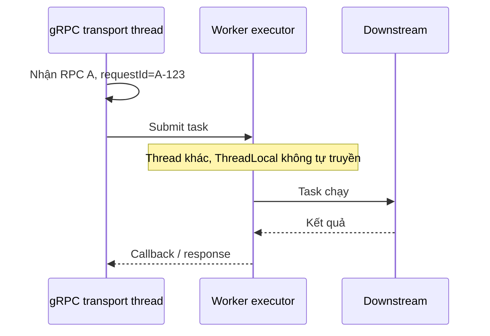

# Context propagation giữa thread

## Mục tiêu bài học

Trong **SPRING_GRPC**, một RPC có thể bắt đầu trên thread của transport, chạy interceptor, chuyển sang thread pool để truy cập database hoặc gọi dịch vụ khác, rồi hoàn tất qua callback bất đồng bộ. Khi công việc đổi thread, dữ liệu gắn với thread hiện tại như ThreadLocal, MDC hoặc Spring Security context có thể không còn hiện diện. Nếu truyền context sai, log mất correlation ID, authorization đọc nhầm principal, hoặc dữ liệu của request trước rò sang request sau trên thread pool dùng chung.

Bài học tập trung vào **context propagation giữa thread**: hiểu io.grpc.Context, truyền request-scoped values qua interceptor và executor, bảo toàn deadline/cancellation, tích hợp với Spring Security và MDC, đồng thời kiểm thử isolation và cleanup trên thread pool.

Sau bài này, bạn có thể:

1. Phân biệt gRPC Context với Java ThreadLocal, MDC và Spring SecurityContext.
2. Tạo Context.Key và gắn dữ liệu request trong server interceptor.
3. Dùng Contexts.interceptCall, Context.wrap và context-aware executor.
4. Truyền context an toàn qua callback, Executor và CompletableFuture.
5. Bảo toàn deadline/cancellation khi chuyển thread và gọi downstream gRPC.
6. Tích hợp Spring Security/MDC mà không làm rò context giữa các request.
7. Kiểm thử context propagation, exception cleanup, cancellation và request isolation.

> **Phạm vi:** Ví dụ dùng gRPC Java và Spring. io.grpc.Context là cơ chế context của gRPC; nó không tự động thay thế Reactor Context hoặc mọi ThreadLocal của thư viện khác. Với các executor/reactive pipeline do ứng dụng quản lý, cần chọn cơ chế propagation tương ứng.

## 1. Vì sao context bị mất khi đổi thread?

Một ThreadLocal gắn giá trị với một thread cụ thể. Giả sử request A chạy trên thread grpc-default-executor-1, ghi requestId=A-123, rồi submit công việc sang worker-3. Thread worker-3 không tự biết giá trị đó. Khi request B được xử lý trên cùng worker thread, nếu code không dọn trạng thái đúng cách, dữ liệu cũ còn có thể xuất hiện trong log của B.



Context propagation bảo đảm dữ liệu cần thiết được gắn vào execution scope của task ở thread đích và được khôi phục sau khi task kết thúc. Cần phân biệt ba khái niệm:

- **Truyền context:** task đích nhìn thấy đúng giá trị của request đã submit task.
- **Khôi phục context:** sau task, thread đích trở về trạng thái trước khi task chạy.
- **Isolation:** request A không thể nhìn thấy dữ liệu của request B và ngược lại.

Trên thread pool, việc khôi phục quan trọng không kém việc truyền. Thread được tái sử dụng; nếu task không dọn context, request tiếp theo có thể nhận dữ liệu sai.

## 2. gRPC Context là gì?

io.grpc.Context là cơ chế lưu dữ liệu theo execution scope của gRPC. Context có thể mang request ID, tenant đã được xác minh, principal hoặc dữ liệu điều khiển như deadline/cancellation.

Các đặc điểm chính:

- Context là immutable theo cách sử dụng thông thường; thêm value tạo context con qua withValue.
- Context.current() trả context đang gắn với thread hiện tại.
- Context.Key<T> định danh value có kiểu.
- attach() gắn context vào thread hiện tại và trả context trước đó.
- detach(previous) khôi phục context trước đó.
- wrap(...) và các executor helper giúp gắn context trong lúc task chạy rồi tự khôi phục.
- Context có thể mang deadline và trạng thái cancellation của RPC.

Khai báo key ở cấp class để các thành phần dùng chung cùng một key:

```java
public final class RpcContextKeys {
    private RpcContextKeys() {}

    public static final Context.Key<String> REQUEST_ID =
            Context.key("request-id");

    public static final Context.Key<String> TENANT_ID =
            Context.key("tenant-id");
}
```

Tên key dùng để chẩn đoán; không dùng key khác nhau cho cùng một khái niệm ở mỗi class. Chỉ lưu dữ liệu nhỏ, immutable và cần thiết trong vòng đời RPC. Không đặt request payload lớn, mutable object, private key, token thô hoặc dữ liệu nhạy cảm không cần thiết vào Context.

## 3. Đưa request context vào gRPC bằng interceptor

Server interceptor là nơi phù hợp để xác định metadata cần dùng xuyên suốt một RPC. Ví dụ sau lấy request ID từ metadata; nếu client không gửi thì server tạo một ID nội bộ.

```java
public final class RequestContextInterceptor implements ServerInterceptor {

    private static final Metadata.Key<String> REQUEST_ID_HEADER =
            Metadata.Key.of(
                    "x-request-id",
                    Metadata.ASCII_STRING_MARSHALLER);

    @Override
    public <ReqT, RespT> ServerCall.Listener<ReqT> interceptCall(
            ServerCall<ReqT, RespT> call,
            Metadata headers,
            ServerCallHandler<ReqT, RespT> next) {

        String requestId = headers.get(REQUEST_ID_HEADER);
        if (requestId == null || requestId.isBlank()) {
            requestId = UUID.randomUUID().toString();
        }

        Context requestContext = Context.current()
                .withValue(RpcContextKeys.REQUEST_ID, requestId);

        return Contexts.interceptCall(
                requestContext, call, headers, next);
    }
}
```

Contexts.interceptCall gắn context cho quá trình dispatch và các callback của ServerCall.Listener, sau đó khôi phục context trước đó. Vì vậy service và listener callbacks có thể đọc RpcContextKeys.REQUEST_ID.get() khi callback chạy trong execution scope của RPC.

Metadata do client gửi là input không đáng tin cậy. Request ID có thể được dùng để correlation sau khi validate độ dài/format; không dùng tenant-id, role hoặc user-id do client tự khai báo làm bằng chứng authorization. Tenant/principal phải được lấy từ authentication đã xác minh hoặc policy phía server.

### 3.1. Context trong service

Trong service, đọc value từ context hiện tại:

```java
@Override
public void getStock(
        GetStockRequest request,
        StreamObserver<GetStockResponse> responseObserver) {

    String requestId = RpcContextKeys.REQUEST_ID.get();

    log.info("Handling GetStock, requestId={}", requestId);

    // Xử lý RPC trong context hiện tại.
}
```

Không cần truyền request ID qua mọi method parameter nếu đó là metadata phục vụ cross-cutting concern. Tuy nhiên, dữ liệu nghiệp vụ bắt buộc và có ảnh hưởng kết quả nên vẫn là parameter rõ ràng; không biến Context thành nơi giấu dependency của business logic.

## 4. Truyền context qua executor

Khi service submit công việc sang executor do ứng dụng quản lý, không giả định context tự đi theo thread. gRPC cung cấp các helper để bọc task.

### 4.1. Bọc một Runnable hoặc Callable

```java
Context callContext = Context.current();

workerPool.execute(callContext.wrap(() -> {
    String requestId = RpcContextKeys.REQUEST_ID.get();
    processRequest(requestId);
}));
```

wrap chụp context tại thời điểm tạo wrapper. Khi task chạy, wrapper attach context đã chụp, thực thi task rồi detach trong finally. Cách này phù hợp khi chỉ cần truyền một task.

Với Callable, có thể dùng callContext.wrap(callable) để giữ context trong lúc tính toán và trả kết quả. Nếu dùng CompletableFuture, hãy cung cấp executor đã bọc context cho các stage async; không cho rằng mọi stage tự động kế thừa context từ stage trước.

### 4.2. Bọc executor cho một RPC

Nếu một RPC submit nhiều task, chụp context một lần và tạo executor cố định cho context đó:

```java
Context callContext = Context.current();

Executor rpcExecutor =
        callContext.fixedContextExecutor(workerPool);

rpcExecutor.execute(() -> loadInventory());
rpcExecutor.execute(() -> loadPricing());
```

fixedContextExecutor luôn chạy các task được submit qua wrapper này trong cùng context đã chụp. Tạo executor wrapper trong phạm vi RPC hoặc request-scoped component; không tạo một fixedContextExecutor(Context.current(), pool) duy nhất lúc khởi tạo singleton bean, vì khi đó nó có thể giữ context khởi tạo thay vì context của từng request.

### 4.3. currentContextExecutor và fixedContextExecutor

| Helper | Context được dùng | Khi phù hợp |
| --- | --- | --- |
| Context.currentContextExecutor(delegate) | Chụp context hiện tại tại mỗi lần execute | Executor dùng chung, task được submit trực tiếp từ thread có context đúng |
| context.fixedContextExecutor(delegate) | Luôn dùng context đã chụp trong biến context | Một nhóm task thuộc cùng một RPC/request |
| context.wrap(runnable) | Chụp context khi tạo wrapper cho task | Một callback hoặc một task cụ thể |

currentContextExecutor không thể đoán context gốc nếu task được submit từ một thread đã mất context. Ví dụ, nếu một async callback không có context lại submit task tiếp theo, helper sẽ chụp context rỗng/sai của callback đó. Khi cần giữ nguyên request context xuyên nhiều tầng async, giữ reference callContext và dùng wrapper cố định hoặc bọc từng callback từ context đã chụp.

## 5. Attach và detach thủ công

Có thể dùng attach/detach khi API không hỗ trợ wrapper:

```java
Context captured = Context.current();

executor.execute(() -> {
    Context previous = captured.attach();
    try {
        performWork();
    } finally {
        captured.detach(previous);
    }
});
```

Luôn gọi detach(previous) trong finally, kể cả khi task ném exception hoặc return sớm. Không chỉ gọi attach() rồi để context tồn tại trên worker thread. Cũng không detach bằng Context.ROOT một cách tùy tiện; phải khôi phục đúng context trước đó để không phá context lồng nhau do framework thiết lập.

Ưu tiên wrap, fixedContextExecutor hoặc currentContextExecutor vì chúng đóng gói attach/detach và giảm nguy cơ quên cleanup.

## 6. Deadline và cancellation khi chuyển thread

gRPC Context có thể mang deadline và cancellation của RPC. Khi chuyển công việc sang executor bằng context-aware wrapper, task có thể kiểm tra trạng thái RPC:

```java
Context callContext = Context.current();
Executor rpcExecutor = callContext.fixedContextExecutor(workerPool);

rpcExecutor.execute(() -> {
    if (callContext.isCancelled()) {
        return;
    }

    performExpensiveStep();

    if (callContext.isCancelled()) {
        return;
    }

    continueWork();
});
```

Khi client hủy RPC hoặc deadline hết hạn, context có thể chuyển sang trạng thái cancelled. Kiểm tra cancellation tại các ranh giới công việc tốn thời gian và dừng thao tác không còn cần thiết. Với database query hoặc HTTP call đang chạy, cần truyền timeout/cancellation xuống API đó nếu API hỗ trợ; việc kiểm tra context không tự hủy mọi blocking call.

Khi tạo outbound gRPC call trong context phù hợp, gRPC Java có thể truyền deadline/cancellation theo cơ chế context propagation. Không đặt deadline downstream dài hơn ngân sách còn lại của request cha. Nếu tạo thread/task mà không giữ context, deadline có thể không còn được áp dụng như mong đợi.

### 6.1. Tránh gửi response sau khi RPC đã bị hủy

Với async service, chỉ một luồng nên điều khiển terminal callback onError hoặc onCompleted. Nếu RPC đã bị client hủy, dừng công việc và giải phóng resource; không tiếp tục phát onNext hoặc cạnh tranh gửi nhiều terminal signal. Với streaming, serialize các lời gọi StreamObserver theo đúng contract và quản lý backpressure/flow control riêng.

Context cancellation là tín hiệu điều khiển; nó không tự dừng thread đang block. Dùng API interruptible/cancellable hoặc cancellation listener khi cần đánh thức công việc đang chờ.

## 7. Context propagation với CompletableFuture

Các stage không async của CompletableFuture có thể chạy trên thread hoàn thành stage trước. Các stage async không truyền context nếu executor không được bọc.

Ví dụ giữ context khi tạo pipeline:

```java
Context callContext = Context.current();
Executor rpcExecutor =
        callContext.fixedContextExecutor(workerPool);

CompletableFuture<Stock> result =
        CompletableFuture.supplyAsync(
                this::loadStock,
                rpcExecutor)
        .thenApplyAsync(
                this::enrichStock,
                rpcExecutor);
```

Cả hai stage async được submit qua executor đã cố định context. Nếu dùng thenApply không có executor, stage có thể chạy trên thread hoàn tất future; không dựa vào điều đó để bảo đảm context. Chọn executor tường minh cho các stage cần request context.

Nếu pipeline chuyển sang thư viện reactive, xem phần Reactor Context bên dưới. gRPC Context và Reactor Context là hai cơ chế riêng; tích hợp cần bridge có chủ đích.

## 8. Kết hợp với Spring Security và MDC

### 8.1. Spring SecurityContext không tự động là gRPC Context

Spring Security thường lưu SecurityContext trong SecurityContextHolder bằng ThreadLocal. io.grpc.Context không tự động copy SecurityContextHolder sang worker thread. Một task có thể thấy request ID từ gRPC Context nhưng không thấy authentication của Spring Security.

Có thể kết hợp executor propagation của gRPC với Spring Security:

```java
Executor grpcContextExecutor =
        Context.currentContextExecutor(workerPool);

Executor securityAndGrpcExecutor =
        new DelegatingSecurityContextExecutor(grpcContextExecutor);
```

Khi submit task từ thread đang xử lý request, DelegatingSecurityContextExecutor chụp SecurityContext theo cơ chế của Spring Security; executor bên trong chụp gRPC Context tại thời điểm submit. Kiểm tra cách executor được tạo và vị trí submit để chắc chắn cả hai context đều hiện diện.

Chỉ dùng identity đã được xác thực. Không tự dựng SecurityContext từ header tùy ý. Với tác vụ chạy nền sau khi RPC kết thúc, cân nhắc truyền principal/authorization snapshot tối thiểu và có thời hạn thay vì giữ nguyên toàn bộ security context lâu dài.

### 8.2. MDC cần được capture và restore

MDC của SLF4J/Logback thường dựa trên ThreadLocal. Có thể dùng Spring TaskDecorator để capture MDC tại lúc submit và khôi phục trên worker:

```java
TaskDecorator mdcTaskDecorator = task -> {
    Map<String, String> submittedMdc = MDC.getCopyOfContextMap();

    return () -> {
        Map<String, String> previousMdc = MDC.getCopyOfContextMap();
        try {
            if (submittedMdc == null) {
                MDC.clear();
            } else {
                MDC.setContextMap(submittedMdc);
            }
            task.run();
        } finally {
            if (previousMdc == null) {
                MDC.clear();
            } else {
                MDC.setContextMap(previousMdc);
            }
        }
    };
};
```

Gắn decorator vào ThreadPoolTaskExecutor do Spring quản lý. Nếu task cũng cần gRPC Context, kết hợp với Context.wrap hoặc context-aware executor. Việc restore MDC cũ trong finally ngăn request sau nhìn thấy request ID của task trước.

Không sao chép toàn bộ MDC nếu nó chứa token, email hoặc dữ liệu cá nhân. Chỉ đưa correlation ID và trường vận hành cần thiết vào log.

## 9. Context trong Reactor và reactive pipeline

Reactor có Context riêng, truy cập qua deferContextual và ghi bằng contextWrite. Nó không phải io.grpc.Context và không đồng nhất với ThreadLocal.

Ví dụ Reactor:

```java
Mono.deferContextual(contextView -> {
    String requestId = contextView.get("requestId");
    return inventoryClient.load(requestId);
})
.contextWrite(context -> context.put("requestId", requestId));
```

Nếu một gRPC handler chuyển sang Reactor, cần bridge request values từ gRPC Context vào Reactor Context tại ranh giới subscribe/pipeline. Nếu dùng Micrometer Context Propagation hoặc Reactor automatic context propagation, xác minh integration và version cụ thể. Không bật propagation toàn cục mà chưa hiểu tác động tới mọi task trong process.

Khi pipeline quay lại callback gRPC, giữ context cần thiết và tuân thủ thread-safety của StreamObserver. Không giả định Reactor scheduler tự duy trì gRPC Context nếu không có bridge.

## 10. Những gì nên và không nên đặt trong context

| Dữ liệu | Khuyến nghị | Lý do |
| --- | --- | --- |
| Request/correlation ID | Có thể lưu | Hỗ trợ tracing/log correlation |
| Deadline/cancellation | Dùng context gRPC | Điều khiển vòng đời RPC |
| Tenant đã xác minh | Có thể lưu nếu cần | Cross-cutting policy, phải lấy từ nguồn tin cậy |
| Principal/authentication | Chỉ lưu theo policy rõ ràng | Tránh identity do client tự khai và context sống quá lâu |
| Request payload lớn | Không | Tăng bộ nhớ và che giấu dependency |
| Mutable map/object dùng chung | Tránh | Race condition và side effect giữa thread |
| Private key, token thô, password | Không | Rủi ro lộ secret qua log/debug/dump |
| Business parameter bắt buộc | Ưu tiên truyền rõ | API minh bạch, dễ test và review |

Context nên nhỏ, bất biến và có vòng đời không vượt quá request. Với tác vụ background tiếp tục sau khi RPC kết thúc, tạo một execution context riêng có dữ liệu tối thiểu, không giữ context của RPC vô thời hạn.

## 11. Lỗi thường gặp và cách xử lý

| Triệu chứng | Nguyên nhân | Cách xử lý |
| --- | --- | --- |
| Request ID biến mất trong worker | Submit Runnable trực tiếp sang executor | Dùng Context.wrap hoặc context-aware executor |
| Request A thấy tenant/request ID của B | ThreadLocal/MDC không được restore hoặc clear | Capture/restore trong finally; test trên pool dùng chung |
| SecurityContext mất sau async boundary | Spring Security ThreadLocal không được truyền | Dùng DelegatingSecurityContextExecutor hoặc integration phù hợp |
| currentContextExecutor chụp context rỗng | Task được submit từ thread đã mất context | Giữ context gốc và dùng fixedContextExecutor/wrap |
| Context còn sau exception | Attach thủ công thiếu finally | Dùng helper hoặc detach đúng previous context |
| RPC tiếp tục chạy sau deadline | Task không kiểm tra cancellation hoặc API downstream không nhận timeout | Kiểm tra isCancelled, truyền timeout và hủy operation |
| Callback gửi response hai lần | Nhiều worker cùng gọi observer | Serialize callback và chỉ phát một terminal signal |
| MDC bị rò giữa request | Task không khôi phục MDC trước đó | TaskDecorator capture/restore trong finally |
| Reactor không thấy gRPC Context | Hai context model khác nhau | Bridge tường minh tại ranh giới pipeline |
| Context giữ object quá lâu | Lưu context vào singleton/background task | Chỉ giữ dữ liệu tối thiểu và giới hạn lifetime |

## 12. Kiểm thử context propagation

Kiểm thử cần dùng executor có thread được tái sử dụng, vì lỗi leak thường không xuất hiện khi mỗi task có thread mới.

Các test quan trọng:

1. Đặt request ID trong gRPC Context, submit task sang single-thread executor và xác minh worker đọc đúng ID.
2. Submit hai request song song với hai ID khác nhau; xác minh không request nào thấy dữ liệu của request kia.
3. Cho task ném exception; xác minh context/MDC trước đó được khôi phục.
4. Chạy task tiếp theo trên cùng worker; xác minh không còn request ID cũ.
5. Hủy RPC hoặc để deadline hết hạn; xác minh task dừng ở checkpoint và downstream nhận timeout/cancellation phù hợp.
6. Với mTLS/Spring Security, xác minh principal đã xác thực được truyền đúng và không thể giả mạo bằng metadata.
7. Với Reactor, xác minh request ID được bridge vào Reactor Context và không rò giữa subscription.
8. Với streaming RPC, xác minh observer callbacks được serialize và chỉ có một terminal event.

Có thể dùng Context.ROOT trong test để kiểm tra worker sau task không còn context request. Tuy nhiên test phải xác minh cả trạng thái trước/sau, không chỉ kiểm tra một giá trị null trong một tình huống đơn lẻ.

## 13. Bài tập thực hành

1. Viết ServerInterceptor đọc x-request-id, validate độ dài/format, tạo ID nếu thiếu và đưa vào Context.Key.
2. Trong service, submit hai tác vụ async bằng fixedContextExecutor; xác minh cả hai cùng đọc đúng request ID.
3. Thay executor bằng executor thường để tái hiện lỗi mất context, rồi viết test chứng minh khác biệt.
4. Tạo hai RPC đồng thời trên single-thread executor; xác minh request ID và tenant không bị trộn.
5. Tích hợp DelegatingSecurityContextExecutor và MDC TaskDecorator; kiểm tra cleanup sau success và exception.
6. Tạo CompletableFuture pipeline nhiều stage async và bảo đảm mỗi stage dùng context-aware executor.
7. Hủy RPC trong lúc worker đang xử lý; kiểm tra cancellation được quan sát và resource được giải phóng.
8. Bridge request ID sang Reactor Context, rồi xác minh subscription isolation.
9. Viết integration test Spring gRPC xác nhận interceptor, service, worker pool và callback cùng giữ đúng request context.

### Câu hỏi tự kiểm tra

- Vì sao ThreadLocal không tự truyền khi task chuyển sang worker thread?
- io.grpc.Context khác SecurityContextHolder và MDC ở điểm nào?
- Contexts.interceptCall giúp context hiện diện trong listener callback ra sao?
- Context.wrap chụp context tại thời điểm nào?
- currentContextExecutor khác fixedContextExecutor thế nào?
- Vì sao không nên tạo một fixed context executor ở lúc khởi tạo singleton bean?
- Tại sao attach/detach thủ công phải dùng try/finally?
- Deadline/cancellation được giữ thế nào khi chuyển qua executor?
- Vì sao Spring Security cần executor/decorator riêng?
- Vì sao Reactor Context cần bridge riêng với gRPC Context?
- Làm sao kiểm thử context leak trên thread pool dùng chung?
- Dữ liệu nào không nên được lưu trong request context?

## Tài liệu tham khảo

- [gRPC Java — Context](https://grpc.github.io/grpc-java/javadoc/io/grpc/Context.html): context propagation, cancellation, deadline và executor helpers.
- [gRPC Java — Contexts](https://grpc.github.io/grpc-java/javadoc/io/grpc/Contexts.html): tích hợp context vào server interceptor/listener.
- [gRPC — Deadlines](https://grpc.io/docs/guides/deadlines/): deadline propagation và xử lý timeout.
- [Spring Framework — Task Execution and Scheduling](https://docs.spring.io/spring-framework/reference/integration/scheduling.html): executor và TaskDecorator.
- [Spring Security — Concurrency Support](https://docs.spring.io/spring-security/reference/servlet/integrations/concurrency.html): truyền SecurityContext qua task/executor.
- [Project Reactor — Context](https://projectreactor.io/docs/core/release/reference/advancedFeatures/context.html): context propagation trong reactive pipeline.
- [SLF4J — MDC](https://www.slf4j.org/api/org/slf4j/MDC.html): mapped diagnostic context và thread-local logging context.

**Kết quả mong đợi:** Người học truyền được request context an toàn giữa các thread trong Spring gRPC, giữ đúng request ID/identity/deadline khi chạy async, tích hợp có chủ đích với Spring Security, MDC và Reactor, tránh context leak trên thread pool dùng chung, và kiểm thử được isolation/cancellation/cleanup cho unary lẫn streaming RPC.
