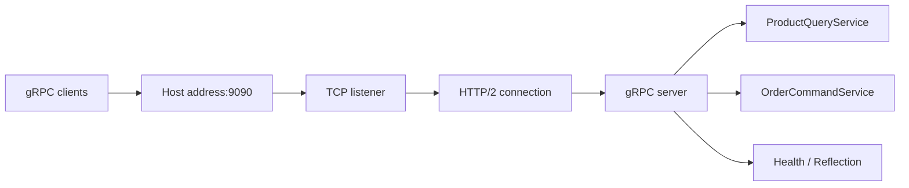

# Cấu hình port và bind address

## 1. Port và bind address xác định điểm lắng nghe của gRPC server

Một gRPC server cần mở một TCP listener để client kết nối. Listener được xác định bởi hai thành phần:

- **Port** là số cổng TCP mà server nhận kết nối, ví dụ 9090.
- **Bind address** là địa chỉ/interface cục bộ mà socket gắn vào, ví dụ 127.0.0.1 hoặc 0.0.0.0.

Các service và method gRPC thường cùng chia sẻ một listener HTTP/2. Không cần mở một port riêng cho từng service hoặc từng RPC method. Client tạo channel tới endpoint host:port rồi gọi method theo tên service trong protobuf contract.



Ví dụ, nếu server bind vào 0.0.0.0:9090 thì socket lắng nghe trên tất cả IPv4 interface tại port 9090. Nếu bind vào 127.0.0.1:9090 thì chỉ các tiến trình có thể truy cập loopback của cùng network namespace mới kết nối được.

Cấu hình port và bind address là cấu hình network của server. Nó khác với địa chỉ client dùng để kết nối, DNS name công bố cho service discovery, hoặc cổng mà container platform expose ra bên ngoài.

## 2. Cấu hình trong Spring gRPC

Với Spring gRPC starter có hỗ trợ server address và port properties, có thể khai báo trong application.yml:

```yaml
spring:
  grpc:
    server:
      address: 0.0.0.0
      port: 9090
```

Hoặc dùng application.properties:

```properties
spring.grpc.server.address=0.0.0.0
spring.grpc.server.port=9090
```

spring.grpc.server.port điều khiển port listener của gRPC server; spring.grpc.server.address điều khiển địa chỉ local mà listener bind vào. Hãy dùng đúng property được hỗ trợ bởi phiên bản Spring gRPC starter trong dự án. Các phiên bản hoặc starter khác nhau có thể thay đổi tên property hay extension point; kiểm tra metadata/configuration reference của dependency đang sử dụng trước khi triển khai.

Không nhầm spring.grpc.server.address với server.address của Spring Boot web server. server.address thường cấu hình embedded HTTP server (ví dụ Spring MVC/WebFlux). Nó không tự động thay đổi listener gRPC được quản lý riêng.

Tương tự, server.port của Spring Boot thường là cổng HTTP application. Nếu ứng dụng đồng thời chạy REST API và gRPC server, hai listener có thể có hai port khác nhau:

```yaml
server:
  address: 0.0.0.0
  port: 8080

spring:
  grpc:
    server:
      address: 0.0.0.0
      port: 9090
```

Trong ví dụ, HTTP server nghe port 8080 và gRPC server nghe port 9090. Việc thay đổi một cấu hình không có nghĩa port còn lại cũng thay đổi.

## 3. Chọn bind address phù hợp

Địa chỉ bind quyết định phạm vi interface mà server nhận kết nối:

| Bind address | Ý nghĩa | Trường hợp sử dụng |
| --- | --- | --- |
| `127.0.0.1` | Loopback IPv4; chỉ truy cập từ cùng network namespace | Local development, test hoặc sidecar giao tiếp nội bộ |
| `::1` | Loopback IPv6 | Môi trường IPv6 local |
| `0.0.0.0` | Tất cả IPv4 interface | Container hoặc service cần nhận traffic từ network |
| `::` | Wildcard IPv6; dual-stack phụ thuộc OS và socket configuration | Hệ thống triển khai IPv6 |
| IP cụ thể của interface | Chỉ bind vào interface đó | Máy nhiều NIC, phân tách mạng nội bộ/public |

### Loopback

Bind vào 127.0.0.1 giúp giới hạn listener ở máy hoặc network namespace hiện tại. Đây là lựa chọn an toàn cho service chỉ được gọi bởi tiến trình cùng môi trường. Tuy nhiên, trong container, loopback của container không phải loopback của host. Một service bind vào 127.0.0.1 bên trong container thường không nhận được traffic gửi tới IP của container từ container khác hoặc từ host qua port mapping.

### Wildcard address

Bind vào 0.0.0.0 cho phép server nhận kết nối trên tất cả IPv4 interface. Đây là lựa chọn thường dùng trong container vì traffic từ bridge network hoặc Kubernetes Pod network đi vào interface của container.

Wildcard bind mở listener trên mọi IPv4 interface hiện có. Nó không tự tạo firewall rule hay public route, nhưng cần kết hợp NetworkPolicy, firewall, security group và exposure policy để giới hạn caller được phép kết nối.

### Bind vào interface cụ thể

Trên host có nhiều network interface, bind vào một IP cụ thể có thể giới hạn traffic chỉ đi qua mạng mong muốn. Địa chỉ đó phải thực sự được gán cho interface trong network namespace nơi server chạy. Nếu IP chưa tồn tại hoặc interface chưa sẵn sàng, server có thể không khởi động được.

Không dùng public DNS name như bind address nếu đó chỉ là tên trỏ tới load balancer hoặc IP bên ngoài máy. Bind address phải đại diện cho địa chỉ local mà process có thể mở socket. DNS name công bố cho client là khái niệm khác.

## 4. Port hợp lệ và cách chọn port

TCP port là số nguyên từ 0 đến 65535. Với service production, chọn một port cố định trong dải phù hợp với quy ước hạ tầng, ví dụ 9090, rồi cấu hình đồng nhất ở server, container service và client/service discovery.

- **Port 0:** yêu cầu hệ điều hành cấp một ephemeral port còn trống. Hữu ích cho test hoặc ứng dụng cần port động; client phải biết port thực tế sau khi server bind thành công.
- **Port cố định:** phù hợp cho deployment có service discovery hoặc load balancer định tuyến tới endpoint ổn định.
- **Port dưới 1024:** trên nhiều hệ điều hành Unix-like cần quyền đặc biệt hoặc capability phù hợp. Ứng dụng Java thông thường nên dùng port không đặc quyền và để ingress/proxy xử lý cổng public nếu cần.
- **Port đang được sử dụng:** server không thể bind và quá trình khởi động thất bại. Không nên che lỗi bằng cách âm thầm chọn một port khác trong production.

Không giả định port 9090 luôn rảnh hoặc là mặc định của mọi starter. Khai báo tường minh để tránh phụ thuộc default của phiên bản thư viện.

## 5. Externalize cấu hình theo môi trường

Không nên hard-code port và bind address trong Java code. Đưa chúng vào cấu hình bên ngoài để local, test, staging và production có thể dùng giá trị khác nhau.

Ví dụ YAML:

```yaml
spring:
  grpc:
    server:
      address: 0.0.0.0
      port: 9090
```

Spring Boot relaxed binding cho phép override trực tiếp tên property bằng environment variable tương ứng:

```bash
SPRING_GRPC_SERVER_ADDRESS=0.0.0.0
SPRING_GRPC_SERVER_PORT=9090
```

Cần chọn một quy ước cấu hình nhất quán giữa deployment manifest, secret/config manager và ứng dụng. Tránh đặt nhiều biến khác nhau cùng điều khiển một giá trị vì khó biết nguồn nào có độ ưu tiên cao hơn.

Có thể dùng profile:

```yaml
# application-local.yml
spring:
  grpc:
    server:
      address: 127.0.0.1
      port: 9090
```

```yaml
# application-prod.yml
spring:
  grpc:
    server:
      address: 0.0.0.0
      port: 9090
```

Kích hoạt profile qua cấu hình triển khai, chẳng hạn SPRING_PROFILES_ACTIVE=prod. Không nên để profile production bind vào loopback nếu client nằm ở Pod hoặc host khác.

## 6. Chạy trong Docker và Kubernetes

Trong container, server cần bind vào interface của container để traffic từ network bên ngoài container đi tới được. Thường cấu hình 0.0.0.0 và port nội bộ, ví dụ 9090.

Ví dụ Docker:

```dockerfile
EXPOSE 9090
```

EXPOSE chỉ mô tả cổng ứng dụng dự kiến sử dụng; nó không tự publish port ra host và không thay đổi bind address của process. Khi chạy container, cần publish port nếu muốn truy cập qua host:

```bash
docker run -p 9090:9090 catalog-service
```

Vế trái là host port; vế phải là container port. Ứng dụng bên trong vẫn bind port 9090. Có thể ánh xạ host port khác, chẳng hạn 19090:9090, mà không cần đổi port listener bên trong container.

Trong Kubernetes, Pod/container port mô tả cổng ứng dụng lắng nghe; Service targetPort định tuyến tới port đó. Ví dụ:

```yaml
apiVersion: v1
kind: Service
metadata:
  name: catalog-grpc
spec:
  selector:
    app: catalog
  ports:
    - name: grpc
      port: 9090
      targetPort: 9090
      protocol: TCP
```

port là cổng Service mà client trong cluster sử dụng; targetPort là cổng của container. Cả hai có thể khác nhau. Để client ngoài cluster truy cập, cần loại Service hoặc ingress/gateway hỗ trợ gRPC và HTTP/2 phù hợp.

Kubernetes Service không làm ứng dụng tự bind vào đúng interface. Nếu server chỉ bind 127.0.0.1 bên trong Pod, traffic tới Pod IP có thể không tới được listener dù Service selector và targetPort đúng.

## 7. Bind address không phải advertised address

Ba khái niệm cần tách biệt:

- **Bind address:** địa chỉ local mà process mở socket.
- **Advertised address/target:** hostname hoặc endpoint mà client dùng để tìm và kết nối server.
- **Published port:** cổng được container runtime, Kubernetes Service, load balancer hoặc NAT công bố.

Ví dụ server trong Pod bind vào 0.0.0.0:9090. Kubernetes Service có tên DNS catalog-grpc.default.svc.cluster.local và expose port 443, targetPort 9090. Client gọi DNS name và port 443; Pod vẫn lắng nghe port 9090.

Không cấu hình server bind vào địa chỉ DNS của Service Kubernetes. DNS Service là endpoint ảo để client kết nối, không phải IP local được gán cho Pod.

Nếu có load balancer hoặc proxy kết thúc TLS, phải cấu hình protocol gRPC/HTTP/2 và health check phù hợp. Thay đổi bind address không tự cấu hình TLS, authority, routing hay service discovery.

## 8. TLS và port listener

Bật TLS không nhất thiết thay đổi port hoặc bind address. TLS là lớp bảo vệ transport trên listener; server có thể tiếp tục bind cùng endpoint nhưng sử dụng TLS context được cấu hình.

Một số môi trường dùng listener TLS trực tiếp; môi trường khác kết thúc TLS ở ingress/proxy rồi chuyển tiếp traffic nội bộ. Cần xác định rõ TLS termination point và protocol giữa các hop. Không gửi Bearer token hoặc dữ liệu nhạy cảm qua hop không được bảo vệ chỉ vì client đã dùng TLS tới ingress.

Nếu server dùng mTLS, listener phải được cấu hình trust client CA và yêu cầu client certificate. Port và bind address không thay thế cấu hình certificate, trust store hoặc authorization.

## 9. Kiểm thử port và bind address

Kiểm thử cấu hình cần xác minh server thực sự lắng nghe tại endpoint mong muốn và client có thể kết nối từ network scope dự kiến.

Các kiểm tra nên có:

1. Khởi động Spring context với port và address xác định; xác minh server lifecycle start thành công.
2. Gọi một unary RPC qua generated stub tới endpoint cấu hình và kiểm tra response.
3. Xác minh kết nối qua loopback hoạt động khi bind 127.0.0.1; đồng thời xác nhận client từ namespace khác không thể truy cập listener loopback.
4. Với container, xác minh listener bind vào 0.0.0.0 và host/service mapping trỏ đúng container port.
5. Thử port đang bị chiếm để bảo đảm startup báo lỗi rõ ràng.
6. Với port 0 trong test, lấy port thực tế từ server lifecycle/test harness sau khi bind; không hard-code giá trị ephemeral.

Không dùng cách “kiểm tra port rảnh rồi mới start” làm bảo đảm tuyệt đối vì một process khác có thể chiếm port giữa hai thao tác. Hãy để server bind và xử lý lỗi bind thực tế. Tránh dùng sleep để đợi listener; dùng application lifecycle signal, readiness probe hoặc retry có deadline trong test.

Có thể kiểm tra socket trên máy Linux bằng:

```bash
ss -ltnp
```

Hoặc trên Windows PowerShell:

```powershell
Get-NetTCPConnection -State Listen -LocalPort 9090
```

Lệnh kiểm tra hệ điều hành giúp xác nhận địa chỉ và port listener, nhưng integration test qua gRPC vẫn cần thiết để xác minh HTTP/2, TLS và service handler.

## 10. Lỗi thường gặp và cách chẩn đoán

| Triệu chứng | Nguyên nhân có thể | Hướng kiểm tra |
| --- | --- | --- |
| Server báo address already in use | Port đã được process khác bind | Xem socket listener, đổi port hoặc dừng đúng process sở hữu port |
| Client trong Pod khác không kết nối được | Server chỉ bind loopback | Bind vào interface của Pod, thường là 0.0.0.0 |
| Local client kết nối được nhưng client ngoài host không được | Firewall, routing hoặc port publish chưa đúng | Kiểm tra network path, container mapping, Service và NetworkPolicy |
| HTTP hoạt động nhưng gRPC thất bại | Proxy/ingress không chuyển tiếp HTTP/2 hoặc cấu hình gRPC chưa đúng | Kiểm tra backend protocol và HTTP/2 end-to-end theo kiến trúc |
| Thay server.port nhưng gRPC vẫn nghe port cũ | Đã đổi property HTTP thay vì property gRPC, hoặc property không được starter hỗ trợ | Kiểm tra đúng prefix và configuration reference của phiên bản |
| Server không start với IP cụ thể | IP không tồn tại trong network namespace | Kiểm tra interface và địa chỉ local của container/host |
| Port 0 chạy nhưng client không biết endpoint | Chưa lấy port thực tế sau khi bind | Lấy bound port từ server/test lifecycle và truyền cho client |
| Kết nối bị từ chối dù port đúng | Server chưa start, bind sai interface hoặc firewall chặn | Kiểm tra listener, bind address và network policy |

Một lỗi thường gặp là dùng server.port để đổi port gRPC. Trong ứng dụng có cả web server và gRPC server, hãy cấu hình đúng namespace của từng listener; đừng suy luận rằng mọi server trong Spring Boot dùng chung một port.

## 11. Bài thực hành

Triển khai cấu hình gRPC server cho ba môi trường:

1. **Local:** bind vào 127.0.0.1, port 9090 để chỉ client local truy cập.
2. **Container:** bind vào 0.0.0.0, port 9090; publish host port 19090 tới container port 9090.
3. **Kubernetes:** giữ container port 9090; tạo Service port 443 với targetPort 9090 và endpoint DNS dành cho client.

Dùng profile hoặc environment variable để chọn address/port mà không sửa code. Kiểm thử một unary RPC ở từng môi trường, xác minh listener thực tế, kiểm tra port conflict và chứng minh loopback bind không nhận traffic từ namespace khác. Ghi rõ port nào là port của process, port container và port client nhìn thấy.

**Tự kiểm tra:** Port xác định cổng TCP; bind address xác định interface local mà gRPC server lắng nghe. Trong Spring gRPC, cấu hình đúng property của gRPC server, không nhầm với server.port/server.address của web server. Local thường dùng loopback; container thường cần wildcard hoặc interface Pod. Docker/Kubernetes có thể publish hoặc ánh xạ port khác với port nội bộ. Bind address, advertised endpoint và TLS là các phần cấu hình riêng cần phối hợp và kiểm thử.

