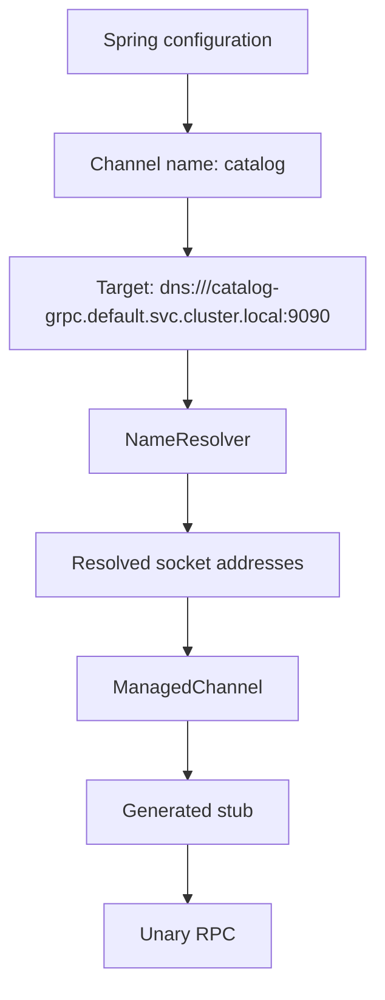

# Cấu hình client channel theo target

## 1. Channel name và target là hai khái niệm khác nhau

Trong gRPC, client tạo một ManagedChannel để duy trì kết nối logic tới một dịch vụ. Channel quản lý name resolution, kết nối HTTP/2, load balancing, TLS, reconnect và trạng thái kết nối. Generated stub sử dụng channel để gọi RPC.

Khi cấu hình client trong Spring, cần phân biệt:

- **Channel name** là tên logic do ứng dụng đặt, ví dụ catalog hoặc orders. Spring dùng tên này để tìm cấu hình channel và tạo channel tương ứng.
- **Target** là địa chỉ đích mà gRPC resolver dùng để tìm endpoint, ví dụ dns:///catalog-grpc.default.svc.cluster.local:9090.
- **Stub** là đối tượng client sinh từ protobuf service; stub gọi method qua channel đã chọn.

Channel name không phải hostname và target không phải tên bean. Một channel có thể được dùng bởi nhiều stub cùng gọi một server; nhiều channel name cũng có thể trỏ tới cùng target nhưng có cấu hình TLS, credentials hoặc policy khác nhau.



## 2. Target URI của gRPC

Target được chuyển cho name resolver của gRPC. Target có thể chỉ rõ resolver scheme để gRPC biết cách tìm endpoint.

Ví dụ DNS target:

```text
dns:///catalog.internal.example:9090
```

dns là resolver scheme; phần endpoint là hostname và port. Cách viết dns:/// với ba dấu slash chỉ rõ URI không có authority riêng và endpoint nằm trong path. Đây là target URI của gRPC, không phải URL HTTP để mở bằng browser.

Các ví dụ thường gặp:

| Target | Ý nghĩa |
| --- | --- |
| dns:///catalog.internal.example:9090 | Dùng DNS resolver để phân giải hostname thành địa chỉ kết nối. |
| dns:///catalog-grpc.default.svc.cluster.local:9090 | Dùng DNS của Kubernetes Service trong cluster. |
| dns:///localhost:9090 | Kết nối service local qua DNS/loopback. |
| dns:///127.0.0.1:9090 | Dùng địa chỉ loopback IPv4. |
| unix:///var/run/catalog/grpc.sock | Unix domain socket nếu transport, resolver và nền tảng hỗ trợ. |

Không phải resolver scheme nào cũng có sẵn trong mọi gRPC transport. Các scheme như custom discovery hoặc xDS cần resolver/library tương ứng được đăng ký. Nếu scheme không được hỗ trợ, channel không thể phân giải target.

Không thêm https:// vào target DNS của gRPC. TLS được cấu hình ở channel/transport; target xác định endpoint và resolver. Khi dùng TLS, hostname trong target cần khớp DNS SAN của server certificate. Nếu target là IP, certificate phải có IP SAN tương ứng.

## 3. Khai báo named channel trong Spring

Với Spring gRPC starter có hỗ trợ named client channels, có thể khai báo target theo channel name trong cấu hình:

```yaml
spring:
  grpc:
    client:
      channels:
        catalog:
          address: dns:///catalog-grpc.default.svc.cluster.local:9090
```

Ở đây:

- catalog là channel name mà ứng dụng tham chiếu.
- address chứa target URI cho name resolver.
- Hostname và port xác định endpoint mà client sẽ kết nối.

Tên property và cách đặt target phụ thuộc phiên bản Spring gRPC starter. Dùng configuration metadata/reference của đúng phiên bản dependency trong dự án để xác nhận prefix, tên trường và scheme resolver được hỗ trợ. Không suy ra rằng mọi starter gRPC đều dùng cùng namespace; các starter khác nhau có thể có cấu trúc property riêng.

Một channel khác có thể trỏ tới target khác:

```yaml
spring:
  grpc:
    client:
      channels:
        catalog:
          address: dns:///catalog-grpc.default.svc.cluster.local:9090
        orders:
          address: dns:///orders-grpc.default.svc.cluster.local:9090
```

Từ đó, ứng dụng có thể dùng channel catalog cho ProductQuery service và channel orders cho OrderCommand service. Mỗi channel có resolver, connection state và cấu hình riêng. Không cần tạo một channel cho mỗi RPC.

## 4. Tạo stub từ channel đã cấu hình

Spring gRPC cung cấp factory để lấy channel theo tên đã khai báo. Ví dụ tạo generated blocking stub:

```java
import io.grpc.ManagedChannel;
import org.springframework.context.annotation.Bean;
import org.springframework.context.annotation.Configuration;
import org.springframework.grpc.client.GrpcChannelFactory;

@Configuration
public class CatalogClientConfiguration {

    @Bean
    ProductQueryServiceGrpc.ProductQueryServiceBlockingStub productStub(
            GrpcChannelFactory channelFactory) {

        ManagedChannel channel =
                channelFactory.createChannel("catalog");

        return ProductQueryServiceGrpc.newBlockingStub(channel);
    }
}
```

GrpcChannelFactory là điểm tích hợp để dùng channel do Spring quản lý. Tên package hoặc cách inject factory có thể khác theo phiên bản starter; điều quan trọng là stub phải nhận channel đã được cấu hình với channel name catalog, không tự tạo channel mới cho mỗi lần gọi.

Generated stub là immutable và có thể tạo biến thể cho từng RPC. Ví dụ đặt deadline cho một request:

```java
import java.util.concurrent.TimeUnit;

GetProductResponse response = productStub
        .withDeadlineAfter(500, TimeUnit.MILLISECONDS)
        .getProduct(request);
```

Channel nên được tái sử dụng trong suốt vòng đời ứng dụng. Stub nhẹ và immutable; có thể dùng chung hoặc tạo biến thể với deadline/credentials cho từng call. Không tạo ManagedChannel bên trong mỗi method service rồi bỏ quên việc đóng nó.

## 5. Chọn resolver và target theo môi trường

Target cần phản ánh cách client tìm server trong môi trường triển khai.

### Local development

Client và server cùng máy có thể dùng:

```yaml
spring:
  grpc:
    client:
      channels:
        catalog:
          address: dns:///127.0.0.1:9090
```

Server phải bind vào loopback hoặc interface mà client có thể truy cập. Nếu server chạy trong container, 127.0.0.1 của client host không phải loopback của container; cần dùng published host port hoặc địa chỉ service phù hợp.

### Docker Compose

Trong cùng Docker network, client thường kết nối bằng service name và port nội bộ:

```yaml
spring:
  grpc:
    client:
      channels:
        catalog:
          address: dns:///catalog:9090
```

Tên catalog phải được Docker network DNS phân giải tới container server. Dùng container port, không mặc định dùng host port đã publish.

### Kubernetes

Trong cùng namespace, client có thể dùng DNS Service ngắn:

```yaml
spring:
  grpc:
    client:
      channels:
        catalog:
          address: dns:///catalog-grpc:9090
```

Hoặc dùng FQDN:

```yaml
spring:
  grpc:
    client:
      channels:
        catalog:
          address: dns:///catalog-grpc.default.svc.cluster.local:9090
```

Service DNS là endpoint mà client phân giải; server Pod bind vào port container. Client không cần biết Pod IP nếu Kubernetes Service cung cấp endpoint ổn định.

### Môi trường nhiều endpoint

Một resolver có thể trả về nhiều socket address. Load balancing policy của gRPC quyết định cách chọn endpoint từ danh sách đã phân giải. DNS target tự nó không bảo đảm round-robin; kết quả phụ thuộc resolver, service config và policy được hỗ trợ. Nếu cần phân phối request giữa nhiều backend, xác minh resolver trả về nhiều địa chỉ và cấu hình load balancing policy phù hợp.

## 6. Cấu hình nhiều target và phân tách trách nhiệm

Một ứng dụng có thể gọi nhiều gRPC service. Nên tạo một channel name cho mỗi cấu hình kết nối logic, ví dụ:

| Channel name | Target | Vai trò |
| --- | --- | --- |
| catalog | dns:///catalog-grpc.default.svc.cluster.local:9090 | Tra cứu sản phẩm |
| orders | dns:///orders-grpc.default.svc.cluster.local:9090 | Tạo và truy vấn đơn hàng |
| inventory | dns:///inventory-grpc.default.svc.cluster.local:9090 | Kiểm tra tồn kho |

Channel name nên ổn định và có ý nghĩa trong code. Target có thể thay đổi giữa local, staging và production thông qua cấu hình profile/environment mà không cần sửa generated stub hoặc business service.

Không tạo channel name theo từng user hoặc từng request. Mỗi channel duy trì resolver và tài nguyên kết nối; tạo channel quá nhiều làm tăng socket, thread, memory và chi phí reconnect.

## 7. TLS và credentials gắn với channel

Target chỉ xác định nơi kết nối. Bảo mật kết nối cần được cấu hình riêng:

- Channel TLS cần trust material để xác minh server certificate và hostname.
- mTLS bổ sung client certificate/private key để server xác minh client workload.
- Bearer token hoặc credentials ứng dụng thường được gắn theo từng RPC bằng CallCredentials.
- Deadline và retry policy là cấu hình hành vi call, không phải một phần của target URI.

Không truyền access token, password hoặc private key trong target string. Target có thể xuất hiện trong log, exception hoặc metrics; chỉ chứa địa chỉ endpoint không nhạy cảm.

Nếu dùng TLS, hostname trong target phải khớp SAN server certificate. Nếu target đi qua load balancer/proxy, certificate và authority phải phù hợp với endpoint mà client xác minh. Không tắt hostname verification để khắc phục target sai.

Ví dụ stub với credentials và deadline:

```java
ProductQueryServiceGrpc.ProductQueryServiceBlockingStub securedStub =
        productStub.withCallCredentials(bearerTokenCredentials);

GetProductResponse response = securedStub
        .withDeadlineAfter(500, TimeUnit.MILLISECONDS)
        .getProduct(request);
```

Trong ứng dụng Spring, TLS và channel credentials nên được gắn vào channel factory/configuration theo cơ chế của phiên bản starter. CallCredentials gắn vào stub/call khi danh tính cần thay đổi theo RPC.

## 8. Channel lifecycle và kết nối

ManagedChannel không chỉ là một địa chỉ socket. Nó quản lý resolver, kết nối, reconnect, load balancing và HTTP/2 state. Tạo channel có thể chưa đồng nghĩa đã thiết lập kết nối TCP thành công; kết nối thường được thiết lập khi có RPC hoặc khi channel được yêu cầu connect.

Nguyên tắc sử dụng:

1. Tạo channel theo cấu hình target và tái sử dụng.
2. Tạo generated stub từ channel đó.
3. Dùng deadline hữu hạn cho RPC theo SLA.
4. Khi DNS hoặc backend thay đổi, resolver/channel có thể cập nhật địa chỉ và reconnect theo policy.
5. Đóng channel khi ứng dụng shutdown; nếu Spring quản lý factory/channel, để lifecycle của framework xử lý thay vì tự đóng channel dùng chung quá sớm.

Nếu một RPC nhận UNAVAILABLE ngay sau khi ứng dụng start, hãy kiểm tra target có phân giải được không, server đã sẵn sàng chưa, port/network policy có đúng không và channel đang dùng đúng cấu hình không. Không coi việc tạo bean stub thành bằng chứng server đã reachable.

## 9. Kiểm thử cấu hình target

Nên kiểm tra cả cấu hình được bind lẫn kết nối thực:

- Load application config theo từng profile và xác minh channel name ánh xạ tới target mong đợi.
- Kiểm tra target URI có scheme được resolver hỗ trợ, hostname và port đúng.
- Với DNS target, xác minh hostname phân giải từ đúng network namespace của client.
- Khởi động server test và gọi unary RPC bằng stub được tạo từ channel factory.
- Kiểm tra target sai hoặc server chưa sẵn sàng trả lỗi kết nối phù hợp; không để test treo vô hạn.
- Nếu target trả nhiều endpoint, xác minh resolver và load balancing policy bằng test phù hợp.
- Với TLS, kiểm tra hostname/SAN và trust store; với mTLS, kiểm tra client certificate được gửi và server trust đúng CA.

Unit test có thể kiểm tra property binding mà không mở socket. Integration test nên dùng server/channel thực hoặc in-process channel khi chỉ kiểm tra handler. In-process transport không xác minh DNS, TCP, TLS hoặc resolver của production target.

## 10. Lỗi thường gặp

| Triệu chứng | Nguyên nhân có thể | Hướng xử lý |
| --- | --- | --- |
| Không tìm thấy resolver cho target | Scheme không được đăng ký hoặc viết sai | Dùng scheme hỗ trợ như DNS hoặc đăng ký resolver phù hợp |
| UNAVAILABLE khi gọi RPC | DNS không phân giải, server chưa chạy, port hoặc network policy sai | Kiểm tra target, DNS, listener và network path |
| Local chạy nhưng container không kết nối | Dùng localhost/127.0.0.1 sai network namespace | Dùng service name hoặc endpoint container có thể truy cập |
| TLS hostname verification thất bại | Hostname target không khớp SAN certificate | Sửa target DNS hoặc cấp certificate đúng SAN |
| Thay cấu hình nhưng client vẫn gọi endpoint cũ | Channel cũ đã được tạo và giữ resolver/config cũ | Đảm bảo channel được tạo lại/reload theo lifecycle; restart hoặc refresh có kiểm soát |
| Tạo nhiều channel làm tăng tài nguyên | Channel tạo theo request hoặc user | Tái sử dụng channel theo logical target |
| Gửi token qua target string | Nhầm endpoint với credentials | Dùng CallCredentials hoặc metadata bảo mật |
| Nghĩ DNS target tự động round-robin | Resolver/service config không cung cấp policy mong muốn | Xác minh danh sách address và cấu hình load balancing |

## 11. Bài thực hành

Cấu hình client cho hai gRPC service:

1. Tạo named channel catalog trỏ tới dns:///catalog-grpc.default.svc.cluster.local:9090.
2. Tạo named channel orders trỏ tới dns:///orders-grpc.default.svc.cluster.local:9090.
3. Dùng GrpcChannelFactory để tạo channel và generated stub cho từng service.
4. Đặt deadline cho các unary RPC và gắn Bearer credentials theo call.
5. Tạo profile local trỏ target tới loopback; profile production trỏ tới Kubernetes Service DNS.
6. Kiểm tra target được phân giải từ đúng network namespace, TLS SAN khớp hostname và server reachable.
7. Viết test property binding, test target sai, server unavailable và một integration test gọi thành công qua channel factory.

**Tự kiểm tra:** Channel name là tên cấu hình logic trong Spring; target URI là địa chỉ và resolver scheme mà gRPC dùng để tìm server. Dùng DNS target cho service discovery, tách target khỏi TLS và credentials, tái sử dụng channel theo logical target và quản lý lifecycle qua Spring. Kiểm tra target, resolver, network namespace, TLS hostname và deadline trong từng môi trường để tránh lỗi kết nối khi triển khai.

