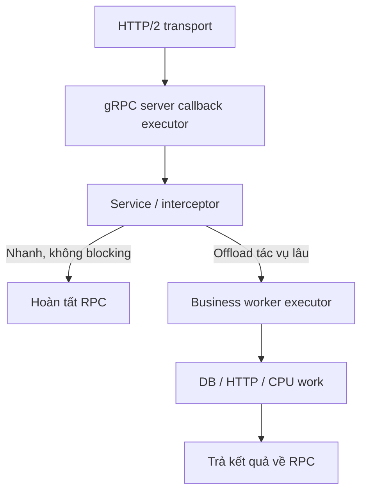

# Cấu hình executor

## Mục tiêu bài học

Trong **SPRING_GRPC**, một RPC được tiếp nhận qua transport thread, sau đó gRPC dispatch callback tới executor của server. Service có thể tiếp tục xử lý trên executor riêng để thực hiện công việc blocking hoặc tốn CPU. Cấu hình executor quyết định mức song song, độ trễ khi chờ hàng đợi, khả năng chịu tải và cách ứng dụng dừng an toàn.

Bài học tập trung vào **cấu hình executor** trong Spring gRPC: phân biệt executor xử lý callback của gRPC server với worker pool của nghiệp vụ, khai báo và quản lý thread pool bằng Spring, gắn executor vào server builder qua extension point của starter, giới hạn queue, xử lý overload, giữ gRPC Context khi offload công việc và kiểm thử shutdown/concurrency.

Sau bài này, bạn có thể:

1. Phân biệt transport/event loop, server application executor và business worker executor.
2. Cấu hình ThreadPoolTaskExecutor với thread limit, queue capacity và lifecycle phù hợp.
3. Gắn executor vào gRPC ServerBuilder do Spring gRPC quản lý.
4. Chọn pool riêng cho tác vụ blocking/CPU-bound và tránh block callback thread.
5. Thiết kế overload/rejection policy có kiểm soát.
6. Giữ deadline, cancellation và request context khi submit task bất đồng bộ.
7. Theo dõi pool metrics và kiểm thử tải, context propagation, graceful shutdown.

> **Phạm vi:** Ví dụ dùng Spring Boot, Spring gRPC và gRPC Java. Tên extension point để tùy biến server builder phụ thuộc starter/transport và phiên bản dự án. Bean Executor của Spring không mặc nhiên được gRPC sử dụng; cần nối nó vào server builder bằng cơ chế được phiên bản đang dùng công bố.

## 1. Những executor nào tham gia xử lý một RPC?

Không phải mọi thread trong ứng dụng gRPC đều có cùng vai trò. Cần tách ít nhất ba nhóm:

| Thành phần | Vai trò | Công việc phù hợp |
| --- | --- | --- |
| Transport/event loop | Đọc/ghi socket, xử lý I/O và protocol | Công việc ngắn, không blocking |
| gRPC server application executor | Dispatch callback/service handler của server | Xử lý request nhanh, điều phối và gọi code ứng dụng |
| Business worker executor | Chạy tác vụ được service chủ động offload | Database/HTTP blocking call, xử lý CPU nặng, tác vụ nền có giới hạn |

gRPC server có thể dùng executor do ứng dụng cung cấp để chạy application callbacks. Nếu không cấu hình, transport thường dùng executor mặc định của implementation. Cấu hình server executor không biến code blocking thành non-blocking; nếu service chờ database hoặc gọi HTTP đồng bộ lâu, thread callback vẫn bị chiếm trong suốt thời gian chờ.

Một worker pool riêng cho phép service chuyển công việc blocking khỏi callback executor. Hai pool có mục đích và sizing khác nhau, nên không nên mặc định dùng chung một pool cho mọi tác vụ.



### 1.1. Vì sao không dùng directExecutor cho service blocking?

gRPC Java có chế độ direct executor, trong đó application callbacks có thể chạy trực tiếp trên thread thực hiện dispatch/transport. Cách này giảm chi phí chuyển thread cho workload rất ngắn, nhưng một handler blocking có thể chiếm thread cần cho tiến trình I/O hoặc dispatch khác.

Chỉ cân nhắc direct executor khi handler được chứng minh là ngắn, không blocking, không chờ lock hoặc I/O và đã được đo tải. Với Spring gRPC service có database/HTTP call đồng bộ, dùng executor phù hợp và offload blocking work.

## 2. Cấu hình ThreadPoolTaskExecutor trong Spring

Spring cung cấp ThreadPoolTaskExecutor, một bean quản lý thread pool và thực thi interface Executor. Có thể cấu hình pool riêng cho tác vụ blocking của gRPC:

```java
@Configuration(proxyBeanMethods = false)
public class GrpcExecutorConfiguration {

    @Bean(name = "grpcBusinessExecutor")
    public ThreadPoolTaskExecutor grpcBusinessExecutor() {
        ThreadPoolTaskExecutor executor = new ThreadPoolTaskExecutor();

        executor.setCorePoolSize(16);
        executor.setMaxPoolSize(48);
        executor.setQueueCapacity(200);
        executor.setKeepAliveSeconds(60);
        executor.setThreadNamePrefix("grpc-business-");

        executor.setWaitForTasksToCompleteOnShutdown(true);
        executor.setAwaitTerminationSeconds(30);
        executor.setRejectedExecutionHandler(
                new ThreadPoolExecutor.AbortPolicy());

        return executor;
    }
}
```

Spring quản lý lifecycle của bean ThreadPoolTaskExecutor và khởi tạo nó trong application context. Không cần gọi initialize thủ công khi bean được Spring quản lý.

Các giá trị 16/48/200 chỉ là ví dụ để minh họa cấu hình, không phải con số tối ưu cho mọi hệ thống. Cần chọn theo CPU, thời gian chờ I/O, throughput mục tiêu, latency budget và tải thực tế.

### 2.1. Ý nghĩa các tham số

| Tham số | Tác động |
| --- | --- |
| corePoolSize | Số worker được duy trì theo chính sách của executor |
| maxPoolSize | Giới hạn số worker tối đa khi queue đã đầy |
| queueCapacity | Số task có thể chờ trước khi executor mở rộng tới max hoặc từ chối |
| keepAliveSeconds | Thời gian worker vượt core có thể rảnh trước khi được thu hồi |
| threadNamePrefix | Giúp nhận diện pool trong thread dump và log |
| waitForTasksToCompleteOnShutdown | Yêu cầu chờ task đã nhận hoàn tất khi Spring đóng context |
| awaitTerminationSeconds | Thời gian tối đa chờ executor kết thúc theo cấu hình lifecycle |
| RejectedExecutionHandler | Chính sách khi không thể nhận thêm task |

Queue không phải nơi lưu request vô hạn. Queue quá lớn làm tăng thời gian chờ, giữ request/context trong bộ nhớ và khiến deadline hết trước khi task bắt đầu. Queue quá nhỏ có thể tăng rejection khi tải đột biến. Chọn giới hạn dựa trên latency budget và khả năng xử lý thật của downstream.

### 2.2. Không chọn CallerRunsPolicy một cách tùy tiện

CallerRunsPolicy chạy task trên thread gọi execute khi pool quá tải. Nếu thread gọi là gRPC callback/transport thread, task blocking có thể làm nghẽn dispatch và ảnh hưởng các RPC khác. Với business worker pool, có thể dùng AbortPolicy để từ chối rõ ràng rồi xử lý overload tại service boundary.

Rejection policy cho server callback executor cần thận trọng hơn vì task có thể do gRPC transport submit. Không tự thay bằng CallerRunsPolicy hoặc một handler âm thầm bỏ task. Phải xác minh cách transport xử lý RejectedExecutionException, đo tải và kiểm thử tình huống queue đầy. Giới hạn concurrency, backpressure hoặc từ chối request ở tầng phù hợp trước khi callback executor cạn tài nguyên.

## 3. Gắn executor vào gRPC server

gRPC Java cho phép cấu hình executor cho application callbacks thông qua ServerBuilder.executor(Executor). Về nguyên tắc, server builder phải nhận đúng executor trước khi build/start:

```java
ServerBuilder<?> serverBuilder = ServerBuilder.forPort(9090);

serverBuilder.executor(grpcServerExecutor);
serverBuilder.addService(inventoryGrpcService);

Server server = serverBuilder.build();
```

Đây là đoạn minh họa điểm cấu hình của gRPC Java. Trong ứng dụng Spring gRPC, server thường được starter tạo và quản lý lifecycle. Hãy dùng server builder customizer/configurer hoặc factory extension point được tài liệu của đúng phiên bản starter công bố để gọi executor trên builder trước khi server được build.

Không tạo một Server độc lập trong @Configuration chỉ để gắn executor nếu Spring gRPC đã sở hữu server đang phục vụ traffic. Việc đó có thể tạo listener thứ hai, bỏ qua service registration, TLS, interceptors, health/reflection hoặc graceful shutdown mà starter quản lý.

### 3.1. Bean Executor không tự động được gắn vào server

Khai báo bean như sau:

```java
@Bean
Executor grpcServerExecutor() {
    return Executors.newFixedThreadPool(24);
}
```

chỉ tạo một bean Executor trong Spring context. Nó không chứng minh gRPC server đang sử dụng bean đó. Cần kiểm tra server factory/customizer của phiên bản dự án và xác nhận builder nhận đúng instance.

Tương tự, cấu hình Spring TaskExecutionAutoConfiguration hoặc property cho @Async không mặc nhiên cấu hình executor của native gRPC listener. Hai cơ chế có thể dùng các pool khác nhau.

### 3.2. Không nhầm server executor với worker executor

Có thể có hai bean riêng:

- grpcServerExecutor: callback executor gắn vào server builder.
- grpcBusinessExecutor: worker pool mà service chủ động dùng cho tác vụ blocking/CPU-bound.

Không cần tách hai pool trong mọi workload; quyết định dựa trên profile thực tế. Nhưng nếu service blocking hoặc có tác vụ dài, tách riêng giúp giới hạn ảnh hưởng của workload đó lên khả năng dispatch callback.

## 4. Offload công việc blocking trong service

Ví dụ service chuyển tác vụ blocking sang worker pool. Executor được inject bằng qualifier để tránh nhầm với các executor khác trong Spring:

```java
@GrpcService
public class InventoryGrpcEndpoint
        extends InventoryGrpc.InventoryImplBase {

    private final Executor grpcBusinessExecutor;
    private final InventoryRepository repository;

    public InventoryGrpcEndpoint(
            @Qualifier("grpcBusinessExecutor") Executor grpcBusinessExecutor,
            InventoryRepository repository) {
        this.grpcBusinessExecutor = grpcBusinessExecutor;
        this.repository = repository;
    }

    @Override
    public void getStock(
            GetStockRequest request,
            StreamObserver<GetStockResponse> responseObserver) {

        Context callContext = Context.current();
        Executor contextualExecutor =
                callContext.fixedContextExecutor(grpcBusinessExecutor);

        contextualExecutor.execute(() -> {
            if (callContext.isCancelled()) {
                return;
            }

            try {
                Stock stock = repository.load(request.getSku());

                if (callContext.isCancelled()) {
                    return;
                }

                responseObserver.onNext(
                        GetStockResponse.newBuilder()
                                .setAvailable(stock.available())
                                .build());
                responseObserver.onCompleted();
            } catch (Exception ex) {
                responseObserver.onError(
                        Status.INTERNAL
                                .withDescription("Không thể đọc tồn kho")
                                .withCause(ex)
                                .asRuntimeException());
            }
        });
    }
}
```

Đoạn minh họa cần bổ sung import, kiểu repository và mapping exception theo ứng dụng. Các điểm quan trọng:

- Service không giữ callback thread trong lúc repository thực hiện I/O.
- Context được chụp trước khi submit để worker vẫn thấy request context và deadline/cancellation.
- Kiểm tra cancellation trước/sau thao tác tốn thời gian.
- Chỉ gửi một terminal signal cho StreamObserver.
- Không trả chi tiết exception nội bộ hoặc dữ liệu nhạy cảm cho client.

Nếu repository có API async/non-blocking thật sự, ưu tiên dùng API đó thay vì chiếm worker thread để chờ. Nếu tác vụ blocking không hỗ trợ cancellation, deadline hết hạn không tự dừng thao tác; cần timeout ở driver/client hoặc cơ chế interrupt/cancel phù hợp.

## 5. Kích thước pool và queue

Không có một công thức duy nhất phù hợp cho mọi service. Bắt đầu bằng phân loại workload:

- **CPU-bound:** xử lý chủ yếu dùng CPU. Số worker thường bắt đầu quanh số core khả dụng; tăng quá nhiều gây context switching.
- **Blocking I/O:** phần lớn thời gian chờ database/HTTP. Có thể cần nhiều worker hơn số core, nhưng phải giới hạn theo connection pool và năng lực downstream.
- **Mixed workload:** cân nhắc tách pool theo loại công việc để tác vụ CPU không bị kẹt sau các call I/O chậm.

Một cách ước lượng ban đầu cho blocking pool là số worker gần bằng số CPU nhân với tỷ lệ thời gian tổng/thời gian thực sự dùng CPU. Đây chỉ là điểm khởi đầu; cần đo throughput, queue wait và latency trong môi trường gần production.

Ví dụ: nếu task mất 100 ms tổng cộng, trong đó chỉ 10 ms dùng CPU và 90 ms chờ I/O, pool có thể cần concurrency cao hơn workload CPU-bound. Nhưng tăng worker vô hạn sẽ làm database connection pool, downstream service và bộ nhớ bị quá tải.

### 5.1. Queue capacity gắn với deadline

Giả sử RPC có deadline 2 giây. Nếu task phải chờ queue 1,8 giây rồi mới chạy, phần lớn ngân sách đã hết trước khi truy cập repository. Vì vậy:

- Theo dõi queue wait time riêng với task execution time.
- Không dùng queue lớn để che dấu thiếu capacity.
- Kiểm tra deadline/cancellation trước khi bắt đầu task.
- Đặt timeout downstream nhỏ hơn ngân sách còn lại.
- Từ chối sớm khi không thể hoàn tất trong SLA thay vì giữ request quá lâu.

Queue capacity nên được xác định từ burst size và thời gian chờ tối đa chấp nhận được, không chỉ từ số lượng request trung bình.

## 6. Xử lý rejection và overload

Khi worker pool đạt max thread và queue đầy, executor không thể nhận thêm task. Service cần xử lý tình huống này rõ ràng.

Ví dụ bắt rejection khi submit task:

```java
try {
    grpcBusinessExecutor.execute(contextualTask);
} catch (RejectedExecutionException ex) {
    responseObserver.onError(
            Status.RESOURCE_EXHAUSTED
                    .withDescription("Hệ thống đang quá tải")
                    .asRuntimeException());
}
```

Trong ứng dụng thực tế, ThreadPoolTaskExecutor có thể ném TaskRejectedException (một loại rejection exception của Spring) tùy đường gọi. Bắt exception phù hợp với abstraction đang inject và giữ mapping status nhất quán.

Chọn gRPC status theo semantics:

- RESOURCE_EXHAUSTED: server không đủ capacity hoặc quota để nhận công việc.
- UNAVAILABLE: service tạm thời không sẵn sàng và client có thể retry theo policy.
- DEADLINE_EXCEEDED: ngân sách thời gian của RPC đã hết.
- INTERNAL: lỗi bất ngờ trong xử lý server.

Không tự retry ngay trên cùng pool đang quá tải; retry có thể làm tăng tải. Nếu client retry, cần backoff/jitter, giới hạn attempt và chỉ retry method có semantics an toàn.

## 7. Deadline, cancellation và vòng đời task

Một task được submit vào worker pool có thể tiếp tục chạy sau khi client đã hủy RPC hoặc deadline hết hạn. Context-aware executor giữ gRPC Context trong task, nhưng không tự động hủy mọi API blocking.

Một operation object trong phạm vi RPC nên sở hữu cả Future và CancellationListener. Khi tạo operation:

1. Chụp Context.current() trước khi submit task và bọc Runnable bằng context.wrap(...).
2. Đăng ký listener với context.addListener(...); listener gọi Future.cancel(true) khi RPC bị hủy.
3. Submit task và lưu Future vào operation object. Xử lý race giữa cancellation và lúc Future được gán bằng cách kiểm tra context.isCancelled() ngay sau khi gán.
4. Khi task hoàn tất, bị từ chối hoặc operation kết thúc, gỡ listener bằng context.removeListener(...).
5. Dùng completion callback để gửi đúng một terminal signal; không block callback gRPC bằng Future.get().

Kiểm tra API downstream có phản ứng với interrupt hay không; một số driver cần query timeout hoặc cancel API riêng. Future.cancel(true) chỉ gửi tín hiệu interrupt, không bảo đảm một blocking API sẽ dừng ngay.

Với streaming RPC, không để mỗi message tạo task không giới hạn. Giới hạn số task đang chạy, bảo đảm thứ tự nếu protocol yêu cầu, và phối hợp flow control/backpressure với tốc độ xử lý.

## 8. Context propagation và các executor của Spring

Spring có thể tạo executor cho @Async, scheduling hoặc application task. gRPC Context không tự động đi theo mọi executor này.

Khi service submit task, chụp context hiện tại và bọc executor:

```java
Context callContext = Context.current();

Executor requestExecutor =
        callContext.fixedContextExecutor(grpcBusinessExecutor);

requestExecutor.execute(this::performWork);
```

Nếu cần truyền MDC hoặc Spring SecurityContext, cấu hình TaskDecorator hoặc DelegatingSecurityContextExecutor phù hợp. Không giả định gRPC Context, MDC và SecurityContextHolder là cùng một cơ chế. Mỗi loại có vòng đời và cách capture/restore riêng.

Tránh tạo fixedContextExecutor từ Context.current() ở thời điểm khởi tạo singleton bean; nó có thể giữ context không thuộc request nào. Tạo wrapper trong phạm vi RPC hoặc capture context tại đúng thời điểm submit.

## 9. Graceful shutdown

Khi Spring application dừng, server cần ngừng nhận RPC mới, cho RPC đang chạy cơ hội hoàn tất trong grace period, rồi mới dừng worker pool.

Thứ tự lifecycle cần được thiết kế:

1. Đánh dấu instance không nhận traffic mới hoặc bắt đầu graceful server shutdown.
2. Chờ RPC đang in-flight trong thời hạn cấu hình.
3. Chờ business worker tasks đã được nhận hoàn tất trong giới hạn.
4. Đóng channel/downstream clients và các resource liên quan.
5. Nếu hết grace period, hủy task còn lại và kết thúc process theo policy.

setWaitForTasksToCompleteOnShutdown(true) giúp Spring chờ task của ThreadPoolTaskExecutor, nhưng không tự đảm bảo gRPC server đã ngừng nhận RPC trước đó. Phải phối hợp lifecycle của server factory với executor bean; kiểm tra dependency/destruction order và thử shutdown dưới tải.

Không chờ vô hạn. Một task blocking không có timeout có thể giữ process không dừng. Đặt timeout cho database/HTTP calls và tổng grace period của ứng dụng.

## 10. Theo dõi executor trong production

Các chỉ số cần theo dõi cho từng pool:

| Metric | Ý nghĩa |
| --- | --- |
| Pool size / active threads | Số worker hiện có và đang chạy |
| Queue size / remaining capacity | Mức backlog và phần capacity còn lại |
| Task submitted/completed/rejected | Throughput và overload |
| Queue wait duration | Thời gian task chờ trước khi chạy |
| Task execution duration | Thời gian thực thi |
| Shutdown/termination duration | Thời gian drain pool khi ứng dụng dừng |
| gRPC in-flight calls | Số RPC đang hoạt động |
| RPC latency/status | Tác động của pool tới API người dùng |

Không chỉ nhìn CPU. Pool có active thread thấp nhưng queue wait cao có thể do worker bị block hoặc downstream chậm; active thread cao cùng rejection tăng là dấu hiệu saturation. Đối chiếu với database connection pool, HTTP connection pool, downstream latency và gRPC deadline.

Đặt tên thread rõ ràng như grpc-business- và grpc-server- để thread dump dễ đọc. Metric label nên có cardinality thấp; không dùng request ID hoặc tenant tùy ý làm label.

## 11. Lỗi thường gặp và cách xử lý

| Triệu chứng | Nguyên nhân | Cách xử lý |
| --- | --- | --- |
| Tạo Executor bean nhưng gRPC vẫn dùng pool khác | Bean chưa được gắn vào server builder | Dùng customizer/factory extension point của đúng starter |
| RPC latency tăng khi database chậm | Blocking call chạy trên callback executor | Offload sang business worker pool và đặt timeout DB |
| Queue tăng liên tục | Arrival rate vượt capacity hoặc downstream bị nghẽn | Giới hạn queue, điều tra downstream và scale có kiểm soát |
| Rejection làm RPC treo hoặc mất callback | Rejection handler không phù hợp transport/đường submit | Xác minh rejection semantics, test saturation và xử lý ở service boundary |
| CPU tăng dù throughput không tăng | Quá nhiều worker gây context switching | Giảm concurrency, đo CPU/queue wait |
| Deadline hết trước khi task chạy | Queue wait chiếm phần lớn ngân sách | Giảm queue, kiểm tra deadline trước khi xử lý, từ chối sớm |
| Context/request ID mất ở worker | Executor không được bọc gRPC Context | Dùng Context.wrap hoặc fixedContextExecutor |
| Request B thấy MDC của request A | MDC không được restore trên pool dùng chung | Dùng TaskDecorator capture/restore trong finally |
| Shutdown treo | Task blocking không có timeout hoặc server chưa drain | Đặt timeout, phối hợp server lifecycle và executor termination |
| Streaming tiêu thụ quá nhiều thread/task | Mỗi message submit không giới hạn | Giới hạn concurrency và phối hợp flow control |

## 12. Kiểm thử cấu hình executor

Không chỉ kiểm tra bean được tạo. Cần xác minh server thực sự dùng executor dự kiến và hành vi đúng khi tải thay đổi.

Các bài test nên có:

1. **Wiring:** gọi RPC và ghi nhận thread name để xác minh callback chạy trên server executor đã cấu hình.
2. **Offload:** tạo service blocking test, xác minh tác vụ chạy trên thread prefix của business pool.
3. **Concurrency:** gửi nhiều unary RPC đồng thời và đo active threads/latency.
4. **Queue saturation:** làm worker chậm, lấp queue và xác minh rejection được chuyển thành status phù hợp, không block transport thread.
5. **Deadline/cancellation:** hủy RPC khi task đang chạy, xác minh Future/downstream được hủy hoặc timeout theo thiết kế.
6. **Context:** xác minh request ID/deadline được giữ qua executor và không leak giữa hai request.
7. **Streaming:** gửi stream dài, kiểm tra giới hạn task và callback ordering.
8. **Shutdown:** gửi RPC đang chạy rồi dừng Spring context; xác minh server drain và executor kết thúc trong grace period.

Dùng executor test nhỏ có giới hạn rõ ràng để tái hiện saturation. Không dùng sleep dài hoặc thread pool vô hạn để làm test ổn định; dùng latch/barrier và timeout để kiểm soát đồng bộ.

## 13. Bài tập thực hành

1. Tạo bean grpcBusinessExecutor bằng ThreadPoolTaskExecutor với core/max/queue hữu hạn và thread name prefix.
2. Gắn một executor riêng vào gRPC server builder thông qua extension point được starter/transport của dự án hỗ trợ.
3. Xác minh bean executor được dùng thực tế bằng thread dump hoặc thread name trong test.
4. Viết unary service offload database call sang business pool và giữ gRPC Context.
5. Tạo queue saturation, bắt rejection và trả RESOURCE_EXHAUSTED theo policy.
6. Đặt deadline ngắn, hủy RPC trong khi worker đang chạy và kiểm tra cancellation.
7. Tạo streaming workload, giới hạn số task song song và kiểm tra flow control.
8. Cấu hình graceful shutdown để server drain trước worker pool; đo thời gian dừng.
9. Thu thập pool metrics và điều chỉnh core/max/queue dựa trên queue wait, task duration, downstream capacity và RPC latency.

### Câu hỏi tự kiểm tra

- Server application executor khác business worker executor như thế nào?
- Vì sao directExecutor nguy hiểm khi service thực hiện blocking I/O?
- Vì sao khai báo ThreadPoolTaskExecutor bean không có nghĩa gRPC server tự sử dụng nó?
- corePoolSize, maxPoolSize và queueCapacity tương tác thế nào?
- Vì sao queue lớn có thể làm deadline hết trước khi task chạy?
- Khi nào nên dùng AbortPolicy và vì sao CallerRunsPolicy có thể gây nghẽn transport?
- Làm thế nào giữ gRPC Context khi submit task sang worker pool?
- Vì sao cancellation của Context không tự dừng mọi blocking call?
- Spring shutdown cần phối hợp server lifecycle và worker executor theo thứ tự nào?
- Metric nào giúp phân biệt pool saturation với downstream chậm?
- Cần test những gì để chứng minh executor wiring và rejection behavior đúng?

## Tài liệu tham khảo

- [gRPC Java — ServerBuilder](https://grpc.github.io/grpc-java/javadoc/io/grpc/ServerBuilder.html): cấu hình executor cho server application callbacks.
- [gRPC Java — Context](https://grpc.github.io/grpc-java/javadoc/io/grpc/Context.html): context propagation, cancellation và executor helpers.
- [Spring Framework — Task Execution and Scheduling](https://docs.spring.io/spring-framework/reference/integration/scheduling.html): ThreadPoolTaskExecutor, TaskExecutor và lifecycle.
- [Spring Boot — Task Execution and Scheduling](https://docs.spring.io/spring-boot/reference/features/task-execution-and-scheduling.html): auto-configuration và executor trong Spring Boot.
- [gRPC — Deadlines](https://grpc.io/docs/guides/deadlines/): ngân sách thời gian và deadline propagation.
- [gRPC — Cancellation](https://grpc.io/docs/guides/cancellation/): hủy RPC và dừng công việc không còn cần thiết.

**Kết quả mong đợi:** Người học cấu hình được executor phù hợp cho Spring gRPC, phân biệt callback executor với worker pool, giới hạn concurrency/queue, xử lý overload và cancellation, giữ context khi offload công việc, phối hợp graceful shutdown, và xác minh cấu hình bằng integration test cùng pool metrics.
