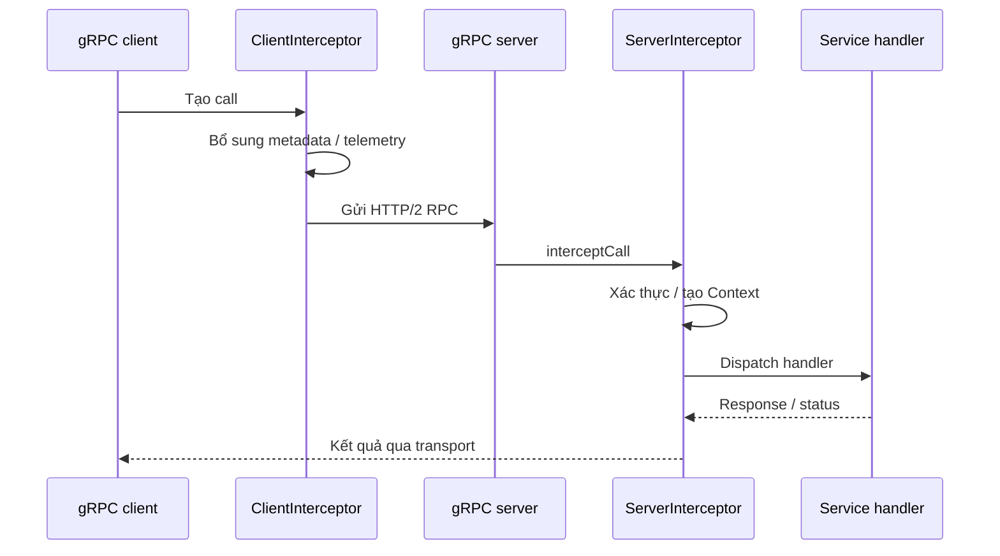

# Cấu hình interceptor

## Mục tiêu bài học

Trong **SPRING_GRPC**, interceptor là điểm mở rộng để áp dụng hành vi dùng chung quanh mỗi RPC mà không lặp lại trong từng service method. Ở server, interceptor thường xử lý correlation ID, authentication, authorization, logging, metrics hoặc policy theo method. Ở client, interceptor có thể bổ sung metadata, đo thời gian gọi và chuẩn hóa telemetry cho outbound RPC.

Bài học tập trung vào **cấu hình interceptor**: phân biệt ServerInterceptor và ClientInterceptor, lựa chọn phạm vi toàn server hay từng service, đăng ký interceptor vào server/channel do Spring quản lý, hiểu thứ tự thực thi, truyền request context, xử lý lỗi và kiểm thử hành vi của chain.

Sau bài này, bạn có thể:

1. Giải thích interceptor tham gia vòng đời RPC ở client và server.
2. Viết ServerInterceptor và ClientInterceptor bằng gRPC Java.
3. Phân biệt interceptor toàn server với interceptor gắn cho một service.
4. Đăng ký interceptor bằng Spring bean và server/channel customization phù hợp.
5. Thiết kế thứ tự chain cho tracing, authentication, authorization và logging.
6. Dùng metadata và gRPC Context an toàn.
7. Kiểm thử interceptor, status, metadata, ordering và lifecycle.

> **Phạm vi:** Ví dụ dùng gRPC Java và Spring gRPC. Cơ chế đăng ký interceptor phụ thuộc starter, server factory và phiên bản transport. Một bean ServerInterceptor hoặc ClientInterceptor không mặc nhiên được gRPC tự sử dụng; phải nối bean vào đúng server builder hoặc channel.

## 1. Interceptor nằm ở đâu trong vòng đời RPC?

Interceptor bao quanh quá trình tạo và thực thi RPC call. Nó có thể quan sát method descriptor, metadata, call options, status và thời gian xử lý; tùy loại interceptor, nó cũng có thể thay đổi metadata hoặc từ chối call trước khi service chạy.

| Loại | Chạy ở đâu | Công việc thường gặp |
| --- | --- | --- |
| ServerInterceptor | Trên server, trước khi service handler được dispatch | Authentication, authorization, request context, audit, metrics |
| ClientInterceptor | Trên client, khi tạo outbound call | Correlation metadata, telemetry, client-side policy |
| CallCredentials | Client, gắn credential cho RPC | Cấp authorization metadata theo từng call |
| Service implementation | Trong service method | Logic nghiệp vụ của RPC |

Luồng đơn giản:



Interceptor là cross-cutting mechanism. Không nên đặt business workflow dài hoặc truy cập database blocking trực tiếp trong interceptor; nó làm tăng latency cho mọi method nằm trong phạm vi áp dụng và có thể chiếm callback thread.

## 2. ServerInterceptor và ClientInterceptor khác nhau

ServerInterceptor được gọi khi server chuẩn bị tạo listener cho một RPC. Nó nhận ServerCall, Metadata và ServerCallHandler. Có thể kiểm tra method, đọc metadata, tạo Context hoặc từ chối call.

ClientInterceptor được gọi khi client tạo một ClientCall. Nó nhận MethodDescriptor, CallOptions và Channel tiếp theo trong chain. Nó có thể bọc ClientCall để sửa metadata lúc start, đo thời gian hoặc quan sát callback.

| Thuộc tính | ServerInterceptor | ClientInterceptor |
| --- | --- | --- |
| API chính | interceptCall(call, headers, next) | interceptCall(method, callOptions, next) |
| Metadata đầu vào | Metadata client gửi | Metadata client chuẩn bị gửi |
| Từ chối call | Đóng ServerCall với Status | Có thể fail call qua ClientCall wrapper |
| Context | Có thể gắn dữ liệu vào gRPC Context | Có thể đọc context hiện tại và tạo call options |
| Phạm vi | Server builder hoặc service definition | Channel hoặc stub |
| Mục tiêu bảo mật | Xác thực peer/caller và authorization phía server | Đưa credential phù hợp vào outbound call |

Client interceptor không thể thay thế server authorization. Client do người dùng kiểm soát có thể bỏ interceptor hoặc gửi metadata tùy ý; server luôn phải xác minh danh tính và quyền ở phía mình.

## 3. Viết một ServerInterceptor

Ví dụ interceptor lấy request ID từ metadata. Nếu header không có hoặc không hợp lệ, server tạo ID nội bộ để correlation:

```java
public final class RequestIdServerInterceptor
        implements ServerInterceptor {

    private static final Metadata.Key<String> REQUEST_ID_HEADER =
            Metadata.Key.of(
                    "x-request-id",
                    Metadata.ASCII_STRING_MARSHALLER);

    @Override
    public <ReqT, RespT> ServerCall.Listener<ReqT> interceptCall(
            ServerCall<ReqT, RespT> call,
            Metadata headers,
            ServerCallHandler<ReqT, RespT> next) {

        String requestId = headers.get(REQUEST_ID_HEADER);

        if (requestId == null
                || requestId.isBlank()
                || requestId.length() > 128) {
            requestId = UUID.randomUUID().toString();
        }

        Context requestContext = Context.current()
                .withValue(RpcContextKeys.REQUEST_ID, requestId);

        return Contexts.interceptCall(
                requestContext, call, headers, next);
    }
}
```

Để đoạn code hoạt động, RpcContextKeys.REQUEST_ID là Context.Key<String> được khai báo dùng chung trong ứng dụng. Contexts.interceptCall bảo đảm context được gắn khi gRPC dispatch listener callbacks và được khôi phục sau callback.

Metadata từ client là input không đáng tin cậy. Request ID chỉ nên phục vụ correlation sau khi validate độ dài/ký tự; không dùng header tenant-id, role hoặc user-id làm bằng chứng authorization. Principal và tenant phải xuất phát từ credential đã được xác minh hoặc policy phía server.

### 3.1. Từ chối call trước khi vào service

Interceptor có thể từ chối call ngay khi thiếu authentication:

```java
if (authorizationHeader == null) {
    call.close(
            Status.UNAUTHENTICATED
                    .withDescription("Thiếu thông tin xác thực"),
            new Metadata());

    return new ServerCall.Listener<>() {};
}
```

Sau khi đóng call, trả về listener rỗng để không dispatch service handler. Dùng UNAUTHENTICATED khi chưa xác minh được caller; dùng PERMISSION_DENIED khi caller đã xác thực nhưng không có quyền gọi method/resource.

Không trả token, nội dung credential hoặc chi tiết nội bộ của validator trong Status description. Ghi nguyên nhân chi tiết ở log đã redaction với correlation ID.

## 4. Authentication và authorization trong interceptor

Một authentication interceptor có thể đọc authorization metadata, xác minh token/chữ ký qua thành phần chuyên trách, sau đó tạo principal đã xác thực và đặt vào gRPC Context.

Quy trình nên tách thành các bước:

1. Đọc header theo key chuẩn hóa, ví dụ authorization.
2. Kiểm tra scheme và cấu trúc credential.
3. Gọi token verifier/JWT decoder hoặc identity provider đã cấu hình.
4. Xác minh signature, issuer, audience, expiry và các claim bắt buộc.
5. Tạo principal nội bộ đã chuẩn hóa.
6. Đưa principal vào Context để service/authorization layer sử dụng.
7. Trả UNAUTHENTICATED nếu credential thiếu hoặc không hợp lệ.

Authorization có thể nằm trong interceptor riêng hoặc service authorization layer. Nó cần biết full method name và resource/tenant cần truy cập. Policy chỉ dựa trên method name thường chưa đủ nếu quyền còn phụ thuộc resource ID trong request.

Không lưu bearer token thô trong Context hoặc MDC. Lưu principal ID/role đã chuẩn hóa ở mức cần thiết, tránh đưa thông tin nhạy cảm vào log. Nếu dùng Spring Security, bridge SecurityContext theo cơ chế tương thích với gRPC thread model; không giả định ThreadLocal tự truyền qua executor.

### 4.1. Dùng CallCredentials ở client

Đối với credential cần được gắn theo từng RPC, gRPC Java có CallCredentials. Đây thường là nơi phù hợp để lấy token hiện hành và đưa authorization metadata vào outbound call, thay vì giữ token cố định trong một interceptor sống lâu.

ClientInterceptor vẫn hữu ích cho correlation ID, telemetry hoặc policy không nhạy cảm. Không ghi token vào log và không chia sẻ một token có scope rộng cho nhiều identity.

## 5. Viết ClientInterceptor để thêm metadata

Ví dụ interceptor client thêm correlation ID vào mỗi call:

```java
public final class CorrelationClientInterceptor
        implements ClientInterceptor {

    private static final Metadata.Key<String> REQUEST_ID_HEADER =
            Metadata.Key.of(
                    "x-request-id",
                    Metadata.ASCII_STRING_MARSHALLER);

    @Override
    public <ReqT, RespT> ClientCall<ReqT, RespT> interceptCall(
            MethodDescriptor<ReqT, RespT> method,
            CallOptions callOptions,
            Channel next) {

        ClientCall<ReqT, RespT> delegate =
                next.newCall(method, callOptions);

        return new ForwardingClientCall
                .SimpleForwardingClientCall<>(delegate) {

            @Override
            public void start(
                    Listener<RespT> responseListener,
                    Metadata headers) {

                String requestId = RequestIds.currentOrCreate();
                headers.put(REQUEST_ID_HEADER, requestId);

                super.start(responseListener, headers);
            }
        };
    }
}
```

RequestIds.currentOrCreate() là helper của ứng dụng, không phải API gRPC. Nếu request ID đến từ gRPC Context hoặc tracing context, helper cần đọc đúng context đang active. Tránh tạo ID mới ở mỗi tầng nếu đã có correlation ID hợp lệ.

Không sửa metadata sau khi ClientCall.start đã được gọi. Metadata cần được chuẩn bị trước khi gửi call; không dùng cùng một Metadata instance mutable cho nhiều RPC đồng thời.

## 6. Đăng ký interceptor với Spring gRPC server

Có hai việc riêng biệt:

- Tạo interceptor bean để Spring quản lý dependency và lifecycle.
- Đăng ký interceptor vào server builder để gRPC thực sự gọi nó.

Ví dụ khai báo bean:

```java
@Configuration(proxyBeanMethods = false)
public class GrpcInterceptorConfiguration {

    @Bean
    ServerInterceptor requestIdServerInterceptor() {
        return new RequestIdServerInterceptor();
    }

    @Bean
    ServerInterceptor authenticationServerInterceptor(
            TokenVerifier tokenVerifier) {
        return new AuthenticationServerInterceptor(tokenVerifier);
    }
}
```

Bean ServerInterceptor chưa chắc tự động được gắn vào server. Ứng dụng cần dùng server builder customizer/configurer hoặc factory extension point mà phiên bản Spring gRPC đang sử dụng hỗ trợ. Tại điểm customization, lấy các interceptor bean theo thứ tự mong muốn và gọi ServerBuilder.intercept(...).

Ví dụ phần thao tác trên builder:

```java
void registerInterceptors(
        ServerBuilder<?> builder,
        List<ServerInterceptor> interceptors) {

    for (ServerInterceptor interceptor : interceptors) {
        builder.intercept(interceptor);
    }
}
```

Đây là helper minh họa thao tác gRPC Java trên builder, không phải tên một interface Spring cố định. Hãy nối helper vào extension point được tài liệu đúng starter/transport công bố. Không tự tạo một Server thứ hai trong @Configuration nếu Spring gRPC đã quản lý listener, service registration, TLS và lifecycle.

### 6.1. Interceptor toàn server và theo từng service

**Toàn server:** đăng ký trên ServerBuilder để áp dụng cho mọi service được bind vào server đó. Phù hợp với request ID, tracing, authentication mặc định, metrics và policy chung.

**Theo service:** bọc một ServerServiceDefinition bằng ServerInterceptors hoặc dùng extension point của Spring gRPC để chỉ gắn interceptor vào một service. Phù hợp với policy đặc thù hoặc service legacy.

Không đăng ký cùng một interceptor hai lần ở cả global và service scope nếu chưa có chủ đích. Nếu lặp, một request có thể bị log/đo metric hai lần hoặc authentication chạy lặp.

## 7. Đăng ký ClientInterceptor với Spring channel

Một client interceptor được gắn vào Channel bằng ClientInterceptors. Giữ ManagedChannel gốc để quản lý shutdown, còn stub dùng channel đã được bọc:

```java
@Bean(destroyMethod = "shutdown")
ManagedChannel inventoryManagedChannel(ChannelCredentials credentials) {
    return Grpc.newChannelBuilder(
            "dns:///inventory.internal.example.com:9090",
            credentials)
            .build();
}

@Bean
InventoryGrpc.InventoryBlockingStub inventoryStub(
        ManagedChannel inventoryManagedChannel,
        ClientInterceptor correlationInterceptor) {

    Channel intercepted = ClientInterceptors.intercept(
            inventoryManagedChannel,
            correlationInterceptor);

    return InventoryGrpc.newBlockingStub(intercepted);
}
```

Ví dụ cho thấy channel được tạo một lần và interceptor được áp dụng khi tạo stub. Trong ứng dụng thực tế, có thể dùng một bean Channel đã bọc hoặc factory tạo stub theo service. Đảm bảo ManagedChannel gốc vẫn được đóng khi Spring context dừng; wrapper Channel không thay thế lifecycle của channel gốc.

Nếu có nhiều downstream, cấu hình interceptor theo client/channel tương ứng. Không gắn policy dành cho Inventory vào mọi outbound service một cách vô tình.

## 8. Thứ tự interceptor và trách nhiệm của từng lớp

Interceptor chain có tính lồng nhau: interceptor ngoài có thể quan sát call trước/sau interceptor bên trong. Thứ tự ảnh hưởng tới việc authentication, authorization, tracing và logging nhìn thấy dữ liệu nào.

Một thứ tự tư duy thường dùng ở server:

1. **Correlation/tracing:** tạo hoặc tiếp nhận trace/request ID đã được kiểm tra định dạng.
2. **Authentication:** xác minh credential và tạo principal.
3. **Authorization:** kiểm tra quyền gọi method/resource.
4. **Metrics/logging:** ghi kết quả cuối cùng, status và duration.

Thứ tự đăng ký thực tế phụ thuộc API builder/factory và cách framework compose interceptor. Không giả định thứ tự chỉ từ thứ tự khai báo bean. Xác minh bằng test có interceptor đánh dấu lúc vào/ra chain.

Logging/metrics cần bao quanh đủ phần xử lý để quan sát status cuối. Nếu đặt logger ở vị trí không phù hợp, nó có thể chỉ thấy lỗi authentication hoặc không thấy exception đã được chuyển thành Status.

### 8.1. Không trộn trách nhiệm

- Correlation interceptor không xác thực người dùng.
- Authentication interceptor không quyết định mọi quyền nghiệp vụ.
- Authorization interceptor không nên gọi database blocking không giới hạn.
- Logging interceptor không ghi payload hoặc credential.
- Metrics interceptor không tạo label cardinality cao từ request ID, tenant hoặc user ID.

Giữ mỗi interceptor nhỏ và có mục đích rõ. Khi một policy chỉ áp dụng cho một method, cân nhắc authorization service layer hoặc service-specific interceptor thay vì điều kiện phức tạp cho toàn server.

## 9. Đo thời gian và ghi status bằng ServerInterceptor

Để đo duration và status cuối, interceptor có thể bọc ServerCall và quan sát close:

```java
public final class RpcMetricsInterceptor implements ServerInterceptor {

    @Override
    public <ReqT, RespT> ServerCall.Listener<ReqT> interceptCall(
            ServerCall<ReqT, RespT> call,
            Metadata headers,
            ServerCallHandler<ReqT, RespT> next) {

        long startedAt = System.nanoTime();
        String method = call.getMethodDescriptor().getFullMethodName();

        ServerCall<ReqT, RespT> wrapped =
                new ForwardingServerCall
                        .SimpleForwardingServerCall<>(call) {

            @Override
            public void close(Status status, Metadata trailers) {
                long elapsedNanos = System.nanoTime() - startedAt;
                recordRpc(method, status.getCode(), elapsedNanos);
                super.close(status, trailers);
            }
        };

        return next.startCall(wrapped, headers);
    }
}
```

Đây là ví dụ cấu trúc. Trong implementation đầy đủ, bảo đảm recordRpc không blocking, không ném exception ra khỏi close và dùng metric label có cardinality thấp. Method full name là tập giá trị hữu hạn theo service definition; request ID và user ID không nên làm metric label.

Nếu interceptor tạo Context riêng, dùng Contexts.interceptCall hoặc đảm bảo callback chạy trong context đúng. Đừng bỏ qua wrapper call khi kết hợp nhiều interceptor; mỗi lớp phải delegate tới call tiếp theo trong chain.

## 10. Xử lý exception và gRPC Status

Interceptor không nên để exception tùy ý rò qua transport hoặc tự chuyển mọi lỗi thành INTERNAL. Cần có một chính sách mapping tập trung:

| Tình huống | Status thường phù hợp |
| --- | --- |
| Credential thiếu/sai/hết hạn | UNAUTHENTICATED |
| Caller hợp lệ nhưng không có quyền | PERMISSION_DENIED |
| Request sai định dạng/vi phạm validation | INVALID_ARGUMENT |
| Resource không tồn tại | NOT_FOUND |
| Quá tải hoặc quota cạn | RESOURCE_EXHAUSTED |
| Dependency tạm thời không sẵn sàng | UNAVAILABLE |
| Deadline đã hết | DEADLINE_EXCEEDED |
| Lỗi bất ngờ phía server | INTERNAL |

Không gửi stack trace, SQL, hostname nội bộ hoặc nội dung token trong Status description. Chi tiết kỹ thuật được ghi trong log đã redaction với request ID. Dùng StatusRuntimeException/StatusException ở service boundary khi cần trả status có chủ đích; giữ cause nội bộ trong log.

Một interceptor có thể xử lý lỗi phát sinh khi thiết lập chain, nhưng không thay thế error handling trong async callback hoặc service method. Với lỗi xảy ra sau khi handler trả về listener, cần bảo đảm callback/error path đóng call đúng một lần.

## 11. Metadata và Context trong interceptor

Metadata là header của RPC, phù hợp cho dữ liệu ngắn như authorization, correlation ID, trace context hoặc version hint. Metadata key ASCII phải viết thường; binary metadata dùng key kết thúc bằng hậu tố -bin và marshaller tương ứng.

Context dùng để truyền dữ liệu đã được xác minh trong vòng đời call:

- Đọc metadata tại interceptor.
- Validate và chuyển thành principal/request context.
- Gắn value bằng Context.withValue.
- Dùng Contexts.interceptCall để áp dụng context cho listener callbacks.
- Khi offload task sang executor, dùng Context.wrap hoặc context-aware executor.

Không đặt toàn bộ Metadata vào Context hoặc log. Chỉ trích xuất trường cần thiết. Không tin tenant/role do client gửi; metadata chỉ là phương tiện vận chuyển dữ liệu, không chứng minh nguồn gốc.

## 12. Client interceptor, retry và call lifecycle

Client interceptor có thể được gọi nhiều lần nếu ứng dụng tạo nhiều RPC; retry policy hoặc hedging có thể làm một logical call tạo nhiều attempt. Vì vậy:

- Phân biệt logical RPC với từng transport attempt khi đo metrics.
- Không tạo side effect nghiệp vụ trong interceptor.
- Không sinh một idempotency key mới ở mỗi retry nếu semantics yêu cầu giữ cùng logical operation ID.
- Không retry vô hạn hoặc tự retry bên trong interceptor.
- Để gRPC retry policy/CallOptions quản lý retry theo cấu hình rõ ràng.
- Đảm bảo wrapper ClientCall delegate đầy đủ start, request, cancel, halfClose và sendMessage.

Với credential động, dùng CallCredentials hoặc cơ chế security được framework hỗ trợ để lấy token tại thời điểm call. Không cache token hết hạn trong singleton interceptor mà không có refresh strategy.

## 13. Lỗi thường gặp và cách xử lý

| Triệu chứng | Nguyên nhân | Cách xử lý |
| --- | --- | --- |
| Đã khai báo bean nhưng interceptor không chạy | Bean chưa được đăng ký vào ServerBuilder/Channel | Nối bean qua customization hook đúng phiên bản |
| Interceptor chạy hai lần | Cùng interceptor được gắn global và service scope | Kiểm tra danh sách đăng ký và phạm vi |
| Authentication không thấy header | Sai metadata key hoặc marshaller | Dùng key lowercase và ASCII/Binary marshaller đúng |
| Service không đọc được request ID | Context không được gắn vào listener | Dùng Contexts.interceptCall |
| Authorization tin tenant từ client | Dùng metadata chưa xác minh làm principal | Lấy identity từ credential đã xác thực |
| Logging thiếu status cuối | Đo ở điểm vào nhưng không bọc ServerCall.close | Bọc call và ghi status khi close |
| Status bị đổi thành INTERNAL | Mapping exception không nhất quán | Centralize error mapping và giữ status có chủ đích |
| Interceptor làm tăng latency | Gọi database/HTTP blocking hoặc logging đồng bộ | Offload/async phù hợp, giới hạn timeout và log |
| Token xuất hiện trong log | Log toàn bộ Metadata hoặc exception | Redact authorization và chỉ log trường cho phép |
| Thứ tự chain không như mong muốn | Dựa vào thứ tự bean mà không test | Định nghĩa thứ tự rõ và viết chain-order test |
| Client interceptor không chạy ở một stub | Stub dùng Channel chưa được bọc | Kiểm tra channel được inject khi tạo stub |
| Retry tạo log/metric nhiều lần | Không phân biệt logical call và attempt | Thiết kế metric theo call/attempt và idempotency |

## 14. Kiểm thử interceptor

Kiểm thử interceptor nên xác minh hành vi qua RPC thật trong test server/channel, không chỉ gọi trực tiếp một method Java.

Các nhóm test:

1. **Registration:** gọi RPC và xác nhận interceptor toàn server thực sự chạy.
2. **Service scope:** xác minh interceptor chỉ áp dụng cho service được chọn nếu cấu hình theo service.
3. **Metadata:** client gửi request ID; server nhận đúng giá trị đã validate.
4. **Authentication:** credential hợp lệ được chấp nhận; thiếu/sai credential trả UNAUTHENTICATED.
5. **Authorization:** principal hợp lệ nhưng thiếu quyền nhận PERMISSION_DENIED.
6. **Context:** service đọc đúng principal/request ID từ Context.
7. **Ordering:** dùng interceptor test ghi event vào list để xác minh thứ tự vào/ra chain.
8. **Status/metrics:** xác nhận close ghi đúng status và duration một lần.
9. **Client:** xác minh client interceptor thêm metadata và không log token.
10. **Lifecycle:** đóng Spring context; xác minh channel/server do Spring quản lý được shutdown đúng.

Với test in-process, có thể dùng InProcessServerBuilder và InProcessChannelBuilder để kiểm tra interceptor chain mà không mở TCP port. Tuy nhiên, test in-process không thay thế integration test qua TLS/HTTP2 nếu cần xác minh transport thực tế.

## 15. Bài tập thực hành

1. Viết RequestIdServerInterceptor đọc x-request-id, validate giá trị và đưa vào gRPC Context.
2. Viết AuthenticationServerInterceptor dùng token verifier; phân biệt UNAUTHENTICATED và PERMISSION_DENIED.
3. Khai báo các interceptor thành Spring beans và đăng ký vào server builder qua extension point của phiên bản Spring gRPC đang dùng.
4. Viết ClientInterceptor thêm correlation metadata; tạo stub từ channel đã bọc.
5. Viết RpcMetricsInterceptor bọc ServerCall.close để ghi method, status và duration.
6. Xác định thứ tự tracing, authentication, authorization và metrics; chứng minh bằng test.
7. Tạo test thiếu token, token sai, token hợp lệ nhưng thiếu quyền và request hợp lệ.
8. Xác minh interceptor không ghi authorization header hoặc payload vào log.
9. Chạy test qua in-process transport và một integration test qua TLS/HTTP2.
10. Kiểm tra graceful shutdown của server/channel khi Spring context đóng.

### Câu hỏi tự kiểm tra

- ServerInterceptor và ClientInterceptor được gọi ở giai đoạn nào?
- Vì sao ClientInterceptor không thể thay thế server-side authorization?
- Khác biệt giữa bean interceptor và interceptor đã được đăng ký vào builder/channel là gì?
- Khi nào nên dùng interceptor toàn server và khi nào dùng theo service?
- Vì sao thứ tự authentication, authorization và logging cần được kiểm thử?
- Contexts.interceptCall giải quyết vấn đề gì?
- Khi nào nên dùng CallCredentials thay vì tự gắn token trong interceptor?
- UNAUTHENTICATED khác PERMISSION_DENIED như thế nào?
- Vì sao metrics không nên dùng request ID hoặc tenant làm label?
- Làm sao xác minh interceptor chain thực sự chạy trong Spring gRPC?

## Tài liệu tham khảo

- [gRPC Java — ServerInterceptor](https://grpc.github.io/grpc-java/javadoc/io/grpc/ServerInterceptor.html): interceptor phía server.
- [gRPC Java — ClientInterceptor](https://grpc.github.io/grpc-java/javadoc/io/grpc/ClientInterceptor.html): interceptor phía client.
- [gRPC Java — ServerBuilder](https://grpc.github.io/grpc-java/javadoc/io/grpc/ServerBuilder.html): đăng ký interceptor và cấu hình server.
- [gRPC Java — ClientInterceptors](https://grpc.github.io/grpc-java/javadoc/io/grpc/ClientInterceptors.html): bọc channel bằng client interceptor.
- [gRPC Java — ServerInterceptors](https://grpc.github.io/grpc-java/javadoc/io/grpc/ServerInterceptors.html): bọc service definition bằng server interceptor.
- [gRPC Java — Contexts](https://grpc.github.io/grpc-java/javadoc/io/grpc/Contexts.html): gắn Context vào server call callbacks.
- [gRPC Java — CallCredentials](https://grpc.github.io/grpc-java/javadoc/io/grpc/CallCredentials.html): credential theo từng RPC.
- [gRPC — Metadata](https://grpc.io/docs/guides/metadata/): metadata headers và trailers.
- [gRPC — Authentication](https://grpc.io/docs/guides/auth/): xác thực và bảo mật transport.

**Kết quả mong đợi:** Người học cấu hình được interceptor cho Spring gRPC server và client, chọn đúng phạm vi và thứ tự chain, dùng metadata/Context an toàn, phân biệt authentication với authorization, chuẩn hóa status/metrics, và kiểm thử được registration, ordering, security behavior cùng lifecycle của interceptor.
